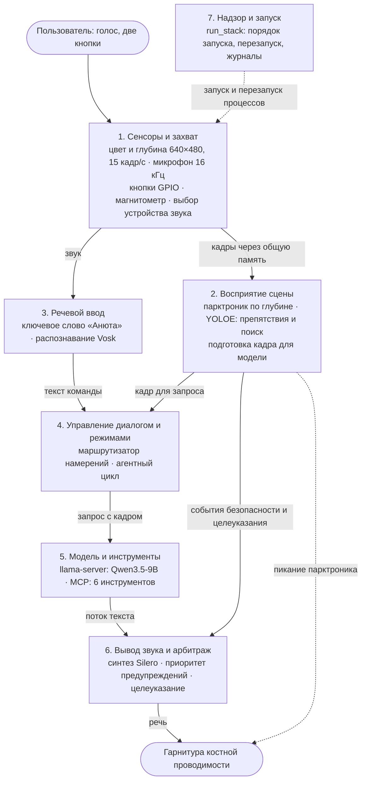
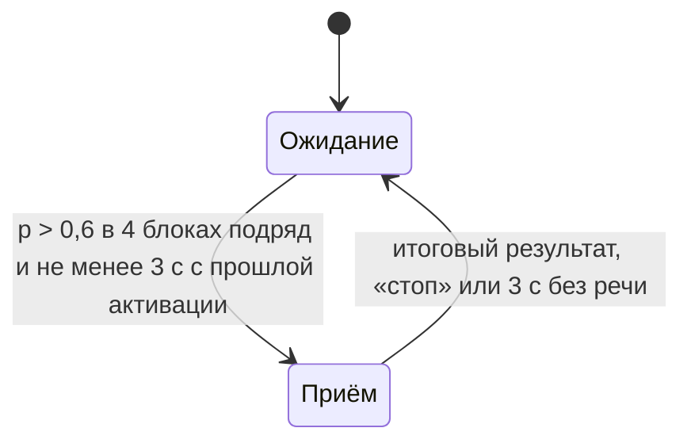
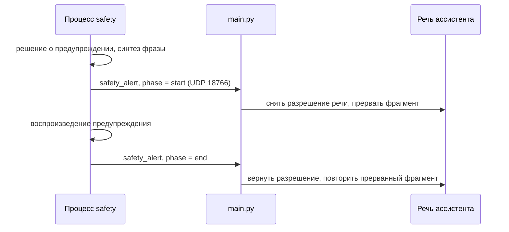

УТВЕРЖДЁН
12209-12209-13-ЛУ

---

# АПК «ИИ-поводырь». Описание программы

**Обозначение:** 12209-12209-13 (код вида «13» по ГОСТ 19.101-77).
**Наименование изделия:** программное обеспечение аппаратно-программного комплекса «Интеллектуальная система помощи слепым и слабовидящим “ИИ-поводырь”», редакция дополнительного опытного образца 2026 года (далее — программа).
**Стандарт:** ГОСТ 19.402-78 «ЕСПД. Описание программы».
**Основание:** техническое задание — приложение № 2 к договору № ГС 99-2026 от 26.06.2026, пп. 4.5 и 5.1.
**Дата:** 2026-11-20. **Редакция 1.**
**Листов:** документ выполнен в электронной форме.

---

## О НАСТОЯЩЕЙ РЕДАКЦИИ

Документ содержит все разделы, предусмотренные ГОСТ 19.402-78. Раздел 3 открывается послойной моделью программы. В ней семь слоёв обработки данных; для каждого названы модули и объёмы, описан путь событий через слои и перечислены правила взаимодействия слоёв с указанием, как каждое проверено.

**Описываемая редакция исходного текста.** Описан каталог `code/`: 42 файла на языке Python, 16 786 строк. Каталог не находится под управлением системы версий, поэтому идентификатора коммита у редакции нет. Её идентифицирует контрольная сумма набора SHA-256 `e2162f1815dd92d334e81ba48ad6f9434760a269519e9d07911c0c1b2830d16f`; способ получения — приложение А, п. А.1. Любая правка любого файла меняет сумму: описание относится только к набору с этой суммой. Опись файлов набора — строки, байты, сумма каждого файла, назначение — приведена в документе «Текст программы» 12209-12209-12.

**Способ получения сведений.** Все сведения — состав процессов и модулей, параметры, форматы обмена, алгоритмы — установлены по исходному тексту, а не по проектной документации. Утверждения сопровождаются ссылками вида `файл:строка` относительно каталога `code/`. Места, где исходный текст расходится с техническим заданием, руководством пользователя или описанием этапа 2025 года, собраны в приложении Б.

**Чего в документе нет.** Измеренных характеристик: задержек, точности, автономности. Они устанавливаются испытаниями по программе и методике испытаний и фиксируются в протоколе. Значения, вычисленные по константам исходного текста, всюду помечены словом «расчётное».

**Состояние проверки.** Объёмные показатели получены командами приложения А 19.11.2026. Ссылки на строки сняты с описываемой редакции. Независимая проверка документа не проводилась.

---

## 1. ОБЩИЕ СВЕДЕНИЯ

### 1.1. Обозначение и наименование программы

Полное наименование — «Программное обеспечение аппаратно-программного комплекса «Интеллектуальная система помощи слепым и слабовидящим “ИИ-поводырь”»». Краткое — ПО АПК «ИИ-поводырь». Обозначение документа — 12209-12209-13. Редакция программы идентифицируется контрольной суммой набора исходного текста.

### 1.2. Состав программы и предмет документа

Программа исполняется как шесть процессов, которые запускает и контролирует сценарий `run_stack.py`, и служба маршрутизации звука, запускаемая отдельно.

| № | Процесс | Точка входа | Назначение | Поведение при отказе |
|---|---|---|---|---|
| 1 | camera | `camera_server.py` | единственный владелец камеры: захват цвета и глубины, публикация в общую память; расчёт курса по магнитометру | перезапуск с задержкой `min(30, 2^n)` с; при смене процесса камеры перезапускаются процессы 4 и 5 (`optional_components.py:21–45`) |
| 2 | llama | внешняя программа `llama-server` (llama.cpp) | визуально-языковая модель по протоколу HTTP, порт 8080 | останов всей программы (`run_stack.py:313–315`) |
| 3 | mcp | `all_mcp_server.py` | шесть инструментов модели по протоколу MCP, порт 8000 | останов всей программы |
| 4 | safety | `safety/yoloe_safety.py` | голосовые предупреждения о препятствиях детектором YOLOE | перезапуск, как у процесса 1 |
| 5 | finder | `yoloe_finder.py` | детектор поиска предмета по названию | перезапуск, как у процесса 1 |
| 6 | main | `main.py` | диалог, режимы, синтез речи, парктроник | завершение `main.py` завершает программу (`run_stack.py:311–336`) |
| 7 | audio-router (служба) | `audio_router.py` | выбор устройства звука (предпочтительно гарнитура Shokz), состояние в `runtime/audio_route.json` | запускается вне `run_stack.py`; собственный цикл повторов (`audio_router.py:92–108`) |

*Таблица 1 — Процессы программы*

Предмет документа — 35 модулей, достижимых по импортам из точек входа таблицы 1 (контур программы). Ещё 7 модулей входят в каталог, но не импортируются ни одним модулем контура (п. 1.5).

### 1.3. Программное обеспечение, необходимое для функционирования

| Компонент | Назначение | Где задан | В поставке |
|---|---|---|---|
| ОС семейства Linux с файловой системой `/dev/shm`, звуковым сервером PulseAudio (`pactl`, `paplay`) и библиотекой `libasound` | общая память, вывод речи, маршрутизация звука | `camera_health.py:9`, `pulse_playback.py:67–72`, `audio_router.py:33–36`, `tts_model.py:23` | нет (окружение) |
| Интерпретатор Python 3.10 | исполнение программы | пояснение `pulse_playback.py:75–77` | нет |
| `llama-server` из llama.cpp | сервер модели | `/home/jetson_agx_orin/llama.cpp/build/bin/llama-server` (`run_stack.py:25`) | нет |
| Пакеты Python: torch, torchaudio, numpy, opencv (`cv2`), pyrealsense2, ultralytics, vosk, sounddevice, pygame, librosa, Pillow, requests, mcp, smbus2, модуль `RPi.GPIO` (на вычислителе — совместимая реализация) | см. раздел 3 | импорты модулей контура (приложение А, п. А.4) | нет; версии не зафиксированы, кроме указания `ultralytics==8.4.107` (`safety/yoloe_demo.py:38–43`) |

*Таблица 2 — Необходимое программное обеспечение*

| Модель или ресурс | Файл | Где задан | В поставке |
|---|---|---|---|
| Визуально-языковая модель (профиль по умолчанию `qwen`) | `GGUF/qwen3/Qwen3.5-9B-Q4_K_M.gguf` и проектор изображений `mmproj-Qwen_Qwen3.5-9B-f16.gguf` | `run_stack.py:41–44`, `:81` | нет |
| Запасные профили `3b`, `8b`, `14b` | `Ministral-3-{3B,8B,14B}-Instruct-2512-Q4_K_M.gguf` с проектором BF16 | `run_stack.py:29–40` | нет |
| Детектор системы безопасности | `safety/yoloe-26s-seg.pt` (запасной `yoloe-26n-seg.pt`) | `run_stack.py:47–50`, `:82` | нет |
| Детектор поиска предмета | `safety/yoloe-26n-seg.pt` | `run_stack.py:52` | нет |
| Текстовый кодировщик подсказок детектора (MobileCLIP), кэш векторов | `safety/.cache/` | `run_stack.py:186`, `safety/yoloe_demo.py:132–235` | нет |
| Распознавание речи | `vosk-model-small-ru-0.22` | `stt.py:38` | нет |
| Детектор ключевого слова | `models/tcn_two_claude_best_8_best_far.pth` | `stt.py:39` | нет |
| Синтез речи | `silero_v3_ru/v5_ru.pt` (Silero v5, голос `xenia`) | `tts_model.py:30–35`, `safety/safety_sys.py:35–39` | нет |
| Звуки начала и конца ответа, начала и конца приёма команды | `sounds/1.mp3`, `sounds/2.mp3`, `sounds/start_recognize.mp3`, `sounds/stop_recognize.mp3` | `main.py:87–88`, `stt.py:40–41` | нет |
| Скорость речи пользователя | `important_data_files/tts_spped.json` (при отсутствии — 1,5) | `speed_state.py:3–17` | нет |

*Таблица 3 — Модели и ресурсы*

Пути к моделям `llama-server`, Vosk и Silero заданы абсолютно в каталоге пользователя `jetson_agx_orin`. Перенос программы на другой вычислитель требует правки исходного текста.

### 1.4. Языки программирования

Программа написана на языке Python: 42 файла, 16 786 строк, все файлы набора (приложение А, п. А.2; поимённо — «Текст программы» 12209-12209-12). Сервер модели `llama-server` написан на C/C++, входит в окружение и в набор не включён. Сценариев на других языках, файлов конфигурации и описаний зависимостей в каталоге нет (`find code -type f ! -name '*.py' | wc -l` даёт 0).

### 1.5. Модули, не входящие в контур программы

| Модуль | Строк | Что делает | Признак |
|---|---|---|---|
| `face_recognition_logic.py` | 315 | распознавание знакомых лиц (insightface, `buffalo_l`), база векторов лиц | не импортируется; глубину делит на 1000 вместо опубликованного масштаба (`:181`, `:267`) |
| `send_to_sam3.py` | 512 | клиент удалённой сегментации SAM3 по WebSocket, сервер `ws://100.107.15.63:8765` | импортируется только модулем `sam3_target.py` |
| `sam3_target.py` | 224 | консольное наведение на предмет стереосигналами по результатам SAM3 | не импортируется |
| `audio_out.py` | 112 | постоянный звуковой поток для коротких сигналов | импортируется только модулем `sam3_target.py` |
| `visual_memory.py` | 104 | память сцен на векторах CLIP с поиском по русскому запросу | не импортируется |
| `memory_manager.py` | 151 | долговременная память фактов о пользователе (инструменты MCP) | не импортируется; в `all_mcp_server.py` не подключена |
| `guidance_audio.py` | 51 | тональные стереосигналы целеуказания для поиска предмета | не импортируется; поиск использует речь (`object_finder.py:1`) |

*Таблица 4 — Модули вне контура (7 модулей, 1 469 строк)*

Модули сохранены в каталоге как заготовки и следы отвергнутых вариантов. Удалённая сегментация противоречит требованию локальной работы ТЗ. Функции распознавания лиц и памяти техническим заданием 2026 года не предусмотрены.

---

## 2. ФУНКЦИОНАЛЬНОЕ НАЗНАЧЕНИЕ

### 2.1. Классы решаемых задач

| № | Задача | Как вызывается | Результат для пользователя | Пункт |
|---|---|---|---|---|
| 1 | Краткое описание сцены | основная кнопка (GPIO 16) либо фраза «опиши коротко», «кратко опиши», «краткое описание», «что передо мной», «что впереди» | не более двух предложений и 25 слов о главном впереди, затем слева и справа | 3.3 |
| 2 | Подробное описание | «опиши подробно», «подробно опиши», «подробное описание», «расскажи подробно» | последовательное описание: опасности, проходы, объекты, люди, ориентиры, заметный текст | 3.3 |
| 3 | Чтение текста | «режим чтения», «прочитай», «прочти», «что написано» | видимый текст подряд; «Текст не найден» или «Текст не разборчив» | 3.3 |
| 4 | Вопрос по сцене или общего характера | любая фраза, не подпавшая под шаблоны | ответ модели с кадром и правом вызвать инструменты | 3.4 |
| 5 | Поиск предмета по названию | «найди…», «найти…», «поищи…», «отыщи…», «помоги найти…» | фразы «Предмет левее, около двух метров» и т. п. | 3.9 |
| 6 | Звуковое предупреждение о препятствии в центре кадра (парктроник) | работает всегда; звук включается и выключается кнопкой GPIO 32 | короткие тональные сигналы, частота и интервал зависят от расстояния | 3.6 |
| 7 | Голосовые предупреждения о препятствиях (система безопасности YOLOE) | включается фразой с «включи» и словами «систему безопасности», «обнаружение препятствий» и др. | «Осторожно, впереди лестница, расстояние один метр» | 3.7 |
| 8 | Управление | «стоп» и ещё семь шаблонов; скорость речи; состояние системы безопасности; «что ты умеешь» | прерывание ответа и поиска; подтверждения | 3.3 |
| 9 | Самоконтроль готовности | при запуске | «Система готова.»; сообщения о недоступности камеры, микрофона, зрительных модулей | 3.10 |

*Таблица 5 — Задачи программы*

### 2.2. Функциональные ограничения на применение

1. **Режим — свойство отдельного запроса.** Программа не хранит «текущий режим». Каждая фраза разбирается заново; основная кнопка всегда запрашивает краткое описание (`main.py:207–211`, `intent_router.py:126–127`).
2. **Угол кадра.** Для кнопки кадр обрезается по горизонтали до 40° по внутренним параметрам камеры (`vision_input.py:14`, `:17–37`); голосовые запросы получают полный кадр. Рабочих углов 50° и 70° программа не формирует.
3. **Порядок зон** в описании задаётся подсказкой модели — «прямо впереди, затем слева и справа» (`intent_router.py:62–63`, `:70–71`). Программа его не проверяет. Отдельного сообщения о пустой зоне подсказка не требует.
4. **Ответы на вопросы — краткие по умолчанию.** Системная подсказка требует отвечать «кратко» (`main.py:55–56`), предел ответа — 200 токенов (`main.py:240`). Команд переключения подробности ответов, повтора распознанного вопроса и подтверждения кнопкой нет.
5. **Чтение выполняет визуально-языковая модель** по одному кадру — лучшему по резкости из трёх (`vision_input.py:46–54`). Отдельного движка распознавания текста нет; ответ ограничен 768 токенами (`main.py:242`).
6. **Произносится только кириллица.** Перед синтезом из текста удаляется всё, кроме русских букв и пробелов. Числа предварительно переводятся в слова; латинские названия и обозначения не произносятся (`tts_model.py:291–297`).
7. **Парктроник видит только центральное окно** 80 × 80 пикселей кадра глубины 640 × 480, то есть 12,5 % ширины и 16,7 % высоты кадра (`depth.py:27–28`, `:76–84`). Если достоверных отсчётов меньше 80, сигнала нет — так же, как при свободном пути (`depth.py:90–94`, `:135–136`). Сигнал одинаков в левом и правом каналах (`depth.py:131`).
8. **Система безопасности YOLOE после запуска выключена** (`safety/yoloe_safety.py:2935–2944`). Она различает 51 класс препятствий в 9 профилях опасности, стороны — по углу ±8° от оси камеры, расстояние до 6,0 м. Расстояние — глубина по оси камеры, а не наклонная дальность. Предупреждение, не успевшее начаться за 1,3 с (срочное) или за 2,2 с (прочее), отбрасывается.
9. **Поиск** ведётся по одному предмету. Перевод названия на английский выполняет модель за время до 25 с; через 90 с без обнаружения поиск прекращается (`object_query.py:90`, `object_finder.py:11`, `:97–104`).
10. **Распознавание речи** — малая русская модель Vosk; голосовой интерфейс только на русском языке.

### 2.3. Условия, при которых применение программы не рекомендуется

* В качестве единственного средства обеспечения безопасности передвижения. Программа дополняет трость и сопровождающего, но не заменяет их (руководство пользователя, разд. 3.2).
* При ярком солнце, дожде, тумане, резких движениях камеры, сильном шуме, разрывах беспроводного звукового канала. Эти факторы ТЗ называет ухудшающими (п. 4.4); программа их не обнаруживает и пользователя о них не извещает.
* Для решений о переходе проезжей части, движении по лестнице, о дозировках и суммах в прочитанных документах.
* При отключённом кнопкой парктронике и выключенной системе безопасности, если пользователь рассчитывает на предупреждения. Отключение парктроника кнопкой звуком не подтверждается (`depth.py:44–50`).

---

## 3. ОПИСАНИЕ ЛОГИЧЕСКОЙ СТРУКТУРЫ

Раздел содержит сведения, предусмотренные п. 2.4 ГОСТ 19.402-78: структуру программы с описанием функций составных частей и связей между ними, алгоритмы и связи с другими программами. Открывает раздел послойная модель — обзор, который связывает подразделы 3.1–3.11.

### Послойная модель программы

Модель показывает состав программы в разрезе обработки данных: семь слоёв, через которые событие проходит от датчика до гарнитуры пользователя. Каждый модуль контура отнесён ровно к одному слою по его основной функции. Модуль `depth.py` отнесён к слою восприятия, хотя сам же формирует звук парктроника, минуя слой 6; это показано на рисунке отдельной стрелкой.



*Рисунок 1 — Послойная модель программы*

| Слой | Что делает | Модули | Файлов · строк | Подробно |
|---|---|---|---|---|
| **1. Сенсоры и захват** | Единственный владелец камеры публикует цвет, глубину, внутренние параметры и метку времени кадра в общую память; рассчитывает курс по магнитометру с компенсацией наклона. Читаются две кнопки. Служба звука выбирает гарнитуру и сообщает, доступны ли выход и микрофон | `camera_server.py`, `compass.py`, `camera_health.py`, `button.py`, `audio_router.py` | 5 · 1 511 | 3.1, 4 |
| **2. Восприятие сцены** | Парктроник оценивает расстояние в центре кадра. Система безопасности выделяет препятствия детектором YOLOE, измеряет расстояние по маске и глубине, ведёт треки и решает, о чём предупреждать. Детектор поиска находит и сопровождает предмет. Кадр для модели готовится с обрезкой и отбором по резкости | `safety/yoloe_safety.py`, `safety/safety_sys.py`, `safety/yoloe_demo.py`, `depth.py`, `yoloe_finder.py`, `finder_tracking.py`, `finder_vocabulary.py`, `finder_shm.py`, `vision_input.py` | 9 · 9 810 | 3.6, 3.7, 3.9 |
| **3. Речевой ввод** | Детектор ключевого слова слушает микрофон постоянно; после «Анюта» звук идёт в распознаватель команд до конца фразы | `keyword_spotting.py`, `stt.py` | 2 · 409 | 3.2 |
| **4. Управление диалогом и режимами** | Разбирает фразу или нажатие кнопки на намерение; служебные действия исполняет без модели; для остальных собирает запрос с кадром и ведёт агентный цикл; объявляет готовность | `main.py`, `intent_router.py`, `llm_agent.py`, `search_command.py`, `startup_ready.py` | 5 · 1 239 | 3.3, 3.4, 3.10 |
| **5. Модель и инструменты** | Потоковый клиент сервера модели; сервер инструментов MCP: поиск предмета с переводом названия, скорость речи, управление системой безопасности. Сервер модели `llama-server` — внешняя программа, в набор не входит | `llm_client.py`, `all_mcp_server.py`, `object_finder.py`, `object_query.py`, `finder_results.py`, `speed_state.py` | 6 · 910 | 3.4, 3.9 |
| **6. Вывод звука и арбитраж** | Потоковый синтез речи с воспроизведением через PulseAudio; пауза и возобновление речи на время предупреждения; голосовое целеуказание с уступкой основному ответу; каналы событий безопасности и целеуказания | `tts_model.py`, `pulse_playback.py`, `spoken_guidance.py`, `safety/safety_events.py`, `guidance_events.py` | 5 · 998 | 3.5, 3.8 |
| **7. Надзор и запуск** | Запускает процессы в установленном порядке, ждёт готовности модели и инструментов, перезапускает необязательные процессы, пишет журналы; цветной журнал с метками времени | `run_stack.py`, `optional_components.py`, `logger.py` | 3 · 440 | 3.10, 5 |
| Вне контура | Заготовки и отвергнутые варианты (п. 1.5) | 7 модулей | 7 · 1 469 | 1.5 |

*Таблица 6 — Слои программы*

В контуре 35 модулей, 15 317 строк; всего в наборе 42 файла, 16 786 строк. Объёмы получены командой `wc -l` по перечню модулей каждого слоя (приложение А, п. А.3). В них входят две закомментированные прежние редакции модулей: `camera_server.py:1–312` и `llm_client.py:1–243`, всего 555 строк. Перечень модулей по слоям сверяется с диском проверкой приложения А, п. А.3. Она не проходит, если модуль не назван, назван дважды или назван, но отсутствует.

#### Путь событий через слои

**Голосовой запрос «Анюта… прочитай».**

1. Слой 3: вероятность ключевого слова превысила 0,6 в четырёх блоках подряд по 64 мс — звучит сигнал начала приёма, звук микрофона пошёл в распознаватель (п. 3.2).
2. Распознаватель вернул фразу «прочитай» — она поступает в общую очередь слоя 4 наравне с нажатием кнопки и вводом с терминала.
3. Слой 4: идущий ответ прерывается. Маршрутизатор относит фразу к намерению «чтение» (п. 3.3).
4. Слой 2: из трёх свежих кадров берётся самый резкий и кодируется в JPEG.
5. Слой 5: запрос уходит модели в изолированном контексте без истории диалога, с температурой 0 и пределом 768 токенов (п. 3.4).
6. Слой 6: текст по мере поступления режется на фрагменты по знакам препинания, синтезируется и воспроизводится; следующий фрагмент синтезируется, пока звучит предыдущий (п. 3.5). Ответ обрамлён короткими звуками начала и конца.

**Препятствие в центре кадра (парктроник).** Слой 1 публикует новый кадр глубины. Слой 2 (`depth.py`) берёт 15-й процентиль достоверных отсчётов центрального окна и кладёт расстояние в очередь звука. Если с прошлого сигнала прошло больше интервала для этого расстояния, звучит тональный сигнал — через собственный микшер `pygame`, без слоя 6 (п. 3.6).

**Препятствие, распознанное детектором (система безопасности).** Слой 2: детектор YOLOE выделил маску, по глубине внутри маски вычислено расстояние, трек подтверждён, правила профиля требуют предупреждения. Фраза синтезируется в процессе safety, и перед воспроизведением слой 6 получает событие «начало». Вся речь ассистента и целеуказание ставятся на паузу; после события «конец» прерванный фрагмент ответа звучит заново (пп. 3.7, 3.8).

**Поиск «найди синюю кружку».** Слой 4 исполняет поиск без участия модели в выборе действия: вызывает инструмент `find_object`. Слой 5 переводит название моделью в запрос «blue mug» и передаёт его детектору поиска через общую память. Слой 2 находит и сопровождает предмет; слой 5 пять раз в секунду публикует направление и расстояние; слой 6 произносит «Предмет левее, около двух метров», уступая основному ответу и предупреждениям (п. 3.9).

#### Правила взаимодействия слоёв

| Правило | Состояние | Как проверено |
|---|---|---|
| Камеру открывает только процесс камеры; остальные читают общую память | соблюдается в контуре | `grep -rln "import pyrealsense2" code` — два модуля: `camera_server.py` и `safety/safety_sys.py`. Во втором устройство открывает только функция `main()` (`safety/safety_sys.py:346–437`), которая не запускается; в контуре модуль даёт чтение общей памяти (`:147–343`) |
| Звук микрофона поступает в распознаватель команд только после ключевого слова | соблюдается | `stt.py:218–222`: блок кладётся в очередь распознавателя лишь в состоянии приёма; детектор ключевого слова получает звук всегда (`:213–216`) |
| Модель и инструменты вызываются только по локальному адресу | соблюдается для клиентов, **нарушено для сервера модели** | клиенты: `run_stack.py:187–189`, `main.py:51`; сервер модели принимает соединения на всех интерфейсах — `--host 0.0.0.0` (`run_stack.py:263`) |
| Межпроцессные события ходят только через 127.0.0.1 | соблюдается | `safety/safety_events.py:16`, `guidance_events.py:29`, `:48` |
| Внешних сетевых адресов в контуре нет | соблюдается | `grep -rnE 'https?://\|wss?://' --include='*.py' code` без локальных адресов даёт строки только в закомментированной части `llm_client.py` и в модулях вне контура (`send_to_sam3.py`, `sam3_target.py`) |
| Предупреждение системы безопасности приостанавливает всю речь ассистента и целеуказание | соблюдается, с двумя оговорками п. 3.8 | `main.py:264–306`, `tts_model.py:264–281`, `spoken_guidance.py:156–157` |
| Парктроник не зависит от модели и детекторов | соблюдается по данным, **не соблюдается по процессу** | `depth.py` читает только глубину; но объект парктроника создаётся в процессе `main.py` (`main.py:250`) и прекращает работу вместе с ним |
| Новый запрос прерывает текущий ответ | соблюдается | `main.py:369–372` |
| Каждый модуль контура назван в модели ровно один раз | соблюдается | проверка приложения А, п. А.3 |

*Таблица 7 — Правила взаимодействия слоёв*

### 3.1. Захват изображения и глубины

Процесс камеры — единственный, кто открывает устройство Intel RealSense. В комментариях исходного текста названа модель D455 (`compass.py:39`, `safety/yoloe_demo.py:3`). Действующая часть модуля — `camera_server.py:314–1164`; строки 1–312 занимает закомментированная прежняя редакция.

**Потоки.** Цвет `bgr8` и глубина `z16`, оба 640 × 480 при 15 кадрах в секунду (`camera_server.py:353–354`, `:561–562`). Глубина совмещается с цветом (`rs.align(rs.stream.color)`, `:567`, `:724`). Публикуются внутренние параметры цветового потока (`:618–627`) и масштаб глубины, прочитанный с устройства (`:615`). Фильтры постобработки глубины не применяются. Излучатель, экспозиция и предустановки остаются по умолчанию устройства. Прогрев — 5 кадров, до 3 попыток, ожидание 4 000 мс (`:636–651`).

**Общая память.**

| Сегмент | Содержимое | Байт |
|---|---|---|
| `rs_color` | цвет, BGR, 480 × 640 × 3, uint8 | 921 600 |
| `rs_depth` | глубина, сырые значения, 480 × 640, uint16 | 614 400 |
| `rs_depth_scale` | масштаб глубины, м на единицу, float64 | 8 |
| `rs_lock` | признак записи, 1 — идёт запись | 1 |
| `rs_color_intrinsics` | 6 × float64: w, h, fx, fy, ppx, ppy | 48 |
| `rs_frame_meta` | 2 × uint64: номер кадра, время публикации `monotonic_ns` | 16 |
| `compass_heading`, `compass_mag_xyz`, `compass_accel_xyz`, `compass_meta` | курс; магнитное поле; ускорение; номер и время | 8; 24; 24; 16 |
| `rs_display_<имя>` | кадр отладочного окна клиента, BGR | 921 600 |

*Таблица 8 — Сегменты общей памяти процесса камеры*

**Запись кадра.** Признак записи выставляется, кадры копируются, номер кадра увеличивается, записывается время `time.monotonic_ns()` хоста, признак снимается (`camera_server.py:735–743`). Аппаратные метки времени камеры не используются. Межпроцессной блокировки нет. Читатель `CameraClient` проверяет признак только перед копированием (`:1052–1058`), читатель системы безопасности — и после (`safety/safety_sys.py:291–303`). Ни один из двух способов не исключает чтения кадра, записанного наполовину.

**Свежесть и восстановление.** Камера считается готовой, если номер кадра больше нуля, а кадру меньше 2,0 с (`camera_health.py:7–12`). Ожидание кадра — 2 000 мс; после четырёх неудач подряд конвейер камеры перезапускается, попытки — раз в 1,0 с в течение 30 с (`camera_server.py:665–767`). Второй экземпляр процесса не запускается, если первый жив и его кадры моложе 10 с; иначе прежний процесс завершается, а его сегменты удаляются (`:402`, `:419`, `:450`, `:472–510`).

**Курс.** Акселерометр блока движения камеры (100 Гц) и магнитометр IST8310 на шине I2C 1, адрес 0x0C, дают курс с компенсацией наклона. Курс пересчитывается каждые 0,05 с со сглаживанием по 10 отсчётам; склонение 9,4°, поправка на разворот датчика 180° (`compass.py:21`, `:29–52`; `camera_server.py:351`, `:770–818`). Гироскоп не используется. Курс читает только система безопасности — для обнаружения смены сцены (п. 3.7).

**Отладочные окна** открываются, если задана переменная `DISPLAY` (`camera_server.py:549`, `:869–929`).

### 3.2. Речевой ввод

**Захват звука.** Поток с микрофона: 16 кГц, моно, 16 бит, блоками по 1 024 отсчёта — 64 мс (`stt.py:308–310`). Доступность микрофона берётся из файла состояния службы звука, если ему меньше 5 с (`stt.py:328–336`). При потере устройства поток открывается заново раз в секунду (`stt.py:301–322`).

**Ключевое слово.** Каждый блок дописывается в скользящий буфер длительностью 1 с (`stt.py:104`, `:156–159`). Для буфера строится логарифмическая мел-спектрограмма: 40 полос, окно 400 отсчётов (25 мс), шаг 160 (10 мс) (`stt.py:124–127`, `keyword_spotting.py:67–70`). Её разбирает временная свёрточная сеть: четыре причинных блока с расширением 1, 2, 4, 8, по 64 канала, ядро 3, на выходе среднее и максимум по времени и линейный слой на два класса (`keyword_spotting.py:8–65`). Вероятность класса «Анюта» — сигмоида первого выхода (`stt.py:161–167`). Для детектора выделено два потока вычислений (`stt.py:16–32`).

**Правило активации.** В состоянии ожидания, если с прошлой активации прошло не менее 3 с, вероятность больше 0,6 должна держаться четыре блока подряд (`stt.py:238–253`). Тогда звучит сигнал начала приёма и включается приём команды. Расчётная задержка подтверждения — не меньше 4 × 64 = 256 мс от первого блока выше порога.

**Распознавание команды.** Распознаватель Vosk (модель `vosk-model-small-ru-0.22`, 16 кГц) получает звук только в состоянии приёма. Итоговый результат приводится к нижнему регистру. Если в нём есть «стоп», формируется команда остановки, иначе текст передаётся в очередь команд. Приём завершается после итогового результата либо через 3 с без промежуточных результатов; во втором случае звучит сигнал конца приёма (`stt.py:257–287`).



*Рисунок 2 — Состояния речевого ввода*

### 3.3. Маршрутизация намерений и ассистивные режимы

Фраза приводится к нижнему регистру, «ё» заменяется на «е», пробелы сжимаются (`intent_router.py:114–115`). Затем проверяется по порядку, первое совпадение определяет маршрут (`intent_router.py:122–301`).

| № | Условие | Намерение | Кадр | Исполнение |
|---|---|---|---|---|
| 1 | нажатие основной кнопки (служебная строка `/mode button`) | краткое описание | обрезка до 40° | модель, предел 64 токена, без инструментов |
| 2 | `/mode brief`, `/mode detailed`, `/mode read` с терминала | краткое, подробное описание, чтение | полный | как в строках 9–11 |
| 3 | «стоп», «хватит», «прекрати», «замолчи», «отмени», «останови(сь)», «нашёл», «всё, спасибо» (8 шаблонов) | остановка | нет | без модели: прерывание ответа и поиска |
| 4 | «(пожалуйста) найди / найти / поищи / отыщи / помоги найти <название>» | поиск предмета | нет | без модели в выборе действия: инструмент `find_object` |
| 5 | «что ты умеешь», «твои возможности» и др. | справка | нет | готовый текст `CAPABILITIES_TEXT` |
| 6 | упоминание системы безопасности с «выключи / включи / работает ли…» | вкл., выкл., состояние | нет | без модели: канал управления системой безопасности |
| 7 | «медленнее / быстрее» вместе с «говори / читай / речь» | скорость речи | нет | без модели: инструмент `tts_set_speed`, шаг ±0,2 |
| 8 | «скорость речи», «как быстро ты говоришь» | запрос скорости | нет | модель с обязательным вызовом `tts_get_speed` |
| 9 | «режим чтения», «прочитай», «прочти», «что написано» | чтение | лучший из трёх | модель в изолированном контексте, 768 токенов, температура 0 |
| 10 | «опиши подробно», «подробно опиши», «подробное описание», «расскажи подробно» | подробное описание | полный | модель, 200 токенов, без инструментов |
| 11 | «опиши коротко», «кратко опиши», «краткое описание», «что передо мной», «что впереди» | краткое описание | полный | модель, 64 токена, без инструментов |
| 12 | всё остальное | вопрос | полный | модель, 200 токенов, 6 инструментов |

*Таблица 9 — Маршруты*

**Подсказки режимов** (`intent_router.py:60–99`). Краткое описание — «сначала главное прямо впереди, затем важное слева и справа… не более двух предложений и двадцати пяти слов». Подробное — «сначала… опасности, проходы и главное прямо впереди, затем объекты слева и справа, людей, ориентиры и заметный текст; объясни взаимное расположение». Чтение — «прочитай только разборчивый текст… если текста нет — „Текст не найден“». Общая системная подсказка требует отвечать по-русски, кратко, сначала о безопасности, не выдумывать предметы, текст и точные расстояния (`main.py:54–67`).

**Переключение режимов** — это выбор маршрута для каждой фразы; состояния «текущий режим» нет. Режим чтения исполняется в изолированном контексте: своя системная подсказка, без общей истории, ответ в историю не пишется (`main.py:71–74`, `:494–502`). Поводом стал дефект, описанный в комментарии исходного текста: в общем контексте режим чтения подхватывал описания сцены из прошлых ходов.

**Недоступность камеры.** Для маршрутов, которым кадр обязателен, звучит «Камера временно недоступна.». Для вопроса модель получает указание не описывать невидимую сцену (`main.py:484–492`).

### 3.4. Агентный цикл и визуально-языковая модель

**Сервер модели.** `llama-server` запускается с параметрами `run_stack.py:254–278`.

| Параметр | Значение | Смысл |
|---|---|---|
| `--model`, `--mmproj` | `Qwen3.5-9B-Q4_K_M.gguf`, `mmproj-Qwen_Qwen3.5-9B-f16.gguf` | веса в 4-битном квантовании и проектор изображений |
| `--n-gpu-layers` | 99 | все слои на графическом ускорителе |
| `--reasoning` | off | без режима рассуждений |
| `--ctx-size`, `--parallel` | 8192, 1 | окно контекста, один запрос одновременно |
| `--threads`, `--threads-batch` | 4, 4 | потоки центрального процессора |
| `--batch-size`, `--ubatch-size` | 1024, 512 | размеры пакетов обработки подсказки |
| `--flash-attn` | on | ускоренное внимание |
| `--cache-type-k`, `--cache-type-v` | q8_0, q8_0 | кэш ключей и значений в 8 битах |
| `--mlock` | — | веса закреплены в памяти |
| `--spec-type` | ngram-simple | упрощённое спекулятивное декодирование по n-граммам |
| `--host`, `--port` | 0.0.0.0, 8080 | все интерфейсы (см. табл. 7) |
| `--alias` | ministral-local | имя модели в ответах сервера, сохранившееся от прежнего профиля |

*Таблица 10 — Параметры сервера модели*

Готовность сервера проверяется запросом `/health` раз в 0,5 с в течение 150 с (`run_stack.py:106–123`).

**Клиент.** Запросы идут в формате, совместимом с OpenAI, к `/v1/chat/completions` с потоковой выдачей (`llm_client.py:310–360`). Параметры по умолчанию: температура 0,15, `top_p` 0,90; ожидание соединения — 5 с, чтения — 300 с (`llm_client.py:261–280`). Пределы ответа по маршрутам — 64, 200 и 768 токенов, у перевода названия предмета — 96.

**Агентный цикл** (`llm_agent.py:93–233`). Не более трёх итераций. Если запросу переданы инструменты, текст итерации копится и отдаётся синтезу только по её окончании (`llm_agent.py:129`). Поэтому на вопрос (маршрут 12) речь начинается после того, как модель закончила ответ. Без инструментов (маршруты 1, 2, 9–11) текст уходит в синтез по мере генерации. Вызов недопустимого инструмента и некорректные параметры возвращаются модели как текст ошибки. После трёх итераций без ответа звучит «Не удалось завершить действие. Попробуйте повторить запрос.».

**Контекст.** Системная подсказка и последние два хода диалога (`main.py:52`, `:202`; `llm_agent.py:35–67`). Изображения из сохранённых ходов удаляются; незавершённый ход перед новым вопросом снимается, чтобы роли чередовались строго (`main.py:476–477`).

**Инструменты MCP** (`all_mcp_server.py`):

| Инструмент | Параметры | Действие |
|---|---|---|
| `tts_set_speed` | `delta` | изменить скорость речи в пределах 0,6–3,0 |
| `tts_get_speed` | — | сообщить скорость речи |
| `find_object` | `object_name` — название словами пользователя | перевести название и начать поиск |
| `stop_object_search` | — | остановить поиск |
| `safety_set_enabled` | `enabled` | включить или выключить систему безопасности; парктроник не затрагивается |
| `safety_get_enabled` | — | сообщить состояние системы безопасности |

*Таблица 11 — Инструменты модели*

**Кадр для модели** кодируется в JPEG с качеством 95 без прореживания цветности и передаётся как ссылка `data:` (`vision_input.py:13`, `:57–62`).

### 3.5. Синтез и воспроизведение речи

Синтез — модель Silero v5 для русского языка, голос `xenia`, 48 кГц, на графическом ускорителе при его наличии; при загрузке модель прогревается фразой «Тест» (`tts_model.py:30–35`, `:57–90`).

**Поток текста в речь** (`tts_model.py:119–217`). Поступающие фрагменты текста копятся. Накопленное отдаётся на синтез при первом знаке из `.!?,;:` либо, если набралось три слова, до последнего пробела. Перед синтезом числа переводятся в слова, затем удаляется всё, кроме кириллицы и пробелов (`tts_model.py:291–297`). Синтез идёт в отдельном потоке, пока звучит предыдущий фрагмент; два синтеза одновременно не исполняются (`tts_model.py:221–227`).

**Скорость** берётся из файла скорости пользователя (по умолчанию 1,5; пределы 0,6–3,0) и применяется растяжением по времени `librosa` (`tts_model.py:229–242`, `speed_state.py:3–17`). Фраза «Система готова.» произносится со скоростью 1,0 и с паузой 0,5 с в начале, чтобы включение выхода не съело первое слово (`startup_ready.py:63–66`).

**Воспроизведение** — программой `paplay`: моно, 32-битные отсчёты с плавающей точкой, задержка буфера 80 мс. Данные передаются через анонимный файл в памяти (`pulse_playback.py:62–114`). Прерывание завершает дочерний процесс воспроизведения (`pulse_playback.py:23–31`). Фрагмент, прерванный предупреждением, после снятия паузы звучит заново с начала (`tts_model.py:264–281`).

**Журнал.** Пишутся время до отправки первого фрагмента на синтез, время синтеза каждого фрагмента, общее время и число фрагментов (`tts_model.py:144–149`, `:197–207`, `:246–248`). Это моменты постановки в очередь и синтеза. Начала звучания журнал не фиксирует.

### 3.6. Парктроник

Парктроник реализует звуковое предупреждение п. 4.2.7 ТЗ — «пиканьем, как парктроник у машины, до расстояния в центре кадра». Модели не использует. Исполняется в процессе `main.py` двумя потоками: измерения и звука.

**Измерение** (`depth.py:62–110`). Поток ждёт новый кадр глубины, переводит сырые значения в метры умножением на масштаб и вырезает центральное окно 80 × 80 пикселей. Достоверными считаются конечные отсчёты от 0,15 до 10,0 м. Если их не меньше 80, расстояние — 15-й процентиль достоверных отсчётов: ближняя граница поверхности в окне, устойчивая к одиночным выбросам. Иначе расстояние полагается бесконечным. Значение кладётся в очередь на два места, где остаётся самое свежее. После обработки поток спит 1/15 с, так что частота измерений не превышает 15 в секунду. Фактическая частота не измерялась.

**Звук** (`depth.py:127–193`). Поток звука не реже чем раз в 0,05 с берёт свежее расстояние *d* и подаёт сигнал, если с прошлого сигнала прошло не меньше интервала *I(d)*:

* частота тона — 0,6 · (600 + 1600 · (1 − d/10)^1,8) Гц;
* интервал — *I(d)* = 0,07 + 1,13 · (min(d, 5)/5)^1,5 с;
* длительность — 80 мс при d ≤ 1,0 м, 50 мс при d ≤ 2,0 м, 35 мс при d ≤ 3,5 м, 30 мс дальше;
* огибающая затухает экспонентой exp(−6t); громкость — 0,18 · max(0,06; 0,9^(1,8·d));
* сигнал одинаков в левом и правом каналах; при d ≥ 10 м, в том числе при бесконечном расстоянии, сигнала нет.

Интервал вычисляется для нового расстояния. Поэтому появившееся близкое препятствие озвучивается не позже чем через *I(d)* после предыдущего сигнала, а не после интервала дальнего. Звук выводится через микшер `pygame`: 44,1 кГц, 16 бит, стерео, буфер 1 024 отсчёта, 4 канала (`depth.py:162–163`). Кнопка GPIO 32 включает и выключает звук парктроника. Переключение отмечается только в журнале, звукового подтверждения нет (`depth.py:44–50`).

| Расстояние, м | Частота, Гц | Интервал, с | Длительность, мс | Громкость, доля |
|---:|---:|---:|---:|---:|
| 0,4 | 1 252 | 0,096 | 80 | 0,93 |
| 1,0 | 1 154 | 0,171 | 80 | 0,83 |
| 1,5 | 1 077 | 0,256 | 50 | 0,75 |
| 2,0 | 1 002 | 0,356 | 50 | 0,68 |
| 3,0 | 865 | 0,595 | 35 | 0,57 |
| 4,0 | 743 | 0,879 | 30 | 0,47 |
| 5,0 | 636 | 1,200 | 30 | 0,39 |
| 6,0 | 544 | 1,200 | 30 | 0,32 |

*Таблица 12 — Звуковой код парктроника, расчётные значения по формулам `depth.py:127–158` (команда — приложение А, п. А.5)*

От 5 м интервал перестаёт меняться: расстояние от 5 до 10 м кодируется только частотой и громкостью. «Нет достоверных данных» и «нет препятствия» дают одно и то же — тишину.

### 3.7. Система безопасности (YOLOE)

Процесс `safety/yoloe_safety.py` пользуется библиотечными функциями модулей `safety/safety_sys.py` (чтение общей памяти, синтез речи, слова расстояния) и `safety/yoloe_demo.py` (словарь классов, расстояние по маске). Их собственные функции `main()` не запускаются.

**Включение.** Процесс стартует с выключенным детектором (`safety/yoloe_safety.py:2935–2944`). Включает и выключает его канал управления (п. 3.11) по голосовой команде или вызову инструмента. Пока детектор выключен, кадры не читаются, очередь речи очищается, треки сбрасываются (`safety/yoloe_safety.py:3039–3065`). Перезапущенный после отказа процесс снова выключен.

**Кадр.** Читается последний опубликованный кадр. Сырые значения глубины 0 и 65 535 считаются недостоверными, остальные переводятся в метры. Кадр старше 2,0 с — ошибка (`safety/safety_sys.py:269–321`).

**Детектор.** YOLOE, веса `yoloe-26s-seg.pt`. Параметры: размер входа 640, порог уверенности 0,18, порог перекрытия 0,55, до 20 объектов, вычисления в 32-битной точности, маски полного разрешения, подавление перекрытий без учёта класса (`safety/yoloe_safety.py:3099–3110`). Половинная точность выключена из-за ошибки постобработки масок в сборке PyTorch для Jetson (`safety/yoloe_safety.py:448–456`). Словарь — 51 текстовая подсказка на английском с русскими названиями для речи (`safety/yoloe_demo.py:59–129`). Векторы подсказок вычисляет текстовый кодировщик MobileCLIP; они кэшируются на диске (`safety/yoloe_demo.py:132–235`). Наблюдения без маски, с маской меньше 0,002 площади кадра и с физическим размером меньше 0,12 м отбрасываются (`safety/yoloe_safety.py:904–1032`).

**Расстояние по маске** (`safety/yoloe_demo.py:375–628`). Маска приводится к кадру глубины и, если в ней не меньше 250 пикселей, сужается на пиксель: так отсекается край, где цвет и глубина расходятся. Достоверные отсчёты — от 0,12 до 6,0 м. Если их меньше 12 или меньше 1 % площади маски, расстояние не определено. Отсчёты делятся на группы по разрывам глубины больше max(0,12 м; 6 %). Выбирается ближайшая группа, чья наибольшая связная область лежит в средней части рамки объекта. Если глубина принадлежит фону за объектом, расстояние не определено. Итог — 20-й процентиль выбранной группы, глубина по оси камеры. Скачок расстояния больше max(0,75 м; 0,45 · d) принимается после 7 согласованных измерений. Иначе расстояние сглаживается: 0,55 · d + 0,45 · медиана последних 24 значений (`safety/yoloe_safety.py:1416–1515`).

**Треки.** Наблюдения сопоставляются трекам жадно, по стоимости. В неё входят перекрытие рамок, смещение центра, отношение глубин и расстояние Бхаттачарьи между цветовыми гистограммами; принимается стоимость меньше 1,30. Положение рамки прогнозируется. Трек живёт 1,5 с без подтверждения. Новый трек того же класса на месте недавно утраченного (в пределах 4,0 с) наследует его отметки, чтобы не повторять предупреждение (`safety/yoloe_safety.py:1146–1369`). Устойчивая метка класса требует трёх голосов, смена — пяти подряд (`safety/yoloe_safety.py:1035–1143`).

**Сближение.** Скорость сближения считается по окну 1,35 с — не меньше 4 измерений за не меньше 0,35 с. Время до столкновения — d / скорость при скорости не меньше 0,30 м/с. «Приближается» — скорость не меньше 0,25 м/с и уменьшение расстояния не меньше 0,08 м за 0,90 с (`safety/yoloe_safety.py:1762–1901`). Собственное движение пользователя не компенсируется.

**Сторона** — по углу центра рамки к оси камеры: меньше −8° — «слева», больше +8° — «справа», иначе «впереди» (`safety/yoloe_safety.py:1690–1710`). Деления по высоте, плоскости пола и геометрического выделения низких и верхних препятствий нет. Верхние и низкие опасности распознаются только по классу.

| Группа | Классы | Зона предупреждения впереди / сбоку, м | Для приближающихся, м | Уровни повтора, м | «Осторожно» с, м | Предел TTC, с |
|---|---|---|---|---|---|---|
| моторный транспорт | автомобиль, грузовик, автобус, мотоцикл, погрузчик | 3,0 / 2,0 | 5,0 / 4,0 | 3,0; 1,5; 1,0; 0,8 | 0,8 | 2,0 |
| лёгкий транспорт | велосипед, электросамокат | 3,0 / 1,5 | 4,0 / 3,0 | 2,0; 1,0; 0,8 | 0,8 | 1,5 |
| медленные подвижные | человек, коляска инвалидная и детская, тележка, собака | 3,0 / 1,5 | — | 1,5; 0,8 | 0,8 | 1,5 |
| опасность падения | лестница, ступенька, эскалатор, бордюр, яма | 3,0 / 3,0 | — | 2,0; 1,2; 0,8 | 1,2 | — |
| проём в земле | открытый люк, траншея | 3,0 / 3,0 | — | 2,0; 1,5; 1,0; 0,8 | 2,0 | — |
| верхняя опасность | низко висящий объект, ветка, строительные леса, лестница-стремянка | 3,0 / 1,5 | — | 1,5; 1,0; 0,8 | 1,5 | — |
| крупные неподвижные | 15 классов: стул, диван, скамейка, стол, дверь, колонна, столбик, столб, забор, ограждение, дорожный конус, гидрант, мусорный бак, дерево, куст | 2,5 / 1,2 | — | 1,2; 0,8 | 0,8 | — |
| предметы на полу | 11 классов: картонная коробка, ведро, рюкзак, чемодан, зонт, кабель, шланг, бревно, камень, мусор, стройматериал | 2,0 / 1,0 | — | 1,0; 0,8 | 0,8 | — |
| опасная поверхность | лужа, сугроб | 2,0 / 1,0 | — | 1,0; 0,8 | 1,0 | — |

*Таблица 13 — Профили опасности (`safety/yoloe_safety.py:159–297`)*

**Решение о предупреждении** (`safety/yoloe_safety.py:2271–2626`). Трек должен иметь конечное расстояние, не меньше трёх попаданий и пяти согласованных измерений глубины. Он должен быть в зоне своего профиля — либо с риском столкновения (время до столкновения не больше предела профиля). Срабатывает ближайший впервые пересечённый уровень. Уровень снова взводится, когда объект отойдёт дальше уровня на 0,45 м. «Срочно» — расстояние не больше 0,80 м либо риск столкновения. Приоритет кандидатов:

1. расстояние не больше 0,80 м;
2. риск столкновения;
3. ближайший в пределах 1,50 м;
4. опасности падения, проёмы, верхние;
5. приближающиеся подвижные;
6. прочие.

Между любыми двумя сообщениями — не меньше 1,05 с, между несрочными — 6,0 с. Повтор по той же стороне допускается при обострении, приближении на 0,60 м или через 30 с.

**Сообщение.** «Осторожно, впереди лестница, расстояние один метр.» либо без «Осторожно» (`safety/yoloe_safety.py:1713–1747`). Расстояние произносится словами с шагом 0,1 м. Неопределённое — «расстояние неизвестно», от 6,0 м — «больше шести метров» (`safety/safety_sys.py:2232–2334`). Синтез — Silero v5, голос `xenia`, 48 кГц, на центральном процессоре, скорость 3,0 (`safety/safety_sys.py:43`, `:444–712`). Воспроизведение — через `sounddevice` на устройство по умолчанию. Очередь — 3 сообщения; срочное очищает очередь, но не обрывает звучащее. Повтор того же текста в течение 1,0 с отбрасывается. Сообщение, не начавшееся за 1,3 с (срочное) или 2,2 с (прочее) от постановки в очередь, отбрасывается. Отметки уровней ставятся при постановке в очередь, поэтому отброшенное не повторяется (`safety/safety_sys.py:798–908`; `safety/yoloe_safety.py:3267–3327`).

**Смена сцены по курсу.** Поворот не меньше 18°, устойчивый в пределах 2,5° в течение 0,35 с, при данных курса моложе 0,50 с, — новая сцена. Память сторон очищается, отсутствовавшие не меньше 0,25 с треки взводятся заново (`safety/yoloe_safety.py:1956–2071`).

**Отказы.** Ошибки чтения кадра пишутся в журнал не чаще раза в 5 с. После трёх ошибок общая память открывается заново раз в секунду в течение 5 с. Исключение в детекторе завершает процесс, его перезапускает надзор (п. 3.10). Запасного исполнения детектора на центральном процессоре нет (`safety/yoloe_safety.py:2850–2856`, `:3011–3097`).

**Журнал** `logs/safety.log`: частота обработки раз в 2 с; строка `ALERT` с треком, группой, причиной, расстоянием, скоростью сближения, временем до столкновения и фразой (`safety/yoloe_safety.py:3277–3297`, `:3329–3353`). Задержка «кадр → решение» и «кадр → звук» не измеряется и не пишется.

### 3.8. Арбитраж звукового канала

В гарнитуру звук приходит из трёх источников, по разным путям вывода:

1. речь ассистента и голосовое целеуказание — процесс `main.py`, программа `paplay`, звуковой сервер PulseAudio;
2. голосовые предупреждения системы безопасности — процесс safety, `sounddevice`, устройство по умолчанию;
3. сигналы парктроника и короткие звуки начала и конца ответа и приёма команды — процесс `main.py`, микшер `pygame`.

**Правило приоритета** (`main.py:264–306`). Событие «начало» предупреждения добавляет его идентификатор в набор активных и снимает разрешение речи. Речь ассистента и целеуказание прерываются. Событие «конец» удаляет идентификатор; когда набор пуст, разрешение восстанавливается, и прерванный фрагмент звучит заново (`tts_model.py:264–281`). Событие прежнего формата без фазы снимается само через max(0,3; длительность) + 0,5 с. Целеуказание уступает и основному ответу: начало ответа обрывает фразу целеуказания. Целеуказание ждёт, пока ответ кончится и разрешение речи восстановится; устаревшее больше чем на 0,9 с не произносится (`spoken_guidance.py:94–111`, `:151–179`). Парктроник в арбитраже не участвует: его сигналы смешиваются с речью звуковым сервером и речь не прерывают.



*Рисунок 3 — Приостановка речи ассистента на время предупреждения*

**Две оговорки, установленные по исходному тексту.**

* Событие «начало» отправляется непосредственно перед воспроизведением предупреждения (`safety/safety_sys.py:884–908`). Прерывание речи ассистента наступает после его приёма, поэтому начало предупреждения может кратко наложиться на речь.
* Срока у паузы нет. Если процесс safety завершится между событиями «начало» и «конец» — например, при перезапуске после смены процесса камеры, — речь ассистента останется на паузе до перезапуска `main.py`.

### 3.9. Поиск предмета по названию

**Запуск.** По фразе «найди…» слой управления сам вызывает инструмент `find_object` с ожиданием 15 с и произносит «Ищу <название>.» (`search_command.py:16–41`). Тот же инструмент может вызвать модель при других формулировках.

**Перевод названия** (`object_query.py:15–96`). Название на латинице передаётся как есть. Русское переводится моделью в короткое английское словосочетание по подсказке, требующей ответа `{"query": "…"}` (96 токенов, температура 0). Ответ проверяется: не длиннее 120 знаков и 16 слов. Перевод ждут до 25 с, последние 128 переводов кэшируются. Ожидание перевода (25 с) длиннее ожидания инструмента (15 с): при медленном переводе раньше срабатывает внешнее.

**Детектор** (`yoloe_finder.py`). Веса `yoloe-26n-seg.pt`; размер входа 768, порог уверенности 0,06, порог перекрытия 0,55, 32-битная точность. Целевая частота — 6 кадров в секунду; без запроса процесс только опрашивает запрос раз в 0,25 с (`yoloe_finder.py:72–74`, `:184–214`, `:268–278`, `:308–319`). Класс 0 — запрос. К нему добавляются конкурирующие классы из словаря системы безопасности, если их текстовые векторы далеки от запроса (косинус меньше 0,60) и не делят с ним слов. Рамка запроса подавляется, если её перекрывает (IoU ≥ 0,55) рамка конкурента с уверенностью выше на 0,05 и более (`finder_vocabulary.py:8–48`). Расстояние — медиана группы глубины в маске, до 8,0 м, при не меньше 25 достоверных отсчётах. Направление — угол atan2(cx − ppx, fx) (`yoloe_finder.py:358–362`, `:387–390`).

**Сопровождение** (`finder_tracking.py`). Ведётся один предмет. Захват — три кадра с уверенностью не меньше 0,10 с промежутками до 0,55 с. Тождество подтверждается по признаку внешнего вида: гистограммам цвета в пространстве LAB на образце 48 × 48, перекрытию маски и корреляции яркости. Пропуски детекций до 1,2 с перекрываются оптическим потоком Лукаса — Канаде с оценкой подобия методом RANSAC; расстояние в такие моменты не сообщается. Расстояние сглаживается медианой до пяти значений за 0,8 с с отбрасыванием скачков (`finder_tracking.py:12–16`, `:27–130`, `:149–211`, `:254–307`).

**Целеуказание** (`object_finder.py:52–112`, `spoken_guidance.py:11–70`). Пять раз в секунду публикуется состояние:

* «виден» — с направлением и расстоянием;
* «сопровождается» — оптическим потоком;
* «потерян» — через 2,0 с после последнего наблюдения, с указанием стороны;
* «ищу» — через 6 с, если предмет ещё не был виден;
* «не найден» — через 90 с после последнего наблюдения; поиск прекращается.

Фразы: «Предмет левее / правее / прямо перед вами, около двух метров». Сторона меняется при отклонении больше 9° и возвращается к «прямо» при отклонении меньше 5°. Расстояние называется с шагом 10 см до 1 м и 0,5 м до 8 м, дальше — «расстояние пока не определено». Между фразами — не меньше 2,5 с, та же фраза «виден» повторяется не раньше чем через 6,0 с.

**Остановка** — фразой остановки, словом «стоп» в распознавателе, новым поиском, вызовом инструмента, по ошибке либо по сроку.

**Журнал** детектора поиска раз в 5 с пишет частоту, число подтверждённых и перекрытых потоком наблюдений и задержку кадра от метки публикации (`yoloe_finder.py:397–403`).

### 3.10. Надзор, готовность и восстановление

**Запуск** (`run_stack.py:126–296`).

1. Проверка наличия файлов программы и моделей. Отказ, если порты 8080 или 8000 заняты: дубликаты не создаются.
2. Каталоги `logs/` и `runtime/`, переменные окружения (п. 5.4).
3. Процесс камеры → через 1 с сервер модели, готовность до 150 с → сервер инструментов, готовность порта до 120 с.
4. Процессы safety и finder — после появления свежих кадров.
5. `main.py`.

Раз в 0,5 с надзор перезапускает необязательные процессы, проверяет сервер модели и сервер инструментов и обновляет `runtime/stack_pids.json` (`run_stack.py:311–319`).

**Перезапуск** необязательных процессов (camera, safety, finder) — с задержкой min(30, 2^n) с, где n — число отказов подряд, не больше 5. Счётчик сбрасывается после 30 с работы. Смена процесса камеры перезапускает safety и finder (`optional_components.py:21–45`). Отказ сервера модели или сервера инструментов останавливает программу. Сообщение в журнале при этом гласит «restarting the stack», но перезапуска нет (`run_stack.py:313–315`). Завершение надзора завершает дочерние процессы по сигналу родителя (`run_stack.py:57–76`). Порядок остановки: main, safety, mcp, llama, camera, finder (`run_stack.py:327–336`).

**Готовность** (`startup_ready.py`, `main.py:344–360`). `main.py` ждёт микрофон до 3 с, затем до 30 с проверяет камеру, детектор поиска (идентификатор процесса в `runtime/finder_ready.json`) и ответ системы безопасности на запрос состояния. «Система готова.» произносится один раз за запуск. Если выход звука недоступен, попытка повторяется раз в 5 с. При неготовности камеры, микрофона или зрительных модулей звучат отдельные сообщения. Состояние системы безопасности — включена или выключена — при этом не объявляется.

### 3.11. Связи между процессами

| Канал | Транспорт и адрес | Откуда → куда | Формат | Где |
|---|---|---|---|---|
| кадры, глубина, параметры камеры, метка кадра | общая память `rs_*` | camera → main, safety, finder | двоичные массивы (табл. 8) | `camera_server.py:389–400` |
| курс | общая память `compass_*` | camera → safety | float64 | `camera_server.py:770–818` |
| запросы к модели | HTTP, сервер 0.0.0.0:8080; клиенты — 127.0.0.1 | main, mcp → llama | JSON, поток SSE | `llm_client.py:310–360` |
| инструменты | MCP через SSE, 127.0.0.1:8000 | main → mcp | MCP | `main.py:51`, `:327–333` |
| события безопасности | UDP 127.0.0.1:18766 | safety → main | JSON `safety_alert`: `phase`, `phrase`, `critical`, `duration_s`, `alert_id`, `caution`, `track_id`, `class`, `distance_m`, `closing_speed_mps`, `ttc_s`, `reason` | `safety/safety_events.py:16–19`; `safety/yoloe_safety.py:2901–2914` |
| управление безопасностью | UDP 127.0.0.1:18767, ожидание ответа 1,0 с | main, mcp → safety | JSON `safety_control` (`set`, `status`) и `safety_control_ack` | `safety/safety_events.py:105–263` |
| запрос и результаты поиска | общая память `finder_query` (512 Б) и `finder_result` (8 192 Б) | mcp ↔ finder | метка, строка UTF-8 с идентификатором запроса; JSON с объектами; результат старше 0,8 с не используется | `finder_shm.py`, `finder_results.py:28–133` |
| целеуказание | UDP 127.0.0.1:18768 | mcp → main | JSON `object_guidance`: `search_id`, `phase`, `stamp`, `state`, `bearing_deg`, `distance_m`, `last_seen_side` | `guidance_events.py:11–35` |
| состояние звука | файл `runtime/audio_route.json`, раз в 1 с | audio-router → main | JSON: устройства, `output_available`, `microphone_available`, `updated_at` | `audio_router.py:74–89` |
| скорость речи | файл `important_data_files/tts_spped.json` | mcp → main | JSON `{"speed": …}` | `speed_state.py:3–17` |

*Таблица 14 — Межпроцессные связи*

---

## 4. ИСПОЛЬЗУЕМЫЕ ТЕХНИЧЕСКИЕ СРЕДСТВА

| Средство | Признак в исходном тексте | Требование программы |
|---|---|---|
| Вычислительный модуль NVIDIA Jetson AGX Orin | каталог пользователя `jetson_agx_orin` (`run_stack.py:25`); «двенадцать ядер Orin» (`stt.py:16–17`) | графический ускоритель с CUDA обязателен: детекторы без него не запускаются (`safety/yoloe_safety.py:2850–2856`), модель целиком на ускорителе (`--n-gpu-layers 99`) |
| RGB-D камера Intel RealSense (по комментариям — D455) с блоком движения | `camera_server.py`, `compass.py:39` | цвет и глубина 640 × 480 при 15 кадрах в секунду; акселерометр 100 Гц |
| Магнитометр IST8310 | шина I2C 1, адрес 0x0C (`compass.py:21`, `camera_server.py:351`) | необязателен: без него нет обнаружения смены сцены |
| Две кнопки | GPIO, нумерация BOARD: 16 — основная, 32 — звук парктроника; подтяжка к питанию, нажатие — низкий уровень, антидребезг 50 мс (`button.py:10–23`) | обязательны: без модуля GPIO `main.py` не запускается (приложение Б, п. Б.16) |
| Гарнитура и микрофон | предпочитается звуковое устройство с «shokz» в имени, подключаемое по USB (`audio_router.py:1`, `:18–23`); иначе — устройство по умолчанию | PulseAudio |
| Дисплей | переменная `DISPLAY` (`run_stack.py:195–199`) | необязателен; нужен только для отладочных окон |
| Внешний аккумулятор | в исходном тексте не отражён; по ТЗ — 25 000 мА·ч, 145 Вт (п. 6.2) | режим энергопотребления вычислителя программа не задаёт |

*Таблица 15 — Технические средства*

**Сеть и порты.** Сеть общего пользования не требуется.

| Порт | Протокол | Адрес привязки | Назначение |
|---|---|---|---|
| 8080 | TCP, HTTP | 0.0.0.0 | сервер модели |
| 8000 | TCP, MCP через SSE | по умолчанию библиотеки FastMCP; клиент обращается к 127.0.0.1 | сервер инструментов |
| 18766 | UDP | 127.0.0.1 | события системы безопасности |
| 18767 | UDP | 127.0.0.1 | управление системой безопасности |
| 18768 | UDP | 127.0.0.1 | целеуказание при поиске |

*Таблица 16 — Порты*

**Память и диск.** Объём оперативной памяти и места на диске не установлен: файлы моделей в поставку не входят, замеры не проводились. Веса модели закрепляются в памяти (`--mlock`).

## 5. ВЫЗОВ И ЗАГРУЗКА

**Точки входа.** Основная — `run_stack.py`; служба звука — `audio_router.py`. Остальные процессы запускает надзор (табл. 1).

```
python3 run_stack.py                     # модель Qwen3.5-9B, детектор безопасности yoloe-26s
python3 run_stack.py --llm-profile 8b    # запасная модель Ministral-3-8B
python3 run_stack.py --safety-model n    # облегчённый детектор безопасности yoloe-26n
python3 run_stack.py --status            # заняты ли порты 8080 и 8000
python3 audio_router.py [--once]         # служба звука: цикл раз в 1 с либо один проход
```

Команда `--status` выполняется после проверки наличия файлов моделей и без них завершается ошибкой (`run_stack.py:155–168`). Каталог запуска — каталог программы: относительные пути `sounds/`, `models/`, `safety/`, `runtime/` отсчитываются от него.

**Порядок инициализации `main.py`** (`main.py:233–363`):

1. синтез речи — загрузка и прогрев;
2. клиент камеры;
3. нумерация GPIO и кнопки;
4. парктроник;
5. приёмники целеуказания и событий безопасности;
6. опрос кнопок и терминала;
7. поток речевого ввода;
8. сессия с сервером инструментов и список инструментов;
9. проверка готовности и «Система готова.»;
10. основной цикл.

| Переменная | Значение | Где |
|---|---|---|
| `PYTHONUNBUFFERED` | 1 | `run_stack.py:185` |
| `YOLOE_CACHE_DIR` | `safety/.cache` | `run_stack.py:186` |
| `ASSISTANT_LLM_URL` | `http://127.0.0.1:8080/v1/chat/completions` | `run_stack.py:187–189` |
| `ASSISTANT_MODEL_NAME` | `ministral-local` | `run_stack.py:190` |
| `DISPLAY` | `:0` или `:1`, если есть сокет X-сервера | `run_stack.py:195–199` |
| `OMP_NUM_THREADS`, `MKL_NUM_THREADS`; `OPENBLAS_NUM_THREADS`, `NUMEXPR_NUM_THREADS`, `VECLIB_MAXIMUM_THREADS` | 2, 2; 1, 1, 1 — только для `main.py` | `run_stack.py:204–213` |

*Таблица 17 — Переменные окружения*

| Файл | Содержимое |
|---|---|
| `logs/camera.log`, `llama.log`, `mcp.log`, `safety.log`, `finder.log` | вывод процессов, дописывается; вывод `main.py` в файл не направляется и идёт в терминал надзора (`run_stack.py:221–238`, `:289–295`) |
| `runtime/stack_supervisor.pid`, `runtime/stack_pids.json` | идентификаторы надзора и процессов |
| `runtime/camera_server.pid`, `runtime/finder_ready.json`, `runtime/assistant_ready.json`, `runtime/audio_route.json` | процесс камеры; готовность поиска; готовность ассистента; состояние звука |

*Таблица 18 — Служебные файлы и журналы*

**Завершение** — сигналом SIGINT, SIGTERM или SIGHUP процессу надзора либо командой `/exit` с терминала (`run_stack.py:339–357`, `main.py:381–383`). Голосовой команды выключения нет.

## 6. ВХОДНЫЕ ДАННЫЕ

| Данные | Источник, единицы | Что считается отсутствием | Обработка отсутствия |
|---|---|---|---|
| Цветной кадр | камера; BGR, 640 × 480, 8 бит | кадр старше 2 с | «Камера временно недоступна.»; вопрос — без кадра с указанием модели |
| Карта глубины | камера; uint16 × масштаб = м | 0 и 65 535; вне 0,15–10 м (парктроник), 0,12–6,0 м (безопасность), 0,12–8,0 м (поиск) | парктроник — тишина; безопасность и поиск — «расстояние неизвестно» либо без расстояния |
| Внутренние параметры камеры | камера; w, h, fx, fy, ppx, ppy | нет сегмента | обрезка для кнопки — по запасному углу 87° (`vision_input.py:29–32`) |
| Курс | магнитометр и акселерометр; градусы | данные старше 0,50 с | смена сцены не определяется |
| Звук микрофона | 16 кГц, моно, 16 бит, блоки по 1 024 | устройство недоступно | повтор подключения раз в 1 с; сообщение при запуске |
| Нажатие кнопки | GPIO 16, 32 | — | — |
| Голосовая команда | текст распознавателя, нижний регистр | пустой результат; 3 с без речи | приём завершается без команды |
| Строка с терминала | stdin | конец ввода | ввод прекращается, голос и кнопки работают (`main.py:221–224`) |
| Название предмета | слова пользователя, до 200 знаков | пустое или непереводимое | «Поиск не запущен…» |
| Скорость речи | файл, 0,6–3,0 | нет файла | 1,5 |
| Состояние звука | файл, JSON | старше 5 с | устройства считаются доступными |

*Таблица 19 — Входные данные*

## 7. ВЫХОДНЫЕ ДАННЫЕ

| Данные | Путь вывода и формат | Содержание |
|---|---|---|
| Речь ассистента и целеуказание | `paplay`; 48 кГц, моно, float32 | ответы по фрагментам; фразы поиска |
| Голосовые предупреждения | `sounddevice`; 48 кГц, моно | «Осторожно, … расстояние …» |
| Сигналы парктроника | микшер `pygame`; 44,1 кГц, стерео с одинаковыми каналами, 16 бит | табл. 12 |
| Короткие звуки | микшер `pygame`, файлы mp3 | начало и конец ответа; начало и конец приёма команды |
| События и управление | UDP, JSON | табл. 14 |
| Журналы | текст с меткой времени чч:мм:сс.ммм | маршруты, время ответа модели и синтеза, строки `ALERT`, частота обработки |
| Отладочные окна | X-сервер | кадры с масками детекций и расстоянием |

*Таблица 20 — Выходные данные*

**Чего программа не формирует.** Изображения, звук и тексты на диск не сохраняются. Исключение — журналы: в них пишутся распознанные фразы пользователя, промежуточные и итоговые (`stt.py:279`, `:286`), текст запроса (`llm_agent.py:113`) и начало ответа модели до 200 знаков (`llm_agent.py:156–158`). Сведений вовне программа не передаёт.

---

## ПРИЛОЖЕНИЕ А. СПОСОБ ПОЛУЧЕНИЯ ПОКАЗАТЕЛЕЙ

Команды выполняются из корня проекта (каталог, содержащий `code/`) 19.11.2026; в Linux вместо `shasum -a 256` — `sha256sum`.

**А.1. Контрольная сумма набора:** `find code -name '*.py' | LC_ALL=C sort | xargs shasum -a 256 | shasum -a 256` → `e2162f1815dd92d334e81ba48ad6f9434760a269519e9d07911c0c1b2830d16f`. Сумма зависит от путей файлов: команда выполняется именно из корня проекта.

**А.2. Файлы и строки:** `find code -name '*.py' | wc -l` → 42; `find code -name '*.py' -exec cat {} + | wc -l` → 16 786; `find code -type f ! -name '*.py' | wc -l` → 0. Три файла не оканчиваются переводом строки (`keyword_spotting.py`, `logger.py`, `speed_state.py`). Построчный подсчёт средствами Python даёт на 3 строки больше; принято значение `wc -l`.

**А.3. Слои.** Для каждого слоя — `cat <модули слоя по табл. 6> | wc -l` из каталога `code/`; получено 1 511, 9 810, 409, 1 239, 910, 998, 440 и 1 469 строк вне контура, в сумме 16 786. Каждый модуль назван ровно один раз. Проверка: список модулей всех строк табл. 6, отсортированный, совпадает с `find . -name '*.py' | sed 's|^\./||' | sort`, повторов нет (`sort | uniq -d` пуст).

**А.4. Сторонние пакеты** — разбор операторов импорта всех модулей модулем `ast` стандартной библиотеки Python с исключением стандартной библиотеки (`sys.stdlib_module_names`) и собственных модулей.

**А.5. Звуковой код парктроника:**

```
python3 -c "
for d in (0.4,1.0,1.5,2.0,3.0,4.0,5.0,6.0):
    f=0.6*(600+1600*(1-d/10)**1.8); I=0.07+1.13*(min(d,5)/5)**1.5
    dur=80 if d<=1 else 50 if d<=2 else 35 if d<=3.5 else 30
    print(d, round(f), round(I,3), dur, round(max(0.06,0.9**(1.8*d)),2))"
```

**А.6. Закомментированные редакции:** `sed -n '1,312p' code/camera_server.py | grep -Ev '^[[:space:]]*#|^[[:space:]]*$' | wc -l` → 0; то же для `code/llm_client.py`, строки 1–243, → 0.

## ПРИЛОЖЕНИЕ Б. РАСХОЖДЕНИЯ ИСХОДНОГО ТЕКСТА С ДОКУМЕНТАМИ

| № | Документ, пункт | Что сказано | Что в исходном тексте | Где |
|---|---|---|---|---|
| Б.1 | ТЗ, 4.2.2 | угол зрения 50° в режиме описания | кнопка — обрезка до 40°, голос — полный кадр | `vision_input.py:14` |
| Б.2 | ТЗ, 4.2.3 | угол зрения 70° в подробном режиме | полный кадр, угол задаёт камера | — |
| Б.3 | ТЗ, 4.2.2–4.2.3 | порядок «центр → справа → слева» | «впереди, затем слева и справа», без проверки | `intent_router.py:62–63`, `:70–71` |
| Б.4 | ТЗ, 4.2.2 | сообщение об отсутствии значимых объектов в зоне | не требуется подсказкой | `intent_router.py:60–66` |
| Б.5 | ТЗ, 4.2.3 | форма, размеры, материалы, цвет, освещённость | в подсказке не названы | `intent_router.py:68–75` |
| Б.6 | ТЗ, 4.2.5 | повтор запроса вслух и подтверждение кнопкой | нет | `main.py:207–211`, `:479–521` |
| Б.7 | ТЗ, 4.2.5 | развёрнутые ответы по умолчанию; сокращённые по команде с сохранением | краткие по умолчанию; команд нет | `main.py:55–56`, `:240` |
| Б.8 | ТЗ, 4.2.8 | Qwen 3.0 VL 8b либо функционально эквивалентная | Qwen3.5-9B, 4 бита, с проектором изображений | `run_stack.py:41–44` |
| Б.9 | ТЗ, 4.5, 5.1 | конфигурационные файлы, сценарии сборки, описание зависимостей, материалы воспроизведения, журнал изменений | в каталоге только файлы `.py` | приложение А, п. А.2 |
| Б.10 | РП, 1.1, 5.1 | действие кнопки зависит от режима | кнопка всегда — краткое описание | `main.py:207–211` |
| Б.11 | РП, 5.8, колонка «Пример намерения» | «Режим описания», «Опиши подробнее», «Отвечай кратко», «Отвечай подробно», «Повторить вопрос» | не входят в шаблоны; уходят модели как вопрос. Колонка «Команда сборки» заполнена 20.11.2026 фактическими фразами | `intent_router.py:265–301` |
| Б.12 | РП, 5.2.1, прежний профиль | тон по высоте объекта: 800–1200, 500–700, 200–400 Гц; интервалы около 0,3 и 1 с | тон кодирует расстояние: 544–1 252 Гц на 0,4–6 м; интервал 0,096–1,2 с; каналы одинаковы. 20.11.2026 в РП добавлен профиль сборки, прежний помечен как неиспользуемый | `depth.py:127–158` |
| Б.13 | РП, 4.4 | штатная команда выключения | голосовой команды нет; сигнал надзору или `/exit` | `run_stack.py:339–357` |
| Б.14 | РП, 10.2 | пути `/home/ai-guide/config/…` | не используются; фактические — табл. 18 | — |
| Б.15 | отчёт этапа 1, 2.3–2.5 | gRPC, модули на C++17, ONNX и TensorRT, стереопозиционирование, тональная кодировка высоты | Python; UDP и общая память; llama.cpp и PyTorch; стереопозиционирования и кодирования высоты нет | — |
| Б.16 | `main.py:46` | «Запуск в режиме эмуляции» без модуля GPIO | без модуля GPIO `ButtonManager` завершается ошибкой: `GPIO` не определён | `button.py:1–14`, `main.py:249` |
| Б.17 | `run_stack.py:315` | «restarting the stack» | программа останавливается | `run_stack.py:313–336` |
| Б.18 | `run_stack.py:190`, `:276` | имя модели `ministral-local` | работает Qwen3.5-9B: имя осталось от прежнего профиля | — |

*Таблица 21 — Расхождения*

## ПРИЛОЖЕНИЕ В. РЕШЕНИЯ, ПРИНЯТЫЕ ПРИ РАЗРАБОТКЕ

| № | Решение | Обстоятельство, которое его потребовало | Где |
|---|---|---|---|
| В.1 | один процесс владеет камерой; остальные читают общую память | устройство нельзя открывать из двух процессов; магнитометр и акселерометр — в том же процессе | `compass.py:1–13`, `camera_health.py:1` |
| В.2 | изолированный контекст режима чтения | в общем контексте чтение подхватывало описания сцены из прошлых ходов | `main.py:71–74`, `intent_router.py:84–86` |
| В.3 | поиск по явной команде запускается без выбора моделью | независимость от того, вызовет ли модель инструмент | `search_command.py:1`, `intent_router.py:144–145` |
| В.4 | детекторы в 32-битной точности | ошибка постобработки масок в половинной точности в сборке PyTorch для Jetson | `yoloe_finder.py:193–201`, `safety/yoloe_safety.py:448–456` |
| В.5 | два потока вычислений для ключевого слова; ограничение потоков `main.py` | разбиение блока 64 мс на 12 ядер стоило планирования и энергии больше, чем давало; обработка YOLOE не должна страдать | `stt.py:16–18`, `run_stack.py:201–203` |
| В.6 | `paplay` с анонимным файлом в памяти | гонки закрытия канала в Python 3.10 при прерывании | `pulse_playback.py:75–77` |
| В.7 | «Система готова.» со скоростью 1,0 и паузой 0,5 с | ускорение искажает короткие фразы; включение выхода съедало первое слово | `startup_ready.py:63–64` |
| В.8 | повтор прерванного фрагмента после предупреждения | иначе фраза ответа пропадала | `tts_model.py:269–281` |
| В.9 | один синтез одновременно | отменённое задание ещё синтезирует; одну модель нельзя исполнять параллельно | `tts_model.py:223–227` |
| В.10 | для чтения — самый резкий из трёх кадров, JPEG без прореживания цветности | мелкий текст | `main.py:134–135`, `vision_input.py:60` |
| В.11 | голосовое целеуказание вместо тональных сигналов поиска | в исходном тексте не записано | `object_finder.py:1` |
| В.12 | обрезка кадра для кнопки до 40° | в исходном тексте не записано | `vision_input.py:14` |
| В.13 | локальная модель вместо удалённых | ТЗ требует локальной работы (пп. 1.3, 4.2.1); удалённые конфигурации закомментированы | `llm_client.py:1–243` |

*Таблица 22 — Решения*
