# Системный аналитик в эпоху гибридного ИИ

> **Методическое пособие для самостоятельного изучения**
> Продолжение курса «РАГРАФ — собери своего ИИ-модератора регламентов» для тех, кто хочет идти дальше — проектировать **гибридные ИИ-системы** класса РАГРАФ, LEYKA и Σ Сигма, где формальная логика регламентов работает в связке с нейросетевыми моделями, а человек-методолог дообучает систему через свой опыт.
>
> **Версия:** 2.0 · **Первая редакция:** 2026-05-29 · **Редакция 2:** 2026-10-30 · **Автор:** Барбашин Олег (команда РАГРАФ — автор и ИИ-агент Claude Code)
> **Аудитория:** выпускники курса РАГРАФ-V1, инженеры и аналитики, желающие перейти в системный анализ
> **Объём:** 12 спринтов + глава «Взгляд фронтенд-разработчика» + дипломный проект + послесловие, ≈ 9 месяцев самостоятельного изучения
> **Формат:** одна книга в Markdown — читай линейно, делай практики, веди свои заметки

---

## Что нового в редакции 2 (30.10.2026)

Первая редакция вышла 29.05.2026. С тех пор в репозитории РАГРАФ — 532 коммита (`git rev-list --count 3a58d2c..HEAD`, 30.10.2026; `3a58d2c` — коммит первой редакции), и многое из того, что книга говорила о РАГРАФ, устарело. Редакция 2 сверена с изделием: с кодом, комплектом ГОСТ 19 «РАГРАФ-ФРЕЙМ» и историей коммитов.

**Что исправлено во всей книге**

- Утверждения о РАГРАФ сверены с кодом на 30.10.2026: ручки программного интерфейса, таблицы DuckDB, типы узлов, пути файлов, роли, интеграции. Примеры, которые выдавались за изделие, но в нём не существуют, заменены настоящими или помечены учебными. Среди них ручка `/api/sensor-readings`, таблицы `readings` и `decisions`, «двухнедельные спринты РАГРАФ», ADR-014 от 15.01.2026 и CHANGELOG версии 1.2.0.
- Язык регламентов называется **Flow DSL** — как в его описании по ГОСТ 19.506-79 (РАГРАФ-ФРЕЙМ-35); `RuleDSL` осталось именем класса в коде.
- «ПМИИ» заменено на «ПМИ» (ГОСТ 19.301-79), «руководство пользователя (ГОСТ 19.505)» — на «руководство оператора».
- Исправлены ошибки о внешнем мире: дело Mata v. Avianca, авторы книг и методов (Паттон, Якобсон, Книберг, Эбботт), ограничения REST по Филдингу, стадии ГОСТ 34.601-90, автор оракульной вычислимости (Тьюринг, 1939).
- Снято утверждение «Минэкономразвития официально определило четыре компонента сильного ИИ»: опоры для него не нашлось, и рамка названа рабочей.

**Что добавлено**

- Глава **«Взгляд фронтенд-разработчика: РАГРАФ на React»** — после Спринта 6.
- Раздел **8.17 «Решение о месте ИИ в архитектуре»** — порядок, изложенный автором в двух докладах на форуме «Золотая долина» (Академгородок, 29–30.10.2026).
- «Живые уроки» РАГРАФ в спринтах — короткие вставки с коммитом и командой. У каждой истории один дом, из других мест на неё ведёт ссылка:

| Урок | Где |
|---|---|
| Фреймворк и настройка: отрасль — это данные; как контур замыкается через ответ человека | Контекст эпохи, Вводный модуль |
| Как РАГРАФ собирается: человек, ИИ-агент и порядок работы | Спринт 1 |
| Трассировка «сценарий → требование → испытание»; ненаписанное называется ненаписанным | Спринт 2 |
| Колонка, которая не доехала до тома: 18 дней без записанных ответов; две ловушки живых журналов | Спринт 3 |
| Единица измерения — часть контракта данных | Спринт 4 |
| Проверка регламента на противоречия и пробелы; люди в контуре; правило — в граф, модель — в код | Спринт 5 |
| Основание вердикта в сообщении; дашборд «ПОЛИГОН» | Спринт 6 |
| Ски-кодинг и бэклог рядом с кодом | Спринт 7 |
| Правила — из кода в граф; документ, не попавший в образ; размещение и недоступность из российских сетей; решение о месте ИИ в архитектуре | Спринт 8 |
| Документация чужого API может врать; push и pull; обратная связь без вебхука; договор с чужой системой | Спринт 9 |
| Пакеты проверок по цене | Спринт 10 |
| Молчаливый отказ; настоящий комплект ГОСТ 19; журналы как ответ второй линии | Спринт 11 |
| Пользу гибрида доказывают замером; оракул у себя: закрытый контур | Спринт 12 |
| Следующая ступень: учебник Flow DSL, живой комплект ГОСТ 19, парный курс | Послесловие |

**Как получены числа.** Каждое число о РАГРАФ стоит в тексте с командой и датой замера. Явно учебные примеры — школьная столовая, коворкинг, стоматология, котельная — не менялись.

**Что не перепроверено.** Числа из первой редакции без источника: зарплатные вилки, «30/60/90 % эффекта обучения», оценки времени освоения, «≈ 9 месяцев» (по оглавлению выходит около 30 недель). Устройство Σ Сигмы описано по документу её эталонной реализации 2025 года (`docs/REQ-SIGMA-INTEGRATION.md`). Настройки действующего экземпляра РАГРАФ взяты из ответов его открытых ручек на 30.10.2026.

---

## Письмо читателю

Привет.

Если ты держишь эту книгу в руках (точнее, открыл её на экране) — скорее всего, ты уже прошёл наш первый курс **«РАГРАФ — собери своего ИИ-модератора регламентов»** ([docs/COURSE-RAGRAF-V1.md](COURSE-RAGRAF-V1.md)) и научился собирать регламенты в Flow Editor, связывать выход регламента с задачей в трекере и защищать дипломный проект на боевых данных своей компании. Респект — ты сделал что-то, что большинство твоих коллег ещё долго будут хотеть, но не уметь.

И вот — ты понимаешь, что инструмент в руках есть, а вопросов стало больше. Как устроена сама платформа РАГРАФ под капотом? Почему DuckDB, а не Postgres? Что такое Turtle и SHACL и причём здесь онтологии? Как читать ту самую `flow.json`, которую ты привык кликать в редакторе? И главное — а **как самому спроектировать** систему такого класса с нуля? И ещё глубже — почему именно сейчас, в 2026 году, мир говорит о **гибридном ИИ** как о следующем шаге после ChatGPT и Claude, и где здесь твоё место?

Эта книга отвечает на эти вопросы. Она строится по канону коммерческого курса «Системный аналитик в IT» (12 спринтов, ≈ 9 месяцев обучения), но **полностью переписана** под нашу аудиторию, нашу платформу и **новую эпоху гибридного ИИ**. Все примеры — из реального кода РАГРАФ и LEYKA. Все архитектурные решения — те, которые мы реально приняли (и можем тебе объяснить почему). Все «грабли» — те, на которые мы реально наступили.

После прохождения этой книги ты сможешь:

- Спроектировать систему класса РАГРАФ для **новой** отрасли — от анализа стейкхолдеров до защиты архитектуры перед заказчиком.
- Читать чужой код и техническую документацию (Python / TypeScript / SQL / YAML / Turtle) на уровне понимания, без претензии написать с нуля.
- Поговорить на одном языке с разработчиком, тимлидом, тестировщиком, архитектором.
- Подготовить полный комплект документации по ГОСТ 19 / ГОСТ 34 для гос-сектора.
- Защитить свою архитектурную идею перед инвестором / комиссией / партнёром.

Это **не** курс «как стать программистом». Это курс «как стать тем человеком, который видит систему целиком и переводит хаотичные требования заказчика в работающее ПО».

Поехали.

— Олег Барбашин, май 2026 (редакция 2 — октябрь 2026)

---

## Контекст эпохи: гибридный ИИ как путь к сильному ИИ

Прежде чем погружаться в спринты, надо понять, **в какую эпоху ты входишь** как системный аналитик. Это не та же эпоха, в которой работали системные аналитики 2010-х. Тогда ИИ был отдельным «модулем» в архитектуре, который опциональный заказчик мог купить отдельно. Сегодня ИИ — это **архитектурный принцип**, и от того, как ты его встроишь, зависит, будет ли система работать или станет очередным «чёрным ящиком», который никто не решается включить в продакшен.

### Две парадигмы и их болезни

История ИИ — это история двух подходов, каждый из которых страдал своей «болезнью», когда его пытались применять в одиночку.

**ИИ-1 (символьный ИИ).** Эпоха экспертных систем 1970–1990-х. Явные правила, логические выводы, прозрачность каждого шага. Каждое решение можно проследить от исходных данных до вердикта. Можно объяснить врачу, прокурору, начальнику ЕДДС, **почему** система так решила. Болезнь: **хрупкость**. Стоит встретить ситуацию, не предусмотренную правилами — система теряет ориентацию, как человек с повреждённым правым полушарием. Любое новое исключение требует нового правила. Кодирование «здравого смысла» эксперта в виде логических правил оказалось колоссальной по объёму работой.

**ИИ-2 (нейросети и LLM).** Эпоха ChatGPT, GigaChat, YandexGPT. Адаптивность, способность работать с любым входом, обучаемость на больших данных. Болезнь: **чёрный ящик**. Никто не может проследить, почему модель выдала именно такой ответ. Модель «галлюцинирует» — придумывает несуществующие законы, регламенты, ГОСТы с полной уверенностью в своей правоте. В нестандартных ситуациях поведение непредсказуемо. Для медицины, права, обороны, критической инфраструктуры это **неприемлемо**.

| Парадигма | Сильная сторона | Болезнь | Пример провала |
|---|---|---|---|
| ИИ-1 (символьный) | Объяснимость, надёжность | Хрупкость, неспособность обобщать | Экспертная система DENDRAL «знает» химию, но падает на любом неучтённом случае |
| ИИ-2 (нейросети) | Адаптивность, мощь | Галлюцинации, непроверяемость | ChatGPT уверенно ссылается на несуществующие судебные прецеденты — суд штрафует юристов на 5000 $ (дело Mata v. Avianca, США, 2023) |

Современная дискуссия в индустрии звучит так: «Либо мощно, но непроверяемо, либо проверяемо, но беспомощно». Это **ложная дилемма**. Подлинный интеллект — биологический или искусственный — требует **обеих парадигм одновременно**, как человеческий мозг требует обоих полушарий.

### Третий путь: гибридный ИИ

Сибирская школа математической логики (Юрий Ершов, Сергей Гончаров, Дмитрий Свириденко, Дмитрий Пальчунов) ещё в 1980-х показала **третий путь**: символьная логика и статистическое обучение могут быть **математически интегрированы** через механизм **оракульной вычислимости**. Формула на языке логики содержит специальные «оракульные подформулы», которые на лету вычисляются нейросетью или LLM, а результат возвращается обратно в логическую цепь для проверки и использования.

Это не «приклеить нейросеть сбоку» — это **глубокая математическая интеграция**, в которой:

- **левое полушарие** системы (онтология, SHACL, формальные правила) задаёт **рамки и контракт**: какие гипотезы допустимы, какие нет;
- **правое полушарие** системы (LLM, эмбеддинги, нейросетевые модели) генерирует **гипотезы и интуицию** внутри этих рамок;
- **мозолистое тело** между ними (оракульная вычислимость + 4-уровневая онтологическая модель) обеспечивает **двусторонний обмен**: логика проверяет нейросеть, нейросеть обогащает логику.

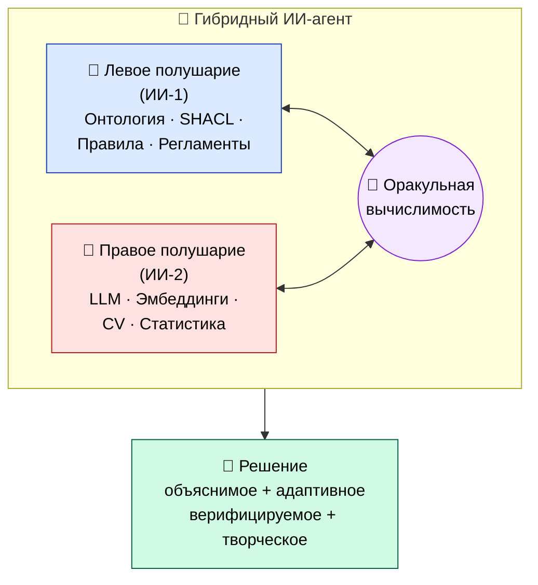

Результат — система, которая одновременно **мощна, объяснима, адаптивна и верифицируема**. То, что в индустрии теперь называют **нейросимволическим ИИ** (или гибридным ИИ), а в мировых публикациях — парадигматическим сдвигом, переопределяющим, что такое ИИ.

### Четыре столпа сильного ИИ — рабочая рамка

В разговоре о сильном ИИ мы опираемся на четыре свойства: рассуждение, непрерывное обучение, гибридность и вещественность. Это не госстандарт, а **рабочий чек-лист** для системного аналитика, проектирующего ИИ-систему класса РАГРАФ или Σ Сигма: если хоть один столп проседает — система не сильная.

| Столп | Что значит | Как реализовано в РАГРАФ |
|---|---|---|
| **1. Рассуждение (reasoning)** | Способность к логическому выводу с явным объяснением каждого шага | Язык регламентов Flow DSL и детерминированный исполнитель `flow_executor`: счёт по трёхзначной логике Клини («нет данных» — не «ложь»), пошаговая трасса каждого прогона, журнал прогонов по расписанию (см. Спринт 5) |
| **2. Непрерывное обучение (life-long learning)** | Адаптация к новым данным **без полного переобучения** | Аналитик-методолог правит регламент в редакторе потока (Flow Editor); до запуска его проверяют собственный проверяющий модуль и статический анализ — противоречия, пробелы, недостижимые ветви; каждая редакция сохраняется в истории версий. Ограничения значений выгружаются формами SHACL для внешних систем. Дорогостоящее дообучение LLM не требуется (см. Спринт 11) |
| **3. Гибридность (hybrid AI)** | Интеграция символьного ИИ и машинного обучения как **архитектурный принцип** | Ядро РАГРАФ = ИИ-1 (детерминированный `flow_executor`); Студия аналитика (раздел «Сима · Студия») = ИИ-2: смысловой поиск по векторным представлениям и языковая модель — по умолчанию локальная через Ollama, обе включаются настройкой; раздел «Граф знаний» — запросы SPARQL по триплетам (см. Спринт 8) |
| **4. Вещественность (embodied AI)** | Взаимодействие с физическим миром через сенсоры и исполнительные механизмы | Раздел «Триггеры» — реестр подтипов источников событий; приём событий по HTTP (детектор номеров, акустика и шум, медицинский вердикт, кредитная заявка) и опрос источников по расписанию (погода, оптоволокно, Plan-R, LEYKA). Выход регламента доставляет вердикт человеку в Telegram или MAX и может завести задачу в LEYKA; команд оборудованию РАГРАФ не подаёт — действие выполняет человек по поручению (см. Спринт 9) |

Эти четыре столпа не конкурируют — они **усиливают** друг друга. Без рассуждения нет объяснимости. Без непрерывного обучения система устаревает за полгода. Без гибридности либо беспомощна, либо непроверяема. Без вещественности — не дотягивается до реальности.

### Ключевая идея этого курса: дообучение через опыт человека = путь к сильному ИИ

Если выделить **одну мысль**, ради которой написана эта книга — она вот.

Сильный ИИ нельзя построить дообучением LLM на терабайтах текста из Reddit. Это путь к более умному попугаю, не к интеллекту. Сильный ИИ строится **в связке с человеком-экспертом**, который непрерывно дообучает систему через свой реальный опыт работы. Не разметку данных, не feedback-кнопки «👍/👎» — а **полноценное право вмешиваться в логику** системы, исправлять её регламенты, добавлять новые правила, отзывать ошибочные.

**Именно эту схему реализует связка РАГРАФ + LEYKA + методолог-аналитик:**

1. **Методолог-человек** наблюдает работу регламентов на боевых данных и видит, где система ошибается.
2. **Через Flow Editor** он правит конкретный регламент — добавляет новое условие, меняет порог, разворачивает дополнительную ветку switch.
3. **История версий** сохраняет каждую редакцию регламента целиком — со временем, подписью автора, примечанием и сводкой отличий от предыдущей (таблица `regulation_history`); восстановление старой версии создаёт новую запись, так что история только пополняется. Подпись — не учётная запись: персональных учётных записей в РАГРАФ пока нет. Документ-основание связан с регламентом через PROV-O (`prov:wasDerivedFrom`).
4. **LLM-слой** (Студия аналитика) использует обновлённую базу как контекст — для семантического поиска, для подсказок аналитику, для подготовки ответов на естественном языке.
5. **После срабатывания** критерий решённости проверяет не факт действия, а результат: параметр вернулся в норму или задача закрыта в срок (`acceptance_resolver`). Исходы копятся в метриках регламента, и начиная с 10 решённых прогонов по ним считается оценка доли успеха по правилу Лапласа (`backend/app/services/forecast.py:51`) — так методолог видит, работает ли правило.
6. **Цикл повторяется**. Система становится умнее **не за счёт перетренировки нейросети**, а за счёт того, что человек-эксперт **встроил свой опыт прямо в её логику**, и этот опыт виден и проверяем.

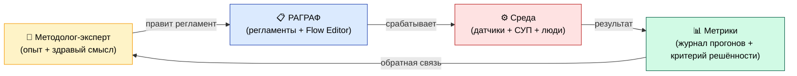

Это и есть **гибридный ИИ с дообучением через опыт человека** — путь, на который указывает и российская научная школа: задачный подход и семантическое моделирование Института математики СО РАН. Подробнее теоретические основы — в [GLOSSARY.md Часть XVI](GLOSSARY.md) («Семантический ИИ — технологический фундамент») и Части XVIII («Задачный подход — теоретическая база РАГРАФ»); научные основания с авторами — в пояснительной записке РАГРАФ-ФРЕЙМ-81, п. 5.2 (`backend/data/gost19/ragraf/`).

### Что это значит для тебя как системного аналитика

Ты входишь в эпоху, когда **проектирование гибридной системы — это уже не R&D, а основная инженерная задача**. Бизнес и государство одинаково остро требуют систем, которые:

- **мощны** — могут работать на неструктурированных данных, как LLM;
- **объяснимы** — каждое решение трассируется до пункта норматива, как у экспертной системы;
- **адаптивны** — обновляются через опыт эксперта без переобучения;
- **верифицируемы** — соответствуют ГОСТам, 152-ФЗ, отраслевым регламентам.

Эти четыре свойства невозможно получить, если ты умеешь только «прикручивать LLM через API» или только «писать SHACL-shapes от руки». Их можно получить только если ты **проектируешь систему как двухполушарного гибридного агента** и понимаешь, **где провести границу** между логикой и нейросетью, **как они обмениваются** информацией, **как человек дообучает** систему через регламенты, и **как пошаговая трасса прогона и основание вердикта** делают объяснимым каждый шаг.

Именно этому посвящены 12 спринтов этой книги. К концу ты сможешь не только проектировать систему класса РАГРАФ, но и **обосновать архитектурное решение** перед заказчиком, регулятором, инвестором или научной комиссией. И, что не менее важно, ты сможешь объяснить **зачем** твой подход даёт стабильное преимущество перед «голым ChatGPT» — на языке, понятном и инженеру, и юристу, и врачу, и министру.

> 💡 **Как контур замыкается в РАГРАФ сегодня.** С осени 2026 года обратную связь даёт не только методолог, но и тот, кому пришло поручение:
>
> 1. **Вердикт приходит с основанием.** Выходу регламента назначают канал (Telegram или MAX) и адрес; после предписания идут до пяти строк «на чём вынесен вердикт» — величины, зона и её границы. Их собирает одна функция по трассе прогона, без кода под конкретное правило (`backend/app/services/osnovanie.py`, с 15.10.2026); без основания сообщение не отправляется (`backend/app/services/delivery.py:355`).
> 2. **Человека спрашивают кнопками.** Спросить и принять ответ пока умеет только Telegram (`delivery.py:118`).
> 3. **Ответ становится величиной.** Нажатие пишется в журнал с подписью ответившего и значением подтипа `chat-feedback`; регламент читает его узлом-датчиком, как погоду. Источник у ответа свой — `telegram-feedback`: субъективное «жарко» не выдаётся за показание термометра.
>
> Пример — регламент `campus-heat-feedback-balance`: ответы о микроклимате за 72 часа превращаются в поручение теплотехнику «прикрыть заслонку» с вопросом «Заслонку отрегулировали?»; если поручение не подтверждено дольше четырёх часов — эскалация руководству (`backend/data/fixtures/campus-heat-feedback-balance.flow.json`).
>
> ⚠ Требование для твоего ТЗ: канал обратной связи проверяют по «ответ записан», а не по «сообщение ушло». Как восемнадцать дней сообщения уходили, а ответы терялись, — разобрано в Спринте 3.

> 💡 **Дополнительное чтение перед началом курса.** Если хочешь до старта Спринта 1 понять контекст полнее — прочитай в [GLOSSARY.md](GLOSSARY.md) Часть XVI «Семантический ИИ — технологический фундамент» и Часть XVIII «Задачный подход — теоретическая база РАГРАФ» (там же — место Σ Сигмы среди платформ сибирской школы), а затем раздел 3.1 пояснительной записки РАГРАФ-ФРЕЙМ-81 — постановку задачи и применённые методы: логику Клини, граф регламента, правило Лапласа. Это даст тебе **общий язык** для общения с архитекторами уровня enterprise, которых ты встретишь после этого курса.

---

## Где ты в траектории обучения

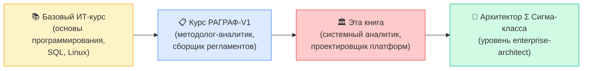

Эта книга — **третья ступень** твоего пути. После неё открываются роли уровня «architecture lead» и «head of analytics» в крупных IT-командах и проектах класса «городская платформа».

---

## Сквозной кейс книги

Каждая книга по системному анализу нуждается в сквозном примере, на котором отрабатываются все концепции. У нас он такой:

> **«Ты — выпускник РАГРАФ-курса. В понедельник тебя зовут в мэрию города Х (200 000 жителей, бюджет 18 млн ₽, нулевая команда). Задача — построить систему класса РАГРАФ для управления городскими сервисами: ЖКХ-аварии, обращения граждан, контроль СНиП на стройках, координация ЕДДС. Что ты делаешь?»**

Этот кейс мы будем «раскручивать» во всех 12 спринтах. К концу книги у тебя будет готовый набор артефактов: спецификация требований, ER-модель, BPMN-процессы, прототип UI, архитектура C4, API-контракт, тест-план, ПМИ (программа и методика испытаний), документация по ГОСТ. Этого достаточно, чтобы реально начать такой проект на следующей неделе.

Параллельно — четыре отдельных учебных проекта в спринтах 2 / 4 / 7 / 9 и **дипломный** в самом конце. Кейсы: требования к контролю школьной столовой (Спринт 2), модель данных для сети стоматологий (Спринт 4), Agile-набор для цифрового двойника школьной столовой (Спринт 7), API букинга коворкинга (Спринт 9); для диплома — пять доменов на выбор. Это сделано специально — чтобы ты привык смотреть на любую предметную область одинаковыми инструментами.

---

## Как читать эту книгу

### 1. По одному спринту в 2 недели

Книга рассчитана на **≈ 9 месяцев самостоятельного обучения**. Один спринт — 2 недели по 10–20 часов. Не пытайся прочитать всё за выходные: ты прочитаешь буквы, но не освоишь компетенции. Системный анализ — это **навык**, который вырабатывается практикой, а не объёмом прочитанного.

### 2. Каждый спринт по канве

В книге всё построено по единому шаблону (он же шаблон [docs/GLOSSARY.md](GLOSSARY.md), которая у тебя уже под рукой):

| Раздел | Что внутри |
|---|---|
| **Главное за минуту** | Суть темы в 5 предложениях с метафорой. Если торопишься — прочитай только это, и уже будешь в курсе |
| **О чём эта часть** | Зачем эта тема нужна **именно тебе** как системному аналитику |
| **Ключевые термины** | Определения с примерами из РАГРАФ/LEYKA. Запоминать наизусть не надо — главное понимать связи |
| **Контекст в РАГРАФ** | Где конкретно эта концепция применяется в нашей платформе. Открой проект параллельно и убедись своими глазами |
| **Сценарий / кейс / диаграмма** | Живой пример, обычно с Mermaid-диаграммой |
| **Практика 5–15 минут** | Конкретная задача, которую можно сделать за один присест |

### 3. С открытым редактором

Эта книга **бесполезна без рук**. Каждую сложную тему открывай в VS Code / Cursor / PyCharm и проверяй на реальных файлах РАГРАФ. Хочешь понять Turtle? Открой `backend/data/fixtures/*.data.ttl`. Хочешь понять язык регламентов Flow DSL? Открой `backend/data/fixtures/*.flow.json` и параллельно `frontend/src/components/flow/FlowEditorScreen.tsx`, а справочником держи его описание по ГОСТ 19.506-79 — `backend/data/gost19/ragraf/РАГРАФ-ФРЕЙМ-35 Описание языка.md` (в самом РАГРАФ оно открывается на странице `/documentation`). Это не задача «прочитать букву» — это задача «увидеть, как буквы работают».

### 4. С блокнотом для конспекта

Заведи Obsidian / Notion / простой Markdown-блокнот и пиши **свои** заметки по каждому спринту. Через два года ты вернёшься в этот блокнот, а не в эту книгу.

### 5. С сообществом

Если у тебя есть однокурсники из РАГРАФ-V1 — проходите эту книгу **вместе**. Один спринт в две недели, потом часовой созвон, обсуждаете трудные места и задачи. Самостоятельное обучение даёт 30% эффекта, обучение в паре — 60%, в группе 4–6 человек — 90%.

---

## Полное оглавление

### Вводный модуль

«Зачем выпускник РАГРАФ-курса идёт в системные аналитики. Карьерная траектория. Сквозной кейс книги: РАГРАФ для мэрии города Х».

### Спринт 1: Понимание роли системного аналитика *(2 недели, ≈ 20 ч)*

Структура команды разработки платформы. Жизненный цикл ПО: Waterfall / Agile / DevOps. Клиент-серверная vs микросервисная архитектура. Типы ПО. Таблица «системный vs бизнес-аналитик vs методолог РАГРАФ».

### Спринт 2: Разработка требований *(2 недели, ≈ 20 ч + проект ≈ 7 ч)*

Уровни требований: бизнес → пользовательские → функциональные → нефункциональные. Анализ стейкхолдеров. UML Use Case. Use Case по Алистеру Коберну. Чек-лист качества требований. Трассировка требований. **Проект 1**: требования к мини-РАГРАФ для школьной столовой.

### Спринт 3: SQL и DuckDB для аналитиков *(2 недели, ≈ 50 ч)*

Базы данных и почему DuckDB. SQL-основы (SELECT / WHERE / JOIN / GROUP BY) на схеме РАГРАФ. Подзапросы, CTE, оконные функции. DuckDB-specific фичи (read_parquet, PIVOT). Бонус: SPARQL над Turtle. 10 SQL-задач с возрастающей сложностью.

### Спринт 4: Моделирование данных *(2 недели, ≈ 22 ч + проект ≈ 18 ч)*

Концептуальная / логическая / физическая модель. ER-диаграммы (Crow's Foot, Peter Chen). Нормализация. Словарь данных. UML Class и Object Diagram. Семантический слой как ещё один вид модели (Turtle / RDF / SHACL / OWL). **Проект 2**: модель данных для записи в стоматологию.

### Спринт 5: Моделирование процессов *(2 недели, ≈ 20 ч)*

BPMN, UML Activity, UML State Machine, DFD (Гейн-Сарсон). Главная тема: **язык регламентов Flow DSL как наш фирменный инструмент**. Когда Flow DSL выигрывает у BPMN, а когда нет.

### Спринт 6: Пользовательские интерфейсы *(2 недели, ≈ 20 ч)*

Персоны. Use Scenario. User Journey Map. Информационная архитектура. Wireframes / mockups. Figma / Excalidraw. UX для cockpit-систем. HTML / CSS / JS-минимум для разговора с фронтенд-разработчиком.

### Глава-вставка: Взгляд фронтенд-разработчика *(≈ 4 ч)*

РАГРАФ на React глазами того, кто его собирал: карта фронтенда с замерами, находки, решения и обстоятельства, которые их потребовали, грабли с коммитами, опыт работы с ИИ-агентом. Чек-лист из десяти вопросов к любому экрану — для требований аналитика.

### Спринт 7: Agile-практики *(2 недели, ≈ 20 ч + проект ≈ 15 ч)*

User Story / Job Story. INVEST / DEEP. Acceptance Criteria в Gherkin. SPIDR. User Story Map по Jeff Patton. MVP. Story Points, Planning Poker. **Проект 3**: Agile-набор для приложения «Цифровой двойник школьной столовой» (бэклог, US, US Map, MVP, прототип).

### Спринт 8: Архитектура системы *(2 недели, ≈ 20 ч)*

Стили: монолит / многослойная / клиент-серверная / SOA / микросервисы / serverless / event-driven. Масштабный куб (X / Y / Z axes). UML Component и Deployment Diagram. **Спецтема**: архитектура РАГРАФ от и до по 5 слоям. ADR. **Решение о месте ИИ в архитектуре**: пять шагов до первой строки кода (§8.17).

### Спринт 9: Программные интерфейсы (API) *(2 недели, ≈ 20 ч + проект ≈ 15 ч)*

HTTP / TCP / IP / WebSocket. JSON / XML / YAML / Turtle. REST детально. GraphQL / gRPC / WebSocket / SSE / Webhooks. Sync vs async. UML Sequence Diagram. Postman. OpenAPI / Swagger. **Проект 4**: API для системы букинга коворкинга (5–10 endpoints + Postman + Swagger).

### Спринт 10: Реализация системы *(2 недели, ≈ 20 ч)*

CI/CD: что из этого есть в РАГРАФ (автоматическая выкатка из ветки main на Railway) и чего нет (сборочного конвейера с проверками — их запускают пакетами вручную). DevOps как культура. Языки программирования «на уровне чтения». Парадигмы. IDE. Git-минимум для аналитика. Пирамида тестирования (unit / integration / e2e / UAT). Test Plan и Test Case.

### Спринт 11: Поддержка, обслуживание и оценка *(2 недели, ≈ 20 ч)*

Документация по ГОСТ 19 и ГОСТ 34. ПМИ. План миграции (big bang / parallel run / phased). Обучение пользователей. Уровни поддержки L1/L2/L3 (на примере LEYKA). Change Request. KPI / метрики РАГРАФ. Documentation as code + ADR + CHANGELOG.

### Спринт 12: Расширенная архитектура и API *(4 недели, ≈ 40 ч)*

Шаблоны микросервисной архитектуры (API Gateway / Service Mesh / Circuit Breaker / Saga / Event Sourcing / CQRS). Событийно-ориентированная архитектура (Kafka / RabbitMQ / NATS). **Нотация C4** уровня Context / Container / Component / Code для РАГРАФ. **Domain-Driven Design**: Bounded Contexts, Ubiquitous Language, Aggregates. Стили API углублённо: GraphQL, AsyncAPI, HATEOAS. OpenAPI 3.1 YAML с нуля.

### Дипломный проект *(4 недели, ≈ 30 ч)*

Самостоятельная работа от и до. 5 доменов на выбор (школьная столовая / коворкинг / автомойка / клиника / автошкола). Полный цикл: требования → данные → процессы → UI → архитектура → API → тесты → документация → защита.

### Послесловие: куда дальше?

Карьерные траектории. Сертификации (ИКАН / IIBA / PSPO / TOGAF). Книжная полка. Конференции. Сообщества. Финальное слово.

---

## Карта компетенций после прохождения

| Компетенция | Уровень после РАГРАФ-V1 | Уровень после этой книги |
|---|---|---|
| Сбор требований | Базовый (по шаблону) | **Продвинутый** (стейкхолдеры, Use Case по Коберну, спецификация) |
| Моделирование данных | Базовый (Parameter в РАГРАФ) | **Продвинутый** (ER, нормализация, словарь, семантика W3C) |
| Моделирование процессов | Базовый (граф регламента на Flow DSL) | **Продвинутый** (BPMN, UML Activity, State Machine, DFD, Flow DSL углублённо) |
| UI-проектирование | Нет | **Базовый** (персоны, wireframes, требования к UI с учётом граблей фронтенда) |
| Agile-практики | Базовый (LEYKA-задачи) | **Продвинутый** (User Stories, INVEST, US Map, MVP) |
| Архитектура | Нет | **Базовый-продвинутый** (стили, C4, ADR) |
| API-проектирование | Базовый (использование REST) | **Продвинутый** (REST + GraphQL + AsyncAPI + Swagger) |
| Тестирование | Нет | **Базовый** (пирамида, Test Plan, Test Case) |
| Документация по ГОСТ | Нет | **Базовый** (ГОСТ 19 / 34, ПМИ) |
| Системный взгляд | Базовый | **Продвинутый** (умеешь видеть платформу целиком) |

---

## Инструментальный набор курса

Что должно быть установлено на рабочем месте к моменту прохождения. Установщик РАГРАФ (`installer/start-ragraf.command` для macOS, `installer/start-ragraf.bat` для Windows) проверит git, Python и Node.js, предложит поставить недостающее через Homebrew или winget, скачает РАГРАФ и запустит его; остальное доустанавливается по ходу. ⚠ Установщик скачивает исходники из репозитория на GitHub, а репозиторий закрыт: без выданного доступа установка не пройдёт — попроси у команды курса доступ или архив. Установщик для Windows после правки 09.10.2026 на живой машине ещё не проверялся.

| Категория | Инструмент | Зачем нужен |
|---|---|---|
| Редактор кода | VS Code / Cursor / PyCharm Community | Чтение кода, правка YAML/Turtle, написание заметок |
| Git-клиент | `git` (CLI) или GitHub Desktop | Работа с репозиторием РАГРАФ + своими ветками |
| Диаграммы | Mermaid (плагин для VS Code) + diagrams.net (drawio) + Excalidraw | Mermaid для git-friendly диаграмм, drawio для сложных, Excalidraw для скетчей |
| Прототипы UI | Figma (бесплатный аккаунт) | Wireframes и mockups в проекте 6 |
| API-клиент | Postman / Insomnia / Bruno | Тестирование API РАГРАФ и LEYKA |
| Терминал | Встроенный в OS + zsh / fish | Запуск тестов, миграций, скриптов |
| Python | 3.11–3.13 (установщик требует не ниже 3.11, для Windows — не выше 3.13; в контейнере изделия — 3.12) | Чтение backend РАГРАФ |
| Node.js + npm | 20 LTS (установщик для Windows требует 20+, для macOS — 18+; контейнер собирает интерфейс на Node 20) | Чтение и сборка frontend РАГРАФ |
| DuckDB CLI | `brew install duckdb` или скачать с duckdb.org | SQL по локальной базе РАГРАФ (`regulations.duckdb`, `live_etl.duckdb`) — на остановленном сервере или по копии файла: работающий сервер держит базу открытой на запись, и второй процесс её не откроет |
| Браузер | Chrome / Firefox / Safari + DevTools | Отладка фронта, анализ API-запросов |

Всё доступно бесплатно, но не всё открыто: Figma, Postman и Chrome — проприетарные программы с бесплатным тарифом; открытые замены — Excalidraw, diagrams.net, Bruno, Firefox. Покупать лицензии для курса не нужно.

---

## Условные обозначения в тексте

- **Жирным** — ключевые термины и понятия
- *Курсивом* — названия книг, источников, цитаты
- `моноширинным` — имена файлов, команды, фрагменты кода
- Блоки кода с указанием языка (`python`, `sql`, `yaml`) — готовы к запуску в твоём окружении
- `mermaid`-блоки — диаграммы, рендерятся на GitHub и в VS Code (с плагином)
- 💡 — практическое замечание или совет от наставников
- ⚠ — типичная ошибка / антипаттерн / «грабли»
- 🎯 — главный вывод раздела
- 📋 — чек-лист

---

## Благодарности

Книгу написал Олег Барбашин вместе с ИИ-агентом Claude Code — так же, как сделан сам РАГРАФ: агент набирал текст и код, автор ставил задачи, проверял каждое утверждение по изделию и принимал решения (как это устроено — в главе «Взгляд фронтенд-разработчика»). Отдельная благодарность коллегам и первым читателям за вопросы, на которые отвечает эта книга, — без них она была бы абстрактной.

Если найдёшь в тексте ошибку, неточность или место, которое можно сделать лучше, — напиши команде курса. Репозиторий РАГРАФ на GitHub закрыт, и без выданного доступа ссылка на него отвечает ошибкой 404. Книга живёт версиями, и твой вклад сделает следующую версию ещё лучше.

---

*Поехали к Вводному модулю.*

---

## Блок A. Вход в системный анализ

> **Блок A — это вход.** Вводный модуль + первые три спринта (1, 2, 3). Они переводят выпускника курса РАГРАФ-V1 из режима «методолог, рисующий регламенты в готовой платформе» в режим «системный аналитик, проектирующий саму платформу». Дальше будут блоки B (спринты 4–6), C (спринты 7–9) и D (спринты 10–12 + дипломный проект). Этот блок отвечает за то, чтобы ученик понял, куда он попал, и закрыл фундаментальные пробелы: команда разработки, требования, SQL/DuckDB. Без этого никакой архитектуры платформ дальше не получится.

---

## Вводный модуль. Зачем выпускнику РАГРАФ-курса лезть в системный анализ

### Главное за минуту

Помнишь, как в курсе РАГРАФ-V1 ты собирал регламент для своей серверной/стройки/ЕДДС и нажимал «сохранить»? За этой кнопкой стоят 252 обработчика программного интерфейса FastAPI в 33 модулях (замер 30.10.2026: `grep -rE "@router\.(get|post|put|patch|delete)" backend/app/api | wc -l` и `grep -lE "@router\.(get|post|put|patch|delete)" backend/app/api/*.py | wc -l`), две базы DuckDB — регламенты и оперативные данные (`regulations.duckdb`, `live_etl.duckdb`), планировщик опроса источников, редактор потока на React, проверка регламента до запуска, пошаговая трасса прогона, доставка вердикта в мессенджер и опросчик задач LEYKA. Всё это кто-то спроектировал. Если ты хочешь, чтобы такая платформа появилась у тебя в мэрии, в стройтресте, в кампусе университета или в собственном стартапе — этим «кем-то» придётся стать тебе. Курс, который ты сейчас читаешь, превращает методолога в человека, который **может разговаривать с разработчиками как с равными**, проектировать систему «с чистого листа» и понимать архитектурные решения уровня Σ Сигмы (фреймворк ЦИИ НГУ масштаба муниципалитета на хранилище триплетов Apache Jena и PostgreSQL; РАГРАФ построен по идее её архитектуры, но на собственном лёгком стеке — см. [GLOSSARY, части XV и XVIII](GLOSSARY.md) и пояснительную записку РАГРАФ-ФРЕЙМ-81, п. 3.4). Это второй курс, не альтернатива первому: первый давал тебе РАГРАФ как инструмент, второй — даёт тебе инструмент для построения РАГРАФ.

### О чём этот вводный модуль

Перед тем как открыть первый спринт, разберёмся с тремя вопросами, которые звучат у каждого второго выпускника РАГРАФ-V1:

1. **«Я же не программист, зачем мне системный анализ?»** — затем, что между «нарисовал регламент» и «он работает в боевой мэрии» лежит уйма работы, и эту работу почти всегда делает не разработчик. Её делает аналитик, и если этого аналитика нет — платформа не запускается. Не «не оптимально работает», а буквально не запускается.
2. **«Я уже методолог-аналитик, зачем мне ещё одна аналитика?»** — потому что методолог собирает регламенты внутри готовой платформы, а системный аналитик проектирует **саму платформу**. Это разные задачи. Грубо говоря, методолог пишет рецепт в кулинарной книге, а системный аналитик проектирует кухню, в которой эти рецепты будут готовиться. Кухня без рецептов — пустая комната, но и рецепты без кухни — просто литература.
3. **«А что у меня будет на выходе?»** — диплом и собственный мини-РАГРАФ, спроектированный с нуля под твою предметную область (парковки/школьное питание/коворкинг/что угодно). С документами, диаграммами, требованиями, SQL-схемой, API-контрактом. Не учебной демо-, а такой, по которой можно нанять команду и она реально соберёт.

### Чем системный аналитик отличается от методолога РАГРАФ

| Что делает | Методолог РАГРАФ (V1) | Системный аналитик (V2) |
|---|---|---|
| Кому продаёт результат | Руководителю ЕДДС, главному инженеру | Product Owner, тимлид, технический директор |
| Главный артефакт | Регламент (Turtle + SHACL + flow.json) | ТЗ, диаграммы (UML/Mermaid/C4), API-контракт |
| Где живёт его работа | Внутри РАГРАФ как контент | На GitHub/в трекере как описание платформы |
| Какие документы нужны до его работы | СНиП/СанПиН/приказ | Бизнес-цель, бюджет, состав команды |
| С кем спорит | С нормотворцами и предметниками | С разработчиками и архитекторами |
| Что должен уметь | Декомпозировать норматив на параметры | Декомпозировать систему на модули |
| Сколько кода читает | 0 строк (но Turtle — это, считай, код) | Много чужого, чтобы понять как работает |
| Сколько кода пишет | 0 строк | Иногда SQL для проверки гипотез, прототипы на Python |

Грубая аналогия. Методолог — это шеф-повар, который пишет меню в существующем ресторане. Системный аналитик — это человек, которого зовут «давай откроем новый ресторан, помоги спроектировать кухню, барную стойку, морозильники, систему заказов». Шеф-повар будет работать в этом ресторане потом — но кухня без проектировщика не появится.

> ⚠ **Поправка из опыта РАГРАФ.** Штатной должности «методолог регламентов» у заказчиков нет — и бюджета под неё тоже: это отрицательный результат нашего исследования 2026 года (`docs/GOTOMARKET/RESEARCH-RAGRAF-REAL-PLACE-2026-08.md`). Меню обычно пишет приглашённый шеф — внешний консультант, который оцифровывает нормы заказчика как услугу (так устроена и модель РАГРАФ, файл `LICENSE`, п. 1), — или сам ответственный за соблюдение норм в рамках своей должности. Урок для системного аналитика: прежде чем проектировать систему, назови поимённо, кого она прикрывает и кто в ней будет работать, — иначе пользу системы не с кого будет снять.

### Карьерная траектория

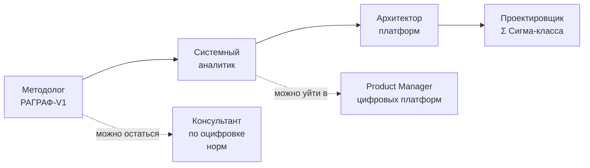

Каждый переход — это плюс примерно 30–60% к зарплате и плюс одна шкура ответственности. Никто не заставляет идти до конца. Но даже если ты остановишься на «системный аналитик» — ты будешь востребован в любой госмуниципальной цифровизации России на ближайшие 10 лет, потому что таких людей сейчас нет, а заказчики уже есть.

### Сквозной кейс книги: мэрия города Х

С этого момента и до диплома мы будем работать с одним сквозным сценарием. Знакомься.

> **Понедельник, 9:00.** Тебе звонит зам. мэра города Х (200 тыс. жителей, областной центр среднего размера). Говорит: «Я был на конференции в Новосибирске, видел РАГРАФ, видел Σ Сигму. Хочу такое же у себя. У меня есть бюджет 18 млн на первый этап, есть кабинет в мэрии, есть желание начать с парковок и шума у школ. Команды разработки нет. Программистов на районе тоже нет — все уехали в Москву. Есть бывший айтишник из ИТ-отдела мэрии, два студента-практиканта и я в роли спонсора. С чего начнём?»

Что ты делаешь дальше — это и есть содержание курса. Спринт 1 — собираешь команду и понимаешь, что такое жизненный цикл ПО. Спринт 2 — пишешь требования (без них зам. мэра через месяц передумает, потому что не сможет вспомнить, чего хотел). Спринт 3 — учишься работать с данными (DuckDB и SQL), потому что без них первый же датчик трафика сделает тебе больно. Дальше — UML/BPMN, REST API, безопасность, тестирование, DevOps. К диплому у тебя будет проект «РАГРАФ-для-города-Х» в полном виде.

> 💡 **Как это устроено в РАГРАФ сегодня: фреймворк и настройка.** С сентября 2026 года РАГРАФ оформлен как **фреймворк** — доменно-нейтральное ядро: язык регламентов Flow DSL, исполнитель, приём событий, хранилище, интерфейс (комплект ГОСТ 19 «РАГРАФ-ФРЕЙМ», `backend/data/gost19/ragraf/`). Отраслевая платформа собирается на нём **настройкой** — набором регламентов и датасетов, а не новым проектом. Это измерено на двух настройках одного ядра:
>
> | Настройка | Регламентов | Доля отраслевого кода |
> |---|---|---|
> | Строительство (РАГРАФ-СТРОЙ) | 5 | 3,3 % |
> | Городская среда и ЖКХ | 26 | 4,1 % |
>
> *Замер 06.09.2026 на коммите `8c058fc`; методика и команды — `docs/URBAN-ENVIRONMENT/README.md`, раздел 4.*
>
> Во второй настройке впятеро больше регламентов, а доля кода осталась того же порядка — разница ушла в данные. При добавлении второй отрасли ни один слой ядра не менялся (пояснительная записка РАГРАФ-ФРЕЙМ-81, п. 2.3).
>
> Для «РАГРАФ-для-города-Х» отсюда первая развилка: не «какой стек взять», а «что здесь ядро, а что настройка». Кухню строят один раз; меню — регламенты, справочники, источники данных — меняется без программиста.
>
> ⚠ Обе настройки собрала одна команда на одном ядре, поэтому устойчивость числа к смене исполнителя не установлена: проверкой была бы третья настройка от сторонней команды (там же).

### Мини-практика (5 минут)

Прежде чем читать дальше — открой любимый текстовый редактор и напиши **полстраницы** ответа на один вопрос: «Если бы мне сейчас принесли 18 млн и сказали “сделай РАГРАФ для своей организации” — что я знаю, а чего не знаю?». Это твой стартовый замер. В конце курса откроешь его и удивишься.

---

## Спринт 1: Понимание роли системного аналитика

> **Сколько займёт:** ~20 часов (3 рабочих дня + один на пересмотр).
> **Артефакт:** организационная схема команды для своего проекта «РАГРАФ-для-Х» + двухстраничная заметка «кого я могу нанять, кого нет, чем буду закрывать дыры».

### Главное за минуту

Системный аналитик — это переводчик и сшиватель. Он сидит ровно посередине между бизнесом (мэр/директор/PO) и разработкой (бэк/фронт/DevOps), и его работа — следить, чтобы первые не говорили «сделайте красиво и быстро», а вторые не отвечали «у нас всё работает, посмотрите Postman». В РАГРАФ роли аналитика, разработчика и архитектора совмещает один человек (Олег Барбашин), а код набирает ИИ-агент (см. [REPORT-PROJECT.md](REPORT-PROJECT.md), раздел 8) — это редкое исключение. В мэрии города Х так не получится: даже если у тебя одна голова, тебе всё равно придётся **формализовать роли**, иначе люди будут делать чужую работу плохо и не делать свою.

### О чём этот спринт

Цель — за 20 часов разобраться:
- как устроена команда, которая собирает платформу класса РАГРАФ,
- какие у каждого роли обязанности и зоны ответственности,
- по какому жизненному циклу ходит ПО (и почему РАГРАФ делается итерациями, а не «большим взрывом»),
- какие бывают архитектуры (монолит vs микросервисы), и какую ты выберешь для проекта города Х.

### Структура команды разработки платформы класса РАГРАФ

Минимальный состав — 5 ролей. Это **роли**, а не количество людей: в РАГРАФ-V1 одна голова закрывала все пять. В мэрии города Х (бюджет 18 млн, наука нулевая) реалистично 3–4 человека, где кто-то будет совмещать.

| Роль | Что делает | Главный артефакт | На РАГРАФ кто это | В городе Х кого нанимаешь |
|---|---|---|---|---|
| **PO (Product Owner)** | Приоритезирует фичи, держит вижн, общается с заказчиком | Backlog (см. [BACKLOG.md](../docs/BACKLOG.md)) | Олег — владелец изделия (в документах так и пишется: «решение владельца») | Сам зам.мэра, надо его «обучить» |
| **Системный аналитик** | Пишет требования, рисует диаграммы, ловит противоречия | ТЗ, Use Case, API-контракт | Олег (отдельной шапкой) | Это ты |
| **Бэкенд-разработчик** | Пишет API, бизнес-логику, миграции | Код на Python/FastAPI + тесты | Олег | Один ведущий специалист (senior) с рынка + студент-стажёр |
| **Фронтенд-разработчик** | Пишет UI, формы, диаграммы | Код на TypeScript/React + e2e тесты | Олег | Один специалист (middle) + студент-практикант |
| **DevOps / SRE** | Деплой, мониторинг, безопасность, бэкапы | Конвейер сборки и выкатки, конфиги площадки | Олег + Railway: приложение — один контейнер, выкатка из ветки main автоматическая (`railway.json`, `Dockerfile`); посадочные страницы — на Vercel; сборочного конвейера с проверками нет, их запускают вручную (`./scripts/proverki.sh`); `fly.toml` — запасная конфигурация, в поддерживаемые способы установки не входит | Совмещает бэкенд-разраб |

Можно ещё добавить:
- **UX/UI-дизайнер** — на ранней стадии не нужен, можно опереться на небольшой набор готовых элементов интерфейса РАГРАФ (`frontend/src/components/ui/`, соглашения — `frontend/DESIGN_SYSTEM.md`). Когда дойдёшь до публичного дашборда мэра — наймёшь на 2 недели.
- **Тестировщик (QA)** — на старте не нанимаешь, тесты пишут сами разработчики и аналитик. Когда система выйдет на 10+ боевых пользователей — нанимаешь.
- **Технический писатель** — никогда не нанимай первым, документация пишется по ходу. Когда документации станет много и она начнёт разъезжаться — да, тогда нужен.

### Реальный кейс: как собирался РАГРАФ

РАГРАФ — это, по сути, **проект одного человека с ИИ-агентом**. Стек определялся не комитетом, а одним человеком, исходя из того, что он умеет (Python, React, TypeScript). DuckDB выбран в первый же день, 13.05.2026, после опыта: результат достижим без хранилища триплетов, а встраиваемая база — это один процесс и один файл без администратора (пояснительная записка РАГРАФ-ФРЕЙМ-81, п. 3.4.5 и приложение А). Turtle, SHACL и PROV-O взяты как открытые стандарты W3C: регламент в открытом формате не привязывает заказчика к поставщику и сохраняет стыковку с Σ Сигмой (там же, п. 3.3.3). Элементы интерфейса — небольшой собственный набор на Tailwind, без дизайнера.

Это **антипаттерн для команды из 4+ человек**, но идеальный паттерн для одного. Если у тебя в городе Х команда из 4 — тебе придётся фиксировать решения письменно, иначе через месяц бэкенд и фронтенд будут спорить о форматах JSON.

> 💡 **Как РАГРАФ собирается сейчас.** Роли по-прежнему совмещает один человек, но код набирает **ИИ-агент**, а решения, проверка и документы остаются за человеком («благодаря AI-парной разработке (Claude Code в большинстве сессий)» — `docs/REPORT-PROJECT.md`, раздел 8). Чтобы агент не превратил проект в груду несогласованного кода, работа идёт по порядку **SKICODING**: письменный разбор до правки кода, реализация фазами, документы — в том же шаге, отложенное — в бэклог с причиной, шаг без проверок не закрыт. Как это выглядит на деле — в Спринте 7, а как устроены сами проверки — в Спринте 10.
>
> Порядок опубликован как открытый набор навыков для агента **NSU-AI-SKILLS** (лицензия MIT, https://github.com/Barbashin1970/NSU-AI-SKILLS): `skicoding`, семейство `gost-19*` для документации по ЕСПД, `otbor-proverok` — отбор автоматических проверок, `niokr` — отчёт о НИОКР.
>
> 🎯 Для города Х вывод двойной. ИИ-агент снимает с команды набор кода, но не работу системного аналитика: решать, что строить, записывать решения и принимать результат по-прежнему должен человек. А агент, которого не обязали обновлять документы, через месяц оставит код, который никто не сможет объяснить.

### Жизненный цикл ПО: Waterfall vs Agile vs DevOps

Три большие парадигмы. Объясню на метафоре стройки:

| Парадигма | Метафора | Когда работает | Когда ломается |
|---|---|---|---|
| **Waterfall (каскад)** | Стройка по проекту. Полгода рисуем, год строим, неделю сдаём | Если требования НЕ меняются (космос, оборонка, мосты) | Если заказчик через 3 месяца говорит «хочу не дом, а дачу» — всё, проект сгорел |
| **Agile (гибкая разработка)** | Сборка лего по урокам. Поставил пять деталей, посмотрел, поставил ещё пять | Если требования меняются часто (госмуниципальный заказ, стартапы) | Если у тебя бюджет на 5 лет фиксирован — Agile в плановой бюрократии не приживётся |
| **DevOps** | Это не методология, а **культура**. Разработка и эксплуатация не отдельные команды, а одна. Деплой каждый день | Если у тебя SaaS-продукт и сотни клиентов | Если у тебя локальный enterprise-инстанс — DevOps вырождается в просто «у нас есть CI» |

**РАГРАФ — это Agile + лёгкий DevOps.** Доказательство — git log: 776 коммитов с 13.05 по 27.10.2026, коммиты были в 74 дня этого срока, в такой день — медиана 8, в пиковый — 38 (замер 30.10.2026: `git log --oneline | wc -l` и `git log --format=%ad --date=short | sort | uniq -c | sort -n`); выкатка на прод — автоматическая из ветки main на Railway. Это не Waterfall: техническое задание есть (РАГРАФ-ФРЕЙМ-1), но пишется вместе с кодом и сверяется с ним, а не утверждается за полгода до первой строки. Не классический DevOps: нет отдельной службы эксплуатации и метрик в Prometheus; есть проверка живости `/api/health`, по которой Railway перезапускает приложение (`railway.json`), и состояние планировщика и источников на «Пульте ядра ETL».

Для города Х на старте я бы рекомендовал **классический Scrum-Agile с двухнедельными спринтами**, потому что:
- Заказчик (зам.мэра) не будет читать длинные ТЗ. Ему нужно показывать «вот посмотри, мы за 2 недели сделали приём заявок на парковку».
- Команда маленькая. Двухнедельный спринт даёт ритм без бюрократии.
- Бюджет 18 млн ≈ 6 месяцев работы команды из 4 человек = ~12 спринтов. Это удобно планировать.

### Клиент-серверная архитектура vs микросервисная

Кратко, что эти слова значат:

**Клиент-серверная архитектура** — это когда у тебя есть один **сервер** (программа, которая отвечает на запросы) и много **клиентов** (программ, которые задают вопросы). Сервер — обычно один процесс или один кластер. Все идут к нему. Это **монолит**.

**Микросервисная архитектура** — это когда твой сервер развалился на 10 маленьких сервисов. Каждый отвечает за свою часть: один за пользователей, другой за регламенты, третий за уведомления. Они общаются между собой по HTTP/gRPC/очередь. Это даёт независимый деплой, разные команды на каждый сервис, разные базы. Но цена — сложность.

| Параметр | Монолит (как РАГРАФ) | Микросервисы (как Σ Сигма) |
|---|---|---|
| Сложность кодовой базы | Низкая (всё в одном репо) | Высокая (10+ репозиториев, нужен оркестратор) |
| Сложность деплоя | Очень низкая (один контейнер, собранный по одному `Dockerfile`) | Очень высокая (нужны Kubernetes/Nomad) |
| Сложность отладки | Низкая (один процесс, одна логфайл) | Высокая (нужны distributed tracing, Jaeger) |
| Когда оправдана | До 50k запросов/мин, до 5 разработчиков | От 100k запросов/мин, от 15 разработчиков |
| Стоимость инфраструктуры | $50/мес (один сервер) | $5000/мес (кластер + ELK + Jaeger + Grafana) |
| Время до первой фичи в продакшен | 2 недели | 3 месяца |

**Для города Х — однозначно монолит**, как РАГРАФ. У тебя нет 15 разработчиков, у тебя нет 100k запросов/мин (у города 200к жителей даже если все одновременно подадут заявку, это будет 200к за день, ≈ 2 запроса в секунду). Микросервисы будут техническим долгом, а не активом.

Σ Сигма задумана как большой контур масштаба муниципалитета: хранилище триплетов, отдельная реляционная СУБД, очередь сообщений, программный шлюз и модули разных проектов Центра; её программный комплекс построен на принципах микросервисной разработки (пояснительная записка РАГРАФ-ФРЕЙМ-81, пп. 3.4.5–3.4.6; `docs/NIR-2025.md`). Для тебя это **горизонт через 3–4 года**. На старте — монолит.

### Типы ПО

Маленький словарь, чтобы не путаться:

- **Web-приложение** — открывается в браузере. РАГРАФ — это оно. Преимущество: ничего не надо ставить, обновляется само. Недостаток: нужен интернет.
- **Desktop-приложение** — устанавливается на компьютер. Photoshop, Word. Для платформ типа РАГРАФ — обычно не нужно.
- **Mobile-приложение** — нативное под iOS/Android. Для административных систем редко окупается, обычно делают адаптивный веб.
- **Cloud (облачное)** — приложение, которое живёт на сервере в дата-центре провайдера (AWS, Yandex Cloud, Selectel). Демонстрационный экземпляр РАГРАФ живёт в облаке Railway (https://ragraf.up.railway.app), посадочные страницы — на Vercel. ⚠ Адрес Railway из российских сетей без VPN недоступен (замер 09.10.2026, `docs/BACKLOG.md`), поэтому облако для госзаказа выбирают и по тому, дотянутся ли до него пользователи и датчики.
- **Self-hosted (само-хостинг)** — приложение, которое ты ставишь на свой сервер (например, в серверной мэрии). Для РАГРАФ это предусмотрено: контейнер на своём сервере и установщик для Windows описаны в руководстве системного программиста РАГРАФ-ФРЕЙМ-32. Честно о состоянии: на стороннем сервере контейнер ещё не запускался, а установщик для Windows после правки 09.10.2026 не исполнялся. Для госзаказа это условие допуска, а не киллер-фича; главное в РАГРАФ другое — правила вынесены из кода в данные, и регламент меняет предметный специалист, а не программист.
- **SaaS (Software as a Service)** — модель оплаты «по подписке за пользование». РАГРАФ — проприетарное изделие с одним правообладателем, и модель в его лицензии записана прямо: доход не от продажи лицензий, а от услуг — обследования процессов, оцифровки норм заказчика, внедрения и сопровождения. Экземпляр может держать правообладатель для многих заказчиков (SaaS) или заказчик у себя (файл `LICENSE`, ред. 3 от 07.09.2026).

**РАГРАФ = web + cloud + self-hosted.** Этот тройной режим почти универсален для гос-IT в России.

### Сравнительная таблица: системный аналитик vs бизнес-аналитик vs методолог РАГРАФ

Это самая часто задаваемая путаница. Закроем её сразу.

| Параметр | Бизнес-аналитик | Системный аналитик | Методолог РАГРАФ |
|---|---|---|---|
| Главный вопрос | «Какую бизнес-задачу решаем?» | «Как это устроено внутри?» | «Какой норматив автоматизируем?» |
| Главный артефакт | BRD (Business Requirements Document) | SRS (Software Requirements Specification), UML | Регламент в РАГРАФ (Turtle + flow.json) |
| Кому докладывает | Заказчику, бизнес-владельцу | PO, тимлиду | Главному инженеру / руководителю службы |
| Глубина IT-знаний | Минимальная (понимает что такое API на уровне «это интерфейс») | Средняя (читает код, пишет SQL, понимает HTTP, знает SHACL) | Низкая, но знает свою предметную область очень глубоко |
| Глубина предметных знаний | Высокая | Средняя | Очень высокая (СНиП, СанПиН, отраслевые регламенты) |
| Где встречается в РАГРАФ-V1 | Не встречается — это V2 | Курс, который ты читаешь | Курс РАГРАФ-V1 |
| Карьерный возраст | 2–7 лет в IT | 3–10 лет в IT | 5–25 лет в отрасли + курс РАГРАФ-V1 (72 ак. ч., 7 модулей и защита) |
| Зарплата (2026, Москва) | 150–250к | 200–350к | Отдельной ставки у заказчика нет: нормы оцифровывает внешний консультант как услугу либо сам ответственный в своей должности |

Часто эти роли совмещаются. Например, в небольшой команде один человек может быть бизнес-аналитиком утром и системным аналитиком после обеда. В РАГРАФ Олег совмещал всё.

### Интерактивное задание: «Заказчик хочет систему типа РАГРАФ для управления парковками»

> Тебе позвонил директор муниципального предприятия «Горпарковки». Хочет систему, которая:
> 1. Получает данные с датчиков занятости парковочных мест (200 датчиков на 12 парковках).
> 2. Получает данные с камер ANPR (распознавание номеров) на въезде/выезде.
> 3. Принимает оплату через интеграцию с парковочным аппом города.
> 4. Уведомляет инспекторов о неоплатных парковщиках через корпоративный мессенджер.
> 5. Делает дашборд для мэра «занятость в реальном времени по картам».
> Бюджет: 8 млн на первый этап (6 месяцев).

**Твоя задача:** распиши команду. Какие роли нужны (сколько человек на каждую). Кого нанимать с рынка, кого можно совмещать. Где взять компетенцию ANPR (своими силами или брать готовое решение поставщика видеодетекторов, см. [GLOSSARY часть III](GLOSSARY.md) «Видеоаналитика и геопространственные данные»)? Какой жизненный цикл — Waterfall или Agile? Монолит или микросервисы? Запиши на полстранички.

**Подсказка-ответ (не подглядывай до того, как напишешь свой):** в реальной жизни ответ выглядит так — 1 системный аналитик (ты), 1 бэкенд (Python+FastAPI как в РАГРАФ), 1 фронтенд (React, скопировать паттерны из РАГРАФ), 0.5 ставки DevOps (можно совмещать с бэкендом), 0 на ANPR (берёшь готовый детектор отраслевого партнёра, потому что 200 датчиков и 12 камер — слишком мало, чтобы окупить свою разработку детекции). Жизненный цикл — Agile с двухнедельными спринтами. Монолит, потому что 200 датчиков ≈ 50 событий в минуту, не нагрузка для распределённой системы. Бюджет 8 млн / 6 месяцев = 1.3 млн в месяц ≈ 4 ФОТ-ставки в Сибири или 2 ставки в Москве. Решение: брать сибирскую команду удалённо.

> 💡 Задача не выдуманная: у РАГРАФ есть приёмник событий детектора номеров на парковке ВКИ НГУ (`backend/app/api/ingest.py`). Как устроен такой приём — направление «push», защита от повторов, границы пачки, — разобрано в Спринте 9, а что случилось, когда детектор замолчал, — в Спринте 8 (§8.12 и §8.17).

### Мини-практика

Открой кейс мэрии города Х. Распиши организационную схему той команды, которая будет собирать РАГРАФ для города. Используй таблицу выше как шаблон. Для каждой роли укажи: ФИО (или «вакансия»), грейд (стажёр / специалист / ведущий специалист / архитектор — на западе говорят junior/middle/senior/architect), на полный рабочий день или совмещение, источник (нанимаем с рынка / уже есть в штате / аутсорс/подрядчик).

Финальный артефакт спринта 1 — эта таблица плюс заметка на 2 страницы «Что я понял про команду и что меня пугает». Сдаётся в LEYKA как первая дипломная веха.

> В следующем спринте мы перейдём к **разработке требований** — это даст тебе возможность превратить «хочу как у соседей» в формальный, трассируемый список того, что должна делать система.

---

## Спринт 2: Разработка требований

> **Сколько займёт:** ~27 часов (3 рабочих дня на лекции/практику + дополнительные 7 часов на Проект 1).
> **Артефакт:** документ требований к мини-РАГРАФ для контроля столовой школы (Use Case + спецификация + Mermaid-диаграмма).

### Главное за минуту

Если не зафиксировать требования письменно — через два месяца все будут спорить, что именно заказывал зам.мэра в понедельник. Через четыре — выяснится, что половину «обязательных» фич никто не помнит, а половину «забытых» теперь экстренно надо. Требования — это не бюрократия, это **страховка** от того, что ты потратишь 18 млн впустую. В курсе РАГРАФ-V1 ты работал с уже формализованными нормативами (СанПиН, СНиП) — это, по сути, готовые требования к регламенту. Системный аналитик делает обратную операцию: из устных «хочу как у соседей» извлекает формальный, проверяемый, трассируемый список требований. После этого спринта ты сможешь написать ТЗ на мини-РАГРАФ так, чтобы любой бэкенд-разработчик через неделю показал работающий прототип.

### О чём этот спринт

Будем разбирать четыре уровня требований, учиться писать Use Case (UML и Коберна), познакомимся с трассировкой (помнишь панель «Прогон на заданных величинах» в редакторе потока — пошаговый расчёт по узлам — и блок «Нормативное основание» в редакторе регламента?), и в конце соберём первый дипломный проект.

### Уровни требований

В системном анализе принято разделять требования на четыре уровня. Это **матрёшка**: верхний уровень определяет нижний.

| Уровень | Кто формулирует | Что отвечает | Пример для РАГРАФ города Х |
|---|---|---|---|
| **Бизнес-требования** | Заказчик (зам.мэра) | Зачем нам эта система? | «Сократить время реакции на превышение шума у школы с 4 часов до 15 минут» |
| **Пользовательские требования** | Будущий пользователь системы (методолог ЕДДС) | Что я хочу делать в системе? | «Загрузить СанПиН по шуму, сконвертировать в регламент за 30 минут, протестировать на исторических данных» |
| **Функциональные требования** | Системный аналитик | Что конкретно должна делать система? | «Система должна позволять загружать PDF до 50 МБ, извлекать оттуда параметры (имя, мин/макс), создавать Turtle-файл с PROV-O ссылкой на пункт документа» |
| **Нефункциональные требования** | Системный аналитик + DevOps | Какими свойствами должна обладать система? | «Время загрузки страницы редактора регламента не более 2 сек, доступность системы 99.5% в рабочие часы, поддержка одновременно до 50 пользователей» |

Сравним с тем, как это устроено в РАГРАФ:
- **Бизнес-требование РАГРАФ:** «Перенос правил организации из исходного текста программ и неисполняемых документов в редактируемый формальный граф, исполнение этих правил по поступающим событиям и доказательство соответствия вынесенного решения норме». Так записано функциональное назначение в техническом задании РАГРАФ-ФРЕЙМ-1, раздел 3 (ред. 3.1 от 09.10.2026, [backend/data/gost19/ragraf/](../backend/data/gost19/ragraf/)); прежняя редакция 2.1 — [TZ_RAGRAF.md](../docs/TZ_RAGRAF.md).
- **Пользовательское требование:** «Методолог должен уметь форкать tutorial-01 и подменять параметры на свои за 15 минут». Закрыто в Модуле 3 курса РАГРАФ-V1.
- **Функциональное:** «Язык регламентов определяет девять типов узлов: sensor, time, input, threshold, compare, formula, switch, output и устаревший shacl_constraint; в палитре редактора их восемь — shacl_constraint исключён 09.06.2026». См. описание языка РАГРАФ-ФРЕЙМ-35, § 2.2 ([backend/data/gost19/ragraf/](../backend/data/gost19/ragraf/)).
- **Нефункциональное:** «Внешняя система управления базами данных не требуется: хранилище встроенное (DuckDB), изделие разворачивается одним процессом» и «Недоступность внешнего источника не останавливает исполнение регламентов на остальных данных» — разделы 4.4 и 4.2 того же ТЗ.

**Самая частая ошибка** — путать пользовательские и функциональные. «Я хочу увидеть отчёт» — пользовательское. «Система должна выгружать CSV в кодировке UTF-8 с разделителем ;» — функциональное. Первое отвечает на «что хочу я», второе на «что делает система».

### Анализ стейкхолдеров

**Стейкхолдер** (от англ. *stakeholder*, дословно «держатель доли») — все, у кого есть интерес в системе. Не только заказчик, не только пользователь. Иначе пропустишь важные требования.

Карта стейкхолдеров для проекта города Х:

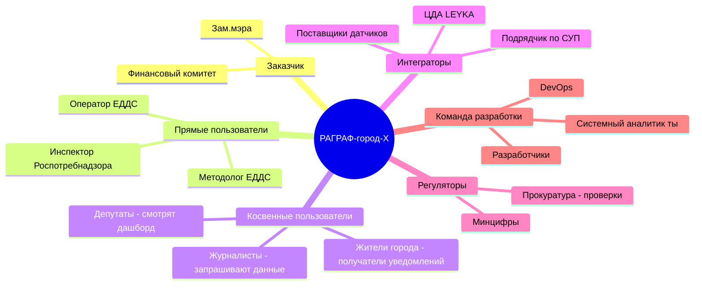

Каждый стейкхолдер даёт **свой набор требований**. Зам.мэра хочет дашборд. Методолог хочет редактор. Инспектор хочет аудит-лог с PROV-O. Журналист хочет API для своих расследований. Прокурор хочет, чтобы любое решение системы было трассируемо до пункта норматива. Без этой карты ты пропустишь как минимум треть требований.

**Лайфхак:** интервью со стейкхолдерами проводи **последовательно**, начиная с тех, кто больше всех влияет (заказчик). Записывай ответы дословно. Через две недели возвращайся и переспрашивай — половина людей переформулирует свои хотелки.

### UML Use Case на примере «оператор регистрирует инцидент»

**Use Case** (вариант использования) — формальное описание того, **что** делает пользователь в системе, без описания **как**. UML — стандартная нотация для рисования диаграмм. Use Case-диаграмма выглядит вот так:

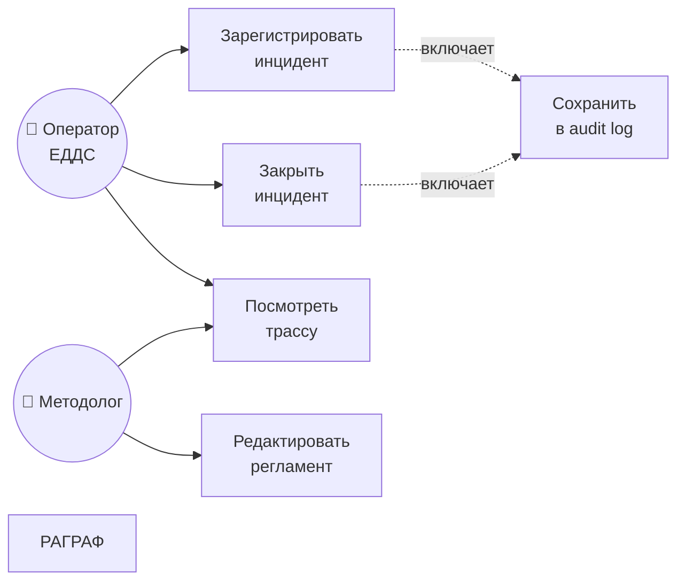

Это **высокоуровневый Use Case**. Из него ясно: оператор и методолог имеют разные роли, у них пересечение только в «посмотреть трассу». А запись в audit log происходит автоматически при регистрации и закрытии инцидента (`<<include>>` в UML).

Дальше каждый Use Case разворачивается в **детальный** документ. Стандарт — Алистер Коберн.

### Use Case по Алистеру Коберну (детальная форма)

Алистер Коберн — автор популярного шаблона. Документ описывает Use Case детально, разбирая основной поток и альтернативы. Покажу на нашем примере «срабатывание регламента превышения шума».

> **Use Case:** Срабатывание регламента превышения шума у школы
> **ID:** UC-NOISE-001
> **Уровень:** Подзадача (subfunction)
> **Главный актёр:** Регламент «Шум у школы»
> **Заинтересованные лица:**
> - Методолог — хочет, чтобы регламент сработал корректно
> - Жители — хотят, чтобы школа не работала ночью с шумом
> - Инспектор Роспотребнадзора — хочет аудит-трассу для проверки
>
> **Предусловия:**
> - Регламент «noise-near-school» активен (status=active в РАГРАФ)
> - Датчик шума `noise-school-12` онлайн
> - Текущее время — после 23:00 или до 7:00 (ночное время по СанПиН 1.2.3685-21, табл. 5.35)
>
> **Гарантия успеха (постусловие):**
> - Создана задача в LEYKA «Проверить источник шума у школы №12»
> - Прогон записан в журнал прогонов `etl_runs` (входы, уровень, рекомендация) и в `regulation_metrics` (исход критерия)
> - Дежурному ушло сообщение в Telegram: уровень, предписание и основание — величина, порог, зона
> - На дашборде ЕДДС появилась карточка инцидента
>
> **Триггер:**
> - Датчик `noise-school-12` отдал показание `value > 45 дБА` (ночная норма для территории у образовательной организации — LAэкв 45 дБА)
>
> **Основной поток:**
> 1. Сборщик данных (`etl/puller.py`) по расписанию забирает показание датчика и пишет снимок в `etl_snapshots`.
> 2. На такте планировщика (`etl/scheduler.py`) applier прогоняет все регламенты областей автоисполнения (`APPLY_DOMAINS`, среди них `nsk_city`) на последних снимках.
> 3. Flow executor запускает регламент «noise-near-school» с входом `noise=58 дБА`.
> 4. Threshold-узел отмечает превышение (ночная норма 45 дБА).
> 5. Switch выбирает ветку «alarm».
> 6. Сработал выход с действием `create_leyka_task`; критерий регламента — «задача закрыта в срок» (`task_closed_within_sla`), поэтому applier вызывает `leyka_task_creator.ensure_task()` и пишет номер задачи в `regulation_metrics.task_ref`.
> 7. LEYKA создаёт задачу; вердикт с основанием (величина, порог, зона) уходит в чат дежурного в Telegram.
> 8. acceptance_resolver на каждом такте сбора проверяет, закрыта ли задача в срок (по умолчанию — 24 часа).
>
> **Альтернативные потоки:**
> - **3а. Датчик offline (нет значения):** вход получает «неизвестно», нижние узлы не срабатывают, вердикт — «нет данных», а в трассе названо, какой величины не хватило (см. tutorial-06 из курса РАГРАФ-V1). Ветви «датчик молчит» с вызовом бригады в tutorial-06 нет — такое требование пиши отдельно. ⚠ «Нет значения» бывает только у датчика, который не прислал ни одного показания: сборщик берёт последний снимок без предела давности, и замолчавший датчик РАГРАФ продолжает считать по старому показанию (`docs/BACKLOG.md`, запись от 14.10.2026, п. 0 — молчащий источник).
> - **6а. LEYKA недоступна:** `ensure_task()` возвращает `None`, прогон не падает, метрика пишется без `task_ref`; критерий резолвер оценит запасным правилом — по числу просроченных задач LEYKA.
> - **8а. Задача не закрыта в срок:** acceptance_resolver ставит `criterion_passed = false`. Действие при провале («эскалация мастеру») регламент хранит текстом в `failure_actions` — само оно не исполняется; эскалацию в РАГРАФ строят ветвью регламента.
>
> **Расширения (extensions):**
> - Если в этот же интервал срабатывает регламент по PM2.5 — у каждого регламента свой прогон и своя запись. Объединения в один инцидент в РАГРАФ нет: `incident_id` создаётся заново на каждый вызов `POST /api/regulations/{id}/execute`. Для твоей системы это отдельное требование.
>
> **Частота:** ~2–5 срабатываний в сутки на 60 датчиков по школам.
> **Особые требования:** PROV-O трасса обязательна, ссылка на СанПиН 1.2.3685-21 пункт N.

Если ты можешь написать такой документ для своего проекта — ты уже половина системного аналитика. Вторая половина — научиться писать его быстро (1–2 часа на Use Case средней сложности).

💡 **От Коберна к требованию и испытанию.** В порядке работы, по которому строится РАГРАФ (навык SKICODING из набора NSU-AI-SKILLS), сценарий — узел, из которого выводятся и требование, и испытание:

```
интервью → сценарий → требование задания (4.х) → испытание (И-х) → строка ведомости покрытия
```

Каждое звено ссылается на соседние по номеру, и вопрос «чем закрыт пункт 4.1.5» получает ответ за десять секунд, а не за день поисков. Самый ценный раздел сценария — «Что считается отказом», то есть твои альтернативные потоки 3а, 6а, 8а: удачный путь все и так знают, а испытание, которое что-то ловит, вырастает из отказа.

Как это выглядит в РАГРАФ на 30.10.2026:
- **Требование — утверждение о сделанном.** В техническом задании РАГРАФ-ФРЕЙМ-1 (ред. 3.1, `backend/data/gost19/ragraf/`) за каждым пунктом раздела 4 стоят ссылки `файл:строка` и место в интерфейсе, где результат видно. Таких пунктов 82 (`grep -c -- '— реализация:'` по файлу задания). Несделанное вынесено в приложение А.
- **Сверка ловит дефекты.** Когда прежнюю редакцию задания сверили с кодом, нашлось 74 расхождения, и пятнадцать из них оказались не «ещё не сделано», а дефектами: функция работала не так, как написано, и молчала об этом.
- **Испытание подписано пунктом.** У настройки АРХИ прогонщик приёмки `scripts/acceptance_tests.py` держит 75 наборов проверок, каждый — с пунктом её ТЗ: `"test_compare_inside_range.py": {"tz": "4.1.2 (5), 4.1.9.1", …}`. Из этой таблицы собирается трассировка в ПМИ РАГРАФ-СТРОЙ-51.

⚠ Пробел назван честно: отдельного файла сценариев (`docs/USE-CASES.md`, как велит навык) в РАГРАФ пока нет — звено «сценарий» живёт в разборах `docs/*-RAZBOR.md` (21 файл). Программа испытаний самого фреймворка РАГРАФ-ФРЕЙМ-51 в ведомости комплекта значится как «планируется».

### Чек-лист качества требований

📋 Каждое требование должно быть:

- [ ] **Полным** — нет дыр, ничего не подразумевается «по умолчанию»
- [ ] **Корректным** — не противоречит другим требованиям
- [ ] **Реализуемым** — не «телепортировать инспектора», а «отправить SMS»
- [ ] **Необходимым** — если убрать, кому-то реально станет хуже
- [ ] **Приоритетным** — есть ранг: must / should / could / won't (методология MoSCoW)
- [ ] **Однозначным** — не «быстро», а «менее 500 мс»
- [ ] **Проверяемым** — есть способ убедиться, что выполнено
- [ ] **Трассируемым** — можно проследить, откуда взялось

Последнее — самое важное. Каждое функциональное требование должно ссылаться на бизнес-требование, из которого оно выросло. И обратно: каждая строка кода в идеале должна трассироваться до требования. В РАГРАФ связь с нормой держит **регламент**, а не параметр: у регламента есть `source_document` (акт) и `source_clause` (пункт) — колонки таблицы `regulations` в [regulation_store.py](../backend/app/services/regulation_store.py), — а прикреплённый документ-основание (ссылка, цитата, файл с контрольной суммой SHA-256) выгружается в Turtle связью PROV-O `prov:wasDerivedFrom`. Основание заполнено у 21 из 65 поставочных регламентов (`grep -l ':sourceDocument' backend/data/fixtures/*.data.ttl | wc -l`, 30.10.2026). Это и есть трассировка «требование → код → данные → результат».

### Трассировка: требование → код → тест → документация

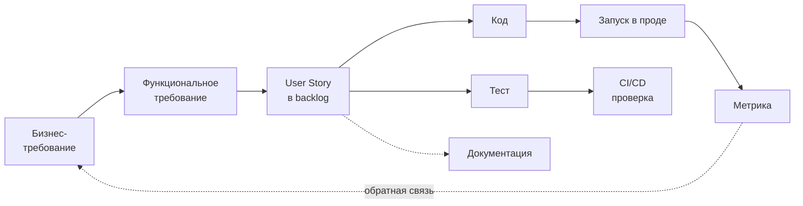

В РАГРАФ эта цепочка реализована через несколько артефактов (состояние на 30.10.2026):
- техническое задание РАГРАФ-ФРЕЙМ-1 в `backend/data/gost19/ragraf/` — требования: каждый пункт раздела 4 — утверждение о сделанном со ссылкой `файл:строка` и местом в интерфейсе, несделанное — в приложении А (прежняя редакция — `docs/TZ_RAGRAF.md`)
- `docs/*-RAZBOR.md` — разборы тем: фаза закрывается ссылкой на коммит и проверку
- `docs/BACKLOG.md` — отложенное: замер, что сделано, что осталось, признак возврата
- код в `backend/app/` — реализация
- проверки в `backend/tests/` — 1174 штуки (`cd backend && .venv/bin/python -m pytest --collect-only -q`); гоняются пакетами по цене: `scripts/proverki.sh dym`, `bazovyy`, `polnyy`. Отдельного сервера CI нет: перед коммитом запускают `scripts/proverki.sh kommit`, а Railway выкатывает прод из ветки `main`
- `regulation_metrics` (таблица в DuckDB) — исход каждого прогона
- комплект ГОСТ 19 (`backend/data/gost19/ragraf/`) и `docs/GLOSSARY.md` — документация

На уровне **данных** трассу даёт основание вердикта: с 15.10.2026 сообщение о вердикте несёт до пяти строк о том, на чём он вынесен, — величины, формулу, зону и её границы (`backend/app/services/osnovanie.py`). Нормативный акт и пункт записаны в самом регламенте, а в выгрузке Turtle документ-основание связан с ним по PROV-O. Это уровень аудита, который раньше требовал отдельной системы, — а в РАГРАФ встроен в саму платформу.

### Diagrams.net и Mermaid

Два главных инструмента диаграмм для системного аналитика.

**Diagrams.net** (бывший draw.io) — графический редактор UML. Бесплатный, работает в браузере. Подходит для:
- Сложных UML-диаграмм классов и состояний
- Архитектурных карт с иконками сервисов (AWS/Azure/GCP)
- Документов, где важна визуальная аккуратность

**Mermaid** — текстовый язык для диаграмм. Рендерится в Markdown (на GitHub, в Notion, в Obsidian, в Confluence). Подходит для:
- Быстрых блок-схем (flowchart)
- Sequence-диаграмм («сначала клиент → потом сервер → потом БД»)
- Диаграмм состояний (state diagram)
- Mind map
- Code-as-diagram — диаграмма живёт в репозитории рядом с кодом

В РАГРАФ диаграммы **в основном Mermaid** (см. [ARCHITECTURE.md](../docs/ARCHITECTURE.md), [GLOSSARY.md](../docs/GLOSSARY.md)). Преимущество — диаграмма обновляется вместе с документом, не отстаёт. Я рекомендую **всегда начинать с Mermaid**, и только если упёрся в его ограничения — переходить в Diagrams.net.

Минимальный пример Mermaid (та же диаграмма стейкхолдеров, но flowchart):

```
flowchart LR
  Z[Заказчик] --> ПО[Платформа]
  П[Пользователи] --> ПО
  И[Интеграторы] --> ПО
  Р[Регуляторы] -.проверяют.-> ПО
```

Mermaid синтаксис примитивен — час на освоение. После этого вся документация твоя.

### Проект 1: «Опиши требования к мини-РАГРАФ для контроля столовой школы»

Это твой первый дипломный спринт. Не маленькое упражнение — полноценный документ требований.

> **Контекст:** директор школы №42 хочет систему, которая контролирует столовую. Какие параметры — должен выяснить ты. Подумай — что в столовой можно автоматически проверять? Температуру блюд? Срок годности продуктов? Чистоту посудомойки? Калорийность меню? Реакцию детей через анкеты?
>
> **Бюджет:** 1.5 млн на первый этап (3 месяца разработки).
> **Команда:** ты + один бэкенд-разработчик + один фронтенд-разработчик.
> **Технологический стек:** РАГРАФ (то есть Python+FastAPI+DuckDB+React) — обязателен, потому что директор хочет «как в кампусе НГУ».

**Что нужно сделать:**

1. **Карта стейкхолдеров** (Mermaid mindmap) — минимум 6 стейкхолдеров с краткими интересами.
2. **Бизнес-требования** — 3–5 пунктов с приоритетом по MoSCoW.
3. **Пользовательские требования** — список User Stories для двух главных ролей (методолог + кто-то ещё).
4. **Функциональные требования** — 15–25 пунктов с уникальными ID (FR-001, FR-002…).
5. **Нефункциональные требования** — 8–12 пунктов (производительность, безопасность, доступность).
6. **Use Case-диаграмма** — UML или Mermaid, 5–8 use cases.
7. **Один детальный Use Case по Коберну** — самый сложный из твоих use cases.
8. **Mermaid-диаграмма архитектуры** — высокоуровневая схема как в РАГРАФ ARCHITECTURE.md.
9. **Трассировка** — таблица «бизнес-требование → функциональное требование → планируемый код модуля».

**Объём:** 15–25 страниц markdown.
**Срок сдачи:** конец спринта 2 (через неделю-полторы после начала).
**Парный аудит:** напарник проверяет по чек-листу качества требований (см. выше).

💡 **Трассировка как проверка готовности: «а если эксперты скажут…»** Однажды мы задали себе вопрос: а если экспертиза пройдёт по системе с перечнем требований и замечаний — на сколько из них у нас уже есть ответ, и можем ли мы его показать? Ответ «вроде бы почти всё сделано» не годится. Поэтому мы разложили каждую возможную претензию в таблицу соответствия — «позиция → что работает сегодня → где это увидеть → что остаётся». Строка такой таблицы выглядит так:

| Позиция | Работает сегодня | Где увидеть | Остаётся |
|---|---|---|---|
| Норма, по которой принято решение, должна быть указана | Нормативное основание регламента: акт, пункт, ссылка, выдержка и документ с контрольной суммой SHA-256 | «Регламенты» — список и редактор регламента; выгрузка пакета | что ещё не сделано — отдельным пунктом плана |

У каждой позиции одно из четырёх состояний: ✅ готово, ◐ основа готова, ▷ добавляется, — вне предмета. У каждого утверждения — место в коде либо команда, которой получено число. Таблица быстро показывает, где ответ уже есть, где есть только основа, а где ответа нет — и последнее полезно узнать раньше экспертов.

Для Проекта 1 возьми у этой таблицы две вещи:
- столбец «Где увидеть»: требование, которое нельзя показать, приёмку не пройдёт;
- правило **«ненаписанное называется ненаписанным»**: несделанное стоит в документе с пометкой, а не исчезает и не выдаётся за сделанное.

В изделии это правило видно прямо в коде. В реестре каналов доставки (`backend/app/services/delivery.py`) почта объявлена с подсказкой «канал объявлен, отправка не реализована», и попытка отправить называет причину отказа. Страница документации показывает ненаписанный документ комплекта ГОСТ 19 с пометкой «Планируется». Неполный комплект с честной ведомостью принимают, полный с приукрашенным содержанием — нет.

### Мини-практика

Чтобы войти в режим, начни с одной маленькой задачи. Возьми **один процесс** из своей повседневной жизни (заказ еды в Яндекс.Еде, оплата метро через Тройку, что угодно) и распиши его как Use Case по Коберну. Один основной поток + два альтернативных. На 15 минут. Это твой разогрев перед Проектом 1.

> В следующем спринте мы перейдём к **SQL и DuckDB** — это даст тебе возможность самостоятельно проверять гипотезы по данным РАГРАФ и не дёргать бэкенд-разработчика по каждому пустяку.

---

## Спринт 3: SQL и DuckDB для аналитиков

> **Сколько займёт:** ~50 часов (этот спринт самый плотный — SQL надо именно НАрабатывать).
> **Артефакт:** решённые 10 SQL-задач + дашборд «топ-проблемных доменов» одним SQL-запросом.

### Главное за минуту

SQL — это вторая (после русского) обязательная грамотность системного аналитика. Без неё ты не сможешь самостоятельно проверить гипотезу «А правда регламент по шуму срабатывает чаще ночью?», и будешь дёргать бэкенд-разработчика. С ней — открываешь DuckDB-консоль и за 15 минут получаешь ответ. В РАГРАФ выбран не Postgres и не SQLite, а именно **DuckDB** — встроенный аналитический (OLAP, Online Analytical Processing) движок. Основания записаны в пояснительной записке РАГРАФ-ФРЕЙМ-81, п. 3.4.5: изделие ставится одним процессом без сетевой СУБД, вплоть до ноутбука проверяющего, а методолог всё время чередует «открыл регламент — увидел статистику — поправил». У выбора есть цена: журналы РАГРАФ пишутся частыми мелкими записями, и под это пришлось строить своё — одно соединение на процесс под замком, восстановление журнала WAL после сбоя, ручную доводку схемы старых баз (разбор одного такого сбоя — `docs/OBRATNAYA-SVYAZ-RAZBOR.md`, § 9). Этот спринт — самый плотный в Блоке A, потому что SQL надо именно НАбивать руки, а не учить теорией.

### О чём этот спринт

Поэтапно: что такое реляционная база данных → SELECT/WHERE/JOIN/GROUP BY → подзапросы и CTE → оконные функции → особые возможности DuckDB → бонус про SPARQL. Параллельно — 10 задач на нашей схеме (regulations, parameters, regulation_metrics, incident_audit_log — база `regulations.duckdb`; etl_snapshots — база `live_etl.duckdb`).

### Базы данных — что это и почему DuckDB

**База данных** — программа для хранения структурированных данных + язык запросов к ним. Структурированных — значит «таблицы со строками и колонками», как в Excel, только большие и быстрые.

Базы делятся на:
- **SQL** (реляционные) — данные в таблицах, связи через foreign keys. Postgres, MySQL, SQLite, DuckDB. Это 80% мира.
- **NoSQL (document)** — данные как JSON-документы. MongoDB. Хорошо для динамичных схем (соцсети, чаты).
- **NoSQL (key-value)** — простой словарь «ключ → значение». Redis. Хорошо для кэшей.
- **Graph** — данные как граф из вершин и рёбер. Neo4j. Хорошо для социальных сетей, рекомендаций.

Дальше внутри SQL-баз есть деление на:
- **OLTP** (Online Transaction Processing) — много мелких записей и чтений в секунду. Postgres, MySQL. Используется в банках, маркетплейсах.
- **OLAP** (Online Analytical Processing) — большие аналитические запросы, агрегаты, окна. ClickHouse, DuckDB. Используется в BI-дашбордах, аналитике.

**Почему в РАГРАФ DuckDB**:

| Альтернатива | Почему не взяли |
|---|---|
| SQLite | OLTP-движок, плохо работает с аналитическими запросами (GROUP BY на миллион строк = смерть). Нам нужна аналитика по snapshot'ам. |
| Postgres | Требует отдельного сервера, дополнительный operational overhead, для embedded-сценария избыточно. РАГРАФ ставится одним процессом — контейнером по `Dockerfile`, сценарием `start.sh` или установщиком — без отдельной СУБД (ТЗ РАГРАФ-ФРЕЙМ-1, раздел 4.4). |
| MySQL | Та же история, что и Postgres. Плюс MySQL хуже работает со сложным SQL. |
| MongoDB | Не реляционная — нам нужны JOIN'ы и SHACL/PROV-O вживую складываются в нормальные таблицы. |
| ClickHouse | Кластерный по дизайну, для одной мэрии города Х оверкилл. |
| **DuckDB** | Embedded (живёт как файл), OLAP-движок (быстрые агрегаты), читает Parquet и CSV без импорта, нативный Python-API. |

Для города Х выбор DuckDB сохранится. Платформа Σ Сигма устроена иначе: семантическое хранилище Apache Jena плюс отдельная реляционная СУБД — так их обосновала НИР 2025 года (пояснительная записка РАГРАФ-ФРЕЙМ-81, п. 3.4.5). Регламенты РАГРАФ переезжают туда файлами Turtle без переписывания. Честная оговорка из той же записки: загрузка такой выгрузки в хранилище триплетов пока не испытывалась.

### Схема таблиц РАГРАФ (для практических заданий)

Возьмём упрощённую версию реальной схемы. Таблицы лежат в двух файлах: `regulations`, `parameters`, `regulation_metrics`, `incident_audit_log` — в `backend/data/regulations.duckdb` (полная схема — [regulation_store.py](../backend/app/services/regulation_store.py)), `etl_snapshots` — в `backend/data/live_etl.duckdb` ([live_data_store.py](../backend/app/services/live_data_store.py)). Настоящие таблицы шире: у `regulations` 49 колонок (`PRAGMA table_info('regulations')`, 30.10.2026).

```sql
-- Регламенты (база regulations.duckdb; в настоящей таблице 49 колонок)
CREATE TABLE regulations (
    source_id      VARCHAR PRIMARY KEY,  -- 'tutorial-01-basic-threshold'
    name           VARCHAR NOT NULL,      -- 'Урок 1. Порог с тремя зонами: …'
    domain         VARCHAR,               -- 'tutorial', 'nsk_city', 'construction', 'campus'
    version        VARCHAR NOT NULL DEFAULT '1.0',
    status         VARCHAR NOT NULL DEFAULT 'draft',  -- 'draft' | 'active' | 'archived'
    source_document VARCHAR,              -- нормативный акт: 'СП 124.13330.2012'
    source_clause   VARCHAR,              -- пункт акта: 'п. 7.2.3'
    updated_at     TIMESTAMP NOT NULL     -- время ПОСЛЕДНЕЙ правки; история — regulation_history
);

-- Параметры регламента (что меряем)
CREATE TABLE parameters (
    source_id      VARCHAR NOT NULL,     -- FK к regulations.source_id
    id             VARCHAR NOT NULL,     -- 'airTemperature'
    name           VARCHAR NOT NULL,     -- 'Температура серверной'
    datatype       VARCHAR NOT NULL,     -- 'decimal' | 'string' | 'date' | 'boolean'
    ref_value      DOUBLE,               -- эталонное значение
    deviation      DOUBLE,               -- допустимое отклонение
    unit           VARCHAR,              -- '°C', 'дБ', 'мкг/м³'
    PRIMARY KEY (source_id, id)
);

-- Прогоны регламентов и исход критерия: одна строка — один прогон
-- (сработал ли регламент — колонка triggered)
CREATE TABLE regulation_metrics (
    run_id           VARCHAR PRIMARY KEY, -- у прогонов по расписанию — тот же run_id, что в etl_runs
    regulation_id    VARCHAR NOT NULL,    -- ссылка на regulations.source_id (FOREIGN KEY в базе не объявлен)
    ts               TIMESTAMP NOT NULL,  -- UTC без зоны
    triggered        BOOLEAN NOT NULL,    -- сработал ли регламент в этом прогоне
    level            INTEGER NOT NULL,    -- 0=норма, 1=внимание, 2=опасно, 3=критично
    criterion_kind   VARCHAR,             -- 'no_violation' | 'task_closed_within_sla' | 'feedback_received' | ...
    criterion_passed BOOLEAN,             -- TRUE / FALSE / NULL = исход не решён: мера ждёт срока или не задана
    latency_ms       INTEGER NOT NULL,
    region           VARCHAR,             -- место замера: 'novosibirsk', 'akademgorodok', 'moscow'
    task_ref         VARCHAR              -- ID задачи в LEYKA
);

-- Snapshot'ы от ETL-источников (входные данные)
CREATE TABLE etl_snapshots (
    ts             TIMESTAMP NOT NULL,
    source_id      VARCHAR NOT NULL,    -- 'open-meteo-air', 'leyka-tasks'
    subtype        VARCHAR NOT NULL,    -- 'om-air-quality'
    field          VARCHAR NOT NULL,    -- 'current.pm2_5'
    value          DOUBLE,
    region         VARCHAR
);

-- Журнал инцидентов (раздел «Журнал прогонов»): ручной запуск и вызов
-- POST /api/regulations/{id}/execute, скоринг, скрининг. Прогоны по расписанию — в etl_runs
CREATE TABLE incident_audit_log (
    entry_id        VARCHAR PRIMARY KEY,
    incident_id     VARCHAR NOT NULL,
    timestamp       TIMESTAMP NOT NULL,
    event_type      VARCHAR NOT NULL,
    regulation_id   VARCHAR,
    level           INTEGER,
    recommendation  TEXT,
    user_id         VARCHAR,
    user_action     VARCHAR
);
```

⚠ **Живой урок: `CREATE TABLE IF NOT EXISTS` не меняет таблицу, которая уже есть.** Таблицы РАГРАФ создаются при старте сервера именно так. Пустую базу команда создаёт правильно, а таблицу, которая уже лежит на томе, не трогает, даже если в коде у неё появилась новая колонка.

Так и вышло с опросами в сообщениях. Таблицу `feedback_opros` на томе прода создала версия 08.10.2026 (коммит `9111790`). 09.10 в схему добавили колонку `tekst` — текст сообщения, в который дописываются ответы (коммит `4da7d7c`). До тома колонка не доехала. С 09 по 27.10.2026:
- запись каждого опроса падала на отсутствующей колонке, а ошибка гасилась предупреждением в журнале процесса;
- нажав кнопку в чате, человек видел «Этот вопрос больше не действует — ответ не записан»;
- сообщения при этом уходили, и журнал доставок показывал успех.

Восемнадцать дней контур обратной связи не работал, и ни один журнал этого не показал. Сбой нашёл владелец: ответил «Да» и «Нет» в чате, а на дашборде кампуса ответов не появилось. Проверки его не поймали: каждая создаёт базу заново, уже по новой схеме (`docs/OBRATNAYA-SVYAZ-RAZBOR.md`, § 9).

Лечение (коммит `5188893`): при старте сервер сверяет таблицы с перечнем `_DOBAVLENNYE_KOLONKI` в `backend/app/services/feedback_store.py` и добавляет недостающие колонки:

```sql
PRAGMA table_info('feedback_opros');                  -- какие колонки есть на томе
ALTER TABLE feedback_opros ADD COLUMN tekst VARCHAR;  -- только если tekst в ответе нет
```

Тот же приём с мая стоит в `regulation_store.py` и описан в ARCHITECTURE.md § 4.4, но в новый модуль его не перенесли. Теперь его держит проверка на таблице ровно в схеме 08.10: `test_tablica_oprosov_prezhney_versii_poluchaet_kolonku`.

🎯 Для аналитика: у каждой таблицы две схемы — в коде и на томе. Вторую показывает только `PRAGMA table_info` на самой базе.

### SQL-основы: SELECT, WHERE, JOIN, GROUP BY

**SELECT — самое главное**. Это «покажи мне такие-то колонки из такой-то таблицы»:

```sql
-- Все регламенты в домене tutorial
SELECT source_id, name, version
FROM regulations
WHERE domain = 'tutorial';
```

**WHERE — фильтрация**:

```sql
-- Только действующие регламенты городской среды (экология — регламент nsk-ecology в этом домене)
SELECT name FROM regulations
WHERE domain = 'nsk_city' AND status = 'active';
```

**ORDER BY — сортировка**:

```sql
-- Последние 10 прогонов
SELECT regulation_id, ts, level FROM regulation_metrics
ORDER BY ts DESC LIMIT 10;
```

**JOIN — соединение таблиц**. Самая частая операция аналитика. Если у тебя метрики в одной таблице, а имена регламентов в другой — JOIN соединит.

```sql
-- Прогоны вместе с именами регламентов
SELECT m.ts, r.name, m.level, m.criterion_passed
FROM regulation_metrics m
JOIN regulations r ON m.regulation_id = r.source_id
WHERE m.ts > CURRENT_DATE - INTERVAL 7 DAY
ORDER BY m.ts DESC;
```

Виды JOIN:
- `INNER JOIN` (просто `JOIN`) — строки, где совпадение есть в обеих таблицах
- `LEFT JOIN` — все строки из левой + совпадения из правой (NULL если нет)
- `RIGHT JOIN` — наоборот
- `FULL OUTER JOIN` — всё со всех сторон

**GROUP BY — агрегаты**. Самое важное для дашбордов.

```sql
-- Сколько раз каждый регламент прогнали и сколько раз он сработал за неделю
SELECT regulation_id,
       COUNT(*)                          AS runs,
       COUNT(*) FILTER (WHERE triggered) AS fires
FROM regulation_metrics
WHERE ts > CURRENT_DATE - INTERVAL 7 DAY
GROUP BY regulation_id
ORDER BY fires DESC;
```

Функции агрегации: `COUNT()`, `SUM()`, `AVG()`, `MIN()`, `MAX()`. Сложнее: `COUNT(DISTINCT)`, `STRING_AGG`, `ARRAY_AGG`.

**HAVING — фильтр после агрегации** (WHERE — до, HAVING — после):

```sql
-- Регламенты, которые прогоняли более 50 раз
SELECT regulation_id, COUNT(*) as runs
FROM regulation_metrics
GROUP BY regulation_id
HAVING runs > 50;
```

### Подзапросы, CTE, оконные функции

**Подзапрос** — SELECT внутри SELECT. Иногда удобно, часто — нечитаемо.

```sql
-- Регламенты, у которых были прогоны (через подзапрос)
SELECT name FROM regulations
WHERE source_id IN (
    SELECT DISTINCT regulation_id FROM regulation_metrics
);
```

**CTE (Common Table Expression)** — «временная таблица» в одном запросе. Читабельнее подзапросов.

```sql
-- Тот же запрос через CTE
WITH active_regs AS (
    SELECT DISTINCT regulation_id FROM regulation_metrics
)
SELECT r.name FROM regulations r
JOIN active_regs a ON r.source_id = a.regulation_id;
```

CTE можно собирать в цепочки — `WITH a AS (...), b AS (...) SELECT ...`. Это твой главный инструмент для **сложной аналитики**.

**Оконные функции** — самая мощная штука SQL. Это агрегат, который не теряет деталь.

Пример: для каждого срабатывания регламента показать его номер по порядку:

```sql
SELECT regulation_id, ts,
       ROW_NUMBER() OVER (PARTITION BY regulation_id ORDER BY ts) as run_num
FROM regulation_metrics;
```

Или — для каждого срабатывания показать скользящее среднее последних 5 срабатываний:

```sql
SELECT ts, level,
       AVG(level) OVER (
         PARTITION BY regulation_id
         ORDER BY ts
         ROWS BETWEEN 4 PRECEDING AND CURRENT ROW
       ) as moving_avg
FROM regulation_metrics;
```

Оконные функции — это то, что отличает базового SQL-юзера от продвинутого. Прокачай их.

### Особые возможности DuckDB

Главная фишка DuckDB — она читает файлы напрямую, без импорта.

**read_csv**:

```sql
-- Прочитать CSV прямо из файла
SELECT * FROM read_csv('/tmp/yandex-traffic.csv') LIMIT 10;
```

**read_parquet**:

```sql
-- Прочитать parquet (компактный бинарный формат)
SELECT region, AVG(value) FROM read_parquet('/tmp/snapshots.parquet')
GROUP BY region;
```

**read_json**:

```sql
-- Прочитать JSON: DuckDB сам разложит поля по колонкам
SELECT current.pm2_5 AS pm25
FROM read_json('/tmp/openmeteo.json');

-- Или достать поле из JSON-строки: сырой ответ Open-Meteo лежит в etl_snapshots.raw_payload
SELECT ts, json_extract(raw_payload, '$._raw.current.pm2_5') AS pm25
FROM etl_snapshots
WHERE subtype = 'om-air-quality' AND field = 'current.pm2_5' AND raw_payload IS NOT NULL;
```

Это **революция** для аналитика. Тебе не нужно «загрузить данные в БД», просто читай файлы. Один запрос может объединять CSV из мэрии, Parquet с датчиков и JSON из Open-Meteo. Раньше для этого был нужен Python с pandas. Теперь — одна строка SQL.

**Pivot/Unpivot** — DuckDB умеет нативный pivot:

```sql
PIVOT regulation_metrics
ON criterion_kind
USING COUNT(*)
GROUP BY regulation_id;
```

Это сразу даёт тебе таблицу: строки — регламенты, колонки — типы критериев, значения — счётчики. Помнишь, в Excel есть «сводная таблица»? Это она и есть, только из SQL.

**ATTACH** — подключение нескольких баз:

```sql
ATTACH 'backend/data/live_etl.duckdb' AS etl (READ_ONLY);
SELECT * FROM etl.etl_snapshots LIMIT 10;
```

Это пригодится, потому что в РАГРАФ две DuckDB-базы — `regulations.duckdb` и `live_etl.duckdb` (см. [ARCHITECTURE.md §4.1](../docs/ARCHITECTURE.md)) — и иногда хочется JOIN между ними: например, `regulation_metrics` и журнал прогонов `etl_runs` связаны общим `run_id`. В коде РАГРАФ такие JOIN запрещены (ADR-004 в [ARCHITECTURE.md §12](../docs/ARCHITECTURE.md)), но для аналитики на свой страх и риск можно.

### Бонус: SPARQL над Turtle

Помнишь, в курсе РАГРАФ-V1 ты сохранял регламенты как **Turtle-файлы**? Это W3C-стандарт для семантического веба (RDF). Над Turtle есть свой язык запросов — **SPARQL**. По синтаксису похож на SQL, но запрашивает граф, а не таблицу.

Пример: найти регламенты, основание которых — правила Минэнерго. Словарь настоящий, из файлов `backend/data/fixtures/*.data.ttl`:

```sparql
PREFIX : <http://regulations.local/ontology#>

SELECT ?reg ?name ?doc WHERE {
  ?reg a :Regulation ;
       :name ?name ;
       :sourceDocument ?doc .
  FILTER(CONTAINS(?doc, "Минэнерго"))
}
```

Этот вопрос в РАГРАФ решается и SQL'ем: `source_document` — колонка таблицы `regulations`. SPARQL выигрывает там, где путь длиннее одного шага, например «регламент → триггер → подтип датчика» (`:hasTrigger`, `:sensorSubtype` в выгрузке Turtle). В самом РАГРАФ SPARQL работает в «Конструкторе графа знаний» (`/knowledge`): над датасетами, загруженными из CSV, есть «SPARQL Workbench» — 29 готовых запросов-пресетов и поле для своего запроса (`POST /api/knowledge/sparql`). Системному аналитику знать на уровне «понимаю, как читать» — обязательно. Писать с нуля — необязательно, пока не дойдёшь до архитектуры Σ Сигмы (там SPARQL уже базовая грамотность).

Кратко, чем отличается:

| Параметр | SQL | SPARQL |
|---|---|---|
| Что запрашиваем | Таблицы и строки | Граф из триплетов |
| Главная конструкция | `SELECT FROM WHERE` | `SELECT WHERE { triple pattern }` |
| JOIN | Явный (`JOIN ON`) | Неявный (через переменные в triple-паттернах) |
| Где используется в РАГРАФ | Метрики, журналы и аналитика (DuckDB) | Датасеты графа знаний («SPARQL Workbench»); у регламентов PROV-O есть только в выгрузке Turtle |

### 10 SQL-задач для практики

Решаем в DuckDB. В репозитории РАГРАФ лежат обе базы — `backend/data/regulations.duckdb` и `backend/data/live_etl.duckdb` (не путай со старым `data/regulations.duckdb` в корне, от 19.05.2026). Данные в них — с машины разработки, не с прода: прогоны по 23.07.2026, снимки по 04.09.2026, есть и тестовые источники `test`, `priority-test`. Поэтому окна «за неделю» и «за месяц» отсчитывай не от `CURRENT_DATE` (на копии получишь пустой ответ), а от `(SELECT max(ts) FROM regulation_metrics)`. Боевые базы живут на томе Railway, снаружи их читают только через GET-ручки (`/api/live/runs`, `/api/live/feedback`, `/api/regulations/{id}/metrics/recent`); из российских сетей Railway без VPN недоступен. Или сгенерируй фейк-данные по схеме выше.

⚠ Открывай **копию** базы и только на чтение: запущенный сервер РАГРАФ держит файл, и второй процесс получит `Could not set lock on file … Conflicting lock is held`. Консоль DuckDB ставится отдельно (`brew install duckdb`), а без неё годится движок из окружения бэкенда: `backend/.venv/bin/python -c "import duckdb; print(duckdb.connect('копия.duckdb', read_only=True).sql('SHOW TABLES'))"`. В задачах ниже строка `regulation_metrics` — это **прогон**; «срабатывание» — прогон с `triggered = TRUE`.

**Задача 1 (warm-up):** Покажи имена всех регламентов в домене `nsk_city`.

**Задача 2:** Сколько регламентов в каждом домене? Отсортируй по убыванию.

**Задача 3:** Для каждого регламента — сколько у него параметров? (JOIN regulations + parameters + GROUP BY)

**Задача 4:** Покажи регламенты, которые НИ РАЗУ не срабатывали за последний месяц. (LEFT JOIN + WHERE IS NULL)

**Задача 5:** Топ-5 регламентов по числу срабатываний за последнюю неделю.

**Задача 6:** Какой регламент чаще всех срабатывает по ночам (с 23:00 до 7:00 по Новосибирску)? `ts` в журналах РАГРАФ хранится в UTC, поэтому бери `EXTRACT(hour FROM ts + INTERVAL 7 HOUR)`, условие `triggered` и GROUP BY.

**Задача 7:** Для каждого региона — средний `latency_ms` срабатываний. Где самые медленные?

**Задача 8 (CTE):** Найди регламенты, у которых `criterion_passed = FALSE` встречается чаще, чем `TRUE`. (Используй CTE для подсчёта проходов/непроходов).

**Задача 9 (оконная функция):** Для каждого регламента покажи временную дельту между его срабатываниями (`ts` минус предыдущий `ts` через `LAG()`).

**Задача 10 (дашборд):** Собери одним SQL-запросом данные для дашборда «топ-проблемных доменов». Колонки:
- `domain`
- `total_runs` — всего прогонов за месяц
- `failed_runs` — где `criterion_passed = FALSE`
- `failure_rate` — отношение `failed_runs / total_runs * 100` (в процентах)
- `slowest_latency_ms` — самый медленный прогон
- `last_run_ts` — последний прогон

Отфильтруй только домены, где `total_runs >= 10` (иначе статистика шумная). Отсортируй по `failure_rate` убыванию.

**Подсказка к задаче 10:** Один CTE для агрегации по доменам, потом JOIN с regulations, потом фильтрация и сортировка. ~25–35 строк SQL.

⚠ **Две ловушки живых журналов РАГРАФ.** Проверь их до того, как сдавать задачи 6, 8 и 10.

**1. Время — в UTC, и не во всех журналах одинаково.** `regulation_metrics.ts` пишется в UTC без зоны, так что ночь по Новосибирску (23:00–7:00) в базе выглядит как 16:00–24:00. Хуже того, если процесс работает не в зоне UTC, журналы `etl_snapshots`, `etl_runs` и `delivery_log` сдвигаются на зону процесса. Проверь сам: в сеансе на `regulations.duckdb` соедини два журнала одного прогона.

```sql
ATTACH 'backend/data/live_etl.duckdb' AS etl (READ_ONLY);
SELECT date_diff('minute', m.ts, r.ts) AS sdvig_min, count(*) AS n
FROM regulation_metrics m JOIN etl.etl_runs r USING (run_id)
GROUP BY 1 ORDER BY n DESC;
```

Замер 30.10.2026 на копии баз из репозитория: у 15 964 прогонов сдвиг 420 минут — ровно семь часов зоны машины разработки. На Railway процесс работает в UTC, и на проде сдвига нет. Дефект записан в `docs/BACKLOG.md` («Время в журналах сдвигается на зону процесса», 08.10.2026).

**2. Доля провалов меряет меру, а не регламент.** 08.10.2026 карточка регламента форточек `nsk-cold-snap-windows` показала «Срочная ревизия»: 21 823 «провала» из 25 837. Регламент работал правильно. Мерой стоял `no_violation`, то есть «успех — когда не сработал». Октябрьские ночи в Новосибирске почти каждый раз холоднее порога, и каждое честное «внимание» записывалось провалом: провалы измеряли погоду (`docs/INSPEKCIYA-FORTOCHEK-RAZBOR.md`). Прежде чем ставить домен в топ задачи 10, посмотри `criterion_kind` его регламентов. `NULL` в `criterion_passed` — не провал, а «исход не решён». Прогноз РАГРАФ (оценка Лапласа) тоже берёт только решённые прогоны и включается от десяти таких.

**Эталонный ответ к задаче 10** (не подглядывай раньше времени):

```sql
WITH domain_stats AS (
    SELECT r.domain,
           COUNT(*) as total_runs,
           SUM(CASE WHEN m.criterion_passed = FALSE THEN 1 ELSE 0 END) as failed_runs,
           MAX(m.latency_ms) as slowest_latency_ms,
           MAX(m.ts) as last_run_ts
    FROM regulation_metrics m
    JOIN regulations r ON m.regulation_id = r.source_id
    WHERE m.ts > CURRENT_DATE - INTERVAL 30 DAY
    GROUP BY r.domain
)
SELECT domain,
       total_runs,
       failed_runs,
       ROUND(failed_runs * 100.0 / total_runs, 2) as failure_rate,
       slowest_latency_ms,
       last_run_ts
FROM domain_stats
WHERE total_runs >= 10
ORDER BY failure_rate DESC;
```

### Мини-практика

После всех 10 задач — открой свою боевую базу (РАГРАФ-локалка, или экспорт из метрик курса РАГРАФ-V1) и **сам придумай** три аналитических вопроса, которые тебе интересны. Например: «А с какой периодичностью я редактирую регламенты?» (это `SELECT DATE_TRUNC('day', created_at), COUNT(*) FROM regulation_history GROUP BY 1 ORDER BY 1`: каждое сохранение пишет снимок в `regulation_history`, а `regulations.updated_at` хранит только последнюю правку). Или: «А есть ли регламенты, которые я никогда не открывал после первого создания?» — сначала проверь, можно ли на это ответить: журнала открытий в РАГРАФ нет, есть только журнал сохранений. Вопрос, на который данных нет, — это новое требование, а не задача для SQL.

Это — главный навык. Не запоминание синтаксиса, а **умение формулировать вопрос как SQL-запрос**. Когда это войдёт в привычку — ты больше не будешь дёргать бэкенд-разработчика по каждому пустяку.

### Итог спринта 3

Артефакт — markdown-файл с 10 решёнными задачами + дашборд-запрос. Сдаётся в LEYKA как M3.S. Парный аудит проверяет:
- [ ] Все 10 задач имеют рабочий SQL (R1)
- [ ] Задача 10 (дашборд) использует CTE или оконные функции (R2)
- [ ] Решения откомментированы (зачем именно так) (R3)
- [ ] Хотя бы одна задача использует DuckDB-специфичные фичи (read_csv, PIVOT) (R4)

---

## Что дальше — Блок B

После трёх спринтов Блока A ты:
- понимаешь, как устроена команда платформы класса РАГРАФ,
- умеешь писать требования с трассировкой,
- бегло читаешь и пишешь SQL на DuckDB.

В Блоке B (спринты 4–6) пойдут инструменты моделирования: **моделирование данных** (ER-диаграммы, нормализация, семантический слой Turtle/SHACL), **моделирование процессов** (BPMN, UML Activity, State Machine, Flow DSL) и **пользовательские интерфейсы** (персоны, wireframes, Telegram-style Лента и cockpit-системы).

Между блоками — короткое домашнее задание: применить навыки Блока A к своему сквозному кейсу «РАГРАФ-для-города-Х». Это твой дипломный проект, который будет расти от спринта к спринту.

К концу курса (Блок D, диплом) у тебя на руках будет:
- спроектированная архитектура «РАГРАФ-для-Х»,
- 80+ функциональных требований с трассировкой,
- ER-диаграмма базы и SQL-схема,
- API-контракт (OpenAPI),
- 3–5 прототипов на Python/React (не production, но рабочие),
- Roadmap внедрения на 12 месяцев с бюджетной оценкой.

Этим документом можно идти к зам.мэру в понедельник и говорить: «У меня готов проект. Нанимаем команду — запускаемся через 3 недели». Это и есть продукт системного аналитика.

---

> *Конец Блока A. Дальше — Блок B (спринты 4–6): моделирование данных, процессов и пользовательских интерфейсов.*

## Блок B. Инструменты системного аналитика: данные, процессы, интерфейсы

> Это второй блок курса «Системный аналитик в эпоху гибридного ИИ». В первом блоке мы разобрались, кто такой системный аналитик и как он смотрит на мир. Теперь — инструменты. Если первый блок был про «уметь думать», то этот — про «уметь моделировать». Три спринта, три плоскости проекции: данные (что хранится), процессы (что происходит во времени), интерфейсы (что видит человек). Между ними — нитка, на которую нанизана вся ваша работа.

---

## Спринт 4: Моделирование данных

### Главное за минуту

Прикинь: ты в приложении заказал доставку еды. В голове у тебя картинка — «я хочу шаурму из «Гирос» через час». В приложении эта же штука уже выглядит иначе: карточка ресторана, корзина, статус. А в базе данных сервиса это вообще куча таблиц с внешними ключами (FK) на пользователя, заказ и ресторан и индексами по ним. **Один и тот же кусок реальности живёт в трёх измерениях** — это и есть три уровня модели данных. Системный аналитик — переводчик между этими тремя языками. В РАГРАФ ровно та же история: «регламент» в голове методолога — это процедура реагирования; в нашей логической модели — связь шести таблиц; на физическом уровне — строки DuckDB, файл графа `flows/{id}.json` и Turtle-описание для обмена. И всё это про одно и то же.

### О чём эта часть

Аналитик 80% времени проводит на стыке предметной области и базы данных. Если ты не умеешь моделировать данные — ты, по сути, переписчик задач от заказчика разработчикам с потерей 30% смысла на каждом шаге. Если умеешь — ты тот человек, без которого фича не взлетает. В этом спринте мы пройдём от концептуальной модели (что вообще есть в нашем мире) до физической (как это лежит в БД) — и заглянем в семантический слой, который РАГРАФ использует как «второй формат» для тех же данных.

### Ключевые термины

**Концептуальная модель** — отвечает на вопрос «что есть в мире?». Сущности и связи на языке бизнеса. Без типов данных, без таблиц, без NULL/NOT NULL. Это нарисованная схема, которую можно показать руководителю ЕДДС, и он скажет «да, у нас примерно так». Уровень — «у нас есть регламенты, у каждого регламента есть параметры и триггеры».

**Логическая модель** — отвечает на «как это организовано?». Сущности превращаются в таблицы, связи — в внешние ключи, появляются типы данных, ограничения. Но ещё не привязано к конкретной СУБД. Можно потом мигрировать с PostgreSQL на DuckDB без переделки модели.

**Физическая модель** — отвечает на «как это лежит в железе?». Уже конкретный DDL — например, так РАГРАФ создаёт таблицу регламентов в DuckDB: `CREATE TABLE IF NOT EXISTS regulations (source_id VARCHAR PRIMARY KEY, name VARCHAR NOT NULL, ...)` (`backend/app/services/regulation_store.py`). Здесь решаются вопросы индексов, партиционирования, denormalization для скорости.

**Сущность (Entity)** — то, про что ты хранишь данные. Регламент, параметр, инцидент, пользователь, датчик. По правилу хорошего вкуса — каждая сущность должна быть на отдельной строке таблицы, а каждая её характеристика — в отдельной колонке.

**Атрибут** — характеристика сущности. У регламента в РАГРАФ: `source_id`, имя, домен, статус, документ-основание и его пункт (`source_document`, `source_clause`), срок действия (`valid_from`, `valid_to`). Атрибуты бывают простые (одно значение) и составные (несколько частей — например, ФИО состоит из имени, фамилии, отчества).

**Связь (Relationship)** — отношение между двумя сущностями. У регламента **есть** параметры (один-ко-многим). Один датчик **может быть привязан** ко многим регламентам (многие-ко-многим).

**Кардинальность** — сколько сущностей с одной стороны связаны со сколькими с другой. 1:1 (один к одному), 1:N (один ко многим), M:N (многие ко многим). Самая частая — 1:N, самая болезненная — M:N (требует промежуточной таблицы).

**Словарь данных** (Data Dictionary) — таблица с описанием каждого поля каждой сущности: имя, тип, обязательность, единица измерения, источник, диапазон допустимых значений. Это «паспорт данных», который читают все — от разработчика до тестировщика.

### Контекст в РАГРАФ/LEYKA

Возьмём слово **«регламент»**. На уровнях:

| Уровень | Что значит «регламент» |
|---|---|
| **Концептуальная модель** | Документ-инструкция: «если в серверной выше 28 — позвать дежурного». Понятная руководителю ЕДДС. |
| **Логическая модель** | Сущность `Regulation` со связями: 1 регламент → N параметров, 1 регламент → N триггеров, 1 регламент → 1 граф (Flow DSL), M регламентов ↔ N процессов (цифровых двойников). |
| **Физическая модель** | DuckDB-таблицы `regulations`, `parameters`, `regulation_triggers` (у `regulations` есть и колонки с JSON-текстом) + рядом файл графа `backend/data/flows/{id}.json`; Turtle-представление (`data.ttl` + `shapes.ttl`) собирается из модели по запросу, а правленный вручную текст хранится в таблице `regulation_raw_turtle`. |

В LEYKA «проект» проходит ровно тот же путь: концепт «проект как контейнер задач» → логика «таблицы projects, tasks, comments; колонка доски — не таблица, а группа статусов задачи» → физика «SQLite + индекс по project_id».

### ER-диаграммы: Crow's Foot vs Peter Chen

ER (Entity-Relationship) — это самый ходовой инструмент аналитика для рисования логической модели. Две главные нотации:

**Peter Chen** (1976) — академическая, олдскульная. Прямоугольники-сущности, ромбы-связи, овалы-атрибуты. Используется в учебниках и для презентаций «верхнего уровня». Минус — занимает много места, для реальной БД из 30 таблиц не годится.

**Crow's Foot** (нотация «вороньей лапки», она же IE/Information Engineering) — индустриальный стандарт. Прямоугольники-сущности с колонками атрибутов внутри; связи — линии с «лапками» (полоска = ровно один, кружок = ноль, лапка = много). Это то, что рисуют в dbdiagram.io, draw.io, DBeaver.

| Когда | Что использовать |
|---|---|
| Презентация бизнес-заказчику | Peter Chen — нагляднее, меньше деталей |
| Передача в разработку | Crow's Foot — индустриальный стандарт |
| Документация к БД | Crow's Foot |
| Быстрый набросок на доске | Crow's Foot (быстрее рисовать) |

#### ER-диаграмма базы регламентов РАГРАФ

Шесть основных таблиц и файл графа. Вот как они связаны (Crow's Foot в Mermaid):

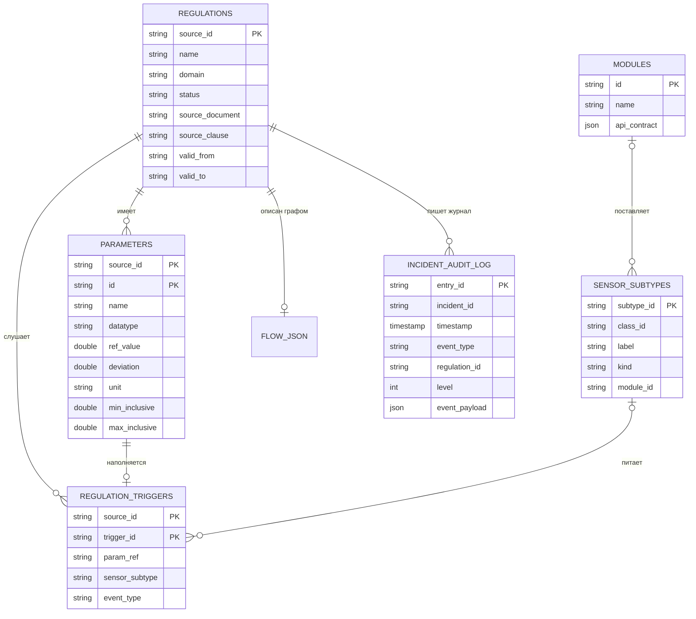

Прочитай эту диаграмму вслух: «У регламента может быть несколько параметров и несколько триггеров. Триггер наполняет ровно один параметр, а у параметра не больше одного триггера. Триггер слушает подтип датчика, подтип может принадлежать модулю — внешней системе-источнику. Граф регламента лежит отдельным файлом, а в журнал инцидентов регламент пишет много записей». Связь «регламент — подтип датчика» — многие-ко-многим, и разрешена она ровно так, как учит теория: промежуточной таблицей `regulation_triggers`. А прямой связи «регламент — модуль» в схеме нет: она выводится через датчик.

⚠ Внешних ключей (`FOREIGN KEY`) в этих таблицах РАГРАФ не объявляет — связи держит код (`backend/app/services/regulation_store.py`). На диаграмме это всё равно связи: логическая модель описывает смысл, а не то, что проверяет СУБД.

Это и есть язык, на котором ты будешь говорить с разработчиком.

### Нормализация: 1NF, 2NF, 3NF, BCNF

Нормализация — это процедура «причёсывания» таблиц, чтобы данные не дублировались и не противоречили друг другу. Звучит сухо — но по сути это инструмент, который помогает не наступить на грабли.

**1NF (первая нормальная форма)** — в одной ячейке таблицы лежит **одно атомарное значение**. Никаких списков через запятую, никаких JSON-массивов «sensor_ids: 1,2,3» в одной колонке.

Плохо:
```
| regulation_id | parameter_names                      |
| reg-001       | "temperature, humidity, co2"         |
```

Хорошо (вынесли в отдельную таблицу):
```
| regulation_id | parameter_id | parameter_name |
| reg-001       | p-001        | temperature    |
| reg-001       | p-002        | humidity       |
| reg-001       | p-003        | co2            |
```

**2NF** — выполнена 1NF + у каждого неключевого атрибута есть полная функциональная зависимость от **всего** составного ключа. Это про случай, когда у тебя ключ из двух колонок и часть колонок зависит только от одной части ключа. Звучит мудрёно — на практике встречается редко, обычно прокатывает по умолчанию.

**3NF** — выполнена 2NF + нет транзитивных зависимостей. Самая важная норма для аналитика! Если в таблице `parameter` лежит `sensor_subtype_name` (а оно зависит от `sensor_subtype_id`) — нарушение. Имя подтипа надо хранить только в таблице `sensor_subtype`, а в `parameter` держать FK.

**BCNF (Boyce-Codd)** — усилённая 3NF. На бытовом уровне аналитика — «3NF, но строже». Встречается редко в реальных проектах. Можно знать, но без фанатизма.

### Где РАГРАФ нормализован, а где нет

| Таблица | Состояние | Почему |
|---|---|---|
| `parameters` | 3NF | Каждый параметр — отдельная строка с составным ключом «регламент + параметр» (`source_id`, `id`); тип — значение колонки `datatype`, без справочника |
| `regulations` | Основные поля нормализованы, списки — нет | Дополнительные критерии, действия при провале и компетенции лежат JSON-текстом в одной ячейке; граф регламента — отдельным файлом `flows/{id}.json` (читается и пишется целиком) |
| `incident_audit_log` | **Сознательная денормализация** | Журнал только дописывается; ключевые поля плоские, чтобы хронология инцидента читалась одним SELECT без JOIN; переменная часть события — JSON-колонка `event_payload` |
| `processes` | **Сознательное нарушение 1NF** | Состав цифрового двойника — JSON-массив `regulation_ids` в одной ячейке вместо таблицы-связки: список мал (2–10 регламентов), а порядок важен интерфейсу |
| `etl_snapshots` | **Сознательная денормализация** | «Узкая» таблица: одна строка — одно значение (`subtype`, `field`, `value`) плюс исходное сообщение строкой (`raw_payload`); подтип хранится строкой — справочник подтипов живёт в другом файле базы (`regulations.duckdb`, а снимки — в `live_etl.duckdb`) |

**Правило РАГРАФ**: нормализуем там, где нужен поиск и аналитика; денормализуем там, где главное — скорость чтения большого потока (телеметрия, аудит) или где список мал и упорядочен (состав двойника).

LEYKA устроена похоже: `tasks` нормализованы (внешние ключи на проект, исполнителя и автора, у ключей индексы), статус задачи — перечисление из шести значений, а не отдельная таблица, а каждая смена статуса пишется строкой в `task_status_history`. Сознательная денормализация тоже есть: связанные задачи хранятся JSON-списком `related_task_ids` прямо в задаче — без внешнего ключа, «мягкими» ссылками.

### Словарь данных в РАГРАФ

Словарь параметров в РАГРАФ — не отдельный документ, а сами данные регламента. Поля описаны моделью `Parameter` (`backend/app/schemas/domain.py`), значения лежат в таблице `parameters` и в Turtle-описании регламента:

| Поле | Тип | Обязательно | Что означает |
|---|---|---|---|
| `id` | string | да | Устойчивый идентификатор параметра внутри регламента (`snowDepth`); из него строится имя свойства в Turtle |
| `name` | string | да | Человекочитаемое имя («Высота снега») |
| `datatype` | enum: `decimal/string/date/boolean` | да (по умолчанию `decimal`) | Тип значения параметра |
| `referenceValue` | число | нет | Эталонное значение |
| `deviationAllowed` | число | нет | Допустимое отклонение от эталона |
| `unit` | string | нет | Единица измерения («°C», «мкг/м³», «м») |
| `minInclusive` / `maxInclusive` | число | нет | Жёсткие границы — контракт данных, уходят в SHACL |
| `required` | boolean | по умолчанию да | Обязательность значения (SHACL `sh:minCount 1`) |
| `pattern` | string | нет | Шаблон для строковых значений (SHACL `sh:pattern`) |

💡 Одно понятие — три имени: в модели `referenceValue`, в таблице `parameters` — колонка `ref_value`, в Turtle — значение свойства (`:snowDepth 0.0`). Словарь данных для того и нужен, чтобы связать уровни.

Срок действия и основание — атрибуты не параметра, а регламента: `valid_from`, `valid_to`, документ `source_document` и пункт `source_clause`, а ещё `source_excerpt` — выдержка, объясняющая, откуда взялись числа. Это нужно, чтобы на вопрос депутата «почему 28, а не 30?» показать пункт и цитату.

⚠ Ссылка на основание стоит на регламенте целиком, а не на каждом числе, и заполнена не везде: на 30.10.2026 пункт-основание объявлен у 21 из 65 поставочных регламентов.

#### Единица измерения — часть контракта данных

Поле `unit` в словаре легко принять за подпись для красоты. Это не так, и РАГРАФ на этом споткнулся.

Регламент перехода температуры через ноль (`campus-zero-crossing`) берёт высоту снега у Open-Meteo, а тот отдаёт её **в метрах**; порог в формуле — `snowDepth >= 0.01`, то есть сантиметр снега. А единицу разборщик Turtle брал из таблицы в коде `PARAM_UNITS` (`backend/app/services/turtle_bridge.py`), где `snowDepth` записан **в сантиметрах**: таблицу когда-то писали под регламент сугробов на кровле. В итоге основание в сообщении печатало «Высота снега, м = 0,01 см» — число верное, подпись врёт в сто раз.

Как исправили:

1. С 15.10.2026 единица — часть описания регламента: предикат `:unit` у свойства в Turtle; объявленная единица главнее таблицы в коде, таблица осталась запасным путём.
2. В поставке регламента объявлено `:snowDepth … :unit "м"`.
3. На действующем экземпляре единицу в таблице `parameters` поправила разовая миграция `edinica_vysoty_snega_v1` (27.10.2026, коммит `5188893`).

⚠ Одно имя величины в двух регламентах может значить разные единицы: снег на кровле в сантиметрах и снег по Open-Meteo в метрах. Справочник «имя → единица» в коде этого не различит — единица должна жить рядом с данными.

📋 Для словаря данных: у каждого числового поля — единица; единица берётся из того же источника, что и значение; сверяя пороги, сверяешь и единицы.

### UML Class Diagram и Object Diagram

ER-диаграммы — это «вид сверху на БД». А UML Class Diagram — «вид сверху на программу». Разница в нюансах:

| | ER-диаграмма | UML Class Diagram |
|---|---|---|
| Что моделирует | Сущности и связи в БД | Классы и связи в коде |
| Есть ли методы | Нет | Да (`getName()`, `validate()`) |
| Видимость атрибутов | Нет | Да (`+ public`, `- private`) |
| Кардинальность | Crow's foot или Chen | `1`, `0..1`, `*`, `1..*` |
| Наследование | Нет (или костыли) | Есть (`extends`) |

В РАГРАФ Class Diagram нужен, когда ты описываешь поведение объекта (методы, состояния). Когда работаешь с чистой моделью данных — хватает ER.

**Object Diagram** — снимок конкретных объектов в конкретный момент времени. «Вот регламент reg-001 с параметрами p-001 (значение 28°C) и p-002 (значение 60%)». Используется редко — обычно для иллюстрации сложного состояния системы в баге.

### Семантический слой как ещё одна модель

Тут самое интересное и фирменное для РАГРАФ. **Один и тот же регламент** живёт в двух представлениях: строки DuckDB (для скорости и API) **и** документ Turtle с RDF-тройками — `data.ttl` с данными и `shapes.ttl` с ограничениями (для обмена). В поставке регламенты лежат файлами Turtle (`backend/data/fixtures/*.data.ttl`, 65 штук) и при первом старте засеваются в DuckDB; дальше главная копия — DuckDB, а Turtle собирается из неё по запросу (`GET /api/regulations/{id}/raw`).

Зачем второй формат, если есть DuckDB? Три причины — и честно о том, какие из них РАГРАФ использует:

1. **Стандартизация**. Turtle/RDF — это W3C-стандарт. Любая система, понимающая RDF, прочитает наши регламенты без дополнительных адаптеров; в СИГМУ и другие системы регламент уходит пакетом, где главное — `data.ttl` и `shapes.ttl` (`GET /api/regulations/{id}/export-bundle`). DuckDB-схема — наша частная штука.
2. **Логический вывод (reasoning)**. Поверх RDF можно навешивать OWL-онтологию и получать вывод «если X класса A, то X класса B». Это возможность стандарта; в РАГРАФ рассуждатель не подключён.
3. **Контракт данных**. SHACL — это язык shapes, описывающий, какой должна быть структура RDF-графа. Аналог CHECK constraints, но мощнее. В РАГРАФ SHACL-форма — контракт для принимающей стороны и источник границ для «Проверки регламента»; при исполнении регламента SHACL-обработчик не запускается.

#### Turtle/RDF на пальцах

RDF (Resource Description Framework) — это формат данных в виде троек **«субъект — предикат — объект»**. Вот фрагмент настоящего регламента РАГРАФ — перехода температуры через ноль (`backend/data/fixtures/campus-zero-crossing.data.ttl`, сокращено):

```turtle
@prefix :     <http://regulations.local/ontology#> .
@prefix owl:  <http://www.w3.org/2002/07/owl#> .
@prefix rdfs: <http://www.w3.org/2000/01/rdf-schema#> .
@prefix xsd:  <http://www.w3.org/2001/XMLSchema#> .

:Regulation a owl:Class .

:CampusZeroCrossingRegulation a :Regulation ;
    :sourceDocument "Правила и нормы технической эксплуатации жилищного фонда (постановление Госстроя России № 170)" ;
    :sourceClause "Удаление наледей и сосулек с кровель с ограждением опасных зон; обработка тротуаров, крылец и пандусов при гололёде" ;
    :temperatureMaxToday 0.0 ;
    :snowDepth 0.0 .

:temperatureMaxToday a owl:DatatypeProperty ; rdfs:domain :Regulation ; rdfs:range xsd:decimal .
:snowDepth a owl:DatatypeProperty ; rdfs:domain :Regulation ; rdfs:range xsd:decimal ;
    :unit "м" .
```

Читай так: «Регламент перехода через ноль — экземпляр класса Regulation; основание — правила Госстроя № 170, пункт про наледь и сосульки; у регламента есть параметры „максимум температуры сегодня“ и „высота снега“, и высота снега меряется в метрах». Заметь: параметр здесь — не отдельная сущность, а **плоское свойство** регламента (`:snowDepth 0.0`), а справочник свойств (`owl:DatatypeProperty` с `rdfs:domain` и `rdfs:range`) объявляет, что это десятичное свойство регламента. Домен, статус и версия в Turtle не попадают — они живут только в DuckDB.

#### SHACL — контракт данных

SHACL (Shapes Constraint Language) — это «JSON Schema для RDF». Описывает, каким должен быть объект. Форма того же регламента (`campus-zero-crossing.shapes.ttl`, сокращено):

```turtle
@prefix :    <http://regulations.local/ontology#> .
@prefix sh:  <http://www.w3.org/ns/shacl#> .
@prefix xsd: <http://www.w3.org/2001/XMLSchema#> .

:RegulationShape a sh:NodeShape ;
    sh:targetClass :Regulation ;
    sh:property [ sh:datatype xsd:decimal ; sh:minCount 1 ;
                  sh:minInclusive -60.0 ; sh:maxInclusive 50.0 ;
                  sh:path :temperatureMaxToday ] ;
    sh:property [ sh:datatype xsd:decimal ; sh:minCount 1 ;
                  sh:minInclusive 0.0 ; sh:maxInclusive 5.0 ;
                  sh:path :snowDepth ] .
```

Это значит: «У каждого объекта класса Regulation должна быть хотя бы одна (`sh:minCount 1`) десятичная температура в пределах −60…+50 и высота снега в пределах 0…5 м». «Ровно одно» записали бы добавкой `sh:maxCount 1`. В SQL это похоже на `NOT NULL` плюс `CHECK (snow_depth BETWEEN 0 AND 5)`. Границы здесь физические, а не нормативные: значение за ними означает сбой источника, а не погоду.

У регламентов, собранных в РАГРАФ, форма выводится из параметров (тип, границы, обязательность) при выгрузке — `regulation_to_shacl_shapes` в `backend/app/services/turtle_bridge.py`; у поставочных рядом с `data.ttl` лежит готовый `shapes.ttl`, и при загрузке его границы ложатся в параметры. ⚠ При исполнении регламента SHACL-обработчик не запускается: библиотека `pyshacl` есть в `backend/requirements.txt`, но в коде не импортируется. Границы работают в другом месте — в «Проверке регламента» (Спринт 5).

### OWL — пара слов, без глубокого ныряния

OWL (Web Ontology Language) — это не слой над SHACL, а соседний инструмент другого назначения: SHACL **проверяет** данные, а OWL описывает **классы** и **их отношения** и позволяет **выводить** новые факты. Пример:

«Класс `CriticalRegulation` — это `Regulation`, у которого `priority` равен 3». Тогда любой регламент с priority=3 автоматически становится экземпляром `CriticalRegulation` — без явного приписывания.

OWL умеет ещё много чего (транзитивность, симметричность, обратные свойства), но для повседневной работы аналитика это **избыточно**. Главное — знать, что такое OWL существует, и при разговоре с семантиками не теряться.

В РАГРАФ из OWL взят только словарь объявлений: в каждом `data.ttl` класс регламента объявлен как `owl:Class`, а его свойства — как `owl:DatatypeProperty`. Отдельного файла онтологии и рассуждателя нет, логического вывода РАГРАФ не делает. Контракт данных держится на SHACL, а логика — на графе регламента.

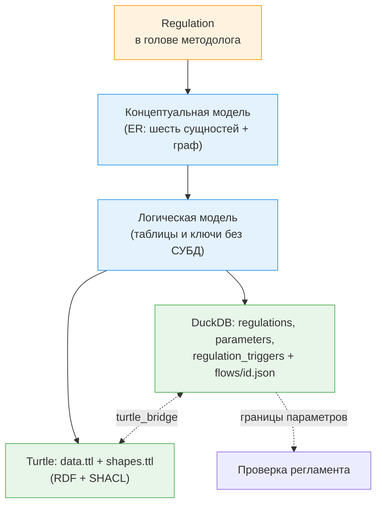

### Мини-практика (10 минут)

Возьми задачку из жизни: **онлайн-кинотеатр типа Кинопоиска**. Нарисуй ER-диаграмму с такими сущностями: Фильм, Актёр, Жанр, Пользователь, Просмотр, Рейтинг. Определи кардинальности. Напиши, какая связь M:N и почему.

Подсказка: фильм-актёр — точно M:N. Просмотр — это связь пользователь-фильм, но с дополнительным атрибутом (когда смотрел, докуда досмотрел) — поэтому это **отдельная сущность**, а не просто связь.

---

### Проект 2 (~18 ч): модель данных для системы записи в стоматологию

**Задача.** «СтомЛайн» — сеть из трёх клиник. Хотят заменить разрозненные таблички Excel единой системой записи на приём. Тебе как аналитику ставят задачу: спроектировать модель данных, написать словарь и сделать семантический слой одного класса.

#### Требования к продукту (вводные)

- Пациент записывается на приём через сайт или по телефону (через регистратора).
- Один приём = пациент + врач + кабинет + слот времени (30/60 минут) + клиника.
- У врача есть специализация (терапевт, ортодонт, хирург, гигиенист).
- У пациента может быть несколько контактных номеров (мобильный, рабочий, родственника).
- Каждый приём может породить медицинские записи (что делали, какие материалы использовали).
- Нужно различать: запись (намерение), приём (фактически состоялся), отмена (запись была, но отменили за N часов).
- Регистратор и пациент должны видеть, какие слоты у врача свободны.

#### Что сдаёшь

**Часть 1: ER-диаграмма (Crow's Foot).** Минимум 6 сущностей. Все связи с кардинальностями. Аргументируй, почему `Appointment` — отдельная сущность, а не связь.

**Часть 2: Словарь данных.** Таблица с колонками для каждого поля каждой сущности: `имя`, `тип`, `обязательно`, `описание`, `единица/формат`, `источник значения`.

**Часть 3: Turtle с базовыми классами.** Три класса минимум: `Patient`, `Appointment`, `Doctor`. По 2-3 свойства на каждый. Должна работать минимум одна связь между классами (например, `Appointment hasPatient Patient`).

```turtle
@prefix dent: <https://stomline.ru/ontology#> .
@prefix owl:  <http://www.w3.org/2002/07/owl#> .
@prefix rdfs: <http://www.w3.org/2000/01/rdf-schema#> .
@prefix xsd:  <http://www.w3.org/2001/XMLSchema#> .

dent:Patient a owl:Class .
dent:Doctor a owl:Class .
dent:Appointment a owl:Class .

dent:hasPatient a owl:ObjectProperty ;
    rdfs:domain dent:Appointment ;
    rdfs:range  dent:Patient .

# далее уже твои данные ...
dent:pt-12345 a dent:Patient ;
    dent:firstName "Иван" ;
    dent:phone "+7-913-..." .
```

**Часть 4: SHACL-валидация одного класса.** Бери `Appointment` и опиши shape: должен быть пациент (1 шт.), врач (1 шт.), время начала (xsd:dateTime, обязательно), длительность (либо 30, либо 60 минут).

**Часть 5: Размышление на полстраницы.** Где ты сознательно нарушил нормальную форму и почему? Где сомневаешься в дизайне? Какие ещё сущности добавишь во второй итерации?

#### Критерии оценки

| Критерий | Вес |
|---|---|
| ER-диаграмма читается и аргументирована | 25% |
| Словарь данных полный и непротиворечивый | 25% |
| Turtle валиден синтаксически (запусти на rdflib) | 20% |
| SHACL покрывает минимум 4 ограничения класса | 20% |
| Рефлексия на полстраницы | 10% |

#### Подсказки

- Не бойся брать M:N связи. У врача — несколько специализаций. У пациента — несколько телефонов.
- `Appointment` — это **не связь** между пациентом и врачом. Это сущность со своими атрибутами (время, статус, материалы).
- `Doctor.specialization` лучше делать FK на отдельную таблицу `Specialization`, а не enum в колонке. Завтра добавится «детский стоматолог» — не придётся менять схему.
- Кабинет может быть отдельной сущностью (`Room`), особенно если в клинике их 10+ и нужно резервировать.

> В следующем спринте мы перейдём к **моделированию процессов** — это даст тебе возможность показывать не только «что хранится», но и «что происходит во времени»: BPMN, UML Activity, State Machine, DFD и наша фирменная Flow DSL.

---

## Спринт 5: Моделирование процессов

### Главное за минуту

Представь Discord: ты бахнул пинг в канале — и вот уже в боте Тостера запустилась команда, она дернула API GitHub, забрала статус PR, перевела его на русский, отправила в канал. **Это процесс**. Цепочка событий, у каждого свой триггер, свой исполнитель, свой результат. Так же устроена городская диспетчерская: жительница позвонила на 112 — диспетчер классифицировал → отправил наряд → наряд приехал → закрыл инцидент → диспетчер отчитался. Если ты умеешь рисовать такие цепочки в формальной нотации — ты можешь автоматизировать их потом без потерь смысла. Если не умеешь — у разработчика будет SQL-запрос вместо процесса, и пользователи будут писать на тебя жалобы. В этом спринте — четыре классические нотации (BPMN, UML Activity, UML State Machine, DFD) и наша фирменная — Flow DSL.

### О чём эта часть

Любая система — это «что-то происходящее во времени». Данные сами по себе мертвы; жизнь у них появляется в процессах. Аналитик, моделирующий процессы, отвечает на четыре вопроса: **кто** делает, **когда**, **в какой последовательности**, **что получается на выходе**. У каждой нотации свой акцент — одни хороши для бизнес-процессов с людьми, другие для технической логики, третьи — для потоков данных. Понимать когда что применять — навык, который сильно повышает твою стоимость на рынке.

### Ключевые термины

**Бизнес-процесс** — последовательность действий, выполняемых людьми и системами для достижения бизнес-цели. «Принять заявку от жителя», «оформить запись на приём», «выгнать машину со штрафстоянки». Здесь главные сущности — **люди и роли**.

**Технический процесс** — последовательность действий внутри системы. «Прочитать сенсор → распарсить JSON → записать в БД → проверить регламент → отправить алерт». Здесь главные сущности — **код, очереди, события**.

**Смешанный процесс** — самое жизненное. Человек дёргает кнопку — запускается код — потом ещё один человек что-то проверяет. 80% реальных процессов выглядят так.

**Событие** (event) — что-то произошло. Может быть стартовое («поступил звонок»), промежуточное («таймер истёк»), финальное («задача закрыта»).

**Задача** (task) — действие, которое кто-то выполняет. У задачи есть исполнитель (роль), вход, выход, длительность.

**Шлюз** (gateway) — точка ветвления процесса. «Если приоритет высокий — на бригаду; иначе — в очередь». Главные — исключающий (одна ветка, XOR) и параллельный (все ветки, AND); в BPMN есть ещё включающий (одна или несколько веток, OR), событийный и сложный.

**Pool** (бассейн) — участник процесса верхнего уровня. Обычно — отдельная организация или система. ЕДДС — один пул, бригада спасения — другой.

**Lane** (дорожка) — роль внутри пула. В ЕДДС: «диспетчер 112», «старший смены», «оператор ЦУКС».

**Состояние** (state) — устойчивое положение, в котором находится сущность. Инцидент: «открыт», «назначен», «в работе», «закрыт». Не действия, а статусы.

**Поток данных** (data flow) — куда движутся данные между процессами и хранилищами. В отличие от потока управления (что после чего), здесь главное — что передаётся.

### Контекст в РАГРАФ/LEYKA

- В РАГРАФ моделирование процессов главенствует: **Flow DSL** — это и есть наш фирменный язык. Когда методолог Анна собирает регламент — она рисует граф из узлов восьми типов палитры, и этот граф потом исполняет flow_executor: по расписанию на живых данных или вручную, кнопкой «Запуск» («Прогон на заданных величинах»).
- В LEYKA процессы прячутся в жизненном цикле задачи: входящие → к работе → в работе → ожидает → проверка → готово (`inbox → todo → in_progress → waiting → review → done`). Это UML State Machine как есть.
- РАГРАФ и LEYKA связаны в обе стороны: выход регламента с кодом действия `create_leyka_task` заводит задачу в LEYKA, смена статуса задачи может запустить регламент (узел «Событие» с `leykaTrigger = status_changed`), а закрытие задачи в срок проверяет критерий решённости `task_closed_within_sla`.

### BPMN: основы для аналитика

BPMN (Business Process Model and Notation) — индустриальный стандарт OMG. Главная нотация для **процессов с людьми**. Если у тебя в процессе есть как минимум один человек, который что-то решает — BPMN твой друг.

Минимальный набор элементов:

| Элемент | Как выглядит | Что значит |
|---|---|---|
| **Событие старта** | Тонкий круг | Сюда «зашёл» процесс. Может быть «поступил звонок», «истёк таймер» |
| **Задача** | Прямоугольник со скруглёнными углами | Действие. Подвиды: user task (человек), service task (система), script task (код) |
| **Шлюз эксклюзивный** | Ромб с X внутри | «Если/иначе» — выбирается одна ветка |
| **Шлюз параллельный** | Ромб с + внутри | «И, и» — выполняются все ветки одновременно |
| **Событие конца** | Жирный круг | Процесс завершён |
| **Стрелка управления** | Сплошная линия со стрелкой | Что идёт после чего |
| **Стрелка сообщения** | Пунктирная линия со стрелкой | Передача данных между пулами |
| **Pool** | Большой прямоугольник вокруг всего | Участник процесса (организация/система) |
| **Lane** | Горизонтальная полоса внутри pool | Роль внутри участника |

#### Пример: обработка заявки от жителя через ЕДДС

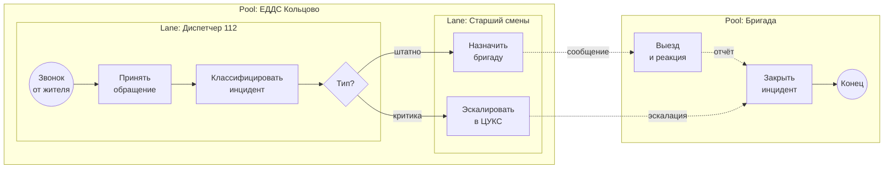

Прочитай вслух: «Жительница звонит → диспетчер принимает обращение → классифицирует → решает: критика или штатно. Если критика — эскалирует старшему смены, тот в ЦУКС. Если штатно — назначает бригаду. Бригада выезжает, реагирует, закрывает инцидент». Это **формальный пересказ** процесса, который раньше был только в голове у дежурных.

**Где BPMN выигрывает**: процессы с участием людей, передачами между ролями, шлюзами «если-иначе». Любой банковский процесс, любой HR-процесс, любая регистратура.

**Где BPMN проигрывает**: чисто технические процессы (потоки данных), реактивные системы (что-то приходит → что-то срабатывает), потоки правил. Там BPMN превращается в визуальный мусор.

### UML Activity Diagram — кузен BPMN

Activity Diagram — это «BPMN в стилистике UML». По смыслу почти одно и то же, но:

- Меньше элементов (вместо pool/lane — «партиции», которые рисуют теми же дорожками).
- Поведение объекта (можно показать состояние данных).
- Совместимость со всей семьёй UML — Sequence, Class и т.д.

**Когда выбирать Activity Diagram вместо BPMN**:

| Когда | Выбор |
|---|---|
| Процесс прежде всего с людьми, нужен заказчик-friendly формат | BPMN |
| Процесс внутри программы, нужна совместимость со всем UML | Activity Diagram |
| Уже есть UML-документация системы | Activity Diagram (единообразие) |
| Внешний аудит по ISO/госстандартам | BPMN (чаще требуют) |

### UML State Machine — для жизненного цикла объекта

Иногда не важна **последовательность действий**, важны **статусы** объекта. Тогда — State Machine.

#### Пример: жизненный цикл инцидента в диспетчерской (учебный)

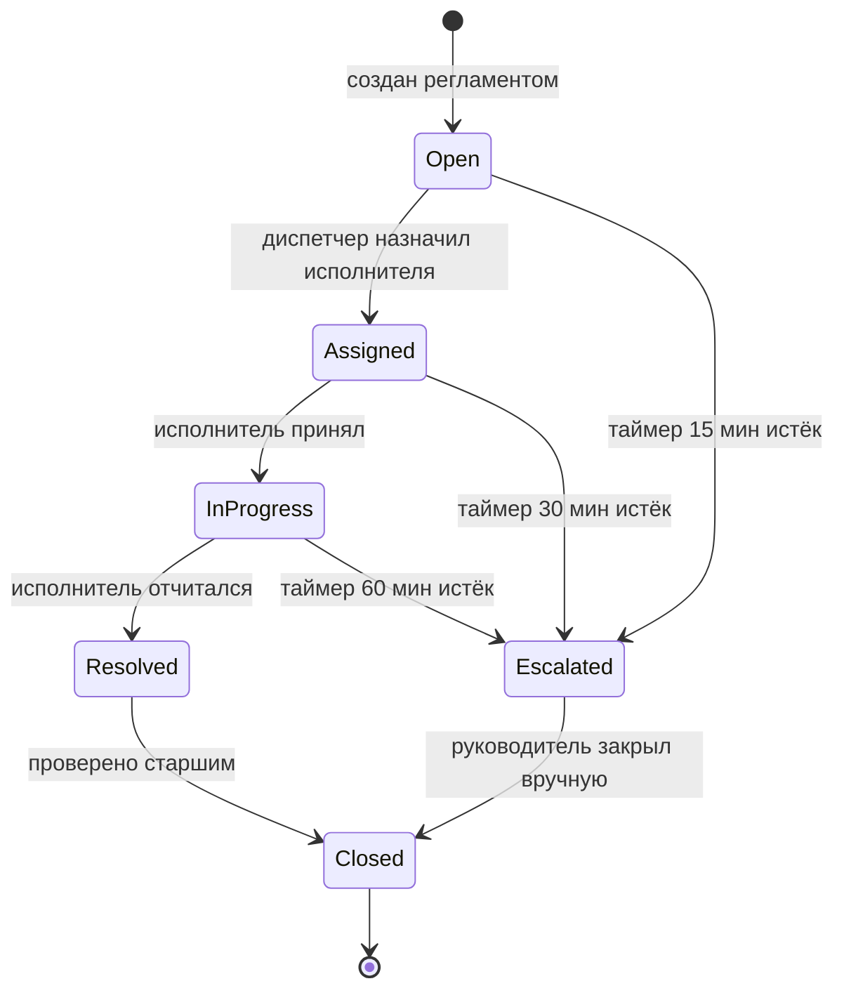

Тут видно: у инцидента 6 состояний и 9 переходов. Каждый переход — это **событие** (отчёт, истечение таймера, ручное действие). Состояния — взаимоисключающие: инцидент не может быть одновременно `Open` и `Resolved`.

⚠ В самом РАГРАФ такого автомата у инцидента нет. Журнал инцидентов `incident_audit_log` только дописывается: событие, вердикт, действие пользователя, итог — строками с общим `incident_id`, без статусов `Open/Assigned/…`. Настоящий конечный автомат в РАГРАФ — статус регламента: `draft`, `active`, `archived`; по расписанию применяется только `active` (`STATUS_PRIMENYAETSYA` в `backend/app/services/etl/applier.py`, с 27.09.2026).

State Machine хороша когда:

- объект имеет дискретный набор статусов;
- есть строгие правила переходов («из Resolved нельзя в Open, только в Closed»);
- нужно автоматически документировать enum-поле `status` в БД.

В LEYKA у задачи (`Task`) шесть статусов: `inbox → todo → in_progress → waiting → review → done`, и каждая смена статуса пишется строкой в таблицу `task_status_history` (старый статус, новый, кто и когда). А вот запрещённых переходов в коде LEYKA нет: карточку можно перетащить из `done` прямо в `todo`. Если правило «готово — только через проверку» нужно заказчику, это отдельное требование — и State Machine как раз тот инструмент, которым его записывают.

### DFD: Data Flow Diagram

DFD — самая старая из техник, ей лет 50. Когда не важен **поток управления**, а важно **что и куда передаётся** — DFD.

Нотация Гейна-Сарсона:

| Элемент | Как выглядит | Что значит |
|---|---|---|
| **Процесс** | Скруглённый прямоугольник | Обработчик данных |
| **Хранилище данных** | Прямоугольник, открытый с одной стороны (у Йордона–Демарко — две параллельные полосы) | БД, файл, кэш |
| **Внешняя сущность** | Квадрат | Источник или приёмник вне системы |
| **Поток данных** | Стрелка с подписью | Что передаётся |

#### Пример: поток данных в РАГРАФ

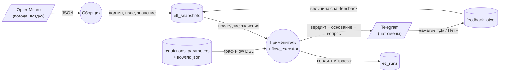

В этом виде:
- Open-Meteo и Telegram — внешние сущности (вне РАГРАФ);
- сборщик и применитель с flow_executor — процессы внутри РАГРАФ: сборщик по расписанию опрашивает источник, применитель прогоняет активные регламенты на последних значениях;
- etl_snapshots, etl_runs, feedback_otvet, regulations — хранилища (таблицы DuckDB в двух файлах, `live_etl.duckdb` и `regulations.duckdb`), рядом — файлы графов;
- стрелки — что передаётся, не **как** и не **когда**.

Обрати внимание на последнюю стрелку: ответ человека возвращается в те же снимки, что и погода, и становится входом регламента наравне с датчиком. Трекер задач LEYKA — ещё одна внешняя сущность: выход с кодом `create_leyka_task` заводит в ней задачу, если интеграция включена.

**Когда DFD незаменим**: при проектировании интеграций, ETL-пайплайнов, аналитике потоков данных. На него очень удобно показывать пальцем при разборе багов «откуда взялась эта цифра».

**Когда DFD не нужен**: для процессов с людьми и шлюзами «если-иначе» — там BPMN-Activity сильнее.

### Главная фишка спринта — Flow DSL

А теперь самое интересное. У РАГРАФ есть **свой собственный язык моделирования процессов** — Flow DSL (полное описание — РАГРАФ-ФРЕЙМ-35 «Описание языка»; в коде документ графа называется `RuleDSL`). Он специально заточен под предметную область «реактивные правила реагирования» — и в этой нише уделывает BPMN/Activity на голову.

#### Что такое DSL

DSL (Domain-Specific Language) — язык, специализированный под предметную область. SQL — DSL для запросов к БД. Regex — DSL для текста. **Flow DSL — DSL для регламентов**: правил из приказов, норм и договоров, которые машина исполняет, а человек читает и проверяет.

Узкая специализация — это и сила, и ограничение. Сила: проще, выразительнее в своей нише, меньше элементов. Ограничение: за пределами ниши непригоден.

#### Восемь типов узлов Flow DSL с метафорами

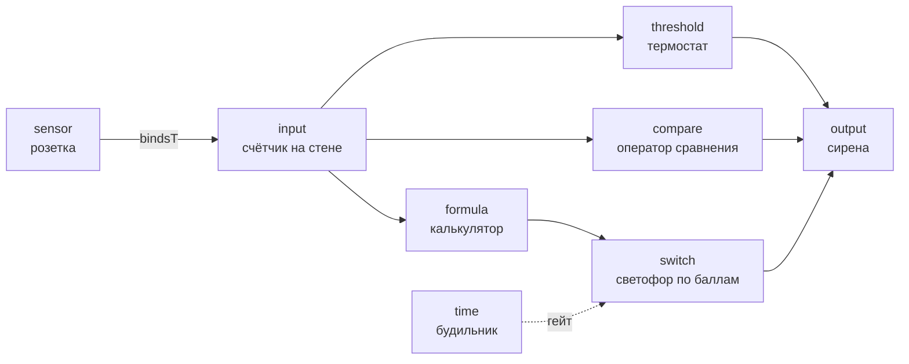

| Узел | Что делает | Метафора из жизни |
|---|---|---|
| **sensor** («Событие») | Подцепляет конкретный канал данных: подтип датчика и поле сообщения | Розетка в стене — без неё прибор не включишь |
| **time** («Время») | Условие по часам: ночь, рабочие часы, день недели; открывает ветку без датчика | Будильник — звенит по времени, а не по событию |
| **input** («Вход») | Параметр регламента, на который кладётся значение | Счётчик электричества — показывает то, что пришло из розетки |
| **threshold** («Порог») | Проверяет коридор «эталон ± отклонение» в обе стороны | Термостат с коридором 2…8 °C — пищит, если вышли за коридор в любую сторону |
| **compare** («Сравнить») | Сравнивает значение с уставкой или два значения между собой (`greater`, `less`, `equal`, вне диапазона…) | Калькулятор: `<`, `>`, `=` |
| **formula** («Формула») | Вычисляет выражение над входами | Калькулятор повеселее: `(a + b) / 2` |
| **switch** («Развилка») | Ведёт поток в зону, куда попало число: `min ≤ V < max`; число зон не ограничено | Светофор: 0-2 балла зелёный, 3-5 жёлтый, 6+ красный |
| **output** («Выход») | Вердикт: код действия, текст, приоритет 0–3; доставка в канал и опрос получателя | Сирена + текст рекомендации |

Девятый тип, **shacl_constraint**, устарел: 09.06.2026 его убрали из палитры, а миграция `strip_shacl_from_flows_v1` вырезала его из сохранённых графов. Ограничения на данные теперь — контракт параметра (SHACL-форма, см. Спринт 4).

⚠ **Три ловушки формулы.** Первая: формула видит только входы — значения порогов, сравнений и других формул ей недоступны, поэтому расчёт одной величины пишут одним выражением. Вторая: «нет данных» — это не «нет». Логика языка трёхзначная (Клини): если входа нет, формула даёт «неизвестно», и узел не срабатывает; так ведут себя `and`/`or`, условное выражение `a if условие else b` (с 09.10.2026) и встроенные функции вроде `max()` (с 15.10.2026). Третья: числовая формула срабатывает при любом числе, даже при 0, поэтому формулу-гейт пиши условием (`t > 28`), а не `1 if t > 28 else 0`.

#### Чем Flow DSL отличается от BPMN

| | BPMN | Flow DSL |
|---|---|---|
| Размер языка | ~50 элементов | 8 типов узлов в палитре (девятый, `shacl_constraint`, устарел) |
| Главный пользователь | Аналитик-бизнес | Аналитик-методолог |
| Главный процесс | Бизнес-процесс с людьми | Реактивная реакция системы на сигнал |
| Поддержка ролей (lanes) | Есть | Дорожек нет; адресат задаётся на каждом выходе («Доставка вердикта»), роль исполнителя — полем регламента `responsible_role` |
| Поддержка таймеров | Есть | Частично: узел «Время» (ночь, рабочие часы, день недели; часы — UTC) и возраст вопроса без ответа; событий-таймеров нет |
| Логика «если-иначе» | Шлюзы | Развилка по зонам `[min; max)` и условное выражение `a if условие else b` в формуле |
| Расчёт численных значений | Костыли | formula-узел |
| Семантическая проверка | Нет | «Проверка регламента»: противоречия и пробелы графа |
| Время освоения новичком | 1-2 недели | 1-2 дня |

Это компромисс. **Flow DSL уделывает BPMN в нише реактивных правил.** Меньше элементов = быстрее освоить. Узкая специализация = выразительнее в своей задаче.

Но в нише «как банк выдаёт кредит, где работают 5 человек на 3 этапах» — BPMN сильнее, потому что у него pool, lane, и подключение к человеческим ролям.

#### Люди в контуре: вопрос «Да / Нет» как вход регламента

Flow DSL не заменяет BPMN, но человека в контур уже включает. С 08.10.2026 у выхода есть поле `feedback` — опрос получателя: вопрос уходит кнопками вместе с вердиктом в тот же чат (`FeedbackQuestion` в `backend/app/schemas/domain.py`). Дальше цепочка такая:

```
вердикт + вопрос «Дорожки обработаны?»  [Да] [Нет]
  → нажатие кнопки → журнал ответов feedback_otvet
  → величина подтипа chat-feedback с полем <код вопроса> (Да = 1, Нет = 0)
  → узел «Событие» регламента → вход → развилка → новый вердикт
```

Рядом с ответом публикуются ещё две величины: `<код>.otvechen` — ответили ли на последний вопрос, и `<код>.vozrast_chasov` — сколько часов вопрос висит без ответа. Вторая делает выразимой эскалацию по молчанию. Так устроен регламент `campus-heat-feedback-balance`: по ответам о микроклимате за трое суток он выдаёт теплотехнику поручение «прикрыть» или «открыть заслонку» с вопросом «Заслонку отрегулировали?», а если молчат 4 часа и больше — развилка «Молчание исполнителя» зовёт руководство (`escalate_to_board`).

💡 Код вопроса — имя факта, а не формулировки: два регламента, спросившие об одном, пишут в одну величину.

⚠ Контур проверяй на живом экземпляре, а не только автотестами: как восемнадцать дней доставка показывала успех, а ответы терялись, — в Спринте 3.

#### Когда Flow DSL выигрывает

- Реактивная логика: «событие → проверка → действие»;
- Численные пороги: температура, влажность, концентрация;
- Простые цепочки решений;
- Нужно объяснить непрограммисту: показал блоки на проекторе → понял.

#### Когда Flow DSL проигрывает

- Многошаговый процесс с участием 3+ людей;
- Нужна передача задачи по цепочке исполнителей («не ответил — следующему, не ответил и тот — дальше»). Одну ступень эскалации по молчанию язык уже выражает: возраст вопроса без ответа приходит величиной, и развилка решает, звать ли руководство;
- Параллельные ветки с синхронизацией;
- Условная очерёдность (если A, то после B, иначе после C).

В таких случаях — BPMN или Activity. Flow DSL — про **точечную реакцию системы**, BPMN — про **процесс с людьми**.

#### Один и тот же сценарий в BPMN и Flow DSL

Возьмём задачу: **«Температура серверной выше 28 → SMS дежурному. Выше 30 → эскалация начальнику».**

**В BPMN:**

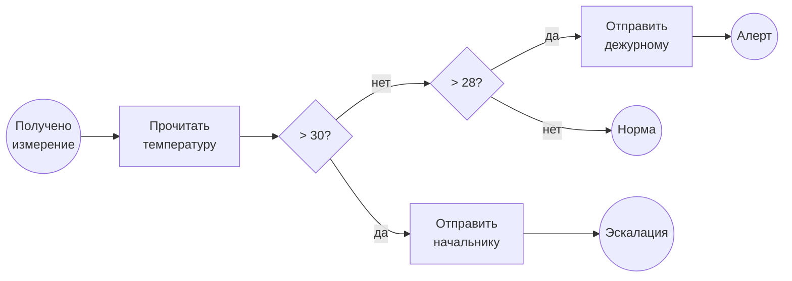

Слишком много элементов на простую задачу. И стрелки рисовать-перерисовывать.

**В Flow DSL:**

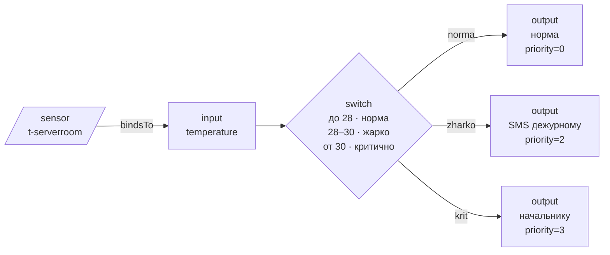

Шесть узлов и ни одного «если»: развилка сама относит температуру ровно к одной зоне по правилу `min ≤ V < max` — 27,5 → «норма», 28,5 → «жарко», 30,1 → «критично». Уровень вердикта — приоритет сработавшего выхода; если выходов сработало несколько, flow_executor берёт наибольший. Получается **одна и та же логика в двух разных абстракциях**.

⚠ Не собирай это двумя порогами «28 ± 0» и «30 ± 0». Порог (`threshold`) проверяет коридор «эталон ± отклонение» в обе стороны: `abs(value − refValue) > deviation`. Порог 28 ± 0 срабатывает при любой температуре, кроме ровно 28, — и при 27,5 °C такая схема зажгла бы оба выхода и позвонила начальнику. Ловится это одним прогоном на заданных величинах.

Аналитик в РАГРАФ собрал это мышкой за 5 минут. В BPMN он бы потратил 20 — на ровном месте, потому что для такой задачи BPMN избыточен.

#### Проверка регламента: противоречия и пробелы до первого события

Регламент в РАГРАФ — формальный граф, поэтому его можно проверить, не дожидаясь первого инцидента. Это вкладка «Проверка регламента» в редакторе регламента (`GET /api/regulations/{id}/consistency`, код — `backend/app/services/regulation_analysis.py`). К 16 структурным проверкам базового валидатора она добавляет 6 своих и раскладывает находки по трём корзинам:

| Корзина | Что ищет | Коды |
|---|---|---|
| Непротиворечивость | зоны развилки перекрываются; ветка лежит вне границ параметра; «одобрить» и «заблокировать» срабатывают на одном входе | `SWITCH_ZONE_OVERLAP`, `DEAD_SWITCH_CASE`, `CONTRADICTORY_OUTPUTS` |
| Пробелы — неописанное поведение | значения, при которых не сработает ни одна ветка; нет ветки ручной проверки на случай «нет данных»; недостижимый выход | `SWITCH_UNCOVERED_RANGE`, `UNKNOWN_INPUT_NO_FALLBACK`, `DEAD_OUTPUT` |
| Структурные замечания | висящий узел, ошибка в формуле, незарегистрированный код действия | `ISOLATED_NODE`, `FORMULA_SYNTAX`, `output_unknown_action` |

Пример. Раздели в серверной зону «Критично» на «30…150» и «Сбой датчика — от 150» при границах параметра −50…100 — проверка ответит `DEAD_SWITCH_CASE`: ветка «лежит вне допустимого диапазона параметра — она никогда не сработает».

⚠ Проверка рассуждает от контракта данных: она верит, что значение за границами параметра не придёт. При прогоне границы не проверяются, и сбойные 999 °C всё равно дойдут до развилки. Поэтому проверка дополняет «Прогон на заданных величинах», а не заменяет его.

🎯 В этом главное отличие регламента-графа от регламента-PDF: противоречие и дыру находит машина — раньше, чем их найдёт инцидент.

#### Где Flow DSL живёт в коде

| Что | Где |
|---|---|
| Описание узла, ребра и графа | `backend/app/schemas/domain.py` (`FlowNode`, `FlowEdge`, `RuleDSL`) |
| Исполнитель | `backend/app/services/flow_executor.py` |
| Вычислитель формул (логика Клини) | `backend/app/services/formula_eval.py` |
| Проверки: структура, мягкий контроль, противоречия и пробелы | `backend/app/services/validator.py`, `flow_validators.py`, `regulation_analysis.py` |
| Перевод в Turtle и обратно | `backend/app/services/turtle_bridge.py` |
| UI-редактор | `frontend/src/components/flow/FlowEditorScreen.tsx` |
| JSON-хранилище | `backend/data/flows/{regulation_id}.json`; поставка — `backend/data/fixtures/*.flow.json` (65 регламентов) |
| Описание языка | `backend/data/gost19/ragraf/РАГРАФ-ФРЕЙМ-35 Описание языка.md` |

#### Правило — в граф, модель — в код

Граница языка проведена так: **модель отдаёт величину, правило решает** (РАГРАФ-ФРЕЙМ-35, § 1.7). Пороги, ветвления, уровни и адресаты — это норма: её правит методолог и её надо предъявить в трассе вердикта, значит, ей место в графе. Обученная или эмпирическая зависимость (прогноз дорожной нагрузки) и свёртка потока (заполненность парковки по событиям камер) остаются в коде.

До 15.10.2026 «Индексы жизни города» и «Экологические риски» эту границу нарушали: баллы считал код сборщика, а граф получал готовый «балл гололёда». Как это нашли и почему решили переносить правило, а не поправить порог, — в Спринте 8 (§8.14, «Решение после мая»). Как выглядит экология после переноса (фаза Д3б, коммит `2e8413b`):

- входы — сами величины Open-Meteo: температура, осадки, ветер, PM2.5, код погоды;
- риск считает одна формула `max(воздух, мороз, гололёд)` — одна, потому что формула видит только входы, а не другие формулы;
- пороги стоят в выражении и правятся в редакторе: PM2.5 выше 35 мкг/м³, мороз ниже −20 и −30 °C, гололёд от −3 до +1 °C при осадках.

В коде остались пять сборщиков величин (`LIVE_PARAM_COLLECTORS` в `backend/app/services/etl/applier.py`), среди них прогноз дорожной нагрузки и заполненность парковки.

🎯 Пиши требование и спрашивай про каждое число: это норма или зависимость? Норма — в граф регламента, иначе её никто не предъявит.

### Мини-практика (15 минут)

Возьми регламент **«Контроль температуры серверной»**. На листочке нарисуй Flow DSL:

1. Один sensor с классом `t` (температура), подтип `t-serverroom`, externalId `current.temp_c`;
2. Один input с paramRef `temperature`; у параметра — единица `°C` и границы контракта −50…100 (`minInclusive`/`maxInclusive`);
3. Одна развилка (switch) на три зоны:
   - «Норма»: до 28;
   - «Жарко»: от 28 до 30 (`min` = 28, `max` = 30);
   - «Критично»: от 30;
4. Три output:
   - «Норма»: action=`no_violation`, priority=0;
   - «Жарко»: action=`send_sms`, text="Температура серверной выше 28 °C — проверь систему охлаждения", priority=2;
   - «Критично»: action=`notify_director`, text="Критическое превышение в серверной", priority=3.

Нарисуй стрелки и проверь, что:
- sensor → input (bindsTo проставится сам, когда проведёшь ребро);
- input → switch;
- из развилки три ребра, и подпись каждого совпадает со значением своей зоны.

Ответь себе: что произойдёт при температуре 27.5, при 28, при 28.5, при 30.1, при 999 (сбой датчика)? И что будет, если датчик замолчал?

💡 Подсказки. Граница зоны полуоткрыта: `min ≤ V < max`, поэтому ровно 28 — уже «жарко». 999 развилка отнесёт к «критично»: границы −50…100 — контракт данных, при прогоне они не проверяются. Без данных не сработает ни один выход: уровень 0, но без вердикта «Норма» — отличай «нет данных» от «нормы» по сработавшему выходу. И не вписывай значение в текст через `{temperature}`: подстановки в языке нет, скобки уйдут в чат как есть, а само число придёт в блоке «Основание» под предписанием.

> В следующем спринте мы перейдём к **пользовательским интерфейсам** — это даст тебе возможность сформулировать, что видит человек на экране, в каком порядке и почему: персоны, wireframes, journey maps, cockpit vs Telegram-style Лента.

---

## Спринт 6: Пользовательские интерфейсы

### Главное за минуту

Tinder — это интерфейс, который заставил миллионы людей принимать одно решение по 50 раз в день: свайп влево или вправо. У него ровно одна задача, ноль лишнего. Госуслуги — обратный полюс: уродливая форма ввода полиса, но это интерфейс для каждой бабушки, которая зашла оплатить штраф. Между ними — целая вселенная подходов. Системный аналитик в продуктах класса РАГРАФ/LEYKA не «дизайнит» (это работа дизайнера), но он **формулирует**, что пользователь делает в системе, в каком порядке, какие у него боли и какие данные ему нужны на экране. В этом спринте — персоны, сценарии, journey map, информационная архитектура, wireframes, и краем глаза заглянем в HTML/CSS/React — чтобы потом не теряться при общении с фронтенд-разработчиком.

### О чём эта часть

Базы данных и процессы — это «что внутри системы». А интерфейс — «что снаружи, на стороне человека». Аналитик-стажёр (junior) часто думает, что фронт — это дело дизайнера. На практике дизайнер рисует красоту, но **логику взаимодействия** придумывает аналитик: какие экраны, в каком порядке, что должно быть наверху, что внизу, какие данные показать. Если аналитик не делает эту работу — её сделает разработчик «по интуиции», и результат будет «работает, но никто не пользуется». Половина провалов внутренних корпоративных систем — это.

### Ключевые термины

**Персона** (persona) — собирательный портрет типичного пользователя системы с именем, возрастом, должностью, болью и целью. Не реальный человек, а архетип. Помогает команде договариваться: «эту фичу делаем не вообще, а конкретно для Виктора».

**Use Scenario** — пошаговое описание, как пользователь выполняет конкретную задачу в системе. От триггера («захотел купить кофе») до закрытия задачи («заплатил и забрал»). Без UI-деталей — только последовательность действий.

**User Journey Map (UJM)** — путь пользователя через систему **с эмоциями и точками боли**. Карта, где видно: вот тут он улыбается, тут хмурится, тут вообще бросает приложение и идёт ругаться в техподдержку. UJM показывает не только что человек делает, но и что чувствует.

**Use Case** — формальная нотация UML для описания взаимодействия пользователя (актора) с системой. Менее модный сейчас формат, в моде Use Scenario.

**Информационная архитектура (IA)** — структура контента и навигации в продукте. Site map для сайта, structure diagram для приложения. Отвечает на вопрос «что-где лежит».

**Wireframe** (lo-fi) — низкодетализированный чертёж экрана. Чёрно-белый, без шрифтов и цветов. Главное — расположение блоков и текст. Чтобы быстро согласовать структуру без споров «а почему синенький, я бы зелёненький».

**Mockup** (hi-fi) — высокодетализированный макет. Уже с цветами, шрифтами, иконками. Близок к финальному виду.

**Prototype** — кликабельный макет. Можно потыкать в Figma и проверить путь пользователя.

**Information density** (плотность информации) — сколько данных одновременно на экране. У TikTok — 1 видео = 0 плотности. У Bloomberg-терминала трейдера — 50 чисел на экране = максимум.

### Контекст в РАГРАФ/LEYKA

В РАГРАФ интерфейсы делятся на два класса:

- **«Cockpit»-интерфейсы** для оператора и руководителя («Ситуационный центр», дашборд «Умный кампус POLIGON») — высокая плотность информации. Нужно много данных на экране одновременно. Стиль — Bloomberg-терминал.
- **«Editor»-интерфейсы** для аналитика-методолога (редактор регламента и редактор потока) — фокус на одной задаче. Стиль — Figma, IDE.

В LEYKA главное — канбан-доска проекта, а обсуждение задачи устроено **«как в Telegram»**: лента сообщений с упоминаниями и галочками прочтения. Telegram уже научил каждого вести ленту сообщений; нет смысла переизобретать.

### Персоны: три портрета РАГРАФ

#### Персона 1: Методолог Анна, 35 лет

**Должность**: Главный методолог-аналитик в Управлении ЕДДС Кольцово.

**История**: Закончила Управление и юр.факультет 12 лет назад. Раньше работала в Роспотребнадзоре, переписывала СанПиН в простые инструкции для дежурных. В РАГРАФ пришла за инструментом — нужно формализовать 30 регламентов реагирования к концу года.

**Боль**:
- «Регламенты сейчас в 4 разных Excel + 2 в Word. Никто не помнит, какой актуальный.»
- «Раньше я диктовала логику программисту, он писал код, который я не понимаю — и я не могла потом проверить.»
- «В прошлый раз СанПиН поменялся — я три месяца искала, где про PM2.5 у нас правило прописано.»

**Цель**: собрать все регламенты в один инструмент, отслеживать их версионность и иметь возможность показать любой пункт начальству с трассировкой до СанПиН.

**Что для неё в РАГРАФ**: роль «Аналитик-методолог» и её домашний раздел «Регламенты»; редактор регламента с вкладками «Поля», «Слайдеры», «Turtle», «Проверка регламента», «Проверка знаний»; «Поток» — редактор логики; «Сима · Студия» — ассистент, который отвечает по регламентам, загруженным документам и графу знаний и показывает источники ответа.

⚠ Персона учебная, и вот почему это важно. Гипотезу о штатном «аналитике-методологе», который сам оцифровывает регламенты, команда РАГРАФ проверяла, и она опровергнута: такой должности и бюджета под неё у заказчика нет (отчёт о НИР 2026, § 6.13). Оцифровку чаще ведёт внешний консультант, а пользу продукта ищут у того, кто отвечает за соблюдение правил. В нашей тройке это скорее Лариса, чем Анна.

#### Персона 2: Оператор Виктор, 50 лет

**Должность**: Дежурный оператор ЦУКС.

**История**: 28 лет в пожарной охране, переведён на ЦУКС год назад. Компьютер — да, базово; Excel — да; но «всё, что выше — пусть молодёжь делает». Главное — не пропустить инцидент.

**Боль**:
- «Слишком много окон. Сразу 8 систем открыты — пожарная, медицина, ЕДДС, видео — не успеваю переключаться.»
- «Когда система выдаёт алерт — я не понимаю, **почему** он сработал. Просто кнопка красная.»
- «Звонит начальник — спрашивает: что случилось? Я знаю что, но не могу объяснить почему именно сейчас.»

**Цель**: видеть в одном окне самое важное и быстро понимать ситуацию. Минимум кликов до результата.

**Что для него в РАГРАФ**: роль «Оператор ситуационного центра» и её домашний экран «Ситуационный центр» (`/live`); вердикт, который сам приходит в чат дежурной смены — с уровнем, предписанием и основанием; ответ на вопрос регламента — одной кнопкой под сообщением в Телеграме. Задачу в LEYKA может завести сам регламент, отдельной кнопки «передать в LEYKA» у оператора нет.

#### Персона 3: Лариса, руководитель ЕДДС, 45 лет

**Должность**: Начальник Управления ЕДДС.

**История**: Закончила МВД, работала в ГИБДД, потом в МЧС, последние 5 лет руководит ЕДДС Кольцово. Управляет 15 сотрудниками. Лично код не пишет, но интегральную аналитику любит и понимает.

**Боль**:
- «На совещаниях у мэра меня спрашивают: сколько мы сэкономили времени? А я отвечаю интуицией.»
- «Депутаты приезжают раз в полгода — нужны цифры и графики. Где взять? У всех в Excel разное.»
- «Если уволятся 2 ключевых сотрудника — система рассыпется, потому что многое в головах.»

**Цель**: иметь дашборд с KPI ЕДДС, метриками реагирования и возможностью показать любому проверяющему «почему вот это решение».

**Что для неё в РАГРАФ**: роль «Руководитель» — «Ситуационный центр» с вкладками предметных областей и дашборд «Умный кампус POLIGON» в виде «Ректор — сводка», где первым показан разрыв: сколько регламентов исполняется на живых данных, а сколько — без источника. Аудит любого вердикта — «Журнал прогонов», который ведётся только на добавление (по умолчанию раздел виден роли «Инженер платформы»). Выгрузки сводки в PDF пока нет — она в плане развития.

### Use Scenario: Анна вечером настраивает регламент

Сценарий **«Создание нового регламента для управдома»**:

1. **17:30**. Анне приходит mail от начальника: «срочно — управдом из дома №5 жалуется, что не получает алерты о давлении в трубах. Нужен новый регламент к завтра.»
2. **17:35**. Анна открывает РАГРАФ в роли «Аналитик-методолог», идёт в «Регламенты» (`/regulations`) и нажимает «Создать регламент».
3. **17:36**. Мастер «Новый регламент» спрашивает, откуда взять величины. Анна выбирает «📡 Из библиотеки» — два датчика давления, `p-water-hot` и `p-water-cold`. Узлы-датчики и триггеры создаются сразу.
4. **17:38**. Во вкладке «Поля» задаёт параметры: давление горячей воды — от 0,3 до 0,6 МПа, холодной — от 0,2 до 0,5 МПа. В разделе «Нормативное основание» указывает пункт СНиП и прикладывает сам документ.
5. **17:42**. Открывает «Поток». Каркас уже собран: на каждую величину — «датчик → вход → развилка» с зонами «ниже нормы / в норме / выше нормы»; зоны «ниже» и «выше» ведут в выходы.
6. **17:45**. Переименовывает выходы — «сообщение управдому» и «сообщение аварийной службе» — и в карточке выхода назначает доставку: Телеграм и МАКС.
7. **17:53**. Жмёт «Проверить». Красная подсказка «Чип без связей»: она перетащила из палитры лишний узел и забыла его соединить. Чинит.
8. **17:55**. Жмёт «Запуск» — прогон на заданных величинах. Подставляет 0,25 МПа — срабатывает зона «ниже нормы», вердикт уходит на выход управдома. Ок.
9. **17:58**. Сохраняет и нажимает «Опубликовать»: регламент переходит из черновика в активные, в истории версий остаётся снимок с автором. На развёрнутом экземпляре публикация — под паролем администратора.
10. **18:00**. Анна закрывает ноут. Регламент готов к утреннему включению.

**Что мы видим из сценария**: 30 минут, 10 шагов, ноль кода. Это то, ради чего РАГРАФ существует.

### User Journey Map: Виктор утром

UJM для **«Утро оператора Виктора»**, от прихода на смену до закрытия первого инцидента:

```mermaid
journey
    title Виктор: утро дежурного
    section 07:50 заходит на работу
      Распечатать сводку: 3: Виктор
      Выбрать роль «Оператор СЦ»: 4: Виктор
      Открыть Ситуационный центр: 5: Виктор
    section 08:15 алерт по воздуху
      Звуковой сигнал: 3: Виктор
      Найти, что мигнуло: 2: Виктор
      Прочитать рекомендацию: 4: Виктор
      Понять, почему сработало: 3: Виктор
    section 08:25 действие
      Кликнуть "передать в LEYKA": 5: Виктор
      Дождаться подтверждения: 4: Виктор
      Записать в журнал: 4: Виктор
    section 08:35 завершение
      Получить отчёт от исполнителя: 5: Виктор
      Закрыть инцидент: 5: Виктор
```

Что важно: **в зоне «найти, что мигнуло» оценка 2 (низкая)**. Это болевая точка — Виктор должен в куче алертов найти конкретный, по которому пищит. Дизайн-задача: подсвечивать конкретный блок Ситуационного центра, по которому пришёл алерт. В РАГРАФ её решили так: вкладка несёт отметку наибольшего уровня среди своих карточек, а внутри группы критичные карточки стоят первыми. Без UJM эту боль никто бы не описал.

UJM — основной инструмент **поиска точек боли**. По нему потом аналитик пишет требования: «при поступлении алерта — звуковой сигнал + автоскролл к строке + подсвечивание цветом».

### Информационная архитектура: как организовать РАГРАФ

Левая панель РАГРАФ — видимая часть информационной архитектуры. Устроена она как панель действий в VS Code: узкая колонка значков, название раздела всплывает подсказкой. Главное — панель **зависит от роли**: каждый раздел объявляет, каким ролям он виден по умолчанию. Состав на 30.10.2026 (`frontend/src/App.tsx`, `frontend/src/lib/navSections.ts`):

```
РАГРАФ
├── Σ — на главную (/)
├── 📡 Ситуационный центр (/live) — виден всем ролям
├── Разделы по ролям
│   ├── Умный кампус POLIGON (/poligon) — руководитель, оператор, инженер
│   ├── Сима · Студия (/sandbox) — аналитик, строитель
│   ├── Регламенты (/regulations) — аналитик, строитель
│   │   ├── вторая панель: «Шаблоны», «Мои черновики», «Сообщество»
│   │   ├── /regulations/:id/edit — «Редактировать»
│   │   ├── /regulations/:id/flow — «Поток»
│   │   └── /regulations/new-from-text, -json, -sensor — создание
│   ├── Граф знаний (/knowledge), Граф связей (/graph), Цифровой двойник (/twins) — аналитик
│   ├── Домены (/domains) — аналитик, инженер, руководитель
│   ├── Свод противоречий (/conflicts), Приоритизация (/priority) — аналитик, инженер, руководитель
│   ├── Исполнение (/execute) — оператор
│   ├── Триггеры (/sensors) — оператор, инженер
│   ├── Журнал прогонов (/audit-log), Модули (/modules), Пульт ядра ETL (/etl-control) — инженер
│   ├── Покрытие платформы (/coverage) — инженер, руководитель
│   ├── Стройка · Plan-R (/planr) — оператор, инженер, руководитель, строитель
│   ├── Контуры интеграции (/planr-bindings) — инженер, руководитель, строитель
│   └── Демо · Яндекс Трекер (/demo/tracker) — аналитик, руководитель
├── Методология (/methodology) — видна всем
└── низ панели: вход по роли (5 ролей + «Админ»), полный экран,
    документация по ГОСТ 19 (/documentation), API (/docs)
```

Шесть витринных страниц — лендинг, глоссарий и ещё четыре — открываются без панели: это сайт, а не рабочее место.

Принципы организации:
- **Сначала роль, потом раздел.** Пять ролей — аналитик-методолог, оператор ситуационного центра, инженер платформы, руководитель, строитель. У каждой свой «дом»: аналитику — «Регламенты», оператору и руководителю — «Ситуационный центр», инженеру — «Покрытие платформы», строителю — «Стройка · Plan-R». Человек не ищет своё среди чужого, панель короче примерно вдвое.
- **Главный экран — вверху и у всех.** «Ситуационный центр» стоит сразу под логотипом и виден любой роли.
- **Роль — не защита.** Она меняет состав панели, но ничего не запрещает и на сервер не передаётся. Изменяющие действия закрыты паролем администратора, который проверяет сервер. «Админ» — не шестая роль, а наложенный вид «видно всё».
- **Документация — внизу, рядом с API.** Комплект по ГОСТ 19 с печатью в PDF открывают редко и не по роли.

⚠ Какие разделы видит роль, администратор правит в окне «Настройки ролевой модели», но хранится эта матрица в браузере, а не на сервере: правка видна только там, где её сделали. Учётные записи и серверная ролевая модель — в плане развития. Для аналитика это готовый пример: «настройка видна всем» и «настройка видна мне» — разные требования, и их надо различать.

> Как роль фильтрует левую панель в коде и почему матрица живёт в браузере — подробнее в главе «Взгляд фронтенд-разработчика» после этого спринта.

В LEYKA архитектура иная: это таск-трекер. Слева — панель с разделами «Сообщения», «KPI центра», «Прогноз», отчётность, «Витрина центра», «Библиотека знаний» и список заказчиков с их проектами. Проект открывается канбан-доской, задача — панелью справа, а внутри задачи идёт лента обсуждения, как в Telegram. Стартовый экран — «Сообщения»: задачи с последними комментариями и упоминаниями. Пользователь сначала видит, где его ждут, и только потом идёт в доску.

### Wireframes vs Mockups

| | Wireframe (lo-fi) | Mockup (hi-fi) |
|---|---|---|
| Цвет | Чёрно-белый | Цветной |
| Шрифт | Системный, простой | Финальный |
| Иконки | Серые квадратики или «X», «O» | Финальные |
| Текст | Заглушки «Lorem ipsum» или плейсхолдеры | Финальные |
| Цель | Согласовать **структуру** | Согласовать **внешний вид** |
| Кто рисует | Аналитик/UX | UX-дизайнер |
| Время на штуку | 10 минут | 1-2 часа |
| Где жить | Excalidraw, Whimsical | Figma |

**Правило**: сначала всегда wireframe. Mockup имеет смысл только когда структура зафиксирована. Иначе перерисовывать в Figma по 5 раз — расходный материал для нервной системы дизайнера.

### Прототипирование: Figma vs Excalidraw

| Инструмент | Когда |
|---|---|
| **Excalidraw** | Быстрые наброски «прямо сейчас на созвоне». Минимум форматирования, максимум скорости. Хорошо для аналитика. |
| **Whimsical** | Wireframes с готовыми UI-компонентами, проще чем Figma. Промежуточный уровень. |
| **Figma** | Полноценные mockups + интерактивный prototype. Стандарт индустрии. |
| **Miro** | Когда нужно совместить wireframes + флоучарты + комментарии в одной доске. |

Аналитик 95% времени живёт в **Excalidraw/Whimsical**, иногда лазит в Figma посмотреть финальные макеты. Дизайнер живёт в Figma.

### UX для систем класса РАГРАФ/LEYKA

Тут есть несколько особенностей, которые отличают эти системы от типового стартапа:

#### 1. Пользователь должен видеть «почему»

Если LEYKA — ну, ОК, кнопка «отправить» отправила сообщение. Просто и понятно. **В РАГРАФ так нельзя**. Если система сказала «эскалация в ЦУКС» — оператор должен мочь увидеть **трассу решения**: какой датчик, какое значение, какое правило, какой пункт СанПиН.

Это требование к UI: **у каждого результата должна быть ссылка «откуда».** Если её нет — система превращается в чёрный ящик, и оператор перестаёт ей верить.

**Как это требование выполнено в РАГРАФ.** Повод был живой: весь вечер 14.10.2026 в чат приходило «🔴 Опасно за рулём (гололёд/сильный ветер)» — и ни одной величины, человеку нечему было поверить (`docs/OSNOVANIE-V-SOOBSHCHENII-RAZBOR.md`). С 15.10.2026 после предписания в сообщении идёт **«Основание»** — не больше пяти строк: величина с единицей и откуда она взята, зона и её границы. Хвост сообщения из проверки `backend/tests/test_osnovanie_v_soobshchenii.py`:

```
Гололёд

Основание:
• Температура воздуха = −0,4 °C → «Зона гололёда» (от −3 до 2 °C)
```

Собирает основание одна функция для любого регламента: идёт от сработавшего выхода назад по графу и берёт входы, формулы и развилки на этом пути. Кода под конкретное правило нет (`backend/app/services/osnovanie.py`). Ещё два места, где видно «почему»: «Журнал прогонов» хранит цепочку «пришедшие показания → вердикт с версией регламента» и ведётся только на добавление; у регламента есть документ-основание — файл нормы с контрольной суммой SHA-256 и пунктом.

⚠ Граница на 30.10.2026: на карточке дашборда основания пока нет — только в сообщении. В разборе это записано как несделанное. Требование выполнено в одном месте из двух, и аналитик должен это видеть, а не ставить галочку «сделано».

#### 2. Минимум кликов до результата

У Виктора-оператора 8 систем открыто одновременно. Если в РАГРАФ от алерта до действия — 5 кликов, **он потеряет нить**. Цель — 1-2 клика, а лучше ноль. В РАГРАФ вердикт сам приходит в чат ответственной роли — в Телеграм или МАКС, — а ответ на вопрос регламента занимает одно нажатие кнопки под сообщением. Задачу в LEYKA может завести сам регламент — действием выхода; отдельной кнопки «Передать в LEYKA» в строке алерта нет.

#### 3. Информационная плотность как у Bloomberg-терминала

«Ситуационный центр» РАГРАФ — это «cockpit». Плохой UX-дизайнер скажет «много данных, давайте уберём». Хороший аналитик скажет «много данных = так и надо, оператор привык, и ему так быстрее».

Нельзя путать **корпоративные cockpit-системы с consumer-приложениями**. У TikTok принцип «одно видео — один свайп», у Bloomberg-терминала — «50 чисел сразу видно». Ситуационный центр — это второе, но с порядком. Сверху — счётчики «опасно/критично», «внимание», «норма»; у каждой вкладки — отметка наибольшего уровня среди её карточек; критичные карточки стоят первыми. Длинные журналы свёрнуты и не загружаются, пока их не открыли (`frontend/src/components/dash/SvernutyyBlok.tsx`).

#### 4. LEYKA-стиль: чат-Лента как Telegram

LEYKA сделала обсуждение задачи лентой «как в Telegram» сознательно. Потому что:
- Каждый знает, как пользоваться чатом.
- 0 затрат на обучение.
- Видна история взаимодействий «снизу вверх», новое снизу.

**Принцип привычности паттернов**: если есть знакомый UX-паттерн (Telegram-лента, Tinder-свайп, IDE-три-панели) — используй его, не изобретай. Изобретать имеет смысл только если вы делаете что-то принципиально новое (тогда привет, Spotify в 2008).

#### 5. Показатель без источника — показывается как показатель без источника

Так звучит главное правило дашборда «Умный кампус POLIGON» (`/poligon`) — второго объекта внедрения РАГРАФ, дашборда руководства НГУ. Правило принял владелец 27.09.2026, и оно оказалось сильнее любого макета: ни одного правдоподобного числа вместо отсутствующего (`frontend/src/components/poligon/PoligonDashboardScreen.tsx`).

Как правило стало интерфейсом:

- **Первым руководитель видит разрыв**, а не красивые цифры: три плитки — «Регламентов в контуре кампуса», «Исполняются на живых данных», «Оцифрованы, но без источника».
- **Молчание канала видно**: у парковки — «приём молчит N сут», у оптоволокна — «последнее событие N сут назад». Тишина датчика не выдаётся за спокойную обстановку.
- **Два вида отличаются подробностью, а не составом**: «Ректор — сводка» и «АХО — эксплуатация». Отдельную роль под АХО заводить не стали: ректор смотрит как «Руководитель», АХО — как «Оператор».
- **Ответ человека — не измерение.** Вердикт уходит в чат с вопросом и кнопками («Да / Нет», «жарко / комфортно / прохладно»), ответ возвращается величиной и питает регламент поручения теплотехнику. Блок «Обратная связь» показывает, сколько вопросов задано, на сколько ответили и чем. Под полосами написано «ответов», а не «градусов»: «прохладно» от человека и 17 °C с термометра — разные сведения (`ObratnayaSvyaz.tsx`).

🎯 «Не показывать выдуманное» — такое же требование к интерфейсу, как «кнопка справа». Запиши его явно, иначе разработчик честно поставит заглушку «как будет».

### Введение в HTML/CSS/JS для аналитика

Аналитик не пишет фронтенд. Но **должен уметь читать** HTML и CSS, чтобы:
- понимать, что технически реально, а что нет;
- описывать требования в терминах, понятных разработчику;
- разбираться в багах «у меня кнопка не нажимается».

#### HTML за 5 минут

HTML — это **скелет страницы**. Размечает, где что лежит.

```html
<div class="card">
  <h2>Регламент: Контроль температуры</h2>
  <p>Если выше 28°C — отправить SMS дежурному.</p>
  <button>Открыть</button>
</div>
```

`<div>` — это контейнер. `<h2>` — заголовок второго уровня. `<p>` — параграф. `<button>` — кнопка. Атрибут `class="card"` — пометка, к которой потом CSS применяет стиль.

#### CSS за 5 минут

CSS — это **внешний вид**. Описывает, как HTML выглядит.

```css
.card {
  background-color: white;
  border-radius: 8px;
  padding: 16px;
  box-shadow: 0 2px 4px rgba(0,0,0,0.1);
}
```

Это значит: у всех элементов с `class="card"` — белый фон, скруглённые углы, отступ внутри 16 пикселей и лёгкая тень.

#### JS за 5 минут

JS (JavaScript) — это **поведение**. Что происходит, когда пользователь нажимает.

```javascript
document.querySelector('button').addEventListener('click', () => {
  alert('Открываем регламент');
});
```

«Возьми кнопку, повесь на неё обработчик клика, при клике покажи всплывашку».

Это всё. Дальше — глубже, но для аналитика этого хватит, чтобы говорить с фронтом на одном языке.

> Как HTML, CSS и JS собраны в настоящем изделии — подробнее в главе «Взгляд фронтенд-разработчика: РАГРАФ на React» после этого спринта.

### Tailwind как дизайн-система РАГРАФ

В РАГРАФ используется **Tailwind CSS** 3.4 — это не дизайнерская библиотека, а **методология**: вместо того чтобы описывать кучу классов в CSS-файле, ты пишешь стили прямо в HTML-классах.

```html
<div class="bg-white rounded-lg p-4 shadow-sm">
  <h2 class="text-lg font-bold">Регламент</h2>
  <p class="text-sm text-stone-500">Контроль температуры</p>
</div>
```

Где:
- `bg-white` — белый фон;
- `rounded-lg` — скругление 8px;
- `p-4` — отступ 16px;
- `shadow-sm` — лёгкая тень;
- `text-lg` — крупный шрифт;
- `font-bold` — жирный;
- `text-stone-500` — тёплый серый: нейтральная гамма РАГРАФ — `stone`, а не `gray`.

**Зачем это аналитику**: когда дизайнер согласовывает с тобой макет в Figma, ты можешь говорить с разработчиком на одном языке: «здесь сделай отступ p-4, а цвет stone-500». Это резко сокращает циклы правок.

Дизайн-система РАГРАФ — это три вещи:
- **токены** в `frontend/tailwind.config.js`: фон `surface` (тёплый беж #FAF6EE), главный цвет `primary` (бирюзовый #2C7A7B), статусные `accent.*` (успех, синий, золотой, фиолетовый, оранжевый, уведомление), шрифт Inter;
- **примитивы** в `frontend/src/components/ui`: `Button`, `Badge`, `Tabs`, `Section`, `PageHeader`, `EmptyState`;
- **договорённости** в `frontend/DESIGN_SYSTEM.md`: цвет слоя (ИИ-действия Студии — фиолетовые, модель — бирюзовая, исполнение — синее), «одна primary-кнопка на форму».

💡 Договорённость проверяют поиском по коду, а не верят на слово. `DESIGN_SYSTEM.md` запрещает прямые `bg-stone-*` в продуктовом коде, а поиск находит их 460 раз в 88 файлах (`grep -rho 'bg-stone-[0-9]\+' frontend/src | wc -l`, 30.10.2026). Правило осталось на бумаге, и аналитик должен уметь такое заметить.

> Где лежат токены и примитивы и как сделать, чтобы правила дизайн-системы не обходили, — подробнее в главе «Взгляд фронтенд-разработчика».

### React-компонент глазами аналитика

В РАГРАФ фронт написан на React + TypeScript. Аналитику нужно понимать, что такое **компонент** и **props**.

**Компонент** — переиспользуемый кусок UI. Например, `<Button>` или `<Modal>` (модальное окно). У него есть **props** — параметры, которые ему передают.

```tsx
<Button variant="primary" onClick={handleSave}>Сохранить</Button>
```

Аналитик в требованиях пишет так:
- Используем компонент `Button`;
- variant — `primary` (основной стиль);
- лейбл — «Сохранить»;
- по клику — вызвать функцию сохранения.

Если компонента не существует в дизайн-системе — это можно увидеть и обсудить с дизайнером **до** того, как разработчик потратит время на самописный.

Компоненты, которые в РАГРАФ действительно есть (`frontend/src/components/ui`, `frontend/src/components/dash`):
- `<Button>` — кнопка; `variant`: `primary`, `secondary`, `ghost`, `danger`, `author` (ИИ-действие в Студии), `execute`; при `loading` сама показывает индикатор загрузки и блокируется;
- `<Tabs>` — переключатель вкладок, как в редакторе регламента: «Поля / Слайдеры / Turtle / Проверка регламента / Проверка знаний»;
- `<Section>` — карточка-раздел с заголовком; `<PageHeader>` — шапка экрана; `<Badge>` — метка статуса; `<EmptyState>` — «данных нет»;
- `<StatChip>` — крупное число с подписью для табло; `<RegulationGroup>` — свёртываемая группа карточек регламентов со светофором; `<SvernutyyBlok>` — «единый стандарт окна дашборда».

Общих `<Modal>`, `<Form>`, `<Table>` и `<Card>` в РАГРАФ нет: окна и таблицы написаны по месту. Это тоже сведения для аналитика: если требование опирается на «стандартную таблицу с сортировкой», её сначала придётся сделать.

В требованиях не описывают «как нарисовать кнопку». Описывают **семантику**: «это primary-кнопка, она запускает сохранение». Дальше дизайн-система разрулит сама.

> Откуда компонент берёт данные с сервера и где живёт состояние экрана — подробнее в главе «Взгляд фронтенд-разработчика».

### Мини-практика: спроектируй дашборд котельной

**Задача**: в РАГРАФ добавляется новый объект — **«Управление котельной микрорайона»**. Тебе как аналитику нужно описать для оператора котельной новый дашборд — так, как в РАГРАФ уже описаны «Ситуационный центр» (`/live`) и «Умный кампус POLIGON» (`/poligon`).

**Контекст**:
- Котельная обслуживает 12 жилых домов.
- Параметры: температура подачи (`t-supply`), температура обратки (`t-return`), давление в системе (`pressure`), расход газа (`gas-flow`).
- На каждом параметре стоят датчики, шлющие данные раз в минуту.
- У оператора 4 регламента: «давление падает», «температура подачи ниже нормы», «расход газа выше нормативного», «дельта T (подача-обратка) меньше 30°C».

#### Что сдаёшь

**Часть 1: персона оператора котельной.** Имя, возраст, должность, история, боль, цель. Опиши на 5-7 предложений.

**Часть 2: Use Scenario.** «Оператор Иван заступает на смену в 7:00». 10-15 шагов от прихода до первого алерта.

**Часть 3: Wireframe в текстовом виде.** Опиши экран как набор блоков сверху вниз:

```
+----------------------------------------------------------+
| HEADER: Логотип РАГРАФ | Сектор: Котельная М-н-7 | Иван |
+----------------------------------------------------------+
| SIDEBAR  | MAIN AREA:                                    |
|          |                                               |
| - Live   | [Гридка из 4 карточек параметров с цифрами] |
| - Audit  | [Подсветка карточки красным если алерт]      |
|          |                                               |
|          | [График всех 4 параметров за последний час]  |
|          |                                               |
|          | [Лента алертов с кнопкой 'Передать в LEYKA'] |
+----------+-----------------------------------------------+
```

**Часть 4: Перечень React-компонент.** Какие компоненты задействуем? Какие нужно добавить новые? Например:
- `<KPICard>` для каждого параметра — есть? Можно ли переиспользовать?
- `<TimeSeriesChart>` для графика — есть?
- `<AlertFeed>` для ленты алертов — нет, надо добавить.

**Часть 5: Информационная плотность.** Сколько одновременно на экране элементов: 4 параметра + 1 график + 5 последних алертов = 10. Это много или мало для cockpit-режима? Аргументируй.

#### Критерии оценки

| Критерий | Вес |
|---|---|
| Персона раскрыта (есть боль и цель) | 15% |
| Use Scenario 10+ шагов и реалистичен | 20% |
| Wireframe читается без объяснений | 25% |
| Перечень компонент с обоснованием reuse | 25% |
| Аргументация плотности информации | 15% |

#### Подсказки

- На карточке параметра показывай: имя, текущее значение, единицу измерения, маленький trend-индикатор (↑↓→) и норматив (отдельно или как фон-зону).
- Если карточка в alert-состоянии — она должна быть **визуально другой**: красная рамка, мигание, иконка-восклицание.
- Для оператора котельной 4 параметра одновременно — норма. Можно даже 8, если это его привычная картина.
- Не забудь про **основание** у каждого алерта: величина с единицей, пересечённый порог, источник. Это требование РАГРАФ: в сообщении оно выполнено с 15.10.2026, на карточке дашборда — ещё нет.
- Прежде чем писать «нужен новый компонент», загляни в `frontend/src/components/dash`: там лежат общие части двух дашбордов — `StatChip`, `RegulationGroup`, `SvernutyyBlok`. Когда 27.09.2026 появился второй дашборд, их не скопировали, а перенесли в общее место: две копии светофора разошлись бы через месяц.

---

## Взгляд фронтенд-разработчика: РАГРАФ на React

> Вставка между блоками B и C. Спринт 6 учил проектировать интерфейс со стороны аналитика; здесь тот же интерфейс показан с другой стороны — глазами того, кто его собирал. Здесь автор книги говорит как разработчик фронтенда РАГРАФ. До React у него за плечами больше тридцати лет бизнес-анализа, QA-автоматизации и технической документации — то есть ровно тот путь, по которому идёшь ты. Все числа — с командой и датой замера, все истории — с коммитом, который можно открыть.

### Главное за минуту

Фронтенд РАГРАФ за пять с половиной месяцев вырос с 20 файлов до 142. Код набирал ИИ-агент, решения и проверку делал я. Для аналитика из этой работы важны три вещи.

1. **Интерфейс системы регламентов — второй исполнитель договора с сервером.** Почти все мои грабли — там, где две копии одного договора расходятся молча: схема ответа на клиенте и модель на сервере, перечень значений здесь и там, «Норма» на экране и «нет данных» в ядре.
2. **«Работает, но не видно» и «сохранилось, но не туда» дороже обычных падений.** Их находит человек, а не проверки, и обычно не сразу.
3. **Требования, которые снимают эти грабли, пишет аналитик.** В конце главы — чек-лист: десять вопросов к любому экрану, которые стоит задать до того, как фронтенд-разработчик сядет за код.

### О чём эта часть

Ты не будешь писать на React — но будешь ставить задачи тому, кто пишет, и принимать его работу. Глава показывает, из чего на самом деле состоит интерфейс РАГРАФ, какие решения в нём приняты и почему, на какие грабли я наступил и что из этого следует для требований. Истории подобраны так, чтобы у каждой был понятный аналитику вывод, а не только урок для программиста.

### Ключевые термины

- **Состояние (state)** — данные, от которых зависит, что нарисовано сейчас.
- **Серверное состояние** — копия данных сервера в браузере. У неё есть возраст, и её надо обновлять. **Интерфейсное состояние** — что выбрано, что открыто, что набрано, но ещё не сохранено.
- **Кэш запросов и инвалидация** — библиотека TanStack Query хранит ответы сервера. После изменения данных кэш помечают устаревшим («инвалидируют»), иначе экран покажет старое.
- **Схема ответа** — описание формы ответа сервера на клиенте (в РАГРАФ — на библиотеке zod): проверяет, что пришло, до того как этим воспользоваться.
- **Гонка (race condition)** — два обновления одного состояния, где результат зависит от того, какое пришло последним.
- **SPA и запасной маршрут** — одностраничное приложение: сервер на любой адрес отдаёт одну и ту же страницу, а какой экран показать, решает браузер.
- **Строгая типизация** — TypeScript в режиме `strict`: часть ошибок ловится до запуска.

### Карта фронтенда РАГРАФ

| Что | Чем сделано | Замер 30.10.2026 и где смотреть |
|---|---|---|
| Язык | TypeScript 5.6, режим `strict` | `frontend/tsconfig.json`; `npx tsc --noEmit` — код выхода 0 |
| Библиотека интерфейса | React 18.3 | `frontend/package.json` |
| Сборка | Vite 5.4; две сборки — студия и лендинг | `vite.config.ts`, `vite.landing.config.ts` |
| Маршруты | React Router 6 | 37 маршрутов, 28 экранов грузятся лениво (`grep -c '<Route ' frontend/src/App.tsx`, `grep -c 'lazy(' frontend/src/App.tsx`) |
| Данные с сервера | TanStack Query 5 | 129 `useQuery`, 80 `useMutation`, 74 `invalidateQueries` в 24 файлах, 47 `refetchInterval` (`grep -rho … frontend/src \| wc -l`) |
| Интерфейсное состояние | Zustand 5 — один стор на 39 строк; остальное — `useState`, адресная строка, `localStorage` | `frontend/src/store/flowStore.ts` |
| Редактор регламента | reactflow 11.11 | `frontend/src/components/flow/` — 17 файлов, 6583 строки |
| Граф связей и знаний | cytoscape 3.30 с раскладкой cola | `GraphView.tsx`, `KnowledgeGraphPanel.tsx` |
| Схемы ответов | zod 4 | `frontend/src/lib/schemas.ts`, 713 строк |
| Диаграммы в документах | mermaid 12, загружается по требованию | только `GostDocsScreen.tsx` |
| Стили | Tailwind 3.4 и свои примитивы | `frontend/src/components/ui/` |
| Проверки | Vitest 2.1 | 11 файлов, 93 проверки за 0,8 с (`cd frontend && npx vitest run`) |

Объём: 142 файла `.ts`/`.tsx`, 56 151 строка (`find frontend/src \( -name "*.ts" -o -name "*.tsx" \) -print0 | xargs -0 cat | wc -l`, 30.10.2026). Для сравнения: 13.05.2026, в первый день, было 20 файлов и 3093 строки (`docs/sigma-audit-RAGRAF-2026-05-13.md`). Самые крупные файлы — редактор регламента (`RegulationEditorScreen.tsx`, 3360 строк), лендинг (3086), Студия аналитика (2307), клиент программного интерфейса `lib/api.ts` (1907).

⚠ В зависимостях с первого дня стоит библиотека перетаскивания `@dnd-kit`, а импортирована она ни разу (`grep -rl '@dnd-kit' frontend/src` — пусто). Перетаскивание из палитры на холст сделано нативным HTML5 Drag-and-Drop. Зависимость, которую никто не использует, — мелочь, но она показывает, как выглядит стек «по спецификации»: его объявили до того, как узнали, что понадобится.

**Как фронтенд попадает на прод.** Один контейнер: Dockerfile собирает интерфейс на Node 20 (`tsc -b && vite build`), и FastAPI сам раздаёт собранные файлы и запасной маршрут SPA — после всех ручек `/api/*` (`backend/app/main.py`). При разработке Vite перенаправляет запросы `/api` на `localhost:8000`. Лендинг собирается отдельно и живёт на Vercel — как страховка на случай падения Railway.

### Находки: что я узнал, собирая интерфейс системы регламентов

**1. Редактор регламента — это граф, а не форма.** Регламент на холсте — узлы и связи на reactflow. У каждого из девяти типов языка свой вид узла, у датчика — иконка по виду источника (их двенадцать), развилка показывает границы своих зон и помечает ветку без границ «⚠ без границ» (`frontend/src/components/flow/nodes/index.tsx`). На холсте — только иконка и тип, подробности — в панели свойств справа, как в Node-RED. Правила соединений — это требования, и придумал их не дизайнер: выход — конечный узел, датчик соединяется только со входом, петель и дублей нет, а связь «датчик → вход» сама проставляет привязку `bindsTo` (`FlowCanvas.tsx`). Если правила соединений не записать в требованиях, разработчик либо разрешит всё, либо придумает свои.

**2. «Запуск» показывает путь, а не только ответ.** Панель «Прогон на заданных величинах» (так она называется с 15.10.2026) прогоняет регламент на введённых значениях. Пресеты «Норма», «Внимание», «Критично» подставляют входы, которые сервер подбирает настоящим прогоном исполнителя (`ExecutePanel.tsx`; `frontend/src/lib/api.ts`, комментарий к ручке). Сработавшие узлы подсвечиваются, сработавшие связи становятся зелёными и анимированными, остальные — серыми; перед сохранением подсветка снимается, чтобы не попасть в регламент. Для аналитика это главный инструмент приёмки: путь решения видно глазами до первого настоящего события.

**3. Экран и ядро — две реализации одного языка, и расходятся они молча.** Панель свойств однажды предлагала оператор сравнения «внутри диапазона», а исполнитель его не знал: оператор срабатывал всегда (история 2 ниже). С тех пор правило простое: интерфейс не предлагает того, чего не умеет ядро, а новая возможность появляется в обоих сразу.

**4. «Нет данных» — самое трудное состояние на экране.** Ядро РАГРАФ различает «нет данных» и «ложь»: пустой вход даёт «неизвестно», узел не срабатывает, в трассе пишется, какой величины не хватило (`flow_executor.py`). Но уровень вердикта это различие теряет: `level = max(...) if fired_outputs else 0` (`backend/app/services/flow_executor.py:544`) — «ничего не сработало» и «сработала норма» дают одно и то же. И интерфейс послушно рисует 0 зелёной «Нормой»: в «Запуске» (`ExecutePanel.tsx`), на дашбордах (`dash/obshchee.ts`: пустой уровень — зона «норма»), на «ПОЛИГОНе» (`r.level ?? 0`). Честно различие показано только местами: у чипа критерия пустая доля выводится серым «success —», у времени — «нет данных». На 30.10.2026 это открытая работа (очередь А, работа 0 в `docs/BACKLOG.md`). Вывод для аналитика: требование «нет данных показывается отдельно» записывают для каждого экрана, а не только для ядра, — иначе ядро будет честным, а экран нет.

**5. Опрос по таймеру вместо сокетов.** WebSocket, SSE и EventSource в РАГРАФ нет ни на клиенте, ни на сервере. Экраны опрашивают сервер сами: Ситуационный центр — раз в 15–30 секунд, «ПОЛИГОН» — раз в 1–5 минут, пульт сбора данных — раз в 10–15 секунд; пока ответ пуст (сервер после перезапуска), — раз в 3 секунды, потом реже (`lib/queryResilience.ts`, `pollWhileEmpty`). Регламенты живут в темпе минут, и опроса хватает; поток событий записан в бэклог как улучшение «на потом». Для аналитика это требование, которое надо задать числом: как часто экран обновляется и почему именно так.

**6. Роль — фильтр меню, а не право.** Пять ролей меняют состав левой панели, но маршруты роль не проверяют, а матрица «роль → разделы» хранится в браузере (`frontend/src/lib/roles.ts`, `navSections.ts`). «Админ» — не шестая роль, а наложенный режим «видно всё», и включается он, только когда сервер подтвердил вход: cookie с подписью, которую браузерный код прочитать не может (`frontend/src/lib/adminAuth.ts`). Всё, что меняет данные, сервер проверяет сам. Это живой пример правила «никогда не верь клиенту» из Спринта 8.

### Решения — и обстоятельства, которые их потребовали

| Решение | Обстоятельство | Где записано |
|---|---|---|
| Ответы сервера проходят через схемы zod | замечание аудита в первый день: «никаких приведений типа для непроверенных данных» | `docs/sigma-audit-RAGRAF-2026-05-13.md`, `frontend/src/lib/schemas.ts` |
| Экраны грузятся лениво | стартовая загрузка — около 211 КБ сжатого JS (замер по локальной сборке 09.10.2026) | ADR-018 в `docs/ARCHITECTURE.md` |
| Фронт и бэк в одном контейнере | минимум платных компонентов, на проде не нужен Node | `docs/DEPLOY.md` |
| Лендинг — отдельной сборкой на Vercel | дешёвая страховка на случай падения Railway | `docs/DEPLOY-VERCEL.md` |
| Одна кнопка «Сохранить» и модель «эталон / буфер / изменено» | редактор Turtle терял набранное (история 4) | `RegulationEditorScreen.tsx` |
| Удержание при закрытии вкладки и полоса «не сохранено»; автосохранение отвергнуто | жалоба «введённое пропадает после выкладки» (история 5); автосохранение засорило бы историю версий и отняло шаг «я закончил» | `docs/NESOHRANENNOE-RAZBOR.md`, `docs/BACKLOG.md` |
| PDF документов — средствами браузера, без библиотеки | печать комплекта ГОСТ 19 | `GostDocsScreen.tsx` |
| Серверное состояние — в TanStack Query, интерфейсное — локально; Zustand — один стор | формулировка есть, довода нет; на практике Zustand понадобился только для ошибок проверки, которые читают три компонента | `docs/ARCHITECTURE.md`; ADR-001 в vault |
| Опрос по таймеру, а не поток событий | обоснования в документах нет; поток событий — в бэклоге | `docs/BACKLOG.md` |
| reactflow 11, рядом cytoscape; интерфейс только на русском | обоснования в документах нет: выбор сделан в первый день спецификацией для агента | `docs/regulation-viz-skill.md` |

⚠ Три последние строки — честный пробел. Решение без записанного обстоятельства — это предпочтение: через полгода никто не скажет, почему reactflow 11, а не 12, и можно ли переходить. Строка «почему» в реестре решений стоит дешевле одного такого вопроса.

### Грабли: истории с коммитами

Каждая история — в одном формате: что видел человек, почему, как вылечено, чем обнаружено и что теперь держит.

#### 1. Висячие связи после Backspace

- **Симптом.** Узел удалялся, а его связи оставались ссылаться на несуществующий идентификатор. Ошибка «Ребро ссылается на несуществующий узел» всплывала только при следующей проверке — много позже причины.
- **Причина.** React Flow разбивает удаление узла на два вызова — `onNodesChange` и `onEdgesChange`, а холст отдавал родителю оба массива сразу, и каждый обработчик держал устаревшую копию второго. Второй вызов затирал свежую половину первого. При обратном порядке тем же путём мог воскреснуть удалённый узел.
- **Лечение.** Сменили договор, а не поставили заплатку: холст отдаёт наверх только изменившуюся половину — `onChange({ nodes?, edges? })`. Удаление узла вместе с его связями стало одной чистой функцией `pruneOrphanEdges` (`frontend/src/lib/rulesDsl.ts`).
- **Чем обнаружено.** Чтением кода при подготовке практикума к руководству программиста — не жалобой и не проверкой.
- **Что держит.** 5 проверок в `rulesDsl.test.ts`. Коммит `f3adc42` от 04.09.2026.

#### 2. Редактор предлагает — ядро не умеет

- **Симптом.** Оператор «внутри диапазона» срабатывал всегда; текстовая ветка развилки не зажигалась, трасса писала «значение вне диапазонов».
- **Причина.** Панель предлагала `inside_range`, исполнитель его не знал. А код ветки развилки берётся из подписи связи, связь же нельзя было даже выделить: обработчика клика по ней не было.
- **Лечение.** `inside_range` реализован в исполнителе; появились выделение связи и панель её свойств (`EdgePropertyPanel.tsx`).
- **Что держит.** `backend/tests/test_compare_inside_range.py` — 7 проверок; для панели связи проверок нет. Коммит `2d7b0f4` от 04.09.2026.

#### 3. zod молча режет поля — и громко роняет экран

- **Симптом.** Трижды сервер отдавал поле, а страница его не видела: «триггер пропал» (18.05), «границы развилки не сохраняются» (09.06), чипы «предмет вердикта» и «важность» снимались сразу после «Сохранить» (26.09). Дважды новое значение на сервере давало пустой экран: тип датчика `task` (26.05) и вид критерия `feedback_received` (08.10).
- **Причина.** `z.object` по умолчанию молча выбрасывает необъявленные ключи, а при сохранении объект уходит обратно на сервер уже без поля. Закрытый перечень `z.enum` на незнакомом значении бросает ошибку разбора, а перехватчика ошибок (ErrorBoundary) в приложении нет.
- **Лечение.** Поля объявлены явно; перечни согласованы.
- **Чем обнаружено.** Жалобами — каждый раз; 26.09 — ещё и сверкой полей модели со схемой: три расхождения из тридцати (`docs/NESOHRANENNOE-RAZBOR.md`).
- **Что держит.** На странице — `switchBounds.regression.test.ts`, `feedbackSchema.test.ts`, `acceptanceKinds.test.ts`. На сервере — сторож, который читает текст `schemas.ts` и падает на необъявленном поле модели (`backend/tests/test_cdr_grani.py`), и сверка перечней (`test_sensor_type_enum_sync.py`, `test_vidy_kriteriya_soglasovany.py`).

#### 4. Редактор Turtle терял набранное

- **Симптом.** «Правка сохраняется только с третьего раза».
- **Причина.** После сохранения ответ сервера перезаписывал буфер редактора, и символы, набранные во время запроса, терялись; возврат на вкладку перечитывал данные и тоже затирал редактор.
- **Лечение.** Модель «эталон / буфер / изменено»: ответ сервера обновляет эталон, но не трогает буфер; две конкурирующие кнопки «Сохранить» заменены одной.
- **Что держит.** Проверок нет. Коммит `f9bb6e9` от 18.05.2026. Класс тот же, что в истории 1: старая копия затирает свежую правку.

#### 5. «Введённое пропадает после выкладки»

- **Симптом.** Владелец: «после каждого деплоя настройки доставки слетают».
- **Причина.** Сохранения не было вовсе. В истории потока на проде — три записи от системы и ни одной из интерфейса. Пробная отправка «✅ Отправлено» выглядела законченной настройкой, а перезагрузка по баннеру обновления уносила набранное.
- **Лечение.** Полоса «не сохранено» прямо у пробы и удержание при закрытии вкладки. Автосохранение отвергнуто — с признаком возврата в бэклоге.
- **Чем обнаружено.** Жалобой; причину показал журнал версий потока на проде.
- **Хвосты.** Переходы внутри приложения несохранённое не удерживают. А «автосохранение черновика» потока раз в 30 секунд пишет в `localStorage` с первого коммита, но читающего кода нет (`grep -rn "flow-draft" frontend/src` находит одну строку — запись). Коммит `dede440` от 26.09.2026.

#### 6. `overflow-hidden` «на всякий случай» — и проверка, которая сторожила дефект

- **Симптом.** «Кнопка Админ · роль перестала работать».
- **Причина.** Чиня прокрутку, к левой панели добавили `overflow-hidden` «на всякий случай». Меню входа по роли раскрывается вправо от панели — за её краем — и обрезалось целиком. Кнопка работала, состояние менялось, но ничего не появлялось: со стороны неотличимо от мёртвой кнопки.
- **Поворот.** Проверка раскладки, заведённая той же утренней правкой, требовала этот класс — то есть сторожила дефект.
- **Лечение.** Класс снят; проверка `SideRail.layout.test.ts` теперь требует обратного и сторожит видимость меню. Коммиты `85f3c7f` и `7fc5d64`, оба 26.09.2026; в сообщении второго агент прямо пишет: «причина в моей же правке».

#### Ещё восемь историй — коротко

| История | Что было | Чем закрыто |
|---|---|---|
| Бесконечный цикл оверлея (09.06) | React Flow мерил оверлей без размеров, экран отвечал новым массивом узлов — и всё по кругу; правка границы не зажигала «Сохранить» из-за старого замыкания | явные размеры, сторож равенства, события измерения игнорируются; держат только комментарии |
| Белый экран от хука (`e1698a7`, 19.05) | `useMemo` стоял после раннего `return null` | правило rules-of-hooks есть в ESLint, но ESLint ничем не запускается |
| Баннер обновления (21.05–11.06) | вечный баннер; бесконечная перезагрузка; `localStorage.clear()` стирал настройки ролей | версия сборки — из хеша коммита на Railway; ключи `ragraf*` переживают очистку |
| Печать (26.09) | документ на сорок листов печатался одним листом | печатный стиль раскрывает всех предков; `minmax(0,1fr)` в сетке |
| Две сборки (01–26.09) | прямой заход на `/archi` — 404; роль не доезжала с лендинга в студию; исключение в `.vercelignore` вырезало каталог исходников | `?role=` в адресе; правка правил переадресации |
| «7 часов назад» (23.05, 07.06) | время без пояса браузер читал как местное | UTC на сервере; работа не доведена — на Railway зона UTC, и сдвиг там не виден |
| Убегающий слайдер (`c3fb4f5`, 13.05) | правка отклонения двигала эталон | чистая функция диапазона и 26 проверок, включая «симуляцию бага» |
| Образец, который изделие не принимает (`5e987f7`, 26.09) | подсказка под полем набрана типографским минусом — «chat not found» | проверка читает текст подсказки |

#### Что ещё не так — найдено чтением кода 30.10.2026

1. «Нет данных» рисуется зелёной «Нормой» (находка 4 выше).
2. Мягкие замечания сервера теряются: сервер отдаёт `lint`, а схема ответа берёт только `{ok, version}`.
3. Перед сохранением вызывается `clearErrors()` — сохранение гасит подсветку проверки.
4. `LeykaProjectCard.tsx` читает ответ без проверки `r.ok`: ошибка сервера будет показана как «интеграция выключена».
5. Перехватчика ошибок (ErrorBoundary) нет — сбой разбора выглядит как пустой экран.
6. Черновик потока пишется, но не читается; переходы внутри приложения несохранённое не удерживают.
7. В `index.html` нет `translate="no"`: браузерный переводчик умеет ломать дерево React — урок из другого моего проекта.

Всё это записано в бэклог (`docs/BACKLOG.md`, запись 30.10.2026). Для тебя как аналитика здесь урок другой: так выглядит честная ведомость — найденное не прячут, а называют.

### Чем проверяется фронтенд — и чем нет

| Файл | Проверок | Что держит |
|---|---|---|
| `sliderDomain.test.ts` | 26 | устойчивость диапазона слайдера |
| `rulesDsl.test.ts` | 14 | перевод графа регламента в узлы холста и обратно, отсечение висячих связей |
| `scenarioSteps.test.ts` | 10 | лента шагов считается по состоянию регламента |
| `acceptanceKinds.test.ts` | 9 | виды критерия решённости |
| `feedbackEditor.test.ts` | 8 | предел в 64 байта для кнопки Телеграма, удаление вопроса |
| `SideRail.layout.test.ts` | 7 | строй оболочки — по исходному тексту |
| `domains.test.ts` | 5 | вид предметных областей |
| `nanoid.test.ts` | 4 | генератор идентификаторов |
| `MarkdownLite.test.ts` | 4 | таблицы в мини-разметке |
| `feedbackSchema.test.ts` | 4 | опрос переживает схему zod |
| `switchBounds.regression.test.ts` | 2 | границы развилки переживают схему zod |

Итого 11 файлов и 93 проверки (`cd frontend && npx vitest run`, 30.10.2026). Часть фронтенда сторожат проверки сервера: они читают текст `.ts` и `.tsx` и падают, если договор разошёлся (`test_cdr_grani.py`, `test_vidy_kriteriya_soglasovany.py`, `test_sensor_type_enum_sync.py`, `test_dostavka_verdiktov.py`, `test_terminy_progona.py`).

Чего нет — называю прямо:
- проверок в браузере: ни компонентных проверок с DOM, ни сквозных сценариев (в `package.json` нет ни Playwright, ни Cypress);
- проверок раскладки на разных экранах и проверок печати;
- сборочного конвейера и git-хуков: автоматически стоит только `tsc -b` в сборке образа. ESLint, Vitest и базовый пакет сервера запускаются вручную — `./scripts/proverki.sh kommit` перед коммитом.

Ни одну из шести подробных историй выше не нашла проверка: их нашли чтение кода, жалоба и сверка. Это не повод отказаться от проверок — это повод знать, какие классы дефектов набор не ловит по устройству, и закрывать их другим способом: чтением кода, пробой на живом экземпляре, жалобой, разобранной до причины.

### Опыт: как фронтенд делается с ИИ-агентом

**Кто что делает.** Код набирает ИИ-агент (Claude Code). Я ставлю задачу и режу её на шаги, проектирую экран и данные, пишу требования и проверки, читаю каждое изменение и решаю, принять его или вернуть. Порядок работы — SKICODING (подробнее — в Спринте 7): разбор до кода, документы и проверки — в том же шаге.

**Следы в репозитории.** Всего 776 коммитов, из них 439 трогают `frontend/` (`git rev-list --count HEAD -- frontend/`, 30.10.2026). Соавтор-агент отмечен в 104 из них (`git log --format=%B -- frontend/ | grep -ci "Co-Authored-By: Claude"`); это нижняя граница — отметку ставили не всегда. Как менялся сам способ работы, видно по сообщениям коммитов во `frontend/`:

| Месяц | Коммитов | С телом сообщения | С отметкой агента |
|---|---|---|---|
| май 2026 | 169 | 14 | 14 |
| июнь | 123 | 15 | 15 |
| июль | 44 | 0 | 0 |
| август | 2 | 0 | 0 |
| сентябрь | 92 | 84 | 69 |
| октябрь | 9 | 8 | 6 |

Весной коммит назывался «фикс 089 - города», и через месяц было не понять, что в нём. С сентября сообщение коммита — короткий разбор: симптом, причина, лечение, проверка. Это главный практический вывод моего опыта: агент пишет код быстрее, чем человек успевает его прочитать, поэтому потолок скорости задаёт не набор, а проверка. Сообщение-разбор — самая дешёвая проверка: чтобы её написать, надо понять, что сделано.

**Где агент ошибается систематически** — по историям этой главы:
- ставит страховку «на всякий случай» (история 6) — спрашивай, от чего именно она защищает;
- предлагает в интерфейсе то, чего не умеет ядро (история 2) — сверяй экран с описанием языка;
- набирает «красивые» символы там, где нужен машинный ввод (история про минус);
- пишет половину функции и не замечает этого (черновик без читателя).

Хорошая новость: агент умеет признавать свои дефекты, если его об этом спросить, — в сообщениях `7fc5d64` и `5e987f7` он пишет это прямо. Но спросить должен человек.

### Что из этого брать аналитику: чек-лист требований к интерфейсу

📋 До того как отдать экран в разработку, ответь в требованиях на десять вопросов:

1. **Три состояния данных.** Как экран показывает «есть значение», «нет данных» и «ошибка источника»? «Нет данных» не рисуется цветом нормы.
2. **Несохранённое.** Где живёт набранное до сохранения; что будет при перезагрузке, уходе со страницы, выходе новой версии?
3. **Перечни.** Откуда экран берёт перечни значений (виды, типы, уровни) и что покажет, получив незнакомое значение?
4. **Экран и ядро.** Каждая возможность в интерфейсе есть в ядре — и наоборот?
5. **Удаление с зависимостями.** Что происходит со связанными объектами — и происходит ли это одним действием?
6. **Время.** В какой зоне время хранится и в какой показывается?
7. **Права.** Что проверяет сервер, а что лишь прячет меню?
8. **Образцы ввода.** Принимает ли изделие то, что написано в подсказке под полем, если его скопировать?
9. **Свежесть.** Как часто экран обновляет данные и почему именно так?
10. **Печать.** Если документ печатают — как он должен выглядеть на бумаге?

### Мини-практика: требования к карточке котельной

Вернись к дашборду котельной из мини-практики Спринта 6 и возьми одну карточку — «давление в системе».

**Что сдаёшь.**
1. Четыре состояния карточки: значение в норме; значения нет; значение застыло (датчик присылает одно и то же); источник вернул ошибку. Для каждого — что видно на экране и каким цветом.
2. Поведение при правке порога: где хранится правка до сохранения, что будет при перезагрузке и при выходе новой версии.
3. Частота обновления карточки — числом и с обоснованием.
4. Что случится, если сервер добавит новый уровень тревоги, которого экран не знает.

**Критерии оценки.**

| Критерий | Вес |
|---|---|
| «Нет данных» и «застыло» отличимы от нормы | 30% |
| Несохранённое описано для трёх случаев | 25% |
| Частота обновления обоснована | 20% |
| Незнакомое значение не роняет экран | 25% |

**Подсказки.** Начни с находки 4 и чек-листа выше. Если ответ на вопрос — «разработчик разберётся», это пробел в требованиях, а не ответ.

### Вопросы для самопроверки

1. Почему два вызова `onNodesChange` и `onEdgesChange` могли вернуть удалённую связь — и почему лечили сменой договора, а не заплаткой?
2. Чем серверное состояние отличается от интерфейсного, и где каждое живёт в РАГРАФ?
3. Почему «нет данных», нарисованное зелёным, опаснее, чем красная ошибка?
4. Что сделает `z.object` с полем, которое сервер прислал, а схема не знает, — и чем это опасно при сохранении?
5. Какие классы дефектов фронтенда не ловит набор проверок РАГРАФ — и что ты попросишь первым?

— *О. В. Барбашин, разработчик РАГРАФ, октябрь 2026*

---

> **Конец блока B.** Дальше в блоке C — следующие три спринта: Agile-практики для системного аналитика, архитектура системы и программные интерфейсы (API). До встречи.

## Блок C. Методологии и архитектура — как делать платформу

> Если первые два блока курса научили тебя видеть систему и описывать предметку, то этот блок — про то, как **строить**. Сначала про то, как организовать работу команды (Agile), потом про то, как разложить систему по полочкам (архитектура), и наконец про то, как куски системы говорят друг с другом (API). Этот блок — стык методологии и инженерии: дальше ты уже не аналитик-наблюдатель, а аналитик-проектировщик, который кидает свои user story в спринт, понимает, что архитектор имел в виду под «положим в Knowledge-слой», и читает OpenAPI без помощи разработчика.

---

## Спринт 7: Agile-практики для системного аналитика

### Главное за минуту

Agile — это не «у нас стендапы по утрам», а способ строить продукт так, чтобы не сжечь полгода на фичу, которая никому не нужна. Представь, что ты готовишь борщ впервые: можно прочитать книгу про борщ от корки до корки, всё купить, варить шесть часов и в конце узнать, что свекла была плохая (это Waterfall). А можно сварить минимальный борщ за час, дать попробовать, поправить соль и продолжать улучшать (это Agile). РАГРАФ так и рос: в первый же день — пять регламентов, которые видно в редакторе потока и в графе, через неделю — живые данные города, на десятый день — связь с LEYKA, через четыре с половиной месяца — второй объект внедрения, кампус НГУ. Техническое задание у РАГРАФ при этом есть, по ГОСТ 19, — но оно переиздаётся вместе с кодом, а не пишется за год до него.

### О чём эта часть

Системный аналитик в Agile — это не «человек, который пишет ТЗ» (этой роли в Agile почти не осталось), а человек, который:

- превращает идеи бизнеса в **user stories** размером со спринт;
- следит, чтобы каждая история была понятна разработчику и тестировщику;
- защищает приоритеты и не даёт продакту впихнуть «ещё чуть-чуть» в текущий спринт;
- собирает обратную связь и пишет следующие истории на её основе.

В этом спринте ты научишься писать user stories, нарезать большие хотелки на маленькие куски, оценивать их без часов, и собирать карту историй для MVP.

### Ключевые термины

- **Спринт** — фиксированный отрезок времени (обычно 2 недели), за который команда выпускает работающий инкремент.
- **Бэклог** — отсортированный по приоритету список того, что ещё надо сделать.
- **User Story** — короткое описание ценности с точки зрения пользователя.
- **MVP** — минимальная версия продукта, которая уже приносит пользу.
- **Story Point** — единица оценки сложности задачи, не связанная с часами.

---

### 7.1. Agile и Waterfall: на контрасте госзаказа «под ключ» и РАГРАФ

Чтобы понять, зачем Agile, посмотрим, что бывает без него.

**Условная городская система** (пример собирательный) делается как госконтракт по полной Waterfall-методике:

1. Полгода писали ТЗ на 400 страниц.
2. Согласовывали ТЗ по всем заинтересованным ведомствам — ещё полгода.
3. Разработка — полтора года, по плану.
4. Приёмо-сдаточные испытания — ещё три месяца.
5. На приёмке выяснилось, что половина требований устарела: пожарники перешли на другую систему, в часть зданий поставили новые датчики с другим протоколом.

Это классический Waterfall: жёсткая последовательность фаз, изменения дорогие.

**РАГРАФ** в 2026 году делается короткими шагами — один разработчик с ИИ-агентом, без двухнедельных спринтов. Историю можно проверить по `git log`:

1. 13.05.2026, первый коммит: серверная часть, редактор потока, граф и пять регламентов, заданных данными, а не кодом. **Работает целиком** — на примерах.
2. 17.05: редактор регламента.
3. 20.05: живые данные города — погода, качество воздуха, пробки.
4. 22.05: связь с LEYKA.
5. 27.09: второй объект внедрения — дашборд кампуса НГУ.

После каждого шага можно показать пользователю что-то живое. Если на третьем шаге выяснится, что регламенты надо хранить не в DuckDB, а в чём-то ещё, — мы потеряем один шаг, а не полгода.

| Параметр | Waterfall | Agile |
|---|---|---|
| Когда фиксируется объём | Заранее | Постоянно пересматривается |
| Когда видно результат | В конце | После каждого спринта |
| Стоимость изменения | Быстро растёт от фазы к фазе | Растёт медленнее: изменения идут малыми порциями |
| Документация | Толстое ТЗ, написанное до кода | Документы растут вместе с кодом: ТЗ, разборы, бэклог отложенного |
| Кто решает приоритеты | ТЗ | Product Owner |
| Подходит для | Госконтрактов, медицины, авиации | Продуктов с неясной предметкой |
| Пример | Крупный госзаказ «под ключ», Госуслуги 1.0 | РАГРАФ, LEYKA, любой стартап |

Это **не значит**, что Waterfall плохой. Если ты делаешь софт для томографа — лучше Waterfall, потому что цена бага — жизнь. А если ты делаешь TikTok — Agile, потому что вкус подростков меняется быстрее, чем ты успеваешь зарелизить.

**Прикинь**: представь, что Telegram делали бы по Waterfall. К моменту релиза «Telegram 1.0 с поддержкой стикеров» уже был бы Snapchat, Discord и ещё пять конкурентов с фишками, которых нет в твоём ТЗ.

#### Как ведётся РАГРАФ на самом деле: ски-кодинг

РАГРАФ ведёт один разработчик вместе с ИИ-агентом: код набирает агент, решения и проверка — за человеком. Все 776 коммитов — одного автора (`git log --format='%an' | sort | uniq -c`, 30.10.2026). Двухнедельных спринтов здесь нет; единица работы — фаза. Порядок работы называется **ски-кодингом** (SKICODING): текстовые и кодовые шаги чередуются, как лыжные следы, и каждый оставляет артефакт, который можно сверить с предыдущим (`docs/SKILL-SKICODING.md`, зафиксирован 23.05.2026).

Цикл — шесть шагов; нечётные — текст, чётные — код:

1. **Разбор** — до любой правки кода: что есть, чего не хватает, что закрываем, чего не делаем. Файл `docs/<ТЕМА>-RAZBOR.md`; в РАГРАФ их 21 (`ls docs/*-RAZBOR.md | wc -l`, 30.10.2026).
2. **Фазы** — по пункту разбора на фазу; после каждой изделие остаётся рабочим.
3. **Документы**, которых коснулась фаза, правятся в том же шаге: ТЗ, руководства, описание программы.
4. **Новое**, что выросло из шага 3, — чаще всего интерфейс.
5. **Бэклог отложенного** — с причиной в одно предложение и признаком возврата.
6. **Проверки**: фаза без проверки — первый пункт следующего разбора.

Как это выглядит на деле. Вечером 14.10.2026 в чат шло «Опасно за рулём (гололёд)» без единой величины. 15.10 сначала появился разбор `docs/OSNOVANIE-V-SOOBSHCHENII-RAZBOR.md`: шесть фаз Д1–Д6, у каждой — оценка в часах и проверка, которая «краснеет сегодня». В тот же день закрыты Д1 (основание в сообщении), Д3а и Д3б; их проверки до правки были красными. Д2, Д4–Д6 ушли в бэклог с признаком возврата.

💡 Ски-кодинг не отменяет ни спринтов, ни доски, ни ревью: спринт — это набор шагов, а документы обновляются **внутри** итерации, а не «в конце спринта». Метод опубликован отдельно — пакетом навыков для ИИ-агента NSU-AI-SKILLS, навык `skicoding`.

---

### 7.2. User Story: «Как кто — хочу что — чтобы что»

User Story (US) — самый главный артефакт аналитика в Agile. Формула проста:

> **As a** *<роль>*, **I want** *<действие/возможность>*, **so that** *<выгода/цель>*.

По-русски:

> **Как** *<роль>*, **я хочу** *<что-то делать>*, **чтобы** *<получить выгоду>*.

Это не «требование», это **разговор о ценности**, упакованный в одно предложение. Главное — три части:

- кто хочет (роль);
- что хочет (действие);
- зачем (выгода — самая важная часть!).

Если не написал «зачем» — story неполная, потому что без этого нельзя понять, можно ли решить задачу иначе и проще.

**10 учебных User Stories к РАГРАФ** (в бэклоге самого РАГРАФ историй в такой форме нет: там записи об отложенном — см. конец 7.11; живой каталог историй с критериями приёмки ведёт LEYKA — `docs/GOST-19/VNE-KOMPLEKTA/USER-STORIES.md` в её репозитории). «Оператор», который ниже правит регламенты, в ролях РАГРАФ — аналитик-методолог; оператор ситуационного центра регламенты не правит:

1. **Как** оператор-аналитик, **я хочу** видеть список всех активных регламентов с фильтром по типу датчика, **чтобы** быстро находить нужный регламент при инциденте.
2. **Как** оператор, **я хочу** редактировать регламент в графическом редакторе вместо ручной правки Turtle, **чтобы** не учить новый язык разметки.
3. **Как** оператор, **я хочу** видеть в превью регламента, какая задача в LEYKA будет создана при срабатывании, **чтобы** не получать «сюрприз» в проде.
4. **Как** разработчик внешней системы, **я хочу** отправить показание датчика через REST API, **чтобы** мне не пришлось изучать внутренние очереди РАГРАФ.
5. **Как** руководитель отдела АХЧ, **я хочу** получать email при превышении температуры в серверной, **чтобы** успеть среагировать до того, как стойки выключатся.
6. **Как** аналитик, **я хочу** видеть историю всех изменений регламента, **чтобы** понимать, кто и когда сломал работающий процесс.
7. **Как** оператор, **я хочу** временно отключить регламент кнопкой «Пауза», **чтобы** провести профилактику без удаления настроек.
8. **Как** оператор, **я хочу** видеть граф связей «датчик → регламент → задача → исполнитель», **чтобы** понимать, как одно событие распространяется по системе.
9. **Как** оператор, **я хочу** тестировать регламент на исторических данных через кнопку «Симуляция», **чтобы** проверить, что он сработает правильно, не дожидаясь реального события.
10. **Как** разработчик, **я хочу** получать структурированный лог в JSON, **чтобы** собирать его в ELK без парсинга строк.

---

#### User Story vs Use Case: в чём разница

Use Case (вариант использования) — родом из UML и Waterfall. Это **подробный сценарий**: основной поток, альтернативные потоки, предусловия, постусловия, обработка ошибок. Объём — 1-3 страницы на каждый use case.

User Story — **тезис в одно предложение** + разговор + acceptance criteria. Объём — 5-10 строк.

| Параметр | Use Case | User Story |
|---|---|---|
| Объём | 1-3 страницы | 5-10 строк |
| Когда пишется | До разработки, полностью | Постепенно, по мере приоритизации |
| Кто пишет | Аналитик | Аналитик + PO + команда |
| Что главное | Сценарии и потоки | Ценность и разговор |
| Принцип | «Опишем всё заранее» | «3 C: Card, Conversation, Confirmation» |
| Пример | «UC-007. Создание регламента» с потоками A1, A2, E1, E2 | «Как оператор, я хочу создавать регламент в UI» |

В Agile карточка US — это **приглашение к разговору**, а не самостоятельная спецификация. Если ты записал US на стикере — это нормально. Если ты записал её и больше не разговаривал с разработчиком — это плохо.

---

### 7.3. Job Story: альтернатива от Intercom

В 2013 году ребята из Intercom предложили альтернативный формат — **Job Story**. Идея: иногда роль не важна, важнее **ситуация**.

> **When** *<ситуация>*, **I want to** *<действие>*, **so I can** *<выгода>*.

По-русски:

> **Когда** *<контекст/триггер>*, **я хочу** *<действие>*, **чтобы я мог** *<выгоду>*.

Сравни две формулировки одной задачи:

| Формат | Текст |
|---|---|
| User Story | Как оператор, я хочу получать уведомление на email, чтобы не пропустить инцидент |
| Job Story | Когда срабатывает регламент с критическим уровнем, я хочу получать уведомление на email, чтобы среагировать в течение 15 минут |

Job Story лучше, когда:

- **триггер** важнее, чем роль (срабатывание регламента может задеть и оператора, и руководителя, и дежурного);
- ты проектируешь продукт «для всех», без чёткой персоны (например, заявка на Госуслугах);
- ситуация запускает поведение, а не сам пользователь.

User Story лучше, когда:

- роли разные и **видят разное** (оператор видит детали, руководитель — сводку);
- у тебя классический B2B-продукт с чёткими ролями.

В РАГРАФ ни один из форматов в бэклог не попал. Ожидание там записывается сценарием апробации — кто участвует, что происходит, что измеряем (`docs/MINECONOM/SCENARII-RAGRAF-KAMPUS-NSU-2026-09.md`), — а требование — строкой ТЗ с графой «чем предъявляется». Но присмотрись к Job Story: «когда <событие> — сделать <действие> — чтобы <исход>» — это почти буквально устройство регламента РАГРАФ: триггер, развилка с выходом и критерий решённости.

---

### 7.4. INVEST: критерии хорошей User Story

Билл Уэйк в 2003 предложил мнемонику **INVEST** — шесть критериев качественной US.

| Буква | Критерий | По-русски | Что значит |
|---|---|---|---|
| **I** | Independent | Независима | Можно сделать без других US |
| **N** | Negotiable | Договариваема | Детали обсуждаются |
| **V** | Valuable | Ценна | Приносит пользу пользователю |
| **E** | Estimable | Оценима | Команда понимает, сколько стоит |
| **S** | Small | Маленькая | Помещается в один спринт |
| **T** | Testable | Тестируема | Можно проверить, что сделано |

#### Плохая US (учебный пример по мотивам РАГРАФ)

> Сделать редактор регламентов.

Чек по INVEST:

- I: непонятно, что от чего зависит.
- N: договариваться не о чем — нет деталей.
- V: для кого ценно? непонятно.
- E: оценить невозможно — может быть и день, и три месяца.
- S: однозначно не помещается в спринт.
- T: как проверить, что «сделан»?

Это **эпик**, а не US.

#### Хорошая US (учебный пример по мотивам РАГРАФ)

> Как оператор, я хочу в редакторе регламента видеть список доступных типов датчиков из выпадающего списка, чтобы не запоминать их идентификаторы.
>
> **Критерии приёмки:**
> - Список содержит ≥ 5 типов из справочника `sensor_types`.
> - Поиск по списку работает по подстроке.
> - При выборе значение записывается в поле `sensorType` формы.

Чек:

- I: можно сделать отдельно от других частей редактора.
- N: можно обсудить, делаем ли поиск, что в списке.
- V: ценность для оператора понятна.
- E: команда оценит часов за 4-8.
- S: помещается в спринт легко.
- T: критерии приёмки чёткие.

---

### 7.5. DEEP: критерии хорошего бэклога

INVEST — про **одну** историю. **DEEP** (Майк Кон) — про **весь бэклог**.

- **D — Detailed appropriately** — детализирован соразмерно. Ближние истории — детальные, дальние — могут быть формулировкой «надо что-то с уведомлениями».
- **E — Estimated** — оценен. Хотя бы верхние 5-10 историй имеют story points.
- **E — Emergent** — изменчивый. Бэклог живёт: что-то падает в архив, что-то появляется новое, приоритеты пересматриваются.
- **P — Prioritized** — приоритизирован. Истории отсортированы по значимости, а не по дате добавления.

Бэклог РАГРАФ под DEEP не подходит, и это осознанный выбор: `docs/BACKLOG.md` — не очередь историй, а журнал отложенного. Записи датированы, свежие — сверху; в записи — основание, причина, сделанное, отложенное и признак возврата. Оценок в story points там нет (`grep -ci "story point" docs/BACKLOG.md` → 0, 30.10.2026). Почему так — в конце 7.11.

**Мини-практика (5 мин):** возьми три приложения с телефона, которыми ты пользуешься. Для каждого напиши одну User Story и одну Job Story, по которой эту фичу могли разрабатывать.

---

### 7.6. Acceptance Criteria и Gherkin

User Story говорит **что** надо сделать. Acceptance Criteria (AC, критерии приёмки) — **когда** считаем, что сделано.

Без AC история — это пустой разговор. С AC — контракт.

#### Формат Gherkin (Given / When / Then)

Gherkin родился в BDD (Behavior Driven Development). Структура:

```
Given <предусловие>
When <действие>
Then <ожидаемый результат>
```

**Учебный пример по мотивам РАГРАФ:**

US: «Как оператор, я хочу подтвердить решение регламента вручную, чтобы система пересчитала задачу с моими параметрами.»

AC:

```gherkin
Scenario: Оператор одобряет предложенное решение
  Given открыта карточка решения с предложенными параметрами
    And статус решения = "pending"
  When оператор нажимает кнопку "Одобрить"
  Then статус решения становится "accepted"
    And в LEYKA создаётся задача с теми же параметрами
    And в журнале появляется запись с автором операции

Scenario: Оператор отклоняет решение
  Given открыта карточка решения с предложенными параметрами
  When оператор нажимает "Отклонить" и пишет причину
  Then статус решения становится "rejected"
    And задача в LEYKA НЕ создаётся
    And в журнале появляется запись с причиной отклонения
```

Gherkin читается и аналитиком, и тестировщиком, и (при использовании Cucumber/Behave) автоматически прогоняется как тест.

**Сколько AC на одну US?** Обычно 2-7. Если меньше — история, скорее всего, слишком мелкая. Если больше — слишком крупная, надо нарезать.

---

### 7.7. SPIDR: как нарезать большую историю

Часто у тебя в бэклоге сидит история, которая не лезет в спринт. Что делать? Не надо тащить её «как есть, авось влезет». Нарежь её по методике **SPIDR** Майка Кона.

- **S — Spike** — нарезка через техническое исследование. «Я не знаю, как это сделать, надо изучить». Делается отдельной маленькой задачей.
- **P — Path** — нарезка по альтернативным путям. Главный путь + обработка ошибок + edge cases.
- **I — Interface** — нарезка по типам интерфейсов. Сначала UI веб, потом мобильный, потом API.
- **D — Data** — нарезка по типам данных. Сначала простой случай, потом сложный.
- **R — Rules** — нарезка по бизнес-правилам. Сначала базовое правило, потом исключения.

#### Пример: «Импорт регламентов из внешних форматов»

Эпик. Слишком большой. Нарежем по SPIDR:

**По Spike:** US-001 — спайк «Изучить, какие форматы используются в Σ Сигме» (4 часа).

**По Path:**
- US-002 — успешный импорт корректного файла.
- US-003 — отображение ошибки парсинга.
- US-004 — обработка частично корректного файла.

**По Interface:**
- US-005 — импорт через UI «загрузить файл».
- US-006 — импорт через REST endpoint `POST /api/import`.
- US-007 — импорт из URL.

**По Data:**
- US-008 — импорт Turtle.
- US-009 — импорт RDF/XML.
- US-010 — импорт CSV с маппингом.

**По Rules:**
- US-011 — импорт без валидации.
- US-012 — импорт с SHACL-валидацией и отклонением невалидных.

Из эпика получилось 12 историй, каждая помещается в спринт.

---

### 7.8. User Story Map по Jeff Patton

Бэклог — это список. Список плохо показывает **картину целиком**. Чтобы видеть всю систему — Jeff Patton предложил **User Story Map**.

Это двумерная сетка:

- **По горизонтали** — последовательность шагов пользователя (timeline).
- **По вертикали** — приоритет историй внутри шага.

Сверху рисуем «магистраль» (backbone) — основные этапы того, как пользователь проходит через продукт. Под каждым этапом — стопка историй, отсортированных от must-have (вверху) до nice-to-have (внизу). Горизонтальные «срезы» этой карты — это релизы.

#### Пример: User Story Map для РАГРАФ-MVP «один регламент от данных до уведомления»

Магистраль (шаги оператора):

1. Создаёт регламент → 2. Подключает датчик → 3. Видит срабатывание → 4. Получает решение → 5. Уведомляет исполнителя.

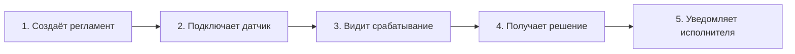

Под каждым шагом — стопка US, отсортированная сверху-вниз:

| 1. Создать регламент | 2. Подключить датчик | 3. Срабатывание | 4. Решение | 5. Уведомить |
|---|---|---|---|---|
| **MVP (release 1)** | | | | |
| Создать в Turtle через API | Принять показание через REST | Запустить регламент | Сгенерировать решение | Положить в LEYKA |
| **Release 2** | | | | |
| Создать в графическом редакторе | UI «список датчиков» | Real-time видимость | Превью решения | Уведомление в Telegram |
| **Release 3** | | | | |
| Импорт из CSV | Поллер MQTT | Симуляция на истории | Кастомные параметры | Эскалация если не отвечает |
| **Nice to have** | | | | |
| Шаблоны | Авто-обнаружение | ML-аномалии | A/B-тест решений | Голосовые уведомления |

Карта удобна тем, что:

- видно, что обязательно в MVP, а что нет;
- видно «провалы» — этапы, у которых пусто;
- видно, что нельзя убрать историю из MVP, не оставив дыру.

---

### 7.9. MVP: что это и зачем

MVP (Minimum Viable Product, минимально жизнеспособный продукт) — версия продукта, которая:

- **минимальна** (только самое нужное);
- **жизнеспособна** (приносит реальную пользу хоть кому-то).

MVP — не «прототип», не «макет», не «бета». Это **работающий продукт**, просто маленький.

Метафора Хенрика Книберга: MVP — это скейтборд, а не колесо. Колесо одно — это не продукт. А скейтборд маленький, но на нём уже можно ехать.

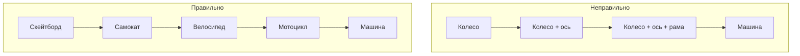

На каждом шаге «правильного» пути можно ехать. На «неправильном» — можно ехать только в конце.

#### История MVP РАГРАФ (по `git log`)

- **День 1, 13.05.2026:** пять регламентов — среди них «температура в серверной» — заданы данными (Turtle и граф потока), а не кодом; их видно в редакторе потока и в графе. **Жизнеспособно?** Да: правило можно показать и обсудить, не открывая Python.
- **День 5, 17.05:** редактор регламента. **Жизнеспособно?** Да: аналитик правит правило без программиста.
- **День 8, 20.05:** живые данные города — погода, воздух, пробки — и первый экран живого контура, нынешний «Ситуационный центр». **Жизнеспособно?** Да: правила исполняются на настоящих данных.
- **День 10, 22.05:** связь с LEYKA — вердикт может стать задачей. **Жизнеспособно?** Это и есть «полный контур» от данных до исполнителя.
- **Через четыре с половиной месяца, 26.09–15.10:** доставка вердиктов в Телеграм и МАКС, второй объект — кампус НГУ, вопрос получателю кнопкой и ответ величиной, основание вердикта в сообщении. **Жизнеспособно?** Да: вердикт дошёл до человека, и человек отвечает.

Каждая итерация — работающий продукт. Обрати внимание, чего в этой истории нет: двухнедельных спринтов. Шаг здесь — фаза из разбора, а не спринт (о методе — в 7.1).

---

### 7.10. Story Points и Planning Poker

**Story Point (SP)** — единица оценки **сложности** задачи, а не времени.

Почему не часы?

- Разработчик А делает за 4 часа то, что разработчик Б делает за 12. Чьи часы писать?
- Оценка в часах превращается в обязательство («ты сказал 8, делай за 8»), а это убивает доверие.
- Время предсказать нельзя, сложность — можно.

SP — относительная шкала. «Эта задача в 3 раза сложнее той». Обычно используют **последовательность Фибоначчи**: 1, 2, 3, 5, 8, 13, 21. Числа растут нелинейно, потому что чем больше задача — тем больше неопределённость.

| SP | Что это значит |
|---|---|
| 1 | Тривиально, точно знаем, как делать |
| 2 | Просто, но есть нюансы |
| 3 | Средняя задача, всё понятно |
| 5 | Заметная задача, есть пара неизвестных |
| 8 | Крупная задача, надо подумать |
| 13 | Огромная, скорее всего, надо нарезать |
| 21 | Эпик, обязательно нарезать |

#### Planning Poker

Командная техника оценки.

1. Аналитик зачитывает US.
2. Команда задаёт вопросы.
3. Все одновременно показывают карточки с оценкой (1, 2, 3, 5, 8, 13, 21).
4. Если разброс большой — обсуждают, почему. Часто выясняется, что у кого-то есть знание, которое другие не учли.
5. Голосуют снова.
6. До консенсуса (обычно 2-3 раунда).

**Плюс**: оценка коллективная, никто не «сел в угол с ТЗ». Если разработчик молчун — карточка заставляет его высказаться. Если в команде доминирует тимлид — карточки уравнивают всех.

В РАГРАФ Planning Poker не играют: изделие ведёт один разработчик с ИИ-агентом, и сравнивать оценки не с кем. Оценка там грубая — в часах на фазу, прямо в разборе (например, «2–3 ч» у фазы Д1 в `docs/OSNOVANIE-V-SOOBSHCHENII-RAZBOR.md`, § 4): нужен порядок величины, а не velocity. Покер оживает, когда за столом больше одного человека. В LEYKA, например, истории оценены в story points по Фибоначчи (`docs/GOST-19/VNE-KOMPLEKTA/USER-STORIES.md`, § 2.3).

---

### 7.11. Бэклог продукта vs бэклог спринта

Бэклог не один. Их два.

**Product Backlog** — общий список того, что когда-нибудь надо сделать. Им владеет **Product Owner**. Может быть длинным (сотни историй). Меняется постоянно.

**Sprint Backlog** — то, что команда взяла в работу на текущий спринт. Им владеет **команда** (включая аналитика). Меняется минимально (если совсем надо).

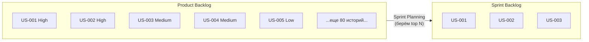

На Sprint Planning команда:

1. Смотрит на верх Product Backlog.
2. Оценивает свою capacity (сколько SP исторически делаем за спринт = velocity).
3. Берёт столько историй, сколько влезает.
4. Sprint Backlog зафиксирован — PO не может добавить туда новую историю без обсуждения.

Если в середине спринта PO приходит со словами «срочно надо это» — формальный ответ: «возьмём в следующий спринт». Если правда горит — можно вынуть из текущего что-то того же размера. Но это исключение.

#### А как в РАГРАФ: бэклог — файл рядом с кодом

Sprint Backlog у РАГРАФ нет, оценок в story points тоже (`grep -ci "story point" docs/BACKLOG.md` → 0, 30.10.2026). Есть один файл — `docs/BACKLOG.md`, 3646 строк (`wc -l docs/BACKLOG.md`, 30.10.2026), и это не очередь историй, а **память об отложенном**: что заметили, почему не делаем сейчас и по какому признаку вернёмся. План — что и когда делаем — в РАГРАФ живёт в таблицах фаз разборов, в командах — на доске или в трекере; в бэклоге — только отложенное. Двух источников правды быть не должно.

Почему файл, а не трекер:
- он правится **тем же коммитом**, что и код, — запись не отстаёт от причины;
- его **читает ИИ-агент**: в чужой трекер агент не ходит;
- он проходит **ревью** вместе с кодом и **предъявляется на приёмке**: видно, что команда знает о своих пробелах.

Живая запись от 27.10.2026 — «Опросы не записывались на действующем экземпляре 09–27.10»:
- **Основание** — владелец нажал «Да» и «Нет» под сообщением, а на дашборде кампуса ответов нет;
- **Причина** — колонку добавили в таблицу опросов уже после её создания, и с 09.10 каждая запись падала молча;
- **Сделано** — четыре правки, С1–С4;
- **Отложено** — четыре пункта: что именно осталось и зачем это нужно;
- **Признак возврата** — например, «первая новая колонка в любой живой таблице».

⚠ Правило ски-кодинга: «отложено» без причины запрещено, и причина умещается в одно предложение. «Потому что сложно» — не причина: это оценка, а не обстоятельство.

---

### 7.12. Проектная работа 3: «Цифровой двойник школьной столовой»

**Задание:** разработай Agile-набор для приложения «Цифровой двойник школьной столовой».

**Контекст:** школа N. В столовой есть кассир, повар, заведующая. Дети едят. Родители платят. Завуч контролирует. СЭС проверяет. Хочется приложение, которое связывает всех этих участников.

**Что сделать (~15 часов):**

#### 1. Бэклог продукта (4 ч)

- Не менее 25 User Stories или Job Stories.
- Каждая в формате «As a — I want — So that» или «When — I want to — So I can».
- Покрытие ролей: ученик/родитель/кассир/повар/заведующая/завуч/СЭС.

#### 2. INVEST-чек (1 ч)

- Выбери 3 свои US.
- Для каждой пройди по чек-листу INVEST.
- Если какой-то критерий не выполняется — перепиши US.

#### 3. User Story Map (3 ч)

- Магистраль из 5-7 шагов (например: «зарегистрироваться → пополнить счёт → выбрать меню → получить блюдо → оценить»).
- Под каждым шагом — стопка US, отсортированная по приоритету.
- Выдели горизонтальные «срезы»: MVP, Release 2, Release 3.

#### 4. MVP (2 ч)

- Опиши MVP в 1 страницу:
  - Какие 5-7 историй входят?
  - Какую ценность приносит?
  - Какие истории осознанно отложены и почему?
  - Какие риски остаются?

#### 5. Acceptance Criteria в Gherkin (2 ч)

- Возьми 5 ключевых US из MVP.
- Для каждой напиши 2-4 сценария в Given/When/Then.

#### 6. Прототип main-экрана (3 ч)

- Wireframe или mockup в Figma/Excalidraw/на бумаге (сфотографируй).
- Покажи, как видится главный экран для ребёнка (например: остаток на счёте, меню дня, кнопка «купить»).

**Критерии оценки:**

- 25+ US/JS соблюдают формат: 20%
- INVEST применён, плохие US переписаны: 15%
- Карта историй понятна, релизы выделены: 20%
- MVP обоснован: 15%
- Gherkin-сценарии корректны: 15%
- Прототип отражает MVP: 15%

**Мини-практика к спринту (10 мин):** напиши 5 User Stories к мобильному приложению Госуслуг с точки зрения студента-первокурсника.

> В следующем спринте мы перейдём к **архитектуре системы** — это даст тебе возможность разложить любую платформу по слоям, выбрать стиль (монолит / микросервисы / event-driven) и фиксировать архитектурные решения в ADR.

---

## Спринт 8: Архитектура системы

### Главное за минуту

Архитектура — это про то, как **разложить систему на куски** так, чтобы её можно было строить, менять и масштабировать. Метафора простая: у дома есть план — где несущая стена, где можно сверлить, где стояк, где разводка электрики. Если ты строишь дом без плана — на третьем этаже выяснится, что стена под спальней не выдерживает. С софтом то же самое: без архитектуры на пятом спринте выяснится, что нельзя добавить мобильное приложение, потому что вся логика жёстко прописана в web-формах. РАГРАФ — монолит: один процесс и две встроенные базы DuckDB. Его ответственность разложена на пять слоёв (Source / Storage / Processing / Knowledge / Presentation), код — на три (обработчики, сервисы, модели), и любую новую фичу мы кладём в нужный слой, а не размазываем по всему коду. Σ Сигма разложена на сервисы — шлюз, авторизация, сбор данных, приём событий и цифровые двойники предметных областей: она строится как большой контур масштаба муниципалитета. В этом спринте ты научишься видеть стиль архитектуры за каждой системой, читать UML Component/Deployment Diagram и фиксировать архитектурные решения в ADR.

### О чём эта часть

Аналитик не пишет код, но **архитектуру обязан понимать**. Без этого ты:

- не сможешь оценить, реально ли требование (а вдруг оно требует переделать половину системы);
- будешь предлагать решения, которые архитектурно противоречат стилю системы;
- не сможешь читать диаграммы, которые рисуют разработчики;
- не научишься фиксировать архитектурные ограничения в требованиях.

В этом спринте: 8 архитектурных стилей с примерами, масштабный куб, два типа UML-диаграмм, разбор РАГРАФ по слоям и понятие ADR.

### Ключевые термины

- **Архитектура ПО** — структура системы (компоненты, их связи, правила взаимодействия).
- **Архитектурный стиль** — типовой подход к структуре (монолит, микросервисы и т.д.).
- **Компонент** — модуль системы с чёткой ответственностью и интерфейсом.
- **Слой** — горизонтальная группировка компонентов по уровню абстракции.
- **ADR (Architecture Decision Record)** — короткий документ про значимое архитектурное решение и почему так.

---

### 8.1. Что такое архитектура и зачем она

Архитектура ПО — это **решения, которые дорого менять**.

- Сменить цвет кнопки — дёшево.
- Сменить базу данных с DuckDB на Postgres — дорого.
- Сменить монолит на микросервисы — очень дорого.

Архитектурные решения принимаются **рано** и живут **долго**. Поэтому к ним стоит подходить осознанно.

Метафора: представь, что ты планируешь квартиру.

- Поменять обои — текущая задача (фича).
- Подвинуть розетку на 10 см — рефакторинг.
- Снести несущую стену — архитектурное решение.

Архитектура отвечает на вопросы:

- Как куски системы общаются?
- Где живут данные?
- Где исполняется логика?
- Что можно менять независимо?
- Как система масштабируется при росте нагрузки?

---

### 8.2. Монолитная архитектура

**Монолит** — вся система в одном развёртываемом артефакте (один процесс, одна база, один деплой).

**Пример: РАГРАФ.** Один процесс uvicorn: FastAPI отдаёт и программный интерфейс `/api/*`, и собранный React, а фоновой задачей того же процесса работает планировщик сбора данных. Данные — в двух файлах DuckDB и в файлах графов регламентов, всё в одном репозитории. Поднял `uvicorn app.main:app` из папки `backend` — система работает.

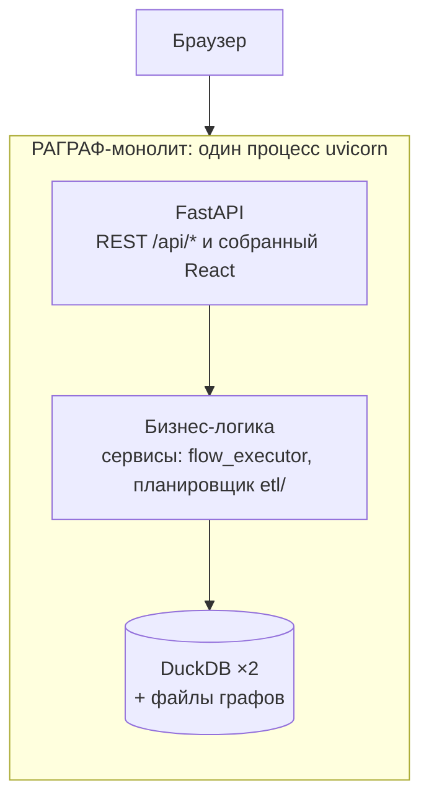

**Плюсы:**

- Просто начать (один репозиторий, один деплой).
- Просто отлаживать (один процесс, единые логи).
- Транзакции работают «из коробки» — всё в одной базе.
- Дёшево хостить.

**Минусы:**

- Невозможно горизонтально масштабировать **отдельные части**. Если ETL грузит — масштабируешь весь монолит.
- Сложно работать большой команде — все ходят по одному коду.
- Деплой = весь продукт целиком, поднять только новую фичу нельзя.
- Зависимости между модулями со временем превращаются в спагетти.

**Когда выбирать:**

- Стартап, пилот, MVP.
- Команда < 10 разработчиков.
- Нагрузка предсказуемая.
- РАГРАФ — здесь.

**Когда переходить на что-то другое:** когда монолит начинает мешать. До тех пор — не трогай.

---

### 8.3. Многослойная (Layered) архитектура

**Многослойная архитектура** — система разбита на горизонтальные слои, каждый слой обращается только к слою ниже.

Это, пожалуй, самый распространённый стиль. Код РАГРАФ разложен на три слоя:

```mermaid
flowchart TB
    API["api/ — обработчики REST<br/>разбор запроса, вызов сервиса, ответ"]
    SRV["services/ — прикладная логика и хранилища<br/>flow_executor, etl/, модули *_store, turtle_bridge"]
    SCH["schemas/ — модель предметной области<br/>domain.py на Pydantic"]
    DB[("DuckDB ×2 + файлы графов")]
    API --> SRV
    SRV --> SCH
    SRV --> DB
```

**Правило:** слой обращается только к слою **ниже**: обработчик зовёт сервис, сервис не знает про HTTP. Вторая половина правила в РАГРАФ выполнена полностью: сервисы не импортируют FastAPI. Первая выполнена с исключениями, и их видно командами (замер 30.10.2026):

- два отложенных вызова «сервис → обработчик»: `grep -rn "from app.api" backend/app/services` → `leyka_task_poller.py:134`, `etl/puller.py:721`;
- пять мест, где обработчик сам берёт соединение с базой в обход сервиса: `grep -rn "_connection()" backend/app/api | wc -l` → 5.

Такие места и ищут, когда проверяют архитектуру.

Поверх трёх слоёв кода в документации РАГРАФ описаны пять слоёв ответственности. Это не порядок вызовов, а путь данных снизу вверх: источник → хранение → обработка → знание → представление.

#### За что отвечает каждый слой РАГРАФ

| Слой | Ответственность | Технологии |
|---|---|---|
| **Source** | Источники данных: опрос внешних систем, приём событий, ручной ввод, ответы людей | опрос по расписанию: Open-Meteo, Yandex, LEYKA, Plan-R, DAS-оптоволокно, системные часы, ответы в Telegram; приём по HTTP `/api/ingest/*` |
| **Storage** | Хранение регламентов, показаний и журналов | `regulations.duckdb`, `live_etl.duckdb`, файлы графов `flows/` и `versions/` |
| **Processing** | Бизнес-логика: исполнение регламентов, доставка вердикта, создание задач, проверка исхода | `applier`, `flow_executor`, `delivery`, `leyka_task_creator`, `acceptance_resolver` |
| **Knowledge** | Семантика: онтология, ограничения, происхождение, граф знаний | rdflib, Turtle, SHACL, PROV-O, SPARQL |
| **Presentation** | Интерфейсы наружу: REST API + Web UI | FastAPI, React 18, OpenAPI |

**Плюсы:**

- Понятно, где что лежит.
- Слой можно заменить отдельно (например, перейти с DuckDB на Postgres — меняется только Storage).
- Тестировать слои можно отдельно.

**Минусы:**

- Запрос проходит через все слои сверху-вниз — есть overhead.
- Соблазн «протащить логику через слои» (антипаттерн).
- Если слоёв много (7-10) — навигация утомляет.

#### Классическая 3-слойная архитектура

Самый частый вариант: **Presentation → Business Logic → Data Access**.

- **Presentation** — UI и контроллеры.
- **Business Logic** — основная логика, правила.
- **Data Access** — работа с БД.

LEYKA построена по 3-слойке + Auth-сбоку.

---

### 8.4. Клиент-серверная архитектура

**Клиент-серверная (Client-Server)** — есть клиент (запрашивает) и сервер (отвечает). Это **физическое** разделение: разные машины, общаются по сети.

**Пример: РАГРАФ.**

- **Клиент** — React-приложение в браузере (тяжёлый Flow Editor + лёгкие списки).
- **Сервер** — FastAPI на Railway.
- Между ними — REST API через HTTPS.

```mermaid
flowchart TB
    subgraph Browser["Клиент: браузер"]
        UI["React 18 SPA"]
    end
    subgraph Server["Сервер: Railway, один процесс"]
        BE["FastAPI"]
        DB[("DuckDB ×2<br/>+ файлы графов")]
        BE --> DB
    end
    BE -->|"HTTPS: index.html и /assets/*"| UI
    UI <-->|"REST /api/* JSON"| BE
```

**Разделение ответственностей:**

| Клиент отвечает за | Сервер отвечает за |
|---|---|
| Отображение | Бизнес-логику |
| UX/анимации | Хранение данных |
| Локальное состояние UI | Авторизацию |
| Валидацию формы (быстрая) | Валидацию данных (последняя инстанция) |
| Кэширование (для скорости) | Источник правды |

**Принцип:** никогда не верь клиенту. Если ты проверил пароль в браузере — проверь ещё раз на сервере. Любую логику, на которой держатся деньги/доступ/безопасность — держи на сервере.

---

### 8.5. Толстый клиент vs тонкий клиент

**Тонкий клиент (thin client)** — клиент почти ничего не делает, всё делает сервер. Например, веб-форма, которая отправляет POST и получает обратно готовую HTML-страницу. Старые ASP/PHP-сайты — типичный thin client.

**Толстый клиент (thick / fat client)** — клиент содержит много логики. Например, Adobe Photoshop: основная обработка на машине пользователя, сервер только для лицензий и облака.

**Middle-thick** — что-то посередине. Современные SPA на React, Vue, Angular — обычно middle-thick.

**РАГРАФ — middle-thick:**

- **Flow Editor** (визуальный редактор регламентов) — **толстый**: drag-and-drop, отрисовка узлов и мгновенная проверка «что к чему можно подключить» идут на клиенте. Но последнее слово за сервером. При сохранении он сам сверяет с графом параметры и триггеры регламента. По запросу он проверяет граф по семи структурным правилам (`POST /api/regulations/{id}/validate`), разбирает формулы и ищет противоречия и пробелы (`GET /api/regulations/{id}/consistency`).
- **Списки регламентов, журналы, дашборды** — **тонкие**: клиент рисует таблицу из JSON, всё остальное — на сервере.

| Часть РАГРАФ | Тип | Почему |
|---|---|---|
| Flow Editor | Толстый | Интерактивная работа с графом, отзывчивость важнее |
| Список регламентов | Тонкий | Простая таблица, можно перерендерить |
| Карточка регламента | Тонкий | Просмотр + лёгкое редактирование |
| Прогон на заданных величинах | Средний | Клиент собирает величины и подсвечивает сработавшие узлы и рёбра, расчёт — на сервере |

**Когда выбирать толстого клиента:**

- Сложный интерактив (Photoshop, Figma, графический редактор).
- Работа оффлайн.
- Высокая отзывчивость (игры, IDE).

**Когда выбирать тонкого клиента:**

- Просмотр и формы.
- Безопасность важна (банк-клиент через web — лучше тонкий).
- Поддержка большого зоопарка устройств.

---

### 8.6. Сервис-ориентированная архитектура (SOA)

**SOA** — система разбита на крупные сервисы, общающиеся через единую шину (часто ESB — Enterprise Service Bus). Сервисы переиспользуются разными приложениями. Это «предшественник» микросервисов, расцвет — 2000-2010-е.

```mermaid
flowchart TB
    subgraph Apps[Приложения]
        A1[Приложение 1]
        A2[Приложение 2]
        A3[Приложение 3]
    end
    ESB[(Enterprise Service Bus)]
    Apps --> ESB
    subgraph Services[Сервисы]
        S1[Сервис Клиенты]
        S2[Сервис Документы]
        S3[Сервис Платежи]
    end
    ESB --> Services
```

**Когда выбирают:**

- Корпоративные интеграции (банки, страховые, нефтянка).
- Много legacy-систем, которые надо завязать в одну экосистему.
- Сильное разделение по отделам внутри компании.

**Современная альтернатива:** микросервисы (про них ниже). Микросервисы — это эволюция SOA с заходом на меньшие куски и отказ от тяжёлой ESB.

---

### 8.7. Микросервисная архитектура

**Микросервисы** — система разбита на множество мелких сервисов, каждый со своей зоной ответственности, своей базой данных и своим деплоем. Общаются через REST/gRPC/события.

**Пример: Σ Сигма.** Эталонная реализация фреймворка (НГУ, 2025) разложена на сервисы; разбор — `docs/REQ-SIGMA-INTEGRATION.md`, §1:

```mermaid
flowchart TB
    Client["Внешний клиент"] --> Gateway["api-gateway<br/>единая точка входа"]
    Gateway --> Auth["AUTH<br/>токены пользователей и приложений"]
    Gateway --> ETL["ETL<br/>адаптеры источников"]
    Gateway --> Events["EVENTS<br/>приём событий от источников"]
    Gateway --> CD["ЦД предметной области<br/>цифровой двойник: теплосети и др."]
    CD -->|"опрос показаний"| ETL
    CD --- F[("FUSEKI<br/>регламенты домена")]
    CD --- J[("журнал ЦД")]
    ETL --- R[("Redis<br/>кэш")]
    CD -->|"уведомления"| N["Telegram, почта"]
```

**Принципы:**

1. **Single Responsibility** — каждый сервис решает одну задачу.
2. **Independent deployability** — каждый сервис деплоится отдельно.
3. **Database per service** — каждый сервис владеет своими данными, не лезет в чужую базу.
4. **Communication через сеть** — REST, gRPC, message queues.
5. **Failure isolation** — упал один сервис — остальные работают.

**Плюсы:**

- Можно масштабировать только нагруженные сервисы.
- Команды работают независимо.
- Разные сервисы — разные технологии (Python для ML, Go для API gateway, Node для real-time).
- Падение одного сервиса не убивает систему.

**Минусы:**

- **Сложность операций** в 10 раз выше. Нужны Kubernetes, service mesh, distributed tracing.
- Распределённые транзакции — боль (саги, eventual consistency).
- Сетевая задержка между сервисами.
- «Распределённый монолит» — типичная ошибка, когда сервисы нарезали, но они так друг от друга зависят, что деплоятся вместе.

**Когда выбирать:**

- Большая команда (50+ разработчиков).
- Высокая нагрузка с разной интенсивностью по компонентам.
- Зрелая инженерная культура.

**РАГРАФ — точно НЕ микросервисы.** Это монолит. И это правильное решение для его масштаба: организация и рабочее место, вплоть до ноутбука проверяющего. Σ Сигма разложена на сервисы, потому что строится как большой контур масштаба муниципалитета.

---

### 8.8. Бессерверная (Serverless) архитектура

**Serverless** — ты не управляешь серверами. Просто пишешь функции, провайдер их запускает по вызову, считает время выполнения и берёт деньги за миллисекунды.

**Примеры платформ:**

- AWS Lambda
- Vercel Functions
- Cloudflare Workers
- Yandex Cloud Functions

```mermaid
flowchart LR
    Trigger[HTTP-запрос<br/>или событие] --> Func[Функция]
    Func --> DB[(База/хранилище<br/>тоже managed)]
    Func --> Resp[Ответ]
```

**Принцип:** функция холодная — она не работает (и не стоит денег). Пришёл запрос — функция «просыпается», выполняется (50-500 мс), отдаёт ответ, засыпает.

**Плюсы:**

- Платишь только за выполнение.
- Автомасштабирование.
- Не думаешь о серверах.
- Идеально для редких событий.

**Минусы:**

- **Cold start** — первый запрос медленный (функция «просыпается» 200 мс - 2 сек).
- Ограничения по времени выполнения (обычно до 15 мин).
- Сложно с состоянием (нужны внешние БД).
- Лок-ин на провайдера.

**Где уместно:**

- Webhooks от внешних систем (редкие, быстрые).
- Cron-задачи (раз в день что-то посчитать).
- Лёгкие API с очень неравномерной нагрузкой.
- Прототипы.

**Гипотетический сценарий для РАГРАФ:** приёмник событий видеодетектора парковки. С сентября 2026 года детектор из российской сети не достаёт до Railway (подробнее — в §8.12). Бессерверная функция в российском облаке могла бы принимать его `POST` и складывать события в очередь, а РАГРАФ забирал бы их оттуда сам по расписанию: обратный путь из Railway в Россию открыт. В бэклоге этот путь записан как «почтовый ящик» на маленьком российском сервере, функция — его бессерверный вариант; решение не принято. А вот писать прямо в DuckDB функция не смогла бы: база встроена в процесс РАГРАФ и открыта им на запись.

---

### 8.9. Событийно-ориентированная архитектура (Event-Driven)

**Event-Driven Architecture (EDA)** — компоненты общаются через события, опубликованные в шину. Подписчики реагируют асинхронно.

Это подробно — в Спринте 12 курса. Пока запомни:

- Не «вызов функции», а «событие случилось, кому надо — подхватит».
- Шина: Kafka, RabbitMQ, Redis Streams, Amazon EventBridge.
- Сильная развязка компонентов.

**Как это выглядит в РАГРАФ.** Шины событий в РАГРАФ нет. Планировщик в одном процессе вызывает шаги по очереди: прогон регламента, запись прогона в журнал, задача в LEYKA, доставка вердикта в Telegram или MAX. Одна развязка всё же сделана сознательно: доставка идёт **после** записи прогона и по его сводке. Поэтому недоступность мессенджера теряет сообщение, а не решение (`backend/app/services/etl/applier.py`, функция `dostavit_svodki`). С шиной тот же контур выглядел бы так: срабатывание публикует событие `RegulationTriggered`, а `leyka_task_creator`, журнал и отправщик сообщений подписаны на него и ничего не знают друг о друге.

К этой теме вернёмся.

---

### 8.10. Масштабный куб (Scale Cube)

Книга Мартина Эбботта и Майкла Фишера «The Art of Scalability» (Addison-Wesley, 2-е изд. — 2015) вводит модель **масштабного куба** — три оси, по которым можно масштабировать систему.

```mermaid
flowchart TB
    O[Origin<br/>одна машина] -->|"X: репликация"| X[Несколько копий]
    O -->|"Y: функц. декомпозиция"| Y[Разные сервисы]
    O -->|"Z: партиционирование данных"| Z[Шардирование]
```

#### X-axis (Replication, репликация)

Делаем **много копий одной и той же системы**. Перед ними — балансировщик. Каждая копия обслуживает часть запросов.

- Просто.
- Работает с stateless-сервисами (где состояние не хранится в памяти).
- Лучшее средство против вертикального предела одной машины.

**РАГРАФ-сценарий:** три копии FastAPI за балансировщиком сегодня не поставить. Встроенная DuckDB допускает одного пишущего, а пишет каждая копия: планировщик сбора данных живёт внутри процесса и делает шаг каждые 30 секунд. Поэтому служба запускается одним рабочим процессом (`start.sh`, комментарий перед запуском uvicorn), а на Railway к сервису с томом реплики не подключаются вовсе. Ось X открывается только вместе со сменой хранилища на серверное.

#### Y-axis (Functional decomposition, функциональная декомпозиция)

Разделяем систему **по функциональности**: сервис регламентов, сервис уведомлений, сервис аудита.

- Это, по сути, путь к микросервисам.
- Можно масштабировать только нагруженный кусок.

**Σ Сигма:** по этой оси она и устроена — шлюз, AUTH, ETL и EVENTS вынесены в отдельные сервисы, а регламенты исполняют цифровые двойники предметных областей, каждый со своим хранилищем FUSEKI (`docs/REQ-SIGMA-INTEGRATION.md`, §1).

#### Z-axis (Data partitioning, партиционирование данных)

Разделяем **данные по ключу**. Например: регламенты по школам — каждая школа хранится в своей базе.

- Шардирование по географии (Москва, Питер, Новосибирск).
- Шардирование по типу пользователя.
- Каждая копия системы видит свою «дольку» данных.

**Гипотетический сценарий для Σ Сигмы:** в каждом районе города — своя БД. Запрос с роутером попадает в нужный шард.

#### РАГРАФ и Σ Сигма на осях куба

| Система | Что на каких осях |
|---|---|
| РАГРАФ сегодня | Начало координат: один процесс, две встроенные базы, один экземпляр. Рассчитан на организацию и рабочее место, а не на город |
| РАГРАФ при росте | Сначала смена хранилища — на серверную СУБД или хранилище триплетов, форматы обмена при этом не меняются. Только после этого открывается ось X |
| Σ Сигма | Ось Y: шлюз, AUTH, ETL, EVENTS и цифровые двойники предметных областей — отдельные сервисы |

---

### 8.11. UML Component Diagram

**Component Diagram** — UML-диаграмма, которая показывает, **из каких компонентов** состоит система и **какие интерфейсы** они предоставляют.

Используется для того, чтобы:

- объяснить новому разработчику «что вообще из чего»;
- показать заказчику крупные блоки системы;
- проверить, что компоненты слабо связаны.

#### Component Diagram РАГРАФ

```mermaid
flowchart TB
    UI["React SPA<br/>редакторы регламента и потока,<br/>Студия аналитика, Ситуационный центр"]
    SRC["Источники событий<br/>видеодетектор номеров, ШУМ-ИИ и др."]
    API["REST API · FastAPI<br/>обработчики api/, приём /api/ingest/*"]
    SVC["Сервисы по запросу<br/>проверки: validator, regulation_analysis<br/>семантика: turtle_bridge, sparql_runner, sigma_export<br/>Студия: sandbox, embedding_index, document_store"]
    ETL["Сбор и применение · etl/<br/>scheduler → puller → applier"]
    POLL["Опрос задач LEYKA<br/>leyka_task_poller"]
    EXE["Исполнитель<br/>flow_executor"]
    OUT["Доставка и задачи<br/>delivery, osnovanie,<br/>telegram_notifier, max_notifier,<br/>leyka_task_creator"]
    ACC["Проверка исхода<br/>acceptance_resolver"]
    DB[("Хранилище<br/>regulations.duckdb · live_etl.duckdb<br/>flows/ · versions/")]

    UI --> API
    SRC --> API
    API --> SVC
    API --> EXE
    ETL --> EXE
    POLL --> EXE
    ETL --> OUT
    ETL --> ACC
    API --> DB
    ETL --> DB
```

Всё на схеме — один процесс uvicorn: планировщик `etl/` и опрос задач LEYKA — его фоновые задачи. Модули-хранилища `*_store.py` — часть слоя сервисов. Внешние системы — на диаграмме развёртывания в §8.12.

#### Нотация

- **Прямоугольник** — компонент.
- **Стрелка** — направление зависимости (А зависит от Б).
- **Кружок-палочка** (lollipop) — провайдер интерфейса.
- **Полукруг-палочка** (socket) — потребитель интерфейса.

Чаще на практике (и в курсе) — упрощённая нотация через Mermaid, как выше.

---

### 8.12. UML Deployment Diagram

**Deployment Diagram** — показывает, **где физически развёрнуты** компоненты: на какой машине, в каком регионе, какие сетевые связи.

#### Deployment Diagram РАГРАФ + LEYKA

```mermaid
flowchart TB
    U["Браузер пользователя"]
    DET["Детектор номеров ВКИ"]
    subgraph RW["Railway: один контейнер РАГРАФ"]
        APP["uvicorn, один рабочий процесс<br/>FastAPI: /api/* и собранный React<br/>планировщик сбора данных, шаг 30 с"]
        VOL[("Том /data<br/>regulations.duckdb · live_etl.duckdb<br/>flows/ · versions/")]
        APP --- VOL
    end
    PULL["Опрос по расписанию<br/>Open-Meteo, Yandex — 900 с<br/>DAS-оптоволокно — 120 с, HTTP без TLS<br/>LEYKA — 300 с · Plan-R — раз в сутки"]
    SEND["Доставка и задачи<br/>Telegram, MAX — вердикты; ответы — опросом Telegram, 30 с<br/>LEYKA — создание задач, слежение за статусом, 30 с"]
    ASK["По запросу пользователя<br/>Cerebras — генерация, Jina — векторы<br/>Каппа НГУ — выгрузка знаний"]

    U -->|"HTTPS"| APP
    DET -.->|"POST /api/ingest/anpr<br/>из России не доходит с 08.09.2026"| APP
    APP --> PULL
    APP --> SEND
    APP --> ASK
```

Внешней СУБД и отдельного сервера для интерфейса у боевого экземпляра нет: интерфейс отдаёт тот же процесс. LEYKA — отдельное изделие: API на Railway с базой SQLite, интерфейс на Vercel. Кроме Railway описаны ещё два способа развёртывания. Первый — контейнер на собственном сервере. Второй — установщик на рабочую машину Windows: служба на `127.0.0.1:8080`, данные в `%USERPROFILE%\RAGRAF-data`, по желанию — локальная модель через Ollama (РАГРАФ-ФРЕЙМ-32, пп. 1.2 и 5.1). Ни на стороннем сервере, ни на Windows эти способы ещё не опробованы.

#### Что обозначаем

- **Узел** (node, прямоугольник) — физическая или виртуальная машина / контейнер.
- **Артефакт** — то, что развёрнуто (бинарник, образ, файл).
- **Связь** — сетевая (с протоколом).

📋 **Случай из РАГРАФ: артефакт, которого не оказалось в образе.** Комплект программных документов по ГОСТ 19 лежал в `docs/RAGRAF/GOST-19`, а страница `/documentation` читала его с диска. На машине разработчика всё работало, а на проде страница показывала «0 из 11 документов». Причина: каталог `docs/` в образ не копируется и вдобавок исключён из контекста сборки (`.dockerignore`). Ненаписанный документ страница честно помечает, а нескопированный выглядел как ненаписанный — страница говорила о комплекте неправду.

**Решение 26.09.2026:** документы — **статика поставки**, как фикстуры регламентов и сиды графа знаний. Они переехали в `backend/data/gost19/` и попадают в образ строкой `COPY backend/data/gost19 /srv/backend/data/gost19` (`Dockerfile`). Сейчас страница на проде показывает 9 из 12 написанных документов фреймворка и 11 из 11 — строительной настройки (`GET /api/documentation`, 30.10.2026).

🎯 **Вывод для аналитика.** У каждого артефакта на диаграмме развёртывания три места: исходный текст, образ, том с данными. Требование «документация доступна в изделии» проверяют в развёрнутом виде, а не на машине разработчика.

Deployment Diagram помогает аналитику:

- понять, какие данные где живут (важно для безопасности);
- увидеть точки отказа (если Railway упал — что работает?);
- понять задержки (если БД в другой стране — добавятся 100 мс).

⚠ **Случай из РАГРАФ: точка отказа, которой не было на схеме.** С 08.09.2026 видеодетектор номеров ВКИ перестал доставлять события на `POST /api/ingest/anpr`, а сайт РАГРАФ из российских сетей без VPN не открывается. Замер 09.10.2026 из российской сети в обход VPN:
- соединение TCP с `ragraf.up.railway.app` устанавливается за 0,24 с;
- защищённое соединение (TLS) не устанавливается, запрос обрывается по истечении 15 с;
- через VPN TLS проходит за 0,22 с, ответ 200 (`docs/BACKLOG.md`, запись 09.10.2026).

Режут адрес площадки, а не имя, — свой домен не поможет. Обратный путь открыт: РАГРАФ сам забирает данные у российских узлов — журнал оптоволокна, пробки, Plan-R.

📋 **Что из этого следует для требований.**
- Размещение — нефункциональное требование, и его пишут явно: «изделие доступно пользователям и источникам событий из российских сетей без VPN». Под него у РАГРАФ описаны контейнер на собственном сервере и установщик на рабочую машину Windows (РАГРАФ-ФРЕЙМ-32, п. 1.2); для модуля Σ Сигмы — российская площадка.
- Для детектора рассматриваются частная сеть NetBird и «почтовый ящик» на российском сервере, откуда РАГРАФ забирает события сам; решение не принято.
- Та же логика — для языковой модели. На действующем экземпляре она облачная: генерация — Cerebras (`gpt-oss-120b`), векторы — Jina (`jina-embeddings-v3`); источник — `GET /api/sandbox/llm-info`, 30.10.2026. Закрытый контур с локальной моделью, где запросы наружу не уходят, описан в Спринте 12 («Оракул можно поставить у себя»).
- Критический путь «событие → вердикт → доставка» от модели не зависит вовсе (§8.16, правило 1).

🎯 У каждой стрелки на диаграмме развёртывания, которая пересекает границу сети или страны, должен быть ответ на вопрос «что, если её перережут».

---

### 8.13. Спецтема: Архитектура РАГРАФ от и до

Пройдём по слоям подробнее.

#### Source Layer — откуда приходят данные

**Что входит:**

- **Опрос по расписанию** — планировщик сам забирает данные: погода и качество воздуха Open-Meteo, загруженность дорог Yandex, задачи LEYKA, стройка Plan-R, журнал оптоволоконного датчика DAS, системные часы.
- **Приём событий по HTTP** — внешняя система присылает события сама: видеодетектор номеров на парковке (`POST /api/ingest/anpr`), сейсмоакустика и шум (`/api/ingest/noise`), кредитная заявка, вердикт медицинской модели. Принятое событие ложится в базу, а в регламент попадает на очередном шаге планировщика.
- **Ручной ввод** — методолог задаёт величины и запускает «Прогон на заданных величинах» в редакторе.
- **Ответы людей** — получатель вердикта нажимает кнопку опроса в Telegram, и ответ возвращается в регламент величиной (с 08.10.2026). Plan-R и LEYKA сами ничего не присылают: РАГРАФ их опрашивает, потому что LEYKA не публикует точку обратного вызова (ADR-021 в `docs/ARCHITECTURE.md`).

**Что НЕ входит:**

- Бизнес-логика обработки этих данных.
- Хранение надолго.

Source-слой — это «дверь». Получил данные — отдай дальше, не задерживай.

#### Storage Layer — где данные живут

В РАГРАФ данные лежат в двух базах DuckDB и в файлах, и у каждого вида данных один хозяин:

| Хранилище | Что хранит | Зачем |
|---|---|---|
| **`regulations.duckdb`** | Паспорта регламентов, параметры, триггеры, история версий, метрики прогонов, журнал инцидентов, загруженные документы | Правки методолога, история, оценка доли успеха |
| **`live_etl.duckdb`** | Снимки показаний, журнал прогонов, события источников, журналы доставок и обратной связи | Отделена сознательно: сбой сбора данных не задевает регламенты |
| **Файлы графов** `flows/`, `versions/` | Граф регламента и неизменяемые снимки его версий | Граф с координатами узлов не ложится в таблицу без потери изображения |
| **Turtle + SHACL** | Выгрузка регламента пакетом для Σ Сигмы, датасеты графа знаний, эталонная поставка `fixtures/` | Открытые форматы W3C |

**Правило:** паспорт и параметры регламента живут в базе, логика — в файле графа. При сохранении графа сервер сам сверяет с ним параметры и триггеры. Turtle — производный: порождается из модели при выгрузке. Поставка `fixtures/` (три файла на регламент) — эталон, из которого база собирается при первом старте.

#### Processing Layer — где работает логика

Пять ключевых участников:

1. **applier** — дирижёр прогона по расписанию. Собирает входы регламента из свежих снимков — по узлам-датчикам графа либо сборщиком ядра. Вызывает исполнитель, пишет прогон в журнал, по сработавшему выходу заводит задачу. Для четырёх регламентов LEYKA вердикт дополняет оценщик в коде.
2. **flow_executor** — исполнитель регламента. Берёт показания, обходит граф, вычисляет пороги, формулы и развилки по трёхзначной логике и возвращает вердикт с пошаговой трассой. Сам ничего не хранит и в сеть не ходит.
3. **delivery** — доставка вердикта в Telegram или MAX. Канал и адрес записаны на выходе регламента. К тексту добавляется основание — величины и границы зоны (`osnovanie.py`, с 15.10.2026). Повтор гасится окном, по умолчанию 12 часов; каждая попытка пишется в журнал доставок.
4. **leyka_task_creator** — задача в LEYKA через REST, когда у сработавшего выхода код «создать задачу», а критерий решённости — «задача закрыта в срок». Одна задача на эпизод срабатывания.
5. **acceptance_resolver** — проверка исхода на каждом шаге планировщика: вернулся ли параметр в норму, закрыта ли задача в срок (запрос к LEYKA по номеру задачи), пришёл ли ответ получателя. Итог пишется в метрику регламента, из которой считается доля успеха.

```mermaid
flowchart TB
    SNAP[("Снимки показаний<br/>etl_snapshots")] --> APP["applier<br/>входы: узлы-датчики графа<br/>или сборщик ядра"]
    REG["Регламент<br/>граф flows/ + параметры"] --> FE
    APP --> FE["flow_executor<br/>вердикт и пошаговая трасса"]
    FE -->|"вердикт"| RUN[("Журнал прогонов etl_runs,<br/>метрики regulation_metrics")]
    RUN --> DEL["delivery<br/>Telegram, MAX + основание"]
    RUN -->|"выход «создать задачу»,<br/>критерий «задача закрыта в срок»"| TC["leyka_task_creator"]
    TC -->|"REST POST /tasks"| L["LEYKA"]
    L -.->|"смена статуса задачи:<br/>leyka_task_poller, 30 с"| FE
    AR["acceptance_resolver<br/>каждый шаг планировщика"] -->|"запрос задачи по номеру"| L
    AR --> RUN
    DEL --> P["Получатель"]
    P -->|"ответ кнопкой"| FB["pull_telegram_feedback,<br/>feedback_store"]
    FB --> SNAP
```

#### Knowledge Layer — семантический слой

Здесь живёт «понимание» предметки:

- **Онтология** — класс `:Regulation` с плоскими свойствами-параметрами (так устроены регламенты и в Σ Сигме), критерий решённости `:AcceptanceCriterion`, триггер `:Trigger`, действие при отрицательном исходе `:FailureAction`.
- **SHACL** — формальные ограничения на значения. На каждый параметр — форма: тип, обязательность, допустимый диапазон `sh:minInclusive`/`sh:maxInclusive`; отдельная форма — на критерий решённости. При прогоне диапазон проверяет узел «Ограничение» графа, конфигурацию критерия — встроенный проверяющий модуль. Сохранению нарушение не мешает: проверки рекомендательные.
- **PROV-O** — стандарт W3C о происхождении данных. В РАГРАФ он связывает регламент с документом-основанием: `prov:wasDerivedFrom` на `prov:Entity` с названием документа, ссылкой, выдержкой и контрольной суммой файла. Кто и когда правил регламент, хранит история версий `regulation_history`, а ход прогона — пошаговая трасса исполнителя.
- **rdflib** — Python-библиотека работы с RDF-графом. Запросы SPARQL к датасетам графа знаний исполняет `sparql_runner` (раздел «Граф знаний»).

Этот слой даёт **стыковку с Σ Сигмой** через открытые форматы: регламент уходит пакетом — Turtle, формы SHACL, граф, документ-основание (`sigma_export.py`). Сериализация туда и обратно проверена наборами `test_turtle_bridge` и `test_sigma_export`; загрузка выгрузки в хранилище триплетов Σ Сигмы пока не испытывалась.

#### Presentation Layer — наружу

- **REST API** — FastAPI с автогенерируемым OpenAPI (про это в Спринте 9).
- **Web UI** — React 18 + TypeScript + Vite.
- **Доступ** — общий пароль администратора `ADMIN_PASS` и cookie с подписью HMAC-SHA256, без хранения сессий на сервере (`backend/app/auth.py`). Создание, правка и удаление регламента — после входа администратора. Публикация своего регламента в сообщество — после входа учётной записью Каппы НГУ. Роли пользователей — это фильтр разделов меню: он хранится в браузере, и сервер его не проверяет. Учётные записи и серверная ролевая модель — в плане развития. Вот тебе живой пример принципа «никогда не верь клиенту» из §8.4: права проверяет сервер, а не меню.

---

### 8.14. ADR — Architecture Decision Records

**ADR** — короткий документ, который фиксирует **значимое архитектурное решение** и **почему так**.

#### Зачем?

Полгода назад вы выбрали DuckDB вместо Postgres. Сегодня к команде присоединился новый разработчик. Он смотрит и говорит: «А почему не Postgres? Postgres же стандарт.» Если ADR нет — вам приходится восстанавливать аргументы по памяти, теряя нюансы. Если ADR есть — открываете его и читаете.

#### Шаблон

```
# ADR-NNN: <решение>

## Status
proposed | accepted | superseded by ADR-XXX | deprecated

## Context
Что было до решения. Какая проблема. Что пробовали.

## Decision
Что решили. Конкретно.

## Consequences
Что станет лучше. Что станет хуже. Что станет невозможно.

## Alternatives considered
Что ещё рассматривали и почему отказались.
```

#### Пример: ADR-001 РАГРАФ — DuckDB как основное хранилище

```
# ADR-001: DuckDB как основное хранилище РАГРАФ

## Status
accepted (2026-05-23). Выбор сделан 2026-05-13, в день заведения
репозитория; 2026-05-23 закреплён решением с границей применимости.

## Context
Архитектура Σ Сигмы предусматривает хранилище триплетов (Apache Jena)
и отдельную реляционную СУБД — большой контур масштаба муниципалитета.
РАГРАФ разворачивается в организации и на рабочем месте, вплоть
до ноутбука проверяющего. Нужны SQL, снимки версий в JSON, быстрые
сводки по журналу прогонов и развёртывание одной службой,
без администратора.

## Decision
Встроенная колоночная СУБД DuckDB (duckdb>=1.2,<2), два файла:
regulations.duckdb — регламенты, история, метрики;
live_etl.duckdb — снимки, прогоны, события.
Граф регламента — файлами flows/ и versions/.
Форматы обмена сохраняются: Turtle, SHACL, PROV-O.

## Consequences
+ Одна служба и один каталог данных; внешняя СУБД не нужна
+ Сводки «открыл регламент — увидел статистику» без отдельной витрины
+ Резервная копия — копия каталога данных при остановленной службе
- Один пишущий процесс: uvicorn работает с одним рабочим процессом
- Выход за допущения масштаба (одновременные пишущие, отказоустойчивость,
  разделение по организациям) — перенос в серверную СУБД
  или хранилище триплетов; форматы менять не придётся

Выявлено в эксплуатации:
- журнал WAL, не сброшенный при редеплое, ронял следующий старт —
  при остановке выполняется CHECKPOINT, с 2026-09-27 по обеим базам
- «Corrupted ART index» при записи: запись не повторять,
  базу пересобрать через EXPORT DATABASE / IMPORT DATABASE

## Alternatives considered
- Apache Jena + реляционная СУБД (состав Σ Сигмы): две сетевые
  службы — избыточно для масштаба организации.
- PostgreSQL: серверная служба и администратор; оставлен путём
  миграции при росте.
- SQLite: рассчитана на короткие транзакции, а не на аналитические
  сводки по журналу.
- Только файлы Turtle: нет транзакций и произвольных запросов.
```

В РАГРАФ решения ведутся не отдельными файлами, а таблицей: 21 запись ADR-001…ADR-021 в `docs/ARCHITECTURE.md`, раздел 12 (`grep -c "^| ADR-" docs/ARCHITECTURE.md` → 21, 30.10.2026). Есть и второй, более ранний реестр — `docs/ARC.md`, раздел 15, 26 записей со своей нумерацией (`grep -cE "^\| 0[0-9]{2} " docs/ARC.md` → 26, 30.10.2026). Там DuckDB — ADR-002, а под номером 001 записан формат идентификатора версии. Последние записи в обоих реестрах сделаны в мае 2026 года. Позднейшие решения изложены в разборах `docs/*-RAZBOR.md`, а обоснование хранилища для комплекта ГОСТ 19 — в пояснительной записке РАГРАФ-ФРЕЙМ-81, п. 3.4.5.

⚠ Урок с этого проекта: реестр решений должен быть один. Два реестра с разной нумерацией делают ссылку «см. ADR-021» неоднозначной, а решение, записанное только в разборе, новый разработчик в реестре не найдёт.


#### Когда писать ADR

- Меняешь базу данных.
- Меняешь архитектурный стиль.
- Выбираешь между двумя серьёзными подходами.
- Делаешь что-то, что отклоняется от привычного.
- Откатываешь предыдущее ADR.

#### Когда **НЕ** писать ADR

- Меняешь библиотеку UI.
- Рефакторишь модуль.
- Любое мелкое решение.

#### Решение после мая: правила — из кода в граф регламента

📋 **Случай из РАГРАФ, октябрь 2026.** Ночью 14→15.10.2026 в Новосибирске выпал снег, а весь вечер в рабочий чат шло «Опасно за рулём (гололёд)» — без единой величины. Рядом регламент «Экологические риски» говорил «норма» по тому же гололёду. Причина оказалась архитектурной. Входами «Индексов жизни города» были баллы, которые заранее считал код сборщика, и гололёд там определялся одной температурой. У экологии был свой код, и гололёд она определяла по-другому (`docs/OSNOVANIE-V-SOOBSHCHENII-RAZBOR.md`).

**Решение — убрать хардкод, а не поправить порог** (фазы Д1, Д3а, Д3б, 15.10.2026):
- расчёт переехал из кода в граф: входами стали величины Open-Meteo — температура, осадки, код погоды, ветер, PM2.5, индекс воздуха, — а баллы и уровни считают формулы и развилки, которые аналитик видит и правит в редакторе;
- гололёд определён один раз — от −3 до +1 °C при осадках за последний час или коде погоды от 51 — и одинаков в обоих регламентах; равенство сторожит проверка `test_gololyod_odin_v_dvuh_reglamentah`;
- сообщение несёт основание вердикта: величины и границы зоны, не больше пяти строк (`backend/app/services/osnovanie.py`).

**Что осталось — называем прямо.** Сборщиков в коде было 7, стало 5. Ещё 4 регламента LEYKA получают вердикт от оценщика в коде. Итого 9 регламентов, правило которых не видно в графе (`docs/BACKLOG.md`, работа 13а). Замер 30.10.2026: `cd backend && .venv/bin/python -c "from app.services.etl.applier import LIVE_PARAM_COLLECTORS as C; from app.services.etl.simple_evaluator import _EVALUATORS as E; print(len(C), len(E))"` → `5 4`. Функции тренда `rate` и `delta` по-прежнему дают «нет данных»: исполнителю не подаётся история показаний (фаза Д4).

🎯 **Вывод для аналитика.** «Регламент — данные, а не код» — архитектурное требование, и его проверяют счётом: сколько правил ещё живёт в коде. Каждое такое место — правило, которое методолог не видит и не может доказать. Решение такого масштаба — кандидат в ADR: оно меняет, где живёт логика системы.

---

### 8.15. Практика: UML Component Diagram для школьной библиотеки

**Задание:** построй UML Component Diagram для мини-системы класса РАГРАФ для управления школьной библиотекой.

**Контекст:** школьная библиотека. Книги, ученики, выдача, возврат, штрафы за просрочку, уведомления через школьный мессенджер.

**Регламенты, которые надо поддержать:**

1. Если ученик не вернул книгу за 14 дней — уведомить классного руководителя.
2. Если в библиотеке осталось менее 3 экземпляров популярной книги — уведомить библиотекаря.
3. Если ученик регулярно сдаёт вовремя — начислить бонусные баллы.

**Что нужно нарисовать (1.5-2 ч):**

#### 1. Component Diagram (60 мин)

Минимум 6 компонентов:

- Компонент Web UI (для библиотекаря и ученика — можно объединить или разделить).
- Компонент REST API.
- Компонент Regulation Engine (исполнитель регламентов).
- Компонент Storage (БД).
- Компонент Notifier (уведомления в мессенджер).
- Один-два специфических компонента (например, Catalog, BorrowingManager).

Покажи зависимости и интерфейсы.

#### 2. Разложи компоненты по слоям (30 мин)

Используй пятислойную модель РАГРАФ:

- Какой компонент в каком слое?
- Какие данные в Storage?
- Что в Knowledge (онтология книги, читателя)?

#### 3. ADR на один выбор (30 мин)

Например: «PostgreSQL vs DuckDB для библиотеки» или «Полнотекстовый поиск: SQLite FTS vs ElasticSearch».

Напиши по шаблону Status/Context/Decision/Consequences/Alternatives.

**Сдача:** одна страница с диаграммой (Mermaid или картинка) + 0.5 страницы ADR.

**Критерии:**

- Не менее 6 компонентов: 30%
- Корректные зависимости: 20%
- Соответствие слоям РАГРАФ: 20%
- ADR полный по шаблону: 30%

**Мини-практика к спринту (10 мин):** возьми любое приложение с телефона. Прикинь его архитектуру: монолит или микросервисы? Толстый клиент или тонкий? По какой оси куба он масштабируется?

---

### 8.16. Двухполушарная архитектура гибридного ИИ в 5 слоях РАГРАФ

В этом блоке мы возвращаемся к идее из введения — «гибридный ИИ как двухполушарная архитектура» — и смотрим, **как именно она ложится на пятислойную модель РАГРАФ**. Это не косметика: понимание, где у платформы «левое полушарие», а где «правое» — главный навык архитектора гибридных систем.

#### Главное за минуту

Гибридный ИИ-агент устроен как человеческий мозг с двумя полушариями: **левое** (символьная логика, правила, объяснимость) и **правое** (нейросеть, паттерны, адаптивность). Между ними — **мозолистое тело** (оракульная вычислимость, обмен через формальные контракты). РАГРАФ — это **рабочий пример такой архитектуры**: его пять слоёв точно распределены между двумя полушариями, и нигде эти роли не размыты. Понимая раскладку, ты можешь спроектировать новую систему такого же класса для своей отрасли.

#### Раскладка по слоям

Пятислойная архитектура РАГРАФ из §8.3 и §8.13 теперь читается так:

| Слой | Что внутри | Полушарие | Почему именно так |
|---|---|---|---|
| **Source** | опрос источников по расписанию, приём событий по HTTP, ручной ввод величин, ответы получателей кнопками | **Левое** | Сбор данных — это проверка формата и приведение к единой записи снимка. LLM на входе нет: даже параметры из текста нормы извлекаются регулярными выражениями и словарём |
| **Storage** | `regulations.duckdb` (регламенты, параметры, история), `live_etl.duckdb` (снимки, прогоны, доставки), файлы графов, поставка в Turtle | **Чисто левое** | Хранилище — это правда. Ни одну правку регламента не пишет нейросеть; история версий фиксирует, кто, когда и что изменил. Векторы фрагментов загруженных документов лежат в той же базе, но служат только поиску в Студии |
| **Processing** | `applier`, `flow_executor`, `acceptance_resolver`, доставка с основанием | **Чисто левое** | Исполнение регламента — детерминированный путь по узлам с трёхзначной логикой. Если ввести сюда LLM, систему нельзя будет верифицировать |
| **Knowledge** | граф знаний с запросами SPARQL (раздел «Граф знаний»), тройки предметной области в подсказке модели, векторный индекс `EmbeddingIndex` (модель — настройка: локально bge-m3, на действующем экземпляре jina-embeddings-v3) | **Гибридное** — SPARQL и тройки это левое, векторный поиск это правое, оракульный мост между ними | Этот слой и есть «мозолистое тело». Аналитик задаёт вопрос → тройки графа знаний сужают предметную область, векторы находят «похожее по смыслу», LLM формулирует ответ со ссылкой на регламент и пункт |
| **Presentation** | React UI (редактор потока, редактор регламента, Ситуационный центр, Студия аналитика), REST API | **Левое** (с правым в Студии аналитика) | Интерфейс не должен «творчески интерпретировать» — что нажал, то и должно произойти. Творчество разрешено только в чате Студии |

```mermaid
flowchart TB
    SRC["📡 Source<br/>опрос источников, приём событий,<br/>ответы людей кнопками"]
    STO[("💾 Storage<br/>DuckDB ×2 + файлы графов")]
    PRO["⚙️ Processing<br/>applier → flow_executor<br/>трёхзначная логика, трасса, основание"]
    OUT["📨 Доставка<br/>Telegram, MAX, задача в LEYKA"]
    KNO["📚 Knowledge — мозолистое тело<br/>SPARQL и тройки графа знаний,<br/>векторный индекс"]
    SAN["💬 Студия аналитика /sandbox<br/>LLM: диалог, предметная область,<br/>разбор документа"]
    HUM["👤 Методолог<br/>принимает или отклоняет"]
    PRE["🖥️ Presentation<br/>редакторы регламента, REST"]

    SRC --> STO
    STO --> PRO
    PRO --> OUT
    OUT -.->|"ответ получателя"| SRC
    STO -.->|"только чтение:<br/>корпус и журнал прогонов"| KNO
    KNO <-->|"оракульный обмен"| SAN
    SAN -->|"гипотеза"| HUM
    HUM --> PRE
    PRE -->|"правка = новая версия"| STO

    style SRC fill:#DBEAFE,stroke:#1E40AF,color:#000
    style STO fill:#DBEAFE,stroke:#1E40AF,color:#000
    style PRO fill:#DBEAFE,stroke:#1E40AF,color:#000
    style OUT fill:#DBEAFE,stroke:#1E40AF,color:#000
    style PRE fill:#DBEAFE,stroke:#1E40AF,color:#000
    style KNO fill:#F3E8FF,stroke:#7E22CE,color:#000
    style SAN fill:#FEE2E2,stroke:#B91C1C,color:#000
    style HUM fill:#FEF3C7,stroke:#92400E,color:#000
```

Голубое — левое полушарие (ИИ-1), сиреневое — мост, розовое — правое полушарие (ИИ-2), жёлтое — человек. Стрелки из правого полушария в хранилище нет: правка доходит до регламента только через человека и редактор.

#### Архитектурные правила раскладки

Прочитав эту схему, легко понять три **жёстких правила**, которые держат РАГРАФ от вырождения в «ещё одну LLM-обёртку»:

**Правило 1. Критический путь — только через левое полушарие.** Цикл «событие → регламент → вердикт → доставка и задача» **никогда не проходит через LLM**: обращения к модели есть только за обработчиками Студии `/api/sandbox/*`, в исполнителе, применителе и доставке их нет. Этот путь полностью детерминирован: `flow_executor` обходит граф регламента, применяет правила и возвращает `ExecutionResult` с пошаговой трассой узлов, из которой собирается основание вердикта. Если завтра поставщик модели закроет доступ — критический путь продолжает работать.

**Правило 2. Правое полушарие — только сбоку, для аналитика.** LLM и векторный поиск живут в **Студии аналитика** (`/sandbox`): диалог по регламентам, определение предметной области вопроса с уточняющим вопросом, разбор загруженного документа, вопросы к портфелю строительных проектов. Они помогают **человеку-методологу** искать, понимать, формулировать. Они **не принимают решений за систему**.

**Правило 3. Обмен только через формальные контракты.** Когда правое полушарие что-то «придумало» (нашло релевантный регламент, предложило формулировку, классифицировало документ) — это **гипотеза**, которая возвращается в левое полушарие на верификацию. Методолог-человек смотрит на гипотезу, принимает решение (правит регламент / отклоняет предложение), и **его действие** уже идёт через детерминированный путь хранения и исполнения.

#### Где у тебя на проекте может встретиться эта раскладка

В реальной системе ты будешь рисовать аналогичную схему **для каждого нового проекта**. Вопросы, которые надо задать заказчику до начала проектирования:

| Вопрос | Зачем нужен | Пример ответа |
|---|---|---|
| Какой путь должен работать **без интернета и без LLM-провайдера**? | Это критический путь левого полушария | «Контроль СИЗ на стройплощадке должен работать даже когда у нас отключили Cerebras-аккаунт» |
| Какой путь может использовать LLM, но **с проверкой человеком** перед применением? | Это правое полушарие | «Помощь методологу в формулировке нового регламента — да, но прежде чем он попадёт в production, его проверяет аналитик» |
| Где живёт «правда» системы — единственный источник истины? | Это Storage левого полушария | «DuckDB + версионированные Turtle-фикстуры. Никакой LLM не имеет права писать туда напрямую» |
| Кто и как **дообучает** систему опытом? | Это контур «человек-эксперт правит регламенты» | «Методолог через Flow Editor правит regulation, изменения попадают в `regulation_history`, метрики через 2 недели показывают эффект» |

Если на любой из этих вопросов заказчик отвечает «а пусть LLM сам решит» — это **красный флаг**. Значит, вы строите не гибридную систему, а очередной чёрный ящик, который через 3 месяца поедет на свалку как невозможный для аудита.

#### Связь с введением и 4 столпами сильного ИИ

Двухполушарная архитектура РАГРАФ — это конкретное архитектурное воплощение **3-го столпа** сильного ИИ (гибридность как архитектурный принцип) из введения этой книги. Остальные три столпа в РАГРАФ реализованы так:

- **Столп 1 (рассуждение):** Processing-слой левого полушария — `flow_executor` с пошаговой трассой и основанием вердикта, которое с 15.10.2026 приходит в самом сообщении
- **Столп 2 (непрерывное обучение):** обратная стрелка «опыт методолога → Storage» в схеме выше — методолог дообучает систему правкой регламентов, **без переобучения нейросети**; с 08.10.2026 туда же возвращаются ответы получателей вердикта — величинами, по которым регламент может ветвиться
- **Столп 4 (вещественность):** Source-слой левого полушария — реестр подтипов датчиков (раздел «Триггеры») и узлы-выходы, через которые система слышит датчики и ставит поручение человеку: сообщение в Telegram или MAX, задача в LEYKA. Команд оборудованию РАГРАФ не подаёт — действие с последствием выполняет человек по поручению

> 💡 **Главный вывод этого блока.** Когда ты проектируешь следующую систему класса РАГРАФ — нарисуй похожую схему **прежде чем писать первую строку кода**. Каждый компонент проекта должен иметь однозначный ответ: «это левое полушарие» / «это правое полушарие» / «это мозолистое тело». Если на какой-то компонент ответ «не знаю, как-то так» — значит, у тебя не архитектура, а каша. Перерисовывай.

**Мини-практика (15 мин):** возьми любое известное тебе ИИ-приложение (Алиса, ChatGPT, GigaChat, Авито с AI-поиском, Яндекс Карты с пробками, Госуслуги с ИИ-помощником). Прикинь его раскладку по двум полушариям: что у него критический путь левого полушария, что — правое полушарие в роли подсказки, есть ли мозолистое тело и как оно устроено. Если приложение целиком в правом полушарии (всё через LLM) — оцени, безопасно ли это для его задач.

---

### 8.17. Решение о месте ИИ в архитектуре: пять шагов до первой строки кода

> Порядок изложен автором книги в двух докладах на форуме «Золотая долина» (Академгородок, НГУ, 29–30 октября 2026): «Интеллектуальная система управления строительством и эксплуатацией зданий» и «Искусственный интеллект на практике: где он приносит реальный результат». Здесь он приложен к РАГРАФ — там, где это проверяется по коду.

#### Главное за минуту

Вопрос «умеет ли ИИ выполнить эту задачу» почти всегда получает ответ «да» — и ничего не решает. Решает другой вопрос: **станет ли управление объектом лучше, когда ИИ встанет в систему.** Отвечать на него — работа аналитика, и делается она до того, как кто-то откроет редактор кода. Шагов пять: выбрать задачу, выбрать роль ИИ, разложить работу между кодом, правилами, моделью и человеком, заранее решить, что делать при «нет данных», и договориться о пилоте с измеримым исходом.

#### Шаг 1. Задача — рутина, а не витрина

| Выдуманная задача | Повторяющаяся рутина |
|---|---|
| Долго анализировать и программировать | Ежедневные отчёты, сверка объёмов, обходы, разбор тревог |
| Используют один раз — для демонстрации | Будет решаться в любом случае — с ИИ или без |
| Руководство разочаровано, затраты не окупились | Эффект легко измерить «до и после» |

⚠ **Грабли.** Задача «для показа» выигрывает конкурс идей и проигрывает внедрение: после демонстрации ею никто не пользуется, и сравнить «до и после» не с чем. Рутина на слайде скучнее, зато у неё уже есть цена — часы людей, которые её делают, — а значит, есть и мерка пользы.

#### Шаг 2. Роль ИИ — внутри решения или поиск решения

У ИИ в такой задаче две разные роли, и путать их дорого.

- **ИИ внутри решения** выполняет часть работы при каждом прогоне: распознаёт, ищет, объясняет. Он становится компонентом архитектуры — со своей ценой вызова, задержкой, отказами и проверкой ответа.
- **ИИ как поиск решения** помогает найти подход и написать обычную программу, а в самом процессе уже не участвует. В архитектуре его нет вовсе — есть программа, тесты и утверждённая версия.

Пример из докладов — еженедельная сводка по объекту:

| Каждый раз просить нейросеть | С помощью ИИ написать программу |
|---|---|
| «Собери отчёты подрядчиков и сделай сводку» | Методика → программа → тесты → утверждённая версия |
| Каждый раз новый ответ | Одинаковые данные — одинаковый результат |
| Методика пропусков, дублей и формул не зафиксирована | Видно, из каких данных получена цифра |
| Проверять приходится и текст, и способ получения | Для каждого расчёта нейросеть уже не нужна |

🎯 **Для повторяющихся расчётов лучше инструмент, созданный с помощью ИИ, чем постоянные запросы к модели.** Модель участвует один раз — при создании инструмента. Дальше расчёт воспроизводим.

⚠ **Быстрее получить ответ — не значит быстрее решить задачу.** Обычная цепочка работы: исходные данные → обработка → проверка → согласование → решение. ИИ ускоряет обработку, но может добавить работу на проверке. Тот, кто принимает результат, задаёт пять вопросов:

- откуда взялась эта цифра;
- учтены ли все документы;
- правильно ли сопоставлены показатели;
- где факт, а где предположение;
- не нужно ли пересчитать всё заново.

Если ответ модели не отвечает на них сам, работа не исчезла, а переехала к следующему человеку. Оценивать нужно весь путь до принятого результата, а не скорость появления ответа.

**Не безошибочность, а воспроизводимость.** Пообещать, что протестированная программа больше никогда не ошибётся, нельзя: проверка находит дефекты, но не доказывает их отсутствия — классическое наблюдение Э. Дейкстры. Обещать можно другое, и это закладывают в решение:

- одинаковые входные данные и версия алгоритма дают одинаковый расчёт;
- видно, из каких данных получен показатель;
- правила обработки зафиксированы;
- неподходящие данные вызывают предупреждение;
- ошибку можно воспроизвести и локализовать.

⚠ Неверная формула тоже работает стабильно. Поэтому проверяют и реализацию, и саму методику.

Сам РАГРАФ сделан по второй схеме: код набирает ИИ-агент, решения и проверка остаются за человеком (подробнее — в главе «Взгляд фронтенд-разработчика» после Спринта 6). А в работающем изделии вердикт регламента считает детерминированный исполнитель графа (`backend/app/services/flow_executor.py`), а не модель.

#### Шаг 3. Раскладка — кто что делает

Интеллектуальная система управления объектом складывается из пяти частей. Гибридный подход — не одна модель вместо всей системы, а сочетание частей под конкретную задачу.

| Часть | Что делает | Где это в РАГРАФ |
|---|---|---|
| Распознавание | камеры, датчики, фото, документы | внешний детектор номеров на парковке сам присылает события (`docs/INTEGRATION-ANPR-PUSH.md`) |
| Вычисления | критический путь, просрочки, перерасход, параметры теплосети | формулы регламента; детекторы рисков Plan-R (`backend/app/services/planr_proactive.py`) |
| Правила | регламенты: кто и что делает | граф регламента на Flow DSL и его исполнитель (`flow_executor.py`) |
| Языковая модель | вопрос словами — ответ по цифрам из расчёта | диалоговый аналитик по проектам Plan-R (`planr_ask`, `backend/app/services/sandbox.py`); поиск по регламентам на естественном языке |
| Человек | решение и ответственность | ответ «Да / Нет» в сообщении о срабатывании; правка регламента методологом |

Формула раскладки: **цифры считает код, объясняет языковая модель, решает человек.** К ней два правила.

1. **Объяснение не добавляет неподтверждённых данных.** В РАГРАФ это правило видно в двух местах. Диалоговый аналитик по Plan-R берёт числа из кеша портфеля, где их уже посчитал код, а модель только формулирует ответ. Её инструкция прямо запрещает пересчитывать числа и выдумывать причины отклонений, ставки штрафов и фамилии ответственных. Если модели нет, аналитик отвечает детерминированным списком (`sandbox.py`, раздел «Диалоговый аналитик по проектам Plan-R»). В исходном тексте детекторов рисков Plan-R то же записано словами: «LLM здесь НЕ участвует; при доставке текст уведомления может формулировать LLM, но все числа/факты берутся отсюда → нет галлюцинаций цифр по построению» (`planr_proactive.py:6–8`). А «основание» в сообщении о срабатывании регламента строится по графу совсем без модели (`backend/app/services/osnovanie.py`) — ещё строже, чем требует формула.
2. **Не для каждого порога нужна нейросеть.** «Температура ниже −20 °C» — сравнение, а не задача для модели. Если требование записывается формулой регламента, модель в этом месте — лишняя цена, задержка и источник ошибок.

💡 Раскладку удобно проверять по типу задачи. Задачи, которые решают с ИИ, бывают четырёх типов, и у каждого свой привычный инструмент:

| Тип задачи | Что это | Чаще всего используют |
|---|---|---|
| Разобраться в информации | найти нужное, сопоставить документы, подготовить объяснение | языковую модель с поиском по своим документам: ответ со ссылкой на источник |
| Увидеть ситуацию | распознать событие по изображению или данным датчиков | компьютерное зрение: детекторы объектов, распознавание номеров, анализ сигналов датчиков |
| Сделать данные доступными человеку | превратить расчёты и наблюдения в понятную информацию | расчёт и объяснение: цифры считает код, модель пересказывает; дашборды, речь |
| Подготовить следующее действие | сформировать уведомление, заявку или предложение по регламенту | правила и ИИ-агент: движок регламентов и агент, который ставит заявку в систему |

В докладах три проекта показаны как три типа. Вопрос словами по графику Plan-R — «разобраться в информации»: цифры из кода, слова от модели. Видеодетекция — «увидеть ситуацию»: модель выделяет объект или событие, правила задают реагирование, сотрудник проверяет, где нужно. Телеметрия — «подготовить следующее действие»: датчики, проверка данных, правила оценки, уведомление, действие ответственного. У каждого типа модель стоит в своём месте, и это место видно до начала разработки.

**Где оставить человека.** Граница проводится до разработки, а не после первого инцидента:

| Система может | Человек определяет |
|---|---|
| искать и сопоставлять информацию | правильную методику |
| выполнять заданные расчёты | допустимые ограничения |
| выделять подозрительные события | действия в нестандартной ситуации |
| готовить объяснения и черновики | решение с существенными последствиями |
| предлагать следующий шаг | |

🎯 Автономность — не самоцель: её уровень выбирают под задачу и цену ошибки. В РАГРАФ граница проведена так: регламент выносит вердикт и ставит поручение, но команд оборудованию не подаёт — решение с последствием выполняет человек. Методику — сам регламент — утверждает и правит методолог, а не модель.

#### Шаг 4. Уровни критичности и отдельная ветка «нет данных»

Входящие данные неравноценны. Большинство — фон, часть требует внимания, а такие события, как минус 40 завтра утром или метр снега за ночь, — красный уровень: здесь нужен заранее утверждённый регламент. Поэтому данные раскладывают по уровням и для каждого заранее решают, что делает система и что — человек.

| Уровень | Пример | Что происходит |
|---|---|---|
| Критический | минус 40 завтра утром, метр снега за ночь, прорыв теплосети | срабатывает утверждённый регламент: план действий, кто и когда |
| Внимание, проверка | тренд к границе: давление падает, ожидается похолодание | уведомление ответственному и подсказка, что проверить |
| Штатный режим | параметры в допустимых пределах | запись в журнал, человека не отвлекаем |
| **Нет данных** | сигнал пропал или значения застыли | **это не «норма»**: отдельная ветка — проверить датчик, вызвать бригаду на точку |

⚠ **Грабли 1: направление шкалы.** В докладах уровень 1 — критический. В РАГРАФ наоборот: 0 — «Норма», 1 — «Внимание», 2 — «Опасно», 3 — «Критично» (таблица `UROVNI`, `backend/app/services/delivery.py:145–150`). Перенося шкалу из документа в документ или из системы в систему, проверяй направление: перевёрнутые приоритеты — настоящий класс дефектов, РАГРАФ находил их в собственных данных регламентов (`docs/BACKLOG.md`, редакция 2026-10-14).

⚠ **Грабли 2: молчащий источник.** Главное правило РАГРАФ — «нет данных — нет вердикта», и трёхзначная логика языка регламентов его держит. Но правило ломается раньше логики — на сборе данных. Детектор номеров на парковке молчит с 08.09.2026: экземпляр РАГРАФ размещён вне России, и из российских сетей детектору до него не достучаться (подробнее — в §8.12). А регламенты парковки по расписанию выносят «свободна»: хранилище берёт последнее значение без предела давности, сборщик событий за окно при молчащем источнике подаёт 0 (`docs/BACKLOG.md`, работа 0 очереди А; на 30.10.2026 не сделана). Вывод для аналитика: «нет данных» пиши в требования отдельной строкой — для отсутствующего значения, для застывшего и для различения «событий нет» и «источник молчит».

#### Шаг 5. Пилот — мерка и порядок

📋 Для первого пилота нужна задача, где есть:

- повторяющаяся операция;
- доступные исходные данные;
- понятный владелец процесса;
- критерий правильного результата;
- возможность сравнить «до» и «после»;
- ограниченные последствия ошибки.

Порядок работы: **описать процесс → измерить исходное состояние → выбрать инструмент → провести ограниченный пилот → оценить весь результат.** Итог пилота — не обязательно «внедрять»: решение может быть «дорабатывать» или «сменить исследуемую задачу». Это нормальный исход, а не провал: заказчика зовут на пилот с честным правом отказаться.

Эффект ищут в измеримом. В эксплуатации это время реакции и доля ручного разбора событий; в безопасности — время обнаружения события, число ложных тревог и нагрузка на оператора. В РАГРАФ вопрос пилота звучит так: **сработал ли регламент вовремя и помог ли ответственному принять решение.** На него работают опрос «Да / Нет» в сообщении и журнал доставок. Пользу подтверждают измерением всего процесса, а не точностью модели.

**Считать нужно весь процесс, а не время автора отчёта.** Оценивают подготовку, проверку, согласование, исправления и сопровождение инструмента. Измеряют суммарные трудозатраты участников, срок до принятия результата, ошибки и возвраты, стоимость эксплуатации. Главный вопрос любого пилота: **мы сократили работу — или передали её следующему сотруднику?**

⚠ **Два неудачных пилота.** Разбираем их не для того, чтобы посмеяться, а чтобы увидеть, где работа вернулась к человеку.

- **McDonald's и IBM: голосовой приём заказов на автокассе.** Тест шёл примерно в 100 ресторанах США. 17.06.2024 сеть объявила, что завершает его, а отключить систему предписала не позже 26.07.2024. До широкого запуска требовалась точность заказа выше 95 %, а по сети расходились ролики с неверно принятыми заказами (Restaurant Business, CNBC, июнь 2024). Распознать отдельные слова недостаточно — нужно правильно оформить намерение клиента. Если заказ приходится исправлять, часть работы возвращается человеку. От голосового приёма сеть при этом не отказалась навсегда и пообещала искать другого партнёра: завершение пилота — не приговор технологии, работоспособность просто подтверждают в реальных условиях.
- **Starbucks: автоматический подсчёт запасов.** Инструмент Automated Counting — камеры планшета и лидар сканировали полки с сиропами и молоком — запустили в сентябре 2025 года, а 21.05.2026 сняли во всех магазинах Северной Америки. По данным Reuters, он путал похожие виды молока и пропускал товар, стоящий на полке; молоко и компоненты напитков снова считают вручную, как остальные запасы. Автоматически полученное число — ещё не достоверный учёт. Если результат приходится пересчитывать вручную, пользу автоматизации оценивают заново.

#### Запиши решение: ADR о роли ИИ

Выбор роли ИИ — архитектурное решение, и записывается оно по шаблону из раздела 8.14 (разделы шаблона здесь названы по-русски).

```markdown
# ADR-NNN: Еженедельная сводка по объекту — программа, написанная с помощью ИИ

## Статус
Принято

## Контекст
Сводку по отчётам подрядчиков собирают вручную каждую неделю. Пробовали просить
языковую модель: при одних и тех же отчётах ответы разные, методика пропусков
и дублей нигде не записана, проверять приходится и текст, и способ получения цифр.

## Решение
Методику сводки записываем явно. Программу по ней пишем с помощью ИИ-агента
и принимаем по тестам на эталонных отчётах. В работе сводки модель не участвует.

## Последствия
+ одинаковые данные дают одинаковый результат, у каждой цифры видно происхождение;
+ нет платы за вызов модели при каждом расчёте;
− изменение методики требует новой версии программы и её тестов.

## Рассмотренные варианты
- Запрос к модели при каждой сводке — отклонён: невоспроизводимо и не проверяется.
- Модель только объясняет готовые цифры — оставлен как следующий шаг.
```

#### Мини-практика: место ИИ в котельной

Возьми котельную из мини-практики Спринта 6.

1. Назови одну рутину, которая уже стоит денег, и прогони её по мерке пилота из шести признаков. Какого признака не хватает?
2. Заполни таблицу пяти частей: что распознаётся, что считается, какие правила, где языковая модель, где решает человек. Для каждой строки с моделью ответь: нельзя ли обойтись формулой?
3. Опиши ветку «нет данных» для трёх случаев: значения нет, значение застыло, источник молчит.
4. Запиши ADR о роли ИИ по шаблону выше.

💡 Хороший ответ на шаге 2 почти всегда оставляет модели меньше места, чем хотелось вначале. Это не поражение ИИ, а архитектура: модель стоит там, где без неё нельзя, и нигде больше.

> В следующем спринте мы перейдём к **программным интерфейсам (API)** — это даст тебе возможность описать, как куски системы говорят друг с другом: HTTP, REST, GraphQL, gRPC, WebSocket, OpenAPI и Postman.

---

## Спринт 9: Программные интерфейсы — API

### Главное за минуту

API — это «меню в ресторане»: список того, что можно у системы заказать, без объяснения, как повар это готовит. Без API системы не общаются — они изолированы. Telegram, Spotify, Госуслуги, СберБанк — у всех есть API, и именно через них приложения третьих сторон создают чат-ботов, плеер для Discord, проверку статуса заявки, оплату подписки. РАГРАФ предоставляет REST API на FastAPI — через него интерфейс разговаривает с сервером, а внешние системы присылают события (`POST /api/ingest/…`). В обратную сторону РАГРАФ сам ходит в чужие API: забирает погоду, график стройки из Plan-R, журнал оптоволоконного датчика, ответы людей из Telegram, а при подключённом трекере LEYKA заводит в нём задачи и пишет комментарии. В этом спринте: что такое API, какие стили (REST, GraphQL, gRPC, WebSocket, Webhooks), как читать OpenAPI/Swagger, как тестировать в Postman и как описать взаимодействие через UML Sequence Diagram.

### О чём эта часть

Системный аналитик, не понимающий API, — как переводчик, не знающий грамматики. Ты будешь:

- проектировать endpoints (какие нужны, что туда отправлять);
- читать OpenAPI/Swagger-документацию;
- тестировать API в Postman;
- описывать взаимодействия через Sequence Diagram;
- понимать, когда REST, а когда — что-то другое.

### Ключевые термины

- **API** — Application Programming Interface, контракт между двумя системами.
- **Endpoint** — конкретный адрес API, по которому отправляется запрос.
- **REST** — самый распространённый стиль API, через HTTP + JSON.
- **OpenAPI/Swagger** — формат описания REST API в YAML/JSON.
- **Idempotency** — свойство операции: повторный вызов даёт тот же результат.

---

### 9.1. Что такое API и зачем

**API (Application Programming Interface)** — формализованный способ, которым программы общаются между собой.

Метафора: ты в ресторане. У тебя есть **меню** — там написано, что можно заказать, по какой цене, и что входит в блюдо. Тебе не надо знать, как повар жарит котлету. Тебе достаточно сказать «номер 12, без лука» — и ты получишь блюдо. Меню — это API ресторана.

То же самое в софте. Когда бот отправляет сообщение в Telegram, он не знает, как сервер Telegram хранит данные. Он знает только API: `POST https://api.telegram.org/bot<токен>/sendMessage` с полями `chat_id` и `text`. Так РАГРАФ и присылает вердикты в чат.

#### Без API системы изолированы

Представь Госуслуги без API. У них есть данные о паспорте, СНИЛС, страховке. Но без API:

- банк не может проверить твою личность через Госуслуги при оформлении карты;
- работодатель не может проверить твой ИНН;
- приложение «штрафы» не может загрузить твою историю автомобильных штрафов.

С API всё это работает: банк делает запрос → Госуслуги отвечают → банк продолжает свою операцию.

#### Виды API

- **Внутреннее** — между компонентами одной системы (фронт → бэк).
- **Партнёрское** — для известных партнёров (LEYKA для РАГРАФ).
- **Публичное** — для всех (Telegram Bot API).

---

### 9.2. Сетевые протоколы и уровни OSI

Прежде чем говорить о REST/GraphQL/gRPC, надо понять, на чём всё это работает.

#### Модель OSI (упрощённо)

| Уровень | Что делает | Пример |
|---|---|---|
| **7. Прикладной** | Что хочет приложение | HTTP, FTP, SMTP |
| **6. Представления** | Кодирование данных | JSON, XML, TLS |
| **5. Сеансовый** | Управление сеансом связи | (в стеке TCP/IP отдельного уровня нет; cookies и токены — заголовки HTTP, уровень 7) |
| **4. Транспортный** | Доставка пакетов | TCP, UDP |
| **3. Сетевой** | Маршрутизация | IP |
| **2. Канальный** | Передача в сети | Ethernet, Wi-Fi |
| **1. Физический** | Электрика и провода | Кабель, радио |

Для аналитика главное:

- **HTTP/HTTPS** — основной протокол современного API (уровень 7).
- **TCP/IP** — то, поверх чего работает HTTP (уровни 4-3).
- **WebSocket** — двунаправленное постоянное соединение поверх TCP (уровень 7, альтернатива HTTP для real-time).

#### Ключевые протоколы прикладного уровня

| Протокол | Когда |
|---|---|
| **HTTP** | Запрос-ответ, без шифрования (только для разработки) |
| **HTTPS** | То же + TLS (обязательно в проде) |
| **WebSocket (ws/wss)** | Двунаправленное соединение для real-time (чаты, биржи, игры) |
| **gRPC** | Бинарный протокол поверх HTTP/2 для микросервисов |
| **MQTT** | Лёгкий протокол для IoT (датчики, мобильные) |
| **AMQP** | Брокеры сообщений (RabbitMQ) |

#### HTTP-запрос: из чего состоит

```
POST /api/ingest/anpr HTTP/1.1
Host: ragraf.up.railway.app
Content-Type: application/json
X-Ingest-Token: <выданный токен>

[
  {
    "timestamp": 1780557279541,
    "numberPlate": "A000AA54",
    "direction": 2,
    "camera_name": "Шлагбаум ВКИ",
    "vehicleTypeId": 12
  }
]
```

Структура:

1. **Метод** (POST) — что хотим сделать.
2. **Путь** (`/api/ingest/anpr`) — куда: приёмник событий видеодетектора номеров.
3. **Версия HTTP** — обычно HTTP/1.1 или HTTP/2.
4. **Headers** — мета-информация (тип контента, ключ приёмника `X-Ingest-Token` и т.д.).
5. **Тело** (body) — данные запроса (для POST/PUT/PATCH). Здесь — пачка событий: время в миллисекундах, номер, направление, камера, категория машины.

#### HTTP-ответ

```
HTTP/1.1 200 OK
Content-Type: application/json

{
  "ok": true,
  "received": 1,
  "inserted": 1,
  "duplicates": 0,
  "skipped": 0
}
```

Структура:

1. **Версия HTTP**.
2. **Status code** (200 OK) — что произошло.
3. **Reason phrase** ("OK") — текстовое описание.
4. **Headers**.
5. **Тело** — здесь счётчики: сколько событий пришло, сколько записано, сколько оказались повтором, сколько отброшено.

💡 Почему не `201 Created`? Приёмник может не создать ничего: повтор того же события гасится и попадает в `duplicates`. `201` РАГРАФ отдаёт там, где ресурс появляется наверняка, — например, `POST /api/regulations` и `POST /api/audit-log`. Заголовок `Location` со ссылкой на созданный ресурс РАГРАФ не ставит нигде.

#### Главные HTTP status codes

| Код | Что значит |
|---|---|
| 200 | OK — всё прошло |
| 201 | Created — создано |
| 204 | No Content — успешно, но без тела |
| 301/302 | Redirect |
| 400 | Bad Request — клиент прислал кривой запрос |
| 401 | Unauthorized — кто ты вообще такой |
| 403 | Forbidden — знаю кто ты, но не пущу |
| 404 | Not Found — нет такого ресурса |
| 409 | Conflict — конфликт (например, дубль) |
| 422 | Unprocessable Content (до RFC 9110 — Unprocessable Entity) — формат правильный, но данные не валидны |
| 429 | Too Many Requests — притормози |
| 500 | Internal Server Error — у нас всё плохо |
| 502 | Bad Gateway — у нас upstream плохо |
| 503 | Service Unavailable — нас положили на ТО |

Аналитику важно различать **4xx** (виноват клиент) и **5xx** (виноват сервер).

---

### 9.3. Форматы передачи данных

#### JSON — де-факто стандарт

Простой текстовый формат. Объекты `{}`, массивы `[]`, строки `""`, числа, `true/false/null`.

```json
{
  "regulation": {
    "id": "reg-007",
    "name": "Превышение температуры в серверной",
    "sensors": ["temp-01", "temp-02"],
    "threshold": 28.5,
    "active": true
  }
}
```

**Когда:** в 95% современных API. Стандарт для REST.

#### XML — для legacy SOAP

```xml
<regulation>
  <id>reg-007</id>
  <name>Превышение температуры в серверной</name>
  <sensors>
    <sensor>temp-01</sensor>
    <sensor>temp-02</sensor>
  </sensors>
</regulation>
```

**Когда:** legacy-системы, SOAP-сервисы, корпоративные интеграции с банками и налоговой. XSD-схемы дают строгую типизацию.

#### YAML — для конфигов

```yaml
regulation:
  id: reg-007
  name: Превышение температуры в серверной
  sensors:
    - temp-01
    - temp-02
  threshold: 28.5
  active: true
```

**Когда:** конфиги, OpenAPI-спецификации, манифесты Kubernetes. Удобен человеку, но позиционно-чувствительный (отступы важны).

#### Turtle — для семантики

```turtle
@prefix ragraf: <https://ragraf.org/v1/> .

ragraf:reg-007 a ragraf:Regulation ;
  ragraf:name "Превышение температуры в серверной" ;
  ragraf:sensor ragraf:temp-01, ragraf:temp-02 ;
  ragraf:threshold 28.5 ;
  ragraf:active true .
```

**Когда:** семантический веб, RDF-данные. В РАГРАФ Turtle — родной формат регламента: каждый поставочный регламент лежит файлами `<id>.data.ttl` (описание) и `<id>.shapes.ttl` (ограничения SHACL) с пространством имён `http://regulations.local/ontology#` и плоскими свойствами вроде `:diggingConfThreshold 0.8`. Тем же Turtle РАГРАФ обменивается с Σ Сигмой: `GET /api/regulations/{source_id}/export-bundle` отдаёт ZIP-пакет (`data.ttl`, `shapes.ttl`, граф `flow.json`, опись `manifest.json`, при наличии — документ-основание), `POST /api/sigma-import/bundle` принимает его обратно, а сырой Turtle регламента читается и правится через `GET` и `PUT /api/regulations/{source_id}/raw`.

#### Сравнение

| Формат | Читаемость | Размер | Поддержка |
|---|---|---|---|
| JSON | Высокая | Средний | Везде |
| XML | Средняя | Большой | Legacy |
| YAML | Высокая | Малый | Конфиги |
| Turtle | Низкая (для не-семантиков) | Малый | Семантический веб |
| Protocol Buffers (бинарный) | Нулевая | Минимальный | gRPC |

---

### 9.4. REST API

**REST (Representational State Transfer)** — архитектурный стиль, предложенный Роем Филдингом в 2000 году в диссертации.

#### Принципы REST

Филдинг выводит REST из шести ограничений:

1. **Client-Server** — клиент и сервер развиваются независимо.
2. **Stateless** — сервер не хранит сессию между запросами. Каждый запрос самодостаточен.
3. **Cacheable** — ответ сам говорит, можно ли его кэшировать.
4. **Uniform Interface** — единые правила: у каждого ресурса свой URI, с ресурсом работают через представления (JSON, Turtle), сообщения самоописательны, переходы — по ссылкам в ответах (HATEOAS). В HTTP это методы над URI.
5. **Layered system** — клиент не знает, разговаривает ли он напрямую с сервером или через proxy/CDN.
6. **Code on demand** (необязательное) — сервер может прислать клиенту исполняемый код, например скрипт.

«Ресурсы» — не отдельный принцип, а первая часть единого интерфейса.

#### HTTP-методы REST

| Метод | Назначение | Idempotent | Safe |
|---|---|---|---|
| **GET** | Прочитать ресурс | Да | Да |
| **POST** | Создать ресурс | Нет | Нет |
| **PUT** | Полностью заменить ресурс | Да | Нет |
| **PATCH** | Частично обновить ресурс | Не обязательно | Нет |
| **DELETE** | Удалить ресурс | Да | Нет |

- **Safe** — метод не меняет состояние сервера.
- **Idempotent** — повторный вызов даёт тот же результат.

**Idempotency** — крутая штука. Если интернет шумит и POST не дошёл — повторный POST может создать дубль. Если DELETE не дошёл — повторный DELETE ничего не испортит: ресурса уже нет. Ответ при этом может быть другим (чаще всего 404), но состояние сервера то же — идемпотентность про состояние, а не про одинаковый ответ. Это причина, почему критичные операции часто делают через PUT с идентификатором клиента, а не POST. Или делают идемпотентным сам POST: приёмник событий РАГРАФ `POST /api/ingest/anpr` вычисляет ключ события `sha1(камера | номер | метка времени)`, и повтор той же записи не создаёт дубля, а попадает в счётчик `duplicates`.

#### Примеры из API РАГРАФ

```http
GET    /api/datasets
POST   /api/regulations
GET    /api/regulations/{source_id}
PUT    /api/regulations/{source_id}
DELETE /api/regulations/{source_id}
POST   /api/regulations/{source_id}/publish

POST   /api/regulations/{regulation_id}/execute
POST   /api/ingest/anpr
GET    /api/sensors/live/{subtype}

GET    /api/audit-log?limit=50
GET    /api/audit-log/{incident_id}
POST   /api/audit-log

GET    /api/live/runs?regulation_id=construction-fiber-cable-protection
GET    /api/leyka/tasks
```

Список сверен с кодом 30.10.2026. Три отличия от учебного REST полезно заметить. Списка `GET /api/regulations` нет — список отдаёт `GET /api/datasets`: имя пришло из API прототипа Сигмы (`/api/v1/regulations/admin/datasets/`). `PATCH` для регламента нет — правка идёт целиком через `PUT`, и каждое сохранение становится новой версией в истории. А «принять решение» — не отдельный ресурс `decisions`: оператор дописывает шаг в журнал инцидентов `POST /api/audit-log` с полями `user_action` и `outcome_status`.

#### Хорошие практики именования

- Существительные во множественном числе для коллекций: `/regulations`, не `/regulation`.
- Существительные, не глаголы: `/regulations`, не `/getRegulations`.
- Подресурсы через слэш: `/api/regulations/{regulation_id}/flow` — граф регламента, `/api/regulations/{source_id}/regulation-history` — его версии.
- Действия — через под-endpoint: `/api/regulations/{source_id}/publish`, `/api/regulations/{regulation_id}/execute`.
- Параметры фильтрации — через query: `/api/live/runs?regulation_id=construction-fiber-cable-protection&limit=50`.
- Версионирование — в пути: так у LEYKA (`/api/v1/tasks`) и у Каппы (`…/v2`). У РАГРАФ версии в пути нет — все ручки под `/api/…`.

#### Statelessness и авторизация

«Stateless» не значит «без авторизации». Это значит «состояние авторизации не хранится в сессии на сервере». Способы:

- **JWT (JSON Web Token)** — подписанный токен: клиент носит его с собой, сервер проверяет подпись и сессию не хранит. В РАГРАФ так входит пользователь Каппы: токен приходит в заголовке `Authorization: Bearer …`, и РАГРАФ сверяет его у Каппы. LEYKA выдаёт JWT в cookie `leyka_session` — с ней в LEYKA ходит бот РАГРАФ.
- **Подписанная cookie** — тот же принцип без JWT. Вход владельца РАГРАФ (`POST /api/auth/admin/login`) ставит cookie `ragraf_admin` с подписью HMAC-SHA256: сервер проверяет подпись, сессий не хранит, и вход переживает перезапуск.
- **API Key** — общий ключ в заголовке. Так у приёмников событий РАГРАФ (`X-Ingest-Token`) и у Plan-R (`Authorization: <токен>` плюс `x-tenant-id`). У Telegram Bot API ключ — токен бота — стоит прямо в пути: `https://api.telegram.org/bot<токен>/sendMessage`.
- **OAuth 2.0** — продвинутый сценарий с access/refresh-токенами. Так у Google, Facebook.

> ⚠ **Живой урок РАГРАФ: документация чужого API может врать.** Plan-R — система управления строительными проектами; РАГРАФ читает Public API её боевого экземпляра (`https://planr-ngu.bim-info.ru/public-api/…`) с двумя заголовками: `Authorization` с токеном и `x-tenant-id` с номером пространства. Руководство администратора Plan-R (релиз 604, § 4.2) велит писать `Authorization: apikey <токен>`. Проверка curl на боевом экземпляре 30.06.2026: на `apikey` — `401`, на голый токен — `200`. Поэтому схема у РАГРАФ — настройка `PLANR_AUTH_SCHEME`, и по умолчанию она `raw`: токен без приставки.
>
> С записью ещё интереснее. 15.09.2026 проба перебрала поля работы по одному: записать — и сразу перечитать. Записалось 18 полей; 73 сервер молча проглотил — ответил `200`, а значения нет; 2 отверг ошибкой `500`. Связи между работами (`/wbs-relations`) отвечают `405`. А карта атрибутов, выведенная догадкой по данным, приняла объём работ за рубли — портфель «стоил» 2949 млн вместо 571.
>
> 🎯 Документация чужого API — гипотеза, а не договор. Договор — то, что подтвердила проба на боевой системе: запрос, который пишет и тут же перечитывает. `200 OK` без перечитывания ничего не доказывает. Состояние стыка РАГРАФ показывает одной ручкой — `GET /api/live/planr/health`: режим, схема авторизации, доступность и код ответа, без раскрытия токена. Подробности — [PLANR/HOWTO-PLANR-API-TOKEN.md](PLANR/HOWTO-PLANR-API-TOKEN.md).

---

### 9.5. GraphQL

**GraphQL** — альтернативный стиль API, придуманный в Facebook в 2012.

Главная идея: **один endpoint**, клиент сам описывает, что хочет получить.

```graphql
query {
  regulation(id: "reg-007") {
    id
    name
    sensors {
      id
      currentValue
    }
    lastDecision {
      status
      timestamp
    }
  }
}
```

В одном запросе клиент попросил регламент + его датчики + последнее решение. В REST это было бы 3 запроса (или один монструозный с кучей вложенностей).

#### Когда выбирают GraphQL

- Frontend сложный, разным экранам нужны разные срезы данных.
- Хочется уменьшить over-fetching (когда REST шлёт лишние поля) и under-fetching (когда не хватает данных, надо лезть в другой endpoint).
- Команда фронтенда имеет силу диктовать бэкенду.

#### Минусы

- Кэширование сложнее (нет единого URI для каждого ресурса).
- Сложно ограничивать нагрузку (один запрос может «потянуть» половину БД).
- Сложнее в наблюдении (один endpoint — сложно мониторить).
- Сложно в авторизации на уровне полей.

**В РАГРАФ — REST.** GraphQL был бы overengineering для текущего объёма данных. Но идею «клиент сам описывает, что вернуть» ты в РАГРАФ встретишь в другом месте: `POST /api/knowledge/sparql` принимает запрос на SPARQL — языке запросов к RDF-графу — и выполняет его над набором троек базы знаний.

---

### 9.6. gRPC

**gRPC (gRPC Remote Procedure Call)** — придуман в Google. Основан на:

- **HTTP/2** — для транспорта (мультиплексирование: много вызовов в одном соединении; потоковый вызов — обычный поток HTTP/2, server push gRPC не использует).
- **Protocol Buffers** — для сериализации (бинарный формат, очень быстрый).
- **Strict schema** — описание сервиса через `.proto` файл.

Пример `.proto`:

```protobuf
service RegulationService {
  rpc GetRegulation (GetRegulationRequest) returns (Regulation);
  rpc ListRegulations (Empty) returns (stream Regulation);
  rpc CreateRegulation (Regulation) returns (Regulation);
}

message Regulation {
  string id = 1;
  string name = 2;
  repeated string sensor_ids = 3;
  double threshold = 4;
}
```

#### Когда выбирают gRPC

- Микросервисы внутри одной системы.
- Скорость важнее читаемости запроса.
- Нужны стримы (continuous push от сервера).

#### Минусы

- Сложно отлаживать (бинарный формат, не откроешь в браузере).
- Браузеры напрямую не поддерживают (нужен gRPC-Web с прокси).
- Меньше готовых инструментов, чем для REST.

---

### 9.7. WebSocket / SSE — для real-time

#### WebSocket

Двунаправленное постоянное соединение. После handshake клиент и сервер могут отправлять сообщения друг другу в любой момент.

```
Client → Server: подключаемся (HTTP Upgrade)
Server → Client: 101 Switching Protocols
Client ←→ Server: обмен сообщениями (любая сторона может первой)
```

**Когда:**

- Чаты (Telegram, Discord).
- Многопользовательские игры.
- Биржи в реальном времени.
- Live-обновления в дашбордах.

#### Server-Sent Events (SSE)

Однонаправленное: сервер пушит, клиент только слушает.

```
Client → Server: GET /events (header: Accept: text/event-stream)
Server → Client: data: {"type": "regulation_triggered"}\n\n
Server → Client: data: {"type": "task_created"}\n\n
...
```

**Когда SSE лучше WebSocket:**

- Поток только в одну сторону.
- Хочется автоматического переподключения (SSE это даёт из коробки).
- Хочется работать через стандартный HTTP (легче через proxy).

#### Пример: как LEYKA могла бы пушить новые сообщения через SSE

Сейчас РАГРАФ опрашивает LEYKA сам (pull-поллер): раз в 30 секунд забирает список задач `GET /api/v1/tasks` и сравнивает статусы задач, привязанных к узлам регламента, со снимком в DuckDB; сводки просрочек собираются отдельно, раз в 5 минут. Оба опроса включаются, только если заданы учётные данные бота LEYKA. Это работает, но есть задержка до 30 секунд и тратятся пустые запросы.

Через SSE могло бы быть так:

```mermaid
sequenceDiagram
    participant R as РАГРАФ
    participant L as LEYKA
    R->>L: GET /events/tasks (SSE)
    L-->>R: HTTP 200 + stream
    Note over R,L: соединение открыто
    Note over L: исполнитель пишет<br/>комментарий
    L-->>R: data: {"taskId":..., "comment":...}
    Note over R: обновили статус<br/>задачи в DuckDB
    Note over L: исполнитель отметил<br/>выполнение
    L-->>R: data: {"taskId":..., "status":"done"}
```

Преимущества: задержка < 1 сек, нет пустых запросов.

Почему не сделали? Pull-поллер проще в реализации, более устойчив к сбоям и обрывам соединения, не требует поддержки SSE на стороне LEYKA. Для текущего объёма задержка в 30 сек приемлема.

> 💡 **Живой урок РАГРАФ: обратная связь без вебхука.** Тот же выбор РАГРАФ сделал с Telegram. Вердикт уходит в чат сообщением с кнопками опроса: на вопрос «Отопление включено?» — кнопки «Отопление: Да» и «Отопление: Нет». Нажатие Telegram умеет прислать вебхуком, но вебхуку нужен публичный адрес, а стенд должен переезжать с машины на машину. Поэтому РАГРАФ забирает нажатия сам: источник `telegram-feedback` раз в 30 секунд вызывает `getUpdates` — около 2900 обращений в сутки (86 400 / 30). Ответ пишется в журнал и превращается в величины `chat-feedback/<код вопроса>`: последний ответ, среднее и число ответов за 72 часа, ответили ли на последний вопрос и сколько часов он висит без ответа. Эти величины — входы регламентов: например, поручение теплотехнику выносится, когда ответы за 72 часа в среднем ближе к «жарко», чем к «комфортно», и ответов не меньше двух. Что спросили и кто ответил — `GET /api/live/feedback` (поля `svodka`, `otvety`, `reglamenty`).
>
> Три правила любого опроса с подтверждением:
> - **Подтверждай после записи.** `getUpdates` со смещением `offset` говорит Telegram «прочитано», и больше эти апдейты не придут никому. Подтвердишь раньше записи — сбой записи потеряет нажатие навсегда.
> - **Читатель один.** Второй потребитель с подтверждением крадёт ответы у первого, а пока стоит вебхук, `getUpdates` отвечает `409`.
> - **Покажи, что ответ принят.** Всплывающее «Принято: Да» (`answerCallbackQuery`) человек увидит, только если ответ пришёл за несколько секунд, а опрос идёт раз в полминуты. Поэтому РАГРАФ дописывает ответ в само сообщение: «✅ Отопление: Нет — имя». Успех без следа для человека неотличим от отказа.
>
> ⚠ Ушедшее сообщение — ещё не работающий контур: как 09–27.10.2026 опросы уходили (в журнале доставок — `sent: true`), а ответы терялись, разобрано в Спринте 3.

---

### 9.8. Webhooks — обратное направление

**Webhook** — это обратная схема: вместо того, чтобы ты дёргал API, **внешняя система дёргает твой endpoint** при наступлении события.

```mermaid
sequenceDiagram
    participant Y as Твоя система
    participant E as Внешняя система
    Y->>E: POST /subscribe<br/>{url: "https://my.app/hooks/payment"}
    Note over E: запомнила,<br/>что слать сюда
    Note over E: произошло событие<br/>(пользователь оплатил)
    E->>Y: POST https://my.app/hooks/payment<br/>{...данные события...}
    Y-->>E: 200 OK
```

**Примеры использования:**

- **Детектор номеров → РАГРАФ:** видеодетектор на шлагбауме парковки ВКИ НГУ сам шлёт пачку событий на `POST /api/ingest/anpr` раз в ~10 секунд. Подписки через `/subscribe` нет — адрес и ключ передали в договоре интеграции, но по сути это webhook. Plan-R, наоборот, в РАГРАФ ничего не шлёт: РАГРАФ сам опрашивает его раз в сутки.
- **GitHub webhooks:** GitHub дёргает endpoint CI/CD, когда сделан push.
- **Stripe webhooks:** Stripe дёргает endpoint магазина, когда прошла оплата.
- **Telegram webhooks:** Telegram дёргает endpoint бота, когда пришло сообщение.

#### Как делать webhook'и правильно

1. **Уникальная подпись** — внешняя система подписывает payload секретом. Ты проверяешь подпись, чтобы убедиться, что это правда пришло от Stripe, а не от хакера.
2. **Idempotency** — payload содержит уникальный event_id. Если ты получил тот же event дважды — обработай один раз. Webhooks часто ретраятся.
3. **Быстрый ответ** — отвечай 200 OK сразу, обработку клади в фоновую очередь. Иначе внешняя система решит, что ты упал, и зашлёт ретрай.
4. **Логирование** — храни все входящие webhook'и в логе. Это сильно поможет, когда что-то пойдёт не так.

> 💡 **Живой урок РАГРАФ: кто кому должен дозвониться.** Push: видеодетектор номеров на шлагбауме парковки ВКИ НГУ сам шлёт пачку событий на `POST /api/ingest/anpr` раз в ~10 секунд. Приёмник следует правилам выше, с одной поправкой — вместо подписи общий ключ в заголовке `X-Ingest-Token`, сравнение за постоянное время. Повтор гасится по ключу `sha1(камера | номер | метка времени)` и попадает в счётчик `duplicates`; пачка больше 2000 событий получает `413`; каждая отклонённая посылка пишется в учёт источника — иначе отказ неотличим от молчания. Вердикт приёмник не считает: он складывает события в DuckDB, а регламент прогоняет планировщик на ближайшем шаге. Pull: журнал оптоволоконного датчика (DAS) РАГРАФ забирает сам — `GET /api/v1/sources/{id}/events/` каждые 120 секунд.
>
> Push требует, чтобы источник дотянулся до тебя, pull — чтобы ты дотянулся до источника. С 08.09.2026 детектор до РАГРАФ на Railway не дотягивается, а обратный путь открыт: РАГРАФ по-прежнему сам забирает данные с российских узлов. Разбор этого случая как требования к размещению — в Спринте 8 (§8.12).
>
> ⚠ Главное для аналитика — что значит тишина: как молчащий детектор превращается в «свободна», разобрано в §8.17. 🎯 В договоре интеграции опиши не только формат события, но и как отличить «ничего не произошло» от «источник не на связи»: период посылок, пульс, предел давности.

---

### 9.9. Синхронные vs асинхронные взаимодействия

#### Синхронное

Запросил → ждёшь → получил ответ. Классический REST.

```
Client → Server: GET /data
              [ждёт 200 мс]
Server → Client: 200 OK + data
```

**Плюсы:**

- Просто.
- Сразу знаешь результат.

**Минусы:**

- Клиент ждёт.
- Если сервер падает — клиент видит ошибку.
- Не масштабируется на тяжёлые операции.

#### Асинхронное

Запросил → получил подтверждение → потом узнал результат другим способом.

```
Client → Server: POST /jobs (запусти задачу)
Server → Client: 202 Accepted + {jobId: "abc"}

[через 10 минут]
Client → Server: GET /jobs/abc (готово?)
Server → Client: 200 OK + {status: "done", result: ...}
```

Или через webhook/SSE:

```
Client → Server: POST /jobs (запусти задачу)
Server → Client: 202 Accepted + {jobId: "abc"}

[через 10 минут, через webhook]
Server → Client: POST https://client/hooks/job-done {jobId: "abc"}
```

**Плюсы:**

- Можно делать долгие операции.
- Клиент не висит.
- Масштабируется.

**Минусы:**

- Сложнее в коде.
- Сложнее отлаживать.

#### Очереди сообщений

**RabbitMQ**, **Apache Kafka**, **Redis Streams** — брокеры сообщений. Используются для:

- Развязки между сервисами (отправитель не знает получателя).
- Сглаживания нагрузки (вали в очередь — обработаем по мере сил).
- Гарантии доставки (даже если получатель упал — сообщение сохранится).

```mermaid
flowchart LR
    P1[Сервис<br/>publisher] --> Q[(Очередь)]
    P2[Сервис<br/>publisher] --> Q
    Q --> C1[Сервис<br/>consumer]
    Q --> C2[Сервис<br/>consumer]
    Q --> C3[Сервис<br/>consumer]
```

**Когда нужны:** Σ Сигма-уровень — её ТЗ предусматривает подписку на события через вебхуки и очереди. В РАГРАФ-монолите брокера нет, и очередей в памяти тоже: принятые события сразу пишутся в DuckDB, а фоновый планировщик с шагом 30 секунд забирает их оттуда. Роль очереди играет таблица.

#### Обмен базами данных как интеграция — антипаттерн

Иногда ленятся делать API и говорят: «Дайте нам прямой доступ к вашей БД, мы будем читать оттуда». Это **антипаттерн**:

- Жёсткая связь по схеме БД. Поменяли схему — все интегрированные системы сломались.
- Нет контракта. Нет идемпотентности. Нет валидации.
- Безопасность дырявая (давая SELECT, выдаёшь всю модель).
- Транзакции через системы не работают.

**Исключение:** read-only представление через VIEW для аналитики (BI-инструменты). И то, лучше через API.

---

### 9.10. UML Sequence Diagram

**Sequence Diagram** — UML-диаграмма, которая показывает **последовательность сообщений** между участниками во времени.

#### Пример: «задача LEYKA привязана к регламенту → исполнитель меняет статус → поллер РАГРАФ видит смену, прогоняет регламент и пишет в задачу»

```mermaid
sequenceDiagram
    autonumber
    participant A as Аналитик
    participant R as РАГРАФ Backend
    participant DB as DuckDB
    participant L as LEYKA
    participant U as Исполнитель

    A->>R: POST /api/leyka/tasks<br/>{project_id, title, regulation_id}
    R->>L: POST /api/v1/tasks<br/>(cookie leyka_session)
    L-->>R: 201 Created + {id: "3f2a…"}
    R-->>A: 200 OK + {id, url}
    Note over A: id задачи записан<br/>в узлы регламента

    Note over U,L: ... позже ...
    U->>L: переводит задачу<br/>in_progress → review

    Note over R,L: ... до 30 секунд спустя ...
    R->>L: GET /api/v1/tasks<br/>(pull-поллер)
    L-->>R: 200 OK + [{id: "3f2a…", status: "review"}, …]
    R->>DB: SELECT last_status FROM leyka_task_state
    Note right of R: был in_progress,<br/>стал review — смена
    R->>R: execute_flow(граф, регламент, [показание])
    R->>L: POST /api/v1/comments<br/>{task_id, text: "🤖 РАГРАФ: регламент сработал…"}
    L-->>R: 201 Created
    R->>DB: UPDATE leyka_task_state SET last_status = 'review'
```

⚠ Сверяй каждую стрелку с настоящим адресом. Клиент LEYKA в РАГРАФ хранит базовый адрес вместе с версией — `…/api/v1` — и пишет пути относительно него: `/tasks`. До 04.09.2026 в двух местах путь был записан полностью, `/api/tasks`; запрос уходил на `/api/v1/api/tasks` и получал 404 — задача автоматически не заводилась, а критерий «задача закрыта в срок» не мог выполниться никогда. В интерфейсе при этом не было ни одной ошибки.

#### Нотация

- **Участники** (actors) сверху, в прямоугольниках.
- **Стрелки** вниз — сообщения между участниками. Сплошная — синхронный вызов, пунктирная — ответ.
- **Вертикальные линии** под участниками — время.
- **Активации** (узкие прямоугольники на линии) — когда участник занят.
- **Заметки** (Note) — пояснения.
- **Циклы и условия** — через `alt`, `loop`, `opt`.

Sequence Diagram особенно полезна, когда:

- Описываешь сложный сценарий с многими участниками.
- Отлаживаешь интеграцию (по диаграмме видно, где может сломаться).
- Объясняешь не-разработчику, что происходит.

---

### 9.11. Postman — инструмент тестирования API

**Postman** — программа для отправки HTTP-запросов вручную. Аналитику нужен для:

- Проверить, что endpoint работает.
- Воспроизвести баг (отправил конкретный запрос — получил конкретную ошибку).
- Подготовить коллекцию для команды (примеры запросов).
- Прогнать сценарий из нескольких запросов.

#### Базовые сценарии

**1. GET — чтение без входа**

1. Создай новый запрос.
2. Method: **GET**.
3. URL: `http://localhost:8000/api/datasets` — список регламентов.
4. Send. Большинство ручек чтения в РАГРАФ открыты, вход не нужен.
5. Смотри в Response: status code (200) и body — JSON-массив регламентов с полями `id`, `name`, `domain`.

**2. POST с JSON — прогон регламента на своих величинах**

1. Method: **POST**.
2. URL: `http://localhost:8000/api/regulations/construction-fiber-cable-protection/execute` — регламент охраны оптоволоконного кабеля.
3. Tab **Headers** → добавь `Content-Type: application/json`.
4. Tab **Body** → выбери **raw** → **JSON** → вставь:

```json
{
  "readings": [
    {"param_id": "criticalEvents", "value": 1},
    {"param_id": "warningEvents", "value": 0}
  ]
}
```

5. Send. В ответе — `level` (на поставочной версии регламента — 3, «Эскалация безопасности»), предписание `recommendation`, трасса узлов `trace` и `incident_id` — номер записи в журнале инцидентов.

💡 Запись — создать, сохранить, удалить регламент — требует входа владельца, если на сервере задан `ADMIN_PASS`: `POST /api/auth/admin/login` с телом `{"password": "…"}`. Сервер ставит httpOnly-cookie `ragraf_admin`, Postman сохранит её и сам приложит к следующим запросам на тот же адрес. Вкладка Authorization тут не нужна.

**3. Сохранение коллекций**

Запросы можно группировать в **коллекции**. Внутри коллекции — папки и запросы. Коллекцию можно экспортнуть в JSON и поделиться с командой.

Пример организации:

```
RAGRAF API Collection
├── 01-Auth
│   ├── Status (GET /api/auth/admin/check)
│   └── Login (POST /api/auth/admin/login)
├── 02-Regulations
│   ├── List (GET /api/datasets)
│   ├── Get by ID (GET /api/regulations/{source_id})
│   ├── Create (POST /api/regulations)
│   └── Update (PUT /api/regulations/{source_id})
├── 03-Events
│   ├── Run on values (POST /api/regulations/{regulation_id}/execute)
│   └── Detector push (POST /api/ingest/anpr)
└── 04-Audit
    ├── Recent incidents (GET /api/audit-log)
    └── Operator action (POST /api/audit-log)
```

💡 Набирать коллекцию руками не обязательно: Postman умеет собрать её из спецификации OpenAPI — Import → ссылка `http://localhost:8000/openapi.json`.

**4. Переменные окружения**

Не хочешь прописывать адрес сервера в каждом запросе? Используй **environments**:

1. Создай environment "Local" со значениями:
   - `baseUrl` = `http://localhost:8000`
   - `adminPass` = пароль владельца (если на локальном сервере `ADMIN_PASS` не задан, вход не нужен вовсе)
2. Создай environment "Production":
   - `baseUrl` = `https://ragraf.up.railway.app`
   - `adminPass` = другой пароль
   - ⚠ из российских сетей без VPN этот адрес сейчас не открывается (замер 09.10.2026)
3. В запросах пиши: `{{baseUrl}}/api/datasets`, а в теле входа — `{"password": "{{adminPass}}"}`.
4. Переключай environments одной кнопкой.

**5. Тесты на ответы**

Postman позволяет писать тесты на JavaScript:

```javascript
pm.test("Status is 200", () => {
  pm.response.to.have.status(200);
});

pm.test("Response is a non-empty array", () => {
  const json = pm.response.json();
  pm.expect(json).to.be.an('array');
  pm.expect(json.length).to.be.above(0);
});

pm.test("Each regulation has id and name", () => {
  const json = pm.response.json();
  json.forEach(r => {
    pm.expect(r.id).to.exist;
    pm.expect(r.name).to.be.a('string');
  });
});
```

Эти тесты прогоняются автоматически после каждого Send.

> 📋 **Живой урок РАГРАФ: договор с чужой системой — отдельный пакет проверок.** Проверки РАГРАФ разложены на пакеты по цене прогона (таблица пакетов — в Спринте 10). Четвёртый, боевой, отвечает на вопрос «договор с чужой системой не изменился?». Он (`pytest --paket boevoy`) запускается только явно: он ходит в сеть, носит секреты и трогает чужие действующие системы — Plan-R, LEYKA, Telegram, Open-Meteo.
>
> Почему отдельно, а не «просто тесты»:
> - **Остальным пакетам сеть закрыта.** Проверка, полезшая наружу без метки `boevoy`, падает и называет адрес. В первом же прогоне 09.10.2026 заслон нашёл пять узлов, куда ходили обычные проверки, — среди них боевой LEYKA и облачный провайдер ИИ. Днём раньше проверка доставки дошла до api.telegram.org с рабочим токеном бота: в живой чат сообщение не попало только потому, что адрес чата в проверке был выдуманный.
> - **Исключение — в коде, а не строкой `-m "not boevoy"` в настройках.** Любой `-m` в командной строке замещает такую строку, и «базовый» прогон выбрал бы боевую проверку (проверено 09.10.2026).
> - **Неизвестная метка роняет прогон** (`--strict-markers`): опечатка `dymm` не выпустит дорогую проверку в обычный прогон.
>
> ⚠ Честно о состоянии на 30.10.2026: механизм есть, а проверок в боевом пакете пока нет ни одной — это работа из бэклога. Договор с Plan-R сверяли ручными пробами (`scripts/proba_*.py`, сентябрь 2026). 🎯 В ПМИ заведи отдельный раздел «договоры с внешними системами»: что проверяем, на каком экземпляре, с каким секретом и кто запускает.

---

### 9.12. Документация API: Swagger / OpenAPI

**OpenAPI Specification** (OAS, в прошлом Swagger) — формат описания REST API в YAML или JSON. Это де-факто стандарт.

#### Пример OpenAPI 3.0 (фрагмент)

```yaml
openapi: 3.0.3
info:
  title: Учебный API регламентов
  version: 1.0.0
  description: API для управления регламентами

paths:
  /api/regulations:
    get:
      summary: Получить список регламентов
      parameters:
        - name: active
          in: query
          schema:
            type: boolean
          description: Фильтр по активности
      responses:
        '200':
          description: Список регламентов
          content:
            application/json:
              schema:
                type: array
                items:
                  $ref: '#/components/schemas/Regulation'
    post:
      summary: Создать регламент
      requestBody:
        required: true
        content:
          application/json:
            schema:
              $ref: '#/components/schemas/RegulationInput'
      responses:
        '201':
          description: Создано
          content:
            application/json:
              schema:
                $ref: '#/components/schemas/Regulation'
        '422':
          description: Не прошёл валидацию

  /api/regulations/{id}:
    parameters:
      - name: id
        in: path
        required: true
        schema:
          type: string
    get:
      summary: Получить регламент
      responses:
        '200':
          description: Регламент
          content:
            application/json:
              schema:
                $ref: '#/components/schemas/Regulation'
        '404':
          description: Не найден

components:
  schemas:
    Regulation:
      type: object
      required: [id, name, active]
      properties:
        id:
          type: string
          example: "reg-007"
        name:
          type: string
          example: "Превышение температуры"
        sensors:
          type: array
          items:
            type: string
        threshold:
          type: number
        active:
          type: boolean

    RegulationInput:
      type: object
      required: [name]
      properties:
        name:
          type: string
        sensors:
          type: array
          items:
            type: string
        threshold:
          type: number
```

Это учебная спецификация. Настоящая спецификация РАГРАФ генерируется самим изделием и устроена иначе: список регламентов — `GET /api/datasets`, а схема `Regulation` вместо `active`, `sensors` и `threshold` несёт `status` (`active` / `draft` / `archived`), `parameters`, `constraints`, `recommendations` и `triggers`.

#### Как FastAPI генерирует Swagger автоматически

В РАГРАФ ручки объявляются в модулях `backend/app/api/*.py` через `APIRouter`, а `main.py` подключает их с префиксом `/api`. Фрагмент журнала инцидентов (сокращено):

```python
# backend/app/api/audit_log.py
from typing import Any

from fastapi import APIRouter
from pydantic import BaseModel

from app.services import audit_log_store

router = APIRouter()


class AuditEntryRequest(BaseModel):
    incident_id: str
    event_type: str
    regulation_id: str | None = None
    level: int | None = None
    user_action: str | None = None
    outcome_status: str | None = None
    # … и ещё 11 необязательных полей


@router.get("/audit-log")
def list_recent(limit: int = 50) -> list[dict[str, Any]]:
    return audit_log_store.list_recent(limit=limit)


@router.post("/audit-log", status_code=201)
def append_entry(payload: AuditEntryRequest) -> dict[str, str]:
    ...


# backend/app/main.py (сокращено)
app = FastAPI(title="RAGRAF API", version="0.1.0", docs_url=None)
app.include_router(audit_log.router, prefix="/api", tags=["audit-log"])
```

FastAPI автоматически:

1. Анализирует типы Pydantic.
2. Генерирует OpenAPI-спецификацию.
3. Хостит её по `/openapi.json`.
4. Поднимает Swagger UI по `/docs`.
5. Поднимает ReDoc по `/redoc`.

Открываешь `/docs` в браузере — получаешь интерактивную документацию, в которой можно даже отправлять запросы. У РАГРАФ стандартный `/docs` отключён (`docs_url=None`) и заменён своим: тот же Swagger UI, но сверху навигация по разделам и полоса «АДМИН / ГОСТЬ» — видно, отдаёт ли сервер гостю замаскированную калибровку. `/openapi.json` и `/redoc` — стандартные. Локально — `http://localhost:8000/docs`. Замер 30.10.2026 (схема собрана вызовом `app.openapi()`): OpenAPI 3.1.0, 217 путей, 251 операция.

Это огромный выигрыш: пути, методы и типы в спецификации **не отстают от кода** — они из него и берутся. Но описания пишут люди, и они отстают: на 30.10.2026 описание тега `flow` в `/docs` РАГРАФ обещало «граф из 7 типов узлов», а в коде их было 9 (`NodeKind` в `backend/app/schemas/domain.py`). ⚠ Схеме доверяй, тексты описаний проверяй.

---

### 9.13. Проектная работа 4: API для системы букинга времени в коворкинге

**Задание:** спроектируй API для системы букинга времени в коворкинге.

**Контекст:** коворкинг N. Есть переговорки, рабочие места, кофемашина (да-да, её тоже бронируют). Пользователи: резиденты (постоянные клиенты с подпиской), гости (разовые), администратор. Бронирование на час/день. Есть отмена, перенос. Есть тарифы.

**Что сделать (~15 ч):**

#### 1. 5-10 endpoints (3 ч)

Минимум:

- `POST /api/auth/login` — вход.
- `GET /api/rooms` — список переговорок.
- `GET /api/rooms/{id}/availability?date=` — доступные слоты.
- `POST /api/bookings` — забронировать.
- `GET /api/bookings` — мои бронирования.
- `PATCH /api/bookings/{id}` — перенести.
- `DELETE /api/bookings/{id}` — отменить.
- `GET /api/tariffs` — тарифы.
- (опционально) `POST /api/webhooks/payment` — webhook от платёжки.

Опиши каждый endpoint: метод, путь, параметры, тело запроса, формат ответа, status codes.

#### 2. OpenAPI YAML (5 ч)

Полная OAS 3.0 спецификация:

- Раздел `info`.
- Все endpoints в `paths`.
- Все модели в `components/schemas`.
- Авторизация в `components/securitySchemes`.
- Примеры запросов и ответов.

#### 3. Postman-коллекция (3 ч)

- Импортируй свой OpenAPI в Postman.
- Настрой environment (localhost + prod).
- Напиши 2-3 теста на каждый endpoint.
- Экспортируй коллекцию в JSON.

#### 4. Sequence Diagram для основного флоу (3 ч)

Сценарий: «гость заходит в систему → видит переговорки → бронирует на завтра → платит → получает email-подтверждение → в день бронирования проверяет статус».

Sequence Diagram должна включать:

- 4-6 участников (гость, frontend, backend, БД, платёжка, email-сервис).
- Минимум 10 сообщений.
- Альтернативный путь: что если оплата не прошла.

#### 5. README для API (1 ч)

Однотрахная страничка:

- Базовый URL.
- Как получить токен.
- Лимиты (rate limiting).
- Версионирование.
- Контакты поддержки.

**Сдача:** zip с OpenAPI YAML + Postman JSON + Mermaid-исходник + README.

**Критерии оценки:**

- 5-10 endpoints с корректной REST-семантикой: 25%
- OpenAPI валиден и полон: 25%
- Postman-коллекция работает с тестами: 20%
- Sequence Diagram отражает основной флоу + альтернативу: 20%
- README понятен новому разработчику: 10%

---

### 9.14. Мини-практика к спринту (15 мин)

Открой документацию любого публичного API:

- Telegram Bot API — https://core.telegram.org/bots/api
- GitHub API — https://docs.github.com/en/rest
- OpenWeatherMap — https://openweathermap.org/api

Найди:

1. Какой стиль API? (REST, GraphQL, gRPC?)
2. Какие методы используются?
3. Какие форматы?
4. Как авторизуются?
5. Есть ли webhooks?
6. Идемпотентны ли изменяющие операции?

Запиши ответы. Это будет твоё «чтение API дикой природы».

---

## Итоги блока C

Ты прошёл через три больших темы:

- **Спринт 7** научил тебя жить в Agile-мире: писать User Stories по INVEST, нарезать большие истории по SPIDR, строить карту историй и понимать, что такое MVP.
- **Спринт 8** дал тебе словарь архитектуры: 8 стилей, масштабный куб, UML Component и Deployment Diagram, разбор пятислойной модели РАГРАФ и понятие ADR.
- **Спринт 9** научил тебя видеть API: HTTP-протокол, REST со всеми его методами, альтернативы (GraphQL, gRPC, WebSocket, webhooks), UML Sequence Diagram, Postman и OpenAPI.

После этого блока ты способен:

- Спроектировать MVP нового продукта.
- Разложить систему по слоям и архитектурным стилям.
- Описать API в OpenAPI.
- Объяснить разработчику, чего хочешь, через User Story с Gherkin-сценариями.
- Прочитать чужую архитектуру и понять её.

Следующий блок D — про **реализацию, поддержку и выпуск**: Спринт 10 (CI/CD, тесты, чтение кода), Спринт 11 (ГОСТ-документация, ПМИ, миграция, CR), Спринт 12 (расширенная архитектура: C4, DDD, микросервисные паттерны), плюс дипломный проект и послесловие. Готовься: там собираешь всё, что выучил, в одно.

## Блок D. Реализация, поддержка и выпуск

> Финальный блок курса. До этого ты учился думать как аналитик: ловить требования, рисовать процессы, проектировать данные и архитектуру. Теперь — про то, что происходит, когда твои спецификации встречаются с реальной разработкой, с боевым продакшеном и с жизнью системы на горизонте 3-5 лет. И ещё про твой дипломный проект — место, где всё собирается в одно.

---

## Спринт 10: Реализация системы

### Главное за минуту

Аналитик не «отдаёт документ и уходит пить кофе». Аналитик идёт вместе с командой в реализацию — отвечает на вопросы разработчиков, корректирует требования, ловит расхождения между «как написано» и «как поняли». Метафора: ты — режиссёр на съёмочной площадке, а не сценарист, который сдал сценарий и уехал в отпуск. Сценарий по ходу съёмок ВСЕГДА правится. И самое главное: чтобы говорить с командой на одном языке, ты обязан понимать, как устроен код, тесты и CI/CD — НЕ писать их, а ЧИТАТЬ.

### О чём эта часть

Большинство аналитиков ломается ровно тут. Спецификация прекрасна, BPMN-диаграммы цветные, API-контракт красив, а потом разработчики смотрят и говорят: «А как ты это себе представляешь технически?» И аналитик плывёт. Спринт 10 — про то, как не плыть. Минимум технических знаний, который аналитик ОБЯЗАН иметь, чтобы быть полезным в этапе реализации.

### Ключевые термины

- **CI/CD** — Continuous Integration / Continuous Delivery (или Deployment). CI — каждый коммит автоматически собирается и проверяется тестами. Continuous Delivery — изделие в любой момент готово к выкатке, а выкатывает человек; Continuous Deployment — всё, что прошло конвейер, уезжает в прод само. Как Spotify Wrapped — но вместо итогов года считается итог каждого pull request'а.
- **Пирамида тестирования** — снизу много unit-тестов, сверху мало e2e. Как пирамида питания: больше круп, меньше шоколада.
- **Code coverage** — процент строк кода, покрытый тестами. Не путать с качеством — 100% покрытия может означать «протестировано, но не то».
- **VCS (Git)** — система контроля версий. Машина времени для кода. Ctrl+Z, но на стероидах.
- **IDE** — Integrated Development Environment. Рабочее место разработчика, как студия для звукорежиссёра.

### Антипаттерн №1: «бросил через стену»

Это самый частый и самый дорогой провал аналитика на проекте.

**Как выглядит**:
1. Аналитик две недели пишет ТЗ.
2. ТЗ согласовано, подписано, выложено в Confluence.
3. Аналитик переключается на следующий проект.
4. Через месяц разработчики приносят демо — и это **не то**.
5. Аналитик кричит: «Я же написал!»
6. Разработчики кричат: «А мы поняли вот так!»
7. Заказчик считает деньги и хочет всех уволить.

**Почему так происходит**: спецификация — это всегда модель реальности, а не сама реальность. Любая модель упрощает. Разработчик читает её через свой опыт и **достраивает** недостающее так, как привык. Без диалога эти достроенные части у тебя и у разработчика будут разные.

**Хороший паттерн**: ежедневная синхронизация. 15-30 минут утром, где аналитик доступен команде. Это не «standup ради standup'а», это твоё рабочее место на этапе реализации.

### CI/CD: как код доезжает до продакшена

Когда разработчик закоммитил код в Git, в типичном проекте дальше происходит автоматически примерно вот это:

```mermaid
flowchart LR
    A[git push] --> B[Lint<br/>проверка стиля]
    B --> C[Test<br/>unit/integration]
    C --> D[Build<br/>сборка артефакта]
    D --> E[Deploy<br/>выкатка в среду]
    E --> F{Какая среда?}
    F -->|main branch| G[Production]
    F -->|dev branch| H[Staging]
    F -->|feature/*| I[Preview]
```

**Кейс РАГРАФ**. Конвейера с проверками у РАГРАФ нет: каталога `.github/` в репозитории нет, на сервере тесты не гоняются. Есть автовыкатка из `main` на Railway; страница и сервер живут в одном контейнере (`Dockerfile`, `railway.json`, `docs/DEPLOY.md`):

| Шаг | Что делает | Где задано |
|-----|------------|------------|
| 1. Проверки перед коммитом | Базовый пакет сервера, `tsc` и Vitest страницы: `./scripts/proverki.sh kommit`. Запускает человек | `scripts/proverki.sh` |
| 2. Push в `main` | GitHub шлёт webhook в Railway | `docs/DEPLOY.md`, § 5 |
| 3. Сборка страницы | `npm ci`, затем `tsc -b && vite build`: ошибка типов роняет сборку | `Dockerfile`, стадия 1 |
| 4. Сборка сервера | Python 3.12, зависимости, код, фикстуры, комплекты ГОСТ 19 | `Dockerfile`, стадия 2 |
| 5. Выкатка | Перезапуск контейнера; новая версия становится доступна, когда ответил `/api/health` | `railway.json`, таймаут 90 с |

Линтеров, `mypy` и прогона pytest в этом пути нет. Vercel держит только статический лендинг-страховку, а `fly.toml` — запасная конфигурация для Fly.io. Для сравнения: у соседней LEYKA конвейер есть. Её `.github/workflows/ci.yml` на каждый push и PR в `main` гоняет pytest после `alembic upgrade head`, проверку типов и сборку страницы.

Аналитик здесь участвует через шаг 1: тесты, которые он спроектировал в test plan, становятся проверками пакета. Но ворота здесь — дисциплина, а не сервер: не прогнали проверки перед коммитом — в прод уедет непроверенное. На проекте с высокими ставками первым делом проси CI с тестами, как у LEYKA.

### DevOps как культура: You build it, you run it

В классической схеме была разделена ответственность:
- Разработчик пишет код и забывает.
- Эксплуатация (Ops) поднимает в продакшен и страдает по ночам.

В DevOps-культуре эта стена снесена. Главный принцип: **«вы строите — вы и поддерживаете»**. Команда, которая сделала фичу, отвечает за её работу 24/7. Звучит жёстко, но это меняет мышление: разработчики начинают писать качественнее, потому что им же ночью разбирать падения.

Аналитик в DevOps-команде:
- Отвечает за то, что фича действительно решает задачу пользователя (а не «формально по ТЗ»).
- Помогает разобрать пост-мортемы инцидентов — что пошло не так в требованиях.
- Следит за бизнес-метриками после релиза.

### Языки программирования: уровень чтения

Аналитик НЕ обязан уметь писать продакшен-код. Но обязан читать его и понимать, что происходит. Минимум на 2026 год:

| Язык | Где встретишь | Что должен понять |
|------|---------------|-------------------|
| **Python** | Бэкенды, ETL, AI/ML | Что делает функция, какие аргументы принимает, что возвращает |
| **TypeScript / JavaScript** | Фронтенды, скрипты | Компоненты, props, state, async/await |
| **SQL** | Базы данных, аналитика | SELECT/JOIN, GROUP BY, WHERE — без этого ты не аналитик |
| **YAML / JSON** | Конфиги, API-спеки | Структура, отступы, типы значений |
| **Bash (опционально)** | DevOps-скрипты | Понять, что делает скрипт деплоя |

**Что значит «уровень чтения»**: возьми вот этот код из РАГРАФ. Он печатает число в сообщении о вердикте (`backend/app/services/osnovanie.py`):

```python
def chislo(v: float | int | None) -> str:
    """Число для человека: типографский минус, запятая, без лишних нулей."""
    if v is None:
        return "—"
    x = round(float(v), 2)
    if x == 0:
        x = 0.0  # «−0» не печатаем
    s = str(int(x)) if x.is_integer() else f"{x:.2f}".rstrip("0").rstrip(".")
    s = s.replace(".", ",")
    return "−" + s[1:] if s.startswith("-") else s
```

Аналитик уровня чтения скажет: «Функция принимает число или ничего и возвращает строку для человека. Нет числа — тире. Иначе округляет до двух знаков, минус ноль превращает в ноль, целое печатает без дробной части, у дробного срезает лишние нули и ставит запятую, а дефис меняет на типографский минус». Этого достаточно. Имена в коде РАГРАФ — русские слова латиницей: `chislo` — «число».

Аналитик уровня **написания** мог бы взять и написать такой код с нуля — это уже не его работа.

### Парадигмы программирования (на 3 минуты)

Без догмы, на пальцах:

- **Процедурная** — «делай по шагам». Скрипт: открой файл → прочитай → запиши результат. Старый школьный Pascal.
- **Объектно-ориентированная (ООП)** — «всё это объекты». Класс `Регламент` с методами `активировать()`, `деактивировать()`. В РАГРАФ классы в основном описывают данные, а логика живёт в функциях модулей.
- **Функциональная (FP)** — «функции без побочных эффектов». На входе данные → на выходе данные, и никаких глобальных состояний. Хорошо для аналитики и параллельных вычислений.
- **Декларативная** — «опиши ЧТО, а не КАК». SQL: «дай мне все регламенты, где порог пробит» — а уж как искать, СУБД сама решит.

В реальных проектах эти парадигмы смешаны. РАГРАФ использует:
- процедурный стиль для сервисов: в `backend/app/services` 63 модуля с функциями, классы объявлены лишь в 15 из них
- классы для описания данных (модели Pydantic): регламент, узел графа, критерий решённости
- SQL (декларативно) для запросов к DuckDB — прямо в `regulation_store.py`
- декларативный язык регламентов: ты описываешь граф «датчик → вход → формула → развилка → выход», а обходит его исполнитель `flow_executor`

### IDE как рабочее место аналитика

IDE — это не только для разработчиков. Современный аналитик в IDE:
- Читает код, чтобы понять реализацию
- Правит YAML-спецификации API
- Пишет SQL-запросы для аналитики
- Редактирует BPMN/PlantUML/Mermaid-диаграммы

**Топ-3 IDE на 2026 год**:

| IDE | Кому подходит | Особенности |
|-----|---------------|-------------|
| **VS Code** | Универсальный выбор | Бесплатный, миллион плагинов, лёгкий |
| **Cursor** | Тем, кто работает с AI | VS Code + встроенный Claude/GPT |
| **PyCharm** | Чисто Python-проекты | Тяжёлый, но мощный для рефакторинга |

JetBrains Toolbox в 2025 был удалён из стандартных сборок — но сами IDE (PyCharm, WebStorm) остались. Если работаешь с Python — попробуй PyCharm Community Edition (бесплатная).

**Минимум плагинов для аналитика в VS Code**:
- Markdown All in One — для документации
- Mermaid Preview — для диаграмм
- GitLens — чтобы видеть историю изменений
- YAML — для API-спек
- Docker — чтобы понимать `Dockerfile` и `docker-compose.yml` (у РАГРАФ — один `Dockerfile`, без compose)

### Git: что аналитик ОБЯЗАН уметь

Минимальный набор команд, без которого тебя не возьмут даже на джуниора:

| Команда | Что делает | Аналог из жизни |
|---------|------------|------------------|
| `git clone` | Скачать репозиторий | Скачать папку с Google Drive |
| `git pull` | Подтянуть свежие изменения | Синхронизация Dropbox |
| `git branch feature/my-spec` | Создать новую ветку | Сохранить копию документа |
| `git checkout` | Переключиться между ветками | Открыть другую копию |
| `git add file.md` | Подготовить файл к коммиту | Положить в корзину «на отправку» |
| `git commit -m "Добавил спеку"` | Зафиксировать изменения | Сохранить версию с подписью |
| `git push` | Отправить на сервер | Загрузить на Google Drive |
| `git status` | Что у меня изменилось | Diff текущего состояния |
| `git log` | История коммитов | Лог изменений документа |

Чего тебе **не нужно** в начале: `rebase`, `cherry-pick`, `bisect`, `reflog`, `submodule`. Это git-fu — для разработчиков, которые работают с кодом ежедневно.

**Pull Request / Merge Request (PR/MR)** — это формальная процедура «прошу влить мои изменения в основную ветку». Аналитик создаёт PR, когда дописал свою спеку в ветке `feature/req-13`, и зовёт разработчика на ревью. Так работает большинство команд. У РАГРАФ и LEYKA, которые ведёт один разработчик, PR-процесса нет: коммиты идут прямо в `main`, других веток нет, слияний в истории ни одного. Ревью там заменяют разбор, написанный до правки кода, и проверки, которые видели красными.

### Тестирование пирамидой

Главная картинка всего тестирования:

```mermaid
flowchart TB
    A[E2E tests<br/>~5%<br/>медленные, дорогие]
    B[Integration tests<br/>~20%]
    C[Unit tests<br/>~75%<br/>быстрые, дешёвые]
    A --- B
    B --- C
```

#### Unit tests — атомы

Тест для одной функции в изоляции. Самые быстрые (миллисекунды), самые дешёвые в поддержке.

**Пример из РАГРАФ** — проверка для `chislo()` (`backend/tests/test_osnovanie_v_soobshchenii.py`): одна проверка, семь случаев.

```python
@pytest.mark.parametrize("znachenie,zhdem", [
    (-0.4, "−0,4"), (4.0, "4"), (12.5, "12,5"), (-15.0, "−15"), (0.0, "0"), (-0.0, "0"),
    (1.234, "1,23"),
])
def test_chisla_po_russki(znachenie, zhdem):
    """Минус — типографский, дробная часть — через запятую, лишних нулей нет."""
    from app.services import osnovanie

    assert osnovanie.chislo(znachenie) == zhdem
```

Аналитик такой тест **не пишет**, но проектирует — описывает в test plan случаи и границы: «минус ноль печатается как 0», «1,234 округляется до 1,23», «целое — без ,0».

#### Integration tests — молекулы

Тест нескольких компонентов вместе. Долго (секунды-десятки секунд), дороже в поддержке.

**Пример из РАГРАФ** — проверка, что `POST /api/regulations` сохраняет регламент и его можно прочитать обратно (`backend/tests/test_create_regulation.py`):

```python
def test_create_then_get_persists(client):
    r = client.post("/api/regulations", json={"domain": "safety", "name": "Эскалация инцидента"})
    sid = r.json()["id"]
    # GET должен отдать ровно тот же
    r2 = client.get(f"/api/regulations/{sid}")
    assert r2.status_code == 200
    assert r2.json()["domain"] == "safety"
    assert len(r2.json()["parameters"]) >= 3
```

Тут уже несколько компонентов: FastAPI-роут, шаблон домена и слой хранения DuckDB. Поэтому проверка дорогая — она поднимает приложение целиком (около 1,2 с, замер 09.10.2026), помечена `medlenno` и идёт в полном пакете, а не в базовом.

#### E2E tests — пользователь

Тест полного пользовательского сценария через UI. Долго (минуты), дорогие в поддержке (UI меняется и тесты ломаются).

**Пример — сквозной сценарий РАГРАФ↔LEYKA** (так связка устроена в изделии):
```
СЦЕНАРИЙ: «Регламент сработал → задача в LEYKA → закрыта → критерий решён»
1. В РАГРАФ выпущен регламент: у его выхода действие leyka_create_task,
   критерий решённости — «задача LEYKA закрыта в срок» с SLA
2. Показание датчика за порогом → прогон → РАГРАФ сам создаёт задачу в LEYKA;
   номер задачи пишется в прогон (повтор того же эпизода новой задачи не плодит)
3. Открыть LEYKA → задача на месте
4. Закрыть задачу в LEYKA
5. Когда истечёт SLA, РАГРАФ спросит LEYKA о статусе задачи:
   закрыта → критерий «да», открыта → «нет»
6. В карточке регламента изменится success_rate
```

В изделии этот сценарий проверяется по частям и на подставной LEYKA: создание задачи — набор `integracii`, решение критерия — `test_acceptance_resolver.py`. Браузерных E2E (Playwright, Cypress) в РАГРАФ нет, а боевой пакет — договор с живой LEYKA — пуст. В командах побольше E2E пишут в Playwright или Cypress. Аналитик — владелец сценария, разработчик — реализация.

#### Acceptance tests (UAT) — заказчик

Это уже не код, а **проверка вместе с заказчиком**. Заказчик садится за систему и говорит «вот это работает как мы договаривались» или «не работает». По программе и методике испытаний фреймворк РАГРАФ ещё не принимали: она не написана (РАГРАФ-ФРЕЙМ-51 стоит в очереди). Как это устроено, когда она есть, видно у строительной настройки РАГРАФ-СТРОЙ: прогонщик `scripts/acceptance_tests.py` подписывает каждый набор проверок пунктом ТЗ и печатает протокол, а приёмку закрепляет акт, который подписывает заказчик.

### Test Plan: как пишется

Шаблон test plan для микрофункционала:

```markdown
# Test Plan: Сохранение черновика регламента

## 1. Объект тестирования
Создание регламента `POST /api/regulations` (новый регламент сохраняется черновиком, статус draft) и кнопка «Опубликовать» (`POST /api/regulations/{id}/publish`, статус active).

## 2. Цели
- Убедиться, что черновик сохраняется в DuckDB со статусом draft
- Убедиться, что черновик не исполняется: такт сбора данных пропускает его с пометкой draft
- Убедиться, что без входа администратора сохранить нельзя — 401 (если задан ADMIN_PASS)

## 3. Среда
- Стенд: локальный экземпляр РАГРАФ (лаунчер `start.command` или `start.bat`)
- БД: DuckDB, засеянная регламентами поставки (`backend/data/fixtures`)
- Браузер: Chrome 130+

## 4. Test Cases
[список — см. ниже]

## 5. Критерии прохождения
Все P0/P1 тесты зелёные. P2-баги — backlog.
```

### Test Case: формат

```markdown
ID: TC-DRAFT-01
Название: Сохранение пустого черновика
Приоритет: P1
Предусловие: Пользователь авторизован, открыта форма регламента
Шаги:
  1. Открыть форму создания регламента
  2. Ввести только название «Черновик 1»
  3. Нажать «Сохранить черновик»
Ожидаемый результат:
  - Появляется уведомление «Черновик сохранён»
  - В списке регламентов появляется запись со статусом draft
  - В БД таблица regulations содержит строку с name='Черновик 1', status='draft'
Фактический результат: [заполняется при прогоне]
Статус: [Pass / Fail / Blocked]
```

### Code coverage: 75% — норма

Coverage — это процент строк кода, через которые прошёл хотя бы один тест.

| Coverage | Оценка |
|----------|--------|
| < 30% | Тестов фактически нет |
| 30-60% | Слабое покрытие, рискованно |
| **60-80%** | **Нормально для большинства проектов** |
| 80-95% | Хорошо, но дорого в поддержке |
| 100% | Обычно фикция — покрыли строки, но не сценарии |

**Главный обман coverage**: можно иметь 100% покрытия и при этом не тестировать ничего полезного. Тест `assert function() is not None` пройдёт код, но ничего не проверит. Поэтому coverage — это **метрика-индикатор**, а не цель.

📋 **Как это устроено в РАГРАФ: пакеты по цене.** Проверки там делят не по этажам пирамиды, а по цене прогона: дешёвое гоняют часто, дорогое — реже, чужие системы — только явно. Команда одна: `./scripts/proverki.sh <пакет>`, она же `pytest --paket <пакет>`.

| Пакет | Вопрос | Проверок 30.10 | Бюджет | Время 09.10 | Когда |
|---|---|---:|---:|---:|---|
| дымовой | изделие собрано и живо? | 14 | 5 с | 2,2–2,6 с | при каждой правке |
| базовый | считает ли верно? | 941 | 5 мин | 58–64 с | перед коммитом |
| полный | всё, кроме чужих систем | 1174 | 10 мин | 6 мин 23–39 с | перед выкладкой |
| боевой | договор с чужой системой не изменился? | 0 — пока пуст | — | — | только явно |

Проверки посчитаны 30.10.2026 командой `pytest --paket <имя> --collect-only -q`; время замерено 09.10.2026, когда в пакетах было 14, 802 и 1032 проверки. Дым 30.10.2026 — 14 проверок за 3,4 с. До разложения тот же набор шёл от 15 до 52 минут: время съедала подготовка базы, а не сами проверки (`docs/TEST-DIZAYN-RAZBOR.md`).

Набор сам сторожит свои правила (`backend/tests/conftest.py`):
- пакет вышел за бюджет — прогон падает; проверка дороже 2 с без метки `medlenno` — тоже;
- неизвестная метка роняет прогон, а не предупреждает;
- пропусков допустимо ноль, а выход в сеть без метки `boevoy` отбивает заслон.

Страница проверяется отдельно: 11 файлов Vitest, 93 проверки за 0,8 с (`npx vitest run`, 30.10.2026). Перед коммитом — `./scripts/proverki.sh kommit`: базовый пакет, `tsc` и Vitest.

🎯 Главное правило отбора — проверку **видели красной**. Пока её не уронили на нарочно сломанном изделии, неизвестно, умеет ли она краснеть вообще (навык `otbor-proverok`).

В РАГРАФ цели по покрытию нет — ни порога в настройках проверок, ни строки в документах; последний след замера — файл `backend/.coverage` от 23.05.2026. Вместо процента там работают правила отбора: проверку видели красной, у неё есть цена, а пропусков в пакете — ноль.

### Практика к спринту 10

**Задача**: напиши test plan для микрофункционала «сохранение черновика регламента» — 5-10 test cases с шагами.

Минимальный набор тестов, который должен у тебя получиться:

| ID | Название | Приоритет |
|----|----------|-----------|
| TC-01 | Сохранение пустого черновика (только name) | P1 |
| TC-02 | Сохранение черновика с полным содержанием | P0 |
| TC-03 | Сохранение черновика с триггером (но не активирует его) | P0 |
| TC-04 | Редактирование черновика | P1 |
| TC-05 | Удаление черновика | P2 |
| TC-06 | Черновик не попадает в прогоны: такт сбора данных пропускает его | P0 |
| TC-07 | Сохранение черновика без входа администратора — 401 (если задан ADMIN_PASS) | P1 |
| TC-08 | Создание регламента в несуществующем домене — 400 | P2 |
| TC-09 | Публикация черновика: `POST /api/regulations/{id}/publish` → статус active | P0 |
| TC-10 | Список черновиков отсортирован по дате | P3 |

Заполни шаги и ожидаемые результаты для TC-02, TC-03, TC-06 (P0 — самые критичные). Это 30-минутное упражнение, которое реально показывает, готов ли ты к работе.

> В следующем спринте мы перейдём к **поддержке, обслуживанию и оценке** — это даст тебе возможность увидеть жизнь системы после релиза: ГОСТ-документация, ПМИ, миграция, обучение пользователей, Change Request и KPI.

---

## Спринт 11: Поддержка, обслуживание и оценка

### Главное за минуту

Дом построили — а кто крышу чинит? Большинство аналитиков думает, что проект заканчивается на релизе. На самом деле релиз — это только начало настоящей жизни системы. 80% денег и сил проект съест в течение следующих 3-5 лет: поддержка, инциденты, изменения, обучение новых пользователей. Метафора: разработка — это свадьба, поддержка — это брак. Свадьба длится день, брак — десятки лет. И вот ровно в этой «брачной» фазе работает огромная армия системных аналитиков — ваших будущих коллег.

### О чём эта часть

В РФ для гос-сектора (и для крупных корпораций) ваша работа аналитика на 60% — это **документация по ГОСТ 19 и ГОСТ 34**. Не потому что «бюрократы заставляют», а потому что без неё система через 3 года превратится в чёрный ящик, который никто не понимает, не может изменить и боится трогать. Спринт 11 — про долгую жизнь системы.

### Ключевые термины

- **ГОСТ 19** — серия стандартов на программное изделие (ЕСПД — Единая Система Программной Документации)
- **ГОСТ 34** — серия стандартов на автоматизированную систему. Шире, чем ГОСТ 19, охватывает весь жизненный цикл
- **ПМИ** — программа и методика испытаний (ГОСТ 19.301-79, код вида 51). Документ, по которому проводят приёмочные испытания: что проверяют и как
- **Change Request (CR)** — формальный запрос на изменение системы
- **L1/L2/L3 поддержка** — уровни эскалации, от «оператор колл-центра» до «разработчик, который писал этот код»
- **ADR** — Architecture Decision Record. Запись «почему мы приняли вот это архитектурное решение»

### Что происходит после релиза

```mermaid
flowchart LR
    A[Релиз 1.0] --> B[Мониторинг]
    B --> C[Инциденты]
    C --> D[Hotfix]
    D --> E[Change Requests]
    E --> F[Релиз 1.1]
    F --> B
    
    B --> G[Бэкапы]
    B --> H[Обновления зависимостей]
    B --> I[Метрики, KPI]
```

Обычная жизнь продакшен-системы через год после релиза:
- 2-3 инцидента в неделю (что-то упало, тормозит, не работает)
- 5-10 change request'ов в месяц («хотим вот эту кнопку», «добавьте отчёт»)
- 1-2 минорных релиза в месяц
- 1 мажорный релиз в полгода-год
- Каждый день — мониторинг метрик

⚠ **Урок РАГРАФ: молчаливый отказ.** Мониторинг видит только то, что ему показали. С 09 по 27.10.2026 — восемнадцать дней — действующий экземпляр РАГРАФ не записал ни одного опроса из сообщений в чат. Сообщения уходили, журнал доставок писал «отправлено, ошибки нет», а человек, нажав кнопку ответа, видел «Этот вопрос больше не действует — ответ не записан».

Причина — одна колонка, не доехавшая до таблицы на томе; механику и лечение на уровне SQL смотри в Спринте 3. Здесь важнее другое — почему не поймали:
- **проверки** каждый раз создают базу заново, сразу с новой схемой — таблицы от прежней версии в наборе не было ни разу;
- **журнал доставок** честно писал про отправку, а сбой случался после неё;
- **нашёл человек**: 27.10 владелец нажал «Да» и «Нет», а на дашборде кампуса ответов не оказалось.

Что изменили в сопровождении (коммит `5188893`): сбой записи опроса теперь виден в журнале доставок — «опрос не записан: …», а новая проверка начинает с таблицы в схеме прежней версии.

🎯 Два вывода для аналитика. Проверка, которая всегда стартует с чистого листа, не видит обновления поверх старых данных — в test plan нужен случай «система уже работала до выкладки». А журнал, который пишет только «что сделано», молчит о том, чего не случилось, — спрашивай, где будет видна неудача.

### ГОСТ 19 и ГОСТ 34: не формальность, а спасение

Многие думают, что ГОСТ — это «толстые тома никому не нужной воды». На самом деле, ГОСТ — это **проверенный временем чек-лист**, что в системе должно быть документировано, чтобы её можно было передать другой команде.

#### ГОСТ 19 — на программное изделие

Применяется, когда у тебя коробочное ПО или отдельная программа.

| Документ | Что внутри | Объём |
|----------|------------|-------|
| **ТЗ (ГОСТ 19.201)** | Требования к программе: что должна делать, ограничения, интерфейсы | 10-30 стр |
| **Спецификация (ГОСТ 19.202)** | Перечень модулей и компонентов | 2-5 стр |
| **Описание программы (ГОСТ 19.402)** | Логическая структура, алгоритмы | 15-40 стр |
| **Текст программы (ГОСТ 19.401)** | Исходный текст — листингом или описью состава: файлы, объёмы, контрольные суммы, порядок сборки | — |
| **Описание применения (ГОСТ 19.502)** | Назначение, область применения, классы решаемых задач | 5-10 стр |
| **Руководство системного программиста (ГОСТ 19.503)** | Установка, настройка, проверка, обслуживание | — |
| **Руководство программиста (ГОСТ 19.504)** | Для тех, кто будет дорабатывать | 15-30 стр |
| **Руководство оператора (ГОСТ 19.505)** | Как пользоваться каждый день | 20-50 стр |
| **Описание языка (ГОСТ 19.506)** | Нужно, если изделие вводит свой язык | — |
| **Программа и методика испытаний (ГОСТ 19.301)** | Что и как проверяют при приёмке | — |
| **Пояснительная записка (ГОСТ 19.404)** | Обоснование решений | — |

**Кейс LEYKA**: комплект LEYKA (каталог `docs/GOST-19` её репозитория, обозначения `LEYKA-NN`) насчитывает в ведомости одиннадцать документов: шесть написаны, одно из них — описание программы — пока черновик, пять не написаны. Руководство для пользователей там по ГОСТ 19.505-79 — руководство оператора LEYKA-34, а программа и методика испытаний LEYKA-51 есть и действует. LEYKA работает в ЦИИ НГУ, и ведомость честно называет ненаписанное.

**Кейс РАГРАФ**: у РАГРАФ свой комплект — РАГРАФ-ФРЕЙМ: в ведомости двенадцать документов, написаны девять, считая черновик спецификации (страница `/documentation`, 30.10.2026). Не написаны описание применения, руководство программиста и программа и методика испытаний.

#### ГОСТ 34 — на автоматизированную систему

Применяется, когда у тебя большая АС (автоматизированная система) — например, система управления городом. Но серию выбирает договор, а не масштаб. Σ Сигма рассчитана на масштаб муниципалитета, а заказчик её фреймворка затребовал программную документацию по ГОСТ 19 — шесть документов: ТЗ, спецификацию, текст программы, руководство оператора, описание программы и протокол испытаний (`backend/data/gost19/ragraf/PLAN-KOMPLEKTA.md`, § 1).

| Стадия (ГОСТ 34.601-90) | Документы и результаты |
|--------|-----------|
| **1. Формирование требований к АС** | Отчёт об обследовании, заявка на разработку АС |
| **2. Разработка концепции АС** | Концепция АС |
| **3. Техническое задание** | ТЗ на АС (действующая редакция — ГОСТ 34.602-2020) |
| **4. Эскизный проект** | Предварительные проектные решения |
| **5. Технический проект** | Проект всех подсистем, схемы данных, описание процессов |
| **6. Рабочая документация** | Руководство пользователя, инструкции, программа и методика испытаний |
| **7. Ввод в действие** | Испытания, опытная эксплуатация, акты приёмки |
| **8. Сопровождение АС** | Гарантийное и послегарантийное обслуживание |

ГОСТ 34 — это огромная серия (десятки стандартов). Для аналитика-стартующего — достаточно знать, что:
1. Стандарт существует
2. На крупных гос-проектах его применение обязательно
3. Когда столкнёшься — есть готовые шаблоны (например, на сайте itstandard.ru или в Минцифры)

📋 **Настоящий комплект: РАГРАФ-ФРЕЙМ.** Так выглядит ведомость живого изделия. Её показывает страница `/documentation`: открывает каждый документ с оглавлением и печатает в PDF средствами браузера. Состояние на 30.10.2026:

| Обозначение | Документ | Стандарт | Состояние |
|---|---|---|---|
| РАГРАФ-ФРЕЙМ-1 и -1/2 | Техническое задание: комплектное и стадии рабочего проекта | ГОСТ 19.201-78 | написаны |
| РАГРАФ-ФРЕЙМ | Спецификация | ГОСТ 19.202-78 | черновик |
| РАГРАФ-ФРЕЙМ-12 | Текст программы — опись состава с контрольными суммами | ГОСТ 19.401-78 | написан |
| РАГРАФ-ФРЕЙМ-13 | Описание программы | ГОСТ 19.402-78 | написано |
| РАГРАФ-ФРЕЙМ-32 | Руководство системного программиста | ГОСТ 19.503-79 | написано |
| РАГРАФ-ФРЕЙМ-34 | Руководство оператора | ГОСТ 19.505-79 | написано |
| РАГРАФ-ФРЕЙМ-35 | Описание языка Flow DSL | ГОСТ 19.506-79 | написано |
| РАГРАФ-ФРЕЙМ-81 | Пояснительная записка | ГОСТ 19.404-79 | написана |
| РАГРАФ-ФРЕЙМ-31, -33, -51 | Описание применения, руководство программиста, программа и методика испытаний | ГОСТ 19.502-78, 19.504-79, 19.301-79 | не написаны |

Итого 9 из 12 — так считает сама страница. Порядок дописывания — `backend/data/gost19/ragraf/PLAN-KOMPLEKTA.md`.

⚠ Перечень документов объявлен в коде (`backend/app/services/docs_registry.py`), поэтому ненаписанный документ показывается пометкой, а не исчезает. Как эта честность однажды обернулась неправдой на проде («0 из 11»), — в §8.12.

🎯 Неполный комплект с честной ведомостью принимают; полный с приукрашенным содержанием — нет. Заметь и другое: программы и методики испытаний у фреймворка пока нет — о ней следующий раздел.

### ПМИ: как заказчик принимает систему

ПМИ — программа и методика испытаний (ГОСТ 19.301-79). Это документ, по которому система формально принимается у разработчика.

**Структура типичной ПМИ** — условный пример на материале РАГРАФ; настоящей ПМИ у фреймворка пока нет:

```markdown
# ПМИ системы РАГРАФ (условный пример)

## 1. Объект испытаний
Программный комплекс «РАГРАФ» в составе:
- сервер на FastAPI (Python 3.12)
- страница на React 18 — в одном контейнере с сервером
- БД DuckDB
- контур живых данных: опрос источников → прогон регламентов → доставка вердиктов
- обмен регламентами в формате Turtle

## 2. Цель испытаний
Подтверждение соответствия функциональных и нефункциональных характеристик 
системы требованиям ТЗ от <дата>.

## 3. Программа испытаний
3.1. Проверка функций приёма регламентов в формате Turtle
3.2. Проверка функций активации регламентов
3.3. Проверка интеграции с LEYKA (push + pull)
3.4. Проверка функций мониторинга метрик
3.5. Нагрузочное тестирование (1000 регламентов одновременно)
3.6. Тестирование отказоустойчивости

## 4. Методика испытаний
[конкретные шаги для каждого пункта программы]

## 5. Критерии оценки
Система считается прошедшей испытания, если:
- Все P0/P1 функции работают согласно ТЗ
- Время отклика API < 200ms на 95-м перцентиле
- При имитации падения LEYKA РАГРАФ не теряет события

## 6. Состав комиссии
- Председатель: <ФИО>, представитель заказчика
- Член: <ФИО>, представитель исполнителя
- Член: <ФИО>, независимый эксперт ЦИИ НГУ
```

ПМИ согласуют и утверждают до испытаний: в ней записано, что и как будут проверять. После прогона оформляют протокол испытаний, а приёмку закрепляет акт сдачи-приёмки со ссылкой на протокол. Живые образцы ПМИ в нашем хозяйстве — LEYKA-51 (ГОСТ 19.301-79) и РАГРАФ-СТРОЙ-51; у самого фреймворка РАГРАФ-ФРЕЙМ-51 пока не написана.

### План миграции: переезд из старой системы

Когда РАГРАФ заменяет старую систему мониторинга регламентов, нужен план миграции. Три классические стратегии:

| Стратегия | Как работает | Когда подходит | Риски |
|-----------|--------------|----------------|-------|
| **Big Bang** | В выходные выключили старое, включили новое | Маленькие системы, выходные есть | Если упало — нет отката |
| **Parallel Run** | Месяц работают обе системы параллельно, сверяем результаты | Критичные системы (банки) | Дорого, удваивает нагрузку |
| **Phased (поэтапная)** | Переводим по подсистемам или по пользователям | Большие распределённые системы | Долго (полгода-год) |

**Кейс РАГРАФ**: настоящая миграция в изделии шла не со старой системы, а из кода в граф. Правила «Индексов жизни города» и «Экологических рисков» жили в питоне сборщика данных; 15.10.2026 их перенесли в граф регламента — поэтапно, по регламенту за фазу:
- **Данные на томе** перевела разовая миграция `indeksy_zhizni_v_graf_v1`: адреса чатов перенесены по узлу, значения удаляемых порогов записаны в журнал запуска.
- **Проверки видели красными** на прежних файлах — до переноса.
- **Старый код удалён** только после этого: сборщиков `compute_life_indices_scores` и `compute_ecology_scores` больше нет (разбор — `docs/OSNOVANIE-V-SOOBSHCHENII-RAZBOR.md`, коммит `2e8413b`).

### Обучение пользователей: это часть проекта

Самая дорогая ошибка проекта — «потом разберутся, документация есть». **Не разберутся.** Без обучения пользователи будут:
- использовать 10% возможностей
- бесконечно дёргать поддержку с базовыми вопросами
- начнут писать excel-костыли в обход системы

**Минимум для обучения**:
1. **Видео-туториалы** (3-5 минут каждый): как создать регламент, как посмотреть метрики, как настроить уведомления
2. **Quick start guide** (1 страница): «За 10 минут — твой первый регламент»
3. **Live-вебинар** при запуске (1 час)
4. **База знаний** (FAQ + how-to)
5. **Onboarding-флоу в самом продукте**: подсказки, туры по интерфейсу при первом входе

В LEYKA онбординг устроен без тура: новичка встречает демо-проект системного партнёра «Лейка», где гость может менять поля, а окно «О LEYKA» открывает вкладку под роль пользователя. Замера конверсии регистраций в LEYKA нет — поэтому и числа здесь нет.

### Уровни поддержки: L1 / L2 / L3

Когда пользователь жалуется, что что-то не работает, его проблема идёт по эскалации:

```mermaid
flowchart TB
    A[Пользователь: помогите] --> B[L1: первая линия]
    B -->|Знаю как решить| C[Закрыли]
    B -->|Не знаю| D[L2: вторая линия]
    D -->|Решил| C
    D -->|Это баг в коде| E[L3: разработчики]
    E --> C
```

| Уровень | Кто это | Что решает | Время ответа |
|---------|---------|------------|--------------|
| **L1** | Оператор поддержки, чат-бот | Простые вопросы: «забыл пароль», «не вижу кнопку» | < 5 минут |
| **L2** | Опытный администратор, аналитик | Конфигурации, бизнес-логика | < 4 часов |
| **L3** | Разработчики, архитекторы | Баги в коде, инфраструктурные сбои | < 24 часов |

🎯 **Чем отвечает вторая линия: журналы РАГРАФ.** На вопрос «почему мне не пришло» не отвечают по памяти. В РАГРАФ на него отвечают три журнала изделия:

| Журнал | Где смотреть | На какой вопрос отвечает |
|---|---|---|
| доставок (`delivery_log`) | `GET /api/delivery/log` | ушло ли сообщение, куда, с каким исходом; погашенный повтор тоже виден |
| прогонов (`etl_runs`) | `GET /api/live/runs` | что регламент получил на входе и какой выход сработал |
| обратной связи | `GET /api/live/feedback` | какие вопросы заданы людям и что они ответили |

Сбой опросов 27.10.2026 разобрали именно так: в журнале доставок — «отправлено», в журнале прогонов — тот самый прогон, а в журнале обратной связи за всё время один опрос и два ответа, оба от 08.10. Где рвётся цепочка, показали три журнала вместе.

**Основание — разбор, встроенный в само сообщение:** до пяти строк о том, на чём вынесен вердикт — входы с единицами, формулы и строка решения «величина = значение → зона (границы)» (`backend/app/services/osnovanie.py`). Как оно выглядит и откуда взялось — в Спринте 6, раздел «Пользователь должен видеть «почему»».

💡 Пишешь требования к уведомлениям — проси сразу две вещи: журнал, где видна каждая попытка доставки, и основание в самом сообщении. Без первого не ответить «почему не пришло», без второго — «почему я должен этому верить».

**Кейс LEYKA**: LEYKA работает в ЦИИ НГУ, но выделенных линий поддержки у неё нет — ни бота поддержки, ни учёта обращений по линиям в коде и документах LEYKA не найдено, поэтому и долей по линиям здесь не будет. Изделия ведёт один разработчик, и все три линии — он же. Тем важнее, чтобы вторая линия отвечала по журналам, а не по памяти: в РАГРАФ на «почему мне не пришло» отвечает журнал доставок `GET /api/delivery/log`.

### Change Request: формальная процедура изменений

Когда заказчик говорит «а давайте ещё добавим...», нельзя просто пойти и добавить. Нужно оформить **Change Request (CR)** — формальный запрос на изменение.

**Шаблон CR**:

```markdown
# CR-2026-014: Добавление роли «Аудитор» в LEYKA

## 1. Инициатор
Иванов И.И., менеджер проекта ЦИИ НГУ
Дата: 2026-05-28

## 2. Описание изменения
Добавить в систему новую роль «Аудитор» (auditor) со следующими правами:
- Видит все проекты, к которым приглашён
- Видит все задачи и комментарии
- НЕ может создавать задачи
- НЕ может комментировать
- НЕ может изменять статусы

## 3. Бизнес-обоснование
Заказчику нужно дать доступ внешним аудиторам/инвесторам без права влияния
на ход работ. Ближайшая роль — «Наблюдатель», но она разрешает комментарии,
а аудитор по договору не должен влиять на работу даже словом.

## 4. Затронутые компоненты
- БД: новая роль с флагами прав (модель `app/models/role.py`, начальные роли — `scripts/seed.py`)
- Backend: проверки прав в ручках `app/api/v1/` (комментарии — `comments.py`)
- Frontend: отображение в селекторе ролей
- Документация: обновить руководство пользователя

## 5. Оценка трудозатрат
- Анализ и проектирование: 4 ч
- Разработка backend: 8 ч
- Разработка frontend: 4 ч
- Тестирование: 6 ч
- Документация: 2 ч
- **Итого: 24 ч (~3 рабочих дня)**

## 6. Влияние на сроки/бюджет
Сдвигает релиз 2.3 на 3 дня. В рамках текущего бюджета.

## 7. Риски
- Существующие интеграции, ожидающие фиксированный список ролей, могут сломаться
- Нужно обновить SDK для внешних потребителей

## 8. Согласовано
- [ ] Заказчик
- [ ] Технический архитектор
- [ ] Менеджер проекта

## 9. Решение
[Принято / Отклонено / Отложено]
[Дата, подпись]
```

CR — это **юридическая защита** обеих сторон. Без CR в крупных проектах изменения не принимаются.

### Оценка результатов внедрения: KPI и метрики

После внедрения нужно мерить, что система реально делает то, что обещала.

**Метрики РАГРАФ.** Таблица `regulation_metrics` — не набор показателей, а журнал: строка на каждый прогон регламента — сработал ли, какой критерий решённости проверялся, прошёл ли, сколько длился прогон. Показатели считаются из неё по запросу `GET /api/regulations/{id}/metrics`:

| Показатель | Что измеряет | Как читать |
|---------|--------------|------------------|
| `success_rate` | доля «да» среди прогонов, где критерий уже решён | здоровье считают за 30 дней: от 0,85 — здоров, от 0,5 — есть провалы, ниже 0,5 — нужна ревизия; меньше трёх срабатываний — «не испытан» |
| `pending_count` | прогоны, чей исход ещё не известен | ждут срока SLA, показания датчика или ответа человека |
| `p50_latency_ms`, `p95_latency_ms` | длительность прогона | медиана и 95-й перцентиль |
| `last_failure_ts` | когда был последний провал | с него начинают разбор |
| прогноз доли успеха | оценка с интервалом | появляется после 10 решённых прогонов |

Критерий решённости бывает шести видов: «нарушения нет», «нужный выход», свой, «задача LEYKA закрыта в срок» (`task_closed_within_sla`), «датчик вернулся в норму» и «ответ получен». Числовых целей вроде «30+ активных регламентов» изделие не задаёт, а доли ложных срабатываний и среднего времени до закрытия не считает. Падение `success_rate` — сигнал: не тот порог, не хватает исполнителей — или мера не подходит регламенту. Последнее случалось: у регламента форточек критерий «нарушения нет» записал провалами 21 823 верных вердикта, и для регламентов-напоминаний завели меру «ответ получен» (разбор 08.10.2026).

### База знаний и FAQ

Документация бывает двух видов:
1. **Reference** — полная, формальная (ГОСТ 19, OpenAPI-спека). Для разбора.
2. **How-to / FAQ** — короткое, по делу. Для быстрого поиска ответа.

**Набросок FAQ для РАГРАФ** — отдельного FAQ в изделии нет; ближе всего к нему «Букварь Flow Editor» с шестью учебными регламентами и словарь на странице `/glossary`:
```
1. Создание регламентов
   1.1. Как создать первый регламент?
   1.2. Какие триггеры поддерживаются?
   1.3. Как протестировать регламент без активации?
2. Интеграция с LEYKA
   2.1. Почему задача из РАГРАФ не появилась в LEYKA?
   2.2. Как настроить ассигни автоматически?
3. Метрики и мониторинг
   3.1. Где смотреть метрики?
   3.2. Как настроить алерт на падение?
...
```

Каждый FAQ — это 200-500 символов, с пошаговой инструкцией и скриншотом.

### Спецтема: как удерживать систему в форме годами

Через 3 года типичная корпоративная система выглядит так:
- Никто не помнит, почему API возвращает поле `legacy_status_id`
- В коде есть `if user_id == 12345: special_case()` — и никто не знает, кто этот юзер
- Документация устарела ещё в первый год

**Лекарство — documentation as code**:
- Документация живёт в Git вместе с кодом
- Каждое изменение требует обновления документации — это проверяют на ревью PR или, как в РАГРАФ, проверками-сторожами: `backend/tests/test_terminy_progona.py` роняет прогон, если снятый термин снова появился в исходниках или документах ЕСПД
- Документация генерируется из кода где возможно (OpenAPI из FastAPI, ER из миграций; в РАГРАФ опись исходного текста для «Текста программы» печатает `scripts/opis_teksta.py`)

**ADR (Architecture Decision Record)** — короткая запись по шаблону:

```markdown
# ADR-NNN: Правила «Индексов жизни» и «Экологии» — из кода в граф регламента

## Дата
2026-10-15

## Статус
Принято

## Контекст
Ночью 14→15.10.2026 в рабочий чат шло «Опасно за рулём (гололёд)»
без единой величины, а регламент экологии по тому же гололёду говорил
«норма». Баллы считал код сборщиков, гололёд в двух местах определялся
по-разному, и методолог не видел правила, по которому вынесен вердикт.

## Решение
Расчёт переносим в граф регламента: входы — величины источника,
пороги — в формулах и развилках. Гололёд — одно определение
на оба регламента. Сборщики баллов удаляем, действующий экземпляр
переводит разовая миграция. В сообщение добавляем основание вердикта.

## Альтернативы рассмотрены
- Писать текст основания руками в регламент — отклонено:
  основание собирается из трассы прогона
- Добавить в код правила под «Индексы жизни» — отклонено:
  расчёт, наоборот, уходит из кода
- Ссылка на карточку вердикта вместо основания — отклонено:
  площадка из российских сетей без VPN недоступна, сообщение
  должно быть достаточным само по себе

## Последствия
+ Правило видно и правится в редакторе, основание называет величины
+ Одно определение гололёда, равенство сторожит проверка
- В коде остаются 5 сборщиков и 4 оценщика: 9 регламентов ещё не в графе
```

ADR пишется в момент принятия решения. Этот пример — настоящее решение РАГРАФ от 15.10.2026: его альтернативы взяты из разбора `docs/OSNOVANIE-V-SOOBSHCHENII-RAZBOR.md`, раздел «Чего не делаем». Но в реестр решений оно не попало, поэтому номера у него нет — NNN. Реестров в РАГРАФ два, и оба остановились в мае (см. §8.14 Спринта 8). Номер даёт только реестр; выдуманный номер расходится с ним и путает читателя. Пример ADR о самом DuckDB — тоже в §8.14.

**Лог изменений (CHANGELOG.md)** — короткая запись изменений по версиям. У РАГРАФ такого файла нет, и версий тоже: сервер с первого дня объявляет `0.1.0`, меток в git ни одной. Историю там ведут сообщения коммитов и строка ревизии в шапке `docs/BACKLOG.md`. Если собрать из них CHANGELOG, он выглядел бы так — пока версии нет, записи копятся в разделе «Не выпущено»:
```markdown
## [Не выпущено]
### Добавлено
- Основание вердикта в сообщении: входы, формулы и решение (15.10.2026)

### Изменено
- «Индексы жизни города» и «Экологические риски» — из кода в граф регламента (15.10.2026)

### Исправлено
- Опросы не записывались на томе, созданном прежней версией (27.10.2026)
```

### Практика к спринту 11

**Задача**: напиши Change Request на добавление новой роли в LEYKA. Возьми шаблон выше, заполни все 9 пунктов. Главный фокус — пункты 3 (бизнес-обоснование), 5 (оценка), 7 (риски). Без них CR — это просто хотелка.

Пример наводящих вопросов для пункта «риски»:
- Кто из текущих пользователей может пострадать от изменения?
- Какие интеграции по API могут сломаться?
- Что произойдёт, если пользователь с новой ролью попробует выполнить запрещённое действие?
- Как откатить изменение, если что-то пойдёт не так?

> В следующем спринте мы перейдём к **расширенной архитектуре и API** — это даст тебе возможность говорить с архитекторами на одном языке: C4, DDD, Bounded Contexts, микросервисные паттерны (Gateway, Saga, Event Sourcing, CQRS) и AsyncAPI.

---

## Спринт 12: Расширенная архитектура и API

### Главное за минуту

Сейчас архитектура — это не «нарисуй прямоугольники со стрелками». Это набор паттернов, словарей и моделей, который команда из 50 человек должна понимать одинаково. Метафора: если архитектура — это город, то C4 — это карта (от глобуса до плана этажа), DDD — это градостроительный кодекс (как делим районы), микросервисы — это отдельные дома, EDA — это система метро между ними. Без этого набора паттернов команда строит хаос из бараков. В этом спринте — то, что отличает специалиста (middle) от ведущего специалиста / архитектора (senior).

### О чём эта часть

К концу курса ты должен говорить с архитекторами на одном языке: «у нас тут Anti-Corruption Layer между двумя bounded contexts», «эта операция должна быть Saga, потому что распределённая», «давайте опишем через C4 на уровне Container». Звучит как магия — а на самом деле это словарь. Спринт 12 даёт этот словарь.

### Ключевые термины

- **Микросервис** — маленький независимый сервис, делающий одну задачу
- **API Gateway** — единая точка входа для клиентов
- **Saga** — паттерн распределённой транзакции
- **Event Sourcing** — хранение не текущего состояния, а истории всех событий
- **CQRS** — Command Query Responsibility Segregation, разделение чтения и записи
- **C4** — нотация описания архитектуры в 4 уровнях (Context/Container/Component/Code)
- **DDD** — Domain-Driven Design, проектирование вокруг бизнес-домена
- **Bounded Context** — изолированный кусок системы со своей моделью

### Шаблоны микросервисной архитектуры

Микросервисы — это когда вместо одного большого приложения (монолита) у тебя 10-100 маленьких. Каждый делает свою работу, общается с другими через API.

#### API Gateway

**Метафора**: ресепшен в отеле. Гости (клиенты) не идут напрямую к горничной или в ресторан — они приходят на ресепшен, который их направляет.

**Зачем**: 
- Клиент не должен знать про 50 микросервисов внутри
- Единая точка авторизации, rate limiting, логирования
- Можно менять внутреннюю структуру, не ломая клиентов

**Кейс из жизни**: Uber на старте имел один монолит. Сейчас за приложением скрывается 2200+ микросервисов, и клиенту с этим не разобраться. API Gateway — это единственный URL `api.uber.com`, который маршрутизирует запросы внутрь.

#### Service Mesh

**Метафора**: инфраструктура дорог в городе. Сами машины (микросервисы) друг с другом не «договариваются о трассе» — есть дороги, светофоры, GPS.

**Зачем**: когда у тебя 100+ микросервисов, нужно унифицированно решать: трафик-менеджмент, security, observability. Service Mesh (Istio, Linkerd) делает это вне кода — на уровне инфраструктуры.

#### Circuit Breaker

**Метафора**: электрический предохранитель. Если в одной розетке коротит — выбивает пробки, и весь дом не сгорает.

**Зачем**: если один микросервис упал, остальные не должны вечно его ждать. Circuit Breaker «выключает» сломанный сервис на минуту и быстро возвращает заглушку.

**Кейс**: Netflix — главные адепты Circuit Breaker (их библиотека Hystrix стала каноном). Если сервис рекомендаций упал, Netflix покажет тебе «топ-10 популярных», но не подвесит всё приложение.

#### Saga

**Метафора**: бронирование путёвки. Тебе нужно забронировать отель + перелёт + страховку. Если страховка отвалилась — нужно отменить отель и перелёт. Это распределённая транзакция через несколько систем.

**Зачем**: в монолите есть `BEGIN TRANSACTION ... COMMIT/ROLLBACK`. В микросервисах транзакция через границу сервиса невозможна (разные БД). Saga — это паттерн «делай шаги + умей откатывать».

**Два варианта Saga**:
1. **Choreography** — сервисы общаются через события, договариваются сами
2. **Orchestration** — есть «дирижёр», который командует

#### Event Sourcing

**Метафора**: вместо «текущий баланс счёта = 1000 рублей» хранится «1.05: +500, 1.06: -200, 1.07: +700». Текущий баланс восстанавливается прокруткой истории.

**Зачем**:
- Полный аудит — кто что когда сделал
- Возможность «перемотать назад» состояние
- Возможность переиграть события на новой логике

**Кейс**: банковские проводки и блокчейн — журнал событий в чистом виде. Git часто ставят в этот ряд, но он хранит не события, а снимки: каждый коммит — полное состояние файлов. РАГРАФ устроен как Git: каждое сохранение регламента пишет полный снимок в таблицу `regulation_history` с автором и комментарием — например, «Опубликован (status → active)» или «Архивирован (status → archived)», — а снимки графа правила лежат отдельно, в `data/versions/`. Хронологию «опубликован → архивирован → восстановлен» прочитать можно (`GET /api/regulations/{id}/regulation-history`), но это не event sourcing: текущее состояние лежит в таблице `regulations`, а не собирается прокруткой событий. Ближе всего к журналу событий — `incident_audit_log`: туда только дописывают цепочку «событие → регламент → рекомендация → действие → результат».

#### CQRS — Command Query Responsibility Segregation

**Метафора**: в библиотеке разные двери для тех, кто сдаёт книги (write), и для тех, кто читает (read). Чтение можно ускорить кэшем, запись идёт через строгие проверки.

**Зачем**: чтение и запись часто имеют разные требования. Записываем редко и надёжно, читаем часто и быстро. Разделение позволяет оптимизировать обе стороны.

**Кейс**: Spotify. Когда ты слушаешь трек — read, миллиарды раз в день. Когда артист загружает альбом — write, тысячи раз в день. Разная инфраструктура.

### Событийно-ориентированная архитектура (EDA)

EDA — это парадигма, где система не «вызывает методы», а «реагирует на события». Метафора: вместо «начальник звонит подчинённому: сделай Х» — «начальник пишет в общий чат: случилось Х», и любой, кто подписан, реагирует.

```mermaid
flowchart LR
    A[Service A] -->|publish<br/>«Регламент активирован»| B[(Message Broker)]
    B -->|subscribe| C[Service B<br/>Уведомлятор]
    B -->|subscribe| D[Service C<br/>Аналитика]
    B -->|subscribe| E[Service D<br/>Логгер]
```

**Брокеры сообщений**:

| Брокер | Особенности | Когда выбирать |
|--------|-------------|----------------|
| **Kafka** | Высокая пропускная способность, persistent log, replay | Большие потоки данных, аналитика |
| **RabbitMQ** | Гибкая маршрутизация, queue-based | Бизнес-сообщения, надёжная доставка |
| **NATS** | Лёгкий, быстрый, простой | Микросервисы, edge-deploy |
| **Redis Streams** | Если уже есть Redis | Простые сценарии |

**Event Storming** — техника моделирования: команда собирается у стены, наклеивает стикеры с событиями («Пользователь зарегистрировался», «Регламент сработал»), и из этого выкристаллизовываются bounded contexts. Это методика DDD, изобретённая Альберто Брандолини.

**Кейс Σ Сигма**: эталонная реализация Сигмы (версия 2.0, 2025) показывает, что событийная система не обязана начинаться с брокера. Источник, который умеет слать сам, отправляет событие сервису приёма EVENTS по HTTP; опрашиваемые источники подключаются адаптерами сервиса ETL; цифровой двойник каждой предметной области сам забирает нужные данные и хранит регламенты в FUSEKI, а все обращения извне проходят через единый шлюз. Подробности и точки стыковки с РАГРАФ — `docs/REQ-SIGMA-INTEGRATION.md`, раздел 1.

**Кейс РАГРАФ**: РАГРАФ — монолит на FastAPI в одном контейнере, брокера сообщений в нём нет. Событийная цепочка при этом есть, она идёт вызовами внутри одного процесса:
- величина приходит: погоду, пробки, Plan-R и оптоволоконный датчик РАГРАФ опрашивает сам по расписанию, а детектор номеров, шумомеры и другие модули присылают события на `POST /api/ingest/*` → запись в живой базе `live_etl.duckdb`;
- применитель берёт регламенты нужных предметных областей и прогоняет их графы на свежих величинах → вердикт в журнале прогонов `etl_runs`;
- вердикт с основанием уходит в Telegram или МАКС; выход с действием `create_leyka_task` может завести задачу в LEYKA;
- на следующих тактах разрешитель проверяет критерий решённости: вернулся ли датчик в норму, закрыта ли задача в срок.

Переписанная на EDA, эта цепочка стала бы набором подписчиков: `SnapshotReceived` → `VerdictIssued` → `VerdictDelivered` и `TaskCreated` → `CriterionResolved`. Команда сознательно выбрала опрос вместо очереди (ADR-021 в `docs/ARCHITECTURE.md`): статусы человеческих задач меняются за минуты и часы, опроса LEYKA раз в 30 секунд хватает, а Kafka или RabbitMQ с сервером схем и разбором потерянных сообщений были бы лишней инфраструктурой. 💡 Брокер — ответ на нагрузку и число подписчиков, а не признак «правильной» архитектуры.

### Архитектура потоковой обработки

Когда событий миллионы в секунду — нужны специальные инструменты:

| Инструмент | Что делает |
|------------|------------|
| **Kafka Streams** | Обработка прямо внутри Kafka, агрегации в реальном времени |
| **Apache Flink** | Сложные потоковые пайплайны, машинное обучение в потоке |
| **Apache Spark Streaming** | Микро-батчи, интеграция с экосистемой Spark |

Для аналитика-стартующего — достаточно знать, что эти инструменты существуют и применяются в Big Data сценариях (умные города, биржа, IoT). РАГРАФ-масштаба эти инструменты избыточны.

### Нотация C4 (Simon Brown)

Это **одна из самых распространённых моделей описания архитектуры**. Но это не стандарт вроде ГОСТ или ISO и не отмена UML: автор, Саймон Браун, подчёркивает, что модель не привязана к нотации. Идея: четыре уровня детализации, от карты мира до плана этажа.

#### Уровень 1: Context

«Что вообще делает наша система? С кем общается?»

```mermaid
flowchart TB
    Analyst["Аналитик-методолог, инженер платформы<br/>собирают регламенты, подключают источники"]
    Lead["Оператор ситуационного центра, руководитель<br/>смотрят сводки, вердикты и журнал"]
    Resp["Ответственный<br/>получает вердикт, отвечает кнопкой"]

    RAGRAF["РАГРАФ<br/>регламент → вердикт → доставка → журнал"]

    Pull["Источники, которые РАГРАФ опрашивает сам<br/>Open-Meteo, Яндекс: индекс пробок,<br/>Plan-R, оптоволоконный датчик DAS"]
    Push["Источники, которые шлют сами<br/>детектор номеров, шумомеры,<br/>медицинский и кредитный вердикты"]
    Msg["Telegram, МАКС<br/>доставка вердиктов"]
    LEYKA["LEYKA<br/>менеджер задач"]
    LLM["Сервер языковой модели<br/>Ollama у себя или облачный,<br/>совместимый с OpenAI"]
    Sigma["Σ Сигма<br/>обмен пакетом регламентов"]
    Kappa["Каппа НГУ<br/>наборы данных графа знаний"]

    Analyst -->|"HTTPS, браузер"| RAGRAF
    Lead -->|"HTTPS, браузер"| RAGRAF
    RAGRAF -->|"опрос по расписанию"| Pull
    Push -->|"HTTP POST /api/ingest/*"| RAGRAF
    RAGRAF <-->|"вердикт с основанием; ответы кнопкой"| Msg
    Msg <-->|"сообщение; нажатие кнопки"| Resp
    RAGRAF <-->|"задача по выходу регламента; опрос статусов"| LEYKA
    RAGRAF <-->|"только Студия аналитика"| LLM
    RAGRAF <-->|"выгрузка и загрузка: Turtle, SHACL, граф"| Sigma
    RAGRAF -->|"выгрузка триплетов; вход для публикации"| Kappa
```

Это вид «с птичьего полёта». На таком уровне обсуждают с заказчиком, директором, инвестором. Без настроек РАГРАФ работает сам по себе — на встроенных регламентах и встроенном имитаторе Plan-R. Связи с LEYKA, мессенджерами, сервером модели и боевым Plan-R включаются переменными окружения (РАГРАФ-ФРЕЙМ-13 «Описание программы», п. 3.5).

#### Уровень 2: Container

«А что внутри нашей системы? Из каких процессов состоит?»

```mermaid
flowchart TB
    User["Пользователь<br/>браузер"]

    subgraph Box["РАГРАФ"]
        SPA["Интерфейс<br/>React 18 + TypeScript, сборка Vite;<br/>граф регламента на React Flow"]
        API["Сервер FastAPI<br/>REST /api/*, спецификация /openapi.json, /docs"]
        BG["Фоновые задачи того же процесса<br/>планировщик опроса источников,<br/>опросчик статусов LEYKA"]
        DB1[("regulations.duckdb<br/>регламенты, история версий, триггеры,<br/>метрики, журнал инцидентов, документы")]
        DB2[("live_etl.duckdb<br/>снимки источников, прогоны,<br/>события детекторов и датчиков")]
        FS[("Файлы<br/>графы flows/, снимки versions/,<br/>фикстуры поставки")]
    end

    Ext["Внешние системы<br/>источники, LEYKA, Telegram и МАКС,<br/>сервер языковой модели"]

    User -->|"HTTPS"| SPA
    SPA -->|"REST, JSON; cookie администратора"| API
    API -->|"SQL"| DB1
    API -->|"SQL"| DB2
    API -->|"чтение и запись"| FS
    BG -->|"SQL"| DB1
    BG -->|"SQL"| DB2
    BG -->|"графы регламентов"| FS
    BG -->|"HTTP: опрос, доставка, задачи"| Ext
    Ext -->|"HTTP POST /api/ingest/*"| API
    API -->|"HTTP: модель, пробная доставка"| Ext
```

Этот уровень — для архитектора и тех-лида. Показывает технологии, протоколы, основные процессы. Обрати внимание, как мало у РАГРАФ процессов: на проде всё это — один образ Docker (`Dockerfile`). FastAPI раздаёт собранный интерфейс как статику. Планировщик опроса источников и опросчик LEYKA — фоновые задачи того же процесса uvicorn. Базы DuckDB встроены в процесс и лежат файлами на томе. Основная площадка — Railway, запасная — Fly.io (`fly.toml`); у себя РАГРАФ ставят установщиком (`installer/`) или запускателем `start.command` / `start.bat`.

#### Уровень 3: Component

«Что внутри одного контейнера? Из каких модулей он состоит?»

```mermaid
flowchart TB
    subgraph Srv["Сервер FastAPI: основные модули"]
        H["Обработчики api/*<br/>регламенты, граф, Студия,<br/>живые данные, приём событий"]
        Auth["auth.py<br/>вход администратора:<br/>cookie с подписью HMAC-SHA256"]
        Store["regulation_store<br/>регламенты, история, триггеры, метрики"]
        Check["validator, regulation_analysis<br/>проверка графа и регламента"]
        Exec["flow_executor + formula_eval<br/>исполнение графа, логика Клини, трасса"]
        Etl["etl: scheduler → puller → applier<br/>опрос источников, прогон регламентов"]
        Res["acceptance_resolver<br/>критерий решённости на следующих тактах"]
        Del["delivery + osnovanie<br/>доставка вердикта с основанием"]
        Ley["leyka_task_creator, leyka_task_poller<br/>задача в LEYKA, опрос статусов"]
        Studio["sandbox + embedding_index<br/>Студия: область, поиск, чат"]
        Ttl["turtle_bridge, sigma_export<br/>Turtle, SHACL, пакет обмена"]
    end

    H --> Auth
    H --> Store
    H --> Check
    H --> Exec
    H --> Studio
    H --> Ttl
    Etl --> Exec
    Etl --> Store
    Etl --> Del
    Etl --> Ley
    Etl --> Res
    Studio --> Store
```

Этот уровень — для разработчика, который реализует. Показывает основные модули и их связи. В РАГРАФ это модули Python, а не классы-сервисы: слой `api/` вызывает слой `services/`, тот — модели `schemas/domain.py` (правила зависимостей сверены в РАГРАФ-ФРЕЙМ-13 «Описание программы», п. 3.1.3). Сердце — `flow_executor`: чистая функция без обращения к базе и сети, поэтому её легко проверять. 📋 Масштаб на 30.10.2026: 33 модуля в `backend/app/api/` (`ls backend/app/api/*.py | grep -v __init__ | wc -l`) и 252 обработчика, из них 6 — встроенный имитатор Plan-R (`grep -rE "@router\.(get|post|put|patch|delete)" backend/app/api | wc -l`).

#### Уровень 4: Code

UML-диаграммы классов, методы, поля. **Для аналитика обычно не нужно** — это территория разработчика.

C4 ценен тем, что разные уровни — для разной аудитории. Заказчику показываешь Context, тех-лиду — Container, разработчику — Component.

**Инструменты для C4**:
- **Structurizr** (от Simon Brown) — DSL для описания C4, генерация диаграмм
- **PlantUML** + плагин C4 — текстом описываешь архитектуру
- **draw.io / Lucidchart** — рисуешь руками

### Domain-Driven Design (DDD)

DDD — это методика проектирования сложных систем вокруг бизнес-домена. Изобретена Эриком Эвансом в книге «Domain-Driven Design» (2003), до сих пор актуальна.

Главная идея: **код должен говорить на языке бизнеса**. Если бухгалтер говорит «счёт-фактура», в коде должен быть класс `Invoice`, а не `Document`. Если регламент-аналитик говорит «триггер», в коде — `RegulationTrigger` (в Turtle — `:Trigger`), а не `Condition`.

#### Ubiquitous Language (Единый Язык)

В РАГРАФ словарь закреплён в коде, интерфейсе и описании языка (РАГРАФ-ФРЕЙМ-35):
- «регламент» — паспорт, параметры, критерий и логика целиком; сама логика — «граф правила» на Flow DSL (в коде `RuleDSL`): правило — часть регламента, а не синоним;
- «триггер» — `RegulationTrigger`, таблица `regulation_triggers`: какой источник наполняет какой вход;
- «вердикт» и «уровень» — итог прогона по одной шкале: 0 «Норма», 1 «Внимание», 2 «Опасно», 3 «Критично»;
- «критерий решённости» — `AcceptanceCriterion`: решена ли задача после срабатывания (вернулся ли датчик в норму, закрыта ли задача в срок);
- «проверка регламента» — правильно ли он собран (`validator.py`, `regulation_analysis.py`, вкладка «Проверка регламента»). Не путай с критерием: проверка смотрит на регламент до запуска, критерий — на мир после;
- «основание» — строки «на чём вынесен вердикт» в сообщении (`osnovanie.py`).

Этот единый словарь:
- В коде (`class Regulation`)
- В БД (`table regulations`)
- В UI («Создать регламент»)
- В документации
- В разговорах с заказчиком

Если разработчик называет в коде поле `rule_name` вместо `regulation_name` — это нарушение Ubiquitous Language. Это критичный момент: путаница в словах = путаница в логике.

#### Bounded Context

Большая система ВСЕГДА разбивается на несколько контекстов, в каждом — свой словарь.

**Кейс РАГРАФ + LEYKA**:

| Контекст | Словарь |
|----------|---------|
| **РАГРАФ — Регулирование** | регламент, граф правила, триггер, вердикт, уровень, критерий решённости, основание, доставка |
| **LEYKA — Управление задачами** | партнёр, проект, задача, исполнитель, статус, приоритет P1–P4, комментарий |

Слово «задача» в этих контекстах значит разное!
- В РАГРАФ: задача — то, что регламент решает; у неё обязан быть критерий решённости (задачный подход: «регламент — это задача с четырьмя стенками», учебник `docs/BOOK/`, часть 1)
- В LEYKA: задача — карточка работы с исполнителем, сроком, статусом и приоритетом

Это нормально. Главное — **граница чёткая**.

#### Anti-Corruption Layer (ACL)

На границе между bounded contexts стоит специальный слой — Anti-Corruption Layer. Он переводит понятия одного контекста в понятия другого, не давая им смешиваться.

```mermaid
flowchart TB
    subgraph R["РАГРАФ — контекст «Регулирование»"]
        V["Вердикт: уровень 3 «Критично»<br/>выход с действием create_leyka_task"]
    end

    ACL["Слой перевода<br/>уровень вердикта → приоритет задачи<br/>текст выхода → заголовок и описание<br/>эпизод срабатывания → одна задача, без дублей"]

    subgraph L["LEYKA — контекст «Задачи»"]
        T["Задача во «Входящих»<br/>от служебной учётной записи РАГРАФ<br/>приоритет P1 «Критично»"]
    end

    V --> ACL --> T
```

Без ACL понятия из одного контекста начнут «протекать» в другой, и через год никто не разберёт, что значит «приоритет регламента» в LEYKA или «assignee триггера» в РАГРАФ.

⚠ Самое коварное в переводе — шкалы. В РАГРАФ уровень растёт с тяжестью (3 — «Критично»), в LEYKA приоритет растёт к единице (P1 — «Критично», P3 — «Обычный»). Перевод «в лоб», номер в номер, переворачивает срочность: критичный вердикт станет обычной задачей. Поэтому у такого слоя обязательна проверка «уровень 3 → P1». В РАГРАФ слой перевода — `backend/app/services/leyka_task_creator.py`, сверка шкал стоит в бэклоге (`docs/BACKLOG.md`, очередь А).

#### Aggregates, Entities, Value Objects

Это базовые строительные блоки DDD:

| Концепт | Что это | Пример РАГРАФ |
|---------|---------|---------------|
| **Entity** | Объект с идентичностью, может меняться | `Regulation`: идентификатор `heat-inlet-breach` постоянен, имя, параметры и статус меняются |
| **Value Object** | Объект без идентичности, неизменяемый | допуск «давление 20,5 ± 1,5» из регламента `pressure-diameter`; в коде это поля `referenceValue`, `deviationAllowed`, `unit` внутри `Parameter` — отдельного класса нет, и это кандидат на вынос |
| **Aggregate** | Группа entity, связанных бизнес-инвариантом | регламент + параметры + триггеры + граф правила + критерий решённости |
| **Aggregate Root** | Главный entity, через который идёт доступ | `Regulation`: сохраняется целиком (`regulation_store.save`), каждое сохранение становится версией в `regulation_history` |
| **Domain Event** | Факт «что-то случилось в домене» | вердикт прогона — запись в журнале (`etl_runs`, `incident_audit_log`); отдельного класса событий в коде нет |

Правило aggregate: **внешний код всегда обращается только к root**, не лезет напрямую внутрь. Это сохраняет инварианты.

⚠ В РАГРАФ этот агрегат живёт в двух хранилищах: паспорт и параметры — в DuckDB с историей в `regulation_history`, граф правила — в файле `flow.json` со своими снимками в `data/versions/`. Поэтому «сохранить регламент» и «сохранить граф» — две операции с двумя историями (`PUT /api/regulations/{id}` и `PUT /api/regulations/{id}/flow`). Проектируя свою систему, реши заранее, где граница агрегата и одна ли у него история.

### Стили API углублённо

#### GraphQL (повторение из спринта 9 + углубление)

GraphQL даёт клиенту запрашивать ровно те поля, которые нужны:

```graphql
query {
  regulation(id: 42) {
    name
    triggers {
      type
      threshold
    }
    metrics {
      taskClosedWithinSla
    }
  }
}
```

Преимущества:
- Один запрос вместо 3 REST-запросов
- Клиент не зависит от бэкенд-схемы целиком
- Сильная типизация

Недостатки:
- Сложно кэшировать (URL уникальный, но запросы разные)
- Сложно security (нельзя ограничить по URL)
- N+1 проблема, если плохо реализован

В РАГРАФ GraphQL не используется — REST хватает. Эталонная реализация Σ Сигмы (версия 2.0) тоже работает на REST: её сервисы стоят за единым шлюзом `/api-gateway/{service}/{path}` (`docs/REQ-SIGMA-INTEGRATION.md`, п. 1.5).

#### AsyncAPI

Это **Swagger для event-driven систем**. Спецификация в YAML, описывающая, какие события публикуются и потребляются.

```yaml
asyncapi: 2.6.0
info:
  title: РАГРАФ Events API
  version: '1.0.0'
channels:
  regulation.activated:
    publish:
      summary: Регламент активирован
      message:
        payload:
          type: object
          properties:
            regulationId:
              type: string
              format: uuid
            activatedAt:
              type: string
              format: date-time
            activatedBy:
              type: string
```

Пример — учебный и в формате версии 2.6. В декабре 2023 вышла AsyncAPI 3.0: `publish` и `subscribe` в ней заменены разделом `operations` с действием `send` или `receive`, — для нового проекта бери её. Событийного API у РАГРАФ нет: события он принимает обычными HTTP-запросами `POST /api/ingest/*`, а остальные источники опрашивает сам.

#### HATEOAS — гипермедиа в REST

HATEOAS — Hypermedia as the Engine of Application State. Идея: ответ API содержит ссылки на следующие возможные действия:

```json
{
  "id": 42,
  "name": "Регламент температуры",
  "status": "active",
  "_links": {
    "self": { "href": "/api/regulations/42" },
    "deactivate": { "href": "/api/regulations/42/deactivate", "method": "POST" },
    "metrics": { "href": "/api/regulations/42/metrics" }
  }
}
```

Идея красивая (клиент «гуляет» по API как по сайту по ссылкам), но на практике редко используется. В РАГРАФ — нет.

### Swagger/OpenAPI глубже

Ниже — учебный пример структуры OpenAPI 3.1 YAML. В нём есть то, чего в настоящем API РАГРАФ нет: вход по токену Bearer JWT, список с фильтром `?status=`, идентификатор uuid. Настоящую спецификацию FastAPI строит сам из кода, тоже в формате OpenAPI 3.1.0: открой `/openapi.json` или `/docs` на своей установке и сравни после разбора. Там список регламентов отдаёт `GET /api/datasets`, а создаёт регламент `POST /api/regulations`. Статусы те же — `draft`, `active`, `archived`, — но в `active` регламент переводит отдельное действие `POST /api/regulations/{id}/publish`. Идентификатор — слаг вида `heat-inlet-breach`. Правка открыта после входа администратора по cookie с подписью HMAC-SHA256, а не по токену Bearer.

Учебный пример:

```yaml
openapi: 3.1.0
info:
  title: РАГРАФ API
  version: 1.0.0
  description: API для управления регламентами

servers:
  - url: https://api.ragraf.example.com/v1

security:
  - BearerAuth: []

paths:
  /regulations:
    get:
      summary: Список регламентов
      parameters:
        - name: status
          in: query
          schema:
            type: string
            enum: [active, draft, archived]
      responses:
        '200':
          description: OK
          content:
            application/json:
              schema:
                type: array
                items:
                  $ref: '#/components/schemas/Regulation'
        '401':
          $ref: '#/components/responses/Unauthorized'
    
    post:
      summary: Создать регламент
      requestBody:
        required: true
        content:
          application/json:
            schema:
              $ref: '#/components/schemas/RegulationCreate'
      responses:
        '201':
          description: Создан
          content:
            application/json:
              schema:
                $ref: '#/components/schemas/Regulation'

components:
  securitySchemes:
    BearerAuth:
      type: http
      scheme: bearer
      bearerFormat: JWT
  
  schemas:
    Regulation:
      type: object
      required: [id, name, status]
      properties:
        id:
          type: string
          format: uuid
        name:
          type: string
          maxLength: 200
        status:
          type: string
          enum: [active, draft, archived]
        triggers:
          type: array
          items:
            $ref: '#/components/schemas/Trigger'
    
    RegulationCreate:
      type: object
      required: [name]
      properties:
        name:
          type: string
        triggers:
          type: array
          items:
            $ref: '#/components/schemas/Trigger'
    
    Trigger:
      type: object
      properties:
        type:
          type: string
          enum: [schedule, threshold, event]
        threshold:
          type: number
  
  responses:
    Unauthorized:
      description: Не авторизован
      content:
        application/json:
          schema:
            type: object
            properties:
              error:
                type: string
```

Ключевые элементы:
- `servers` — куда деплоится API
- `security` — какие схемы auth (Bearer, OAuth2, ApiKey)
- `paths` — endpoint'ы
- `components.schemas` — переиспользуемые типы
- `components.responses` — переиспользуемые ответы
- `$ref` — ссылки на компоненты (избегаем дублирования)

### Будущее API

**tRPC** (TypeScript RPC) — типизированный RPC между TS-фронтом и TS-бэком без отдельной OpenAPI. Если у тебя TypeScript на обоих концах — это сильно проще REST/GraphQL.

**gRPC-web** — gRPC из браузера. Бинарный протокол, очень быстрый. Используется в Google, Netflix.

**WebTransport** — новая замена WebSocket для bidirectional коммуникации в браузере.

Тренд: **типизация и end-to-end safety**. Чтобы изменение в бэкенде сразу ломало компиляцию во фронте — и ты ловил баг до деплоя, а не в проде.

### Практика к спринту 12

**Задача**: построй C4 model уровня Container для гипотетической системы «РАГРАФ + n8n + LangChain».

Контекст: представь, что РАГРАФ интегрирован с **n8n** (no-code оркестратор workflow) и **LangChain** (фреймворк для LLM-агентов). Бизнес-сценарий:
- В РАГРАФ срабатывает регламент
- РАГРАФ публикует событие в n8n
- n8n запускает LangChain-агента, который анализирует ситуацию через LLM
- LangChain-агент решает: создать ли задачу в LEYKA, или эскалировать, или закрыть как ложное срабатывание
- Результат возвращается в РАГРАФ для метрики

Минимум, который должен быть на твоей диаграмме:
- Контейнеры РАГРАФ (FastAPI, React, DuckDB)
- Контейнер n8n (с его БД)
- Контейнер LangChain Agent (Python service)
- Контейнер LLM Provider (внешний, Claude API)
- LEYKA как внешний контейнер
- Стрелки с протоколами: HTTPS/REST, WebHooks, gRPC и т.д.

Нарисуй в Mermaid или PlantUML или draw.io. Это упражнение — претензия на стажёра-архитектора (junior architect) уровня собеседования.

---

### 12.12. Оракульная вычислимость — паттерн интеграции LLM и символьной логики

Если в Спринте 8 (§8.16 «Двухполушарная архитектура гибридного ИИ в 5 слоях РАГРАФ») мы посмотрели, **где** в архитектуре живут два полушария гибридного ИИ, то здесь — про то, **как именно** они общаются. Этот блок — самый «академический» в книге, но без него ты не сможешь объяснить разницу между «прикрутили GPT через API» и «спроектировали гибридную систему» на собеседовании на роль архитектора.

#### Главное за минуту

Оракульная вычислимость — идея Алана Тьюринга (1939): вычислитель вправе обратиться к внешнему источнику ответов — **оракулу — за значением, которое сам вывести не может**, и продолжить счёт. Новосибирская школа семантического программирования (Ю. Л. Ершов, С. С. Гончаров, Д. И. Свириденко — с 1980-х) встроила эту идею в формальную модель задачи: предикаты базовой модели допускается трактовать как оракулы. Современное приложение: оракулом становится LLM или нейросеть, символьная система формулирует **точный запрос с контрактом**, LLM возвращает гипотезу, символьная система **верифицирует и интерпретирует** результат в своих терминах. Это не «прикрутить GPT» — это **инженерный паттерн интеграции**: решение остаётся за символьной частью, и его можно проследить.

#### Зачем системному аналитику знать это слово

Для трёх вещей.

1. **Чтобы объяснять заказчику разницу между «гибридной системой» и «системой с LLM».** Когда заказчик из госсектора спрашивает «а у вас тут LLM не нагаллюционирует?» — ответ «у нас оракульный паттерн интеграции с верификацией результата символьным слоем» звучит гораздо убедительнее, чем «ну, мы как-то проверяем». И главное — это **правда**, а не маркетинг.
2. **Чтобы понимать научный задел проекта.** Это российская математическая школа (Ершов, Гончаров, Свириденко, Пальчунов) — за термином стоят 40 лет работ, диссертации, конференции. Σ Сигма и РАГРАФ напрямую опираются на эту базу. Когда ты идёшь в проект уровня enterprise или государственный — это даёт тебе теоретическую почву под ногами.
3. **Чтобы правильно проектировать LLM-интеграции.** Большинство «AI-стартапов» 2024–2026 годов делают одну и ту же ошибку: они **передают LLM полный контроль** над ответом, надеясь на лучшее. Оракульный паттерн заставляет тебя думать иначе: **LLM — это функция с контрактом**. Контракт описывает: что подаётся на вход, что ожидается на выходе, какие проверки выполняются.

#### Структура оракульного вызова

Любой оракульный вызов имеет 5 формальных частей:

```
┌─────────────────────────────────────────────────────────────┐
│            ОРАКУЛЬНЫЙ ВЫЗОВ В ГИБРИДНОЙ СИСТЕМЕ              │
├─────────────────────────────────────────────────────────────┤
│                                                              │
│  1. ПРЕДУСЛОВИЕ (символьная часть)                          │
│     ──────────────────────────                              │
│     Что должно быть истинно в системе ДО вызова             │
│     Пример: «параметр noise_level имеет тип xsd:decimal,    │
│     задан context = SCHOOL_NIGHT»                           │
│                                                              │
│  2. ЗАПРОС К ОРАКУЛУ (контракт)                             │
│     ────────────────                                         │
│     Точная формулировка вопроса + ограничения на форму      │
│     Пример: «найди в корпусе регламентов те, где есть       │
│     ограничения для контекста SCHOOL_NIGHT, верни top-3     │
│     с источниками»                                           │
│                                                              │
│  3. ОРАКУЛ (нейросетевая часть)                             │
│     ─────                                                    │
│     LLM / EmbeddingIndex / CV-модель / ML-classifier         │
│     Гипотеза: «вот эти 3 регламента похоже релевантны»      │
│                                                              │
│  4. ВЕРИФИКАЦИЯ (символьная часть)                          │
│     ───────────                                              │
│     Проверка возврата против формальных правил              │
│     - Соответствует ли контракту по форме?                  │
│     - Не нарушает ли SHACL-ограничения?                     │
│     - Не противоречит ли уже известным фактам?              │
│                                                              │
│  5. ИНТЕРПРЕТАЦИЯ (символьная часть)                        │
│     ─────────────                                            │
│     Применение результата с записью вызова в журнал         │
│     «Использован регламент X на основании оракульного       │
│     вызова с confidence 0.87, источник bge-m3»              │
│                                                              │
└─────────────────────────────────────────────────────────────┘
```

Запоминай это как **5 этапов**: предусловие → контракт → оракул → верификация → интерпретация. Если хоть один пропущен — это **не оракульный паттерн**, а просто «LLM-вызов с надеждой на лучшее».

#### Конкретный пример: шаг уточнения области в Студии аналитика РАГРАФ

Покажем, как это работает в коде, который ты уже знаешь. Студия аналитика («Сима · Студия», экран `/sandbox`) отвечает на вопрос в два шага. Первый — уточнение предметной области — устроен как оракульный вызов по всем пяти этапам (`POST /api/sandbox/route-domain`, функция `route_domain` в `backend/app/services/sandbox.py`, с 12.06.2026).

Сценарий: методолог спрашивает «где у нас регламенты про утечку на тепломагистрали?»

**1. Предусловие** (символьная часть):
- есть реестр предметных областей — поставочные и созданные аналитиком; у каждой — название, подсказка и выжимка её триплетов из базы знаний (`_domain_catalog`);
- настроен сервер языковой модели; если его нет, шаг пропускается и поиск идёт по всему корпусу.

**2. Запрос к оракулу (контракт):**
- «выбери до трёх областей ТОЛЬКО из реестра, верни JSON `[{"domain": "<id из реестра>", "score": 0..1}]`, без пояснений»; температура 0 — ответ должен повторяться.

**3. Оракул:**
- LLM возвращает гипотезу — ранжированный список областей со скорами.

**4. Верификация** (`_parse_route_json`):
- область вне реестра отбрасывается, повторы убираются, скор зажимается в отрезок от 0 до 1. Придуманная область до пользователя не доходит.

**5. Интерпретация** (`_route_decision`) — трёхзначная развилка Клини по отрыву лидера:
- «уверен» — лидер не ниже 0,60 и опережает второго на 0,20 и больше: дальше ищем в этой области;
- «спросить» — уверенности нет: методолог видит кнопки «Уточните область поиска» и «Искать по всем»;
- «по всем» — лидер ниже 0,35: ищем по всему корпусу.

Второй шаг — сам ответ (`POST /api/sandbox/chat`) — устроен проще, по схеме RAG: поиск по корпусу регламентов и ответ модели по найденному. Выбранная область добавляет в подсказку модели триплеты этой области, а при включённых векторных представлениях ещё и сужает поиск. В «Источниках» показываются только регламенты, которые действительно нашлись в корпусе (`_pick_display_sources`); сам текст ответа построчно не сверяется. Честное имя этого шага — «RAG с привязкой источников», а не «оракул с верификацией».

```mermaid
sequenceDiagram
    participant U as 👤 Методолог
    participant S as 🧮 Студия (символьная часть)
    participant R as 📚 Реестр областей
    participant O as 🎨 LLM (оракул)

    U->>S: «где регламенты про утечку на тепломагистрали?»
    S->>R: 1. Предусловие: области с описаниями
    R-->>S: id, название, выжимка триплетов
    S->>O: 2. Контракт: JSON «область из реестра + score», температура 0
    O-->>S: 3. Гипотеза: список «область + score»
    S->>S: 4. Верификация: области вне реестра отброшены
    S->>S: 5. Интерпретация: уверен / спросить / искать по всем
    S-->>U: поиск в области или кнопки «Уточните область поиска»
```

Заметь: **языковая модель в РАГРАФ не пишет в базу, не запускает регламент и не заводит задачу в LEYKA** — все её вызовы живут в Студии аналитика: уточнение области, чат, разбор загруженного документа, вопросы по портфелю Plan-R. Проверяется её ответ там, где есть с чем сверить: область — по реестру, источники — по найденному корпусу; в вопросах по Plan-R числа считает код, а модель только формулирует. Последнее слово — за человеком.

#### Антипаттерны: как НЕ надо

Чтобы понять оракульный паттерн глубже — посмотри на **типичные ошибки**, которые делают команды, услышавшие про «гибридный ИИ» и решившие «давайте просто прикрутим GPT».

| Антипаттерн | Что делают | Что не так | Как правильно |
|---|---|---|---|
| **LLM как первый класс** | LLM получает запрос пользователя напрямую без предусловия | Нет гарантии, что вопрос вообще в домене системы | Сначала классификатор / валидатор намерения, потом LLM |
| **Доверчивая интерпретация** | Ответ LLM показывается пользователю как есть | LLM может «придумать» факт, и пользователь поверит | Верифицируй каждое утверждение против БД / онтологии |
| **Действие через LLM** | LLM сам вызывает API записи в БД или отправки задачи | Невозможно проверить, что действие соответствовало намерению | LLM возвращает **предложение** действия, человек подтверждает, символьный слой исполняет |
| **«LLM знает всё»** | Доменные знания не выносятся в формальную онтологию | При обновлении модели меняется поведение всей системы непредсказуемо | Онтология + правила в Storage. LLM обращается к ним как к источнику, а не «помнит сам» |
| **Молчаливый оракул** | Вызовы LLM не логируются | Невозможен аудит, регулятор приходит и закрывает | Каждый оракульный вызов пишется в PROV-O: вход, выход, версия модели, время, latency |

#### Сравнение паттернов интеграции LLM

Чтобы поставить оракульный паттерн в контекст — вот таблица четырёх типичных способов интегрировать LLM в систему. Они **не равнозначны**.

| Паттерн | Где LLM в потоке | Кто верифицирует | Когда применять | Где встречается |
|---|---|---|---|---|
| **Pass-through** | LLM прямо в чате с пользователем | Никто (пользователь сам проверяет) | Развлекательные / творческие задачи | ChatGPT в чистом виде |
| **RAG (Retrieval-Augmented Generation)** | LLM получает контекст из корпуса, отвечает | Опционально — пост-проверка цитат | Q&A над документацией | чат Студии аналитика РАГРАФ (`/sandbox/chat`): источники — только из найденного |
| **Tool-using agent** | LLM вызывает функции системы (writes, actions) | Sandbox в окружении (часто слабый) | Автоматизация рутины | Cursor agent, n8n + LLM |
| **Оракульный паттерн (hybrid)** | LLM — функция с контрактом, ответ верифицирует символьный слой | Формальный — против онтологии и правил | Критические системы (медицина, право, инфраструктура) | шаг уточнения области в Студии РАГРАФ (`/sandbox/route-domain`) |

Когда ты будешь защищать архитектуру системы перед заказчиком из госсектора — указание на «оракульный паттерн с верификацией» (а не «RAG» или «tool-using agent») мгновенно поднимает уровень разговора. Это не маркетинг — это другой класс системы.

#### 🎯 Пользу гибрида доказывают замером

Фразу «оракульный паттерн поднимает качество» заказчик вправе не принять на веру. Её проверяют **абляцией**: метод фиксируют и меняют ровно один фактор — знание, которое получает символьная часть.

Так проверяли шаг уточнения области в Студии РАГРАФ (опыт 12.06.2026; отчёт о НИР `docs/OTCHET-NIR-RAGRAF-2026.md`, §5.13; вопросы — `docs/STUDIA-DOMAIN-TESTSET.md`). Маршрутизатор один и тот же, меняется только описание областей:

| Условие | Что маршрутизатор знает об областях | Точность на 24 одно-доменных вопросах |
|---|---|---|
| C — контроль | только названия | ≈ 75–81 % (18 верных, 3 ошибки, 3 раскола голосов 2 : 2) |
| B-real | реальные триплеты базы знаний | 23 из 24 ≈ 96 % |
| B-ideal | вычищенные подсказки — верхняя граница | 24 из 24 |

Прирост — около 18 п. п. от середины контроля (≈ 78 %), и весь он пришёлся на пары близких областей, которые по названию не различить: техподдержка и кибербезопасность, теплоснабжение и тепловые сети, безопасность и реагирование на ЧС. Вывод для базы знаний: важны границы между областями, а не объём фактов.

⚠ Оговорки показывай заказчику вместе с числами. Маршрутизаторами в опыте были четыре ИИ-агента-заместителя, а не боевая модель, и ставился он вне кода изделия. Повторить его одной командой сейчас нельзя: в `backend/scripts/eval_domain_routing.py` нет переключателя условий, а часть эталонных ответов указывает на области, которых в реестре уже нет (`docs/BACKLOG.md`, разбор от 14.10.2026). Пока замер не повторяется командой на текущем изделии, это сильная гипотеза, а не доказательство.

📋 Чек-лист замера пользы: метод зафиксирован, меняется один фактор · вопросы размечены заранее, с категориями · есть контроль и верхняя граница · прогон повторяется одной командой · в отчёте — дата, модель, число вопросов.

#### Полиномиальная сложность как гарантия

В Σ-программировании (С. С. Гончаров, Д. И. Свириденко) есть ещё одна тонкость, важная для критических систем: формулы с ограниченными кванторами — **Δ₀-формулы** — на полиномиально вычислимых моделях проверяются за полиномиальное время. Число обращений к оракулу внутри такой формулы тоже ограничено, а вот время ответа самого оракула логика не ограничивает — его отсекают тайм-аутом. В Студии РАГРАФ это 30 секунд на уточнение области и 300 на ответ чата, дальше — запасной путь без модели. Что это значит на практике?

- Чистая нейросеть **не даёт временных гарантий** — на сложном запросе может думать секунду, может минуту, может зависнуть.
- Чистая символьная логика тоже **не всегда полиномиальна** — наивное дерево SAT-решений может уйти в экспоненту.
- Оракульный паттерн с ограниченными кванторами даёт **жёсткие верхние границы по времени** — за столько-то операций оракул будет вызван не больше N раз, и каждый раз с известным контрактом.

Для критических систем (медицина, диспетчерская ЕДДС, торговый алгоритм) это **обязательное требование** — система не имеет права «задуматься» в момент, когда нужна реакция за 100 мс. И именно поэтому в РАГРАФ критический путь `flow_executor` **не содержит LLM-вызовов**: вся «творческая» часть отделена в Студию аналитика, где задержка 5 секунд приемлема.

💡 **Объяснимость без нейросети: «основание» в сообщении.** Раз в критическом пути нет LLM, вердикт должна объяснять сама символьная часть. В РАГРАФ это делает основание (`backend/app/services/osnovanie.py`, с 15.10.2026). Одна функция для любого регламента идёт от сработавшего выхода назад по рёбрам графа и собирает не больше пяти строк: входы с единицами и источником, формулы, решение развилки. Строка решения стоит последней и при обрезке не теряется. Как это выглядит в сообщении — в Спринте 6. Сравни с оракулом: там трассу надо писать специально, а здесь она — побочный продукт исполнения графа.

#### Где это лежит у нас в коде

| Компонент | Файл / эндпоинт | Какая часть оракульного паттерна |
|---|---|---|
| Реестр областей с выжимкой триплетов | `_domain_catalog` в `backend/app/services/sandbox.py`; `domain_store.py`, `domain_knowledge.py` | Предусловие |
| Запрос к модели | `route_domain` и системная подсказка `_ROUTE_SYSTEM` там же; `POST /api/sandbox/route-domain` | Контракт |
| Сервер языковой модели | любой, совместимый с OpenAI, через библиотеку `openai`; `LLM_PROVIDER` = `ollama` (по умолчанию), `cerebras`, `groq`, `openrouter`, `openai`, `mock` (`backend/app/config.py:46`) | Оракул |
| Проверка ответа | `_parse_route_json`: область — только из реестра | Верификация |
| Решение | `_route_decision`: уверен / спросить / искать по всем | Интерпретация |
| Источники ответа в чате | `_pick_display_sources`: только регламенты, найденные в корпусе | Верификация, частичная: текст ответа не сверяется |

Журнала вызовов модели в РАГРАФ пока нет: ответ несёт признак режима (`real` или `mock`) и список источников, а вход, выход и версия модели не сохраняются. Узел-оракул в Flow DSL с записью каждого вызова — в плане развития (`docs/BACKLOG.md`, «#5 · Oracle-узел в Flow DSL»).

Открой `backend/app/services/sandbox.py` параллельно с этим разделом — и ты увидишь, как абстрактные «5 этапов» проявляются в Python-коде.

#### Оракул можно поставить у себя: закрытый контур

Первый вопрос заказчика из госсектора — «куда уходят наши данные?». С облачным поставщиком ответ длинный, с локальной моделью — короткий: никуда. РАГРАФ говорит с сервером модели по протоколу, совместимому с OpenAI. Поставщик выбирается настройкой `LLM_PROVIDER`, и значение по умолчанию — `ollama`, то есть локальный сервер (`backend/app/config.py:46`).

Режим «Локальная модель» в запускателях поднимает Ollama на той же машине: модель диалога `qwen2.5:7b-instruct`, модель векторных представлений `bge-m3`. Запускатели — `start.command` для macOS и Linux и `start.bat` для Windows; режим включается флагом `--local` или пунктом 5 меню. Он закрывает требование работы в закрытом контуре (РАГРАФ-ФРЕЙМ-1, раздел 7, этап 5: «работа в закрытом контуре на локальной модели проверена»). Смысловой поиск по корпусу и загрузка своих документов работают при этом без внешнего сервиса векторных представлений. Чтобы наружу не уходил и сбор данных, его выключают настройкой `ETL_ENABLED=false` (РАГРАФ-ФРЕЙМ-32, п. 5.1). Как поставить — `installer/INSTALL-WINDOWS.md`, раздел «Опционально: локальные ИИ-модели».

⚠ «Закрытый контур» и «отечественная модель» — разные требования. `qwen2.5` и `bge-m3` — открытые модели зарубежных разработчиков, запущенные у тебя. Если ТЗ требует отечественную модель, проверь её сервер на совместимость с протоколом OpenAI. Это отдельный пункт приёмки, а не следствие локального запуска.

#### Связь с введением

Оракульный паттерн — это **формальный язык, на котором сформулирована вся наша книга**. Когда мы во введении писали «гибридный ИИ с дообучением через опыт человека = путь к сильному ИИ», под этим лежит ровно эта математика:

- **3-й столп сильного ИИ (гибридность)** = оракульный паттерн как архитектурный принцип
- **1-й столп (рассуждение)** = символьная часть до и после оракульного вызова
- **2-й столп (непрерывное обучение)** = эксперт правит правила и контракты, оракул заменяется на лучший без переписывания системы
- **4-й столп (вещественность)** = оракул может быть подключён к сенсорам и исполнительным механизмам через те же контракты

> 💡 **Главный вывод этого блока.** «LLM с контрактом и верификацией» — это **другой класс системы**, чем «LLM с подсказкой и надеждой». В резюме и на собеседовании учись говорить именно так: «спроектирована как гибридная система с оракульным паттерном интеграции LLM: ответ модели сверяется с реестром, онтологией или правилами, каждый вызов попадает в журнал». И называй только то, что в системе действительно есть, — проверяющий откроет код. Это и есть язык архитектора 2026 года.

**Мини-практика (20 мин):** возьми эндпоинт `/sandbox/route-domain` и распиши его как **5 этапов оракульного паттерна**: предусловие → контракт → оракул → верификация → интерпретация — здесь все пять на месте. Потом сделай то же для `/sandbox/chat` и найди, какой этап там слабее и почему (подсказка: что сверяется с корпусом, а что нет). Если какой-то этап «не нашёлся» — это или пробел в РАГРАФ (опиши его предложением в бэклог), или ты не до конца понимаешь паттерн (перечитай раздел). И то и другое полезно.

> В следующем разделе — **дипломный проект**: это даст тебе возможность собрать всё, что выучил за 12 спринтов, в один полный набор артефактов «от и до» по одному выбранному домену.

---

## Дипломный проект

### Главное за минуту

Дипломный проект — это твоё **портфолио для собеседования**. Не код без багов, не идеальный дизайн — а **демонстрация, что ты умеешь вести проект от хаоса заказчика до готовой к реализации спеки**. Это 4 недели работы, ~30 часов, и в результате — папка из 10 артефактов, которую ты показываешь работодателю и говоришь: «Смотри, что я сделал». Это твоя визитка системного аналитика.

### О чём эта часть

Здесь нет домашних заданий, нет лекций, нет наставников, которые ведут за руку. Ты сам выбираешь домен, сам трактуешь хотелки заказчика, сам делаешь все артефакты. Перед защитой — встреча с куратором, который слушает презентацию и задаёт вопросы как реальный собеседующий. Цель — собрать всё, что выучил за курс, и применить.

### Постановка задачи

Тебе даётся **«неструктурированная постановка от заказчика»** в виде хаотичного email'а или транскрипта разговора. Твоя задача — превратить это в полный пакет спецификаций.

**Выбираешь один из пяти доменов**:

#### 1. Школьная столовая

> «Здравствуйте. У нас в школе 850 детей едят в столовой 3 раза в день. 
> Проблема — постоянно что-то не так: то еды не хватает, то продукты испортились, 
> то аллергики жалуются что им не то дали. Нужна система, которая бы 
> отслеживала меню, остатки продуктов, аллергии, и сигналила, если что-то 
> идёт не по плану. Бюджет — копеечный, мы школа. Желательно через телеграм-бот 
> для родителей. Срок — к 1 сентября».

#### 2. Коворкинг

> «Я открываю коворкинг на 100 рабочих мест в Новосибирске. Нужна система 
> бронирования рабочих мест, переговорок, выдачи кофе и печенек по абонементу. 
> Должна быть мобильная версия, оплата через СБП. И ещё нужна аналитика — 
> какие места популярные, когда пиковая загрузка. Может, ещё лояльность какую-то».

#### 3. Автомойка

> «Сеть автомоек, 8 точек по городу. Хочу, чтобы клиент мог записаться через 
> сайт или приложение, видел свободные слоты, оплачивал заранее. Чтобы 
> сотрудники получали задачи на смену через мобилку. И чтобы я как владелец 
> видел статистику — выручка по точкам, средний чек, повторные клиенты».

#### 4. Стоматологическая клиника

> «У меня сеть из 3 стоматологий. Хочется единую систему: запись пациентов, 
> карты пациентов (с медицинской историей!), напоминания о визитах, 
> рассылки с акциями. Особенно важно: учёт страховых случаев (ОМС, ДМС), 
> работа со страховыми по электронным реестрам».

#### 5. Автошкола

> «Веду автошколу, 200 учеников в год. Нужна система: запись на курс, 
> расписание занятий (теория + вождение), учёт оплат, выдача документов 
> (свидетельства об окончании), сдача внутренних экзаменов. И ещё чтобы 
> ученик в личном кабинете видел прогресс, домашки, оценки преподавателя».

### Полный цикл работы

Ты должен сделать **все 10 шагов** на твоём домене:

```mermaid
flowchart TB
    Start[Хаотичная постановка<br/>от заказчика] --> S1[1. Анализ требований<br/>Use Cases, спецификация]
    S1 --> S2[2. Моделирование данных<br/>ER + Turtle + SHACL]
    S2 --> S3[3. Моделирование процессов<br/>BPMN + Flow DSL]
    S3 --> S4[4. UI-прототип<br/>Figma / wireframes]
    S4 --> S5[5. Архитектура<br/>C4 model]
    S5 --> S6[6. API-проект<br/>Swagger YAML]
    S6 --> S7[7. Test Plan<br/>10 test cases]
    S7 --> S8[8. ПМИ]
    S8 --> S9[9. Документация<br/>мини-ГОСТ 19]
    S9 --> S10[10. Презентация]
    S10 --> Defense[Защита перед<br/>наставником]
```

Подробно по каждому шагу:

#### Шаг 1. Анализ требований

- Распарси хаотичную постановку, выяви явные и неявные требования
- Составь список 5-10 Use Cases в формате Алистера Коберна
- Напиши функциональные требования (50-100 шт.) и нефункциональные (10-20 шт.)
- Identify actors (роли пользователей)
- Объём: ~5-10 страниц

#### Шаг 2. Моделирование данных

- ER-диаграмма основных сущностей (15-30 сущностей)
- Описание каждой сущности с полями
- Turtle/RDF онтология для ключевых концептов (как в РАГРАФ)
- SHACL-shapes для валидации (минимум 5 shape'ов)
- Объём: ~3-5 страниц + диаграмма

#### Шаг 3. Моделирование процессов

- 3-5 ключевых бизнес-процессов в BPMN
- 2–3 регламента на Flow DSL для логики реагирования: собери их в редакторе РАГРАФ по образцу «Букваря» и приложи пакет с кнопки «Экспорт в СИГМУ» в редакторе регламента (ZIP: `data.ttl`, `shapes.ttl`, `flow.json`, `manifest.json`)
- Описание роли каждого процесса
- Объём: ~5 страниц + диаграммы

#### Шаг 4. UI-прототип

- Wireframes для 5-7 ключевых экранов (Figma / Excalidraw / draw.io)
- НЕ нужен пиксель-идеальный дизайн — нужно показать структуру
- Сценарий «пользовательского пути» через 3-5 экранов
- Объём: ~10-15 экранов

#### Шаг 5. Архитектура C4

- Уровень Context — какие внешние системы интегрируются
- Уровень Container — какие процессы внутри твоего проекта
- Уровень Component для **одного** ключевого контейнера (бэкенд)
- ADR на 2-3 ключевых решения (выбор стека, выбор БД)
- Объём: 3 диаграммы + 2–3 ADR

#### Шаг 6. API-проект

- OpenAPI 3.1 YAML на 10-20 endpoint'ов
- Все запросы и ответы с примерами
- Безопасность (Bearer Token)
- Импортируется в Swagger UI без ошибок
- Объём: ~300-500 строк YAML

#### Шаг 7. Test Plan + 10 test cases

- Структура test plan (как в спринте 10)
- 10 test cases на разных уровнях пирамиды (5 unit, 3 integration, 2 e2e)
- Минимум 3 теста на негативные сценарии (что если...)
- Объём: ~5-7 страниц

#### Шаг 8. ПМИ

- Программа испытаний (что проверяем)
- Методика испытаний (как проверяем)
- Критерии приёмки
- Объём: ~5-10 страниц

#### Шаг 9. Документация (мини-комплект ГОСТ 19)

Минимальный набор:
- ТЗ (ГОСТ 19.201-78) — 5-10 стр.
- Описание программы (ГОСТ 19.402-78) — 5-10 стр.
- Руководство оператора (ГОСТ 19.505-79) — 5-15 стр. со снимками экранов или макетами

Живой образец каждого — комплект РАГРАФ-ФРЕЙМ на странице «Документация по ГОСТ 19» (`/documentation`; файлы — `backend/data/gost19/ragraf/`).

#### Шаг 10. Презентация

10-15 слайдов, ~15-20 минут защиты.

### Шаблон презентации

```
Слайд 1: Титульный
- Название проекта, ваше имя, дата, наставник

Слайд 2: Проблема
- О чём заказчик жаловался
- 1-2 ключевые цитаты из постановки

Слайд 3: Анализ заинтересованных сторон
- Кто пользователи (3-5 ролей)
- Что им важно

Слайд 4: Use Cases (топ-5)
- Краткий список ключевых сценариев

Слайд 5: Архитектура C4 — Context
- Картинка верхнего уровня

Слайд 6: Архитектура C4 — Container
- Картинка контейнерного уровня

Слайд 7: Данные
- ER-диаграмма (топ-10 сущностей)

Слайд 8: Бизнес-процесс
- 1 ключевой BPMN

Слайд 9: UI
- 2-3 wireframe'а ключевых экранов

Слайд 10: API
- Скриншот Swagger UI с парой endpoint'ов

Слайд 11: Testing
- Топ-3 test cases (с шагами и ожидаемыми результатами)

Слайд 12: Документация
- Список произведённых документов с объёмом

Слайд 13: Сложности и решения
- 2-3 интересные сложности по ходу проекта и как решены

Слайд 14: Что бы добавил, если был бы продолжение
- Roadmap v2

Слайд 15: Спасибо / Q&A
```

### Критерии оценки

| Критерий | Вес | Что смотрят |
|----------|-----|-------------|
| **Полнота артефактов** | 20% | Все 10 шагов сделаны, ничего не пропущено |
| **Качество требований** | 15% | Use Cases полные, не противоречивые, реалистичные |
| **Качество моделей** | 15% | ER, BPMN, C4 — корректные, читаемые, без явных ошибок |
| **API-проектирование** | 10% | OpenAPI валидируется, эндпоинты логичные, безопасность |
| **Test Plan** | 10% | Покрывает основные сценарии, есть негативные |
| **Документация ГОСТ** | 10% | Соответствует структуре, читабельная |
| **Презентация** | 10% | Логичная, в срок, отвечает на вопросы |
| **Глубина мышления** | 10% | Видны trade-off'ы, обоснованные решения, ADR |

**Итог**: 90-100 — отлично, 75-89 — хорошо, 60-74 — удовлетворительно, < 60 — на доработку.

### Главный критерий

Не идеальный код. Не идеальные диаграммы. **ДЕМОНСТРАЦИЯ, что ты можешь вести проект как системный аналитик**. Это значит:

- Услышать заказчика (даже когда он говорит непонятно)
- Превратить хаос в структуру
- Выбрать инструменты под задачу (не из моды, а по делу)
- Принять решения и обосновать их
- Сделать комплект артефактов, по которому другая команда (разработчики) сможет реально начать кодить

Если ты можешь это — у тебя есть профессия. Без багов в коде, без идеальных Figma-макетов, без знаний всего на свете. Просто **умение вести проект**.

### Особенности дипломного проекта

- **Без домашних заданий** — самостоятельная работа в течение 4 недель
- **Без лекций** — все знания должны быть из спринтов 1-12
- **Чек-ин с наставником раз в неделю** — 15 минут, спрашиваешь то, что застряло
- **Защита** — 30 минут (15-20 презентации + 10 Q&A)
- **Артефакты** — в git-репозитории на GitHub, чтобы можно было показать работодателю

**Рекомендуемый трек по неделям**:
- Неделя 1: Шаги 1-3 (требования, данные, процессы)
- Неделя 2: Шаги 4-6 (UI, архитектура, API)
- Неделя 3: Шаги 7-9 (тестирование, ПМИ, документация)
- Неделя 4: Шаг 10 (презентация), полировка, репетиция защиты

### Совет от наставников

1. **Не пытайся сделать всё идеально**. Лучше посредственный комплект из 10 артефактов, чем идеальный из 3.

2. **Не выбирай домен, который ты не понимаешь**. Если ты не водил машину — не бери автошколу. Если не был в коворкинге — не бери коворкинг. Чем ближе домен к твоему опыту, тем легче будет.

3. **Веди дневник проекта**. Каждый день — 5 минут записать «что сделал сегодня, что планирую завтра, что застряло». На защите такой дневник — золото.

4. **Используй РАГРАФ и LEYKA как референсы**. Не бойся «копировать паттерны». Хороший аналитик — это тот, кто умеет переиспользовать удачные решения. Поставь РАГРАФ у себя (`installer/INSTALL-MACOS.md`, `installer/INSTALL-WINDOWS.md`) — данные останутся на твоём компьютере. Образцы под рукой. «Букварь» — шесть учебных регламентов домена `tutorial` (кнопка «?» в редакторе регламентов; файлы `backend/data/fixtures/tutorial-01-basic-threshold.data.ttl`, `.shapes.ttl`, `.flow.json` и ещё пять уроков рядом) — для шагов 2 и 3. Комплект ГОСТ 19 на странице «Документация по ГОСТ 19» (`/documentation`) — для шага 9.

5. **Прорепетируй защиту вслух**. Хотя бы один раз. Лучше — два, перед зеркалом или сокурсником.

---

## Послесловие: куда дальше?

### От наставника — выпускнику

Если ты дочитал до этой страницы — поздравляю. Серьёзно. Это был длинный курс, и ты прошёл его. Не каждый доходит. У тебя в руках — реальный набор скиллов системного аналитика 2026 года. Не магических, не идеальных, но рабочих.

А теперь — самое важное. **Этот курс не финал, а старт.** Профессия системного аналитика — это пожизненное обучение. Технологии меняются каждые 2-3 года. Семантические платформы 2026-го — это будут не те же, что в 2030-м. Но **способ мышления** — превращать хаос в структуру, слышать заказчика, моделировать реальность — это навсегда.

### Следующая ступень: язык, образцы, парный курс

Книга научила проектировать систему класса РАГРАФ. Следующий шаг — собрать в ней работающий регламент своими руками и сверить свои документы с живым комплектом.

- **Учебник «Flow DSL» — `docs/BOOK/README.md`** (с июня 2026). Шесть частей: зачем и откуда, задача и критерий решённости, ядро языка из пяти узлов, запуск и проверка, замкнутый контур и цифровой двойник, гибрид с нейросетями и оракульный паттерн. Каждую главу повторяешь в продукте: кнопка «?» в редакторе регламентов открывает «Букварь» — шесть учебных регламентов домена `tutorial`.
- **Живой комплект ГОСТ 19** — страница «Документация по ГОСТ 19» (`/documentation`, значок в левой панели; файлы — `backend/data/gost19/ragraf/`): техническое задание, описание программы, описание языка, руководства, пояснительная записка. Положи рядом свой мини-комплект из дипломного проекта.
- **Парный курс «От идеи к прототипу с ИИ-агентом» — `docs/COURSE-PM-TRACK-IDEA-TO-PROTOTYPE.md`**: если хочешь проверять идеи руками и приходить к команде с прототипом, а не с документом на 30 страниц.
- Если ты пришёл в эту книгу не через первый курс, его программа — в `docs/COURSE-RAGRAF-V1.md` (повышение квалификации ЦИИ НГУ, 72 ак. ч., первый поток — октябрь–декабрь 2026).

💡 Порядок: «Букварь» и учебник — язык; потом свой регламент на своих данных; потом комплект документов к нему.

### Карьерные траектории

Куда движется твоя карьера после курса:

```mermaid
flowchart LR
    Start["Стажёр (junior)<br/>1-2 года"] --> Mid["Специалист (middle)<br/>2-4 года"]
    Mid --> Sen["Ведущий специалист (senior)<br/>4-7 лет"]
    Sen --> Branch{Развилка}
    Branch -->|архитектура| SA[Архитектор<br/>Solution Architect]
    Branch -->|менеджмент| PO[Product Owner / PM]
    Branch -->|консалтинг| Cons[Independent Consultant]
    SA --> EA[Enterprise Architect]
    EA --> CTO[CTO / Chief Architect]
```

**Стажёр-аналитик (junior, 0-2 года)**:
- Зарплата (РФ, удалёнка): 80-150к ₽
- Работа: парные спецификации, готовые шаблоны, supervised work
- Skills: пирамида тестирования, Use Cases, BPMN basics, чтение кода

**Специалист-аналитик (middle, 2-4 года)**:
- Зарплата: 150-280к ₽
- Работа: самостоятельные модули, ведение клиента, ревью стажёров
- Skills: DDD, C4, OpenAPI, ГОСТ-документация

**Ведущий специалист (senior, 4-7 лет)**:
- Зарплата: 280-450к ₽
- Работа: архитектурные решения, ведение крупных проектов, наставничество
- Skills: EDA, микросервисы, ADR, leadership

**Архитектор / Solution Architect (7+ лет)**:
- Зарплата: 400-700к ₽
- Работа: проектирование систем целиком, выбор стека, технические решения
- Skills: глубокие знания нескольких доменов, индустриальная сертификация

**Enterprise Architect (10+ лет)**:
- Зарплата: 600к+ ₽
- Работа: архитектура всей компании, согласование между системами, IT-стратегия
- Skills: TOGAF, бизнес-стратегия, портфельное мышление

### Сертификации

Реальные сертификации, которые ценятся работодателями (на 2026 год):

| Сертификация | Кто выдаёт | Уровень | Стоимость |
|--------------|------------|---------|-----------|
| **ECBA** (Entry Certificate in Business Analysis) | IIBA | Начальный | $260 (экзамен) |
| **CCBA** (Certification of Capability in Business Analysis) | IIBA | Средний | $250-405 |
| **CBAP** (Certified Business Analysis Professional) | IIBA | Старший | $325-505 |
| **PSPO I/II/III** (Professional Scrum Product Owner) | Scrum.org | Различные | $200/$250/$500 |
| **PSM I/II/III** (Professional Scrum Master) | Scrum.org | Различные | $200/$250/$500 |
| **TOGAF Enterprise Architecture Foundation / Practitioner** | The Open Group | Архитектор | см. сайт The Open Group на дату |
| **ИКАН** (Институт Корпоративных Архитекторов и Аналитиков) | РФ | Различные | по программе |

**Совет**: не гонись за сертификацией сразу. Сначала получи 1-2 года опыта, потом ECBA или PSPO I как первая сертификация — это уже усиливает CV.

### Книжная полка системного аналитика

Книги, которые **реально** читают и обсуждают в индустрии:

| Книга | Автор | О чём | Когда читать |
|-------|-------|-------|--------------|
| **Разработка требований к программному обеспечению** | Карл Вигерс | Библия требований, всё про требования | После курса, год опыта |
| **Domain-Driven Design** | Эрик Эванс | Классика DDD, сложно, но обязательно | Middle SA, 2+ года |
| **Создание микросервисов** | Сэм Ньюман | Микросервисы на практике | Middle/Senior |
| **Designing Data-Intensive Applications** | Мартин Клеппман | Как устроены большие data-системы | Senior, перед собеседованием в FAANG |
| **User Story Mapping** | Джефф Паттон (с Питером Экономи) | Как строить карту пользовательских историй | После курса, для product-фокусных проектов |
| **Современные методы описания функциональных требований к системам (Use Cases)** | Алистер Коберн | Как писать Use Cases: шаблон и уровни целей (сам метод предложил Ивар Якобсон) | Сразу, дополнение к курсу |
| **Чистый код** | Роберт Мартин | Программирование, но полезно аналитику для словаря | Junior |
| **Феникс** / **Юникорн** | Джин Ким, Кевин Бер, Джордж Спаффорд («Феникс»); Джин Ким («Юникорн») | DevOps в виде романа | Любой уровень |
| **Building Evolutionary Architectures** | Нил Форд, Ребекка Парсонс, Патрик Куа | Архитектура, которая меняется со временем | Senior |
| **Software Architecture: The Hard Parts** | Нил Форд, Марк Ричардс, Прамод Садаладж, Жамак Дехгани | Trade-offs в архитектуре | Senior |

### Конференции и сообщества

**Российские**:
- **Системный Аналитик MeetUp** (Москва, Питер, Новосибирск, онлайн) — 1-2 раза в год
- **ArchitectureCraft** — Telegram-канал + ежеквартальные митапы
- **HighLoad++** — большая инженерная конференция, есть треки для аналитиков
- **YaTalks** (Яндекс) — техническая конференция, треки про архитектуру
- **РИТ++** — серия инженерных конференций

**Международные**:
- **DevOpsDays** (в разных городах мира)
- **QCon** (InfoQ) — треки по архитектуре
- **DDD Europe**
- **API Days**

### Каналы для подписки

**Telegram-каналы (на русском)**:
- @systems_analyst — комьюнити системных аналитиков
- @ddd_ru — Domain-Driven Design на русском
- @arch_community — архитектурное сообщество
- @backendsecret — про бэкенд, полезно для понимания технологий

**YouTube**:
- **Computer Science Center** — фундамент
- **Yandex.School of Data Analysis** — на современном уровне
- **Habr** — официальный канал, выступления с конференций

**Английские**:
- **Mark Richards (DeveloperToArchitect)** — практическая архитектура
- **Confluent** — про Kafka и event streaming
- **InfoQ** — статьи и видео про новые подходы

### Книжная цитата на прощание

«Хороший системный аналитик — это переводчик. Он переводит с языка бизнеса на язык кода, и обратно. Когда обе стороны его понимают — проект движется. Когда не понимают — проект тонет.»

— *условный учитель, который существует в любом успешном проекте*

### Финальное слово

Системный аналитик это не «должность», это **способ видеть мир**. Когда ты идёшь в кафе и автоматически замечаешь, как у них устроен процесс приёма заказа, какие там роли, где узкие места — ты аналитик. Когда смотришь на любое приложение и думаешь «а почему они сделали так, а не иначе» — ты аналитик. Когда читаешь новость про новый IT-провал и сразу понимаешь, **где** в требованиях был промах — ты аналитик.

Этот навык не пропьёшь. Не устареет с очередной волной AI. Не потеряется при переезде в другую страну. Он — твой навсегда.

Курс — это твой первый «свой» инструмент. РАГРАФ — твой первый «свой» полигон. Дальше — мир Σ Сигмы, городских платформ, Enterprise-Architecture, IT-стратегий городов и стран. Дальше — твои собственные системы, твои собственные команды, твои собственные проекты.

Удачи. Идём строить семантические платформы будущего.

С уважением,

Олег Барбашин

Октябрь 2026

---

> *P.S.* Если зайдёшь к нам через год и расскажешь, как применил знания курса в реальном проекте — мы будем безумно рады. Связь — через Telegram-комьюнити выпускников. Не теряйся.
