# РАГРАФ

> **Правила организации перестают жить в исходном коде.**
>
> РАГРАФ — модуль в составе фреймворка **Σ СИГМА**, городской платформы ЦИИ НГУ
> на Apache Jena, — и рабочее место аналитика ситуационного центра. По классу это
> **прикладная система искусственного интеллекта, основанная на знаниях**: решение
> выносит правило, записанное человеком в редакторе, а не обученная модель, и каждый
> вердикт предъявляет входные величины, формулу и порог, по которым вынесен.
>
> Ядро одно на все отрасли, предметная область задаётся регламентами и датасетами,
> а не разработкой: в первой собранной платформе — АРХИ, управление строительным
> проектом, — отраслевого кода 3,3 %. Регламент проверяется на противоречия и пробелы
> и прогоняется на тестовых сценариях до того, как начнёт решать.
>
> Контур замыкается целиком: датчик или таск-трекер замечает событие, регламент решает,
> что делать, исполнитель получает понятное поручение в мессенджере — и факт
> возвращается обратно в систему. На сервисах Яндекса: модели Yandex AI Studio
> в Студии, доставка в Яндекс Мессенджер, связка с Яндекс Трекером (демо).
>
> **Правообладатель — ЦИИ НГУ.** Автор — Барбашин Олег Владимирович.

[**🎯 Лендинг**](https://ragraf.up.railway.app) · [**🏗 Платформа АРХИ**](https://ragraf.up.railway.app/archi) · [**📐 Студия**](https://ragraf.up.railway.app/regulations) · [**🧠 Методология**](https://ragraf.up.railway.app/methodology) · [**📊 Ситуационный центр**](https://ragraf.up.railway.app/live)

Онлайн-версия работает на Railway и из России открывается через VPN. Основной способ работы — установка на компьютер, раздел «Быстрый старт».

---

## Зачем РАГРАФ

На текущем рынке отсутствует целостный инструмент, который **одновременно**
работает над датчиками, таск-трекерами и мессенджерами с **формально-проверяемой
логикой** регламента — не «чёрный ящик» нейросети, а декларативный DSL с
трассировкой каждого решения до пункта нормативного акта.

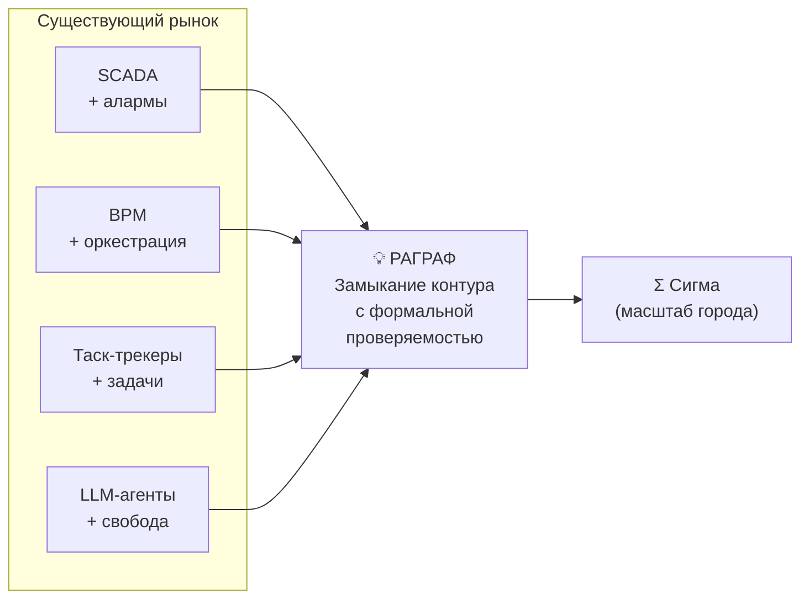

→ Технико-экономические показатели — [техническое задание фреймворка, редакция 3.0, §6](backend/data/gost19/ragraf/РАГРАФ-ФРЕЙМ-1%20Техническое%20задание.md).
Разбор рыночной ниши остался в замещённой редакции 2.1: [docs/TZ_RAGRAF.md §2](docs/TZ_RAGRAF.md#2-технико-экономическое-обоснование).

---

## Главная идея — задачный подход

РАГРАФ — практическая реализация **задачного подхода** Сибирской математической
школы (Е.Е. Витяев, С.С. Гончаров, Д.И. Свириденко, 2023). Каждый цифровой регламент — это
формальная задача из **четырёх обязательных компонентов**:

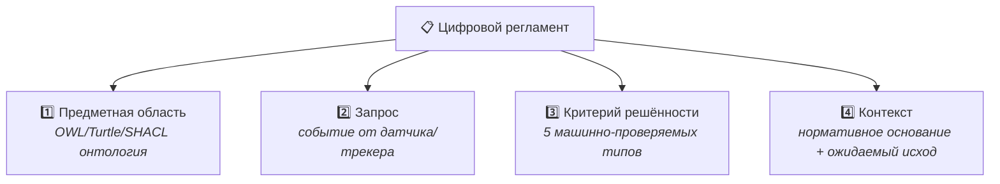

И реализует **полный цикл шести стадий функциональной системы П.К. Анохина**
— от афферентного синтеза события до подкрепления методолога на основе
результата.

→ Теория «на пальцах» с примером: [«Справочник строителя умного города», часть XVIII](backend/data/knigi/spravochnik/GLOSSARY.md#часть-xviii-задачный-подход--теоретическая-база-раграф)
→ Whitepaper: [/methodology](https://ragraf.up.railway.app/methodology)

---

## Замкнутый контур данных

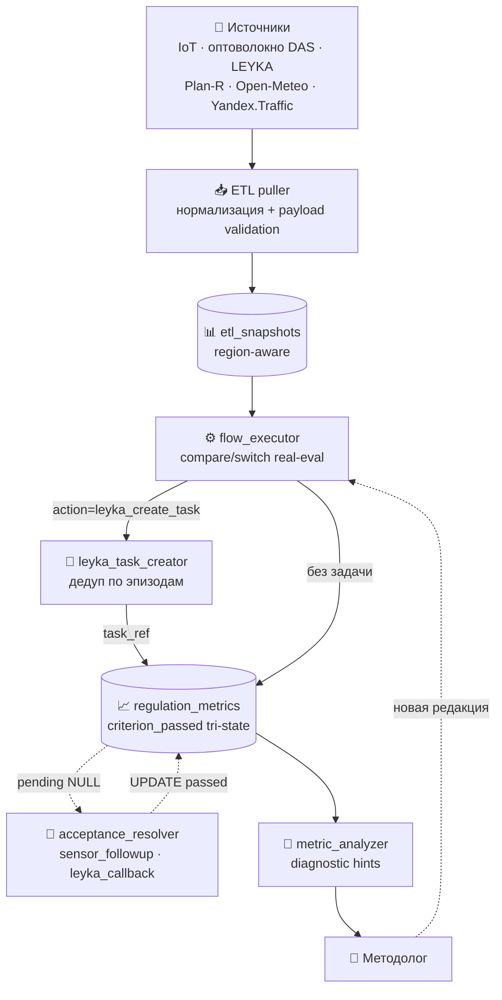

Решение по каждому прогону выносится по машинно-проверяемому критерию решённости
одного из пяти типов. Сводная оценка точности — **90–93 %** — получена расчётом
по долям этих типов в [docs/DATA-FLOW-AUDIT.md §6](docs/DATA-FLOW-AUDIT.md), а не
прогоном корпуса на размеченном наборе: бенчмарка точности решений в изделии нет,
и число следует читать как оценку, а не как замер.

Текущий корпус — **65 регламентов в 15 предметных областях**, из них 16 демонстрационных: реестр `REGISTRY` и перечень `DEMONSTRACIONNYE` в `backend/app/services/fixtures.py`, счёт на 07.11.2026.

→ Полный аудит потока данных: [docs/DATA-FLOW-AUDIT.md](docs/DATA-FLOW-AUDIT.md)
(редакция от 17.07.2026; фазы C.2 и D.2 из плана с тех пор реализованы)
→ Архитектура по слоям: [описание программы РАГРАФ-ФРЕЙМ-13, раздел 3 «Послойная модель изделия»](backend/data/gost19/ragraf/РАГРАФ-ФРЕЙМ-13%20Описание%20программы.md); рецепт подключения внешней системы и перечень ADR — [docs/ARCHITECTURE.md](docs/ARCHITECTURE.md)

---

## Два режима приёма событий — pull и push

РАГРАФ принимает события **двумя способами** — тянет сам и принимает входящие:

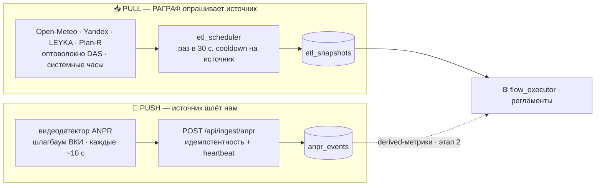

| | **Pull** (тянем сами) | **Push** (шлют нам) |
|---|---|---|
| Инициатор | `etl_scheduler`: шаг цикла 30 c, у каждого источника свой период | внешняя система (HTTP POST) |
| Источники | Open-Meteo, Yandex.Traffic, LEYKA, Plan-R, оптоволокно DAS, системные часы | видеодетектор ANPR (парковка ВКИ НГУ) |
| Точка входа | исходящие запросы пуллеров | `POST /api/ingest/anpr` (пачкой до 2000) |
| Хранилище | `etl_snapshots` (скалярные измерения), `fiber_events` (дискретные события DAS) | `anpr_events` (сырой журнал) |
| Дедуп | latest snapshot по `(subtype, field, region)` | `sha1(camera‖plate‖timestamp)` — гасит перекрытие окон |
| Живость | freshness снапшотов | heartbeat (`last_push_at`) + светофор в Live ETL |

Push закрывает источники, которые нельзя опрашивать по расписанию, а они **сами** генерируют поток (видеоаналитика, IoT-шлюзы). Контракт интегратора — [docs/INTEGRATION-ANPR-PUSH.md](docs/INTEGRATION-ANPR-PUSH.md); архитектура и анализ ресурсов — [docs/REQ-PUSH-ANPR-PARKING.md](docs/REQ-PUSH-ANPR-PARKING.md).

Погода Open-Meteo: если основной адрес не принимает соединение (из России без VPN), прогноз берётся с официального зеркала `historical-forecast-api.open-meteo.com`, и час опросы идут сразу туда — [docs/POGODA-BEZ-VPN-RAZBOR.md](docs/POGODA-BEZ-VPN-RAZBOR.md).

---

## Ситуационный центр

Главный рабочий экран `/live`: живая сводка по выбранному городу, светофор регламентов
(опасно · внимание · норма) и вкладки по предметным областям — «Городская среда и ЖКХ»,
«Парковка ВКИ НГУ», «Проектное управление», «Оптоволокно (DAS)». Каждая карточка ведёт
в регламент, который выдал вердикт.

---

## Проверка регламента — до первого события

Регламент хранится как формальный граф, поэтому его можно проверить как модель, не дожидаясь
события. Вкладка «Проверка регламента» показывает две корзины:

- **непротиворечивость** — ветка развилки целиком вне диапазона параметра, два несовместимых
  вердикта на одном входе, нахлёст зон;
- **пробелы** — открытые края развилки, нет ветви на случай отсутствия данных, недостижимые узлы.

Это и есть практический смысл формальной записи: ошибку видно до того, как по ней приняли решение.

---

## Сигма · Студия — вопросы к своду норм

Раздел `/sandbox`: вопрос по корпусу регламентов текстом или голосом (обращение «Сигма»; голос принимает и «Сима») —
ответ со ссылкой на регламент и пункт норматива. Контекст ответа собирается не из фрагментов
текста, а из формальных регламентов и триплетов предметной области; отнесение вопроса к области
идёт по закрытому реестру и возвращает трёхзначное решение — сузить поиск, искать по всему своду
либо переспросить у пользователя.

Вердикты при этом считает интерпретатор, а не языковая модель: она отвечает на вопросы,
но ничего не решает и ничего не вычисляет.

**Модели** выбираются в самой Студии, без правки `.env`:
- **облако · Яндекс** — Yandex AI Studio: Alice AI LLM Flash (по умолчанию, самая дешёвая),
  Alice AI LLM, YandexGPT Pro 5.1 и другие; у каждой модели в выборе — цена за 1000 токенов.
  Ключ и каталог Yandex Cloud — `YANDEX_AI_API_KEY` и `YANDEX_AI_FOLDER_ID` в `backend/.env`;
- **облако · прочие** — Cerebras, Groq, OpenRouter, OpenAI;
- **локально** — Ollama: работает без интернета.

**Поиск в интернете** — глобус «Интернет» под строкой вопроса, Yandex Search API
(`YANDEX_SEARCH_API_KEY`, `YANDEX_SEARCH_FOLDER_ID`).

**Скорость.**
- Облачная модель отвечает за секунды.
- Локальная модель на процессоре без видеокарты отвечает минутами. По оценке 07.11.2026 было около 4,5 мин на вопрос со стандартными настройками; на скане с ноутбука ответ шёл дольше двух минут.
- С 07.11.2026 при локальной модели область вопроса выбирается поиском по своду, без вызова модели. Это минус около 95 с на вопрос; сам ответ на процессоре по-прежнему идёт минуты.
- На такой машине выбирайте облачную модель. Подбор параметров под модель — в очереди работ ([BACKLOG.md](docs/BACKLOG.md), «Студия: параметры генерации под выбранную модель»).

### Поиск по смыслу: векторы и почему без Qdrant

Студия ищет не только по словам, но и по смыслу. Для этого текст превращается в **вектор** — 1024 числа, которыми модель описывает его смысл. Близость двух текстов — косинус угла между их векторами.

| Что | Где лежат векторы | Как ищется |
|---|---|---|
| Свод регламентов — вектор на регламент: название, область, параметры, триггеры и датчики, рекомендации, критерий, норматив | в памяти сервера; строятся одним запросом при первом вопросе и заново — при смене состава регламентов и после перезапуска | вектор вопроса сравнивается со всеми регламентами подряд; можно заранее сузить по области или датчику |
| Документы аналитика и книга «Справочник строителя умного города» — фрагменты по 800 знаков, вектор на фрагмент | в той же базе DuckDB, что и регламенты (`document_chunks`); у книги векторы готовые, из поставки | так же, по включённым документам; пока векторы считаются, поиск идёт по словам, а в панели виден счётчик «векторы считаются: N из M» |
| Выбор области вопроса | — | при локальной модели — по лучшим регламентам того же поиска, без вызова модели; при облачной — моделью по реестру областей |

- **Кто считает векторы.** Модель `bge-m3` в Ollama на том же компьютере, без облака. Её задают `EMBED_MODEL`, `EMBEDDING_BASE_URL` и `EMBEDDINGS_ENABLED`. Без векторов всё работает поиском по словам.
- **Почему без отдельной векторной базы** — Qdrant, Weaviate, Chroma:
  - объём маленький: 65 регламентов, до 10 документов, в книге 384 фрагмента. Точный перебор быстр — 5 мс на вопрос по своду и 77 мс по книге (замер 07.11.2026 на Apple M);
  - приближённый поиск векторной базы окупается на сотнях тысяч векторов, а для ноутбука это ещё одна служба с портом и своей копией данных;
  - сейчас регламенты, документы и их векторы лежат в одном файле: одна резервная копия, одна транзакция.
- **Медленно на ноутбуке не поиск**, а расчёт векторов на процессоре — поэтому векторы книги теперь в поставке — и сама языковая модель.
- **Когда перерастём.** Сначала остаёмся внутри DuckDB: векторы столбцом фиксированной длины и близость в SQL, затем индекс HNSW (расширение `vss`). Отдельная служба понадобится, только если появится общий архив документов для многих экземпляров.

Подробно:
- как Студия ищет — [РАГРАФ-ФРЕЙМ-13, п. 3.6](backend/data/gost19/ragraf/РАГРАФ-ФРЕЙМ-13%20Описание%20программы.md);
- почему так — [РАГРАФ-ФРЕЙМ-81, п. 3.4.5](backend/data/gost19/ragraf/РАГРАФ-ФРЕЙМ-81%20Пояснительная%20записка.md);
- обновление векторов книги после её правки — `backend/.venv/bin/python scripts/vektory_glossariya.py` ([РАГРАФ-ФРЕЙМ-32, п. 5.8](backend/data/gost19/ragraf/РАГРАФ-ФРЕЙМ-32%20Руководство%20системного%20программиста.md)).

---

## Один движок — три знакомые роли 

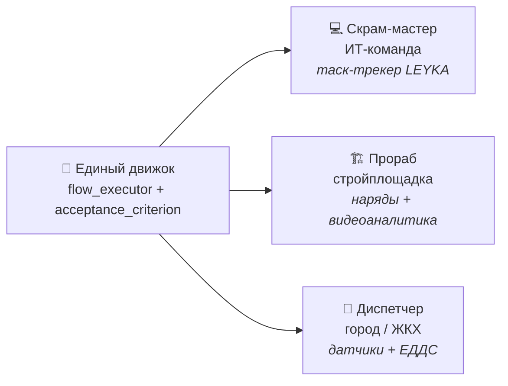

Меняется только набор источников и порогов — поведение становится знакомой
ролью для вашей сферы.

Это **не роли интерфейса**: три образа выше — отраслевые применения одного движка.
В самом изделии переключатель ролей фильтрует разделы по рабочему контуру и даёт
четыре рабочие роли — аналитик-методолог, оператор ситуационного центра, инженер
платформы, руководитель, — плюс админ-вид «видно всё» под паролем.

→ Подробное позиционирование: [docs/GOTOMARKET/STRATEGY-POSITIONING.md](docs/GOTOMARKET/STRATEGY-POSITIONING.md)

---

## Размер решения — лестница масштаба 

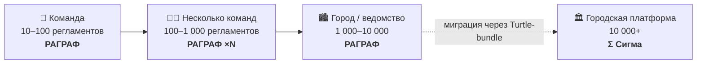

Регламенты переносятся **файлами** (Turtle + SHACL — открытые форматы W3C).
Никакого vendor lock-in: у потребителя всегда есть выбор остаться в РАГРАФ
или вырасти в Σ Сигму.

| Параметр                | РАГРАФ                            | Σ СИГМА · городская платформа       |
|-------------------------|------------------------------------|--------------------------------------|
| Целевой размер          | 10–10 000 регламентов / команда   | 10 000+ регламентов / город          |
| Хранилище               | DuckDB + rdflib                   | Apache Jena / FUSEKI                 |
| События                 | pull (ETL-scheduler) + push (HTTP `/api/ingest`) | pull (ETL-сервис) + приём событий по HTTP |
| Развёртывание           | 1 ноутбук / 1 контейнер           | Кластер в ИТ-инфраструктуре города   |
| Формат регламента       | **Turtle + SHACL (W3C)**           | **Тот же Turtle + SHACL**            |

---

## Две отраслевые настройки — чем подтверждается доменная нейтральность

«Ядро доменно-нейтрально, отрасль задаётся настройкой» — утверждение, которое легко заявить
и трудно доказать. До сентября 2026 оно опиралось на одну настройку, а одна точка не отличает
свойство подхода от свойства конкретной отрасли.

Сейчас настроек **две**, и обе измерены одной методикой на одном знаменателе — 94 869 строк кода
и 118 920 строк с регламентами и датасетами (замер 06.09.2026):

| Настройка | Регламентов | Отраслевой код | Доля кода | С регламентами и датасетами | Доля |
|---|---|---|---|---|---|
| **Платформа АРХИ** · строительство | 5 | 3 140 | **3,3 %** | 4 926 | 4,1 % |
| **Ситуационный центр мониторинга городской среды** | 26 | 3 920 | **4,1 %** | 16 972 | 14,3 % |

Существенно не каждое число по отдельности, а их сопоставление: **вторая настройка содержит
впятеро больше регламентов, а доля отраслевого кода осталась того же порядка.** Разница ушла
в данные — доля с их учётом выросла втрое. Ядро при добавлении второй отрасли не переписывалось:
интерпретатор, семантический слой и обработчики запросов по регламентам не содержат ни одного имени
предметной области — отраслевая часть добавлена новыми файлами. Исключение названо прямо: перечень
областей автоматического исполнения задан в планировщике константой.

Пять регламентов АРХИ — это четыре регламента области `construction` и пятый, охрана подземного
оптоволоконного кабеля, заведённый в области `safety`. Ниже по тексту, где речь идёт только о домене
`construction`, называются четыре — это не расхождение.

Оговорка, которую не убираем: обе настройки построены одной командой на одном ядре, поэтому
устойчивость показателя к смене исполнителя не установлена.

| Настройка | Граница и измерение | Для непрофильного читателя |
|---|---|---|
| Строительство | [docs/ARCHI-CONSTRUCTION/README.md](docs/ARCHI-CONSTRUCTION/README.md) | комплект документов РАГРАФ-СТРОЙ |
| Городская среда | [docs/URBAN-ENVIRONMENT/README.md](docs/URBAN-ENVIRONMENT/README.md) | [паспорт настройки](docs/URBAN-ENVIRONMENT/PASPORT.md) |

---

## Внешние модули и интеграции

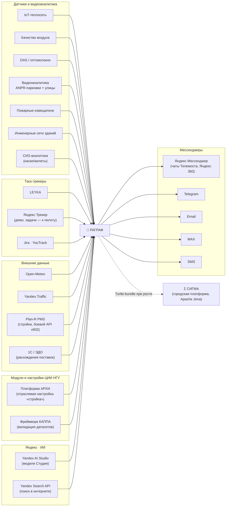

Отправка вердикта реализована для Telegram, MAX и Яндекс Мессенджера; `send_email` и `send_sms`
объявлены в реестре действий регламента, но собственных отправителей в изделии не имеют.

- **Яндекс Мессенджер** — канал доставки вердиктов (`backend/app/services/yandex_messenger.py`):
  бот организации Яндекс 360 пишет в её чаты и треды Телемоста. Токен — `YANDEX_MESSENGER_TOKEN`,
  проверка — `/api/live/yandex-messenger/health` и `/test`; порядок подключения — блок
  «Как подключить Яндекс Мессенджер» на карточке выхода регламента. Живой пробы канала
  ещё не было: бот подключается на тарифе организации.
- **Яндекс Трекер** — страница `/yandex-tracker` для клиента из регулируемой отрасли и демо
  `/demo/tracker` на регламенте кампуса. Задачу, комментарий, сообщение и проверку закрытия
  считает настоящий движок, а постановка задач в Трекер идёт «на сухую»: клиент API Трекера —
  к пилоту. Разбор — [docs/YANDEX-TRACKER-RAZBOR.md](docs/YANDEX-TRACKER-RAZBOR.md).
- **Yandex AI Studio и Yandex Search API** — модели и поиск в интернете в Студии.

→ Детали 19 модулей палитры + контракты интеграции: [docs/REQ-SIGMA-INTEGRATION.md](docs/REQ-SIGMA-INTEGRATION.md), [docs/PLANR/PLAN-R-MOCK.md](docs/PLANR/PLAN-R-MOCK.md), [docs/CONCEPT-ARHI-CONSTRUCTION.md](docs/CONCEPT-ARHI-CONSTRUCTION.md)

---

## Технический стек

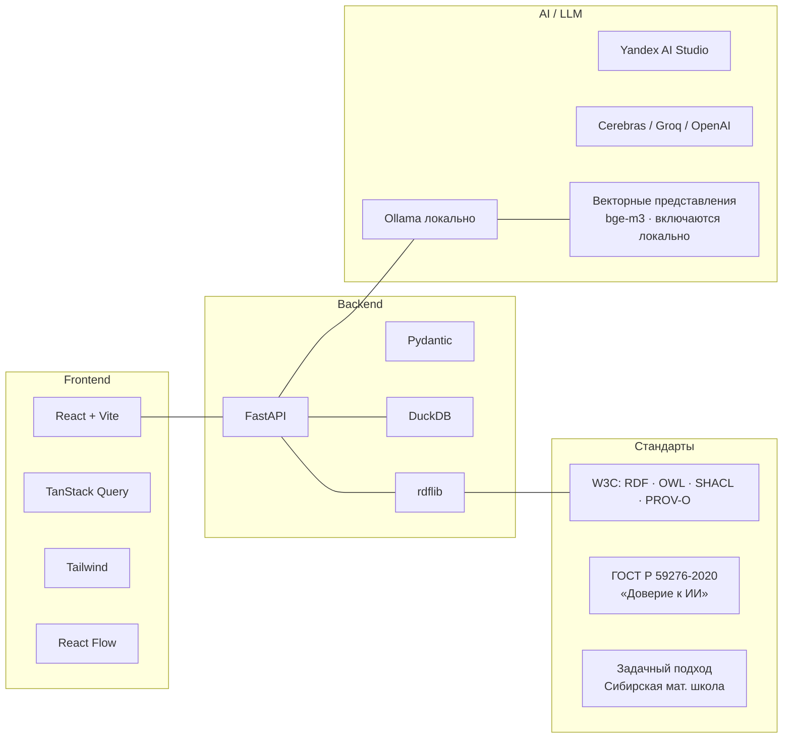

- **Multi-provider LLM:** одна переменная `LLM_PROVIDER` переключает между
  Ollama / Cerebras / Groq / OpenRouter / OpenAI / Yandex (AI Studio) / mock;
  в Студии модель выбирается и без неё.
- **Векторные представления:** по умолчанию выключены (`EMBEDDINGS_ENABLED=false`), и поиск
  по своду идёт сравнением основ слов. Включаются локальным режимом лаунчеров (`--local`,
  `bge-m3`) либо строками в `backend/.env`; тогда работает смысловой поиск по регламентам
  и документам. Отдельной векторной базы нет — векторы в памяти сервера и в DuckDB
  (раздел «Поиск по смыслу» выше).
- **Embedded DuckDB:** один файл, без кластера, мигрирует через WAL-recovery.
- **Открытые форматы W3C:** регламент = `<id>.data.ttl` (данные, OWL) +
  `<id>.shapes.ttl` (ограничения, SHACL) + `<id>.flow.json` (граф исполнения).
  `manifest.json` появляется только в ZIP-выгрузке регламента наружу.

---

## Быстрый старт

Репозиторий закрыт: доступ — по ключу, раздел «Ключ доступа» в
[installer/INSTALL-WINDOWS.md](installer/INSTALL-WINDOWS.md).

```bash
# 1. Клон
git clone https://github.com/Barbashin1970/RAGRAF.git
cd RAGRAF

# 2. Запуск — скрипт сам создаст окружение, поставит зависимости
#    и поднимет оба сервиса
./start.command   # macOS / Linux (или двойной клик в Finder)
start.bat         # Windows — копия из ZIP-архива или клон разработчика

# 3. Браузер откроется сам: http://localhost:5173
#    Бэкенд (FastAPI) — http://localhost:8000/docs
```

Без флагов скрипт показывает меню. Полезные флаги `start.command`: `--run` — запуск
без меню, `--local` — работа на локальной модели без интернета, `--backend-only`
и `--frontend-only`.

Готовые инсталляторы для конечных пользователей:
- **Windows:** [installer/INSTALL-WINDOWS.md](installer/INSTALL-WINDOWS.md). Копию из GitHub ставит и
  обновляет `installer\start-ragraf.bat`; ярлык RAGRAF на рабочем столе ведёт туда же и при каждом
  открытии проверяет обновления. Копию из ZIP-архива запускает `start.bat`. Оба вместе не запускать —
  база у них одна. Останавливать сервер Ctrl+C в его окне, а не крестиком.
- **macOS:** [installer/INSTALL-MACOS.md](installer/INSTALL-MACOS.md)

Онлайн-развёртывание:
- **Railway** — онлайн-версия для показа: [docs/DEPLOY.md](docs/DEPLOY.md). Из России без VPN не
  открывается, поэтому основной способ работы — установка на компьютер (решение 05.11.2026).
- **Fly.io:** [docs/DEPLOY-FLY.md](docs/DEPLOY-FLY.md)
- **Vercel больше не используется:** проект `ragraf` удалён 05.11.2026 (адрес `*.vercel.app` из России без VPN не открывается). Лендинг и студию отдаёт Railway. Прежняя схема — в [docs/DEPLOY-VERCEL.md](docs/DEPLOY-VERCEL.md), как история.

---

## Главные документы — что читать дальше

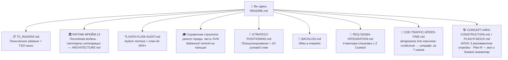

| Документ                                                      | Когда читать                                      |
|---------------------------------------------------------------|---------------------------------------------------|
| [TZ_RAGRAF.md](docs/TZ_RAGRAF.md)                             | Хочу понять задачу платформы и ТЭО ниши. *Действующее задание — РАГРАФ-ФРЕЙМ-1 редакции 3.0 в комплекте ЕСПД; настоящий файл — предшественник* |
| [ARCHITECTURE.md](docs/ARCHITECTURE.md)                       | Хочу найти, где теперь слоистая архитектура (описание программы РАГРАФ-ФРЕЙМ-13, раздел 3), и рецепт подключения внешней системы с перечнем ADR |
| [DATA-FLOW-AUDIT.md](docs/DATA-FLOW-AUDIT.md)                 | Хочу точную карту потока + список разрывов и фиксов|
| [STRATEGY-POSITIONING.md](docs/GOTOMARKET/STRATEGY-POSITIONING.md) | Хочу понять позиционирование и стратегический план|
| [Справочник строителя умного города](backend/data/knigi/spravochnik/GLOSSARY.md) | Хочу словарь из 22 частей — от умного города до задачного подхода, строительной аналитики и методов ИИ, сверенный с изделием; в самом РАГРАФ он на странице «Документация и книги» |
| [BACKLOG.md](docs/BACKLOG.md)                                 | Хочу увидеть очередь идей и что в работе          |
| [REQ-SIGMA-INTEGRATION.md](docs/REQ-SIGMA-INTEGRATION.md)     | Хочу понять как соединить РАГРАФ с городской Σ Сигмой|
| [SMART_CITY_ONTOLOGIES.md](docs/SMART_CITY_ONTOLOGIES.md)     | Хочу увидеть онтологии 10 Smart-City доменов      |
| [FORMULA-SPEC.md](docs/FORMULA-SPEC.md)                       | Хочу спецификацию formula evaluator (AST + Kleene)|
| [SKILL-D0SL.md](docs/SKILL-D0SL.md)                           | Хочу разобраться в Rule DSL                       |
| [backend/data/gost19/ragraf/](backend/data/gost19/ragraf/) | Хочу **комплект программных документов фреймворка** по ЕСПД (РАГРАФ-ФРЕЙМ): спецификация, техническое задание, описание программы, текст программы, руководство оператора, описание языка, пояснительная записка. Состав и состояние — [README комплекта](backend/data/gost19/ragraf/README.md), очередь работ — [PLAN-KOMPLEKTA.md](backend/data/gost19/ragraf/PLAN-KOMPLEKTA.md) |
| [backend/data/gost19/archi/](backend/data/gost19/archi/) | Хочу **комплект платформы АРХИ** (РАГРАФ-СТРОЙ): одиннадцать файлов в десяти обозначениях — спецификация, техническое задание (две редакции: 7.6 «Группа Мета» и 8.0 ЦИИ НГУ), текст и описание программы, описание применения, три руководства, программа и методика испытаний, методические рекомендации по внедрению |
| [PEREDACHA-NGU-2026-09.md](docs/ARCHI-CONSTRUCTION/PEREDACHA-NGU-2026-09.md) | Хочу понять, как платформа передаётся в НГУ: три объекта, пакет документов, проекты текстов. *Документ сентября 2026 — до 05.11.2026, когда правообладателем РАГРАФ стал ЦИИ НГУ* |
| [SKILL-GOST-19.md](docs/SKILL-GOST-19.md) | Хочу правила, по которым эти документы пишутся: документ ведёт код, а не описывает его задним числом |
| [RAGRAF_UserManual_GOST19.md](docs/RAGRAF_UserManual_GOST19.md) | *(предшественник, замещён документом РАГРАФ-ФРЕЙМ-34 комплекта)* |
| [E2E-TRAFFIC-SPEED-FINE.md](docs/E2E-TRAFFIC-SPEED-FINE.md)   | Я новичок — хочу понять путь данных «датчик → штраф» за 7 шагов |
| [CONCEPT-ARHI-CONSTRUCTION.md](docs/CONCEPT-ARHI-CONSTRUCTION.md) | Хочу разобраться в АРХИ-домене (стройка через РАГРАФ) |
| [docs/PLANR/](docs/PLANR/)                         | Хочу понять интеграцию с Plan-R: встроенный мок на шести GET-эндпойнтах — [PLAN-R-MOCK.md](docs/PLANR/PLAN-R-MOCK.md), подключение к боевому экземпляру партнёра — [HOWTO-PLANR-API-TOKEN.md](docs/PLANR/HOWTO-PLANR-API-TOKEN.md) |
| Паспорта настроек: [городская среда](docs/URBAN-ENVIRONMENT/PASPORT.md) · [медицинский скрининг](docs/MED-SCREENING/PASPORT.md) · [финансовый скоринг](docs/FINANCE-SCORING/PASPORT.md) | Хочу изложение для непрофильного читателя: что контур делает, чего не делает сегодня и какой работой это достижимо |
| [YANDEX-AI-STUDIO-RAZBOR.md](docs/YANDEX-AI-STUDIO-RAZBOR.md) · [YANDEX-MESSENZHER-RAZBOR.md](docs/YANDEX-MESSENZHER-RAZBOR.md) · [YANDEX-TRACKER-RAZBOR.md](docs/YANDEX-TRACKER-RAZBOR.md) | Хочу понять работу на сервисах Яндекса: модели в Студии, доставка в Мессенджер, связка с Трекером — что сделано и что к пилоту |
| [ZAPUSK-WINDOWS-RAZBOR.md](docs/ZAPUSK-WINDOWS-RAZBOR.md) | Хочу понять запуск на Windows: какой файл запускать, ярлык с проверкой обновлений, один сервер на базу, остановка Ctrl+C, занятая база и почему журнал базы не переживает снятие процесса |
| [POGODA-BEZ-VPN-RAZBOR.md](docs/POGODA-BEZ-VPN-RAZBOR.md) | Хочу понять, откуда погода на дашборде без VPN: зеркало Open-Meteo |
| [DELIVERY-PROFILES.md](docs/DELIVERY-PROFILES.md) | Хочу понять, что входит в поставку по каждому профилю и какой ценой сегодня исключается контур |
| [SFP-article-2026.md](docs/SFP-article-2026.md) | Хочу научное изложение подхода — статья «Семантическое потоковое программирование»: формальные основания, логика Клини K3, трёхпроекционная модель и замеры. *Рукопись готовится к подаче; до подачи распространению не подлежит* |
| [regulation-flows/](docs/regulation-flows/)                   | Хочу посмотреть **63 карточки регламентов** в виде Mermaid-диаграмм (GitHub рендерит нативно): 10 областей — учебный набор, стройка, ЕДДС, теплоснабжение, ЖКХ, городской транспорт, ИТ-поддержка, безопасность, кампус НГУ, города и районы. Витрина отстаёт от корпуса (65 регламентов в 15 областях на 07.11.2026) и регенерируется скриптом. Каждая карточка — граф Rule DSL Flow + ссылки на исходные `*.flow.json` / `*.data.ttl` / `*.shapes.ttl`. Регенерируется скриптом `scripts/export_flows_to_mermaid.py`. |
| [COURSE-RAGRAF-V1.md](backend/data/knigi/kursy/COURSE-RAGRAF-V1.md) | Хочу программу курса повышения квалификации «РАГРАФ — собери своего ИИ-модератора» (72 ак. ч., 7 модулей + защита, LEYKA как LMS курса; редакция 1.2 от 31.10.2026, в начале — оглавление со ссылками на разделы) |
| [COURSE-SYSTEM-ANALYST-V1.md](backend/data/knigi/kursy/COURSE-SYSTEM-ANALYST-V1.md) | Хочу методическое пособие «Системный аналитик в эпоху гибридного ИИ» — продолжение РАГРАФ-курса для тех, кто идёт дальше в проектирование гибридных ИИ-систем класса РАГРАФ/LEYKA/Σ Сигма (редакция 2 от 30.10.2026, сверена с изделием: 12 спринтов, глава «Взгляд фронтенд-разработчика: РАГРАФ на React», раздел 8.17 «Решение о месте ИИ в архитектуре», дипломный проект и послесловие; ~9 месяцев самостоятельной работы; 7441 строка — `wc -l`; в начале — оглавление со ссылками на все разделы и спринты; автор — Барбашин Олег). Сквозная идея: гибридный ИИ с дообучением через опыт человека-эксперта — путь к сильному ИИ |
| [Учебник Flow DSL](backend/data/knigi/flow-dsl/README.md) | Хочу выучить язык регламентов с азов: оглавление и шесть частей — для аналитиков, а не программистов. Учебник и оба курса открываются на странице документации изделия (`/documentation`, раздел «Книги и курсы») и сохраняются в PDF вместе со схемами — для чтения без сети |

---

## Структура репозитория

```
RAGRAF/
├── backend/                    # FastAPI + DuckDB + Pydantic
│   ├── app/
│   │   ├── api/                # routers по доменам
│   │   ├── services/           # бизнес-логика
│   │   │   ├── etl/            # puller, applier, scheduler, acceptance_resolver
│   │   │   ├── flow_executor.py
│   │   │   ├── leyka_task_creator.py
│   │   │   ├── metric_analyzer.py
│   │   │   ├── regulation_store.py
│   │   │   ├── turtle_bridge.py
│   │   │   └── validator.py
│   │   ├── schemas/            # Pydantic-домен
│   │   └── main.py
│   └── data/fixtures/          # seed-регламенты (Turtle + SHACL + flow.json)
├── frontend/                   # React + Vite
│   ├── src/
│   │   ├── components/
│   │   │   ├── landing/        # LandingScreen
│   │   │   ├── methodology/    # /methodology whitepaper
│   │   │   ├── regulations/    # Regulation Editor
│   │   │   ├── flow/           # Flow Editor (React Flow)
│   │   │   └── knowledge/      # Knowledge Ingest Studio
│   │   └── lib/                # api.ts, schemas.ts
│   └── package.json
├── docs/                       # вся документация
└── installer/                  # инсталляторы Windows + macOS
```

---

## Что внутри платформы (по фазам реализации)

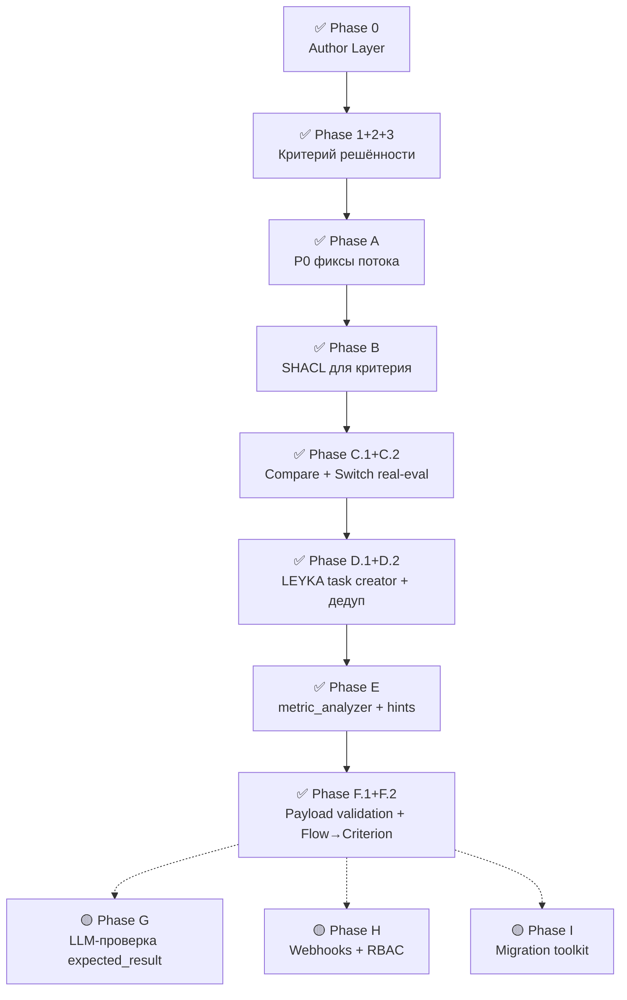

**Сделано:** все узлы плана закрыты — отложенные на дату аудита C.2 «switch как маршрутизатор»
и D.2 «автосоздание задач LEYKA» реализованы позже. Методология закрыта полностью: 4 компонента
задачи и 6 стадий ТФС. Расчётная точность по декомпозиции аудита — 90–93 %; это оценка по типам
критериев, а не замер на бенчмарке.

→ Детально по фазам: [docs/DATA-FLOW-AUDIT.md §7](docs/DATA-FLOW-AUDIT.md#7-что-осталось-в-плане)

---

## Свежие добавки (2026, второй и третий кварталы)

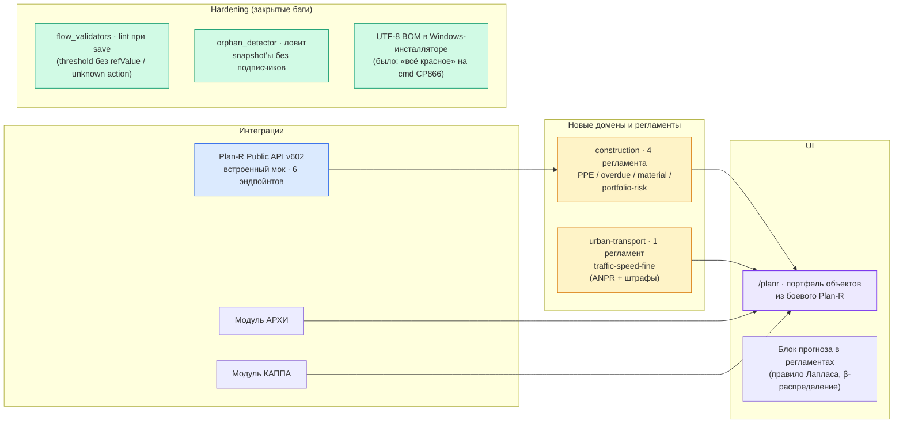

| Что | Где | Зачем |
|---|---|---|
| **Платформа АРХИ + Plan-R** | [planr_client.py](backend/app/services/etl/planr_client.py), `backend/app/api/_planr_mock.py`, [HOWTO-PLANR-API-TOKEN.md](docs/PLANR/HOWTO-PLANR-API-TOKEN.md), [PLAN-R-MOCK.md](docs/PLANR/PLAN-R-MOCK.md) | Перенос функционала ТЗ АРХИ (ЦИИ НГУ) на стек РАГРАФ. Работает с **боевым экземпляром партнёра** `planr-ngu.bim-info.ru` по API-токену; сбор идёт в режиме чтения. Встроенный мок остаётся для разработки и демонстраций. |
| **Витрины для внешнего читателя** | [ArchiPlatformScreen.tsx](frontend/src/components/landing/ArchiPlatformScreen.tsx) (`/archi`), [InvestorProposalScreen.tsx](frontend/src/components/landing/InvestorProposalScreen.tsx) (`/investors`), [PlanrPortfolioScreen.tsx](frontend/src/components/planr/PlanrPortfolioScreen.tsx) (`/planr`) | Отдельная страница платформы АРХИ, страница предложения и рабочий стройпортфель на данных боевого Plan-R. Прежний демонстрационный экран `/demo-arhi` удалён — его роль перешла к `/planr`. |
| **Домен `urban-transport`** | [traffic-speed-fine.flow.json](backend/data/fixtures/traffic-speed-fine.flow.json) + [E2E-шпаргалка](docs/E2E-TRAFFIC-SPEED-FINE.md) | Первый регламент: ANPR-камера + ступенчатые штрафы (КоАП ст. 12.9). Эталонный e2e-сценарий для документации. |
| **Push-приём событий — ANPR парковки ВКИ** | [api/ingest.py](backend/app/api/ingest.py) · [INTEGRATION-ANPR-PUSH.md](docs/INTEGRATION-ANPR-PUSH.md) · [REQ-PUSH-ANPR-PARKING.md](docs/REQ-PUSH-ANPR-PARKING.md) | **Вторая парадигма приёма** (в дополнение к pull): видеодетектор номеров шлёт события на `POST /api/ingest/anpr` каждые ~10 c. Идемпотентность `sha1(camera‖plate‖ts)`, heartbeat-светофор живости потока, отчёт по номерам (Сегодня/Вчера/Неделя) + гистограмма категорий ТС за месяц на Live ETL. ГРЗ под админом (152-ФЗ). |
| **Прогноз (правило Лапласа)** | `backend/app/services/forecast.py`, [docs/REQ-FORECAST-FEATURE.md](docs/REQ-FORECAST-FEATURE.md) | 4-й уровень модели Пальчунова (вероятностный). Байесовская оценка доли успеха с равномерным априорным распределением Beta(1,1). Включается после 10 решённых прогонов. |
| **Flow lint validators** | [backend/app/services/flow_validators.py](backend/app/services/flow_validators.py) | Bug-2 (threshold без refValue) + Bug-4 (output.action не в реестре) — non-blocking warnings при save. |
| **Orphan ETL detector** | [backend/app/services/etl/orphan_detector.py](backend/app/services/etl/orphan_detector.py), endpoint `/api/etl/orphans` | Bug-1: snapshot'ы пишутся в DB, но регламента-подписчика нет → rate-limited audit alert. |
| **Модули АРХИ + КАППА** | `backend/app/services/module_store.py` | Аддитивный seed двух модулей-партнёров ЦИИ НГУ в библиотеку Прикладных модулей. |
| **Windows-инсталлятор v2 — чистая машина за один клик** | [installer/ragraf.ps1](installer/ragraf.ps1), [installer/start-ragraf.bat](installer/start-ragraf.bat), [installer/ragraf.ico](installer/ragraf.ico), [installer/INSTALL-WINDOWS.md](installer/INSTALL-WINDOWS.md) | CRLF EOL через `.gitattributes` (раньше `.bat` схлопывался моментально на LF); `winget` авто-установка Git + Python 3.13 + Node LTS с `--scope user` (без UAC, fallback на machine-scope); `Test-Dependency` отсеивает Microsoft Store Python alias; `Update-PathFromRegistry` подхватывает свежий PATH в той же сессии — без перезапуска `.bat`; `git config core.longpaths true` (защита от 260-символьного лимита в `node_modules`); Desktop-shortcut «RAGRAF» с золотой Σ-иконкой (`installer/ragraf.ico`, 7 размеров) указывал на `_run-server.ps1`; с 06.11.2026 он ведёт на `installer\start-ragraf.bat` и проверяет обновления — раздел ниже. |
| **Двусторонняя LEYKA-интеграция (sensor ↔ output)** | [backend/app/services/leyka_task_poller.py](backend/app/services/leyka_task_poller.py), [backend/app/api/leyka.py](backend/app/api/leyka.py), [frontend/src/components/flow/LinkToLeykaDialog.tsx](frontend/src/components/flow/LinkToLeykaDialog.tsx), [frontend/src/components/flow/LinkSensorToLeykaDialog.tsx](frontend/src/components/flow/LinkSensorToLeykaDialog.tsx) | Output-узел Flow → кнопка «Связать с LEYKA» создаёт задачу с deep-link обратно в регламент. Sensor-узел → кнопка «Привязать к LEYKA-задаче» (trigger=`status_changed`); фоновый поллер каждые 30с замечает смену статуса и дёргает `execute_flow`. При срабатывании регламента автокомментарий улетает в чат привязанных задач (`leyka_pings[]` в response). Все 4 ЦДР стройплощадки демонстрируются на проекте «Платформа АРХИ» в LEYKA — см. [PROGRESS-ARHI-2026-05-27.md](docs/PROGRESS-ARHI-2026-05-27.md). |
| **Лендинг — реструктуризация 10 секций + новый раздел «01 Методология»** | [frontend/src/components/landing/LandingScreen.tsx](frontend/src/components/landing/LandingScreen.tsx) | Полная переработка: раздел 01 теперь «Методология» (3 карточки — задачный подход, ТФС Анохина, онтологическая модель Пальчунова) — научный «козырь» сразу под Hero; разделы 04 «Эффект и окупаемость» (мерж бывших 04 + 08) + 10 «Стек и масштаб» (мерж стек + бывший 06½ «Размер»); новые «длинно-хвостовые» 08 Экономика, 09 Рынок, 10 Стек+масштаб (не в навигации). Hero-CTA синхронизированы с якорями (раньше «Узнать больше» вело в Методологию вместо ROI). Унифицирован термин «модератор» (вместо «модератор»/«заместитель»). Лингвистический аудит и упрощение для смешанной аудитории строителей/диспетчеров/ИТ-команд. |
| **Zod sensorType sync** | [frontend/src/lib/schemas.ts](frontend/src/lib/schemas.ts) + [test_sensor_type_enum_sync.py](backend/tests/test_sensor_type_enum_sync.py) | Регресс-тест: backend `Literal SensorType` ↔ frontend `z.enum`. Без него страница Flow Editor показывала 0 узлов вместо реальных. |

→ Подробный e2e-проход для новичков: [docs/E2E-TRAFFIC-SPEED-FINE.md](docs/E2E-TRAFFIC-SPEED-FINE.md)

---

## Свежие добавки (2026, четвёртый квартал)

| Что | Где | Зачем |
|---|---|---|
| **Модели Яндекса в Студии** | [llmModels.ts](frontend/src/components/sandbox/llmModels.ts), [sandbox.py](backend/app/services/sandbox.py), [YANDEX-AI-STUDIO-RAZBOR.md](docs/YANDEX-AI-STUDIO-RAZBOR.md) | Группа «Облако · Яндекс»: Alice AI LLM Flash, Alice AI LLM, YandexGPT Pro 5.1 и другие модели Yandex AI Studio; цена у каждой модели в выборе; уточнение области — самой дешёвой моделью, с 07.11.2026 и когда Яндекс — основной поставщик. |
| **Студия быстрее на ноутбуке** | [sandbox.py](backend/app/services/sandbox.py), [document_store.py](backend/app/services/document_store.py), [ZAPUSK-WINDOWS-RAZBOR.md](docs/ZAPUSK-WINDOWS-RAZBOR.md), п. 12 | При локальной модели область вопроса выбирается поиском по своду, без вызова модели: минус ≈ 95 с на вопрос на процессоре, и на замере из 42 вопросов точнее — 0 неверных сужений против 5. Плашки выбора области — только когда подходят несколько областей. Векторы книги-справочника — в поставке; пока векторы документа считаются, виден счётчик «N из M», а поиск идёт по словам. |
| **Поиск в интернете** | глобус «Интернет» в Студии, Yandex Search API | Ответ Студии опирается и на источники из сети, со ссылками. |
| **Яндекс Мессенджер** | [yandex_messenger.py](backend/app/services/yandex_messenger.py), [YANDEX-MESSENZHER-RAZBOR.md](docs/YANDEX-MESSENZHER-RAZBOR.md) | Канал доставки вердиктов: бот организации Яндекс 360 пишет в чаты и треды Телемоста. Живой пробы ещё не было — ждёт тарифа организации. |
| **Яндекс Трекер** | `/yandex-tracker`, `/demo/tracker` ([TrackerVerifyDemo.tsx](frontend/src/components/demo/TrackerVerifyDemo.tsx), [demo_tracker.py](backend/app/api/demo_tracker.py)) | Сценарий «данные → регламент → задача в Трекере и сообщение» на регламенте кампуса: выводы регламента считает настоящий движок, постановка задач в Трекер — «на сухую», к пилоту. |
| **Ассистент «Сигма»** | Студия, голосовой режим | Обращение «Сигма»; голос принимает и «Сима» — в речи «г» часто съедается. |
| **Погода без VPN** | [open_meteo_client.py](backend/app/services/etl/open_meteo_client.py), [POGODA-BEZ-VPN-RAZBOR.md](docs/POGODA-BEZ-VPN-RAZBOR.md) | Основной адрес Open-Meteo из России без VPN не отвечает — прогноз берётся с официального зеркала. |
| **Windows: запуск и сохранность базы** | [installer/ragraf.ps1](installer/ragraf.ps1), [start.bat](start.bat), [installer/zanyatost-bazy.ps1](installer/zanyatost-bazy.ps1), [ZAPUSK-WINDOWS-RAZBOR.md](docs/ZAPUSK-WINDOWS-RAZBOR.md) | Ярлык ведёт через установщик и проверяет обновления; второй сервер на ту же базу не поднимается; занятую базу запуск называет вместе с процессом, а сервер с занятой базой не стартует; остановка — Ctrl+C. База сохраняется в конце подъёма и раз в 10 минут — обход ошибки DuckDB 1.5.2, из-за которой снятый без остановки процесс терял журнал и база собиралась заново. |

---

## Учебные материалы и связанные проекты

- **Методология on-line:** [/methodology](https://ragraf.up.railway.app/methodology) — публичный whitepaper по задачному подходу.
- **Тренажёр операторов:** [sigma-operator.vercel.app/operator](https://sigma-operator.vercel.app/operator) — учебный сайт по компетенциям операторов СЦ; размещён на Vercel, из России открывается через VPN.
- **Каппа** (проверка знаний): эксперты сообщества подтверждают онтологии — связанный некоммерческий проект.

Литература по теории:
- Vityaev E.E., Goncharov S.S., Sviridenko D.I. (2023). *Task-driven approach to artificial intelligence.* Cognitive Systems Research, V.81, P.50–56.
- Гончаров С.С., Свириденко Д.И. (1989). *Σ-Programming.* AMS Translations, V.142.
- Анохин П.К. (1975). *Очерки по физиологии функциональных систем.*

---

## Сообщество и контакты

- **GitHub:** [github.com/Barbashin1970/RAGRAF](https://github.com/Barbashin1970/RAGRAF) — репозиторий закрыт, доступ по ключу.
- **Email:** banksnab@gmail.com
- **Вопросы и предложения:** по почте.

---

## Правообладатель, лицензия и происхождение

**Правообладатель РАГРАФ — ЦИИ НГУ** (Центр искусственного интеллекта Новосибирского государственного
университета), с 05.11.2026; разработка служебная. **Автор — Барбашин Олег Владимирович.** До 05.11.2026
фреймворк вёлся инициативно.

**РАГРАФ — модуль в составе фреймворка Σ СИГМА.** СИГМА — городская платформа ЦИИ НГУ на Apache Jena
(хранилище FUSEKI). РАГРАФ в ней — рабочее место аналитика ситуационного центра: регламенты как
исполняемые правила, их проверка и прогон до применения, вердикты с основанием. РАГРАФ работает и отдельно —
на ноутбуке или в контейнере; регламенты переносятся в СИГМУ файлами Turtle + SHACL (стандарты W3C).
Стыковка — [docs/REQ-SIGMA-INTEGRATION.md](docs/REQ-SIGMA-INTEGRATION.md).

**РАГРАФ построен на открытых инструментах** (Python/FastAPI, React/TypeScript, DuckDB,
rdflib и др. — под лицензиями MIT / Apache 2.0 / BSD). Это значит: **не нужно покупать
лицензии на компоненты** и нет зависимости от иностранных проприетарных вендоров/облаков.

**Само ПО «РАГРАФ» — не open source**, это проприетарный продукт; условия использования определяет
правообладатель. Текст — [LICENSE](LICENSE), редакция 4 от 07.11.2026; окончательную редакцию утверждает юрист
по интеллектуальной собственности.

**Модель поставки: передаётся весь состав.** Отраслевая настройка собирается вместе с ядром — признака
сборки или флага для её исключения не предусмотрено, поставка технически неделима. Какие профили поставки
различаются, что входит в каждый и какой ценой сегодня достижимо исключение отдельного контура —
[docs/DELIVERY-PROFILES.md](docs/DELIVERY-PROFILES.md). Порядок передачи платформы АРХИ в НГУ —
[docs/ARCHI-CONSTRUCTION/PEREDACHA-NGU-2026-09.md](docs/ARCHI-CONSTRUCTION/PEREDACHA-NGU-2026-09.md)
(документ сентября 2026, до смены правообладателя).

> По вопросам лицензирования и интеграции: banksnab@gmail.com.

---

> ℹ️ **Этот файл — навигатор**. За полным техническим описанием —
> [docs/draft_readme.md](docs/draft_readme.md) (legacy README с расширенными
> деталями) или конкретные документы из таблицы выше.
