# ОТЧЁТ О НАУЧНО-ИССЛЕДОВАТЕЛЬСКОЙ РАБОТЕ

## Платформа «РАГРАФ» — замкнутый контур «датчик — регламент — задача — человек»
### Итоговый отчёт за 2026 год (этапы 1 и 2)

---

> **УДК:** [002:004]:316.774
> **ГРНТИ:** 20.01.04
> **Обозначение документа:** РАГРАФ.НИР.002-2026 — утверждено руководителем работы 2026-11-09
> **Вид отчёта:** итоговый. Собран из черновиков двух этапов:
> - этап 1 — РАГРАФ.НИР.001-2026, `docs/OTCHET-NIR-RAGRAF-2026.md`, редакция от 2026-11-08;
> - этап 2 — черновик раздела «Математические основания», `docs/NIR-ETAP2-MATEMATICHESKIE-OSNOVANIYA.md`, редакция 2 от 2026-11-09, и разборы этапа.
>
> **Дата составления:** 2026-11-09. **Редакция 1.4** от 2026-11-12: добавлены примеры из поставки (введение, пп. 4.5, 5.2, 6.5, 7.4, 7.6, 8.1); исправлен критерий окончательности в п. 5.4; рисунки перенумерованы — подробно в «Состоянии документа». **Правка 2026-11-11 без смены редакции**, найдена владельцем: рисунок 9 не разбирался на GitHub — тот раскрывал `&quot;` в подписи узла в кавычку, и она обрывала подпись; кавычки записаны кодом mermaid `#quot;`, скобки — обычными. Содержание рисунка не менялось. **Редакция 1.3** от 2026-11-10: добавлено 17 рисунков — готовые схемы из README изделия, комплекта ЕСПД, книг и разборов, сверенные с изделием; поправки к каждой названы в тексте у рисунка; п. 8.1 приведён к п. 2.3 — мост «проблема — решается — регламент» построен 09.11.2026. **Редакция 1.2** от 2026-11-09, вечер: начата починка поставки — фаза П1, критерий приёмки назван DoD (п. 6.5); в изделии — индикация окончательности вердикта (п. 5, задел). Редакция 1.1 того же дня: утверждено обозначение, названа роль автора в НИР 2024–2025 (п. 1.1).
> **Изделие:** модуль РАГРАФ — фреймворк регламентов; исходный текст на 2026-11-09 (коммит `1ae0b4d` и правки того же дня). Примеры редакции 1.4 сняты с поставки на 2026-11-12 (коммит `bb145a2`).
> **Правообладатель изделия:** ЦИИ НГУ, с 05.11.2026. **Автор:** Барбашин О. В.
> **Основание:** постановка цели — техническое задание на Фреймворк «Сигма» (уточнённое — 2025 год; ИИ-01-01-01-1/1-ЛУ) [1]; РАГРАФ — стенд этой цели и модуль фреймворка. Задание на сам модуль — РАГРАФ-ФРЕЙМ-1, ред. 3.1 от 2026-10-09; на стадии рабочего проекта — РАГРАФ-ФРЕЙМ-1/2, ред. 6 от 2026-11-07. Исходное задание — `docs/TZ_RAGRAF.md`, ред. 2.1 от 2026-06-11.
> **Стандарт:** ГОСТ 7.32-2017 [2].

---

## Состояние документа

**Что это.** Итоговый отчёт о НИР 2026 года. Он не пишется заново, а собирается из черновиков этапов. Черновики остаются рабочими записями и при сборке не правились. Расхождения, найденные при сборке, исправлены здесь; перечень — в приложении Г.

**Как отобраны результаты.** У каждого кандидата в результат оценены два признака:
- **научный вес** — новое знание, свойство или метод либо инженерная разработка, применение, обзор, позиционирование;
- **сила доказательства** — доказано и проверяется исполнением; измерено на стенде командой; показано в пилоте; оценено.

В основной части стоят результаты первых двух групп по весу, в порядке силы доказательства. Позиционирование, маркетинг и планы результатами не считаются. Они названы в ведомости приоритезации (приложение А), но в основную часть не перенесены.

**Что исправлено относительно черновика этапа 1.**
- Числа, снятые редакцией 08.11.2026, не переносятся.
- Итог «все задачи выполнены в полном объёме» заменён поимённой оценкой по каждой задаче.
- Назван правообладатель.
- Исправлены отсылки к НИР 2024–2025: определение ЦД СУ — из отчёта 2024 года, связка с ТФС — из отчёта 2025 года.
- Источники перенумерованы по первому упоминанию; в списке только цитируемые.
- Добавлены предмет исследования и раздел-ссылка на комплект ЕСПД.

**Что добавлено и исправлено в редакции 1.4 (12.11.2026).** Просьба руководителя работы: показать на настоящих регламентах, что тема — не только теорема, но и практика.
- **Примеры из поставки.** Сквозной пример — регламент пилота в кампусе `campus-zero-crossing` в трёх представлениях языка, с прогонами исполнителем изделия (п. 4.5). Дальше:
  - что теорема даёт на регламентах трёх платформ (п. 5.2);
  - починка штрафа на самом языке и в вердиктах (п. 6.5);
  - регламенты трёх платформ и сообщение в чат (п. 7.6);
  - натурная находка о регламенте охраны кабеля (п. 7.4);
  - мост в графе знаний и быстрый путь Студии (п. 8.1);
  - два случая из поставки в «Актуальности»;
  - обозначения раздела 5 на одном примере — датчик температуры, развилка, три выхода (раздел «Обозначения»).
- **Исправлена неточность в п. 5.4.** Критерий окончательности был назван «необходимым и достаточным» без второго условия: общий вердикт пополнений должен совпадать с вынесенным. Контрпример нашёлся на регламенте поставки при подготовке примеров. Там же — замер и уточнение пересказа гипотезы о точности статуса. Теоремы 1 и 2 поправка не задевает.
- **Теорема 2 сформулирована** в п. 5.4 — достаточное условие окончательности, с условием адекватности статуса и тем, чего она не говорит; это задел. Граница L₀ показана на регламентах поставки — таблица в разделе «Обозначения». В п. 5.5 — абзац «Не тривиальна ли теорема»: утверждается корректность исполнителя относительно K3 на фрагменте, а не монотонность K3.
- **Рисунки.** Листинги на языке — тоже рисунки: по ГОСТ 7.32-2017 компьютерная распечатка — разновидность иллюстрации [2]. Рисунки перенумерованы по порядку мест. Объём в реферате считается по подписям «Рисунок N —» (приложение В).
- **Чем держится.** Таблицы примеров и новые числа получены командами `scripts/primery_nir.py` и `scripts/dostatochnost_dannyh.py`. Совпадение листингов, графа, таблиц и сообщения с поставкой и изделием держит проверка `backend/tests/test_otchet_nir_primery.py`. Разбор — `docs/NIR-PRIMERY-RAZBOR.md`.

**Чего в документе нет.**
- Печатной формы. С 10.11.2026 она собирается выгрузкой в DOCX со страницы документации изделия: номера листов в содержании проставляет Word полем оглавления, а на месте каждого рисунка стоит метка с его номером — туда вставляется снимок схемы с GitHub.
- Отзывов рецензентов: раздел 5 передаётся Д. Е. Пальчунову и Д. И. Свириденко до совета.

---

## Лист утверждения

| Роль | ФИО | Подпись | Дата |
|---|---|---|---|
| Руководитель работы, автор | Барбашин О. В. | _____________ | 2026-11-09 |
| Правообладатель изделия | ЦИИ НГУ | _____________ | |
| Рецензент раздела 5 до совета | Пальчунов Д. Е. (НГУ) | отзыв не получен | |
| Рецензент раздела 5 до совета | Свириденко Д. И. (ИМ СО РАН) | отзыв не получен | |

## Список исполнителей

| Роль | ФИО | Разделы |
|---|---|---|
| Руководитель и единственный исполнитель | Барбашин О. В. | все разделы |

**Методологическая опора** — авторы научного аппарата, на котором стоит работа. Исполнителями они не являются и в коде не участвовали.

| Аппарат | Авторы | Где используется |
|---|---|---|
| задачный подход и Σ-программирование | Гончаров С. С., Свириденко Д. И., Витяев Е. Е. (ИМ СО РАН) | п. 2.1, 3, 13 |
| теория моделей предметных областей, четыре уровня знания | Пальчунов Д. Е. (НГУ) | п. 2.3, 5 |
| теория функциональных систем, историческое основание | Анохин П. К. | п. 2.2 |
| трёхзначная логика | Клини С. К.; теория частичных структур — Блейми С., Фиттинг М. | п. 5 |

**Опорные работы предшествующих лет:** НИР ЦИИ НГУ «Фреймворк Сигма», этапы 1 (2024) и 2 (2025), руководитель И. А. Болдырев. Автор участвовал в них внешним экспертом, вне состава исполнителей (п. 1.1).

**Порядок работы.** Код и текст подготовлены руководителем работы в паре с ИИ-агентом. Агент — средство, а не исполнитель; ответственность за содержание несёт руководитель работы.

---

## РЕФЕРАТ

Отчёт: 90 с., 21 рис., 42 табл., 46 источн., 4 прил.

ФРЕЙМВОРК «СИГМА», ЦИФРОВОЙ РЕГЛАМЕНТ, ЗАДАЧНЫЙ ПОДХОД, ЧАСТИЧНАЯ МОДЕЛЬ, ТРЁХЗНАЧНАЯ ЛОГИКА КЛИНИ, СОХРАНЕНИЕ ВЕРДИКТА, ФРАГМЕНТ ЯЗЫКА, ВЕРИФИКАТОР РЕГЛАМЕНТОВ, СТАТИЧЕСКИЙ АНАЛИЗ, ГРАФ ЗНАНИЙ, ЦИФРОВОЙ ДВОЙНИК СУБЪЕКТА УПРАВЛЕНИЯ, ЗАМКНУТЫЙ КОНТУР, FLOW DSL, ОТРИЦАТЕЛЬНЫЙ РЕЗУЛЬТАТ, УРОВЕНЬ ГОТОВНОСТИ ТЕХНОЛОГИИ

**Основание и замысел.** Цель поставлена техническим заданием на Фреймворк «Сигма» [1] — среду разработки систем проактивного управления городской инфраструктурой, в которой цифровые регламенты описываются декларативно, на предметно-ориентированном языке. РАГРАФ — стенд этой цели и модуль фреймворка. Язык регламентов Flow DSL — решение, найденное на стенде: в 2025 году языка логики регламента, доступного аналитику, в ядре «Сигмы» не было, а за 2026 год он вырос до трёхзначной семантики, доказанного свойства и верификатора.

**Объект исследования** — оперативное управление по регламентам с нормативным основанием. События в нём поступают от автоматических источников, исполнители — люди. Часть показаний в момент решения может отсутствовать.

**Цель работы:**
- довести до опытной эксплуатации программное средство, замыкающее контур «датчик — регламент — задача — человек» на основе задачного подхода и формально проверяемой логики;
- дать этому средству математическое основание: доказать, что вердикт, вынесенный при неполных данных, при их пополнении не отменяется, и указать, где это верно.

**Метод.** Регламент записывается формальным графом на языке Flow DSL и исполняется над частичной моделью показаний в сильной трёхзначной логике Клини. Для фрагмента языка доказывается монотонность вердикта по знанию; граница фрагмента снимается с исходного текста исполнителя. Свойство проверяется двумя средствами: исполняемым сторожем на случайных расширениях моделей по всему корпусу и минимальным регламентом на каждую конструкцию. Число без команды получения в отчёт не вносится.

**Результаты — в порядке приоритета.**
1. **Теорема о сохранении вердикта.** Для регламентов фрагмента L₀ сработавший выход при пополнении данных не отменяется. Граница фрагмента — две конструкции: явный тест определённости и несколько величин у узла, классифицирующего одно значение. Во фрагменте 60 регламентов поставки из 66 — после починки двух регламентов; до неё было 59.
2. **Верификатор регламентов, построенный из теоремы.**
   - Проверка свойства нашла в исполнителе четыре отступления от логики Клини, в том числе контрпример внутри объявленного фрагмента; все исправлены.
   - Исправление сменило вердикт у 8 регламентов из 66 на 24 156 частичных моделях; каждая смена вскрыла скрытый дефект регламента.
   - Встроенный в изделие анализ называет до исполнения формулы, которые не вычисляются никогда, пороги, сравнивающие не ту величину, и развилки без маршрута: до починки их было 27, 16 и 6.
   - Починка по описи начата: до DoD доведены 2 регламента из 18, после этого — 23, 14 и 6.
3. **Замкнутый контур и пилот модуля** в кампусе НГУ. Уровень готовности 7 заявлен для модуля; свидетельство пилота неполно.
4. **Граф знаний в запросе Студии аналитика.** Направление пользы устойчиво; величина не доказана.

Отрицательные результаты названы наравне с подтверждёнными (п. 11): точность решений с эталоном не измерена; мера «доля прогонов с критерием „да“» измеряет мир, а не изделие; полнота положительного вердикта по делу не обеспечивается.

**Область применения** — регламенты эксплуатации зданий и сетей, строительного контроля, ЕДДС, кампуса, ИТ-поддержки. Подходит там, где решение должно быть предъявимо: назван пункт нормы, данные и путь вывода. Примеры из поставки — регламенты трёх платформ изделия: кампуса НГУ, стройки на Plan-R и ситуационного центра города (пп. 4.5, 5.2, 7.6).

**Рекомендации по внедрению:**
- довести регламенты поставки до DoD по описи верификатора — начато, 2 из 18 (п. 6.5);
- замер точности решений с эталоном;
- свидетельство пилота — имя, дата, журнал — и акт заказчика.

**Значимость.** Работа показывает, что гарантию для решения на неполных данных можно доказать для языка правил, проверять в изделии командой и использовать как основу верификатора, находящего ошибки там, где гарантии нет.

---

## СОДЕРЖАНИЕ

- Введение
- 1 Путь к постановке: опорные работы 2024–2025 и поиск 2026 года
- 2 Постановка задачи и методологическая опора
- 3 Известные решения и выбор подхода
- 4 Объект исследования: язык регламентов и его исполнение
- 5 Результат 1. Сохранение вердикта при пополнении данных
- 6 Результат 2. Верификатор регламентов
- 7 Результат 3. Замкнутый контур и пилот модуля
- 8 Результат 4. Граф знаний в запросе Студии
- 9 Прочие результаты
- 10 Стенд и измерения
- 11 Отрицательные результаты и пределы
- 12 Новизна и чужое
- 13 Публикации, результаты интеллектуальной деятельности, внедрение, уровень готовности
- 14 Связь с комплектом программной документации
- Заключение
- Список использованных источников
- Приложение А. Ведомость приоритезации результатов
- Приложение Б. Ведомость сведения «задача — результат — доказательство»
- Приложение В. Протокол замеров
- Приложение Г. Что изменено при сборке относительно черновиков этапов

---

## ТЕРМИНЫ, ОПРЕДЕЛЕНИЯ И СОКРАЩЕНИЯ

Включены термины, употребляемые в особом значении.

**Цифровой регламент** — регламент, записанный как задача из четырёх компонентов задачного подхода — предметная область, запрос, критерий решённости, контекст — и исполняемый изделием [3]. В изделии он хранится тремя файлами: данные в Turtle, контракт в SHACL, граф на Flow DSL.

**Цифровой двойник субъекта управления (ЦД СУ)** — набор исполняемых спецификаций (цифровых регламентов) и связанных с ними хранилищ знаний, моделирующий логику действий субъекта управления. Определение взято из НИР «Фреймворк Сигма» 2024 года [4].

**Частичная модель** — показания с пропусками при фиксированном моменте времени; прецедентный уровень модели знаний [5].

**Порядок знания.** Модель M′ расширяет модель M (M ⊑ M′), если в ней те же показания и, возможно, новые.

**Вердикт** — множество сработавших выходов регламента и его уровень, то есть максимальный приоритет сработавшего выхода.

**Сохранение вердикта (персистентность)** — свойство исполнителя: из M ⊑ M′ следует F(M) ⊆ F(M′). Слово «доверенность» в отчёте означает это свойство и ничего сверх него.

**Фрагмент L₀** — регламенты без двух конструкций:
- Н1 — тест определённости `== None`;
- Н4 — несколько величин у развилки с границами или у порога.

**Верификатор регламентов** — проверки анализа регламента в изделии, построенные из теоремы, её модели исполнения и того же метода сверки.

**Трасса прогона** — пояснения каждого узла к вердикту; по ней различаются причины молчания.

**Режим развилки** — правило выбора ветвей, свойство графа: границы, метки или все ветви (п. 4.2).

### Обозначения

Обозначения раздела 5 и разборов этапа 2 — как их читать и что они значат в этом отчёте.

**Знак ⊥ — не перпендикуляр.** Он читается «неизвестно», а в теории порядков — «дно» (англ. *bottom*): наименьший по знанию элемент, значение, которого ещё нет. В классической логике тот же знак иногда обозначает «ложь»; **в этом отчёте ⊥ везде значит «неизвестно» и никогда — «ложь» или «ноль»**. На этом различии и держится работа: молчащий датчик даёт ⊥, а не «норму».

| Обозначение | Как читается | Что значит | Пример |
|---|---|---|---|
| ⊥ | «неизвестно», «дно» | значения нет: показание не пришло или условие нельзя вычислить; в коде — `None` | `x > 5` при неизвестном x даёт ⊥ |
| T, F | «истина», «ложь» | определённые значения условия | `7 > 5` даёт T |
| K3 | сильная трёхзначная логика Клини | логика со значениями T, F, ⊥ [6]: «неизвестно» не превращается в T или F без основания | — |
| ∧, ∨, ¬ | «и», «или», «не» | связки; в формулах — `and`, `or`, `not`. В K3: F ∧ ⊥ = F, T ∨ ⊥ = T, ¬⊥ = ⊥, в остальных случаях с ⊥ — ⊥ | `x > 5 and y > 5` при x = ⊥, y = 3 даёт F: второго «нет» достаточно |
| M = (v, t) | «модель» | частичная модель: показания v в момент t | — |
| v: P ⇀ ℝ | «частичная функция из P в ℝ» | для части параметров показание-число есть, для остальных его нет | — |
| dom v | «область определения v» | параметры, для которых показание есть | — |
| M ⊑ M′ | «M′ расширяет M», «в M′ знаний не меньше» | в M′ те же показания, что в M, и, возможно, новые; момент тот же | M: есть давление; M′: есть давление и температура |
| ⊥ ⊑ a | «неизвестно меньше определённого» | порядок знания: знание может только прибавляться, определённые значения между собой несравнимы | — |
| F(M) | «сработавшие выходы на M» | множество выходов регламента, сработавших при показаниях M | — |
| L(M) | «уровень вердикта на M» | наибольший приоритет сработавшего выхода; L(∅) = 0 | — |
| ⊆ | «содержится в» | каждый элемент левого множества есть в правом | F(M) ⊆ F(M′): всё, что сработало, сработает и при полных данных |
| ∅ | «пустое множество» | ни один выход не сработал | — |
| ℝ, ℕ | вещественные, натуральные числа | значения показаний; приоритеты выходов | — |
| pr: O → ℕ | «приоритет выхода» | каждому выходу сопоставлено натуральное число | — |
| min ≤ v < max | полуоткрытая зона развилки | нижняя граница включена, верхняя — нет; соседние зоны не перекрываются и не оставляют дыр | зоны `[0; 30)` и `[30; +∞)` |
| L₀ | «эль-ноль», фрагмент L₀ | регламенты без конструкций Н1 и Н4; для них доказано сохранение вердикта | 60 регламентов поставки из 66 (09.11.2026, после починки П1; до неё — 59) |
| Н1 | конструкция Н1 | тест определённости `x == None` / `x != None` | `x if x != None else 7` |
| Н4 | конструкция Н4 | несколько величин у развилки с границами или у порога | два входа в один порог |
| Н2, Н3 | конструкции прежней границы | членство `in` и метки на входах развилки; сняты 09.11.2026 правкой исполнителя, номера не переиспользуются | — |
| Н5 | будущая граница | функции рядов по истории отсчётов: они немонотонны по отсчётам, теорема их не покрывает | `rate("p", "1h") > 5` |
| С1…С9 | неточности исполнителя | номера находок разбора «что в вычислителе неточно» [7] | С9 — ошибка значения в связке |
| ∎ | «что и требовалось доказать» | конец доказательства | — |

**Термины раздела 5.**
- **Монотонность по знанию** — свойство операции: если аргументы уточнились (⊥ стало числом), результат либо остался прежним, либо уточнился из ⊥. Определённый результат при этом не меняется на другой.
- **Персистентность (сохранение вердикта)** — из M ⊑ M′ следует F(M) ⊆ F(M′).
- **Тотальная модель** — показания есть для всех параметров: dom v = P.
- **Фрагмент языка** — часть языка, выделенная запретом нескольких конструкций.
- **Граница фрагмента** — список этих конструкций.
- **Теорема** — главное доказанное утверждение работы.
- **Лемма** — вспомогательное доказанное утверждение.
- **Предложение** — доказанное утверждение меньшего веса; здесь — о том, что каждая конструкция границы действительно ломает свойство.
- **Следствие** — то, что прямо вытекает из теоремы.

**Теорема 1 простыми словами.** Пока часть показаний неизвестна (⊥), регламент выносит вердикт по тому, что уже известно, — или молчит. Когда показания приходят, ⊥ заменяются числами. Если в регламенте нет конструкций Н1 и Н4, вердикт при этом может только дополниться: новые выходы могут зажечься, а уже сработавшие не погаснут, и уровень вердикта не упадёт. Поэтому по такому вердикту можно действовать, не дожидаясь всех датчиков.

**Обозначения на одном примере.** Регламент из одного датчика температуры, развилки и трёх выходов: ниже −20 °C — «мороз», от −20 до +10 — «холодно», от +10 — «нормально». Так же устроен регламент поставки `construction-planr-critical-path-overdue`: один вход, три зоны, три выхода (п. 5.2).

| Обозначение | На этом примере |
|---|---|
| частичная модель M | что известно сейчас. При одном входе частичная модель одна — M₀: температура не пришла. Полных моделей бесконечно много, по одной на каждое значение |
| ⊥ | температура не пришла; это не «ноль» и не «нормально» |
| M ⊑ M′ | M₀ ⊑ {t = −25}: пришла температура. Модели {t = −25} и {t = 0} несравнимы: это разные значения, а не больше знания |
| зоны min ≤ v < max | ниже −20, от −20 до +10, от +10: ровно −20 — «холодно», ровно +10 — «нормально»; дыр и перекрытий нет |
| F(M), L(M) | F(M₀) = ∅ и L(M₀) = 0; F({t = −25}) = {«мороз»} |
| три траектории | три класса полных моделей по зонам, а не три частичные модели |
| Теорема 1 | на M₀ ничего не сработало, терять нечего. При нескольких входах она говорит: сработавшее не погаснет, когда придут остальные |
| окончательность (п. 5.4) | на M₀ вердикт не окончателен: пополнения дают три разных исхода. Температура существенна и необходима |

Частичных моделей становится много при нескольких входах: их 2ⁿ видов по тому, какие из n входов пришли. У сквозного примера п. 4.5 входов четыре, видов 16; строка «оттепель при снеге; прогноза на ночь и осадков нет» — одна такая модель, и вердикт на ней уже окончателен.

**Граница L₀ на регламентах поставки.** Что такое Н1–Н5 — на настоящих регламентах: какие у них входы и выходы и что происходит на неполных данных. Перепись — `persistentnost.konstrukcii_vne_fragmenta`, нарушение найдено поиском `persistentnost.iskat_narushenie` и проверено прямым прогоном, 12.11.2026.

<!-- primer: granica -->
| Конструкция | Регламент поставки | Входы → выходы | Что происходит на неполных данных |
|---|---|---|---|
| L₀ — во фрагменте | `campus-zero-crossing`, кампус (п. 4.5) | максимум сегодня, минимум на завтра, высота снега, осадки → «перехода нет», «наледь», «сосульки» | «сосульки» при оттепели и снеге не гаснут, какой бы прогноз ни пришёл |
| Н1 — тест определённости | `campus-heat-feedback-balance`, кампус: читает ответы людей в чате | среднее по ответам (°C), ответов за 72 ч, «отопление включено (1/0)», часов без ответа на поручение → «оснований нет», «перетоп», «недотоп», «отопление не включено», «эскалация» | формула `heatingOnConfirmed if heatingOnConfirmed != None else 1`: пока ответа об отоплении нет, она считает его включённым. При 24 °C, трёх ответах и 23 часах без ответа — «перетоп» и «эскалация». Пришёл ответ «отопление не включено» — «перетоп» гаснет, горят «оснований нет» и «отопление не включено» |
| Н4 — несколько величин у порога | `support-sla-critical`, ИТ-поддержка | порог «Реакция: 15 [5…60]» читает «возраст тикета, мин» и «SLA реакции, мин» → эскалации | порог берёт первое значение, какое есть: без возраста тикета он сравнивает саму уставку SLA. Нарушения поиск не нашёл — второй источник здесь вход без параметра (п. 11, пункт 4) |
| Н4 — до починки П1 | `traffic-speed-fine`, редакция `6868eae` | скорость, лимит зоны, уставки 20 и 40 км/ч → постановления первой и высшей ступени | без уставок — «постановление высшей ступени»; пришли уставки — оно гаснет, горит первая ступень. Починено (п. 6.5) |
| Н2 — членство, снята 09.11.2026 | `nsu-parking-anpr`, демонстрационный | номер на въезде, телефон → «открыть шлагбаум», «запрос оператора», «отказ во въезде» | `plate in allowlist_plates`: до 09.11.2026 при неизвестном номере членство давало определённую ложь — «номера нет в списке» — ещё до того, как номер пришёл. Теперь — неизвестно |
| Н3 — метки развилки, снята 09.11.2026 | `dormitory-flood`, кампус (рисунок 16) | уровень воды, расход стояка, уровень эвакуации → комендант, задвижка стояка, эвакуация | метки `leak`, `breach`, `evacuation` на рёбрах в развилку принимало только первое ребро обхода, и вердикт зависел от порядка узлов в файле. Теперь метки снимаются со всех пройденных рёбер |
| Н5 — будущая граница | только урок 5, `tutorial-05-rate-of-change`: в поставке функций рядов больше нет | уровень воды → «наблюдение», «закрыть задвижку» | `rate("waterLevel", "1h") > 5` без истории отсчётов всегда даёт ⊥ (п. 4.4) |

Н1 — граница по существу: тест определённости нарочно отвечает определённо, когда данных нет. Н4 — по устройству исполнителя: у узла, который классифицирует одно значение, при частичных данных подменяется источник. Обе конструкции анализ называет кодом `VERDICT_MAY_CHANGE` (п. 6.1).

**Сокращения.**

| Сокращение | Расшифровка |
|---|---|
| K3 | сильная трёхзначная логика Клини |
| ПМИ | программа и методика испытаний |
| УГТ | уровень готовности технологии |
| ЕСПД | единая система программной документации |
| ЦИИ НГУ | Центр искусственного интеллекта НГУ |
| ЕДДС | единая дежурно-диспетчерская служба |

---

## ВВЕДЕНИЕ

### Основание и замысел: от задания «Сигмы» к стенду и языку

Цель проекта поставлена техническим заданием на Фреймворк «Сигма» [1] — программно-аппаратный комплекс для разработки, сопровождения и управления жизненным циклом систем проактивного управления городской инфраструктурой. Задание ставит цель с большим запасом возможностей:
- цифровые двойники городской инфраструктуры;
- интеграция по онтологиям и открытым стандартам;
- формальная спецификация требований к целевой системе вместе с контролем уровней сервиса;
- прогноз и выработка решений с объяснениями;
- итеративное управление жизненным циклом.

Уточнение 2025 года разводит две части. Фреймворк — это среда разработки: «набор DSL/инструментов/SDK… для проектирования цифровых двойников (ЦД), правил, форм валидации и шаблонов отчётов». Платформенный контур — среда исполнения: шлюз, ETL, ядро, база знаний RDF/OWL/SHACL, мониторинг. Цифровые регламенты задание велит описывать декларативно, на предметно-ориентированном языке; средством названы sDSL и платформа d0sl (п. 4.8 и раздел 5 задания).

**РАГРАФ — стенд этой цели.** Изделие построено как облегчённый прототип фреймворка. На нём постановку задания можно проверить исполнением целиком: от события на датчике до задачи человеку и оценки результата. С первых дней стенд упёрся в вопрос, который задание оставляет открытым: на каком языке аналитик записывает логику регламента. В ядре «Сигмы» 2025 года регламент хранится описанием онтологии — параметрами с эталоном и допуском — и правится «на уровне описаний онтологий» [8]. Сочетания условий, выбор ветви по зонам, окна времени, формулы и вопросы человеку так не выражаются. Платформа d0sl — закрытая технология стороннего разработчика, и в ядро 2025 года она не вошла (п. 1.1).

**Flow DSL — решение, найденное по ходу разработки, а не цель работы.** Это визуальный граф логики регламента поверх открытых форматов задания: Turtle и SHACL хранят параметры и контракт данных, граф — логику. Язык самостоятельно воплощает открытую идею исполняемой спецификации и её трёхзначный тип «нет данных», не используя закрытой технологии. За 2026 год он вырос от редактора и исполнителя до описания по ГОСТ 19, трёхзначной семантики целиком, доказанного свойства и верификатора (п. 4.1).

**РАГРАФ сдаётся как модуль Фреймворка «Сигма»** по своей программе испытаний [9]. Модуль закрывает функции задания, которых не хватает платформенному контуру; что закрыто и что остаётся за контуром — п. 2.5.

Изделие и его окружение — на рисунке 1: кто собирает регламенты, кто читает сводки и журнал, кто получает вердикт и отвечает кнопкой, какие источники изделие опрашивает само и какие шлют события. Языковая модель работает только в Студии аналитика. Схема — из методического пособия системного аналитика (`backend/data/knigi/kursy/`), дополнена каналом Яндекс Мессенджера, действующим с 04.11.2026.

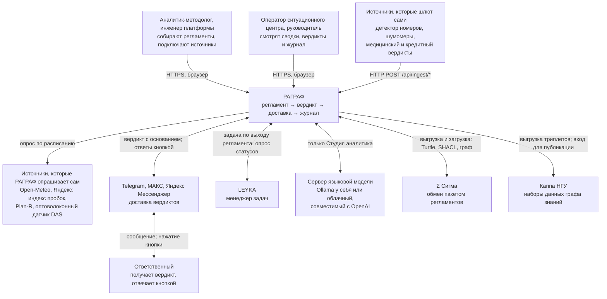

Рисунок 1 — РАГРАФ и его окружение

### Актуальность

Регламент управления — нормативный текст, по которому человек или система принимает решение. На практике он ломается в двух местах.

1. **Регламент зашит в код или остаётся текстом.** Тогда его нельзя проверить до применения: противоречие двух пунктов или пропущенный случай обнаруживаются инцидентом.
2. **Решение выносится на неполных данных.** Датчики отвечают не одновременно, и тот, кто читает вердикт, вынесенный без части показаний, спрашивает: не отменится ли он, когда данные придут? Обычный ответ «нет данных — значит норма» эту подмену и делает.

Обе беды не умозрительны: в поставке изделия случились обе. Обе нашла проверка до применения, а не инцидент.
- **«Нет данных — значит норма».** Регламент кампуса о переходе температуры через ноль (`campus-zero-crossing`) в первой редакции, 09.10.2026, был одной формулой с условным выражением. Когда высота снега не приходила, он выдавал «перехода нет»: условное выражение языка тогда не было трёхзначным, и неизвестное условие считалось ложным. В оттепель это молчание там, где надо огораживать зоны под сосульками. Ошибку поймала проверка в день создания регламента, и в тот же день условное выражение стало трёхзначным. Регламент в нынешнем виде — сквозной пример отчёта (п. 4.5).
- **Ошибка, которую не видно до применения.** Регламент штрафа за превышение скорости (`traffic-speed-fine`) выносил постановление высшей ступени — 5000 ₽ и задачу инспектору — даже при 50 км/ч в зоне 60: порог сравнивал с уставкой не превышение, а саму скорость. Граф выглядел правдоподобно. Ошибку нашёл верификатор, построенный из теоремы (п. 6.5).

Работа отвечает на обе беды одним построением. Регламент записывается формальным графом. «Нет данных» — третье значение логики, а не «норма». Для основного фрагмента языка доказано, что вердикт при пополнении данных не отменяется. Та же теория дала верификатор, который проверяет регламент до исполнения.

### Откуда выросла работа

Постановка выросла из НИР ЦИИ НГУ «Фреймворк Сигма» 2024–2025 годов [4], [8]. Оттуда взяты:
- определение ЦД СУ как набора исполняемых спецификаций;
- задачный подход как теоретическое ядро;
- модель знаний Пальчунова;
- постановка формальной верификации — «взаимная непротиворечивость двух спецификаций».

Последняя задача в 2024–2025 годах осталась без результата; в 2026 году на неё отвечают разделы 5 и 6. Путь подробно — в разделе 1.

### Цель работы

Цель этапа 1 переносится из черновика этапа дословно, чтобы приёмка сверяла один текст:

> «Разработать и довести до уровня опытной эксплуатации (УГТ-7) программную платформу РАГРАФ, реализующую замкнутый контур «датчик — регламент — задача — человек» на основе задачного подхода и формально-проверяемой логики, и продемонстрировать её применимость в задачах управления городскими инфраструктурами на примере домена «Строительство и инфраструктура» (Платформа АРХИ).» [10]

Цель этапа 2 — дать формально проверяемой логике математическое основание:
- сформулировать свойство «вердикт при пополнении данных не отменяется»;
- доказать его для фрагмента языка и назвать точную границу фрагмента по исходному тексту исполнителя;
- проверить свойство на изделии и измерить по корпусу [11].

### Задачи

Задачи а)–д) — этапа 1, дословно [10]; е)–ж) — этапа 2. Итоги по каждой задаче — в заключении, по тому же перечню.

- а) «принимает в качестве конфигурации **исполняемые спецификации** (регламенты) в открытом, проверяемом, переносимом между системами формате (Turtle / SHACL / PROV-O / Rule DSL Flow)»;
- б) «обеспечивает **постоянную инфраструктуру исполнения** этих спецификаций — от приёма события до подкрепления методолога — в замкнутом контуре с гарантиями воспроизводимости, объяснимости и формальной проверяемости»;
- в) «позволяет **наращивать задачное пространство** ЦД СУ инкрементно — каждый новый регламент расширяет область компетенции цифрового двойника без переписывания инфраструктуры»;
- г) «интегрируется с внешними **цифровыми двойниками объектов управления** (внешними Оракулами — датчики, таск-трекеры, бизнес-системы) через формализованные адаптеры»;
- д) «служит **испытательным стендом** для эмпирической проверки гипотез из НИР 2024 года — в частности, гипотезы о том, что задачный подход Сибирской математической школы и теория функциональных систем П.К. Анохина могут быть операционализированы в коде производственной платформы без потери научной корректности»;
- е) сформулировать и доказать свойство сохранения вердикта для фрагмента языка регламентов, назвать границу фрагмента по исходному тексту исполнителя, проверить свойство исполняемым сторожем и измерить по корпусу;
- ж) по итогам проверки свойства привести исполнитель к теории и встроить в изделие проверку, называющую до исполнения конструкции, при которых вердикт может смениться, а регламент — молча не работать.

Две поправки к задаче д):
- гипотеза о ТФС в тексте НИР 2024 года отсутствует, связка задачного подхода с ТФС появляется в отчёте 2025 года [8];
- «научная корректность» в задаче не определена; этап 2 даёт ей одно проверяемое содержание — сохранение вердикта.

### Объект и предмет исследования

**Объект** — процессы оперативного управления по регламентам с нормативным основанием. Источники событий в них автоматические: датчики, трекеры задач, внешние системы. Исполнители — люди.

**Предмет** — способ записи регламента формальным графом, его исполнение над частичной моделью показаний в трёхзначной логике и проверка до исполнения. Сюда входят свойства этого способа — сохранение вердикта, полнота и непротиворечивость ветвей — и их проверка на изделии. Предмет в черновике этапа 1 не назывался; здесь он назван впервые.

### Методы

| Метод | Для чего |
|---|---|
| задачный подход | постановка регламента как задачи [3], [12] |
| теория функциональных систем | каркас контура «событие — решение — исполнение — оценка» [13] |
| модель знаний Пальчунова | уровни: регламент — теория, показания — прецедент [5], [14] |
| сильная логика Клини и теория частичных структур | свойство и его доказательство [6], [15], [16] |
| статический анализ графа | проверка до исполнения |
| сторож на случайных расширениях и минимальные регламенты | проверка свойства исполнением |
| перепись корпуса и сравнение вердиктов до и после | замер |
| натурная проверка | пилот, боевые источники |
| абляция | польза графа знаний |

### Этапы работы

| Этап | Сроки | Что сделано | Черновик |
|---|---|---|---|
| 1 | 2026-05-13 — 2026-11-08 | изделие, стенд, интеграции, проверка регламента как графа, граф знаний в Студии, пилот модуля, комплект ЕСПД и ПМИ | `docs/OTCHET-NIR-RAGRAF-2026.md` [10] |
| 2 | 2026-11-09 | математические основания: теорема, граница, сторож; приведение исполнителя к теории; верификатор | `docs/NIR-ETAP2-MATEMATICHESKIE-OSNOVANIYA.md` [17], разборы [11], [7] |

План этапа 2 в черновике этапа 1 (пп. 6.8, 6.15.4) математических оснований не содержал. Тема этапа 2 возникла из сверки отчёта с изделием 08.11.2026 и решения руководителя работы 09.11.2026. Расхождение плана и факта названо здесь, а не сглажено.

---

## 1. ПУТЬ К ПОСТАНОВКЕ: ОПОРНЫЕ РАБОТЫ 2024–2025 И ПОИСК 2026 ГОДА

### 1.1. Опорные работы: НИР «Фреймворк Сигма», 2024 и 2025

**Что это за работы.** Отчёты 2024 [4] и 2025 [8] — промежуточные отчёты ЦИИ НГУ по теме «Фреймворк Сигма», этапы 1 и 2. Основание — грант из федерального бюджета, договор от 27.12.2023 № 70-2023-001318; руководитель НИР — И. А. Болдырев. В списках исполнителей этих отчётов автор настоящей работы не значится.

**Роль автора.** В 2024–2025 годах автор работал по теме внешним экспертом, вне состава исполнителей. Он сводил вместе научные работы и результаты темы, чтобы команда видела картину целиком и по ней принимала решения по архитектуре. Поэтому здесь эти работы — опорные: из их поиска выросла НИР 2026 года. Её прежними этапами они не являются.

**Что из них вошло в работу 2026 года.** Таблица — вехи, без которых работа 2026 года не сложилась бы.

| № | Веха | Где | Почему без неё 2026 год не получился бы |
|---|---|---|---|
| 1 | ЦД СУ — набор исполняемых спецификаций | 2024 | без него у работы нет предмета: регламент и есть такая спецификация, а изделие — её инфраструктура исполнения |
| 2 | регламент меняется без изменения кода, решение создаёт аналитик | 2024 | отсюда изделие без программиста в контуре решений |
| 3 | четыре уровня знания Пальчунова на оси времени; база знаний 2025 года по ним | 2024–2025 | отсюда уровни п. 2.3 и прецедентный уровень теоремы |
| 4 | адаптер событий; стыковка с городскими сервисами ШУМ и ВОЗДУХ | 2024 | отсюда схема «событие — задача» и модули приёма шума и воздуха в коде |
| 5 | **постановка формальной верификации** — «взаимная непротиворечивость двух спецификаций» | 2024 | осталась без результата в 2024 и 2025 годах; ответ — разделы 5 и 6 |
| 6 | d0sl — спецификация на логических операциях | 2024 | предок Flow DSL; его разбор дал трёхзначный тип «нет данных», а его пределы — довод за собственный визуальный язык |
| 7 | пилот 2025 года: двойник объекта и двойник помощника; аудит «почему сработало правило» | 2025 | разграничение двух двойников принято за отправную точку |
| 8 | ядро «Сигмы» 2025 года в направлении «Строительство и городская среда» | 2025 | эталон, от которого РАГРАФ поставлен как облегчённый прототип в том же строительном домене |
| 9 | задачный подход против галлюцинаций языковых моделей | 2025 | обоснование, почему языковая модель вынесена из контура решений |
| 10 | связка задачного подхода и теории функциональных систем | 2025 | отсюда шесть стадий контура; в 2024 году этой связки в тексте нет |

**Что из них в работу не вошло.**

| Направление 2024–2025 | Что с ним в 2026 году |
|---|---|
| блокчейн, смарт-контракты, гражданское участие | нет |
| логико-вероятностные нейросети | нет реализации |
| p-полный язык с рекурсией, теорема о полиномиальном аналоге неподвижной точки | в изделие не вошли |
| виртуальные города, тесты планируемости | нет |
| d0sl как платформа исполнения | заменён Flow DSL; трёхзначный тип «нет данных» унаследован |
| стек Jena + PostgreSQL + очередь сообщений | заменён DuckDB и опросом источников; сравнительного замера с Jena не было (п. 11) |
| языковая модель как генератор спецификаций | модель ищет и подсказывает; регламент она не правит |
| методика оценки «умных городов» | нет |

Отказы 2024–2025 годов в самих отчётах не названы: оба заканчиваются оценкой «все поставленные задачи выполнены в полном объёме». Повороты видны только при сравнении лет. Например, d0sl в 2024 году — ядро технологии, а в ядре и регистрации 2025 года его нет. Эта сверка — тоже результат работы: она показывает, какие направления поиска не дали изделия.

### 1.2. Линия поиска: от вопроса 2024 года к ответу 2026-го

| Идея | 2024 | 2025 | 2026 |
|---|---|---|---|
| задачный подход | термин и источники; задачи с критериями решённости | статьи о проверяемости решений по формальным критериям [18], [19] | цифровой регламент — задача из четырёх компонентов; шесть видов критерия решённости |
| модель Пальчунова | четыре уровня, нечёткий четвёртый | база знаний ядра по уровням | регламент — теория, показания — прецедент; оценка доли успеха по правилу Лапласа на вероятностном уровне |
| «нет данных» | нет; ближе всего — «неполные прецеденты, частичные модели» | нет | логика Клини в исполнителе с 19.05.2026; язык трёхзначен целиком с 09.11.2026; теорема о сохранении вердикта |
| регламент как спецификация | исполняемая спецификация d0sl | правила в RDF/OWL; «скрытые конфликты между регламентами» | регламент как граф, проверяемый до исполнения (п. 6) |
| формальная верификация | поставлена, результата нет | результата нет | статический анализ и теорема (пп. 5, 6) |
| роль языковой модели | переводчик формулировок в онтологию | гибрид с логическим выводом | только поиск и подсказка, вне контура решений |

**Сквозной вывод.** В 2024 году работа ЦИИ НГУ поставила вопрос о формальной верификации спецификаций управления; в 2025 году он остался открытым. Работа 2026 года отвечает на него для языка регламентов. Свойство доказано для фрагмента, граница снята с кода, проверка встроена в изделие.

### 1.3. Тупики и отказы внутри 2026 года

Поиск 2026 года тоже дал отрицательные результаты, и они повернули работу.

| Что | Когда | Почему отказались | Что вместо |
|---|---|---|---|
| графовый движок RAGU для GraphRAG | с 13.05.2026, удалён 22.05.2026, вычищен из окружения 06.09.2026 | тяжесть интеграции против пользы | лёгкий поиск по эмбеддингам bge-m3 [20] и опциональная генерация |
| гипотеза о профессии «оператор регламентов» | этап 1, п. 6.13 | профессии, которую изделие автоматизирует, у заказчика нет | сопровождаемое внедрение; продавать проверку, а не инструмент |
| уточнение области поиска локальной моделью | отменено 07.11.2026 | 5 неверных уверенных сужений на 42 вопросах против 0 у поиска по своду (п. 8) | поиск по своду |
| «точность решений 90–93 %» и «+5–7 п.п.» | сняты 08.11.2026 | это сумма ожидаемых приростов по плану, а не замер | замер с эталоном — задача следующего этапа |
| облачная площадка как основание УГТ | снято 08.11.2026 | из России без VPN площадка не открывается | локальная установка; пилот на ноутбуке |
| «эмпирико-байесовский прогноз» | переименован 15.10.2026 | это правило Лапласа, а не эмпирический Байес | «оценка доли успеха по правилу Лапласа» |
| курс ДПО для «оператора регламентов» | отложен на этапе 1 | должности нет | первый канал — сопровождаемое внедрение |

---

## 2. ПОСТАНОВКА ЗАДАЧИ И МЕТОДОЛОГИЧЕСКАЯ ОПОРА

### 2.1. Регламент как задача

По задачному подходу [3], [21], [12] интеллектуальная задача задаётся четырьмя компонентами: предметная область, запрос, критерий решённости, контекст. В изделии каждому компоненту соответствует файл и узлы графа:

| Компонент | В изделии |
|---|---|
| предметная область | данные регламента в Turtle [22]; параметры с контрактом SHACL [23] |
| запрос | граф Flow DSL: входы, формулы, пороги, развилки, выходы |
| критерий решённости | шесть видов, с 08.10.2026 и `feedback_received` |
| контекст | область, основание — пункт нормы, расписание, доставка |

Те же четыре компонента — на рисунке 2. Схема — из README изделия; подписи запроса и критерия приведены к таблице выше: в README запрос назван событием от датчика, а видов критерия — пять, хотя с 08.10.2026 их шесть.

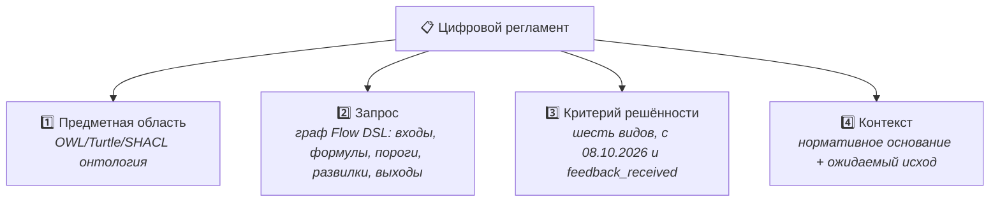

Рисунок 2 — Регламент как задача из четырёх компонентов

Σ-программирование [24] и семантические предметно-ориентированные языки [25] дают происхождение самой идеи «исполняемой спецификации на логических операциях». Flow DSL — её визуальная форма.

### 2.2. Контур по теории функциональных систем

Шесть стадий функциональной системы [13], [26] образуют каркас контура «датчик — регламент — задача — человек»:

| Стадия | В изделии |
|---|---|
| афферентный синтез | приём показаний: опрос источников и приём событий |
| принятие решения | исполнение графа |
| акцептор результата | критерий решённости |
| эфферентный синтез и действие | доставка вердикта и создание задачи |
| обратная афферентация | ответ человека и закрытие задачи |

Как стадии ложатся на модули изделия — на рисунке 3: путь прогона от источника до подсказки методологу. Схема — из README изделия; код действия приведён к реестру (`create_leyka_task`), добавлены доставка вердикта и ответ человека — стадии эфферентного синтеза и обратной афферентации, подписи переведены на русский.

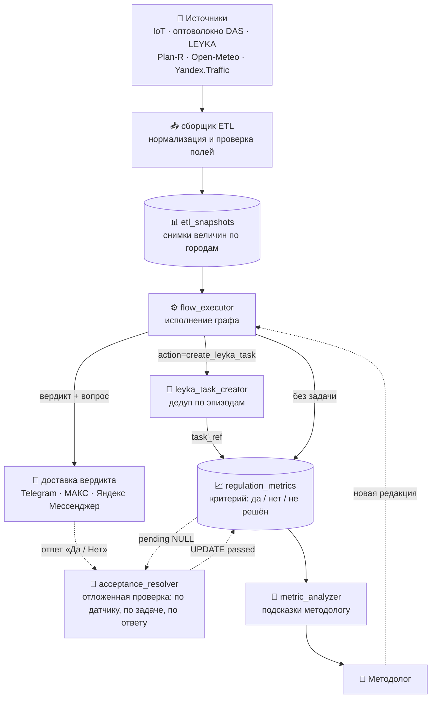

Рисунок 3 — Путь прогона регламента по стадиям функциональной системы

Связка задачного подхода с ТФС взята из работ 2025 года [19].

### 2.3. Уровни знания

Модель Пальчунова [5], [14] различает четыре уровня знания. В изделии каждому соответствует своя часть.

| Уровень | Что это в модели | Что это в РАГРАФ |
|---|---|---|
| 1. Онтологический | сигнатура предметной области и аксиомы онтологии | база знаний в триплетах: словарь регламента — параметры как свойства онтологии (`owl:DatatypeProperty` с единицей `:unit`) и контракт значений SHACL; граф знаний области в Студии — 15 датасетов-семян, 1556 троек (п. 8) |
| 2. Теоретический | утверждения теории в сигнатуре онтологии | регламент — граф Flow DSL, записанный в словаре онтологии: входы и формулы называют её свойства |
| 3. Прецедентный | прецеденты — частичные модели | показания в момент прогона; журнал прогонов — накопленные прецеденты |
| 4. Вероятностный | оценки на прецедентах | доля успеха по правилу Лапласа |

**Как уровень 1 держит остальные.** Триплеты и есть онтологический уровень.
- Регламент — теория в их словаре: формулы и входы называют свойства онтологии, а не переменные программы.
- Контракт SHACL — аксиомы онтологии: он ограничивает допустимые модели.
- Частичная модель прецедента — частичная интерпретация того же словаря в пределах контракта. По точкам границ контракта работают и сторож теоремы, и перебор окончательности (пп. 5, 6).

Вопрос «не отменится ли вердикт» — вопрос об отношении уровней 2 и 3: сохраняется ли истинность утверждения теории при расширении частичной модели прецедента. На него отвечает раздел 5.

**Где связь слабая — и чем её закрыть.** Свой словарь есть у каждого регламента, а моста от графа знаний области к регламенту нет. Не хватало триплета вида «проблема А — решается — регламентом Б» в графе той же области, что и регламент (до ночи 09.11.2026 — «решение вопроса А — поддерживается — регламентом Б»). С ним поиск по области приводит к регламенту, который отвечает на вопрос. Без него Студия ошибается областью и отвечает «точного регламента нет», хотя регламент есть: случай 05.11.2026, п. 8.3.

Замер 09.11.2026, команда `backend/.venv/bin/python scripts/most_vopros_reglament.py`:
- из 66 регламентов в триплетах своей области названы 2;
- ещё 10 названы, но только в графе чужой области — например, четыре регламента ЕДДС Кольцово в графе муниципального управления;
- у 43 регламентов в их области нет ни одного триплета, в том числе у всех 16 регламентов кампуса.

По основам слов заземлены 35 параметров из 135 (п. 8.3).

**Мост построен тем же вечером, 09.11.2026.**
- Мосты заведены всем 66 регламентам, каждый в графе своей области. Темы написаны по именам регламентов. Областей регламентов без единого триплета не осталось — было девять. Сторож держит правило «у каждого регламента мост в своей области».
- Студия добавляет регламент моста к кандидатам ответа: тема и вопрос должны делить не меньше двух основ слов. Мост дополняет поиск, а не перебивает его.
- Замер на 39 вопросах (`backend/.venv/bin/python scripts/zamer_mostov.py`). При поиске по словам нужный регламент попал в кандидаты в 25 случаях из 26 вместо 23. Оба прироста — на вопросах, которые автор видел, выбирая правило. На 20 независимых вопросах и при поиске по векторам изменений нет: поиск там и так находит нужное. Лишних мостов на 13 вопросах без своего регламента нет.

Польза моста сейчас — в покрытии онтологического уровня и в закрытом классе ложного «точного регламента нет». Прироста качества поиска замер не показал. Ставить регламент моста первым замер запретил: на независимом вопросе это вытеснило верный регламент.

### 2.4. Требования к изделию

Функциональные и нефункциональные требования этапа 1 (Ф-1…Ф-14, НФ-1…НФ-8) действуют в редакции задания РАГРАФ-ФРЕЙМ-1 [27] и ПМИ [9]. Ведомость покрытия на 08.11.2026 — 147 пунктов задания: 62 закрыты, 76 частично, 9 не закрыты [9]. Здесь требования не повторяются. Место языковой модели — вне контура решений: решения принимает исполнитель графа. Модель ищет по своду норм, уточняет область вопроса и отвечает в Студии; регламент она не правит.

### 2.5. Модуль в задании Фреймворка «Сигма»: что закрыто и что остаётся за платформой

**Как читается задание.** Основной текст задания на Фреймворк «Сигма» [1] написан в 2023 году. Уточнения 2025 года внесены комментариями, без правки текста, и они переопределяют главные требования:
- «смарт-контракт» — это регламент, исполнимая спецификация, которую аналитик правит без программирования;
- «обучение с подкреплением» — правка регламента аналитиком без перезапуска системы;
- цифровой двойник — двойник системы или субъекта управления, «но не объектов».

В таком прочтении модуль совпадает с заданием гораздо больше, чем по букве. Где прочтения расходятся, ниже стоят оба статуса.

**Место модуля.** С 05.11.2026 РАГРАФ — служебная разработка ЦИИ НГУ и модуль в составе фреймворка. Он относится к среде разработки: язык регламентов, редактор аналитика, формы проверки данных SHACL. С собой он несёт облегчённый исполняющий контур, который работает автономно и выгружает регламенты пакетом Turtle и SHACL. По календарному плану задания работа 2026 года ложится прежде всего на этап 4.2 — интеграцию программного обеспечения Центра. Вклад есть и в этап 3.2 (рабочая документация модуля), и в этапы 3.1 и 9 (пилот в кампусе).

| Пункт задания | Чего требует | Модуль | Чем закрыто |
|---|---|---|---|
| 4.6.3, 4.9.3 | формальная спецификация требований; «ясно и однозначно определить требования» | ✅ для требований, записанных регламентами; ◐ для SLA и ИБ самой целевой системы | верификатор (п. 6) и теорема о сохранении вердикта (п. 5) — ответ на постановку формальной верификации 2024 года, оставшуюся без результата (п. 1.2) |
| 4.1.3, комментарий 2025 | «интерфейс аналитика регламентов» с разработкой без программирования | ✅ по функции; ⬜ по d0sl | графический редактор и язык Flow DSL (п. 4.1) |
| 4.9.1, комментарий 2025 | умный протокол интеграции = регламент как исполнимая спецификация | ✅ по комментарию; ⬜ блокчейн | регламент — Turtle, SHACL и граф |
| 4.7.7, комментарий 2025 | правка регламента аналитиком без перезапуска | ✅ по комментарию; ⬜ машинное обучение | правка порога пересчитывается сразу; ответ адресата — величина регламента |
| 4.7.1, 4.7.5, комментарий 2025 | двойник субъекта управления | ✅ | двойник из регламентов; композиция «процесс»; двойников объектов задание не требует |
| раздел 5, комментарий 2025 | отсутствие события — не подтверждение значения | ✅ в языке; ◐ у сборщиков | трёхзначная логика Клини (п. 4.2); два сборщика подставляют ноль (п. 4.4) |
| 4.7.6 | решения с объяснениями | ◐ | основание вердикта в сообщении и документ-основание; трасса прогона не хранится, вариантов решений нет |
| комментарии к 4.9.5, 4.9.6 | регламенты декларативны и версионируются; реестр с машиночитаемыми схемами | ✅ | история версий с автором; выгрузка пакета и корпуса |
| 4.6.2, 4.6.4, 4.9.4 | предметные области; открытые стандарты | ◐ | 66 регламентов в 15 областях на одном исполнителе; RDF/Turtle, SHACL, OpenAPI; сетевого обмена с сервисами платформы нет |
| раздел 6 | рекомендации по языку для бизнес-аналитиков | ✅ для своего языка | описание языка РАГРАФ-ФРЕЙМ-35 [28] с методикой; учебник Flow DSL |
| 4.7.2–4.7.4, 4.8 | имитация, прогноз рисков, логико-вероятностное обучение, MBSE 2.0 | ⬜ | результат чужой модели модуль принимает величиной и превращает в вердикт |
| 4.1, 4.10, 5.2 | шлюз, единый вход, Jena/Fuseki, S3, мониторинг, Kubernetes, надёжность, ГИС | — | за платформенным контуром |
| раздел 9 | приёмочные испытания с заказчиком и акт | ◐ | программа испытаний модуля РАГРАФ-ФРЕЙМ-51 [9]; испытаний с заказчиком и акта нет (п. 7.3) |

**Итог.** Модуль закрывает недостающие функции фреймворка в части среды разработки и проверки регламентов. Главное из них — формальная спецификация требований и её проверка до исполнения. Инфраструктура исполнения, модели и прогноз остаются за платформенным контуром и модулями Центра. Полная сверка — 65 пунктов с доказательствами и комментариями 2025 года — лежит в `docs/SVERKA-TZ-SIGMA-2025-RAGRAF.md`.

---

## 3. ИЗВЕСТНЫЕ РЕШЕНИЯ И ВЫБОР ПОДХОДА

### 3.1. Что известно

| Направление | Что даёт | Чего не даёт для задачи работы |
|---|---|---|
| таблицы решений DMN и их анализ [29], [30] | проверка полноты и перекрытия правил одной таблицы | работы с отсутствующими данными как с третьим значением; графа с гейтами и развилками; проверки между регламентами |
| сильная логика Клини [6], частичные структуры [15], семантика Крипке — Клини [16] | монотонность связок по порядку знания | границы для конкретного языка правил с запасными правилами движка |
| исполняемые спецификации d0sl и Σ-программирование [24], [25] | логическая запись правила | визуального языка для аналитика, трёхзначности в исполнении, проверки до исполнения |
| генерация с поиском, RAG и GraphRAG [31], [32] | ответ модели по внешнему знанию | детерминированного решения и его доказуемости |

### 3.2. Почему выбрано так

- **Регламент — формальный граф, а не таблица и не текст.** Только граф с выходами и приоритетами выражает поставку регламентов: гейты времени, развилки по зонам, несколько исходов с разной эскалацией. Только формальный граф можно проверить до исполнения.
- **«Нет данных» — третье значение, а не «ложь».** Иначе молчащий датчик даёт «норму»; это и есть подмена, против которой строится работа.
- **Языковая модель — вне контура решений.** Вердикт, который нельзя воспроизвести, нельзя предъявить.
- **Хранение — DuckDB, а не триплет-стор.** Обоснование и пределы — черновик этапа 1, п. 2.4 [10]. Сравнительного замера с Apache Jena не было; это записано отрицательным результатом (п. 11).

Место модели относительно решения — на рисунке 4. Схема — из учебника Flow DSL, часть 5. Две боковые задачи модели свёрнуты в один блок, чтобы схема читалась на листе, и подпись приведена к изделию: черновик регламента из текста строят правила без модели, а модель разбирает документ против корпуса.

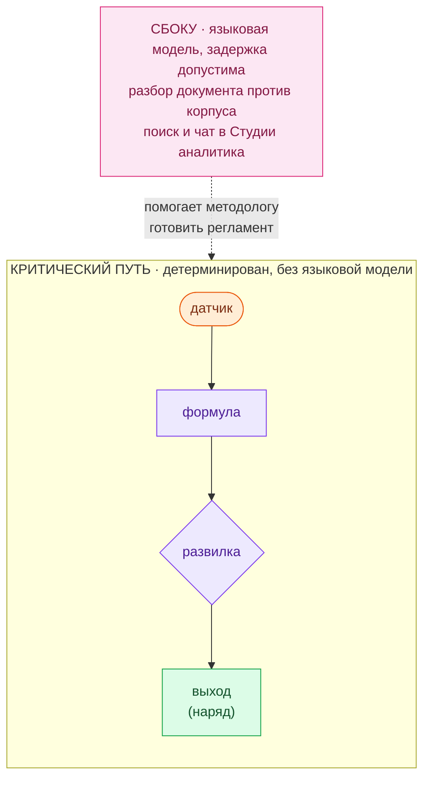

Рисунок 4 — Критический путь без языковой модели и её место сбоку

---

## 4. ОБЪЕКТ ИССЛЕДОВАНИЯ: ЯЗЫК РЕГЛАМЕНТОВ И ЕГО ИСПОЛНЕНИЕ

### 4.1. Язык: устройство, происхождение, рост

**Исходная точка 2025 года.** В ядре «Сигмы» 2025 года были модуль проверки событий по регламентам и база знаний цифровых регламентов [8]:
- регламент хранился описанием онтологии — параметрами с эталоном и допуском;
- проверка оценивала критичность события и давала рекомендацию;
- правка шла «на уровне описаний онтологий».

Задание требует большего: цифровые регламенты описываются декларативно, на предметно-ориентированном языке, с рекомендациями для бизнес-аналитиков (п. 4.8, разделы 5 и 6 задания [1]). Языка логики регламента, доступного аналитику без программиста, в 2025 году не было.

**Почему понадобился свой язык.** Причин три:
1. **Выразительность.** Регламенту нужны сочетания условий, выбор ветви по зонам, окна времени, формулы, вопрос человеку и ожидание ответа.
2. **Проверяемость.** Проверить до исполнения можно только формальную структуру. Это вопрос формальной верификации, поставленный ещё в 2024 году (п. 1.2).
3. **Открытость.** d0sl закрыт, а задание требует открытых стандартов (п. 4.6.4 задания).

Решение — граф. Узлы — вход, порог, формула, сравнение, развилка, время, датчик, выход; рёбра несут сигнал «сработало». Граф хранится рядом с регламентом в Turtle, SHACL задаёт контракт данных.

**Как язык рос в 2026 году.** Каждый шаг — ответ на конкретный случай, названный в описании языка [28].

| Когда | Шаг | Что он дал |
|---|---|---|
| 13.05.2026 | первая версия стенда: визуальный редактор потока и проверка графа | регламент — граф с первого дня |
| 17–19.05.2026 | исполнитель графа, вычислитель формул, связки по Клини | вердикт на неполных данных; «нет данных» — третье значение |
| 23.05.2026 | разбор потока данных, фазы A–E | «Сравнить» вычисляется по оператору; проверка критерия решённости; задачи исполнителям — контур замкнут |
| 20.06.2026 | «Проверка регламента»: противоречия и пробелы до исполнения | первый верификатор |
| 04.09.2026 | описание языка РАГРАФ-ФРЕЙМ-35, ред. 1 | язык описан документом ЕСПД |
| 08–09.10.2026 | ред. 2–5 | вопрос получателю — элемент языка, его состояние — величина; вход без данных даёт «неизвестно»; условное выражение трёхзначно; канон «порог — в развилке, вход — от события» |
| 15.10.2026 | ред. 6 | основание вердикта в сообщении; функции над числами трёхзначны |
| 09.11.2026 | ред. 7 | членство и ошибка в связке — по Клини; режим развилки — свойство графа; теорема о сохранении вердикта, верификатор из теоремы, начало починки поставки |

**Мера полезности.** Число потоков в поставке: 46 на 31.05.2026, 58 на 30.06, по 59 на 31.07 и 31.08, 62 на 30.09, 65 на 31.10, 66 на 09.11. Команда: число файлов `*.flow.json` в `backend/data/fixtures` на последнем коммите месяца (`git ls-tree`). Корпус 2026 года — 66 регламентов в 15 областях. Корпус паспорта фасадов ложится в язык целиком: 157 карточек из 157 во фрагменте L₀ [33] (п. 5).

**Устройство на 09.11.2026.** Flow DSL — визуальный язык графа регламента; описание языка — РАГРАФ-ФРЕЙМ-35, ред. 7 [28].
- **Узлы:** девять машинных типов, восемь — в палитре редактора: датчик, вход, время, формула, порог, сравнение, развилка, выход и ограничение SHACL.
- **Рёбра** несут сигнал «сработало» и необязательную метку.
- **Выход** несёт приоритет, действие и доставку.

Типы узлов и их связи — на рисунке 5. Схема — из справочника строителя умного города; добавлено ребро гейта времени в развилку — главное употребление узла времени (урок 2 поставки).

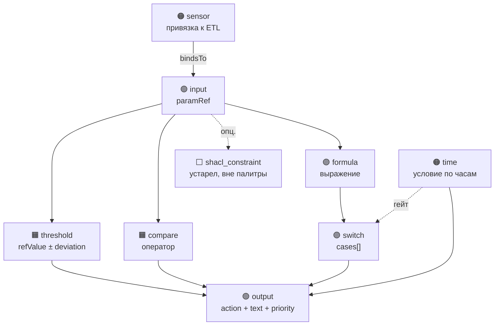

Рисунок 5 — Девять типов узлов Flow DSL и их связи

Устройство одного регламента — на рисунке 6: учебный регламент урока 1 поставки, `tutorial-01-basic-threshold`. Схема — из приложения А описания языка [28]; коды действий приведены к поставке: в приложении остались учебные коды, заменённые в реестре 26.09.2026.

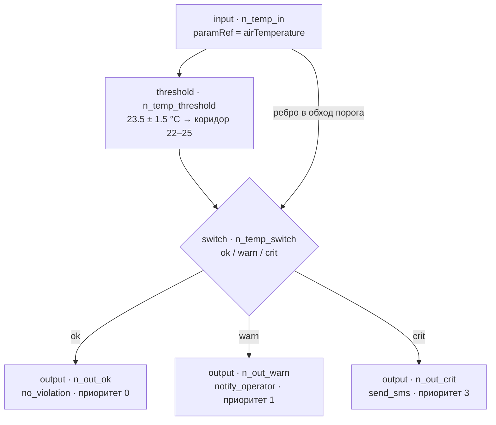

Рисунок 6 — Урок 1: вход, порог, развилка на три зоны, выходы с приоритетами

### 4.2. Семантика исполнения

Исполнитель обходит граф от сработавших узлов (`backend/app/services/flow_executor.py`). Формулы вычисляются в сильной логике Клини (`formula_eval.py`). Язык стал трёхзначным в несколько шагов:

| Дата | Что стало трёхзначным |
|---|---|
| 19.05.2026 | связки `and`, `or`, `not` |
| 09.10.2026 | условное выражение |
| 15.10.2026 | встроенные функции над числами |
| 09.11.2026 | членство `in` и ошибка значения внутри связки: связка принимает её за ⊥ |

Вне логики Клини остаётся только явный тест определённости `== None`; он для того и заведён.

Язык двухуровневый — рисунок 7: снаружи граф Flow DSL, внутри узлов формулы и времени — выражения в логике Клини, которые разбираются по белому списку конструкций, без исполнения текста. Схема — из рукописи статьи о языке; добавлена оговорка об оконных функциях.

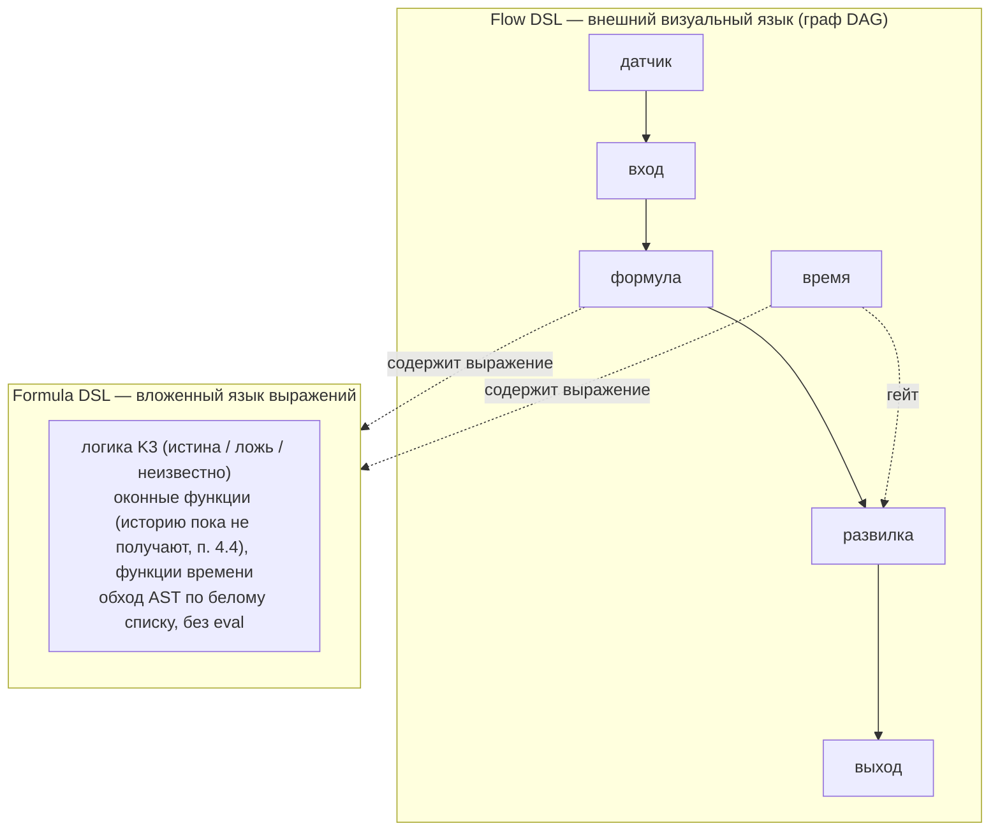

Рисунок 7 — Два уровня языка: граф Flow DSL и выражения формул

Что даёт третье значение на деле — рисунок 8: без показания задымления формула даёт ⊥, развилка с границами не выбирает ветвь, и вердикта нет, а не «норма». Это урок 6 поставки, `tutorial-06-kleene-unknown`; схема — из приложения А описания языка [28], код действия приведён к поставке.

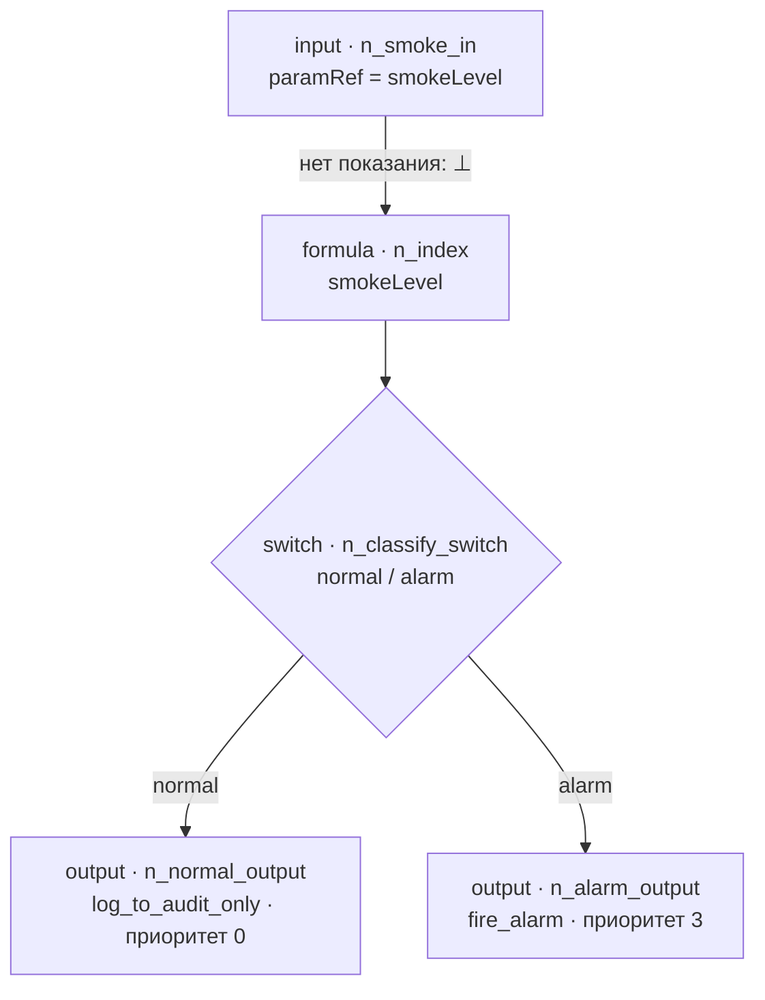

Рисунок 8 — Урок 6: без показания вердикта нет, а не «норма»

**Развилка с 09.11.2026 выбирает ветви по режиму** — это свойство графа, функция `rezhim_razvilki`:

| Режим | Когда | Как выбираются ветви |
|---|---|---|
| границы | у зон заданы `min` или `max` | ровно одна ветвь по значению; значения нет — ни одной |
| метки | границ нет, есть помеченные входящие рёбра | ветви по меткам всех пройденных рёбер, метка совпадает и через зону; несовпавшая метка — ни одной ветви |
| все ветви | ни границ, ни меток | все исходящие ветви |

До 09.11.2026 метка была сильнее границ, принималась только с первого ребра обхода, а несовпавшая метка зажигала все ветви. Почему это изменено — п. 6.3.

### 4.3. Трасса и состояния результата

Вердикт двузначен по каждому выходу: сработал или нет. Причину молчания различает трасса.

| Запись трассы | Что она значит |
|---|---|
| «нет входного значения», «unknown (нет данных: x)», «нет значения на входе — неизвестно» | данных нет |
| «гейт времени не активен» | не применимо |
| «ошибка формулы: …» | дефект правила |
| «маршрут не определён» | граф не говорит, какая ветвь |

Методология цифровой регламентации [33] различает шесть состояний результата правила. Их соответствие трассе и сжатие в K3 — черновик этапа 2, п. 7 [17]. Сжатие исполнено, а различение состояний в самом вердикте — нет; это направление развития.

### 4.4. Чего исполнитель не делает

- Узлы за развилкой, кроме выходов, не вычисляются.
- Функции рядов (`rate`, `delta`, `max_over`, …) не получают истории и всегда дают ⊥, а `count_above` — 0.
- Порог не читает значения формулы-предшественника и сравнивает вход за ней.
- Последнее значение источника берётся без предела давности. Два сборщика подставляют 0 вместо молчания: `etl/applier.py:309–317` — прогноз нагрузки дорог, `:400–402` — индекс выбросов. Для этих регламентов пропуск становится определённым нулём, и теорема раздела 5 к ним не относится (п. 11).

Пример ко второму пункту — урок 5 поставки, рисунок 9: `rate("waterLevel", "1h") > 5` без истории всегда даёт ⊥, а у развилки нет ни границ, ни меток. Регламент стоит в описи починки, фаза П3 (п. 6.5). Схема — из приложения А описания языка [28], код действия приведён к поставке.

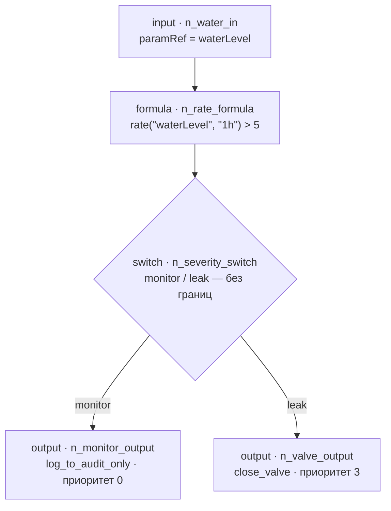

Рисунок 9 — Урок 5: функция ряда без истории даёт ⊥

### 4.5. Пример из поставки: регламент перехода через ноль

Примеры пп. 4.1–4.4 — учебные регламенты: на каждом видна одна конструкция. Здесь — настоящий регламент пилота в кампусе НГУ (п. 7.3) в трёх представлениях языка, которые задаёт его описание [28], § 1.5: граф, структура данных графа, данные и контракт в Turtle и SHACL. Все три — выемки из файлов поставки `backend/data/fixtures/campus-zero-crossing.*`. Совпадение с поставкой держит проверка `backend/tests/test_otchet_nir_primery.py`.

**Задача.** Переход температуры через ноль. Днём оттепель, к утру мороз — мокрые дорожки за ночь замерзают. Если при оттепели лежит снег, с кровель течёт, а сосульки растут и падают. Основание записано в данных регламента: Правила и нормы технической эксплуатации жилищного фонда (постановление Госстроя России № 170) — удаление наледей и сосулек с кровель с ограждением опасных зон, обработка тротуаров, крылец и пандусов при гололёде. Показания — Open-Meteo по месту замера кампуса: максимум сегодня, минимум на завтра, высота снега, осадки за час. Вердикт уходит в чат кампуса вместе с вопросом исполнителю.

**Граф** — рисунок 10, в том виде, в каком его рисует изделие (`flow_to_mermaid`); для листа он развёрнут сверху вниз. Три исхода — три формулы-гейта на `and` и `or`. При известных величинах срабатывает ровно один.

<!-- primer: graf campus-zero-crossing -->
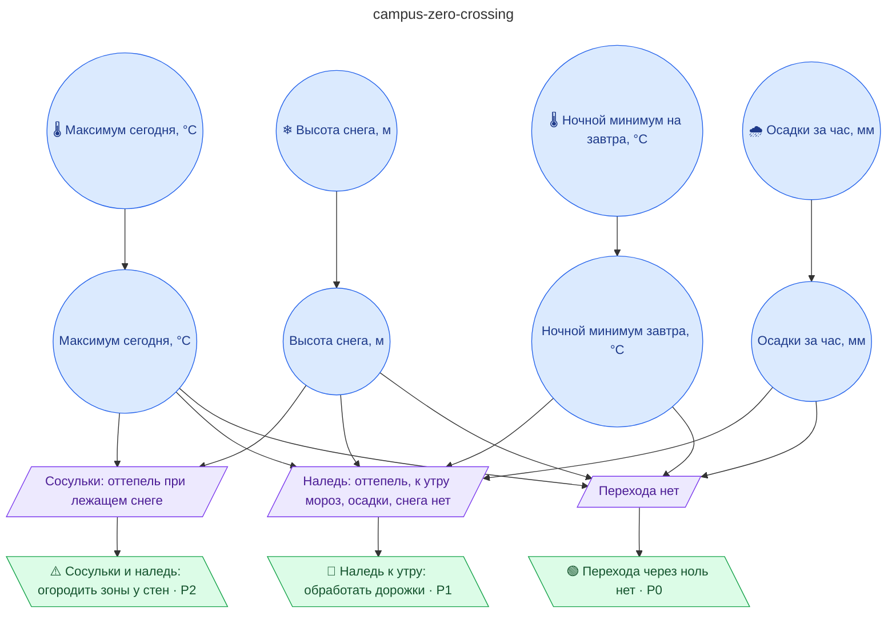

Рисунок 10 — Регламент `campus-zero-crossing`: четыре источника, три формулы-гейта, три выхода

**Структура данных графа** — рисунок 11: то, что изделие хранит и исполняет. Показаны датчик и вход одной величины, все три формулы и выход «сосульки» с доставкой в чат и вопросом исполнителю. У выхода два вопроса, в листинге — первый. Координаты узлов на листе и текст предписания опущены.

<!-- primer: flow campus-zero-crossing -->
```json
{
  "nodes": [
    {
      "id": "n_sensor_sneg",
      "type": "sensor",
      "sensorType": "weather",
      "sensorSubtype": "om-weather-current",
      "externalId": "current.snow_depth",
      "label": "❄ Высота снега, м",
      "bindsTo": "n_in_sneg"
    },
    {
      "id": "n_in_sneg",
      "type": "input",
      "label": "Высота снега, м",
      "paramRef": "snowDepth"
    },
    {
      "id": "n_f_net",
      "type": "formula",
      "label": "Перехода нет",
      "expression": "temperatureMaxToday < 1 or (snowDepth < 0.01 and not (temperatureMinTomorrow <= -1 and precipitationNow > 0))"
    },
    {
      "id": "n_f_naled",
      "type": "formula",
      "label": "Наледь: оттепель, к утру мороз, осадки, снега нет",
      "expression": "temperatureMaxToday >= 1 and temperatureMinTomorrow <= -1 and precipitationNow > 0 and snowDepth < 0.01"
    },
    {
      "id": "n_f_sosulki",
      "type": "formula",
      "label": "Сосульки: оттепель при лежащем снеге",
      "expression": "temperatureMaxToday >= 1 and snowDepth >= 0.01"
    },
    {
      "id": "n_out_sosulki",
      "type": "output",
      "label": "⚠️ Сосульки и наледь: огородить зоны у стен",
      "action": "notify_supervisor",
      "priority": 2,
      "delivery": [{"channel": "telegram", "address": "", "mention": "", "dedup_minutes": 720}],
      "feedback": [
        {
          "kod": "zony_ogorozheny",
          "vopros": "Опасные зоны у стен огорожены?",
          "korotko": "Зоны",
          "varianty": [
            {"kod": "da", "podpis": "Да", "znachenie": 1},
            {"kod": "net", "podpis": "Нет", "znachenie": 0}
          ]
        }
      ]
    }
  ],
  "edges": [
    {"source": "n_sensor_sneg", "target": "n_in_sneg"},
    {"source": "n_in_tmax", "target": "n_f_sosulki"},
    {"source": "n_in_sneg", "target": "n_f_sosulki"},
    {"source": "n_f_sosulki", "target": "n_out_sosulki"}
  ]
}
```

Рисунок 11 — Тот же регламент в структуре данных Flow DSL: выемка из `campus-zero-crossing.flow.json`

**Данные и контракт** — рисунок 12. В Turtle записаны основание вердикта и величина с единицей: это словарь регламента, онтологический уровень (п. 2.3). В SHACL — контракт: высота снега от 0 до 5 м. За этими границами показание считается сбоем источника, а не погодой.

<!-- primer: turtle campus-zero-crossing -->
```turtle
# campus-zero-crossing.data.ttl — регламент, основание вердикта, величина «высота снега»
:CampusZeroCrossingRegulation a :Regulation ;
    :sourceDocument "Правила и нормы технической эксплуатации жилищного фонда (постановление Госстроя России № 170): разделы о содержании кровель (удаление наледей и сосулек) и об уборке территорий в зимний период (обработка противогололёдными материалами)" ;
    :sourceClause "Удаление наледей и сосулек с кровель с ограждением опасных зон; обработка тротуаров, крылец и пандусов при гололёде" ;
:snowDepth a owl:DatatypeProperty ; rdfs:domain :Regulation ; rdfs:range xsd:decimal ;
    :unit "м" .

# campus-zero-crossing.shapes.ttl — контракт величины: за границами — сбой источника, а не погода
:RegulationShape a sh:NodeShape ;
    sh:targetClass :Regulation ;
    sh:property [ sh:datatype xsd:decimal ; sh:minCount 1 ;
                  sh:minInclusive 0.0 ; sh:maxInclusive 5.0 ;
                  sh:path :snowDepth ] ;
```

Рисунок 12 — Тот же регламент в Turtle и SHACL: основание и контракт величины «высота снега»

**Прогоны.** Таблица снята исполнителем изделия: `backend/.venv/bin/python scripts/primery_nir.py campus-zero-crossing`, 12.11.2026. Индикация окончательности — та же, что в ручном прогоне «Запустить» (п. 5.4). Значения в строках с полными данными — максимум сегодня и минимум на завтра (°C), высота снега (м), осадки за час (мм).

<!-- primer: progony campus-zero-crossing -->
| Случай | Известно | Не пришло (⊥) | Сработал выход | Индикация | Что это значит на деле |
|---|---|---|---|---|---|
| мороз весь день | −5; −12; 0,15; 0,2 | — | «Перехода через ноль нет» — норма | все показания есть | мер не нужно |
| оттепель, снега нет, к утру мороз, осадки | 3; −4; 0; 0,5 | — | «Наледь к утру: обработать дорожки» — внимание | все показания есть | до утра обработать дорожки, крыльца и пандусы |
| оттепель при лежащем снеге | 2; −3; 0,2; 0 | — | «Сосульки и наледь: огородить зоны у стен» — опасно | все показания есть | огородить зоны под карнизами, вызвать очистку кровель |
| известен только максимум | максимум −5 | минимум, снег, осадки | «Перехода через ноль нет» — норма | окончательный, по проверке на 27 пополнениях | ждать остальных показаний незачем |
| оттепель, высота снега не пришла | максимум 3, минимум −4, осадки 0,5 | снег | ничего | предварительный: зависит от высоты снега | «данных недостаточно», а не «перехода нет»; здесь ошибалась первая редакция |
| оттепель при снеге; прогноза на ночь и осадков нет | максимум 2, снег 0,2 | минимум, осадки | «Сосульки и наледь: огородить зоны у стен» — опасно | окончательный, по проверке на 9 пополнениях | огораживать можно сейчас, не дожидаясь прогноза |
| та же модель, пополнена | 2; −6; 0,2; 1 | — | «Сосульки и наледь: огородить зоны у стен» — опасно | все показания есть | вердикт прежний: Теорема 1 на деле |

**На что обратить внимание.**
1. **Клини на деле — шестая строка.** Двух величин из четырёх нет, а вердикт уже окончателен. Формула «сосулек» истинна по пришедшим величинам. В формуле наледи ложна часть `snowDepth < 0.01`, и F ∧ ⊥ = F. В формуле «перехода нет» ложны обе части дизъюнкции. Значит, при любом прогнозе на ночь сработают только «сосульки», и регламент выносит этот исход сразу.
2. **Молчание — не норма: пятая строка.** Без высоты снега оттепель днём неотличима от летнего дня, и регламент молчит. Индикация называет, какого показания не хватает. Первая редакция в этом случае говорила «перехода нет» (см. «Актуальность»).
3. **Где регламент по теории.** Регламент во фрагменте L₀, анализ ошибок не находит. Два предупреждения — пустые адреса доставки в поставочном файле: чат знает только развёрнутый экземпляр, и адрес переносит миграция `dostavka_novyh_kampusnyh_v1`.
4. **Чего в нём нет.** Запас в градус от нуля и сантиметр снега — допущения, названные в файле регламента, а не нормы.

---

## 5. РЕЗУЛЬТАТ 1. СОХРАНЕНИЕ ВЕРДИКТА ПРИ ПОПОЛНЕНИИ ДАННЫХ

Раздел переносит основное содержание черновика этапа 2 [17]. Полный текст с примерами — там же.

### 5.1. Определения

**Определение 1 (регламент).** Регламент R задан конечным множеством параметров P, выходами O с приоритетами pr: O → ℕ и ориентированным ациклическим графом узлов типов {вход, датчик, порог, сравнение, формула, время, развилка, выход}. Контракт данных — форма SHACL.

**Определение 2 (частичная модель).** M = (v, t), где v: P ⇀ ℝ — частичная функция показаний, t — момент. M ⊑ M′, если t = t′, dom v ⊆ dom v′ и v′ совпадает с v на dom v.

**Определение 3 (исполнение).** Каждый узел вычисляет значение в ℝ ∪ {T, F} ∪ {⊥}. F(M) — сработавшие выходы, L(M) = max pr(F(M)), L(∅) = 0.

**Определение 4 (сохранение вердикта).** Исполнитель персистентен на R, если F(M) ⊆ F(M′) для любых M ⊑ M′. Отсюда L(M) ≤ L(M′): уровень вердикта не понижается.

**Определение 5 (фрагмент L₀).** В регламенте нет конструкций:
- Н1 — тест определённости `== None` / `!= None` в формуле;
- Н4 — несколько различных величин у узла, классифицирующего одно значение, то есть у развилки с границами или у порога. Различие считается по корню величины так, как значение читает исполнитель.

Номера Н2 (членство) и Н3 (метки развилки) принадлежали прежней границе. Они сняты правкой исполнителя 09.11.2026 (п. 6.3).

### 5.2. Теорема

**Теорема 1.** Для всякого регламента R ∈ L₀ исполнитель персистентен.

*Доказательство.* Индукция по топологическому порядку графа. Покажем, что значение каждого узла монотонно по порядку знания, где ⊥ ⊑ a для определённого a.

Узлы значений:
- **Входы и датчики:** определённое значение при расширении не меняется.
- **Арифметика, порядок и встроенные функции** строги по ⊥.
- **Ошибка значения** определяется известными аргументами, поэтому при расширении не исчезает и не возникает на месте определённого значения; в порядке знания она ведёт себя как ⊥.
- **Связки, условное выражение и членство** — монотонные операции K3 [6], [15].
- **Порог с одним входом и сравнение** при ⊥ не срабатывают, при определённом значении ответ фиксирован.
- **Время** при фиксированном t — константа.

Развилки:
- **С границами и одной величиной:** ⊥ → ∅, значение v → одна ветвь `min ≤ v < max`; v при расширении не меняется.
- **Без границ, с метками:** объединение ветвей по меткам сработавших предшественников; предшественники не гаснут, объединение не убывает.
- **Без границ и меток** — константа.

Н1 и Н4 исключены условием. Срабатывание — монотонный предикат от монотонного значения. F(M) собирается обходом от сработавших узлов, у развилки — по ветвям, решённым после обхода. Ни один сработавший узел не гаснет, ни одна ветвь не отменяется. Значит, F(M) ⊆ F(M′). ∎

Теорема одной картинкой — на рисунке 13. Схема — из разбора этапа 2 [11]; подписи уровней приведены к п. 2.3: контракт SHACL — аксиомы онтологии, то есть уровень 1, а не часть регламента.

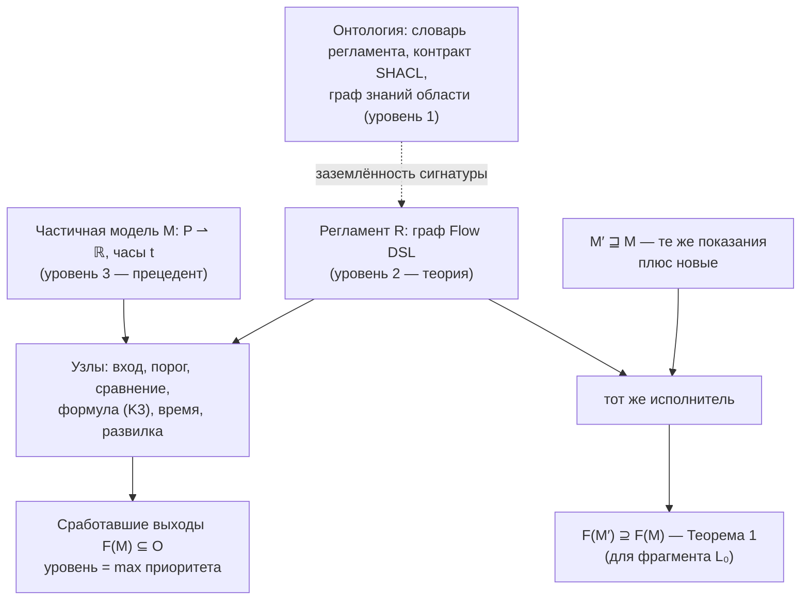

Рисунок 13 — Теорема 1: модель и её пополнение проходят через один исполнитель, и сработавшие выходы только прибавляются

**Следствие 1.1.** Для R ∈ L₀ положительный вердикт при неполных данных верен при любом их пополнении. Пример — `campus-zero-crossing`: «перехода через ноль нет», если днём не теплеет до +1 °C, каков бы ни был ночной минимум, потому что F ∧ ⊥ = F.

**Что это значит на регламентах трёх платформ.** Теорема разрешает действовать по вердикту, не дожидаясь всех показаний, и запрещает принимать молчание за норму. Таблица снята исполнителем изделия: `backend/.venv/bin/python scripts/primery_nir.py`, 12.11.2026. Все три регламента — во фрагменте L₀.

<!-- primer: progony platformy -->
| Платформа и регламент | Случай | Вердикт | Что гарантирует теория | Что это значит для человека |
|---|---|---|---|---|
| Умный кампус POLIGON, `campus-zero-crossing` | оттепель при снеге; прогноза на ночь и осадков нет | «Сосульки и наледь: огородить зоны у стен» | выход не погаснет при любом прогнозе (Теорема 1); индикация — окончательный | огораживать зоны под карнизами сейчас |
| Умный кампус POLIGON, `campus-zero-crossing` | известен только максимум | «Перехода через ноль нет» | T ∨ ⊥ = T, а обе тревоги гаснут: F ∧ ⊥ = F; индикация — окончательный | мер не нужно: остальные показания вердикт не изменят |
| Стройка · Plan-R, `construction-planr-critical-path-overdue` | Plan-R не ответил | ничего | молчание — не «критический путь не нарушен»; индикация — предварительный, перебор точен | ГИП не получит ложного «всё в порядке» по объекту, о котором данных нет |
| Ситуационный центр, `nsk-nmu-smog-trap` | PM2.5 = 40, ветер не пришёл | ничего | исход зависит от ветра: до 1,25 м/с — «НМУ объявлено», сильнее 3,125 м/с — норма; индикация — предварительный, зависит от ветра | городской штаб видит, какого показания не хватает, а не получает «норму» |

### 5.3. Граница

**Предложение 2.** Каждая из конструкций Н1 и Н4 нарушает персистентность. Доказательство — три регламента из двух-трёх узлов, исполняемые проверки в `backend/tests/test_persistentnost.py`:
- **Н1.** `x if x != None else 7` → развилка «меньше 5»: без x — «не меньше», с x = 2 — «меньше».
- **Н4 у развилки.** Два входа в развилку с границами: без x значение берётся у y.
- **Н4 у порога.** Два входа в порог 5 ± 1: без x порог видит y = 9 и даёт тревогу, с x = 5 — норму.

Вне Н1 и Н4 все операции монотонны, поэтому по этому перечню операций L₀ — наибольший фрагмент, на котором теорема верна. ∎

Как не попасть в Н4 — рисунок 14: два входа сводятся формулой в одну величину, и развилка классифицирует её одну. Это урок 4 поставки, `tutorial-04-formula-threshold`, регламент во фрагменте L₀ (`persistentnost.v_fragmente`); схема — из приложения А описания языка [28], коды действий приведены к поставке.

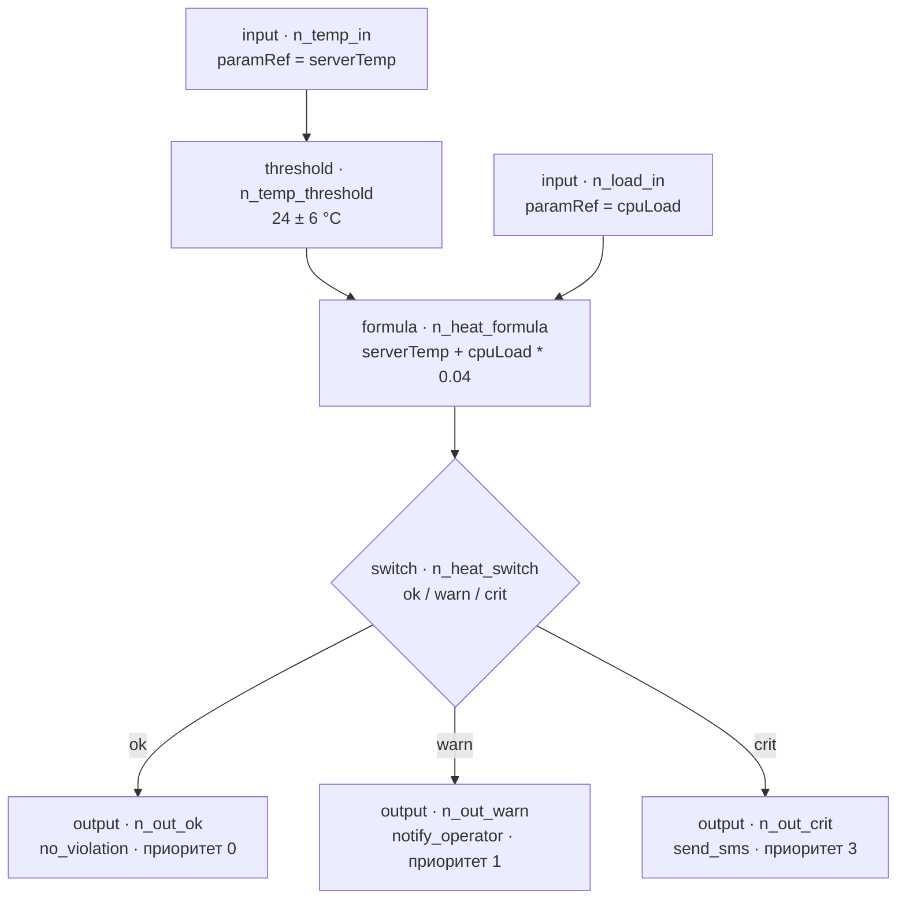

Рисунок 14 — Урок 4: два входа сведены формулой в одну величину

**Лемма 3 (детерминированность).** На тотальной модели регламент из L₀, прошедший проверки покрытия развилок, на каждой развилке с границами зажигает ровно одну ветвь, и F(M) не зависит от порядка обхода.

**Лемма 4 (композиция).** Пусть регламенты персистентны, у каждого есть гейт применимости, а агрегация монотонна по включению. Тогда персистентно и целое. На этом устроен корпус паспорта фасадов мэрии [33]: 157 атомарных правил, все во фрагменте по построению. Содержание свойства там — в агрегации по этапам дела.

### 5.4. Полнота положительного вердикта — пробел

Методология [33] требует: «непроверенная обязательная часть блокирует окончательный положительный результат». Это свойство агрегата по делу, а не отдельного регламента. В изделии объекта «дело» нет.

Замер 09.11.2026 (`scripts/matematika_korpusa.py`): из 8 регламентов с выходом «норма» и двумя и более входами у 6 «норма» срабатывает при неизвестном входе. Внутри L₀ это законный вывод по Следствию 1.1. Решение руководителя: агрегат по делу в этап не входит.

**Задел: достаточность данных для вердикта** (исследование 09.11.2026, разбор `docs/DOSTATOCHNOST-DANNYH-RAZBOR.md`). Теорема 1 говорит, что сработавшее не погаснет, но не говорит, когда вердикт **окончателен** — новые показания уже ничего не добавят.

- **Критерий окончательности — с поправкой 12.11.2026.** Ни одна неизвестная величина не существенна, то есть от её значения вердикт уже не зависит, тогда и только тогда, когда вердикт одинаков на всех тотальных пополнениях. Доказательство — цепочкой одномерных изменений между двумя пополнениями. Окончательность требует второго условия: этот общий вердикт совпадает с вынесенным. До редакции 1.4 и в разборе 09.11.2026 критерий был назван «необходимым и достаточным» без второго условия; контрпример из поставки и замер — ниже.
- **Необходимое и существенное различаются в обе стороны.** Существенная величина не обязательно необходима: в `a > 5 or b > 5` обе существенны, но хватит любой. Необходимая — не обязательно существенна: регламент НМУ из примера ниже ждёт ветра, хотя исход от ветра не зависит. Обратное утверждение разбора — «всякая необходимая величина существенна» — опиралось на критерий без второго условия.
- **Признак за один проход** — Теорема 2 ниже: если трёхзначный статус каждого выхода определён, вердикт окончателен.
- **Полнота положительного вердикта сводится к окончательности.** «Норма» окончательна, когда она сработала и вердикт окончателен. Для одного регламента агрегат по делу для этого не нужен.

**Теорема 2 (достаточное условие окончательности) — задел.** Доказана в разборе `docs/DOSTATOCHNOST-DANNYH-RAZBOR.md`, § 4.

*Статус выхода.* St_M(o) ∈ {T, F, ⊥} — значение выхода o на модели M, вычисленное по графу в K3 теми же правилами узлов, что у исполнителя, но с третьим значением на выходе: «сработает», «не сработает», «неизвестно». Статус **адекватен**, если на всякой модели St_M(o) = T ⇔ o ∈ F(M), а на тотальной модели значения ⊥ не бывает.

*Утверждение.* Пусть R ∈ L₀ и статус адекватен. Если на M статус каждого выхода определён — T или F, — вердикт на M окончателен: F(M*) = F(M) для всякого тотального пополнения M* ⊒ M.

*Доказательство.* Статус собирается теми же монотонными операциями, что в Теореме 1, но теперь переносится и значение F: определённый статус при пополнении не меняется. По адекватности на тотальном M*: o ∈ F(M*) ⇔ St_{M*}(o) = T ⇔ St_M(o) = T ⇔ o ∈ F(M). ∎

*Чего теорема не говорит.*
- **Условие только достаточное.** Статус бывает ⊥ и у решённого выхода: в `x > 5 or x <= 5` величина входит дважды, а у регламента НМУ (поправка ниже) условие выхода — формула над двумя величинами. Когда признак и необходим — открытый вопрос, Гипотеза 3 разбора. Её доказательство набросано; проверка продолжается, в результаты она не входит.
- **Адекватность — условие, а не факт.** Статуса выхода в изделии нет (фаза Д1), и его совпадение с исполнителем не проверено. Пока статус не построен и не сверен, Теорема 2 — утверждение о модели исполнения, а не об изделии.

*Как Теорема 2 может проверить исполнитель.* Так же, как Теорема 1: адекватность — проверяемое условие. Если вычислить статус отдельно, по графу, и сверить его с исполнителем на частичных моделях корпуса, каждое расхождение укажет место, где исполнитель уходит от K3-семантики графа. Три кандидата известны (п. 4.4, 6.5): порог, читающий вход за формулой; узлы за развилкой, которые исполнитель не вычисляет; рёбра в обход развилки. Неизвестные покажет только сверка; она — первая проверка фазы Д1.

**Замер — перебором пополнений по точкам границ, 2152 частичные модели.**
- Окончателен лишь каждый третий вердикт на неполных данных: 409 из 1286 при полном переборе.
- **Молчание регламента на неполных данных в 81 % случаев — «данных недостаточно», а не «нарушений нет»;** у регламентов без формул, где перебор точен, — в 92 %.
- «Норма» на неполных данных в L₀ окончательна во всех 14 случаях полного перебора.
- Потерь сработавшего выхода на 1153 моделях фрагмента нет — независимое подтверждение Теоремы 1.

**Поправка 12.11.2026: исход определён, а исполнитель молчит.** Пропущенное в критерии условие — не формальность, его нарушают регламенты поставки. Пример — регламент ситуационного центра `nsk-nmu-smog-trap` о неблагоприятных метеоусловиях. Ветер и PM2.5 приходят из двух разных точек Open-Meteo (подтипы `om-weather-current` и `om-air-quality`) и могут прийти порознь.

Пусть пришло PM2.5 = 8 мкг/м³, а ветра нет. Индекс `pm25Level - windMs * 8` при любом ветре не больше 8: по контракту SHACL ветер не отрицателен. Значит, индекс в зоне «Норма» (меньше 15), и исход определён. Исполнитель же молчит: разность с неизвестным в K3 неизвестна.
- Существенных величин нет: единственная неизвестная на исход не влияет.
- Вердикт не окончателен: вынесено «ничего», а всякое пополнение даёт «Норму».
- Индикация изделия честна: «предварительный», величины не названы (`backend/.venv/bin/python scripts/primery_nir.py nsk-nmu-smog-trap`, случай «чистый воздух, ветер не пришёл»). А утверждение разбора «существенные величины — ровно те показания, которые могут изменить вердикт» здесь неверно: вердикт изменит приход показания, а не его значение.

Это свойство K3, а не дефект исполнителя. K3 вычисляет по операциям и пополнений не перебирает. Вынесенное им верно при любом пополнении (Теорема 1), но определённый исход он иногда выносит позже, чем мог бы. Опасной стороны у разрыва нет: исполнитель молчит, а не говорит лишнего.

Замер 12.11.2026 — той же методикой, что 09.11.2026, на поставке из 68 регламентов: с 11.11.2026 добавлены два регламента области «Городская экология». Частичных моделей — 2186, команда `backend/.venv/bin/python scripts/dostatochnost_dannyh.py`.
- Из 1357 неокончательных вердиктов у 132 все перебранные пополнения дают один вердикт, а вынесен другой.
- 104 из них — молчания.
- Такие модели есть у 23 регламентов; 98 из 132 — у регламентов фрагмента L₀.

В изделии статуса выхода пока нет: «не сработал» означает и «не сработает», и «неизвестно». Это следующая фаза работ, а не результат этапа.

**Индикация окончательности в изделии — первый шаг, 09.11.2026, вечер.** Ручной прогон «Запустить» с пустыми входами сообщает, окончателен ли вердикт. Если нет — называет входы, от которых он ещё зависит: «Вердикт предварительный: может измениться, когда придут X, Y».
- **Как считается.** Пополнения перебирает тот же исполнитель по точкам границ, так что место правды одно (`backend/app/services/okonchatelnost.py`).
- **Где перебор точен.** У регламента без формул при полном переборе (до 600 пополнений) — доказательство для данного момента. У регламента с формулами — проверка по точкам, и интерфейс пишет «окончательный по проверке».
- **Проверено.** На примере раздела 5: если днём не теплеет до +1 °C, `campus-zero-crossing` выносит окончательное «перехода нет» при неизвестном ночном минимуме. Проверок 7, каждая увидена красной на поломке.
- **Цена.** Весь корпус без показаний — 3,0 с на 66 регламентов.

Трёхзначного статуса выхода (Теорема 2) индикация не заменяет. Решением руководителя работы исследование достаточности остаётся заделом следующего этапа, а не результатом 2026 года.

**Два слоя: мир и знание** (идея руководителя работы, разбор, § 7а). Обработку недостаточности данных выносят в отдельный регламент на выходе регламента-решения, а не в ветвь `x == None` внутри него: такая ветвь — конструкция Н1, и регламент-решение потерял бы гарантию.
- **Слой мира** — регламенты фрагмента L₀; их вердикт сохраняется.
- **Слой знания** — регламент недостаточности. Он читает статус вердикта и существенные величины и вызывает оператора с адресом поломки: «не хватает показания P, датчик D молчит с 14:20».

Доказано, что окончательность монотонна по знанию, а множество существенных величин при пополнении только сокращается. Значит, регламент недостаточности по построению временный: его вердикт может только погаснуть. Система из двух слоёв не молчит неопределённо — для всякой модели либо вердикт окончателен, либо названо, чего не хватает. С поправкой 12.11.2026 «чего не хватает» — не всегда существенные величины: там, где исход определён, а исполнитель молчит, существенных нет, и называть приходится недостающие показания. Так и делает индикация изделия.

Связка «выход одного регламента — вход другого» в изделии есть в схеме и двойнике процесса, но при исполнении цепочка не прогоняется. Это тоже следующая фаза.

Так устроен двойник процесса ЕДДС Кольцово — рисунок 15: четыре регламента связаны в схеме двойника, связи задаёт аналитик, но цепочку исполнитель не прогоняет. Схема — из справочника строителя умного города.

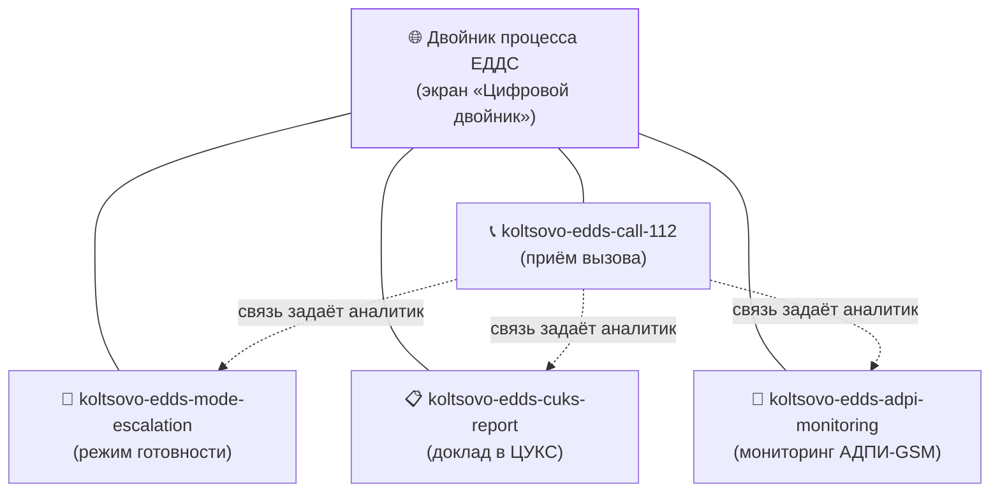

Рисунок 15 — Двойник процесса из четырёх регламентов ЕДДС

### 5.5. Новизна результата

- **Предложено.** Корректность исполнителя языка регламентов относительно K3: сохранение истинности при расширении частичной модели — для языка с гейтами, развилками по границам и по меткам и частичными операциями, с точной границей из двух конструкций, снятой с исходного текста.
- **В отличие от известного.** Монотонность K3 известна [6], [15], [16]. Анализ таблиц DMN [29] не работает с отсутствующими данными и не даёт гарантии о расширении модели.
- **Проверено:**
  - доказательство;
  - сторож — 74 проверки, 11,4 с: на каждом регламенте фрагмента случайный поиск не находит отменённого выхода, а для каждой конструкции границы есть регламент, где отмена есть;
  - перепись — 59 из 66 после правки исполнителя, 60 из 66 после починки П1;
  - способность сторожа краснеть — на стенде поломок (п. 10).
- **Ограничения:**
  - фиксированный момент времени: изменение показаний — не пополнение;
  - функции рядов не покрыты (Н5 — будущая граница);
  - сборщики, подставляющие 0 вместо молчания, выводят регламент из-под гарантии;
  - граница достаточна, но не точна: у 5 из 7 регламентов вне фрагмента нарушение поиском не найдено.

**Не тривиальна ли теорема?** Логическое ядро Теоремы 1 классическое: композиция монотонных операций K3 монотонна [6], [15], [16]. Если читать теорему как «где нет немонотонного, там монотонно», она пуста. Но утверждается другое: исполнитель изделия корректен относительно K3-семантики графа на синтаксическом фрагменте с точной границей. Доказывается не логика, а то, что программа её реализует. Три довода, что это не тавтология.
1. **Утверждение было ложным для программы.** До 09.11.2026 исполнитель его нарушал: проверка свойства нашла четыре отступления от K3, одно из них, С9, — внутри объявленного фрагмента (п. 6.3). Тавтологию нельзя нарушить, а эту нарушали, пока исполнитель не исправили. Правка сменила вердикт у 8 регламентов, и каждая смена вскрыла дефект регламента.
2. **Граница задана до проверки и не по выводу.** Н1 и Н4 — синтаксические конструкции, снятые с исходного текста исполнителя, и каждая доказуемо ломает свойство (Предложение 2). Перечень мог оказаться неполным — так и было с С9 до правки.
3. **Фрагмент не пустой и проверяется до исполнения.** В нём 60 регламентов поставки из 66 и 157 карточек паспорта фасадов из 157. Принадлежность фрагменту называет проверка `VERDICT_MAY_CHANGE` за один проход по графу (п. 6).

Содержательные утверждения о достаточности данных — дальше, в заделе п. 5.4: окончательность вердикта (Теорема 2) и разрыв «исход определён — исполнитель молчит».

---

## 6. РЕЗУЛЬТАТ 2. ВЕРИФИКАТОР РЕГЛАМЕНТОВ

Раздел соединяет проверку регламента как графа из этапа 1 (п. 5.18 черновика [10]) и проверки, построенные из теоремы на этапе 2 [17], [7].

### 6.1. Что проверяется до исполнения

Анализ регламента (`backend/app/services/regulation_analysis.py`) собирает находки базового валидатора и мягкого контроля и добавляет 12 собственных кодов. Описание — РАГРАФ-ФРЕЙМ-35, § 5.4 [28]. Происхождение кодов разное, и оно разведено честно.

| Группа | Коды | Откуда |
|---|---|---|
| непротиворечивость | `DEAD_SWITCH_CASE`, `CONTRADICTORY_OUTPUTS` и перекрытия зон и гейтов | этап 1: перенос анализа таблиц решений на граф [29] |
| пробелы | `SWITCH_UNCOVERED_RANGE`, `UNKNOWN_INPUT_NO_FALLBACK`, `DEAD_OUTPUT`, `UNREACHABLE_NODE` | этап 1 |
| сохранение вердикта | `VERDICT_MAY_CHANGE` | прямо из границы теоремы — Н1 и Н4 |
| маршрут | `SWITCH_ROUTE_UNDEFINED`, `SWITCH_LABEL_IGNORED` | из модели исполнения: маршрут, который граф не определяет, — ⊥ |
| молчание формул и порогов | `FORMULA_UNKNOWN_NAME`, `THRESHOLD_SOURCE_UNDEFINED`, `TIME_SERIES_INERT` | тем же методом — сверкой того, что исполнитель делает молча; признак «несколько величин» у порога — Н4 |
| между регламентами | противоречия на общем параметре (`GET /api/regulations/conflicts`) | этап 1 |

Правило маршрута и область видимости формул анализ берёт у исполнителя, а не повторяет. Так анализ и исполнитель не расходятся молча. До 09.11.2026 они расходились: классификатор считал метку, совпавшую с кодом зоны, совпавшей, а исполнитель зоны не читал.

### 6.2. Замер по корпусу

**08.11.2026, этап 1** — 65 регламентов поставки за 0,52 с; команда — черновик этапа 1, п. 5.18.3 [10].
- У 61 регламента нет ошибок.
- Найдено: 8 регламентов, которые при нехватке данных молчат; 6 недостижимых узлов; 3 чипа без связей; 111 выходов с действием вне реестра; одно противоречие вердиктов.
- Между регламентами сравнимы 11 из 65.
- Проверок-сторожей — 52.

**09.11.2026, этап 2** — 66 регламентов, цикл `analyze_regulation`.

| Находка | После правки исполнителя | После починки П1 (вечер) |
|---|---|---|
| во фрагменте L₀ | 59 | 60 |
| `VERDICT_MAY_CHANGE` | 18 у 7 регламентов — ровно у регламентов вне L₀ | 15 у 6 — ровно у регламентов вне L₀ |
| `SWITCH_ROUTE_UNDEFINED` | 6 | 6 |
| `FORMULA_UNKNOWN_NAME` | 27 формул в 10 регламентах, 52 вхождения имён | 23 формулы в 8 регламентах |
| `THRESHOLD_SOURCE_UNDEFINED` | 16 порогов в 7 регламентах | 14 порогов в 6 регламентах |
| `TIME_SERIES_INERT` | 1 | 1 |
| регламентов с ошибками | 16 из 66 | 14 из 66 |

С 09.11.2026 (поздний вечер) этот счёт виден в изделии, а не только в отчёте: экран «Свод противоречий» показывает сводку того же анализа по выбранному объёму — сколько регламентов сохраняют вердикт при пополнении данных, сколько с ошибками, находки по кодам со ссылками в регламенты (`svodka_proverki`, `GET /api/regulations/consistency-svodka`). Признак «сохраняет вердикт» — одно правило для вкладки и сводки; на поставке он даёт те же 60 из 66, что перепись фрагмента. Решение владельца: числа верификатора — в изделии, на публичной странице «Методология» — нет.

### 6.3. Теорема как инструмент: исполнитель приведён к теории

Свойство проверялось двумя средствами: сторожем по корпусу и минимальным регламентом на каждую операцию. Проверка нашла четыре отступления исполнителя от логики Клини, все исправлены 09.11.2026 [7].

| № | Отступление | Как найдено | Исправление |
|---|---|---|---|
| С1 | членство `in` при ⊥ — определённая ложь | таблица истинности вычислителя | ⊥ по Клини |
| С2 | метку развилки принимает только первое ребро обхода, вердикт зависит от порядка узлов в файле | минимальный регламент: расширение отменяло ветвь | метки — со всех пройденных рёбер, после обхода |
| С3 | несовпавшая метка зажигает все ветви; синонимы зоны не читаются | перепись корпуса | метка выбирает ветвь и через зону, несовпавшая — ни одной; границы сильнее меток |
| С9 | ошибка значения роняет связку: `b / c > 1 or a > 5` гаснет при c = 0 — **контрпример внутри L₀** | минимальный регламент при сверке черновика этапа 2 с изделием | для связки ошибка значения — ⊥ |

С9 показывает, почему нужны оба средства. В поставке нет ни одной частичной операции внутри связки: 86 выражений, у 15 есть частичная операция, в связках — 0. Поэтому сторож на корпусе её не видел, а минимальный регламент нашёл сразу.

**Что правка вскрыла в корпусе.** Вердикты сравнены до и после на 24 156 частичных моделях: 66 регламентов × 3 момента × 122 модели. Вердикт сменился у 8 регламентов, у 58 остался прежним. Каждая смена называет дефект регламента, который прежний исполнитель прятал:
- **`dormitory-flood`:** одна протечка зажигала коменданта, задвижку стояка и эвакуацию; теперь — только коменданта.
- **`thermal-incident-server`:** любое одно отклонение зажигало все три ветви, включая вызов 112. Теперь не зажигается ничего, и анализ выдаёт ошибку: метки входов не связаны с уровнями тревоги.
- **`nsu-parking-anpr`:** «шлагбаум открыт», «оператор» и «доступ запрещён» зажигались разом; теперь — ничего, с той же ошибкой.
- **Четыре регламента ЕДДС Кольцово:** зажигались ветви по всем службам разом; теперь — только по путям в обход развилки, с той же ошибкой.
- **`nsk-traffic-signal`, 6 прогонов из 366:** при пороге перекоса 0 и равных плотностях истинны обе формулы-гейта, и регламент велит продлить зелёный обоим направлениям. Порог 0 допустим контрактом — это дефект регламента, а не данных.

**Итог.** L₀ вырос с 51 до 59 регламентов из 66 без правки ни одного регламента. Граница сузилась с четырёх конструкций до двух.

### 6.4. Сличение с эталоном, снятым другим средством

Зелёный набор проверок ничего не доказывает, если анализ сверяется сам с собой. Поэтому:
- **`FORMULA_UNKNOWN_NAME` сверен с вычислителем формул** по всем выражениям поставки: формула помечена тогда и только тогда, когда вычислитель падает на ней ошибкой имени хотя бы при одном из пяти наборов значений.
- **`VERDICT_MAY_CHANGE` сверен со сторожем:** помечены ровно регламенты вне фрагмента.

**Каждая новая проверка увидена красной.** На коде до правок новые проверки этапа 2 дают 19 красных для Ч1 и 7 для Ч2. Пятнадцать поломок по отдельности краснят каждая свою проверку; откат сбора меток роняет и сторож теоремы на настоящем регламенте `dormitory-flood`.

### 6.5. Опись дефектов и план починки

Опись верификатора по поставке:
- 6 развилок без маршрута;
- 27 формул с придуманными величинами: `pressureFell`, `tempOutOfRange`, `currentHour` и другие — для них не заведены ни вход, ни параметр;
- 16 порогов с неопределённым источником;
- перекрытие гейтов светофора.

Так выглядит поток, собранный без проверки свойства: граф правдоподобен, а часть его узлов мертва.

**Починка: состояние на 09.11.2026, вечер — начата; фаза П1 выполнена по двум регламентам из восемнадцати в описи** [34].

**DoD — критерий готовности починки, одинаковый для каждого регламента.** Цель работ — отчёт, в котором каждый регламент описи доведён до DoD:
1. анализ без ошибок; оставшиеся предупреждения названы и оставлены осознанно;
2. регламент во фрагменте L₀;
3. сторож Теоремы 1 зелёный на этом регламенте;
4. вердикты до и после сравнены на тех же 366 частичных моделях, и каждое расхождение названо поимённо;
5. правка записана с причиной в файлах регламента, корпус пересчитан.

Пункты 1–4 проверяет скрипт починки: `backend/.venv/bin/python scripts/pochinka_postavki.py kriteriy <регламент> --do <git-ссылка редакции «до»>`. Скрипт — судья, а не автор: правку делает человек, скрипт её принимает или нет. Верификатор служит и детектором, и судьёй.

**Что сделано в П1.**
- **`dormitory-flood` — DoD выполнен, вердикты не изменились (0 из 366).** Удалён узел ночного режима: у его формулы не было входного ребра, и исполнитель её не вычислял никогда. Механическая правка из плана — функция времени вместо придуманной величины `currentHour` — оказалась бы ошибкой: ожив, узел вызывал бы коменданта каждую ночь без протечки. Отсюда вывод для метода: план, составленный по описи, сам проходит через критерий, а не принимается на веру.
- **`traffic-speed-fine` — DoD выполнен; разошлись 273 вердикта из 366, все — дефекты прежней редакции.** Прежняя редакция выносила постановление о штрафе по высшей ступени (5000 ₽ и задача инспектору) при любой скорости от 40 км/ч, даже 50 км/ч в зоне 60: порог сравнивал с уставкой не превышение, а сырую скорость. В новой редакции полоса превышения считается одной формулой, развилка выбирает ступень, уставки — константы условия, входы — только величины события. Итог: 50 и 70 км/ч в зоне 60 — норма, 85 — первая ступень, 100 — высшая; без лимита зоны вердикта нет.
- **Пять `support-*` — П1 не применён.** Сопоставление входов и параметров предложено (19 пар). Без перестройки порогов оно опасно: оживают формулы-суммы, и выходы загораются разом — «норма» вместе с автозакрытием и аудитом в 26 % прогонов. Нужна перестройка по образцу штрафа — фаза П2.

Регламент `dormitory-flood` до починки — на рисунке 16: в узел «Ночной режим» не входит ни одно ребро, и его формула не вычислялась никогда. Схема — карточка витрины регламентов, которую изделие нарисовало 26.09.2026, до правки 09.11.2026; после правки узла «Ночной режим» и его ребра к выходу «Вызвать коменданта» на схеме нет.

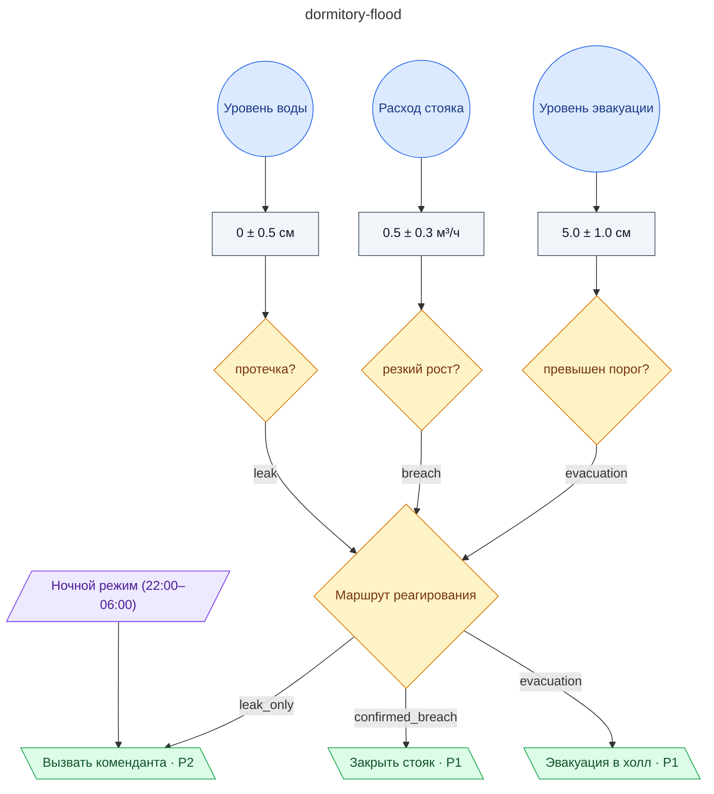

Рисунок 16 — Регламент `dormitory-flood` до починки П1

**Что поменялось у штрафа — на самом языке.** Узлы `traffic-speed-fine` до починки (редакция `6868eae`) и после неё:

| Что | До починки | После починки |
|---|---|---|
| вход скорости `n_in_speed` | без `paramRef`: имени `currentSpeedKmh` у формул нет, и формула превышения падает с ошибкой «переменная не определена» | `paramRef = currentSpeedKmh` |
| что выбирает ступень | пороги `n_thr_warn` (20 ± 0) и `n_thr_critical` (40 ± 0). Порог не читает значения формулы-предшественника и сравнивает вход за ней (п. 4.4), то есть саму скорость | формула `n_formula_band`: `3 if (currentSpeedKmh - speedLimitKmh) >= 40 else (2 if (currentSpeedKmh - speedLimitKmh) >= 20 else 1)` |
| развилка `n_switch_band` | зоны превышения: `critical` от 40, `warn` от 20 до 40, `ok` до 20 — а приходит скорость | зоны полосы: `critical` от 2,5, `warn` от 1,5 до 2,5, `ok` до 1,5 |
| уставки 20 и 40 км/ч | входы `warnExcessKmh` и `criticalExcessKmh`: из события они не приходят | константы условия в формуле — канон «порог — в развилке, вход — от события» (п. 4.1) |
| фрагмент L₀ | нет: у двух порогов и развилки по нескольку источников значения (Н4) | да |

Вердикты — тем же исполнителем на одних и тех же скоростях в зоне 60 км/ч. Скорость подаётся через узел датчика, как её подаёт сборщик (`backend/.venv/bin/python scripts/primery_nir.py shtraf`, 12.11.2026):

<!-- primer: shtraf -->
| Скорость, км/ч | Превышение, км/ч | До починки | После починки |
|---|---|---|---|
| 50 | −10 | постановление высшей ступени и задача инспектору | норма |
| 70 | 10 | постановление высшей ступени и задача инспектору | норма |
| 85 | 25 | постановление высшей ступени и задача инспектору | постановление первой ступени |
| 100 | 40 | постановление высшей ступени и задача инспектору | постановление высшей ступени и задача инспектору |

В эксплуатации регламент не применялся. Область «Городской транспорт» планировщик не обходит (`scheduler.APPLY_DOMAINS`), а связи с ГИБДД в изделии нет: код действия `issue_fine_critical` только попадает в вердикт. Ошибку нашёл верификатор, а не инцидент.

**Что починка дала верификатору.** Анализ не видел узла, до которого не доходит ни один источник данных; теперь это ошибка `UNREACHABLE_NODE`, проверка увидена красной. Найдены ещё три расхождения анализа с исполнителем, они внесены в план работ:
- рёбра в обход развилки — 7 выходов у 6 регламентов;
- узлы за развилкой, которые исполнитель не вычисляет;
- формулы-гейты, непрозрачные для поиска противоречий.

**Путь к «всё по DoD» — состояние по регламентам описи.**

| Регламент | Что не так | DoD | Фаза и кто решает |
|---|---|---|---|
| `dormitory-flood` | узел ночного режима без входа не вычислялся | ✅ 09.11.2026 | П1 |
| `traffic-speed-fine` | ступень штрафа по сырой скорости; формулы на величине без входа | ✅ 09.11.2026 | П1 |
| пять `support-*` | формулы на величинах без входа; пороги за формулами; уставки входами; рёбра в обход развилки | ⬜ | П2: перестройка по образцу штрафа; сопоставление подтверждает методолог |
| `nsk-traffic-signal` | при пороге 0 и равных плотностях истинны оба гейта продления | ⬜ | П2: методолог выбирает вариант |
| `heat-inlet-breach`, `roof-snow-fencing` | формулы на придуманных величинах: бригада, клапан, ограждение и СМС по этим путям не срабатывают | ⬜ | П2: методолог задаёт уставки |
| `thermal-incident-server` | метки событий не связаны с уровнями тревоги — маршрут не определён | ⬜ | П2: методолог решает, что критично |
| четыре регламента ЕДДС Кольцово | маршрут не определён | ⬜ | П2: таблица «событие → служба» |
| `nsu-parking-anpr` | маршрут не определён; решение о допуске принимает код, а не граф | ⬜ | П3: руководитель работы |
| `campus-heat-feedback-balance` | неоднозначное противоречие исходов | ⬜ | П3: методолог |
| `tutorial-05-rate-of-change` | функция рядов без истории | ⬜ | П3: руководитель работы |

DoD выполнен у 2 регламентов из 18. Шесть регламентов после правки исполнителя не выносят вердикта по развилке вовсе: маршрут не определён. Это честнее прежнего «все ветви», и до DoD их доводят фазы П2–П3.

### 6.6. Новизна результата

- **Предложено.** Верификатор регламентов как следствие теоремы. Он называет до исполнения:
  - конструкции, при которых вердикт может смениться;
  - развилки без маршрута;
  - формулы, которые не вычисляются никогда;
  - пороги, сравнивающие не ту величину.

  Сюда же входит перенос анализа таблиц решений на граф с контрактом SHACL, трёхзначностью и проверкой между регламентами.
- **В отличие от известного.** Анализ DMN [29] проверяет полноту и перекрытие правил одной таблицы. Он не связан со свойством исполнения на неполных данных и не сверяется с исполнителем.
- **Проверено** на корпусе поставки 08.11 и 09.11.2026, сличением с вычислителем и сторожем, поломками на стенде.
- **Ограничения.**
  - Метод не различает спор и два независимых вопроса.
  - Между регламентами сравнима шестая часть корпуса.
  - Перекрытие формул-гейтов анализу не видно — его нашло только сравнение вердиктов.
  - Сторож на корпусе не видит конструкций, которых в корпусе нет (п. 11).

---

## 7. РЕЗУЛЬТАТ 3. ЗАМКНУТЫЙ КОНТУР И ПИЛОТ МОДУЛЯ

### 7.1. Контур

Изделие замыкает контур «датчик — регламент — задача — человек»:
- **приём** — опрос девяти источников по расписанию и приём событий детектора номеров (`POST /api/ingest/anpr`);
- **исполнение графа**;
- **доставка вердикта** в чат Telegram с кнопками ответа;
- **ответ человека** — критерий `feedback_received`;
- **задачи** — в трекер LEYKA;
- **Plan-R** — чтение из боевой системы.

Устройство — черновик этапа 1, пп. 4, 5.5–5.6, 5.12 [10].

Шесть слоёв изделия — на рисунке 17. Схема — из описания программы РАГРАФ-ФРЕЙМ-13, вводная часть раздела 3; перечень модулей по слоям сторожит проверка `test_poslojnaya_model_nazyvaet_kazhdyy_modul`.

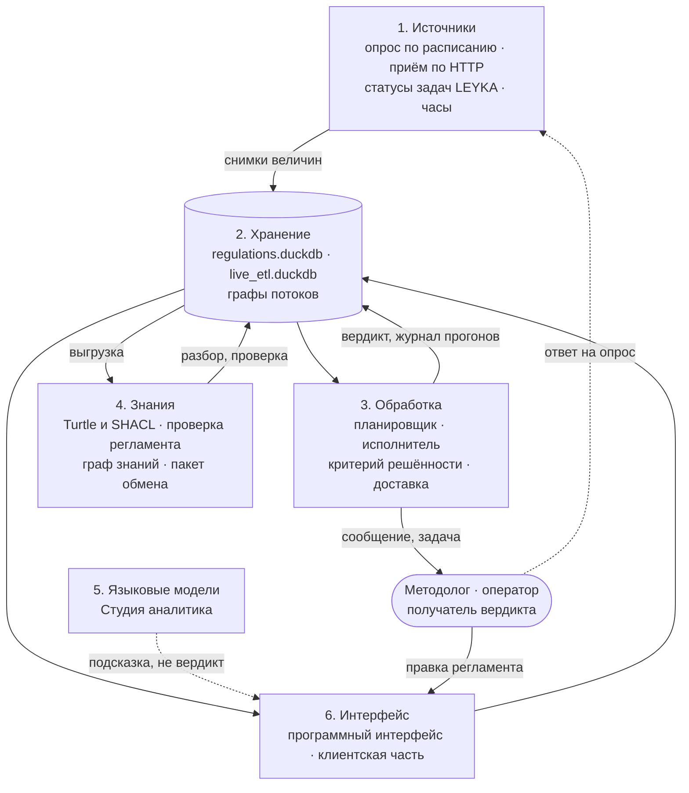

Рисунок 17 — Шесть слоёв изделия: где хранится состояние и где выносится вердикт

Как ответ человека становится величиной — рисунок 18: нажатие «Да / Нет» записывается в `feedback_otvet` и возвращается в снимки величиной `chat-feedback`; по ней работает критерий `feedback_received`. Схема — из методического пособия системного аналитика.

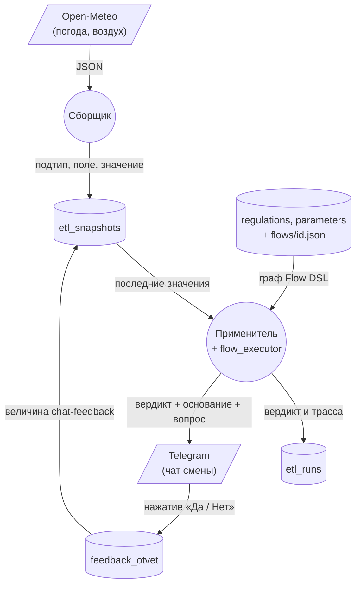

Рисунок 18 — Ответ получателя вердикта становится величиной регламента

### 7.2. Стенд этапа 1

Стенд — Платформа АРХИ на площадке ЖК «Пульсар»: пять строительных регламентов. Сценарий 1 подтверждён снимками экрана задачи от 2026-05-27. У остальных демонстрационных сценариев свидетельства в черновике не названы [10].

### 7.3. Пилот модуля и уровень готовности

**Пилот** — кампус НГУ, ноутбук с Windows без VPN. Три регламента: похолодание и форточки, переход через ноль, индексы жизни. Вердикт доходит в чат Telegram с кнопками «Да» и «Нет». Запуск и ярлык проверены 07.11.2026 [10], [35].

**Уровень готовности 7 заявлен для модуля РАГРАФ** — не для Платформы СИГМА и не для отчёта. Свидетельство неполно:
- ответственный назван условно;
- дата начала регулярной работы не записана;
- акта нет.

Протокол собственных испытаний (ПМИ) подтверждает пятый уровень, пилот у заказчика — седьмой. Приёмку закрывает только акт заказчика.

### 7.4. Натурные находки

Боевой контур дал находки, которых не дают ни макет, ни тесты.

| Находка | Что произошло | Вывод |
|---|---|---|
| Plan-R | схема `apikey` даёт 401, справочника атрибутов нет, `/wbs-relations` отвечает 405 | три находки из четырёх — отсутствие того, что предполагалось; срок «подключить боевой источник» нельзя планировать как конфигурационную работу |
| живой минимум, 09.10.2026 [36] | 16 регламентов шли по расписанию, данных не получали и сняты в черновик | метка «применяется» — объявление, а не факт |
| обратная связь [37] | ответы людей терялись 18 дней, с 09 по 27.10.2026, при чистых журналах: колонка, добавленная после создания таблицы, не доехала до тома | чистый журнал ничего не доказывает |
| место замера, 08.10.2026 [38] | место замера кампуса подменилось погодой Казани | место — свойство объекта, а не настройка |
| охрана кабеля, июнь — 26.09.2026 | регламент DAS `construction-fiber-cable-protection` перенесли в область «Безопасность кампуса» по его источнику, а перечень областей планировщика не поправили. Последние прогоны в журнале — 09.06.2026; ни один журнал об остановке не сообщал. Нашли 26.09.2026 при переносе в ту же область другого регламента (`backend/app/services/etl/scheduler.py`) | смена области регламента меняет контур, а не только данные: исполнение сверяется с журналом прогонов |

### 7.5. Производительность

- **Ядро решает быстро:** медиана 15 мс, у 90 % решений быстрее 26 мс, на 19 509 решениях журнала прогонов; замер 25.09.2026 [39].
- **Анализ корпуса:** 65 регламентов за 0,52 с.
- **Полный пакет проверок изделия:** 407,9 с при бюджете 600 с, 09.11.2026.

### 7.6. Регламенты поставки на трёх платформах

Контур п. 7.1 один для всех областей: меняются регламенты, а не код. В изделии это видно по трём платформам — экранам «Умный кампус POLIGON», «Стройка · Plan-R» и «Ситуационный центр». Ниже — по два регламента каждой. Их области планировщик обходит (`scheduler.APPLY_DOMAINS`), в демонстрационных они не значатся: при подключённом источнике регламенты исполняются без участия человека. Фрагмент и анализ — `backend/.venv/bin/python scripts/primery_nir.py`, 12.11.2026.

| Платформа | Регламент | Источник | Что решает и кому | Основание в данных регламента | L₀ · анализ |
|---|---|---|---|---|---|
| Умный кампус POLIGON | `campus-zero-crossing` (п. 4.5) | Open-Meteo по месту замера кампуса | наледь к утру — оператору, сосульки — руководителю; в чат кампуса с вопросом исполнителю | постановление Госстроя России № 170 | да · ошибок нет; адрес доставки в поставочном файле пуст |
| Умный кампус POLIGON | `nsk-cold-snap-windows` | Open-Meteo: минимум на завтра | закрыть форточки и проёмы: при 8 °C и ниже — оператору, при 5 °C и ниже — руководителю; в чат | постановление Госстроя России № 170, подготовка к зимней эксплуатации | да · ошибок нет; адрес доставки в поставочном файле пуст |
| Умный кампус POLIGON | `construction-fiber-cable-protection` | оптоволоконный датчик DAS: копка и шаги у трассы | выезд патруля; эскалация службе безопасности | 116-ФЗ; наряд-допуск на земляные работы — приказ Минтруда № 883н | да · ошибок нет; коды действий вне реестра |
| Стройка · Plan-R | `construction-planr-critical-path-overdue` | Plan-R: работы, одновременно просроченные и лежащие на критическом пути | от одной работы — задача ГИП на план компенсации, 24 ч; от пяти — эскалация инвестору, 12 ч | регламент управления строительным проектом, п. 4.3; ГК РФ, гл. 37 | да · замечаний нет |
| Стройка · Plan-R | `construction-planr-schedule-staleness` | Plan-R: суток с последнего пересчёта графика | неделя — прорабу, две недели — ГИП | регламент управления строительным проектом, п. 3.1: график ведётся еженедельно | да · замечаний нет |
| Ситуационный центр | `nsk-nmu-smog-trap` | Open-Meteo: ветер и PM2.5 | риск НМУ, объявление НМУ, опасное НМУ — городским службам | в данных регламента не записано | да · ошибок нет; нет выхода на случай нехватки данных; коды действий вне реестра |

Регламенты Plan-R перенесены из опыта проекта АРХИ, отработанного на боевом Plan-R. Величины отдаёт сам Plan-R: число работ на критическом пути считается пересечением по сырым записям работ, а не произведением двух счётчиков (разбор `docs/PLANR-REGLAMENTY-RAZBOR.md`). У регламента НМУ основание не записано: вердикт по нему предъявим только наполовину — данные и путь вывода есть, пункта нормы нет.

**Что получает человек** — рисунок 19: сообщение `campus-zero-crossing` в случае п. 4.5 «оттепель при снеге; прогноза на ночь и осадков нет». Текст собран той же функцией, что отправляет его в канал (`delivery.sobrat_tekst`), основание — по трассе прогона (`osnovanie.sobrat`); канал при этом не вызывался. Под сообщением — кнопки ответа на два вопроса. Ответ становится величиной регламента (рисунок 18).

<!-- primer: soobshchenie campus-zero-crossing -->
```text
🟠 Опасно · Регламент перехода температуры через ноль (наледь на дорожках к…

Днём оттепель при лежащем снеге: с кровель течёт, сосульки растут и падают. Огородить и обозначить зоны у стен под карнизами и над входами, вызвать очистку кровель от снега и наледи. К утру обработать дорожки: талая вода замёрзнет.

Основание:
• Максимум сегодня, °C = 2 — по данным «🌡 Максимум сегодня, °C»
• Высота снега, м = 0,2 м — по данным «❄ Высота снега, м»
• Сосульки: оттепель при лежащем снеге = 1

Ответьте, пожалуйста, кнопками ниже:
• Опасные зоны у стен огорожены?
• Дорожки обработаны?
```

Рисунок 19 — Сообщение в чат кампуса: вердикт, основание и вопросы исполнителю

В основании — пришедшие показания и сработавшая формула, а прогноза на ночь там нет: вердикт вынесен без него и, по Теореме 1, от него не отменится.

---

## 8. РЕЗУЛЬТАТ 4. ГРАФ ЗНАНИЙ В ЗАПРОСЕ СТУДИИ

### 8.1. Где граф знаний входит в запрос

Граф знаний — часть онтологического уровня, уровня 1 по Пальчунову (п. 2.3). Вторая часть того же уровня — словари регламентов: их параметры, единицы и контракт SHACL. Студия отвечает по графу знаний, регламенты исполняются на теоретическом уровне. Мост между двумя частями уровня 1 построен 09.11.2026: у каждого регламента в графе его области есть триплет «проблема — решается — регламент» (п. 2.3); заземлённость параметров в графе знаний по-прежнему мала — 35 из 135 (п. 8.3).

Граф знаний хранится CSV-триплетами по областям. Он входит в запрос модели в двух местах шага Студии [10]:
- в описание областей — для уточнения области вопроса;
- в контекст ответа.

Первое место — уточнение области, рисунок 20. Схема показывает путь облачной модели; с 07.11.2026 при локальной модели область выбирается поиском по своду, без модели (`sandbox.oblast_po_poisku`). Схема — из методического пособия системного аналитика.

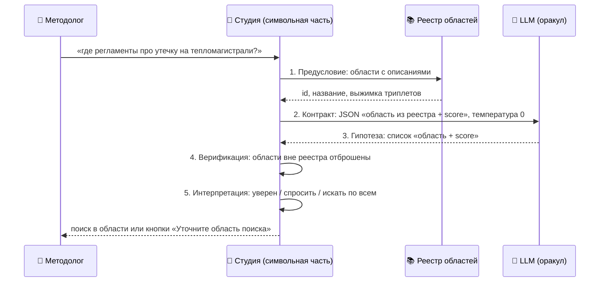

Рисунок 20 — Уточнение области вопроса по описаниям областей с выжимкой триплетов

Второе место — контекст ответа, рисунок 21: карточки регламентов, триплеты области, регламенты мостов (п. 2.3) и фрагменты включённых документов. Схема — из справочника строителя умного города; подписи приведены к изделию: векторы по умолчанию выключены и поиск идёт по основам слов, поставщик модели — на выбор, в том числе Yandex AI Studio.

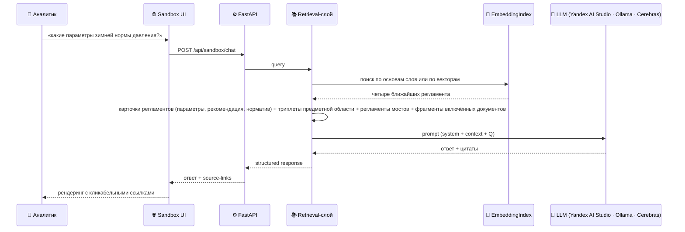

Рисунок 21 — Контекст ответа Студии

GraphRAG [32] не реализован.

**Пример: как Студия приходит к регламенту п. 4.5.** Мост регламента в графе знаний области «Кампус НГУ» — две тройки семян (`backend/data/knowledge_seed/mosty/campus.csv`):

<!-- primer: troyki campus -->
| Субъект | Предикат | Объект |
|---|---|---|
| Проблема: переход температуры через ноль: наледь на дорожках и сосульки на кровлях | решается_регламентом | Регламент_campus_zero_crossing |
| Регламент_campus_zero_crossing | называется | Регламент перехода температуры через ноль (наледь на дорожках к утру, сосульки на кровлях в оттепель) |

Быстрый путь по графу (п. 8.2) на двух вопросах — `backend/.venv/bin/python scripts/primery_nir.py studia`, 12.11.2026:
- «Что делать с сосульками на кровлях в оттепель?» — область «Кампус НГУ». Первым идёт `campus-zero-crossing` по общим основам «кров», «отте», «сосу», вторым — `roof-snow-fencing`. Путь — 0,04 мс, без модели.
- «Гололёд на дорожках кампуса — что делать?» — ничего. В теме моста «наледь», а не «гололёд»; синонимов путь не знает, и область выбрана не та. Это предел, названный в п. 8.3: быстрый путь доказывает скорость, а не полноту.

### 8.2. Замеры

| Замер | Значение | Когда, чем |
|---|---|---|
| абляция маршрутизации: без триплетов / реальные триплеты / идеальные | 18 из 24 / 23 из 24 / 24 из 24 | 12.06.2026, агенты на модели-посреднике [10] |
| интервалы Уилсона, 95 % [40] | 79,8–99,3 % и 55,1–88,0 % — перекрываются | пересчёт 08.11.2026 |
| уточнение области поиском по своду против локальной модели | 0 против 5 неверных уверенных сужений на 42 вопросах; медиана 0,08 с против 3,4 с | 07.11.2026, `scripts/eval_domain_routing.py` [41] |
| быстрый путь по графу: область → «проблема — решается — регламент», без модели и векторов | демо-вопросы 12 из 12; 39 вопросов замера мостов — верный регламент первым у 19 из 26, лишний ответ у 2 из 13; медиана 0,02–0,03 мс | 09.11.2026, `scripts/zamer_puti_po_grafu.py` |

### 8.3. Что из этого следует

**Направление пользы устойчиво, величина не доказана.**
- Абляция шла через модель-посредника, сценарий прогона в репозиторий не положен.
- Интервалы условий перекрываются.
- Знание, разошедшееся с корпусом, ведёт маршрутизатор уверенно не туда — контрпример 05.11.2026 [42].
- До модели доходили одни и те же триплеты: 34 из 500, все из одного файла.
- Согласие графа знаний с корпусом не проверяется.
- Точность ответов Студии не измерялась.
- Быстрый путь по графу доказывает скорость, а не пользу. Вопрос в языке триплетов он проходит за доли миллисекунды без модели, но на независимом наборе находит верный регламент первым у 19 из 26 вопросов, а минимум двух общих основ введён после замера (до него — 22 из 26 и 10 лишних ответов из 13). Набор после этого — просмотренный; нужен новый, написанный не автором тем.
- Привязка регламентов к графу знаний своей области была близка к нулю: моста «проблема — решается — регламентом» в графе своей области не было у 64 регламентов из 66, у 43 в области не было ни одного триплета. Мосты построены 09.11.2026 вечером — 66 из 66; прироста качества поиска замер не показал (п. 2.3, `scripts/zamer_mostov.py`). По основам слов заземлены 35 параметров из 135; замер 09.11.2026 [11].

---

## 9. ПРОЧИЕ РЕЗУЛЬТАТЫ

Эти результаты названы, но по силе доказательства уступают разделам 5–8.

- **Паспорт решения ВИЛНС** — лексикографический решатель для скоринга. Проверен на четырёх сценариях без даты и команды; обзора аналогов нет. Домен относится к ноу-хау и в открытых материалах не раскрывается. Статус — кандидат в результат.
- **Отрицательный продуктовый результат: «оператора регламентов» не существует** [10]. Метод назван, но выборки, чисел и дат нет. Из него следует правило: сначала выгодоприобретатель, затем метрики.
- **Логика правил перенесена из кода в граф.** Было 5 регламентов с 245 строками кода, 29 ветвлениями и 54 порогами; стало 3 регламента с 133 строками, 8 ветвлениями и 17 порогами (15.10.2026) [43]. В остатке трасса балл не объясняет.

---

## 10. СТЕНД И ИЗМЕРЕНИЯ

### 10.1. Состав

| Часть | Что |
|---|---|
| изделие | исходный текст модуля РАГРАФ на 09.11.2026: Python 3, FastAPI, DuckDB; клиент — React |
| корпус | `fixtures.REGISTRY` — 66 регламентов в 15 областях; каждый — данные Turtle, контракт SHACL и граф |
| стенд поломок | копия репозитория в отдельном каталоге, без настроек и базы экземпляра; на нём откатывается каждая правка по отдельности |
| средства замера | `scripts/matematika_korpusa.py` (перепись фрагмента и полнота положительного вердикта); `backend/app/services/persistentnost.py` (граница и генератор частичных моделей); сторож `backend/tests/test_persistentnost.py`; цикл `analyze_regulation`; одноразовые скрипты сверки до и после |

### 10.2. Методика

- **Перепись фрагмента** — синтаксически, по корням величин так, как значение читает исполнитель.
- **Случайный поиск нарушения.** Частичная модель и её расширение строятся по точкам: границам зон и порогов с окрестностями ±1 и ±0,001, краям контракта SHACL и середине. Поиск идёт при трёх моментах времени, по 40 или 60 попыткам; семя — идентификатор регламента.
- **Сравнение вердиктов до и после** — на одних и тех же 366 моделях каждого регламента.
- **Способность проверки краснеть** — поломка на стенде по одной правке за раз.

### 10.3. Проверки изделия

- **Серверные:** 1693 в 123 файлах; пакеты дым / базовый / полный / боевой — 14 / 1422 / 1693 / 0 (`pytest --collect-only -q --paket <пакет>`, 10.11.2026, день — выгрузка в DOCX; ночь на 10.11.2026 — 1633 в 122; поздним вечером 09.11 — 1597 в 121, днём — 1555 в 118 файлах).
- **Полный пакет** зелёный: 1693 из 1693 за 461,6 с (`cd backend && .venv/bin/python -m pytest --paket polnyy -q`, 10.11.2026, день; ночь на 10.11.2026 — 1633 из 1633 за 414,3 с, `./scripts/proverki.sh polnyy`; поздним вечером 09.11 — 1597 из 1597 за 408,6 с).
- **ПМИ** [9] на 08.11.2026 — 132 испытания: 35 пройдено, 46 частично, 26 не пройдено, 8 показом, 17 не испытывалось.

Сводная таблица чисел с командами — приложение В.

---

## 11. ОТРИЦАТЕЛЬНЫЕ РЕЗУЛЬТАТЫ И ПРЕДЕЛЫ

Отрицательные результаты приводятся с той же полнотой, что и подтверждённые.

**О решениях и их мере**
1. **Точность решений с эталоном не измерена.** Прежние «88–93 %» и «+5–7 п.п.» — сумма ожидаемых приростов по плану, сняты 08.11.2026.
2. **Мера «доля прогонов с критерием „да“» измеряет мир, а не изделие.** Для `no_violation` успех засчитывается, когда регламент не сработал: 21 823 «провала» регламента форточек из 25 837 измеряли погоду [44].
3. **Полнота положительного вердикта по делу не обеспечивается** (п. 5.4).

**О свойстве и его границе**
4. **Граница L₀ достаточна, но не точна:** у 5 из 7 регламентов вне фрагмента нарушение поиском не найдено. Второй источник значения у них — вход без параметра, а поиск подаёт показания только по параметрам.
5. **Сторож на корпусе не видит конструкций, которых в корпусе нет:** контрпример С9 найден минимальным регламентом. Поэтому каждая операция языка держит свой минимальный регламент в проверках.
6. **Молчание источника может стать нулём или устаревшим значением.**
   - Последнее значение берётся без предела давности.
   - Два сборщика подставляют 0 вместо пропуска.
   - По разбору 15.10.2026 ни один путь автоматического вердикта не проверял давность данных [45], и на 09.11.2026 это по коду не изменилось.

   Теорема говорит о значении, которое не пришло. Устаревшее значение и подставленный ноль она не различает и для них ничего не гарантирует.
7. **Функции рядов не обеспечены историей** и при её появлении немонотонны по отсчётам.
8. **Молчание регламента не различает «нарушений нет» и «данных недостаточно».** На неполных данных 81 % молчаний не окончательны (п. 5.4, перебор пополнений), а исполнитель сообщает их одинаково. Есть и обратный разрыв: исход бывает определён известными показаниями и контрактом, а исполнитель K3 его ещё не выносит. Таких вердиктов в замере 12.11.2026 — 132 из 1357 неокончательных, из них 104 молчания (п. 5.4, поправка).

**О верификаторе**
9. **Метод анализа не различает спор и два независимых вопроса.** Класс вердикта задаётся действием, а вопрос вердикта в модели не записан.
10. **Между регламентами сравнима шестая часть корпуса — 11 из 65.** Единственное противоречие — заведомо построенная пара.
11. **Регламент с циклом можно сохранить:** проверка цикла есть только в анализе.
12. **Перекрытие формул-гейтов анализу не видно.**
13. **Шесть регламентов поставки после правки исполнителя не выносят вердикта по развилке вовсе.** Это честнее прежнего «все ветви», но регламенты требуют починки. Починка начата 09.11.2026: DoD выполнен у 2 регламентов описи из 18, эти шесть — в фазах П2–П3 (п. 6.5).

**Об изделии и данных**
14. **Сравнительного замера с Apache Jena не было** — хранилище не устанавливалось.
15. **Ответы людей терялись 18 дней** при чистых журналах (п. 7.4).
16. **Натурно не проверялись** приём номеров с живого детектора, медицина и кредитный скоринг, нагрузка и многопользовательская работа.

**О графе знаний**
17. Направление пользы устойчиво, величина не доказана; точность ответов не измерялась; согласие графа знаний с корпусом не проверяется; заземлённость регламентов близка к нулю (п. 8.3).

**О границе утверждений**
18. **Теорема — о языке регламентов при фиксированном моменте.** О распознавании, языковых моделях, сети и организационных действиях она не говорит; это та же граница, что названа в методологии [33].

---

## 12. НОВИЗНА И ЧУЖОЕ

**Известно:**
- монотонность связок K3 и сохранение истинности при расширении частичных структур [6], [15], [16];
- анализ таблиц решений на полноту и перекрытие [29], [30];
- задачный подход и Σ-программирование [3], [24], [12];
- четырёхуровневая модель знаний [5], [14];
- ЦД СУ как набор исполняемых спецификаций [4];
- генерация с поиском [31].

**Своё** — в пределах п. 11:
1. **Граница сохранения вердикта для языка регламентов** — две конструкции, снятые с исходного текста, и доказательство для фрагмента (п. 5).
2. **Верификатор, построенный из теоремы и встроенный в изделие** — с замером по корпусу и сличением с исполнителем (п. 6).
3. **Приведение исполнителя к теории.** Четыре отступления, в том числе контрпример внутри объявленного фрагмента. Граница сузилась вдвое, а смена вердиктов вскрыла скрытые дефекты регламентов (п. 6.3).
4. **Двойственное свойство — полнота положительного вердикта** — выявлено как пробел и перенесено на уровень агрегации по делу (п. 5.4).
5. **Лемма о композиции на реальной спецификации** из 157 атомарных правил (п. 5.3).

**Что не заявляется.**
- Заявки «впервые» из черновика этапа 1 о двойнике субъекта управления и о составной конструкции двойника в итоговый отчёт не переносятся. Понятие взято из НИР 2024 года, а обзора, подтверждающего приоритет, нет.
- «Первая практическая реализация задачного подхода» не заявляется по той же причине.

**Патентные исследования.** Патент на способ не подаётся: патентный поиск нашёл аналоги. Защита — через программы для ЭВМ, базу данных и ноу-хау [46].

---

## 13. ПУБЛИКАЦИИ, РЕЗУЛЬТАТЫ ИНТЕЛЛЕКТУАЛЬНОЙ ДЕЯТЕЛЬНОСТИ, ВНЕДРЕНИЕ, УРОВЕНЬ ГОТОВНОСТИ

| Что | Состояние | Какой раздел подтверждает |
|---|---|---|
| статья «Семантическое потоковое программирование» (Барбашин О. В., Свириденко Д. И.), журнал Software and Systems Modeling | подготовлена к подаче, 23.10.2026 [46] | пп. 4, 6 |
| формально-логическая версия статьи — раздел 5 | черновик раздела, ждёт рецензий | п. 5 |
| результаты интеллектуальной деятельности: 2 программы для ЭВМ, база данных — корпус регламентов, ноу-хау — методика перевода норм | подготовлены, зарегистрировано 0 из 4 [46]; правообладатель — ЦИИ НГУ с 05.11.2026 | пп. 4, 6, 10 |
| договоры внедрения и лицензирования | 0 подписано, 5 в подготовке [46] | — |
| акты внедрения | нет | п. 7.3 |
| уровень готовности | 7 — для модуля, свидетельство неполно | п. 7.3 |

Собственных опубликованных работ по теме 2026 года нет. Работы школы, на которые работа опирается, в публикации автора не засчитываются.

---

## 14. СВЯЗЬ С КОМПЛЕКТОМ ПРОГРАММНОЙ ДОКУМЕНТАЦИИ

Программная часть работы документирована комплектом РАГРАФ-ФРЕЙМ по ГОСТ 19. Каталог — `backend/data/gost19/ragraf/`, перечень — `backend/app/services/docs_registry.py`. Содержание комплекта здесь не дублируется.

| Обозначение | Документ | Редакция | Зачем читать |
|---|---|---|---|
| РАГРАФ-ФРЕЙМ-1 | Техническое задание | 3.1 | что требовалось [27] |
| РАГРАФ-ФРЕЙМ-1/2 | Техническое задание на стадии рабочего проекта | 6 | задание модуля для Платформы СИГМА |
| РАГРАФ-ФРЕЙМ | Спецификация | — | состав поставки |
| РАГРАФ-ФРЕЙМ-12 | Текст программы | — | опись исходного текста |
| РАГРАФ-ФРЕЙМ-13 | Описание программы | 2 | алгоритмы исполнителя, развилка [41] |
| РАГРАФ-ФРЕЙМ-31 | Описание применения | 1 | применение, уровень готовности [35] |
| РАГРАФ-ФРЕЙМ-32 | Руководство системного программиста | — | установка |
| РАГРАФ-ФРЕЙМ-33 | Руководство программиста | 1 | подключение датчиков и систем |
| РАГРАФ-ФРЕЙМ-34 | Руководство оператора | 2 | работа аналитика |
| РАГРАФ-ФРЕЙМ-35 | Описание языка Flow DSL | 7 | семантика и проверки регламента [28] |
| РАГРАФ-ФРЕЙМ-51 | Программа и методика испытаний | 1 | 132 испытания, ведомость покрытия [9] |
| РАГРАФ-ФРЕЙМ-81 | Пояснительная записка | — | решения и ограничения |

Отчёт описывает работу, комплект — изделие; в один документ они не сводятся.

---

## ЗАКЛЮЧЕНИЕ

### Итоги по задачам

| Задача | Итог | Состояние |
|---|---|---|
| а) исполняемые спецификации в открытом проверяемом формате | регламент — Turtle, SHACL и граф Flow DSL; язык описан в РАГРАФ-ФРЕЙМ-35, ред. 7 | выполнено |
| б) инфраструктура исполнения в замкнутом контуре с гарантиями воспроизводимости, объяснимости и формальной проверяемости | контур замкнут (п. 7.1); трасса объясняет каждый вердикт; формальная проверяемость получила доказуемое содержание — сохранение вердикта для L₀ — и проверку до исполнения (пп. 5, 6) | частично: регламент с циклом сохраняется; молчащий источник не проверяется на давность; анализ — совет, а не запрет |
| в) наращивание задачного пространства без переписывания инфраструктуры | 66 регламентов в 15 областях на одном ядре; новый регламент — данные и граф без кода | выполнено; у трёх регламентов логика частично остаётся в коде (п. 9) |
| г) интеграция с внешними двойниками объектов | опрос девяти источников, приём событий, LEYKA, Plan-R на чтение | частично: запись в Plan-R не сделана; живого детектора номеров в контуре нет |
| д) стенд для проверки гипотез об операционализации задачного подхода и ТФС без потери научной корректности | операционализация есть (пп. 2.1–2.2); для «научной корректности» получено одно проверяемое содержание — Теорема 1 — и одна граница (п. 5) | частично: гипотеза о ТФС отнесена к 2025 году; других критериев корректности не задано |
| е) свойство сохранения вердикта: доказательство, граница, сторож, замер | Теорема 1, граница Н1 и Н4, сторож 74 проверки, 59 из 66, после починки П1 — 60 из 66 | выполнено; рецензии не получены |
| ж) исполнитель по теории и верификатор | С1, С2, С3, С9 исправлены; 12 кодов анализа; опись дефектов поставки | выполнено; починка регламентов — следующая фаза |

### Цель

**Цель этапа 1 достигнута частично.**
- Изделие доведено до опытной эксплуатации модуля в пилоте, но свидетельство пилота неполно и акта нет.
- Применимость показана на стенде АРХИ; подтверждён сценарий 1.
- Формально проверяемая логика реализована и получила доказанное свойство.

**Цель этапа 2 достигнута.** Свойство сформулировано, доказано для фрагмента, граница снята с кода, проверка встроена в изделие и измерена по корпусу. Сверх цели теорема дала верификатор и привела к исправлению исполнителя.

### Главный вывод работы

Гарантию для решения, вынесенного на неполных данных, можно доказать для языка правил, назвать её точную границу по исходному тексту и проверять командой. Та же теорема, применённая к исполнителю и корпусу, работает как верификатор. Он находит ошибки там, где гарантии нет: в исполнителе — четыре отступления от логики, в регламентах — формулы, которые не вычисляются, пороги, сравнивающие не то, развилки без маршрута.

Вопрос формальной верификации спецификаций управления, поставленный в 2024 году и оставшийся открытым в 2025-м, получил ответ для языка регламентов.

### Рекомендации

1. **Починить регламенты поставки по описи верификатора.** План по каждому регламенту с критерием приёмки — в бэклоге изделия [34]. Начать с механических правок; правки, где граф не говорит, что задумано, — с решением методолога.
2. **Измерить точность решений с эталоном** — по размеченному набору входов или по подтверждению человека (`feedback_received`). До этого точность не заявлять.
3. **Измерить точность ответов Студии** с графом знаний и без него.
4. **Добавить поле «вопрос вердикта»,** чтобы анализ искал противоречие внутри вопроса.
5. **Проверять давность данных и запретить сборщикам подставлять 0 вместо пропуска** — иначе гарантия раздела 5 не распространяется на эти регламенты.
6. **Проверять цикл при сохранении.**
7. **Пополнить свидетельство пилота** — имя ответственного, дата начала, журнал работы людей; затем акт заказчика для перехода к УГТ-8.
8. **Собирать историю отсчётов для функций рядов** — со своей границей фрагмента, Н5.
9. **Ввести трёхзначный статус выхода и пометку окончательности вердикта.** Сообщение должно говорить «вердикт предварительный, ещё зависит от показаний X, Y» (п. 5.4). Статус сверять с исполнителем и с перебором пополнений; проверить гипотезу о точности для однократных регламентов. Там, где исход уже определён при любом пополнении, а исполнитель K3 молчит, индикация может назвать исход; вердикт по перебору — новая семантика, решение за руководителем работы (п. 5.4, поправка).
10. **Получить отзывы рецензентов на раздел 5** и подготовить формально-логическую версию статьи.

---

## СПИСОК ИСПОЛЬЗОВАННЫХ ИСТОЧНИКОВ

1. Фреймворк «Сигма» — программно-аппаратный комплекс для разработки, сопровождения и управления жизненным циклом систем проактивного управления городской инфраструктурой : техническое задание (уточнённое — 2025 год) : СИГМА 2.1 : ИИ-01-01-01-1/1-ЛУ / Новосибирский государственный университет, ЦИИ НГУ ; рук. разработки И. А. Болдырев. — Новосибирск, 2025. — 105 л. — Основной текст 2023 года с комментариями 2025 года. — Копия в Markdown «ТЗ СИГМА-2025 версия 3.1» — материалы руководителя работы.
2. ГОСТ 7.32-2017. Система стандартов по информации, библиотечному и издательскому делу. Отчёт о научно-исследовательской работе. Структура и правила оформления. — М.: Стандартинформ, 2017.
3. Vityaev E. E., Goncharov S. S., Sviridenko D. I. Task-driven approach to artificial intelligence // Cognitive Systems Research. — 2023. — Vol. 81. — P. 50–56. — DOI 10.1016/j.cogsys.2023.05.001.
4. Фреймворк Сигма : отчёт о НИР (промежуточный, этап 1) / Новосибирский государственный университет, ЦИИ НГУ ; рук. НИР И. А. Болдырев. — Новосибирск, 2024. — 110 с. — НИОКТР 124042200020-3. — Копия в Markdown: `docs/NIR-2024.md`.
5. Пальчунов Д. Е. Теория моделей предметных областей. I // Алгебра и логика. — 2022. — Т. 61, № 2. — С. 239–250. — Англ. пер.: Algebra and Logic. — 2022. — Vol. 61. — P. 166–173. — DOI 10.1007/s10469-022-09685-9.
6. Kleene S. C. Introduction to Metamathematics. — Amsterdam: North-Holland, 1952. — Рус. пер.: Клини С. К. Введение в метаматематику. — М.: Изд-во иностранной литературы, 1957.
7. Барбашин О. В. Разбор: что в вычислителе и языке неточно с точки зрения теоремы — и надо ли доделывать. — Новосибирск, 09.11.2026. — `docs/VYCHISLITEL-PO-NAUKE-RAZBOR.md`.
8. Фреймворк Сигма : отчёт о НИР (промежуточный, этап 2) / Новосибирский государственный университет, ЦИИ НГУ ; рук. НИР И. А. Болдырев. — Новосибирск, 2025. — 47 с. — Копия в Markdown: `docs/NIR-2025.md`.
9. РАГРАФ-ФРЕЙМ-51. Программа и методика испытаний : ред. 1. — Комплект РАГРАФ-ФРЕЙМ, `backend/data/gost19/ragraf/`. — Числа испытаний — на 08.11.2026.
10. Барбашин О. В. Платформа «РАГРАФ» — замкнутый контур «датчик — регламент — задача — человек» : отчёт о НИОКР (промежуточный, этап 1) : РАГРАФ.НИР.001-2026 : ред. от 08.11.2026. — Новосибирск, 2026. — Черновик этапа: `docs/OTCHET-NIR-RAGRAF-2026.md`.
11. Барбашин О. В. Разбор: математические основания регламента как графа — что доказуемо из кода. — Новосибирск, 09.11.2026. — `docs/NIR-ETAP2-MATEMATIKA-RAZBOR.md`.
12. Гончаров С. С., Свириденко Д. И. Семантическое моделирование и искусственный интеллект // Сибирский философский журнал. — 2018. — Т. 16, № 4. — С. 5–25. — DOI 10.25205/2541-7517-2018-16-4-5-25.
13. Анохин П. К. Очерки по физиологии функциональных систем. — М.: Медицина, 1975.
14. Пальчунов Д. Е. Теория моделей предметных областей. II // Алгебра и логика. — 2022. — Т. 61, № 4. — С. 500–510. — DOI 10.33048/alglog.2022.61.408.
15. Blamey S. Partial Logic // Handbook of Philosophical Logic. Vol. III / ed. by D. Gabbay, F. Guenthner. — Dordrecht: Reidel, 1986. — P. 1–70.
16. Fitting M. A Kripke-Kleene semantics for logic programs // The Journal of Logic Programming. — 1985. — Vol. 2, № 4. — P. 295–312. — DOI 10.1016/S0743-1066(85)80005-4.
17. Барбашин О. В. Математические основания: регламент как формула над частичной моделью : черновик раздела отчёта о НИР этапа 2 : ред. 2 от 09.11.2026. — Новосибирск, 2026. — `docs/NIR-ETAP2-MATEMATICHESKIE-OSNOVANIYA.md`.
18. Nechesov A. V., Vityaev E. E., Goncharov S. S., Sviridenko D. I. The Task-Based Approach: A New Paradigm for Building Trustworthy Artificial Intelligence // Известия Иркутского государственного университета. Серия «Математика». — 2025. — Т. 54. — С. 96–112. — DOI 10.26516/1997-7670.2025.54.96.
19. Vityaev E. E., Sviridenko D. I., Rofe A. R. Task-Based Approach to Digital Transformations // Известия Иркутского государственного университета. Серия «Математика». — 2025. — Т. 54. — С. 78–95. — DOI 10.26516/1997-7670.2025.54.78.
20. Chen J., Xiao S., Zhang P., Luo K., Lian D., Liu Z. BGE M3-Embedding: Multi-Lingual, Multi-Functionality, Multi-Granularity Text Embeddings Through Self-Knowledge Distillation. — 2024. — arXiv:2402.03216.
21. Витяев Е. Е., Гончаров С. С., Свириденко Д. И. О задачном подходе в искусственном интеллекте и когнитивных науках // Сибирский философский журнал. — 2020. — Т. 18, № 2. — С. 5–29. — DOI 10.25205/2541-7517-2020-18-2-5-29.
22. RDF 1.1 Turtle. Terse RDF Triple Language : W3C Recommendation. — 2014. — URL: https://www.w3.org/TR/turtle/
23. Shapes Constraint Language (SHACL) : W3C Recommendation. — 2017. — URL: https://www.w3.org/TR/shacl/
24. Goncharov S. S., Sviridenko D. I. Σ-Programming // American Mathematical Society Translations. Series 2. — 1989. — Vol. 142.
25. Gumirov V. S., Matyukov P. Y., Palchunov D. E. Semantic Domain-specific Languages // 2019 International Multi-Conference on Engineering, Computer and Information Sciences (SIBIRCON). — 2019. — P. 0955–0960.
26. Vityaev E. E., Demin A. V. Cognitive architecture based on the functional systems theory // Procedia Computer Science. — 2018. — Vol. 145. — P. 623–628.
27. РАГРАФ-ФРЕЙМ-1. Техническое задание : ред. 3.1 от 09.10.2026. — Комплект программной документации РАГРАФ-ФРЕЙМ, `backend/data/gost19/ragraf/`.
28. РАГРАФ-ФРЕЙМ-35. Описание языка регламентов Flow DSL : ред. 7 от 09.11.2026. — Комплект РАГРАФ-ФРЕЙМ, `backend/data/gost19/ragraf/`.
29. Calvanese D., Dumas M., Laurson Ü., Maggi F. M., Montali M., Teinemaa I. Semantics and Analysis of DMN Decision Tables // Business Process Management. BPM 2016. — Cham: Springer, 2016. — (Lecture Notes in Computer Science; vol. 9850). — P. 217–233. — DOI 10.1007/978-3-319-45348-4_13.
30. Decision Model and Notation (DMN) : specification / Object Management Group. — URL: https://www.omg.org/spec/DMN/
31. Lewis P., Perez E., Piktus A. [et al.]. Retrieval-Augmented Generation for Knowledge-Intensive NLP Tasks // Advances in Neural Information Processing Systems 33 (NeurIPS 2020). — 2020.
32. Edge D., Trinh H., Cheng N. [et al.]. From Local to Global: A Graph RAG Approach to Query-Focused Summarization. — 2024. — arXiv:2404.16130.
33. Барбашин О. В. Исследование и разработка методологии автоматизации регламентированной организационно-управленческой деятельности. На примере деятельности мэрии : отчёт о НИР, методологическая редакция. — Новосибирск, 31.10.2026 ; корпус атомарных правил паспорта фасадов и пакет «Регламентный советник», версия 0.2.0. — Материалы автора.
34. Бэклог изделия РАГРАФ, раздел «План: исправить найденные ошибки в потоках регламентов поставки». — 09.11.2026. — `docs/BACKLOG.md`.
35. РАГРАФ-ФРЕЙМ-31. Описание применения : ред. 1, п. 2.5. — Комплект РАГРАФ-ФРЕЙМ, `backend/data/gost19/ragraf/`.
36. Разбор: живой минимум — регламенты, которые проверяются на настоящих данных. — 09.10.2026. — `docs/ZHIVOY-MINIMUM-RAZBOR.md`.
37. Разбор: обратная связь от получателя вердикта ; разд. 9 — сбой записи 09–27.10.2026. — `docs/OBRATNAYA-SVYAZ-RAZBOR.md`.
38. Разбор: место замера — у кампуса своё, у города своё. — 08.10.2026. — `docs/MESTO-ZAMERA-RAZBOR.md`.
39. Целевые показатели гранта: реалистичность и способ замера ; замер времени решения. — 25.09.2026. — `docs/CII-POKAZATELI-GRANTA-2026-09.md`.
40. Wilson E. B. Probable Inference, the Law of Succession, and Statistical Inference // Journal of the American Statistical Association. — 1927. — Vol. 22, № 158. — P. 209–212.
41. РАГРАФ-ФРЕЙМ-13. Описание программы : ред. 2 ; п. 3.6 «Студия аналитика», замер 07.11.2026. — Комплект РАГРАФ-ФРЕЙМ, `backend/data/gost19/ragraf/`.
42. Студия: «точного регламента нет», когда он есть — разбор. — 05.11.2026. — `docs/STUDIA-LOZHNOE-NET-RAZBOR.md`.
43. Разбор: регламент должен быть цельным — оценка идеологии. — 08–15.10.2026. — `docs/REGLAMENT-CELNYY-RAZBOR.md`.
44. Разбор: инспекция регламента форточек по накопленной статистике. — 08.10.2026. — `docs/INSPEKCIYA-FORTOCHEK-RAZBOR.md`.
45. Обратная связь комиссии СИГМА: план работ этапов 0 и 1 ; разбор, раздел о давности данных. — 15.10.2026. — `docs/KOMISSIYA-ETAPY-0-1-RAZBOR.md`.
46. Справка: от исследований к внедрению — РАГРАФ-ФРЕЙМ, РАГРАФ-Кампус, РАГРАФ-СТРОЙ. — 23.10.2026. — `docs/SPRAVKA-NIR-RID-VNEDRENIE-RAGRAF-2026-10.md`.

---

## ПРИЛОЖЕНИЕ А. ВЕДОМОСТЬ ПРИОРИТЕЗАЦИИ РЕЗУЛЬТАТОВ

**Группы:**
- (а) научный результат: метод, модель, свойство, измерение;
- (б) инженерная разработка изделия;
- (в) применение и пилот;
- (г) обзор и опора;
- (д) позиционирование, маркетинг, планы.

**Сила доказательства, по убыванию:**
- Д — доказано и проверяется исполнением;
- З — измерено командой;
- П — показано в пилоте или на стенде;
- О — оценено или заявлено.

| Приоритет | Кандидат | Группа | Доказательство | Этап | Где в отчёте | Где подробно |
|---|---|---|---|---|---|---|
| 1 | сохранение вердикта, граница L₀, сторож | а | Д | 2 | п. 5 | [17], п. 1–8 |
| 2 | верификатор регламентов; исполнитель по теории; опись дефектов | а | Д, З | 1, 2 | п. 6 | [10], п. 5.18; [7] |
| 3 | трёхзначная семантика исполнения | а | Д, З | 1, 2 | пп. 4.2, 5 | [10], п. 5.20.5 |
| 4 | замкнутый контур и пилот модуля, УГТ-7 модуля | в | П | 1 | п. 7 | [10], пп. 5.3–5.7 |
| 5 | натурные находки: Plan-R, живой минимум, потеря ответов, место замера | а, в | З | 1 | п. 7.4 | [10], пп. 5.15, 5.20 |
| 6 | граф знаний в Студии: абляция и уточнение области | а | З, частично | 1 | п. 8 | [10], пп. 5.13, 5.19 |
| 7 | производительность ядра | б | З | 1 | п. 7.5 | [10], п. 5.20.6 |
| 8 | лемма о композиции, корпус фасадов | а | Д по построению | 2 | п. 5.3 | [17], п. 5 |
| 9 | полнота положительного вердикта — пробел | а | З | 2 | п. 5.4 | [17], п. 6 |
| 10 | паспорт решения ВИЛНС | а | О | 1 | п. 9 | [10], п. 5.14 |
| 11 | перенос логики правил из кода в граф | б | З | 1 | п. 9 | [10], п. 5.20.5 |
| — | архитектура, ADR, интеграции LEYKA, Plan-R, КАППА | б | П | 1 | п. 7.1 — ссылкой | [10], пп. 4, 5.5–5.6 |
| — | сверка с ТЗ АРХИ, матрица покрытия | в | О: процент на ред. 8.0 тавтологичен | 1 | не перенесено | [10], п. 5.8 |
| — | сверка с ГОСТами по ИИ | б | О — самооценка | 1 | не перенесено | [10], пп. 3.4–3.5 |
| — | ниша, образовательный модуль, маркетинг, модель сопровождения | д | О | 1 | не перенесено | [10], пп. 5.10–5.11, 5.16–5.17, 6.14 |
| — | «ИИ-модератор», гипотеза «ИИ-3», дорожная карта гибрида | д | О | 1 | не перенесено | [10], пп. 6.2, 6.11–6.12 |
| — | разработка в паре с ИИ-агентом | д | О | 1 | не перенесено | [10], п. 6.10 |
| — | отрицательный продуктовый результат: «оператора регламентов нет» | д, а | О, качественно | 1 | п. 9 | [10], п. 6.13 |

## ПРИЛОЖЕНИЕ Б. ВЕДОМОСТЬ СВЕДЕНИЯ «ЗАДАЧА — РЕЗУЛЬТАТ — ДОКАЗАТЕЛЬСТВО»

| Задача | Результат | Доказательство | Где |
|---|---|---|---|
| а | язык и формат регламента | РАГРАФ-ФРЕЙМ-35, ред. 7; 66 регламентов поставки | пп. 4, 14 |
| б | контур, трасса, теорема, верификатор | ПМИ; сторож; анализ корпуса | пп. 5–7 |
| в | 66 регламентов в 15 областях на одном ядре | `fixtures.REGISTRY` | п. 10.1 |
| г | девять источников, события, LEYKA, Plan-R | черновик этапа 1, пп. 5.5–5.6, 5.12 | п. 7.1 |
| д | операционализация задачного подхода и ТФС; одно проверяемое содержание корректности | пп. 2, 5 | пп. 2, 5 |
| е | Теорема 1, граница, сторож, перепись | `backend/tests/test_persistentnost.py`, `scripts/matematika_korpusa.py` | п. 5 |
| ж | исполнитель по теории; 12 кодов анализа | `backend/tests/test_regulation_analysis.py`, поломки на стенде | п. 6 |

## ПРИЛОЖЕНИЕ В. ПРОТОКОЛ ЗАМЕРОВ

Команды запускаются из корня репозитория, если не сказано иное; окружение `backend/.venv`.

| № | Величина | Значение | Команда или способ | Дата |
|---|---|---|---|---|
| 1 | регламентов поставки, областей | 66, 15 | `len(fixtures.REGISTRY)` | 09.11.2026 |
| 2 | во фрагменте L₀ / вне | 59 / 7 (Н1 — 1, Н4 — 6) | `backend/.venv/bin/python scripts/matematika_korpusa.py` | 09.11.2026 |
| 3 | нарушение подтверждено поиском | 2 из 7 | там же; 3 момента × 60 попыток | 09.11.2026 |
| 4 | частичных моделей при сравнении до и после | 24 156 (66 × 3 × 122) | скрипт сверки, разбор [7], § 5а | 09.11.2026 |
| 5 | регламентов со сменой вердикта | 8 из 66 | там же | 09.11.2026 |
| 6 | сторож Теоремы 1 | 74 проверки, 11,4 с | `cd backend && .venv/bin/python -m pytest -q tests/test_persistentnost.py` | 09.11.2026 |
| 7 | выражений поставки, с частичной операцией, частичная операция в связке | 86 / 15 / 0 | разбор [7], С9 | 09.11.2026 |
| 8 | `VERDICT_MAY_CHANGE` | 18 у 7 | цикл `analyze_regulation` по поставке | 09.11.2026 |
| 9 | `SWITCH_ROUTE_UNDEFINED` | 6 | там же | 09.11.2026 |
| 10 | `FORMULA_UNKNOWN_NAME` | 27 формул в 10 регламентах, 52 вхождения | там же | 09.11.2026 |
| 11 | `THRESHOLD_SOURCE_UNDEFINED` | 16 порогов в 7 регламентах | там же | 09.11.2026 |
| 12 | регламентов с ошибками анализа | 16 из 66 | там же | 09.11.2026 |
| 13 | анализ корпуса | 65 регламентов за 0,52 с; у 61 нет ошибок | черновик этапа 1, п. 5.18.3 | 08.11.2026 |
| 14 | сравнимых между регламентами | 11 из 65 | `find_cross_regulation_conflicts` | 08.11.2026 |
| 15 | полнота положительного вердикта | 8 регламентов, у 6 «норма» при неизвестном входе | `scripts/matematika_korpusa.py` | 09.11.2026 |
| 16 | корпус паспорта фасадов | 157 из 157 во фрагменте | `scripts/matematika_korpusa.py --fasady <каталог>` | 09.11.2026 |
| 17 | абляция маршрутизации | 18 / 23 / 24 из 24 | агенты, черновик этапа 1, п. 5.13 | 12.06.2026 |
| 18 | после починки П1: во фрагменте L₀ / вне | 60 / 6 (Н1 — 1, Н4 — 5) | `backend/.venv/bin/python scripts/matematika_korpusa.py` | 09.11.2026, вечер |
| 19 | после починки П1: регламентов с ошибками анализа; `FORMULA_UNKNOWN_NAME`; `THRESHOLD_SOURCE_UNDEFINED`; `VERDICT_MAY_CHANGE` | 14 из 66; 23 формулы в 8; 14 порогов в 6; 15 у 6 | цикл `analyze_regulation` по поставке | 09.11.2026, вечер |
| 20 | DoD починки: `dormitory-flood` / `traffic-speed-fine` — вердиктов разошлось из 366 | выполнен / выполнен — 0 / 273 | `backend/.venv/bin/python scripts/pochinka_postavki.py kriteriy dormitory-flood traffic-speed-fine --do 6868eae` | 09.11.2026, вечер |
| 21 | DoD выполнен у регламентов описи | 2 из 18 | п. 6.5; бэклог [34] | 09.11.2026, вечер |
| 22 | индикация окончательности: весь корпус без показаний | 3,0 с на 66 регламентов | цикл `okonchatelnost.ocenit` по поставке | 09.11.2026, вечер |
| 23 | мост «вопрос → регламент»: названы в триплетах своей области / только в чужой / в области нет триплетов | до мостов 2 / 10 / 43 из 66; после — 66 / 0 / 0 | `backend/.venv/bin/python scripts/most_vopros_reglament.py` | 09.11.2026, вечер |
| 24 | мост в ответе Студии: нужный регламент среди кандидатов, 26 вопросов (из них 20 независимых); лишние мосты на 13 вопросах | по словам 23 → 25 (19 → 19); по векторам bge-m3 25 → 25 (19 → 19); лишних 0 | `backend/.venv/bin/python scripts/zamer_mostov.py --vektory` | 09.11.2026, вечер |
| 25 | уточнение области: поиск по своду против локальной модели | 0 против 5 неверных сужений; 0,08 с против 3,4 с | `scripts/eval_domain_routing.py` | 07.11.2026 |
| 26 | время решения ядра | медиана 15 мс, у 90 % < 26 мс, 19 509 решений | журнал прогонов [39] | 25.09.2026 |
| 27 | проверки изделия | 1693 в 123 файлах; полный пакет 1693 из 1693 за 461,6 с (ночь на 10.11 — 1633 из 1633 за 414,3 с; поздним вечером 09.11 — 1597 из 1597 за 408,6 с; днём — 1555 в 118, 407,9 с) | `cd backend && .venv/bin/python -m pytest --collect-only -q`; `.venv/bin/python -m pytest --paket polnyy -q` | 10.11.2026 |
| 28 | ПМИ | 132 испытания: 35 / 46 / 26 / 8 / 17 | [9] | 08.11.2026 |
| 29 | ведомость покрытия задания | 147 пунктов: 62 / 76 / 9 | [9] | 08.11.2026 |
| 30 | живой минимум | 16 регламентов сняты в черновик | `scripts/ocenka_zhivyh_reglamentov.py` [36] | 09.10.2026 |
| 31 | заземлённость в графе знаний | 0 из 22 регламентов; 35 из 135 параметров | бриф разбора этапа 2 [11] | 09.11.2026 |
| 32 | быстрый путь по графу: демо-вопросы Студии — верно первым, лишнее; 39 вопросов замера мостов — первым, лишнее; медиана пути | 12 из 12, 0 из 2; 19 из 26, 2 из 13; 0,02–0,03 мс (до правила двух основ: 22 из 26, 10 из 13) | `backend/.venv/bin/python scripts/zamer_puti_po_grafu.py` | 09.11.2026, поздний вечер |
| 33 | сводка верификатора по поставке: сохраняют вердикт; с ошибками анализа; время анализа 66 регламентов | 60 из 66; 14; 0,4 с | `svodka_proverki` по поставке; равенство с переписью — `tests/test_regulation_analysis.py::test_svodka_na_postavke_soglasna_s_perepisyu` | 09.11.2026, поздний вечер |
| 34 | объём отчёта | см. реферат | команда ниже | 12.11.2026 (ред. 1.3, 10.11.2026: 70 с., 17 рис.; до рисунков, 09.11.2026: 60 с., 0 рис.) |
| 35 | примеры из поставки: прогоны и индикация окончательности, текст сообщения в чат, штраф до и после П1, быстрый путь Студии | таблицы пп. 4.5, 5.2, 5.4, 6.5, 7.6, 8.1 | `backend/.venv/bin/python scripts/primery_nir.py`; сверка с отчётом — `backend/tests/test_otchet_nir_primery.py` | 12.11.2026 |
| 36 | неокончательные вердикты, у которых все пополнения согласны, а вынесен другой вердикт | 132 из 1357; молчаний 104; у 23 регламентов; в L₀ — 98 | `backend/.venv/bin/python scripts/dostatochnost_dannyh.py` | 12.11.2026 |
| 37 | замер достаточности данных повтором той же методики на поставке из 68 регламентов | 2186 моделей; окончательных 829 (38 %); при полном переборе — 411 из 1343; молчание окончательно в 17 % при полном переборе; потерь сработавшего выхода в L₀ — 0 | там же | 12.11.2026 |

Объём отчёта считается той же командой, что в черновике этапа 1, п. 6.15.5, с заменой имени файла и раздела источников. С редакции 1.4 рисунки считаются по подписям «Рисунок N —», а не по блокам mermaid: листинги на языке — тоже рисунки, компьютерная распечатка по ГОСТ 7.32-2017 — разновидность иллюстрации [2].

```
python3 - <<'EOF'
import re
t = open('docs/OTCHET-NIR-RAGRAF-2026-ITOGOVYY.md', encoding='utf-8').read()
L = t.split('\n')
print('страниц (1800 знаков):', round(len(t) / 1800))
print('рисунков (подписи «Рисунок N —»):', sum(1 for l in L if re.match(r'^Рисунок \d+ — ', l)))
print('таблиц:', sum(1 for l in L if re.match(r'^\s*(>\s*)?\|\s*:?-{3,}', l)))
s = t.split('\n## СПИСОК ИСПОЛЬЗОВАННЫХ ИСТОЧНИКОВ')[1].split('\n## ПРИЛОЖЕНИЕ А')[0]
print('источников:', len(re.findall(r'^\d+\. ', s, flags=re.M)))
print('приложений:', sum(1 for l in L if l.startswith('## ПРИЛОЖЕНИЕ')))
EOF
```

## ПРИЛОЖЕНИЕ Г. ЧТО ИЗМЕНЕНО ПРИ СБОРКЕ ОТНОСИТЕЛЬНО ЧЕРНОВИКОВ ЭТАПОВ

Черновики этапов не правились. Ниже — что сделано иначе в итоговом отчёте и почему; номера строк — `docs/OTCHET-NIR-RAGRAF-2026.md`.

| Что в черновике этапа 1 | Что в итоговом отчёте | Почему |
|---|---|---|
| итог «все поставленные на этап 1 задачи выполнены в полном объёме» (стр. 3054) | поимённая оценка по задачам а)–ж) | противоречит пп. 5.3, 5.9, 6.15 самого черновика |
| реферат, введение и п. 6.3: 90–93 %, ≥ 90 %, +25–28 п.п., 95 %+; п. 2.2: +5–7 п.п. | не переносятся | сняты редакцией 08.11.2026, но текст не был исправлен |
| правообладатель РАГРАФ не назван; «ПО — проприетарное лицензируемое» | правообладатель — ЦИИ НГУ с 05.11.2026, автор — Барбашин О. В. | решение 05.11.2026 |
| определение ЦД СУ отнесено к НИР 2025 года (стр. 320) | к НИР 2024 года | текст стоит в отчёте 2024 года |
| гипотеза о ТФС отнесена к НИР 2024 года (стр. 339) | к 2025 году | в тексте 2024 года Анохина нет |
| «эмпирико-байесовский прогноз» — 10 мест | «оценка доли успеха по правилу Лапласа» | переименовано в коде 15.10.2026 |
| «никаких потерянных событий» | потеря ответов за 18 дней; молчащий источник и подстановка нуля — пределы | противоречило п. 5.20.3 и разбору 15.10.2026 |
| SHACL «через pyshacl» | собственный валидатор | `pyshacl` в `backend/app` не импортируется |
| Новизна-1–4 с «впервые» | не заявляются (п. 12) | обзора, подтверждающего приоритет, нет; понятие ЦД СУ заимствовано |
| 96 источников, из них 66 без ссылки по номеру | только цитируемые, по порядку первого упоминания | правило ГОСТ 7.32 и проверка командой |
| предмет исследования не назван; раздела-ссылки на ЕСПД нет | названы (введение, п. 14) | требования к составу отчёта |
| облачная площадка как продакшен-стенд | локальная установка, пилот на ноутбуке | площадки не открываются из России без VPN |
| схемы контура и слоёв (стр. 1086–1158), в итоговом отчёте до ред. 1.3 — ни одного рисунка | 17 рисунков: готовые схемы README, комплекта ЕСПД, книг и разборов, сверенные с изделием 10.11.2026; поправки названы у каждого рисунка | схема слоёв черновика устарела (пять слоёв вместо шести); решение руководителя работы 10.11.2026 — «чем больше схем, тем понятнее новому читателю» |
| примеры языка в итоговом отчёте до ред. 1.4 — только учебные регламенты; текста регламента на языке нет | примеры из поставки: регламент пилота в трёх представлениях языка, регламенты трёх платформ, починка штрафа на языке, сообщение в чат, мост в графе знаний (введение, пп. 4.5, 5.2, 6.5, 7.6, 8.1) | просьба руководителя работы 12.11.2026: показать, какое решение защищает теорема |
