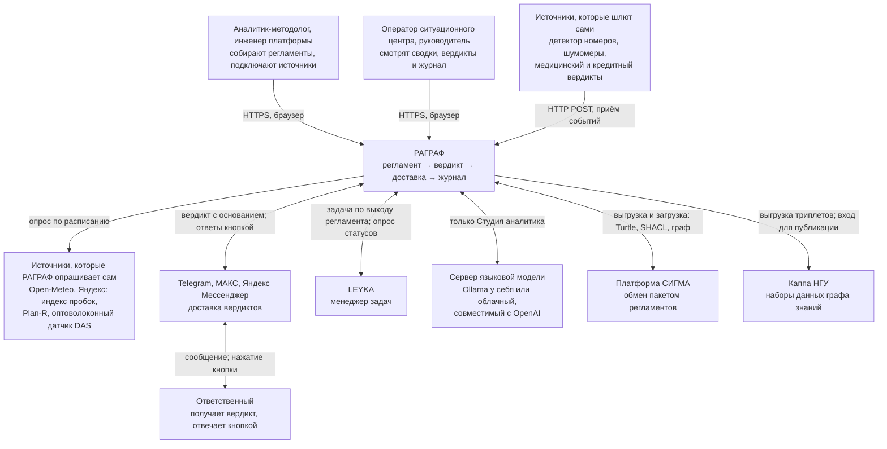
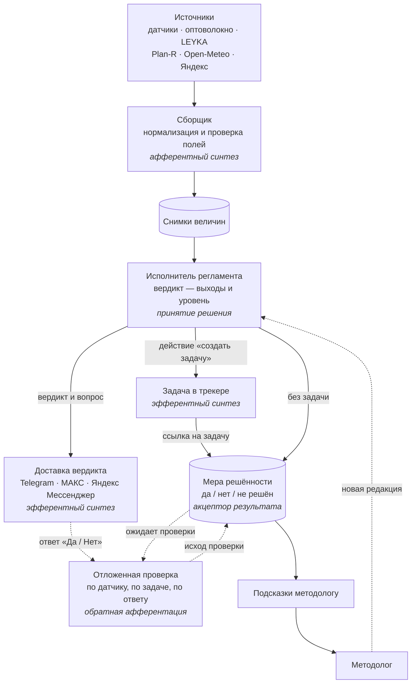
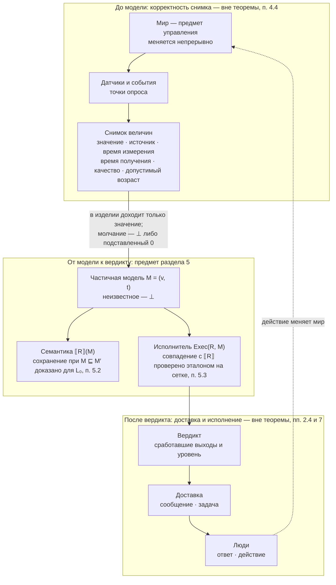
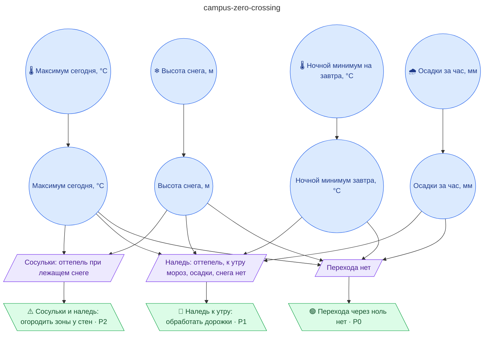
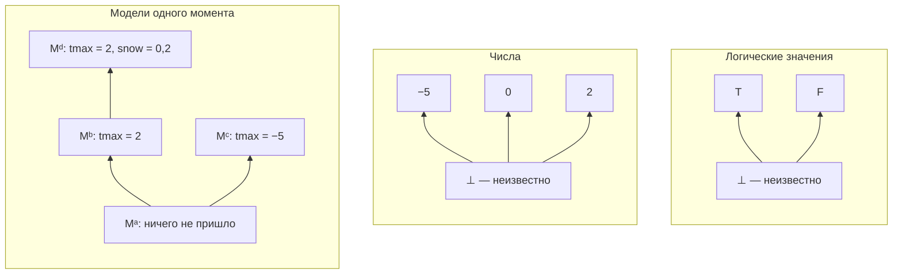
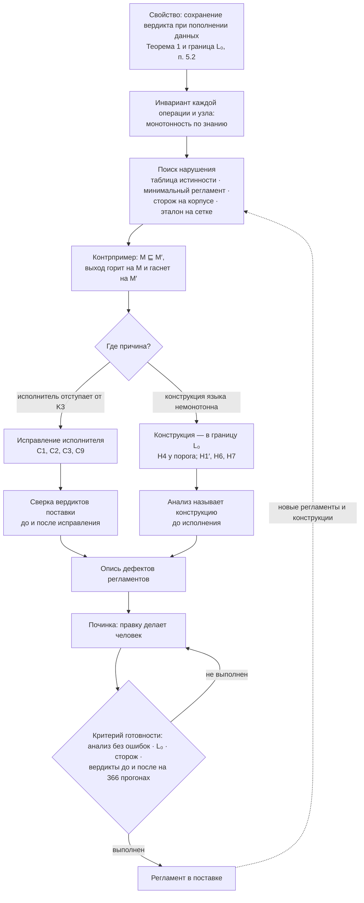
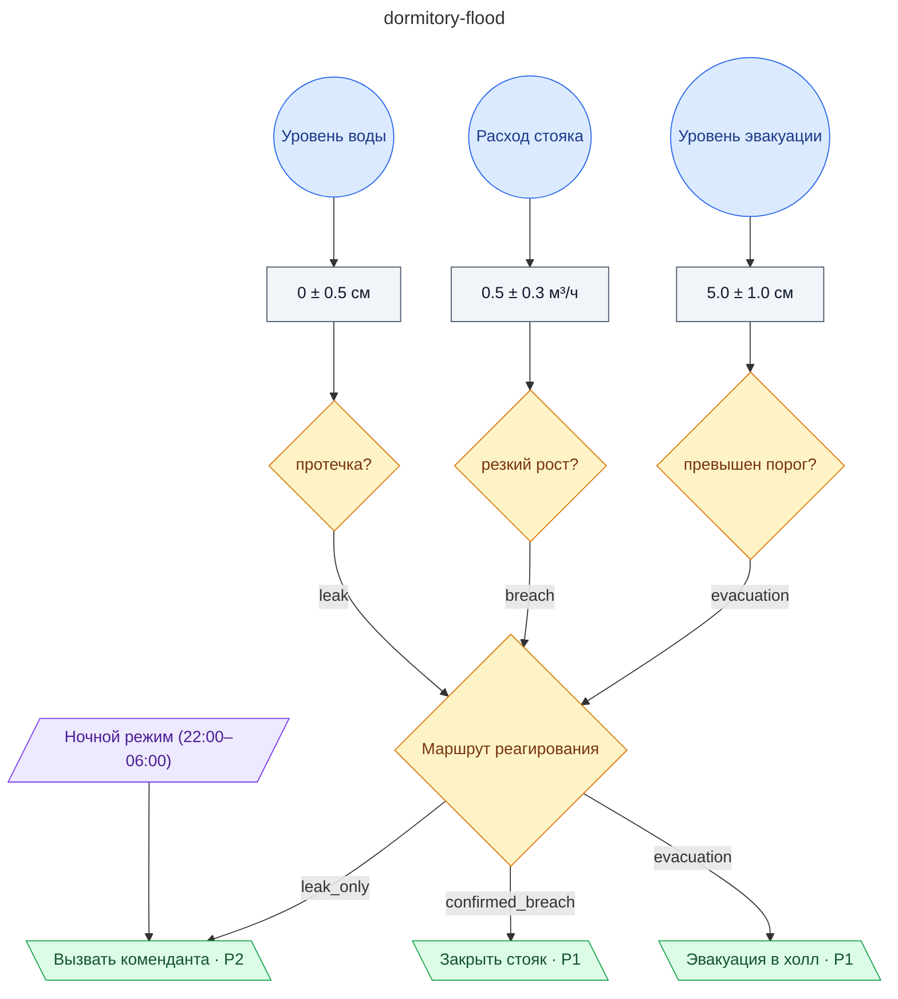
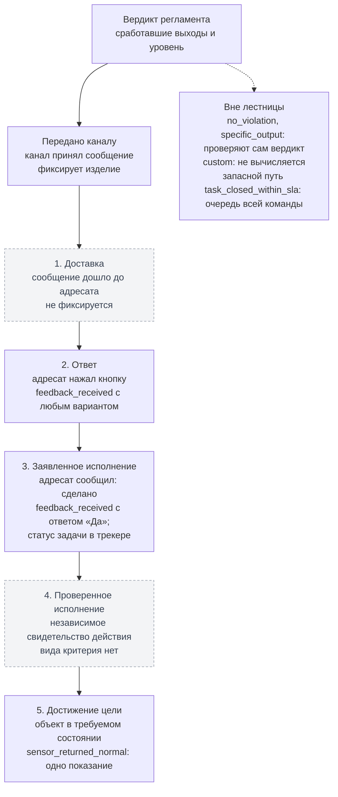
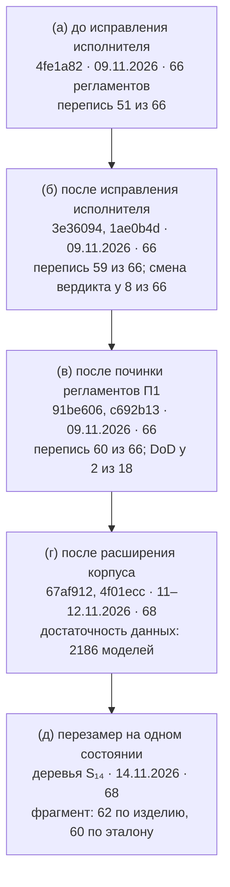

# ОТЧЁТ О НАУЧНО-ИССЛЕДОВАТЕЛЬСКОЙ РАБОТЕ

## Платформа «РАГРАФ» — замкнутый контур «датчик — регламент — задача — человек»
### Итоговый отчёт за 2026 год (этапы 1 и 2), редакция 2.2

---

> **УДК:** [002:004]:316.774
> **ГРНТИ:** 20.01.04
> **Обозначение документа:** РАГРАФ.НИР.002-2026
> **Идентификатор сборки:** SHA-256 частей и источников — `46fd46643ce62f506ab4a518a30fbb09c47f9c0e538b82c025a284082c914716`.
> **Вид отчёта:** итоговый. Редакция 2.2 от 19.11.2026 — по математической рецензии 18.11.2026: дефекты изделия Д1–Д6 устранены, перепись фрагмента переведена на белый список, сложность программы-исполнителя разобрана по коду. Редакция 2.1 — от 17.11.2026; редакция 2.0 от 14.11.2026 написана заново, прежняя редакция 1.4 сохранена черновиком. История редакций — приложение Ж.
> **Изделие:** модуль РАГРАФ — фреймворк регламентов. Состояние кода каждого замера названо в протоколе (приложение В) [1].
> **Правообладатель изделия:** ЦИИ НГУ, с 05.11.2026. **Автор:** Барбашин О. В.
> **Основание:** постановка цели — техническое задание на Фреймворк «Сигма» (уточнённое — 2025 год; ИИ-01-01-01-1/1-ЛУ) [2]; РАГРАФ — стенд этой цели и модуль фреймворка. Задание на сам модуль — РАГРАФ-ФРЕЙМ-1, ред. 3.1 от 09.10.2026; на стадии рабочего проекта — РАГРАФ-ФРЕЙМ-1/2, ред. 7 от 12.11.2026 [3], [4]. Исходное задание на изделие — РГРФ-02-01-01-1/1-ТЗ, ред. 2.1 от 11.06.2026.
> **Стандарт:** ГОСТ 7.32-2017 [5].

---

## Состояние документа

**Чего в документе нет.**
- Печатной формы: она собирается выгрузкой в DOCX со страницы документации изделия.
- Отзывов рецензентов на раздел 5.
- Точного числа страниц: в реферате оно оценено по плотности редакции 1.4 до выгрузки PDF (прил. В, строка 91).
- Перемера чисел на состояниях кода после замера, кроме названных в п. 11.3 и в таблице правок (прил. В, таблица 28).

---

## Лист утверждения

Таблица 1 — Лист утверждения

| Роль | ФИО | Подпись | Дата |
|---|---|---|---|
| Руководитель работы, автор | Барбашин О. В. | _____________ | 17.11.2026 |
| Правообладатель изделия | ЦИИ НГУ | _____________ | |
| Рецензент раздела 5 до совета | Пальчунов Д. Е. (НГУ) | отзыв не получен | |
| Рецензент раздела 5 до совета | Свириденко Д. И. (ИМ СО РАН) | отзыв не получен | |

## Список исполнителей

Таблица 2 — Список исполнителей

| Роль | ФИО | Разделы |
|---|---|---|
| Руководитель и единственный исполнитель | Барбашин О. В. | все разделы |

**Методологическая опора** — авторы научного аппарата, на котором стоит работа. Исполнителями они не являются и в коде не участвовали.

Таблица 3 — Методологическая опора

| Аппарат | Авторы | Где используется |
|---|---|---|
| задачный подход и Σ-программирование | Гончаров С. С., Свириденко Д. И., Витяев Е. Е. (ИМ СО РАН) | пп. 2.1, 3.1, 5.1, 12.1 |
| теория моделей предметных областей, четыре уровня знания | Пальчунов Д. Е. (НГУ) | пп. 2.3, 5.1; прил. М |
| теория функциональных систем, историческое основание | Анохин П. К. | пп. 2.4, 7.1 |
| трёхзначная логика; теория частичных структур | Клини С. К.; Блейми С., Фиттинг М. | пп. 3.1, 5.1, 5.2 |
| методология полиномиальной вычислимости и её теоремы | Гончаров С. С., Нечёсов А. В., Свириденко Д. И. (ИМ СО РАН) | разд. 5; пп. 9, 12.5 |

**Опорные работы предшествующих лет:** НИР ЦИИ НГУ «Фреймворк Сигма», этапы 1 (2024) и 2 (2025), руководитель И. А. Болдырев. Автор участвовал в них внешним экспертом, вне состава исполнителей (п. 1.1).

**Порядок работы.** Код и текст подготовлены руководителем работы совместно с ИИ-агентом. Агент — средство, а не исполнитель; ответственность за содержание несёт руководитель работы.

---

## РЕФЕРАТ

Отчёт: 305 с., 13 рис., 49 табл., 92 источн., 12 прил.

ФРЕЙМВОРК «СИГМА», ЦИФРОВОЙ РЕГЛАМЕНТ, ЯЗЫК РЕГЛАМЕНТОВ, ЗАДАЧНЫЙ ПОДХОД, ФОРМАЛЬНАЯ СЕМАНТИКА, ЧАСТИЧНАЯ МОДЕЛЬ, ТРЁХЗНАЧНАЯ ЛОГИКА КЛИНИ, СОХРАНЕНИЕ ВЕРДИКТА, ФРАГМЕНТ ЯЗЫКА, ЭТАЛОННЫЙ ИНТЕРПРЕТАТОР, ВЕРИФИКАТОР РЕГЛАМЕНТОВ, МОДЕЛЬ МИРА, ЦИФРОВОЙ ДВОЙНИК ОБЪЕКТА УПРАВЛЕНИЯ, ОТРИЦАТЕЛЬНЫЙ РЕЗУЛЬТАТ, УРОВЕНЬ ГОТОВНОСТИ ТЕХНОЛОГИИ

**Объект исследования** — цифровой регламент оперативного управления, записанный графом на языке Flow DSL, и его исполнение в модуле РАГРАФ, когда часть показаний в момент решения отсутствует.

**Цель работы** — довести до опытной эксплуатации средство, замыкающее контур «датчик — регламент — задача — человек», и дать его логике математическое основание: определить семантику регламента, доказать, что вердикт, вынесенный на неполных данных, при их пополнении не отменяется, назвать, где это верно, и проверить, что программа соответствует семантике.

**Метод.** Семантика языка записана отдельно от программы: показания — частичная модель, «неизвестно» — третье значение сильной логики Клини. Для фрагмента языка доказано достаточное условие сохранения вердикта, на каждую конструкцию границы фрагмента построен контрпример. Программа сверена с независимо написанным эталонным интерпретатором на конечной сетке значений: у 49 из 68 регламентов поставки — полным перебором, у 19 — выборкой. Числа сняты на состоянии замера S₁₄; правки после него и повторная сверка названы отдельно.

**Результаты.** Доказано: во фрагменте L₀ — без четырёх конструкций, явно или скрыто проверяющих, пришло ли значение, — сработавший выход не отзывается приходом недостающих показаний того же момента. На состоянии замера S₁₄ эталон и исполнитель совпали по выходам и уровню во всех 9 185 829 прогонах поставки, а на 14 261 271 паре моделей 191 регламента L₀′ трёх наборов — поставки, минимальных и батареи выражений — нарушений сохранения нет; сверка нашла падение исполнителя на целых вне двойной точности. Затем исполнитель и эталон вместе приведены к семантике — числовая область, членство в списке, функции рядов. На состоянии `32e34e7` совпадение — во всех 9 455 109 прогонах поставки из 69 регламентов, вердикты поставки не изменились; на 14 573 160 парах 194 регламентов L₀′ тех же наборов нарушений сохранения нет. После замера встроенная перепись фрагмента переведена на белый список: её метка «сохраняет вердикт» односторонне корректна — регламент с ней лежит в L₀ (Предложение 6), и на трёх наборах она совпадает с классификатором эталона. Граница программы-исполнителя выведена по коду: рост значений и глубина выражения ограничены правилом языка, и программа полиномиальна по построению, хотя степень её границы выше оценки семантики. Это совпадение по выходам и уровню на проверенных входах, а не точность решений: показания поданы по величинам с явным моментом, значения взяты из конечной сетки, сверены только сработавшие выходы и уровень. Из границы теоремы выведен верификатор с паспортом гарантий 42 видов находок; ошибки найдены у 14 регламентов из 68. Контур информационный: предписание формируется и передаётся каналу, реакция регистрируется; достижение управленческой цели в пилоте не подтверждено. Протоколом собственных испытаний подтверждён пятый уровень готовности технологии, шестой и седьмой не подтверждены.

**Новизна** — в методе: граница сохраняющего фрагмента задаётся перечнем конструкций языка, проверяется до исполнения и служит верификатором, а соответствие программы семантике проверяется независимым эталоном. В просмотренных спецификациях DMN и работах по анализу таблиц решений такого фрагмента не найдено.

**Отрицательные результаты.** Теорема, прежде сформулированная для исполнителя, внутри прежнего фрагмента неверна; встроенная проверка видела не всю границу и обещала сохранение вердикта регламентам вне фрагмента — после замера исправлено; рост значений не был ограничен длиной выражения у обеих программ — тоже исправлено; у части программ сбора показаний молчание источника становится нулём или «нормой», и гарантии для таких показаний нет; точность решений не измерена.

**Задел** — окончательность вердикта: на синтетической совокупности в 48 частичных моделях из 1966 у 11 регламентов фрагмента все проверенные пополнения дают предписание, а исполнитель его ещё не выносит; двойник объекта управления над дискретной моделью мира.

**Степень внедрения.** Договоров и актов внедрения нет; две программы для ЭВМ, база данных и ноу-хау подготовлены к регистрации.

**Область применения** — регламенты эксплуатации зданий и сетей, строительного контроля, ситуационного центра и дежурно-диспетчерских служб, городской среды, кампуса, ИТ-поддержки и парковки, где решение должно быть предъявимо: названы пункт нормы, данные и путь вывода.

**Рекомендации:** починить регламенты по описи верификатора; передавать регламенту снимок величины с происхождением и возрастом; вычислить трёхзначный статус выхода; измерить прикладную точность одного выхода кампуса по осмотрам объектов и независимой оценке эксперта; получить акт заказчика.

---

## СОДЕРЖАНИЕ

- Введение
- 1 Путь к постановке: опорные работы 2024–2025 и поиск 2026 года
  - 1.1 Опорные работы: НИР «Фреймворк Сигма», 2024 и 2025
  - 1.2 Линия поиска: от вопроса 2024 года к ответу 2026-го
  - 1.3 Тупики и отказы внутри 2026 года
- 2 Постановка задачи и методологическая опора
  - 2.1 Регламент как задача
  - 2.2 Субъект и предмет управления: два двойника и модель мира
  - 2.3 Уровни знания: в каком смысле регламент — теория
  - 2.4 Контур по теории функциональных систем и лестница подтверждения
  - 2.5 Требования к изделию
  - 2.6 Модуль в задании Фреймворка «Сигма»
- 3 Известные решения и выбор подхода
  - 3.1 Что известно
  - 3.2 DMN и FEEL по свойствам
  - 3.3 Почему выбрано так
- 4 Объект исследования: язык регламентов и его исполнение
  - 4.1 Язык: устройство, происхождение, рост
  - 4.2 Исполнение в изделии
  - 4.3 Трасса и состояния результата
  - 4.4 Снимок величин и его корректность
  - 4.5 Сквозной пример: регламент перехода через ноль
- 5 Формальная модель и сохранение вердикта
  - 5.1 Формальная семантика
  - 5.2 Сохранение вердикта: достаточное условие и граница
  - 5.3 Соответствие программы семантике
  - 5.4 Достаточность данных — задел
  - 5.5 Новизна раздела
- 6 Верификатор регламентов
  - 6.1 Что проверяется до исполнения
  - 6.2 Паспорт гарантий
  - 6.3 Цепочка метода
  - 6.4 Замер по корпусу и опись дефектов
  - 6.5 Новизна и пределы верификатора
- 7 Замкнутый контур и пилот модуля
  - 7.1 Контур
  - 7.2 Стенд этапа 1
  - 7.3 Готовность модуля
  - 7.4 Натурные находки
  - 7.5 Регламенты поставки на трёх платформах
  - 7.6 Производительность
- 8 Граф знаний в запросе Студии
- 9 Прочие результаты
- 10 Стенд и измерения
  - 10.1 Состав стенда
  - 10.2 Методика
  - 10.3 Проверки изделия
- 11 Отрицательные результаты и пределы
  - 11.1 Опровергнутые гипотезы и утверждения
  - 11.2 Ограничения метода
  - 11.3 Дефекты реализации и поставки
  - 11.4 Неподтверждённое
- 12 Новизна и чужое
  - 12.1 Что известно
  - 12.2 Что своё
  - 12.3 Сравнение с языками решений
  - 12.4 Что не заявляется
  - 12.5 Оракулы и полиномиальность: что заявляется и что нет
- 13 Публикации, результаты интеллектуальной деятельности, внедрение, уровень готовности
- 14 Связь с комплектом программной документации
- Заключение
- Список использованных источников
- Приложение А. Ведомость приоритезации результатов
- Приложение Б. Ведомость сведения «задача — результат — доказательство»
- Приложение В. Протокол замеров
- Приложение Г. Что изменено при сборке относительно черновиков этапов
- Приложение Д. Паспорт гарантий верификатора
- Приложение Е. Паспорта экспериментов
- Приложение Ж. История редакций
- Приложение И. Паспорт решения: демонстрация выразительности языка
- Приложение К. Примеры из поставки
  - К.1 Сквозной регламент в трёх представлениях языка
  - К.2 Регламенты трёх платформ на неполных данных
  - К.3 Регламент штрафа до и после починки
  - К.4 Сообщение в чат и мост графа знаний
- Приложение Л. Доказательства
  - Л.1 Белый список конструкций выражений (п. 5.1)
  - Л.2 Доказательство Леммы 1 (п. 5.1)
  - Л.3 Доказательство Предложения 1 (п. 5.1)
  - Л.4 Доказательство Леммы 3 (п. 5.2)
  - Л.5 Доказательство Леммы 2 (п. 5.1)
  - Л.6 Доказательство Следствия 1.1 (п. 5.2)
  - Л.7 Доказательство Предложения 2 (п. 5.2)
  - Л.8 Доказательство Следствия 2.1 (п. 5.2)
  - Л.9 Доказательство Леммы 4 (п. 5.2)
  - Л.10 Доказательство Леммы 5 (п. 5.4)
  - Л.11 Доказательство Предложения 3 (п. 5.1)
  - Л.12 Доказательство Предложения 4 (п. 5.4)
  - Л.13 Доказательство Теоремы 2 (п. 5.4)
  - Л.14 Доказательство Предложения 5 (п. 5.4)
  - Л.15 Доказательство Предложения 6 (п. 6.2)
- Приложение М. Граф знаний в запросе Студии
  - М.1 Где граф знаний входит в запрос
  - М.2 Замеры
  - М.3 Что из этого следует
- Приложение Н. Второй стенд: прогноз загрузки бригад ЖКХ с мерой неопределённости
  - Н.1 Место стенда
  - Н.2 Данные
  - Н.3 Правило
  - Н.4 Что измерено
  - Н.5 Порог как отношение цены ошибки к пользе
  - Н.6 Связь с регламентами РАГРАФ
  - Н.7 Отрицательные результаты и пределы
  - Н.8 Погода: тот же порядок

---

## ТЕРМИНЫ, ОПРЕДЕЛЕНИЯ И СОКРАЩЕНИЯ

В отчёте применяют следующие термины с соответствующими определениями; включены термины, употребляемые в особом значении. Точные определения формальных понятий — в разделе 5, номер определения указан в скобках.

**Цифровой регламент** — регламент, записанный как задача из четырёх компонентов задачного подхода — предметная область, запрос, критерий решённости, контекст — так, что её исполняет программа [6]. В изделии хранится тремя файлами: данные в Turtle, контракт величин в SHACL, граф логики на Flow DSL (п. 2.1).

**Цифровой двойник субъекта управления (ЦД СУ)** — «набор исполняемых спецификаций на машинно-исполняемом языке, отражающих логику действий субъекта в рамках управления объектом в определённом задачном пространстве», вместе с инфраструктурой их исполнения [7]. РАГРАФ — такой двойник (п. 2.2).

**Цифровой двойник объекта управления (ЦД ОУ)** — «непрерывно адаптируемая цифровая модель объекта управления, дублирующая его состояния и жизненный цикл» [7]. Для изделия — направление развития: модель, которая восстанавливает состояние мира между точками наблюдения и даёт прогноз с мерой неопределённости. Образцы по роли (п. 2.2): первый — блок приёма и склейки событий видеодетектора номеров на парковке, состояние между событиями; второй — прогноз загрузки бригад ЖКХ проекта РАГРАФ-ПРОГНОЗ на стенде СИМА, прогноз с мерой неопределённости (прил. Н).

**Предмет управления** — то, чем управляет субъект: здания и кровли, сети, дороги, воздух, парковка, строительный проект. Для ЦД СУ это внешний мир, а не уровень знания (п. 2.2).

**Модель мира** — то, что о предмете управления известно регламенту в момент решения. В изделии она дискретна: мир виден только в точках опроса и в событиях, между ними состояние неизвестно, а на вход идёт последнее значение без предела давности (пп. 2.2, 4.4).

**Снимок величин** — значения величин на момент прогона, которые получает исполнитель, то есть частичная модель M = (v, t) этого момента. Корректность снимка — отдельное от свойств исполнения свойство: известная величина измерена в момент t или с допустимой давностью, из названного источника и с приемлемым качеством, а неизвестная осталась ⊥ (п. 4.4).

**Сборщик** — программа изделия, которая получает показания источника опросом или событием, приводит поля к величинам регламента и записывает их в снимок (рисунок 3).

**Канал параметров** — подача показания по имени величины; другие привязки показания — к узлу-датчику и к типу датчика (п. 4.2).

**Частичная модель** — пара M = (v, t): частичная функция показаний v из величин регламента в конечные числа двойной точности и момент t (Определение 2); прецедентный уровень модели знаний [8]. Модель тотальна, если показание есть у каждой величины.

**Пополнение** — модель M′ пополняет M, M ⊑ M′, если момент тот же, а показания M сохранены и, возможно, добавлены новые (Определение 2). Изменение показания со временем — не пополнение, а другая модель с другим моментом.

**Монотонность по знанию** — пополнение аргумента не меняет уже определённого результата: ⊥ может стать значением, а определённое значение остаётся тем же (Лемма 3).

**Контракт** — для каждой величины q границы lo_q, hi_q — числа двойной точности или ±∞, которыми при загрузке стали границы SHACL, — и допустимые значения I_q = D ∩ [lo_q; hi_q] (Определение 1; правило загрузки — п. 5.1). **Допустимые пополнения** Comp_C(M) — тотальные модели, которые пополняют M и удовлетворяют контракту; модель допустима, если Comp_C(M) ≠ ∅, то есть известные показания лежат в своих I_q, а у неизвестных величин I_q не пусты (Определение 4, Предложение 1). В поставке все контракты — ящики, а показания вне контракта изделие не отвергает (пп. 4.4, 5.1).

**Формальная семантика ⟦R⟧** — множество выходов регламента R, сработавших на модели M по Определению 3: до обхода, обход до наименьшей неподвижной точки, выбор ветвей развилок, дообход, вердикт. Спецификация снята с исходного текста исполнителя и записана отдельно от кода; непредставимый числовой итог в ней — ошибка значения ε в каждой операции, а исполнитель на состоянии замера считал такие итоги внутри выражения по правилам Python (п. 4.2). Для регламента из L₀, у которого имена вне области видимости стоят только в мёртвых выражениях, выход срабатывает тогда и только тогда, когда истинна его формула φ_o в сильной логике Клини (Лемма 2).

**Передача значения** — стратегия узла-сравнения с одной величиной и без уставки: узел срабатывает, когда значение известно, и передаёт его дальше; в переводе в K3 это атом Изв (п. 5.1).

**Сквозной проход** — узел-сравнение, к которому не применима ни одна стратегия: нет операции или входов, операция не распознана, «вне коридора» без порога и коридора. Достигнутый, он срабатывает без теста и значения не несёт (п. 5.1).

**Теория регламента** — определения выходов T_R^def вместе с контрактом C (Определение 8). Определение выхода — правило метаязыка ‖Out_o‖_M := ‖φ_o‖_M: значение атома «выход o сработал» на модели равно значению его формулы. Это не формула Out_o ↔ φ_o, обязанная быть истинной на модели: в K3 при ‖φ_o‖_M = ⊥ она равна ⊥ при любом значении Out_o. Теория говорит не о том, что выходы истинны, а о том, когда истинен каждый.

**Вердикт** — множество сработавших выходов регламента и его уровень, то есть наибольший приоритет среди них. Если не сработал ни один выход, уровень равен 0 и регламент молчит (п. 4.1).

**Исполнитель** — программа изделия, которая вычисляет вердикт: при явном моменте Exec(R, M) — множество сработавших выходов либо отказ исключением. Соответствие программы семантике — равенство Exec(R, M) = Success(⟦R⟧(M)); где оно проверено, сказано в п. 5.3.

**Сохранение вердикта** — свойство: из M ⊑ M′ следует ⟦R⟧(M) ⊆ ⟦R⟧(M′). Выход, сработавший на неполных данных, не отзывается приходом недостающих показаний того же момента (Теорема 1); допустимость действия по выходу это свойство не устанавливает.

**Граница фрагмента** — перечень конструкций, запрещённых во фрагменте; у L₀ это Н1, Н4, Н6, Н7 (Определение 5). Общая природа конструкций границы — явный или скрытый тест определённости: они наблюдают, пришло ли значение.

**Фрагмент L₀** — регламенты, которые удовлетворяют общим условиям О1–О3 и не содержат Н1, Н4, Н6, Н7 (Определение 5); для них сохранение вердикта семантики доказано. Это математический класс. Перечни регламентов строят две переписи, и их метки значат разное (п. 5.3, таблица 18):
- «в L₀′» — классификатор эталона не нашёл ни конструкции границы, ни нарушенного условия; он отличается от L₀ в обе стороны, но на поставке даёт то же множество;
- признак изделия «сохраняет вердикт» — перепись изделия проверила каждое условие Определения 5 и причин не нашла. Метка односторонне корректна: регламент с ней лежит в L₀ (Предложение 6, п. 6.2). До правки `4fd855e` перепись видела только Н1 с литералом `None` и Н4, и признак был диагностикой и оценкой L₀ сверху.

**Перепись** — синтаксический подсчёт конструкций границы по регламентам корпуса, без исполнения. Обе переписи — изделия и эталона — проверяют всю границу и условия О2–О4 по белому списку (пп. 5.3, 6.2); до правки `4fd855e` перепись изделия видела Н1 только с литералом `None` и Н4. Метка переписи становится гарантией сохранения, только если доказана её односторонняя корректность: всякий помеченный регламент лежит в L₀ (п. 5.3). Для переписи изделия она доказана — Предложение 6 (п. 6.2).

**Поставка** — регламенты из дистрибутива изделия; на S₁₄ — 68 в 16 областях, из них 17 демонстрационных (п. 4.1).

**Окончательность вердикта** — вердикт на допустимой модели M окончателен, если ⟦R⟧(M*) = ⟦R⟧(M) для всякого M* ∈ Comp_C(M); исход определён, если ⟦R⟧ постоянен на Comp_C(M) (Определение 9). Вердикт окончателен, когда исход определён и совпадает с вынесенным (п. 5.4).

**Индикация окончательности** — слово изделия при вердикте ручного прогона: «все показания есть», «окончательный» или «предварительный». Пополнения перебираются на конечной сетке тем же исполнителем, поэтому это проверка на сетке, а не доказательство (пп. 4.3, 5.4).

**Сетка** — конечное множество значений каждой величины вокруг критических точек регламента: края контракта, уставки и допуски порогов, границы зон, у эталона — ещё и константы выражений (п. 10.2). Перебор и поиск пополнений идут по сетке, поэтому их итог — проверка, а не доказательство.

**Эталонный интерпретатор** — вторая реализация семантики, написанная по спецификации, а не по коду исполнителя: свои разбор поставки и вычислитель выражений, обход — наименьшая неподвижная точка раундами [9]. Его независимость кончается на общей среде Python и на спецификации, снятой с кода (п. 5.3).

**Батарея выражений** — регламенты стенда эталона, по одному на проверяемое выражение; на S₁₄ их 109 (п. 10.1).

**Минимальный регламент** — регламент из нескольких узлов, построенный для одной конструкции языка или операции; на нём ищется и показывается контрпример (пп. 5.2, 6.3).

**Сторож** — автоматическая проверка в наборе проверок изделия, которая падает при нарушении названного свойства (п. 10.3).

**Верификатор регламентов** — проверки, которые изделие выполняет над регламентом до исполнения, без показаний. Центральные из них выведены из границы Теоремы 1, модели исполнения и сверки графа с тем, что исполнитель делает молча (п. 6.1).

**Паспорт гарантий** — сведения о каждом виде находки верификатора: свойство, предпосылки, род вывода, ложные находки, пропуски, обоснование и сложность (п. 6.2, приложение Д).

**Цепочка метода** — путь от свойства к починке: нарушенный инвариант → минимальный контрпример → исправление исполнителя → дефект регламента → починка (п. 6.3).

**Трасса прогона** — пояснение каждого узла к вердикту; по ней различаются причины молчания (п. 4.3).

**Критерий решённости** — заданный до решения вид проверки исхода регламента, один из шести видов изделия (п. 2.4).

**Лестница подтверждения** — ступени силы сведений о результате: доставка, ответ, заявленное исполнение, проверенное исполнение, достижение цели (п. 7.1).

**Оракул** — источник, который отвечает регламенту, а не вычисляется им: датчик, сборщик, модель модуля, человек, часы; в НИР «Фреймворк Сигма» — внешний вычислитель [7]. Формальная модель работы проще — частичный поставщик данных, то есть снимок M (п. 12.5). Места, где значение входа регламента вычисляет код вне графа, — оракулы изделия (п. 9). Языковая модель в граф регламента не включается.

**Студия аналитика** — часть изделия, где аналитик задаёт вопросы о регламентах и нормах; отвечает языковая модель с поиском по своду норм и по графу знаний. Вердиктов Студия не выносит, регламент не правит (п. 2.5, прил. М).

**«Сигма»** — имя двух разных объектов. Фреймворк «Сигма» — программно-аппаратный комплекс по техническому заданию ЦИИ НГУ [2]; в редакции задания 2.1 — серверное ядро, на котором строится Платформа СИГМА — прикладное решение для муниципальных служб: мониторинг объектов инфраструктуры, обработка событий, контроль реагирования [10]; в документах изделия РАГРАФ назван модулем Платформы (п. 2.6). Методология «Сигма» — методология программирования с гарантированной полиномиальной сложностью Гончарова С. С., Нечёсова А. В., Свириденко Д. И. [11]; в отчёте она называется методологией полиномиальной вычислимости. Σ-программирование [12] — более раннее понятие той же школы.

**СИМА** — система интеллектуального муниципального анализа: инициативный демонстрационный стенд ЦИИ НГУ на открытых данных Новосибирска, работа Барбашина О. В. Стоит рядом с Фреймворком «Сигма», а не входит в него; это и не Платформа СИГМА, и не ассистент «Сигма» Студии аналитика, до 05.11.2026 называвшийся «Сима». В работе — второй испытательный стенд: модель объекта управления, прогноз загрузки бригад ЖКХ с мерой неопределённости (прил. Н) [13].

**РАГРАФ-ПРОГНОЗ** — проект прогнозов с проверяемой надёжностью для решений мэрии, имя с 18.11.2026; испытан на стенде СИМА. Его отчёт РАГРАФ-ПРОГНОЗ.НИР.001-2026 — дополнение к настоящему: здесь краткое изложение (прил. Н), там полный текст [13].

**Выпуск прогноза** — прогноз, выданный поставщиком, с моментом выпуска, идентификатором и версией правил прогноза. Повторный расчёт с тем же содержимым — тот же выпуск; новый выпуск — новый снимок величин, а не пополнение прежнего (п. 12.5). Момент выпуска говорит, когда прогноз посчитан, но не по каким данным.

**Возраст выпуска** — время от момента выпуска до момента прогона, отдельная величина регламента. Давность данных в основе выпуска — другая величина: выпуск может быть свежим, а данные — старыми (п. 12.5).

**Платформа АРХИ** — система управления строительными проектами и регламентами для работы в составе Фреймворка «Сигма», отдельный от РАГРАФ продукт. В цели этапа 1 — домен «Строительство и инфраструктура», на котором показывается применимость изделия [14] (п. 7.2).

**«Умный кампус POLIGON»** — экран изделия с регламентами и показаниями кампуса НГУ; вместе со «Стройкой · Plan-R» и «Ситуационным центром» — одна из трёх платформ изделия (п. 7.5).

### Обозначения

**Знак ⊥ — не перпендикуляр.** Он читается «неизвестно», а в теории порядков — «дно»: наименьший по знанию элемент, значение, которого ещё нет. **В этом отчёте ⊥ везде значит «неизвестно» и никогда — «ложь» или «ноль».** На этом различии и держится работа: молчащий датчик даёт ⊥, а не «норму».

Таблица 4 — Обозначения

| Обозначение | Как читается | Что значит | Пример |
|---|---|---|---|
| ⊥ | «неизвестно», «дно» | значения нет: показание не пришло или условие нельзя вычислить; в коде — `None` | `x > 5` при неизвестном x даёт ⊥ |
| ε | «ошибка значения» | итог операции, у которого нет значения среди конечных чисел двойной точности: деление на ноль, выход из области функции, показатель степени по модулю больше 1024, несовместимые типы операндов, итог ±∞, NaN, комплексное число или целое вне диапазона. Узел с ε не срабатывает; внутри выражения ε сильнее ⊥, но связка и членство в списке её поглощают, если решает другой операнд; для порядка знания ε склеена с ⊥ | `2 ** 1024` |
| K3 | сильная трёхзначная логика Клини | логика со значениями T, F, ⊥ [15]: «неизвестно» не превращается в T или F без основания | — |
| ∧, ∨, ¬ | «и», «или», «не» | связки; в формулах — `and`, `or`, `not`. В K3: F ∧ ⊥ = F, T ∨ ⊥ = T, ¬⊥ = ⊥, в остальных случаях с ⊥ — ⊥ | `x > 5 and y > 5` при x = ⊥, y = 3 даёт F |
| R = (N, E, P, C, pr) | «регламент» | узлы N, рёбра E, величины P, контракт C, приоритеты pr выходов O ⊆ N (Определение 1) | — |
| M = (v, t) | «модель» | частичная модель: показания v в момент t | — |
| v: P ⇀ D | «частичная функция из P в D» | для части величин показание есть, для остальных нет; D — конечные числа двойной точности | — |
| M ⊑ M′ | «M′ пополняет M» | в M′ те же показания и, возможно, новые; момент тот же | M: есть давление; M′: давление и температура |
| ⟦R⟧(M) | «семантика регламента на M» | множество сработавших выходов по формальной семантике | — |
| Exec(R, M) | «исполнение» | ответ исполнителя изделия: Success — множество сработавших выходов, Failure — исключение | — |
| L(M) | «уровень вердикта» | наибольший приоритет сработавшего выхода; L(∅) = 0 | — |
| C, I_q, Comp_C(M) | «контракт», «допустимые значения q», «допустимые пополнения» | границы lo_q, hi_q, загруженные из SHACL; I_q = D ∩ [lo_q; hi_q] — конечные числа двойной точности между ними; допустимые тотальные пополнения M | без границ I_q = D |
| φ_o, Out_o | «формула выхода», «выход o сработал» | условие выхода o в K3 и атом выхода; значение атома задаёт правило метаязыка ‖Out_o‖_M := ‖φ_o‖_M (Определение 8) | при ‖φ_o‖_M = ⊥ и ‖Out_o‖_M = ⊥ |
| ⊆ | «содержится в» | каждый элемент левого множества есть в правом | ⟦R⟧(M) ⊆ ⟦R⟧(M′): сработавшее не погаснет при пополнении |
| min ≤ v < max | полуоткрытая зона развилки | нижняя граница включена, верхняя — нет; соседние зоны стыкуются без дыр и перекрытий | зоны `[0; 30)` и `[30; +∞)` |
| О1–О4 | «общие условия» | О1 — момент фиксирован; О2 — граф ациклический, у каждой величины один вход; О3 — выражения формул и узлов времени составлены из конструкций белого списка, строка стоит в них только на месте имени величины и окна функции рядов, а имя вне области видимости не стоит там, куда вычисление может впервые дойти при пополнении модели: в ветви условного выражения, во втором и следующих сравнениях цепочки, в операнде арифметики, сравнения, членства, вызова функции или списка, перед которым вычисляется операнд со связкой, членством в списке или вызовом `is_night`; мёртвое выражение, у которого нет значения ни на одной модели, от О3 освобождено; О4 — приоритеты неотрицательны, нужно только для уровня (Определение 5) | — |
| L₀ | «эль-ноль» | регламенты, удовлетворяющие О1–О3, без Н1, Н4, Н6, Н7; для них доказано сохранение вердикта | `campus-zero-crossing` (п. 4.5) |
| L₀′ | «эль-ноль-штрих» | регламенты, которые к L₀ относит классификатор эталона; как он соотносится с L₀ — п. 5.3 и прил. Л.1 | — |
| Н1 | тест `==` / `!=` | любой тест равенства или неравенства в выражении формулы или узла времени, в том числе с `None`: в языке он отвечает определённо и при неизвестном операнде; узел-сравнение «равно» в границу не входит | `x if x != None else 7` |
| Н1′ | тест `==` / `!=` без `None` | часть Н1: равенство или неравенство, ни один операнд которого не литерал `None`; до правки `4fd855e` перепись изделия её не видела (п. 5.3) | `x != 5`, `hour() == 23` |
| Н4 | несколько корней у узла | несколько различных корней значения у узла, классифицирующего одно значение: у порога и у развилки в режиме «границы»; корень входа — его величина | два входа в один порог |
| Н6 | связка с нелогическим операндом | `and` / `or` с операндом не логического типа (идиома умолчания) | `x or 5` |
| Н7 | узел за развилкой | ветвь развилки ведёт в узел, который не выход | развилка ведёт в другую развилку |
| Н2, Н3 | снятые конструкции | членство `in` и метки на входах развилки: монотонны после исправления исполнителя (п. 6.3) | — |
| Н5 | будущая граница | функции рядов по истории отсчётов: с историей они станут немонотонны, теорема их не покрывает | `rate("p", "1h") > 5` |
| Δ | «тест определённости» | Δθ = T, если значение есть, и F, если его нет; немонотонен и в K3 не выражается | `x == None` — это ¬Δx |
| С1, С2, С3, С9 | отступления исполнителя от K3 | найдены и исправлены: членство, метки развилки, несовпавшая метка, ошибка значения в связке; номера — из разбора вычислителя [16] | С9 — ошибка значения в связке |
| R1b, R2, R3, R4 | минимальные регламенты-контрпримеры | нарушают сохранение внутри прежней границы: R1b — Н1′, R2 и R3 — Н6, R4 — Н7 (таблица 17) | R1b: `x != 5` → выход |
| П1, П2, П3 | фазы починки поставки | механические правки; варианты правки, которые выбирает методолог; вопросы о назначении регламента (п. 6.4) | П1 — `dormitory-flood`, `traffic-speed-fine` |
| П-1, П-2, … | работы до сдачи | работы, которые программа испытаний ставит между изделием и сдачей (п. 7.3) | П-6 — журнал решений без трассы |
| S₁₄ | «состояние замера» | состояние кода и корпуса, на котором 14.11.2026 сняты текущие числа отчёта: 68 регламентов поставки в 16 областях; правки после замера — п. 11.3 и таблица 28 | — |

Общая природа Н1, Н4, Н6, Н7 — **явный или скрытый тест определённости**: Н1 спрашивает «пришло ли значение», Н4 и Н6 берут «первое определённое», Н7 делит узлы на «достигнут обходом» и «нет». Граница L₀ — конструкции, наблюдающие отсутствие ответа (пп. 5.2, 12.5).

**Теорема 1 простыми словами.** Пока часть показаний неизвестна, регламент выносит вердикт по тому, что известно, — или молчит. Когда показания того же момента приходят, ⊥ заменяются значениями. Если регламент принадлежит L₀ — в нём нет Н1, Н4, Н6, Н7 и выполнены общие условия О1–О3, — вердикт может только дополниться: новые выходы могут зажечься, а сработавшие не погаснут; при неотрицательных приоритетах уровень не падает. Это утверждение о семантике ⟦R⟧; о программе утверждается лишь, что эталон на конечной сетке с ней совпал (п. 5.3). О новом моменте — следующем опросе — теорема не говорит (п. 2.2).

**Обозначения на одном примере.** Регламент из одного датчика температуры, развилки и трёх выходов: ниже −20 °C — «мороз», от −20 до +10 — «холодно», от +10 — «нормально». Модели обозначим по показанию температуры. В модели M(⊥) температура не пришла: ⟦R⟧(M(⊥)) = ∅ и L(M(⊥)) = 0, потому что ⊥ — не «ноль» и не «нормально», и вердикта, который можно потерять, нет. В модели M(−25) температура −25 °C: M(⊥) ⊑ M(−25) и ⟦R⟧(M(−25)) = {«мороз»}. Модели M(−25) и M(0) несравнимы: у них разные значения одной величины, а не больше знания. Ровно −20 — «холодно», ровно +10 — «нормально»: зоны полуоткрыты и стыкуются без дыр и перекрытий. При нескольких входах Теорема 1 говорит: сработавшее не погаснет, когда придут остальные показания того же момента.

При n входах частичных моделей 2ⁿ видов по тому, какие входы пришли. У сквозного примера п. 4.5 входов четыре, видов 16. Там же видна окончательность: если известен только максимум −5 °C, обе тревоги ложны, F ∧ ⊥ = F, статусы всех выходов определены, и по Теореме 2 вердикт «перехода нет» окончателен (п. 4.5, прил. К.2).

**Граница L₀ на регламентах поставки.** Что такое конструкции границы — на настоящих регламентах: какие у них входы и выходы и что происходит на неполных данных (таблица 5). Регламенты стоят там, куда их относит перепись изделия; нарушение найдено поиском и проверено прямым прогоном исполнителя; согласие таблицы с поставкой и исполнителем держит сторож примеров отчёта (п. 10.3). Н6 и Н7 в таблицу не вошли: Н6 в поставке стоит только в формулах, которые падают ошибкой имени при любом означивании, Н7 в поставке нет; их контрпримеры — п. 5.2.

Таблица 5 — Граница L₀ на регламентах поставки
<!-- primer: granica -->
| Конструкция | Регламент поставки | Входы → выходы | Что происходит на неполных данных |
|---|---|---|---|
| L₀ — во фрагменте | `campus-zero-crossing`, кампус (п. 4.5) | максимум сегодня, минимум на завтра, высота снега, осадки → «перехода нет», «наледь», «сосульки» | «сосульки» при оттепели и снеге не гаснут, какой бы прогноз ни пришёл |
| Н1 — тест определённости | `campus-heat-feedback-balance`, кампус: читает ответы людей в чате | среднее по ответам (°C), ответов за 72 ч, «отопление включено (1/0)», часов без ответа на поручение → «оснований нет», «перетоп», «недотоп», «отопление не включено», «эскалация» | формула `heatingOnConfirmed if heatingOnConfirmed != None else 1`: пока ответа об отоплении нет, она считает его включённым. При 24 °C, трёх ответах и 23 часах без ответа — «перетоп» и «эскалация». Пришёл ответ «отопление не включено» — «перетоп» гаснет, горят «оснований нет» и «отопление не включено» |
| Н4 — несколько величин у порога | `support-sla-critical`, ИТ-поддержка | порог «Реакция: 15 [5…60]» читает «возраст тикета, мин» и «SLA реакции, мин» → эскалации | порог берёт первое значение, какое есть: без возраста тикета он сравнивает саму уставку SLA. Нарушения поиск не нашёл — второй источник здесь вход без параметра (п. 11) |
| Н4 — до починки П1 | `traffic-speed-fine`, редакция `6868eae` | скорость, лимит зоны, уставки 20 и 40 км/ч → постановления первой и высшей ступени | без уставок — «постановление высшей ступени»; пришли уставки — оно гаснет, горит первая ступень. Починено (п. 6.4) |
| Н2 — членство, снята 09.11.2026 | `nsu-parking-anpr`, демонстрационный | номер на въезде, телефон → «открыть шлагбаум», «запрос оператора», «отказ во въезде» | `plate in allowlist_plates`: до 09.11.2026 при неизвестном номере членство давало определённую ложь — «номера нет в списке» — ещё до того, как номер пришёл. Теперь — неизвестно |
| Н3 — метки развилки, снята 09.11.2026 | `dormitory-flood`, кампус (рисунок 8) | уровень воды, расход стояка, уровень эвакуации → комендант, задвижка стояка, эвакуация | метки `leak`, `breach`, `evacuation` на рёбрах в развилку принимало только первое ребро обхода, и вердикт зависел от порядка узлов в файле. Теперь метки снимаются со всех пройденных рёбер |
| Н5 — будущая граница | только урок 5, `tutorial-05-rate-of-change`: в поставке функций рядов больше нет | уровень воды → «наблюдение», «закрыть задвижку» | `rate("waterLevel", "1h") > 5` без истории отсчётов всегда даёт ⊥ (п. 4.4) |

### Сокращения

Таблица 6 — Сокращения

| Сокращение | Расшифровка |
|---|---|
| ВИЛНС | Вера, Истина, Любовь, Надежда, София — слои паспорта решения (прил. И) |
| ВОЗ | Всемирная организация здравоохранения |
| ГИП | главный инженер проекта |
| ДТП | дорожно-транспортное происшествие |
| ЕДДС | единая дежурно-диспетчерская служба |
| ЕСПД | Единая система программной документации |
| НБКИ | Национальное бюро кредитных историй |
| НМУ | неблагоприятные метеоусловия |
| ОСШ | отношение сигнал/шум |
| ПДК | предельно допустимая концентрация загрязняющего вещества |
| ПДН | показатель долговой нагрузки заёмщика |
| ПДн | персональные данные |
| РИД | результаты интеллектуальной деятельности |
| СанПиН | санитарные правила и нормы |
| ТФС | теория функциональных систем П. К. Анохина |
| ЦД ОУ | цифровой двойник объекта управления |
| ЦД СУ | цифровой двойник субъекта управления |
| ЦИИ НГУ | Центр искусственного интеллекта Новосибирского государственного университета |
| ЭПР | экспериментальный правовой режим |
| CAMS | служба мониторинга атмосферы программы Copernicus и её модель состава воздуха |
| CSI | индекс критического успеха — доля верных срабатываний среди всех срабатываний и пропусков (п. 11.4) |
| DAS | распределённое акустическое зондирование — датчик на оптоволоконном кабеле |
| DMN | нотация моделирования решений (Decision Model and Notation) — стандарт OMG |
| DoD | критерий готовности починки регламента (п. 6.4) |
| DTI | отношение долговых платежей заёмщика к доходу |
| ECMWF IFS | модель прогноза погоды Европейского центра среднесрочных прогнозов погоды (прил. Е) |
| ERA5, ERA5-Land | реанализы погоды службы Copernicus Climate Change Service |
| FAR | доля ложных тревог среди срабатываний (прил. Е) |
| FEEL | язык выражений DMN |
| Flow DSL | графовый язык регламентов изделия [17] |
| IEM | Iowa Environmental Mesonet — открытый архив метеосводок Университета штата Айова |
| K3 | сильная трёхзначная логика Клини |
| KYC | идентификация клиента («знай своего клиента») |
| METAR | регулярная авиационная метеорологическая сводка аэропорта |
| PD | вероятность дефолта заёмщика |
| PM2.5 | взвешенные частицы размером до 2,5 мкм |
| POD | доля обнаруженных событий (прил. Е) |
| PROV-O | онтология происхождения данных W3C |
| RAG | генерация, дополненная поиском; GraphRAG — её вариант с графом знаний |
| SHACL | язык ограничений форм W3C; в изделии — контракт величин |
| SLA | соглашение об уровне обслуживания: сроки реакции и решения по заявке |
| TCK | набор тестов совместимости движков DMN |

---

## ВВЕДЕНИЕ

### Основание и замысел

Цель проекта поставлена техническим заданием на Фреймворк «Сигма» [2] — программно-аппаратный комплекс для разработки, сопровождения и управления жизненным циклом систем проактивного управления городской инфраструктурой; задание требует декларативного языка регламентов для бизнес-аналитиков. РАГРАФ — стенд этой цели и модуль фреймворка: на нём постановку задания можно проверить исполнением целиком — от показания датчика до задачи человеку и проверки исхода. Что из задания модуль закрывает и что остаётся за платформой, сказано в п. 2.6.

Стенд сразу поставил вопрос, который задание оставляет открытым: на каком языке аналитик без программиста записывает логику регламента (п. 4.1). Ответ — Flow DSL, визуальный граф логики поверх открытых форматов: Turtle и SHACL хранят данные регламента и контракт величин, граф — логику. Язык — решение, найденное по ходу работы, а не её цель: за 2026 год он вырос от исполнителя графа со связками Клини до описания по ЕСПД, формальной семантики, доказанного свойства и верификатора на его основе (п. 4.1).

Изделие и его окружение показаны на рисунке 1. Языковая модель работает только в Студии аналитика и вердиктов не выносит (п. 2.5). Схема взята из методического пособия системного аналитика в поставке изделия и дополнена каналом Яндекс Мессенджера.



Рисунок 1 — РАГРАФ и его окружение

### Актуальность

Регламент управления — нормативный текст, по которому человек или система принимает решение. Решение по регламенту предъявимо, если названы пункт нормы, данные и путь вывода (п. 7.5). Вердикт, который нельзя воспроизвести, нельзя предъявить, а проверить до применения можно только формальную запись регламента (п. 3.3). На практике регламент ломается в двух местах.

1. **Регламент зашит в код или остаётся текстом.** Тогда его нельзя проверить до применения: противоречие пунктов или пропущенный случай обнаруживаются инцидентом. В поставке изделия так жила структура правил пяти регламентов — в функциях сборщиков (п. 9).
2. **Решение выносится на неполных данных.** Тот, кто читает вердикт, вынесенный без части показаний, спрашивает: не отменится ли он, когда данные придут? Подмена «нет данных — значит норма» отвечает на этот вопрос неверно.

Источники оперативного управления опрашиваются по расписанию и отвечают не одновременно; неполнота данных в момент решения — обычное состояние. Известные решения этой задачи не закрывают. Язык выражений FEEL стандарта DMN трёхзначен, и его связки — та же сильная логика Клини, но рядом стоят конструкции, двузначные по `null`, а порядка знания и сохранения результата при пополнении входов не вводят ни спецификация, ни изученные работы по анализу таблиц решений (п. 3.2). Монотонность связок Клини по порядку знания известна [15], [18]. Не хватает метода, который для конкретного языка правил с его исполнителем выделяет фрагмент, где сохранение вердикта доказуемо, называет его границу и проверяет программу (п. 3.1).

Обе проблемы видны на регламентах поставки изделия.
- **«Нет данных — значит норма» в языке.** Первая редакция регламента кампуса `campus-zero-crossing` о переходе температуры через ноль была записана одной формулой с условным выражением, которое при неизвестном условии уходило в ветвь «иначе». Когда не приходила высота снега, регламент выдавал «перехода нет» (пп. 3.2, 4.5), хотя при оттепели и лежащем снеге нужно огораживать зоны под сосульками. Условное выражение языка стало трёхзначным; регламент в нынешнем виде — сквозной пример отчёта (п. 4.5).
- **«Нет данных — значит норма» на стыке с источником.** Видеодетектор номеров на парковке молчит с сентября 2026 года, и на состоянии замера его молчание доходило до регламентов парковки нулём: они выносили «Свободно» (пп. 2.2, 4.4). Язык различает «нет показания» и «ноль», а стык источника с регламентом — нет (п. 7.4).
- **Ошибка, которую не видно в графе.** Регламент штрафа за превышение скорости `traffic-speed-fine` выносил постановление высшей ступени даже при 50 км/ч в зоне 60: порог брал первое пришедшее значение — уставку, лимит зоны или саму скорость, — а не превышение над лимитом. Граф выглядел правдоподобно; в эксплуатации регламент не применялся, и ошибку нашёл верификатор, а не инцидент (п. 6.4, прил. К.3).

Работа отвечает на обе проблемы одним построением. Регламент записывается формальным графом, его семантика задана отдельно от программы, и «нет данных» — третье значение логики, а не «норма». Для фрагмента языка доказано, что сработавший выход не отзывается приходом недостающих показаний того же момента; соответствие исполнителя семантике проверено независимым эталоном на конечной сетке; та же граница стала проверкой регламента до исполнения, хотя встроенная проверка видит её пока не целиком (п. 6.2). Подмену на стыке с источником теорема не ловит — она говорит о снимке величин, а не о мире (п. 4.4), — и это названо пределом работы.

### Связь с другими работами

Постановка выросла из НИР ЦИИ НГУ «Фреймворк Сигма» 2024–2025 годов [7], [19]; автор участвовал в них внешним экспертом, вне состава исполнителей. Что из них взято и на какой их вопрос работа даёт частичный ответ, сказано в пп. 1.1–1.2. Рядом идёт проект автора POLINOM — эмпирическая проверка методологии полиномиальной вычислимости Гончарова С. С., Нечёсова А. В. и Свириденко Д. И. [11] в среде CPython [20]; его инструментом статического аудита проверен код решателя и сборщиков изделия (п. 9). Рядом — и проект автора РАГРАФ-ПРОГНОЗ на стенде СИМА: внешний модуль модели объекта управления, прогноз с мерой неопределённости; его отчёт РАГРАФ-ПРОГНОЗ.НИР.001-2026 — дополнение к настоящему (п. 2.2, задел 11, прил. Н) [13]. Патентный поиск нашёл аналоги способа; патент на способ не подаётся, защита — программы для ЭВМ, база данных и ноу-хау (п. 12.4).

### Цель работы

Цель этапа 1 переносится из черновика этапа дословно, чтобы приёмка сверяла один текст:

> «Разработать и довести до уровня опытной эксплуатации (УГТ-7) программную платформу РАГРАФ, реализующую замкнутый контур «датчик — регламент — задача — человек» на основе задачного подхода и формально-проверяемой логики, и продемонстрировать её применимость в задачах управления городскими инфраструктурами на примере домена «Строительство и инфраструктура» (Платформа АРХИ).» [14]

Цель этапа 2 — дать формально проверяемой логике математическое основание:
- определить формальную семантику регламента и сформулировать свойство «вердикт при пополнении данных не отменяется»;
- доказать его для фрагмента языка и назвать границу фрагмента;
- проверить на конечной сетке, что исполнитель изделия соответствует семантике, и измерить свойство по поставке [21], [22].

### Задачи

Задачи а)–д) — этапа 1, дословно [14]; е)–ж) — этапа 2. В терминах формальной модели задачи поставлены в п. 2.2; итоги по каждой задаче — в заключении, по тому же перечню.

- а) «принимает в качестве конфигурации **исполняемые спецификации** (регламенты) в открытом, проверяемом, переносимом между системами формате (Turtle / SHACL / PROV-O / Rule DSL Flow)»;
- б) «обеспечивает **постоянную инфраструктуру исполнения** этих спецификаций — от приёма события до подкрепления методолога — в замкнутом контуре с гарантиями воспроизводимости, объяснимости и формальной проверяемости»;
- в) «позволяет **наращивать задачное пространство** ЦД СУ инкрементно — каждый новый регламент расширяет область компетенции цифрового двойника без переписывания инфраструктуры»;
- г) «интегрируется с внешними **цифровыми двойниками объектов управления** (внешними Оракулами — датчики, таск-трекеры, бизнес-системы) через формализованные адаптеры <…>»;
- д) «служит **испытательным стендом** для эмпирической проверки гипотез из НИР 2024 года — в частности, гипотезы о том, что задачный подход Сибирской математической школы и теория функциональных систем П.К. Анохина могут быть операционализированы в коде производственной платформы без потери научной корректности»;
- е) сформулировать и доказать свойство сохранения вердикта для фрагмента языка регламентов, назвать границу фрагмента по исходному тексту исполнителя, проверить свойство исполняемым сторожем и измерить по корпусу;
- ж) по итогам проверки свойства привести исполнитель к теории и встроить в изделие проверку, называющую до исполнения конструкции, при которых вердикт может смениться, а регламент — молча не работать.

Две поправки к задаче д):
- гипотеза о ТФС в тексте НИР 2024 года отсутствует, связка задачного подхода с ТФС появляется в отчёте 2025 года [19];
- «научная корректность» в задаче не определена; этап 2 даёт ей одно проверяемое содержание — сохранение вердикта.

### Объект и предмет исследования

**Объект** — цифровой регламент оперативного управления, записанный графом на языке Flow DSL, и его исполнение в изделии (раздел 4). Регламенты поставки относятся, в частности, к эксплуатации зданий и сетей, строительному контролю, дежурно-диспетчерским службам, кампусу, ИТ-поддержке и парковке; перечень областей — п. 4.1. События в них приходят от автоматических источников — датчиков, трекеров задач, внешних систем, — исполнители — люди, и часть показаний в момент решения может отсутствовать.

**Предмет** — свойства регламента на неполных данных и их проверка: формальная семантика над частичной моделью показаний в трёхзначной логике; сохранение вердикта при пополнении показаний и граница фрагмента, где оно доказано; соответствие программы семантике; полнота и непротиворечивость ветвей, проверяемые до исполнения.

Предмет управления — внешний мир, которым управляет субъект, — предметом исследования не является: регламент решает не о мире, а о том, что о мире известно (п. 2.2).

### Методы и этапы работы

Применены:
- задачный подход [6], [23] и теория функциональных систем [24] — постановка задачи и устройство контура (п. 2);
- модель знаний Пальчунова [8], [25], сильная логика Клини и частичные структуры [15], [26], [18], теорема о хаотической итерации [27] — формальная семантика и доказательства (п. 5);
- независимый эталонный интерпретатор с перебором конечной сетки [9] — проверка соответствия исполнителя семантике (п. 5.3);
- минимальные регламенты-контрпримеры, сторож на случайных пополнениях и статический анализ графа — поиск нарушений и проверка до исполнения (пп. 6, 10.2);
- перезамер на одном состоянии кода сохранёнными командами [1] (п. 10);
- статический аудит кода инструментом sigma-audit проекта POLINOM [20] (п. 9);
- натурные наблюдения контура, абляция графа знаний и ретроспективная проверка регламентов по архиву прогнозов [28] (пп. 7.4, 11.4; прил. М).

Измерения программные: текущие числа сняты на одной машине и на одном состоянии кода сохранёнными командами, исторические стоят с датой и состоянием, на котором сняты (раздел 10, прил. В).

Этап 1 — изделие, стенд, интеграции, пилот модуля, комплект программной документации и программа испытаний [14]. Этап 2 — математические основания: формальная семантика, теорема, граница, эталон, верификатор [21], [29], [16]. Итоговый отчёт собран из черновиков этапов (приложение Г); история редакций — приложение Ж.

### Главная линия и структура отчёта

Отчёт построен по одной линии: постановка → модель → теорема → метод проверки → результаты → пределы → новизна (таблица 7). Центр линии — Теорема 1 о сохранении вердикта. Остальное либо готовит её, либо проверяет на программе и на поставке, либо называет её пределы. Рядом идёт вторая линия — контур этапа 1: его устройство, пилот модуля, Студия аналитика и прочие результаты; они проверены как устройство, а не по результативности.

Таблица 7 — Главная линия отчёта по разделам

| Шаг | Разделы | Что устанавливается | Род утверждений |
|---|---|---|---|
| постановка | 1–3 | откуда вопрос — опорные работы и линия поиска (п. 1); регламент как задача, субъект и предмет управления, дискретная модель мира, задача в терминах формальной модели (п. 2); известные решения и выбор подхода (п. 3) | обзор и довод |
| модель | 4, 5.1 | язык Flow DSL и его исполнение по исходному тексту, снимок величин и его корректность, сквозной пример (п. 4); формальная семантика ⟦R⟧, частичная модель, контракт, фрагмент L₀ и граница Н1, Н4, Н6, Н7, регламент как теория (п. 5.1) | определения |
| теорема | 5.2 | Теорема 1 с полным доказательством; контрпример к каждой конструкции границы; наибольший фрагмент в узком смысле | доказано |
| метод проверки | 5.3, 6.1–6.3, 10 | сверка исполнителя с независимым эталоном на конечной сетке (п. 5.3); верификатор и цепочка метода (пп. 6.1–6.3); стенд и методика (п. 10) | проверено |
| результаты | 5.3, 6.4 | совпадение исполнителя с эталоном и сохранение вердикта на сетке (п. 5.3); анализ поставки, опись дефектов и починка (п. 6.4) | проверено |
| пределы | 5.4, 11 | достаточность данных как задел (п. 5.4); опровергнутое, ограничения метода, дефекты, неподтверждённое (п. 11) | отрицательные результаты |
| новизна | 12 | метод одной формулировкой, сравнение, что не заявляется | заявлено в пределах просмотренных источников |
| вторая линия — контур | 2.4, 7–9 | контур, пилот, Студия (прил. М), прочие результаты | проверено как устройство; результативность не подтверждена |
| сведения о внедрении | 13–14 | публикации, РИД, уровень готовности, комплект ЕСПД | — |

Заключение подводит итоги по задачам а)–ж) и делит результаты на завершённые, условные и задел. Приложения служат экспертизе; их перечень — в содержании.

### Как читать отчёт

**Обычное чтение** — разделы 1–14 подряд, без приложений. Линия от постановки к новизне в них полная: определения, формулировки теорем, лемм и предложений, доказательство Теоремы 1, доводы и выводы; у остальных утверждений раздела 5 — идея доказательства. Род каждого утверждения назван: «доказано» — только о формальной семантике; «проверено» — о программе: эталоном, проверками изделия, замером; «заявлено» или «оценено» — об остальном.

**Экспертиза** — по ссылкам. Число в тексте несёт ссылку на свою строку протокола замеров — «(прил. В, строка N)», где стоят значение, команда и состояние кода. Ссылка «(прил. Е)» ведёт к паспорту эксперимента, «(прил. К.2)» — к примеру из поставки, «(прил. Л)» — к полному доказательству, «(прил. Д)» — к паспорту гарантий верификатора. Приложения ведут дальше — к сценариям замеров и машинным результатам в репозитории изделия с контрольными суммами (прил. В).

**Состояния изделия.** Если не сказано иное, утверждение об изделии относится к состоянию замера S₁₄ — 68 регламентов поставки в 16 областях. Исторические числа стоят с меткой состояния, на котором сняты, — (а)–(г) по рисунку 10 (прил. Е). Правки изделия и эталона после замера и то, что они меняют в числах, собраны в двух местах: для сверки с эталоном — в конце п. 5.3, для изделия — в п. 11.3; таблица правок с коммитами — прил. В, таблица 28.

## 1. ПУТЬ К ПОСТАНОВКЕ: ОПОРНЫЕ РАБОТЫ 2024–2025 И ПОИСК 2026 ГОДА

### 1.1. Опорные работы: НИР «Фреймворк Сигма», 2024 и 2025

Понятия, главный вопрос и часть аппарата работы взяты из промежуточных отчётов ЦИИ НГУ по теме «Фреймворк Сигма», этапы 1 [7] и 2 [19] (договор о предоставлении гранта из федерального бюджета от 27 декабря 2023 г. № 70-2023-001318, руководитель НИР — И. А. Болдырев). Автор настоящей работы в их исполнителях не значится, он работал по теме внешним экспертом; поэтому эти работы — опорные, а не прежние этапы.

Из них взяты двойники субъекта и объекта управления (п. 2.2), регламент, который аналитик меняет без изменения кода, уровни знания Пальчунова (п. 2.3), постановка формальной верификации (п. 1.2), спецификация d0sl с типом «нет данных» — предок Flow DSL, задачный подход против галлюцинаций языковых моделей (п. 3.3) и его связка с теорией функциональных систем (п. 2.4). Не вошли блокчейн и гражданское участие, логико-вероятностные нейросети, p-полный язык с рекурсией, виртуальные города, методика оценки «умных городов».

### 1.2. Линия поиска: от вопроса 2024 года к ответу 2026-го

Задачный подход прошёл через доверенный ИИ с проверкой решений по формальным критериям [30], [31] к регламенту как задаче (п. 2.1), оговорка «прецеденты могут быть неполными» — к третьему значению ⊥ (п. 5.1). Главная линия — формальная верификация, поставленная в 2024 году тремя сценариями [7]. Онтологию и спецификацию сопоставляет сверка графа с контрактом величин до исполнения (п. 6.1), но показания вне контракта при исполнении не отвергаются (п. 4.4). Непротиворечивость двух спецификаций проверяет межрегламентный анализ (п. 6.1), однако сравнимы лишь 13 регламентов из 68, и единственное противоречие — у пары, построенной заведомо (прил. В, строка 16). Спецификацию и реализацию сверяет эталонный интерпретатор на конечной сетке (п. 5.3); сетка эвристическая, а спецификация снята с кода.

Сверх этого работа поставила новый вопрос — не отменится ли вердикт, вынесенный при неполных данных, когда данные придут; для фрагмента языка ответ даёт Теорема 1 (п. 5.2). Итог: вопрос 2024 года получил для языка регламентов частичный ответ — для формальной семантики доказано достаточное условие сохранения вердикта, соответствие программы семантике проверено эталоном на конечной сетке, проверка границы встроена в изделие. Непротиворечивость двух произвольных спецификаций остаётся открытой.

### 1.3. Тупики и отказы внутри 2026 года

Главный поворот работы — отрицательный результат. Сохранение вердикта было сформулировано для исполнителя с границей из двух конструкций — Н1 только с `None` и Н4; граница, снятая с исполнителя, оказалась недостаточной: внутри объявленного фрагмента нашлись ещё три нарушающие конструкции. Отсюда доказательная линия раздела 5: теорема о формальной семантике с границей Н1, Н4, Н6, Н7 и сверка программы эталоном (пп. 5.2, 5.3). Прочие тупики и отказы — пп. 11.1 и 11.4.

---

## 2. ПОСТАНОВКА ЗАДАЧИ И МЕТОДОЛОГИЧЕСКАЯ ОПОРА

Регламент — задача в смысле задачного подхода (п. 2.1). Решает её субъект управления о внешнем мире, видимом через дискретную модель; в этих терминах поставлена задача работы (п. 2.2). Далее — регламент как теория, контур по теории функциональных систем, требования и задание «Сигмы» (пп. 2.3–2.6).

### 2.1. Регламент как задача

По задачному подходу [6], [32], [23] интеллектуальная задача задаётся четырьмя компонентами: предметная область, запрос, критерий решённости, контекст. Цифровой регламент — такая задача, записанная так, что её исполняет программа; в изделии он хранится тремя файлами: данные в Turtle [33], контракт величин в SHACL [34], граф логики на Flow DSL [17]. Компоненты сквозного примера (п. 4.5) — регламента `campus-zero-crossing`, который предупреждает о наледи и сосульках в оттепель, — в таблице 8.

Таблица 8 — Четыре компонента задачи в изделии и в регламенте `campus-zero-crossing`

| Компонент | В изделии | В `campus-zero-crossing` |
|---|---|---|
| предметная область | величины онтологии с единицами; их границы — контракт SHACL | максимум сегодня и ночной минимум завтра (°C), высота снега (м), осадки за час (мм) |
| запрос | граф: входы, формулы, пороги, сравнения, развилки, узлы времени, выходы с приоритетами | три формулы-условия и три выхода: «перехода нет» (приоритет 0), «наледь к утру» (1), «сосульки и наледь» (2) |
| критерий решённости | один из шести видов (п. 2.4) | `no_violation` — умолчание области кампуса |
| контекст | пункт нормы, место замера, расписание, доставка, вопрос исполнителю | постановление Госстроя России № 170; место замера и чат кампуса; вопросы «Дорожки обработаны?» и «Опасные зоны у стен огорожены?» |

Критерий решённости задаётся до решения; что он на деле проверяет — п. 7.1. Исполняемая спецификация на логических операциях пришла из Σ-программирования [12] и семантических предметно-ориентированных языков [35]; Flow DSL — её визуальная форма: аналитик собирает граф, а не пишет программу (п. 4.1).

### 2.2. Субъект и предмет управления: два двойника и модель мира

Управление различает субъекта — того, кто управляет, — и предмет управления — то, чем он управляет. В НИР 2024 года обоим сопоставлены цифровые двойники [7]:
- **ЦД СУ** — «набор исполняемых спецификаций на машинно-исполняемом языке, отражающих логику действий субъекта в рамках управления объектом в определённом задачном пространстве», вместе с инфраструктурой их исполнения;
- **ЦД ОУ** — «непрерывно адаптируемая цифровая модель объекта управления, дублирующая его состояния и жизненный цикл» по его операционным данным. В архитектуре 2024 года это внешняя система: она поставляет данные ЦД СУ и получает его команды.

**РАГРАФ — это ЦД СУ:** исполняемые регламенты со знаниями четырёх уровней (п. 2.3) и инфраструктура их исполнения (пп. 4, 7). Модели предмета управления в изделии нет, и строить её модуль не обязан: пилот 2025 года отделил «двойник помощника (субъекта управления)» от «двойника объекта» [19], а уточнение задания 2025 года требует двойников систем и субъектов управления, «но не объектов» [2]. Тем важнее прямо назвать модель мира, на которой модуль решает.

**Предмет управления — внешний мир**, а не предмет исследования из введения: здания и кровли, тепловые и водопроводные сети, дороги, воздух, парковка, строительный проект. Мир — не уровень знания: уровни — знания о предметной области, а не сама область. Показание из мира попадает в изделие дважды: как прецедент (уровень Ⅲ) и как запуск правила (уровень Ⅱ).

**Модель мира сейчас дискретная.** ЦД СУ решает не о мире, а о том, что о мире известно [36]. Мир наблюдается в точках — опросом источников по расписанию и событиями, — и между точками его состояние неизвестно. На вход регламента идёт последнее значение без предела давности: это неявное допущение «состояние держится до следующего замера», без срока (п. 4.4). Прогноз приходит одним числом последнего выпуска — без меры неопределённости и без пометки «факт, прогноз или сценарий», то есть неотличим от измерения. Так же неотличимо от измерения и текущее значение модели: PM2.5 у регламента НМУ даёт модель CAMS через Open-Meteo, а не пост наблюдения; у 11 точек опроса по районам города в один день в среднем 3 разных значения — точки попадают в одни клетки сетки около 44 × 26 км [37]. История в решения не идёт: функции рядов дают ⊥, ход мира между моментами не моделируется (будущая граница — Н5). Молчание источника в языке — ⊥, а в части сборщиков — ноль или «норма» (п. 4.4).

**Гарантия вердикта — для одного момента.** Теорема о сохранении вердикта (п. 5.2) говорит о частичной модели M = (v, t) и её пополнениях M ⊑ M′ с тем же t. Ход мира между моментами она не описывает: это не изъян теоремы, а её предмет. Пример. В 03:30 по месту замера кампуса известны максимум сегодня +2 °C и высота снега 0,2 м, а ночной минимум и осадки равны ⊥; регламент `campus-zero-crossing` выносит «Сосульки и наледь: огородить зоны у стен». Если в тот же момент придут минимум и осадки, это пополнение M ⊑ M′, и по Теореме 1 выход формальной семантики не погаснет; что исполнитель ведёт себя так же, проверено эталоном на сетке (п. 5.3). Новый выпуск прогноза через шесть часов — другой момент и другая модель; что вердикт нового момента скажет относительно прежнего, теорема не утверждает. Её предпосылка — «неизвестное остаётся неизвестным»: устаревшее значение и подставленный ноль теорема от настоящего показания не отличает и для них ничего не гарантирует (пп. 4.4, 11.2).

Во времени дискретность показывает рисунок 2; тот же рисунок — на странице «Методология» изделия, раздел «Субъект и предмет управления».


Рисунок 2 — Дискретная модель мира: мир непрерывен, изделие видит его в точках опроса и держит последнее значение; двойник объекта управления восполняет промежутки и даёт прогноз с мерой неопределённости

Серая кривая — мир, как он есть. Голубые точки — опросы датчиков и события. Янтарная ступенька — модель мира сейчас: последнее значение действует до следующего замера, а после последнего — пока не придёт новое. Фиолетовый пунктир и полоса — двойник объекта управления, следующий шаг: восполнение промежутков между точками и прогноз, неопределённость которого растёт с горизонтом.

**Модель мира и точность рекомендации.** Модель мира задаёт две из трёх составляющих точности. Качество входа — ошибка прогноза, давность, сбой распознавания, подставленный ноль — не измерено (п. 11.4). Выбор действия при неопределённости не моделируется: регламент решает по одному числу, без вероятности события p и без климатической статистики, хотя при цене меры c и потерях ℓ действовать выгодно при p > c/ℓ [38]. К третьей составляющей — верности правила — работа даёт два средства, не зависящих от модели мира: сохранение вердикта доказано для формальной семантики (п. 5.2), дефекты графа ищет верификатор (п. 6); совпадение с текстом нормы проверяет методолог, мера совпадения не измерялась.

**Направление — двойник объекта управления.** Слабое место дискретной модели закрывает ЦД ОУ — модель, которая восстанавливает состояние мира между точками наблюдения и даёт прогноз с мерой неопределённости. Тогда регламент решает по оценённому состоянию и с указанием этой меры. Так цифровой двойник понимается и в задачном подходе: модель, дающая системные, исторические, оперативные и прогнозные данные об объекте, о субъекте управления и об окружающей среде [31]. Строить такую модель — не задача модуля: в Платформе СИГМА прогноз готовят внешние модули моделей, а фреймворк принимает его с источником, временем расчёта и прогнозным периодом и различает фактические, прогнозные и сценарные события [10]. РАГРАФ принимает результат модели величиной и превращает его в вердикт по норме. Для части норм прогноз — не удобство, а условие нормы: по ГОСТ Р 50597-2017 момент обнаружения зимней скользкости — это и получение информации «о возможном ее образовании с дорожных метеостанций и организаций Росгидромета (четырехчасовой прогноз)», и срок устранения идёт от него (п. 3.4) [39]. Регламент по такой норме обязан принимать прогноз величиной с источником и моментом выпуска, и источник здесь — часть нормы: она называет дорожные метеостанции и организации Росгидромета, а прогноза модели общего назначения в этом определении нет.

**Первый образец ЦД ОУ уже есть** — блок приёма и склейки событий видеодетектора номеров на парковке (п. 4.4). Он восстанавливает состояние парковки между событиями — кто внутри и сколько мест свободно; отделяет наблюдение от объекта, склеивая варианты распознавания одного номера; ведёт время события и приёма, качество распознавания и пульс детектора; стоянку, оценённую по появлениям, помечает как оценённую, а не измеренную. Это прототип по роли, а не по устройству: блок работает в том же процессе, что и РАГРАФ, а точность склейки не измерена (п. 11.4). Пробел — на стыке: регламент получает одно число без источника, времени, качества и возраста, и молчание детектора уходит в него нулём, то есть «свободно». Детектор молчит с сентября 2026 года, и на состоянии замера S₁₄ регламенты парковки, исполняемые по расписанию, работали на этом нуле [36]; что исправлено после замера — п. 11.3.

**Второй образец — проект РАГРАФ-ПРОГНОЗ на стенде СИМА:** внешний модуль модели, прогноз загрузки ремонтных бригад ЖКХ на 14 суток по открытой сводке отключений мэрии [13]. Он закрывает вторую половину направления — прогноз с мерой неопределённости, — но не первую: состояний между точками опроса не восстанавливает. Вероятность плановых работ проверена серией: на двух отложенных выпусках точность «свободно» 79 % против 66 % у исходного правила при полноте 47 % против 49 %, шкала Брайера 0,221 против 0,252; на всех 24 выпусках в корзине уверенности 70–90 % обещано 79,5 % — сбылось 79,4 % ([13], табл. 7–9). В нижней корзине уверенность «свободно» занижена и на всей истории: обещано 9,1 %, сбылось 16,1 % (там же, табл. 8). После включения отопления вероятность слишком резка на обоих краях: в верхней корзине отложенных выпусков обещано 96,8 % — сбылось 83,6 % на 55 прогнозах ([13], табл. 9). Порог «свободно» прочитан через правило «стоимость / потери»: он неявно считает ошибочное «свободно» почти вдвое дороже пользы угаданного окна ([13], п. 8.2). С 17.11.2026 выпуски сохраняются с моментом выпуска. С 18.11.2026 демо-регламент РАГРАФ читает прогноз пятью величинами — с возрастом выпуска и давностью данных: выпуск может быть свежим, а данные в его основе — старыми (прил. Н.6).

**Постановка задачи в этих терминах.** Задачи а)–ж) введения переводятся на язык формальной модели; обозначения — в разделе терминов.
1. **Дано.** Регламент R — граф над величинами P с контрактом C. В момент t известна частичная модель M = (v, t), где v: P ⇀ D. Мир между моментами в модель не входит.
2. **Требуется:**
   - задать формальную семантику — множество сработавших выходов ⟦R⟧(M) и уровень L(M) (п. 5.1);
   - найти достаточное условие на язык, при котором из M ⊑ M′ следуют ⟦R⟧(M) ⊆ ⟦R⟧(M′) и L(M) ≤ L(M′), и показать, что без запрета любой конструкции границы сохранение нарушается (п. 5.2);
   - проверить на конечной сетке, что Exec(R, M) = Success(⟦R⟧(M)) на названной области проверки (п. 5.3);
   - встроить проверку до исполнения, называющую конструкции границы и дефекты регламента (п. 6);
   - замкнуть контур «датчик — регламент — задача — человек» и испытать его в пилоте (п. 7).
3. **Не входит в задачу и названо пределом:** ход мира между моментами (функции рядов — граница Н5), качество входа, выбор действия при неопределённости.

### 2.3. Уровни знания: в каком смысле регламент — теория

Модель знаний Д. Е. Пальчунова [8], [25] различает четыре уровня знания; в НИР 2024 года она положена на ось времени: над осью — знания субъекта управления, под осью — объекта [7]. Уровни в изделии — таблица 9.

Таблица 9 — Четыре уровня знания в изделии

| Уровень | Что это в модели | Что это в РАГРАФ |
|---|---|---|
| Ⅰ. Онтологический | словарь предметной области | величины — свойства онтологии с единицами; их области значений — контракт SHACL; граф знаний области |
| Ⅱ. Теоретический | утверждения, верные во всех ситуациях области | граф Flow DSL в словаре онтологии: во всех ситуациях верны не условия выходов, а их определения — значение «o сработал» равно значению φ_o; утверждения в триплетах |
| Ⅲ. Прецедентный | описания ситуаций, возможно неполные, — частичные модели | показания момента прогона M = (v, t); журнал прогонов |
| Ⅳ. Вероятностный | утверждения со значением истинности в [0; 1] | доля прогонов с выполненным критерием решённости по правилу Лапласа, с интервалом |

Триплет связывает термины и потому есть утверждение: граф знаний занимает уровни Ⅰ и Ⅱ. Оценка прогонов — свойство правила на накопленных прецедентах, а не прогноз и не точность решений; при критерии `no_violation` она измеряет мир, а не изделие (пп. 7.1, 11.1). Мир — вне уровней (п. 2.2).

**В каком смысле регламент — теория** (точные определения — п. 5.1). Условие выхода o — формула φ_o сильной трёхзначной логики Клини K3 [15] над сигнатурой σ_R — величинами и выходами регламента. На частичной модели M формула истинна, ложна или неизвестна, и у регламента фрагмента L₀ выход срабатывает тогда и только тогда, когда она истинна (Лемма 2). Теорию образуют не сами условия, а определения выходов — правила метаязыка ‖Out_o‖_M := ‖φ_o‖_M, o ∈ O, — вместе с контрактом C (почему не формулы Out_o ↔ φ_o — Определение 8); она говорит не о том, что выходы истинны, а о том, когда истинен каждый. Контракт задаёт класс K_C допустимых тотальных моделей, а не аксиомы частичной модели: части величин в момент прогона может не быть, и от M требуется лишь допустимое пополнение, Comp_C(M) ≠ ∅. Вопрос «не отменится ли вердикт» — об отношении уровней Ⅱ и Ⅲ: сохраняется ли истинность условия выхода при пополнении прецедента (п. 5.2). Каков контракт в поставке — пп. 4.4, 5.1.

### 2.4. Контур по теории функциональных систем и лестница подтверждения

Связка задачного подхода с теорией функциональных систем П. К. Анохина [24] появляется в опорных работах 2025 года [19], [31]; когнитивная архитектура на её основе — [40]. Функциональная система — замкнутый цикл: синтез обстановки, решение, предвидение результата, программа действия, действие и сличение сведений о результате с предвиденным. Стадии в изделии — таблица 10.

Таблица 10 — Стадии функциональной системы в изделии

| Стадия | Что в изделии | Чего нет |
|---|---|---|
| афферентный синтез | опрос источников, приём событий, снимок величин; пусковой стимул — такт планировщика | времени измерения, качества и срока годности величины; память — журнал прогонов — в решение не идёт |
| принятие решения | исполнение графа; вердикт — сработавшие выходы и уровень | вариантов решения с вероятностями |
| акцептор результатов действия | критерий решённости — заданный заранее вид проверки | параметров результата в мире, кроме `sensor_returned_normal` |
| эфферентный синтез и действие | выход: действие, текст, основание, доставка, вопрос; задача в трекере LEYKA; исполняют люди | — |
| обратная афферентация | ответ кнопкой, статус задачи, показание после поручения; отложенная проверка критерия | проверенного исполнения; проверки «закрыто и в норме» |

Критерий решённости бывает шести видов: «нарушения нет» (`no_violation`: успех — регламент не сработал), «сработал ожидаемый выход» (`specific_output`), «задача закрыта в срок» (`task_closed_within_sla`), «получен ответ» (`feedback_received`), «показание вернулось в норму» (`sensor_returned_normal`) и ручная отметка методолога (`custom`).

Путь прогона от источника до подсказки методологу — на рисунке 3: у блоков подписаны стадии функциональной системы, пунктир — сведения о результате, которые возвращаются в контур. Схема взята из описания изделия и дополнена доставкой вердикта и ответом человека.



Рисунок 3 — Путь прогона регламента по стадиям функциональной системы

Сведения о результате бывают разной силы — от передачи сообщения каналу до достижения цели. Эта лестница подтверждения и то, до какой её ступени доходит вердикт в изделии, разобраны в п. 7.1.

**Итог.** Теория функциональных систем операционализирована по стадиям: у каждой стадии есть программное воплощение, и путь «вердикт — ответ — величина регламента» замкнут по информации. Эффективность — то, что контур приводит предмет управления в требуемое состояние, — не доказана и не измерена. Это предел не только изделия, но и постановки: достижение цели требует модели мира после действия (п. 2.2). Для задачи д) введения это значит: стадии операционализированы, а проверки того, что контур достигает результата, нет.

### 2.5. Требования к изделию

Требования заданы техническим заданием РАГРАФ-ФРЕЙМ-1 [3] и его редакцией на стадии рабочего проекта [4]; по программе испытаний [41] из 147 пунктов раздела 4 задания закрыто 62, частично — 76, не закрыто — 9 (прил. В, строка 89). Языковая модель — вне контура решений: вердикт выносит исполнитель графа, а модель ищет по своду норм и отвечает в Студии; регламент она не правит (п. 3.3). Работа добавляет к заданию два требования в проверяемой форме: сохранение вердикта при пополнении данных — для фрагмента языка с названной границей (п. 5) — и проверку регламента до исполнения (п. 6).

### 2.6. Модуль в задании Фреймворка «Сигма»

Цель работы поставлена техническим заданием на Фреймворк «Сигма» [2]. Его основной текст написан в 2023 году, а уточнения 2025 года, внесённые комментариями, переопределяют главные требования: «смарт-контракт» — это регламент, который аналитик правит без программирования; «обучение с подкреплением» — правка регламента без перезапуска; цифровой двойник — двойник системы или субъекта управления, «но не объектов» (п. 2.2). В таком прочтении модуль по смыслу ближе к заданию, чем по букве; полная сверка — 65 пунктов с доказательствами — [42].

РАГРАФ закрывает недостающие функции среды разработки — язык регламентов, редактор аналитика, формы проверки данных SHACL — и несёт облегчённый исполняющий контур; главное из закрытого — формальная спецификация реакции на событие и её проверка до исполнения (пп. 5, 6). Частично закрыты объяснения решений, открытые стандарты, приёмочные испытания (акта нет, п. 7.3) и требование «отсутствие события — не подтверждение значения», которое нарушает часть сборщиков (п. 4.4); имитация, прогноз рисков и обучение не закрыты, а шлюз, хранилища, мониторинг, Kubernetes и ГИС остаются за платформой. Редакция задания версии 2.1 [10] сжимает фреймворк до серверного ядра и относит редактор правил, дашборды и рабочие места к платформе; поэтому в документах изделия РАГРАФ назван модулем Платформы СИГМА [4], который подключается к ядру как обработчик событий и адаптер [43], — такая стыковка ещё не сделана. Перечень закрываемых функций от этого не меняется, меняется их место.

---

## 3. ИЗВЕСТНЫЕ РЕШЕНИЯ И ВЫБОР ПОДХОДА

### 3.1. Что известно

Задача работы стоит на стыке трёх областей.
- **Языки решений.** DMN, его язык выражений FEEL и анализ таблиц [44], [45], [46], [47] дают стандарт записи решений, трёхзначные связки, проверку полноты и перекрытия правил и анализ графа таблиц при неполной информации, но не фрагмент с доказанным сохранением результата при пополнении входов и не сверку исполнителя с ним (п. 3.2).
- **Трёхзначная логика над частичными данными.** Сильная логика Клини [15], частичная логика [26] и семантика Крипке — Клини [18] дают монотонность связок по порядку знания и сохранение истинности при расширении частичных структур, но не границу для конкретного языка правил со скрытыми тестами определённости и правилами выбора источника значения. Трёхзначный SQL даёт ответы, верные при любом пополнении неполной базы [48], но не для графового языка с условиями по времени, развилками и приоритетами.
- **Исполняемые спецификации.** d0sl и Σ-программирование [7], [12], [35] дают логическую запись правила и тип «нет данных», но не открытую реализацию, визуальный язык, доказанное свойство и проверку до исполнения.

Рядом стоит генерация с поиском, RAG и GraphRAG [49], [50]: она отвечает по внешнему знанию, но воспроизводимого решения с основанием не даёт.

Монотонность связок K3 по порядку знания известна и новизной работы не является. Новое — не логика, а метод: как для конкретного языка правил с его исполнителем выделить фрагмент, где сохранение вердикта доказуемо, назвать границу и проверить программу (пп. 5, 12).

### 3.2. DMN и FEEL по свойствам

DMN — стандарт OMG для записи решений таблицами и графом требований решений; FEEL — его язык выражений [44]. Сравнение ведётся по первоисточникам: спецификациям DMN 1.6 и прежних версий, набору тестов соответствия [51] и документации движков [52] (таблица 11).

Таблица 11 — Flow DSL, DMN и FEEL по свойствам

| Свойство | Flow DSL | DMN 1.6 и FEEL | Первоисточник |
|---|---|---|---|
| значение для отсутствующих данных | ⊥ — «неизвестно», не «ложь» и не «ноль» | `null`; трёхзначная логика в FEEL с версии 1.1, прямо объяснена пропущенными данными | [44], п. 10.3.2.4; [53] |
| связки `and`, `or`, `not` | сильная K3 для логических операндов; с нелогическим операндом связка возвращает значение операнда — граница Н6 | сильная K3; нелогический операнд — «неизвестно» | [44], табл. 51–52 |
| равенство при неизвестном операнде | определённо: `x == 5` при ⊥ — ложь, `x != 5` — истина; тест `== None` — тоже; граница Н1 | определённо: `100 = null` — ложь, `null = null` — истина; есть `= null`, `instance of` | [44], табл. 50 и 62; [51], тест 0068 |
| правило при неизвестном входе | порог, сравнение и развилка с границами не срабатывают | пустая ячейка правила «-», «любое значение», по формальной семантике совпадает только при `e != null`, по описательным разделам и в распространённом движке — и при `null`; тестов таблиц с `null` на входе нет | [44], правило 15, пп. 8.1, 8.2.8, 10.3.2.10; [52] |
| сохранение результата при пополнении | доказано для семантики фрагмента L₀ (п. 5.2); исполнитель сверен эталоном на сетке (п. 5.3) | не формулируется: порядка знания и монотонности в спецификации нет; движки проверяют тестами соответствия | [44], поиск по полному тексту версий 1.6 и 1.7 Beta 1; [51] |

**Что из сравнения следует.**
1. **Отличие Flow DSL от FEEL — не в третьем значении:** FEEL трёхзначен с версии 1.1 [53], и его связки — та же сильная логика Клини. В одном FEEL строже: нелогический операнд связки он читает как «неизвестно», а Flow DSL возвращает значение операнда (Н6).
2. **Двузначные по неизвестному конструкции есть в обоих языках:** равенство и явный тест определённости, а в FEEL — ещё условное выражение, которое при неизвестном условии уходит в ветвь `else` ([44], табл. 50; [51], тест 0032), значение по умолчанию, вытесняемое пополнением входов ([44], п. 10.3.2.10), и двузначный диалект B-FEEL версии 1.6 (там же, гл. 11). Это один класс — явный или скрытый тест определённости; во Flow DSL он и составляет границу фрагмента (п. 5.2).
3. **Сохранения результата при пополнении нет ни в спецификации, ни в изученной литературе по DMN.** Ближайшие работы решают соседнюю задачу — окончательность результата при любом пополнении (п. 5.4) — и решают её рассуждателем, а не исполнителем FEEL: Semantic DMN [47], эпистемический DMN [54], [55], [56], движок IDP [57]. Анализ таблиц [45], [46], [58], [59] считает входы тотальными и с движком не сверяется (работа [59] изучена по описанию, полный текст не читан); обзор [60] пропусков данных не касается.
4. **Ограниченное утверждение о новизне.** В изученных источниках не найдено работы, которая для DMN, FEEL или другого языка решений:
   - вводит порядок знания на частичных входах;
   - выделяет синтаксический фрагмент с доказанным сохранением сработавших выходов при пополнении;
   - задаёт границу фрагмента перечнем немонотонных конструкций языка;
   - сверяет с этим свойством реальный исполнитель.

   Изучены спецификации DMN версий 1.1–1.6 и 1.7 Beta 1, набор тестов соответствия, документация движков и названные работы. Это утверждение о просмотренных источниках, а не о приоритете; новизна работы формулируется как метод (п. 12).

### 3.3. Почему выбрано так

- **Формальный граф, а не текст и не таблица.** Регламентам поставки нужны условия по времени, развилки по зонам, пороги с допуском, несколько исходов с разной эскалацией и вопрос человеку, а проверить до исполнения можно только формальную запись. Граф решений и несколько исходов (политики C, R, O) есть и в DMN; отличие Flow DSL — в узлах: порог, развилка, время, выход с приоритетом, доставкой и вопросом.
- **Своя семантика неизвестного, сверяемая с исполнителем.** Поведение DMN при пропусках зависит от реализации (п. 3.2), а собственный язык с собственным исполнителем позволил задать порядок знания, доказать сохранение вердикта для семантики и проверить исполнитель эталоном (пп. 5.1–5.3). Сравнение п. 3.2 сделано после выбора языка: оно выбор не опровергает, но снимает прежний довод — третье значение есть и в FEEL.
- **«Нет данных» — третье значение, а не «ложь»,** иначе молчащий датчик даёт «норму»; где сборщик подставляет ноль, гарантия п. 5 не действует (п. 4.4).
- **Открытость:** d0sl — закрытая технология стороннего разработчика, а задание требует открытых стандартов.
- **Языковая модель и прогноз — вне контура решений:** вердикт, который нельзя воспроизвести, нельзя предъявить (п. 2.5), а прогноз готовят поставщик данных и модули моделей платформы (п. 2.2).


## 4. ОБЪЕКТ ИССЛЕДОВАНИЯ: ЯЗЫК РЕГЛАМЕНТОВ И ЕГО ИСПОЛНЕНИЕ

Объект исследования — регламент на языке Flow DSL и его исполнение в изделии. Здесь они описаны по исходному тексту, без формализации: формальная модель — в разделе 5, проверки до исполнения — в разделе 6. Описание снято на состоянии замера S₁₄ (прил. В); что изменено после замера — п. 11.3. С описанием языка РАГРАФ-ФРЕЙМ-35 [17] оно расходится в 26 пунктах [22]. Ниже названы те, без которых нельзя читать разделы 5 и 6.

### 4.1. Язык: устройство, происхождение, рост

**Откуда язык.** В «Сигме» 2025 года правила базы знаний цифровых регламентов правились «на уровне описаний онтологий» [19]; языка, на котором аналитик сам, без программиста, пишет логику регламента, не было. Задание на Фреймворк «Сигма» требует декларативного предметно-ориентированного языка регламентов и рекомендаций по нему для бизнес-аналитиков (п. 4.8, разделы 5 и 6 задания [2]). Ближайший предок Flow DSL — спецификации d0sl [7]: от них унаследован тип «нет данных». Почему понадобился свой язык и почему граф, сказано в п. 3.3.

**Регламент — три файла:** данные в Turtle [33] — сам регламент, его основание (пункт нормы) и величины с единицами, то есть словарь регламента, онтологический уровень знания (п. 2.3); контракт в SHACL [34] — допустимые значения величин; граф на Flow DSL — логика регламента. Язык описан в РАГРАФ-ФРЕЙМ-35, ред. 7 [17].

**Устройство графа.** Ребро передаёт сигнал «сработало» и может нести метку; узел по входящим рёбрам и правилу своего типа решает, сработать ли самому. Выход — узел-исход с приоритетом (в интерфейсе — шкала тяжести от 0 до 3), действием, доставкой и вопросами получателю. **Вердикт прогона** — множество сработавших выходов и уровень, наибольший приоритет среди них. Если не сработал ни один выход, уровень равен 0: регламент молчит. Типов узлов девять, в палитре редактора — восемь (таблица 12; перепись поставки — прил. В, строка 58).

Таблица 12 — Типы узлов Flow DSL и их число в поставке

| Тип | Что делает | Узлов в поставке |
|---|---|---|
| датчик, `sensor` | привязка к источнику данных — подтип и поле; передаёт показание своему входу (`bindsTo`) | 92 |
| вход, `input` | величина регламента (`paramRef`); без показания — «неизвестно» | 272 |
| время, `time` | условие по часам; в поставке — только условие развилки по времени | 4 |
| формула, `formula` | выражение над величинами; срабатывает по своему значению | 82 |
| порог, `threshold` | срабатывает, когда значение вне коридора «эталон ± допуск» | 132 |
| сравнение, `compare` | сравнивает значение предшественника с эталоном или с коридором по своему оператору | 96 |
| развилка, `switch` | выбирает ветви по зонам значения или по меткам рёбер | 54 |
| выход, `output` | исход: приоритет, действие, доставка, вопросы | 217 |
| ограничение SHACL, `shacl_constraint` | проверка значения по контракту; устарел, вне палитры | 0 |

**Как язык рос.** Каждый шаг — ответ на случай, названный в описании языка [17]: в мае 2026 года — исполнитель графа и связки Клини, с ними «нет данных» стало третьим значением; в июне — первый верификатор; в сентябре — описание языка по ЕСПД; в октябре — ответ получателя как величина регламента, трёхзначное условное выражение, правило «порог — в развилке, вход — от события»; в ноябре — режим развилки как свойство графа, теорема о сохранении вердикта и верификатор на её основе.

Регламентов в поставке было 6 в первый день стенда, 13.05.2026, 46 к концу мая, 58 к концу июня, затем прибавлялось от нуля до трёх в месяц (прил. В, строка 57). На состоянии замера S₁₄ их 68 в 16 областях, из них 17 демонстрационных (прил. В, строка 1). В область применения работы входят кампус НГУ, безопасность кампуса, строительство, проектное управление в трекере LEYKA, теплоснабжение, управление ЖКХ, ситуационный центр, городская среда Новосибирска, городская экология, городской транспорт и техническая поддержка ИТ-продукта. Вне её — медицина и финансы с паспортами решения (прил. И), электроника, демонстрационное противоречие норм и учебные регламенты: это демонстрации выразительности языка и анализа и уроки языка.

Второй корпус — 157 карточек паспорта фасадов [61] — по строению укладывается во фрагмент L₀: у каждой карточки один вход, формула-тождество и две зоны; в Flow DSL карточки не переводились (Лемма 5; прил. В, строка 21).

### 4.2. Исполнение в изделии

Прогон получает показания и, необязательно, момент. Показание — число с привязкой к узлу-датчику, к величине (канал параметров) или к типу датчика; без момента функции времени читают часы сервера (п. 4.4). Возвращает он сработавшие выходы, уровень, предписания и трассу (п. 4.3). Выражения узлов формулы и времени разбираются по белому списку конструкций, без исполнения текста.

**Третье значение.** «Неизвестно» обозначается ⊥, в коде — `None`. Арифметика, сравнения `<`, `<=`, `>`, `>=` и функции над числами строги: неизвестный операнд даёт ⊥. Отрицание и связки `and`, `or` над логическими операндами следуют сильной логике Клини [15]: F ∧ ⊥ = F, T ∨ ⊥ = T, прочее с ⊥ даёт ⊥. Условное выражение при неизвестном условии даёт ⊥. Членство `in` при неизвестном левом операнде даёт ⊥, но на S₁₄ элементы списка вычислялись все, и ошибка любого из них роняла выражение, даже когда равный элемент уже найден. Вне логики Клини остаются три конструкции:
- `==` и `!=` отвечают определённо при любом неизвестном операнде, а не только в тесте `x == None`: при неизвестном x `x == 5` ложно — граница Н1 (Определение 5);
- `and` и `or` с нелогическим операндом возвращают сам операнд: `x or 5` при неизвестном x даёт 5 — граница Н6;
- `count_above` без истории даёт 0 (п. 4.4); на S₁₄ её порог при этом вычислялся.

**Ошибка значения ε** — деление на ноль, выход из области функции, показатель степени по модулю больше 1024, несовместимые типы операндов и всякий итог вне конечных чисел двойной точности (п. 5.1). Узел с ошибкой, как при ⊥, не срабатывает, а внутри выражения ошибка сильнее ⊥, кроме двух конструкций с решающим операндом: связка и членство в списке, записанном в формуле, поглощают ошибку нерешающих операндов. Ошибку имени не поглощает ни одна конструкция; где её может вызвать пополнение, её исключает условие О3 (Определение 5). На S₁₄ исполнитель отступал от правила ε в трёх местах: ±∞, NaN, комплексные числа и большие целые внутри выражения считал по правилам Python, на целом итоге формулы вне двойной точности падал, а унарный знак над строкой обрывал вычисление, как ошибка имени.

**После замера** исполнитель и эталон вместе приведены к семантике п. 5.1 (п. 11.3; прил. В, таблица 28): ε — в каждой операции, констант `inf` и `nan` в языке нет, унарный знак над нечислом — ε; найденный равный элемент списка решает членство и поглощает ошибку и ⊥ остальных, пустой список даёт «ложь» при любом левом операнде; порог `count_above` без истории не вычисляется, имя величины и окно функций рядов — строки.

**Ход прогона** — пять шагов определения семантики (п. 5.1).
1. **До обхода** показания привязываются к входам. Срабатывают датчики и входы с показанием, а также сравнение «внутри диапазона», единственный предшественник которого — порог в норме. Все пороги и узлы «Время» вычисляются, дойдёт до них обход или нет: порог на невыбранной ветви может зажечь свой выход.
2. **Обход** распространяет сигнал: срабатывает каждый узел, у которого есть сработавший предшественник, отличный от развилки, и выполнено правило типа узла. Формула срабатывает при истинном логическом итоге и при любом числовом, в том числе 0; развилка только отмечается достигнутой. Итог — наименьшая неподвижная точка (п. 5.1, Лемма 1). На S₁₄ исполнитель вёл обход очередью; по Лемме 1 (б) очередь и раунды приходят к одной точке (п. 5.3). После замера обход идёт раундами, как в эталоне (прил. В, таблица 28).
3. **Развилки** выбирают ветви по окончании обхода, когда известны метки всех пройденных входящих рёбер: сначала условие по времени, затем режим.
4. **Дообход** зажигает узлы за выбранными ветвями без вычисления.
5. **Вердикт** — сработавшие выходы и уровень.

**Режим развилки** — свойство графа, а не прогона. Если у какой-либо зоны задана граница `min` или `max`, выбирается ровно одна ветвь — зона, куда попало значение, `min ≤ v < max`; при перекрытии зон — первая по списку, а перекрытие соседних зон анализ называет ошибкой (п. 6.1); значения нет или оно вне всех зон — ни одной. Если границ нет, но есть помеченные входящие рёбра, ветви выбираются по меткам всех пройденных рёбер, прямо или через зону; не совпала ни одна метка — ни одной ветви, «маршрут не определён». Без границ и меток выбираются все ветви. Прежнее правило выбора нарушало сохранение вердикта и исправлено (п. 6.3). Развилка с входящим ребром от узла «Время» выбирает ветви, только если хотя бы один такой узел сработал; иначе ветвей нет, и трасса пишет, что условие по времени не активно.

**Что ещё нужно знать для разделов 5 и 6.**
- Порог читает вход, а не формулу перед ним.
- Развилка с границами берёт значение у первого по порядку рёбер предшественника, у которого оно есть. Если предшественники несут разные величины, при частичных данных источник подменяется — граница Н4 (п. 5.2).
- Узел, до которого дошла только ветвь развилки, не вычисляется, а зажигается дообходом вместе со всем, что за ним; если это развилка, горят все её ветви — граница Н7 (п. 5.2). В поставке за развилками стоят только выходы.
- Сравнение одной величины без уставки срабатывает, когда её значение известно, и передаёт значение дальше — это передача значения. Сквозной проход — сравнение, к которому не применима ни одна стратегия: нет операции или входов, операция не распознана, «вне коридора» без порога и коридора; достигнутое, оно срабатывает без теста и значения не передаёт (п. 5.1).
- Итог не зависит от порядка рассмотрения узлов, а порядок узлов и рёбер в файле влияет в нескольких местах: Н4, сравнение с двумя предшественниками, первое ребро выбранной зоны, два входа с одной величиной (п. 5.3).
- Приоритет схемой не ограничен; выходов с отрицательным приоритетом, который дал бы уровень ниже нуля, в поставке нет (прил. В, строка 38).

### 4.3. Трасса и состояния результата

Вердикт двузначен по каждому выходу: «не сработал» покрывает «ложно», «неизвестно» и «ошибку». Почему регламент молчит, говорит трасса — пояснение каждого узла. Шесть состояний результата правила из методологии цифровой регламентации [61] ложатся на K3 так (сопоставление черновика этапа 2 [21], сверенное с исходным текстом исполнителя):
- «соответствует» и «не соответствует» — T и F;
- «недостаточно данных» — ⊥: узел не срабатывает, трасса пишет, например, «нет входного значения»;
- «не применимо» — ложь условия по времени: развилка пропущена;
- «ошибка исполнения» — как ⊥, но с записью «ошибка формулы: …»: различие ⊥ и ошибки сохраняется только в трассе;
- «требуется экспертная оценка» — не состояние, а исход: выход с действием ручной проверки, который анализ требует там, где формулы могут дать ⊥ (п. 6.1).

В методологии нет состояния «маршрут не определён»: метки рёбер развилки не совпали ни с одной ветвью, в K3 это ⊥.

**Чего трасса и вердикт не дают.** Получатель видит молчание и не знает, вызвано оно недостатком данных, невыполненным условием по времени или ошибкой правила. Трасса не всегда называет причину: формула с функцией ряда пишет «unknown (трёхзначная Kleene)», хотя величина пришла, — причина в отсутствии истории (п. 4.4). Журнал прогонов трассу не хранит. Сжатие шести состояний в K3 исполнено, различение их в самом вердикте — нет; это направление развития (п. 5.4).

**Индикация окончательности.** Ручной прогон в редакторе добавляет к вердикту слово: «все показания есть» — неизвестных величин нет; «окончательный» — все проверенные пополнения неизвестных величин дают вынесенный вердикт; «предварительный» — хотя бы одно даёт другой; называются величины, от которых вердикт зависит, если их удаётся выделить. Пополнения берутся на конечной сетке и прогоняются тем же исполнителем: это проверка на сетке, а не доказательство (п. 5.4). При исполнении по расписанию индикация не вычисляется.

### 4.4. Снимок величин и его корректность

Исполнитель получает не мир, а его снимок — значения величин на момент прогона, частичную модель M = (v, t) (п. 5.1). Свойства исполнения — что регламент выводит из снимка и сохраняется ли вывод при пополнении — предмет теоремы (п. 5.2) и сверки с эталоном (п. 5.3). Корректность снимка — другое свойство: снимок передаёт состояние мира в момент t, если известная величина измерена в этот момент или с допустимой давностью, из названного источника и с приемлемым качеством, а неизвестная осталась ⊥.

Теорема о корректности снимка ничего не утверждает, она на неё опирается. Если молчащий датчик превратился в ноль, теорема верна для модели с нулём, а не для мира; при устаревшем значении она говорит о модели другого момента. Так, без высоты снега регламент п. 4.5 при оттепели, ночном морозе и осадках молчит. Подставленный сборщиком 0 дал бы «Наледь к утру: обработать дорожки», а при лежащем снеге нужно другое предписание — огородить зоны под сосульками. Граница теоремы — на рисунке 4.



Рисунок 4 — Граница теоремы: мир → датчики → снимок → семантика и исполнитель → вердикт → доставка

Схема составлена для этого отчёта; теорема и сверка с эталоном говорят только о её среднем блоке.

**Пять признаков корректного снимка** — источник, время измерения, время получения, признак качества и допустимый возраст. Сборщик передаёт исполнителю только число — последнее значение поля из таблицы снимков. По изучению кода и опытам на временной копии данных [22], ни один признак до исполнителя не доходит. У строки снимка есть источник, но значение выбирается без него, а время получения есть лишь частично; времени измерения, признака качества и допустимого возраста у снимка нет.

**Молчание источника становится значением.** Без значения общий путь сбора оставляет вход ⊥, и это верно. Но особые сборщики, считающие величину своим кодом, и часть опросчиков подставляют ноль или «всё в порядке»: перепись нашла 13 таких мест из 18, где вход регламента вычисляет код вне графа, — 11 на рабочих путях сбора и 2 в демонстрационных [62]. На пустом снимке все шесть входов прогноза дорог известны; молчащий детектор номеров на состоянии замера давал «Свободно»; опросчик Plan-R записывает 0 вместо отсутствующей величины уже в снимок; в медицинском скрининге пропуски становятся «нормой и валидно». Для исполнителя это известные показания. Перепись и договор оракула для перевода этих мест — в п. 9, что переведено после замера — п. 11.3.

**Давность.** Предела давности нет ни на одном пути автоматического вердикта: на временной копии данных снимок 30-дневной давности дошёл до исполнителя как показание. Старые снимки не удаляются, а старый ответ в чате на каждом опросе переписывается в снимок с текущим моментом и выглядит свежим. При нескольких объектах одного поля «последним» становится последний записанный — у Plan-R, по коду, наименьшая просрочка; на данных эксплуатации это не проверялось. Момент прогона не закреплён: функции времени читают часы сервера при каждом вызове, и t относится к обработке, а не к измерению.

**Показания вне контракта не отвергаются.** Из контракта SHACL изделие берёт только границы величин — для анализа до исполнения и для области пополнений (пп. 6.1, 5.4); при исполнении их читает лишь узел `shacl_constraint`, которого в поставке нет. У регламента п. 4.5 высота снега −0,5 м, по контракту сбой источника, исполняется как «снега нет», а 7 м при оттепели дают «Сосульки и наледь: огородить зоны у стен» с индикацией «окончательный», хотя допустимых пополнений нет, Comp_C(M) = ∅ (п. 5.4; прил. В, строка 61).

**Снимок — одна точка.** Истории исполнитель не получает, поэтому функции рядов всегда дают ⊥, а `count_above` — 0; в поставке они есть только в уроке 5, `rate("waterLevel", "1h") > 5` (прил. В, строка 10). Теорема говорит об одном моменте, функции рядов по истории — будущая граница Н5 (п. 5.1); то, что мир виден только в точках опроса, — свойство модели мира изделия (п. 2.2).

**Блок госномеров.** Вести все пять признаков изделие уже умеет — это делает блок приёма событий видеодетектора номеров, прототип двойника объекта управления (п. 2.2). Но на стыке признаки пропадают: `nsk-parking-occupancy` получает одно число, загрузку в процентах, а при молчании детектора — 0 % и «Свободно» (п. 7.4).

**Что из этого следует.** Через места с подстановкой входы получают и регламенты фрагмента L₀, и регламенты вне его (прил. В, строка 3): три `support-*` (Н4) и, на демонстрационном пути, `campus-heat-feedback-balance` (Н1) [62]. Для регламентов L₀ теорема верна, но говорит о модели с подставленным значением, а не о мире. Направление, не реализованное: передавать регламенту снимок, а не число, — значение с пятью признаками и пометкой происхождения, а «источник молчит» — отдельной величиной, на входе регламента — ⊥, вместо подстановки [36].

### 4.5. Сквозной пример: регламент перехода через ноль

Сквозной пример отчёта — настоящий регламент пилота в кампусе НГУ (п. 7.3). **Задача** — переход температуры через ноль: днём оттепель, к утру мороз, и мокрые дорожки замерзают; при лежащем снеге с кровель течёт, растут и падают сосульки. Основание записано в данных регламента — Правила и нормы технической эксплуатации жилищного фонда (постановление Госстроя России № 170). Показания — Open-Meteo по месту замера кампуса [63]: максимум сегодня, минимум на завтра, высота снега, осадки за час. Вердикт уходит в чат кампуса с вопросами исполнителю (п. 7.5).

**Граф** — рисунок 5, как его рисует изделие, развёрнутый для листа сверху вниз. Три исхода — три формулы-условия на `and` и `or`; при всех четырёх известных величинах срабатывает ровно один.

<!-- primer: graf campus-zero-crossing -->


Рисунок 5 — Регламент `campus-zero-crossing`: четыре источника, три формулы-условия, три выхода

Условия выходов — формулы узлов; tmax — максимум сегодня, tmin — ночной минимум завтра, snow — высота снега, prec — осадки за час:
- «Перехода через ноль нет» — tmax < 1 ∨ (snow < 0,01 ∧ ¬(tmin ≤ −1 ∧ prec > 0));
- «Наледь к утру» — tmax ≥ 1 ∧ tmin ≤ −1 ∧ prec > 0 ∧ snow < 0,01;
- «Сосульки и наледь» — tmax ≥ 1 ∧ snow ≥ 0,01.

Два других представления из описания языка [17], § 1.5, — структура данных графа и данные с контрактом в Turtle и SHACL — вынесены в приложение (прил. К.1). Контракт допускает высоту снега от 0 до 5 м: за этими границами показание — сбой источника, а не погода.

**Прогоны** — таблица 13, вывод исполнителя изделия (прил. В, строка 36); индикация — как в ручном прогоне (п. 4.3). В строках с полными данными — максимум сегодня и минимум на завтра (°C), высота снега (м), осадки за час (мм).

Таблица 13 — Прогоны регламента `campus-zero-crossing` исполнителем изделия

<!-- primer: progony campus-zero-crossing -->
| Случай | Известно | Не пришло (⊥) | Сработал выход | Индикация | Что это значит на деле |
|---|---|---|---|---|---|
| мороз весь день | −5; −12; 0,15; 0,2 | — | «Перехода через ноль нет» — норма | все показания есть | мер не нужно |
| оттепель, снега нет, к утру мороз, осадки | 3; −4; 0; 0,5 | — | «Наледь к утру: обработать дорожки» — внимание | все показания есть | до утра обработать дорожки, крыльца и пандусы |
| оттепель при лежащем снеге | 2; −3; 0,2; 0 | — | «Сосульки и наледь: огородить зоны у стен» — опасно | все показания есть | огородить зоны под карнизами, вызвать очистку кровель |
| известен только максимум | максимум −5 | минимум, снег, осадки | «Перехода через ноль нет» — норма | окончательный, по проверке на 27 пополнениях | по K3 исход уже определён: при максимуме −5 обе тревоги ложны, F ∧ ⊥ = F; приход остальных показаний «норму» не отзовёт |
| оттепель, высота снега не пришла | максимум 3, минимум −4, осадки 0,5 | снег | ничего | предварительный: зависит от высоты снега | «данных недостаточно», а не «перехода нет»: исход зависит от высоты снега; запись регламента одной формулой с двузначным условным выражением давала здесь «перехода нет» |
| оттепель при снеге; прогноза на ночь и осадков нет | максимум 2, снег 0,2 | минимум, осадки | «Сосульки и наледь: огородить зоны у стен» — опасно | окончательный, по проверке на 9 пополнениях | предписание не будет отозвано приходом прогноза; само действие обосновано нормой регламента |
| та же модель, пополнена | 2; −6; 0,2; 1 | — | «Сосульки и наледь: огородить зоны у стен» — опасно | все показания есть | вердикт прежний: сработавший выход сохранился при пополнении (теорема 1, п. 5.2) |

**Что показывает пример.**
1. **Клини на деле — шестая строка.** Известны максимум 2 °C и снег 0,2 м. Формула «сосулек» истинна: 2 ≥ 1 и 0,2 ≥ 0,01. В формуле наледи ложно snow < 0,01, и F ∧ ⊥ = F; в формуле «перехода нет» ложны tmax < 1 и snow < 0,01, и F ∨ (F ∧ ⊥) = F. Исход определён логикой, и приход прогноза и осадков того же момента предписание не отзовёт: для семантики это доказано (Теорема 1, п. 5.2), для исполнителя проверено эталоном на сетке (п. 5.3). Допустимость самого действия определяют основание регламента и проверка конфликтов (п. 6.1), а не теорема.
2. **Проверка программы.** Регламент лежит в L₀: конструкций границы в нём нет, классификатор эталона относит его к L₀′, а на поставке L₀′ = L₀. Признак изделия «сохраняет вердикт» у него тоже стоит, но сам по себе L₀ не устанавливает (п. 5.3, таблица 18). Анализ ошибок не находит. На всех 226 576 частичных моделях сетки в трёх моментах эталон и исполнитель совпали, и при пополнении одной величиной сработавший выход не терялся (прил. В, строка 46) — это проверка на конечной сетке, а не доказательство.
3. **Пределы.** Запас в градус и сантиметр снега — допущения файла регламента, а не нормы; минимум на завтра — прогноз одним числом, его ошибка не измерена (п. 11.4). Ответы на эти вопросы не читает ни мера этого регламента, ни другой регламент поставки, а критерий решённости считает провалом каждое верное предупреждение (п. 7.1).


## 5. ФОРМАЛЬНАЯ МОДЕЛЬ И СОХРАНЕНИЕ ВЕРДИКТА

Раздел отвечает на один вопрос: может ли выход, сработавший на неполных показаниях, погаснуть, когда придут недостающие показания того же момента. Ответ построен в четыре шага: формальная семантика языка Flow DSL и фрагмент L₀ (п. 5.1); сохранение вердикта на L₀ и контрпримеры на его границе (п. 5.2); соответствие программы семантике, проверенное независимым эталоном (п. 5.3); достаточность данных как задел (п. 5.4).

«Доказано» говорится только о формальной семантике, «проверено» — о программе: эталоном, проверками, замером; остальное — «заявлено» или «оценено». Доказательство Теоремы 1 приведено целиком, у остальных утверждений — идея, полные доказательства — в приложении Л.

**Какая семантика описана.** ⟦R⟧ — семантика языка в том виде, в каком его исполняет изделие после правок, названных в конце п. 5.3; на состоянии замера S₁₄ изделие и эталон отступали от неё в нескольких конструкциях, которых нет в поставке. Спецификация снята с исходного текста исполнителя чтением и опытами и записана отдельно от кода [22]; с описанием языка [17] на S₁₄ она расходилась в 26 местах (прил. Е), и семантику, объявленную в описании, раздел не строит.

### 5.1. Формальная семантика

**Определение 1 (регламент).** Регламент — это R = (N, E, P, C, pr):
- N — конечный список узлов. Тип узла — вход, датчик, порог, сравнение, формула, время, развилка, выход или ограничение SHACL.
- E — конечный список рёбер (u, w, c): из узла u в узел w, с необязательной меткой c.
- P — величины регламента. Вход называет свою величину. Вход без величины, которому значение подаёт датчик, считается своей величиной.
- C — контракт: для каждой величины q границы lo_q, hi_q ∈ D ∪ {−∞, +∞} — числа, которыми границы SHACL стали при загрузке (правило и граница NaN — после Предложения 1). Отсутствующая граница — −∞ снизу и +∞ сверху. Допустимые значения величины — I_q = D ∩ [lo_q; hi_q], конечные числа двойной точности между границами.
- O ⊆ N — выходы; pr: O → ℤ — их приоритеты.

Порядок узлов и рёбер в списках — часть синтаксиса: в нескольких местах результат от него зависит (п. 5.3).

**Значения и порядки знания** заданы таблицей 14: порядок знания говорит, что значит «знать больше». Знак ⊥ везде читается «неизвестно», а не «ложь» и не «ноль».

Таблица 14 — Области значений и порядки знания

| Тип | Значения | Порядок знания | Где встречается |
|---|---|---|---|
| числа | D — конечные числа двойной точности; показание — всегда такое число | плоский: ⊥ ⊑ a для любого a, разные числа несравнимы | показания; значения порогов, формул, сравнений |
| строки | литералы выражений | плоский | имя величины и окно функции рядов |
| логические | T, F; в арифметике, сравнении и членстве — 1 и 0 | ⊥ ⊑ T и ⊥ ⊑ F; T и F несравнимы | условия, связки, вердикт коридора порога |
| «нет значения» | ⊥ — показание не пришло или значение не вычислено; ε — ошибка значения | ⊥ и ε склеены в дно порядка | всюду |
| срабатывание узла | «нет», «да» | «нет» < «да» | все узлы |
| множества | пройденные рёбра 𝒫(E), метки развилки, выбранные ветви, сработавшие узлы, сработавшие выходы 𝒫(O) | включение ⊆ | обход, развилки, вердикт |
| уровень | целые числа | обычный порядок ≤ | вердикт |

**Ошибка значения ε** — итог операции, у которого нет значения в D. Её дают:
- деление на ноль, аргумент вне области функции и неизвестный аргумент `is_night`;
- показатель степени по модулю больше 1024 — это правило вычислителя, а не переполнение: `1 ** 2000` тоже даёт ε;
- итог вне D — ±∞, NaN, комплексное число, целое вне двойной точности: `2 ** 1024`, `(x - 10) ** 0.5` при x < 10;
- несовместимые типы операндов, в том числе унарный знак над нечислом, и неверное число аргументов функции.

Литерал вне D (`1e400`) и показание вне D — тоже ε; констант `inf` и `nan` в языке нет. Правило одно для каждой операции, константы, величины и функции. Узел с итогом ε не срабатывает и значения не получает. Внутри выражения ε сильнее ⊥, кроме двух конструкций с решающим операндом: связка и членство в списке, записанном в формуле, поглощают ε нерешающих операндов. Для порядка знания ε склеена с ⊥: определённое значение при пополнении в ε не переходит (Лемма 3), а ε может стать значением, когда пополнение делает ошибочный подтерм ненужным: `x > 5 or 1 / y > 0` при y = 0 даёт ε, пока x неизвестно, и T при x = 7. **Ошибка имени** — обращение к имени вне области видимости — устроена иначе: её не поглощает ни одна конструкция, и вычисление обрывается (условие О3, Определение 5).

**Пример: число вне области D.** Формула `x * 1e308 > 0` при x = 10 даёт в арифметике Python +∞, и сравнение `∞ > 0` истинно: выход горел бы на числе, которого в области D нет. Формула `abs((x - 10) ** 0.5) > 2` при x = 1 берёт корень из −9 — комплексное число 3i, — его модуль равен 3, и сравнение снова истинно, хотя посчитано то, чего в регламенте быть не может. По семантике оба итога — ошибка значения ε, узел не срабатывает. На состоянии замера эталон и исполнитель считали такие итоги по правилам Python, и строгая модель числовой области расходилась с ними в 891 прогоне у 10 регламентов батареи и минимальных; после правки `32e34e7` — ни в одном (прил. В, таблица 28).

**Пример: почему решающий элемент поглощает ошибку.** Формула `x in [1, 1 / y]` спрашивает, равен ли x одному из чисел списка. Пусть x = 1, а y ещё не пришло. Первый элемент равен x, и ответ — T: второй, пока неизвестный, его уже не изменит. Пришло y = 0, и второй элемент — деление на ноль. На состоянии замера эта ошибка обрывала всё выражение: выход, горевший при неизвестном y, гас, и пополнение данных отменяло вердикт. Теперь членство устроено как связка «или»: найденный равный элемент решает, ошибка остальных поглощается, и выход горит и при y = 0. Если равного элемента нет — `x in [2, 1 / y]` при x = 1 и y = 0, — решения нет, ошибка выходит наружу, и трасса её называет.

**Определение 2 (частичная модель, пополнение).** Частичная модель — пара M = (v, t): v: P ⇀ D — частичная функция показаний, t — момент. Модель M′ = (v′, t′) пополняет M, пишется M ⊑ M′, если t′ = t и v′ продолжает v: dom v ⊆ dom v′, и v′(q) = v(q) при q ∈ dom v. Равенство здесь — тождество элементов D, а не оператор `==` языка. Модель тотальна, если dom v = P.

Изменение показания со временем — не пополнение, а другая модель с другим моментом. Показание NaN или ±∞ элементом модели не является, и Теорема 1 о нём ничего не утверждает.

Пример — выход «Сосульки и наледь: огородить зоны у стен» сквозного регламента `campus-zero-crossing` (п. 4.5) с формулой `temperatureMaxToday >= 1 and snowDepth >= 0.01`; ниже tmax — максимум температуры сегодня, snow — высота снега. Модели одного момента: Mᵃ — ничего не пришло; Mᵇ — tmax = 2; Mᶜ — tmax = −5; Mᵈ — tmax = 2, snow = 0,2. Здесь Mᵃ ⊑ Mᵇ ⊑ Mᵈ и Mᵃ ⊑ Mᶜ, а Mᵇ и Mᶜ несравнимы: у них разные значения одной величины, а не больше знания (рисунок 6).



Рисунок 6 — Порядок знания: стрелка ведёт от меньшего знания к большему; разные значения и модели Mᵇ, Mᶜ несравнимы

**Узлы как операторы.** Каждый тип узла читает своё, выдаёт значение своей области и срабатывает по своему правилу (таблица 15); правила сняты с исполнителя как есть, со всеми особенностями. Таблица нужна доказательствам; при первом чтении достаточно строк «вход», «формула», «порог», «развилка» и «выход». В ней три понятия:
- **Область видимости** ρ_M выражения на модели M — значения его имён: каждой величине q под её идентификатором, именем параметра и подписью входа сопоставлено v(q), а если показания нет, — ⊥. Константы `pi`, `e`, `True`, `False` и встроенные функции видны всегда; прочие имена — вне области видимости.
- **Порог настроен**, если у него заданы уставка r и допуск d. Сравнивает он Thr(n) — показание первого по порядку рёбер входа-предшественника, у которого оно есть; если такого нет — показание первого входа на два шага назад, через узел любого типа; иначе ⊥.
- **SV(sw)** — значение, по которому развилка выбирает зону: значение первого по порядку рёбер предшественника, у которого оно есть, — входа с показанием, вычисленного порога, сработавших формулы или сравнения; иначе Thr первого по порядку рёбер ненастроенного порога, у которого оно есть; иначе ⊥.

Таблица 15 — Узлы как операторы: что читают, что выдают, когда срабатывают

| Узел | Читает | Выдаёт | Правило срабатывания |
|---|---|---|---|
| вход величины q | показание v(q) | срабатывание; число или ⊥ | показание есть. Ребро во вход зажигает его без значения |
| датчик | показание своего входа | срабатывание; все его рёбра пройдены | вместе со своим входом. Ребро в датчик зажигает его |
| порог с уставкой r и допуском d | Thr(n) | вердикт коридора: T, F, ⊥ или ε; срабатывание; число | вычисляется у всех порогов до обхода: abs(Thr(n) − r) > d. Ненастроенный порог и порог без значения не срабатывают. Уставка, допуск и разность — из D, иначе вердикт коридора — ε: порог не срабатывает, значение — Thr(n). Свой коридор у сравнения — по тому же правилу: при ε не срабатывает ни «вне», ни «внутри» (с `8e593c7`; прежде обе программы на переполнении зажигали порог — п. 11.3, пункт 20) |
| время | выражение, область видимости ρ_M, момент t | срабатывание | вычисляется у всех до обхода: итог без ошибки и истинен. Ребро в узел времени зажигает его всегда |
| формула | выражение в ρ_M при t, а не значения предшественников; достижимость | срабатывание; число или ⊥ | узел достигнут. Логический итог — по значению; числовой — всегда, в том числе 0; ⊥ и ошибка — нет |
| сравнение | значения первых предшественников по порядку рёбер, вердикт коридора порога, уставка | срабатывание; число | узел достигнут и выполнен тест его стратегии. Стратегию задают операция, уставка и число предшественников: одна величина и уставка — сравнение с уставкой; одна величина без уставки — **передача значения**, тест «значение известно»; две величины — сравнение их значений; коридор — вердикт порога-предшественника или свой коридор; **сквозной проход** — ни одна стратегия не применима (нет операции или входов, операция не распознана, «вне коридора» без порога и коридора), срабатывание без теста. Нужного значения нет — не срабатывает. «Внутри коридора» без порога и коридора не срабатывает никогда, а с единственным ребром от порога в норме срабатывает до обхода |
| ограничение SHACL | значение дошедшего предшественника, отрезок ограничения | срабатывание — это нарушение | значение вне отрезка; нет значения — не срабатывает |
| развилка | достижимость, гейт, метки пройденных входящих рёбер, SV(sw) | выбранные ветви — подмножество исходящих рёбер | после обхода. Гейт: если есть предшественники-узлы времени, сработал хотя бы один. Режим — свойство графа. «Границы»: первое по списку ребро первой по списку зоны с min ≤ SV < max, условие которого — код или подпись зоны; при SV = ⊥ — ни одной ветви. «Метки»: ветви, условия которых совпали с метками прямо или через зону. «Все»: все ветви |
| выход | достижимость, выбранные ветви | срабатывание | достигнут или выбран ветвью развилки |
| узел за выбранной ветвью, кроме выхода | — | срабатывание | зажигается без вычисления вместе со всем, что от него достижимо в обход уже сработавших узлов (дообход); выход дообход зажигает, но дальше не ведёт |

Узел «достигнут», если в него ведёт пройденное ребро. Ребро проходится при обходе, когда сработало его начало, если оно не развилка: развилка передаёт срабатывание только ветвями.

**Состояние обхода.** Правила читают и значения, и пройденные рёбра, поэтому обход задан на состояниях X = (A, V, Π): A ⊆ N — сработавшие узлы, Π ⊆ E — пройденные рёбра, V — частичная таблица значений. Значение узла задано моделью, а не обходом: у входа — показание, у настроенного порога — Thr(n), у формулы — числовой итог её выражения, а при логическом итоге T — 1, у сравнения, кроме сквозного прохода, — значение первого по порядку рёбер предшественника; у прочих узлов и у цикла из сравнений значения нет. Это частичное отображение val_M: N ⇀ D, и V — его сужение. Порядок покомпонентный: X ⊑ X′, если A ⊆ A′, V′ продолжает V и Π ⊆ Π′. Состояния образуют конечную решётку, изоморфную 𝒫(N) × 𝒫(dom val_M) × 𝒫(E); строго возрастающая цепь в ней делает не больше 2|N| + |E| шагов.

**Определение 3 (семантика регламента).** Для модели M = (v, t) вердикт ⟦R⟧(M) вычисляется в пять шагов.
1. *До обхода.* Показание v(q) получает первый по списку вход величины q. Срабатывают входы с показанием и их датчики, пороги со значением вне коридора, узлы времени с истинным выражением, сравнения «внутри коридора» за порогом в норме. Получается начальное состояние X₀(M) = (Act_M, V₀, Π₀): V₀ — показания и значения настроенных порогов, Π₀ — рёбра сработавших датчиков и рёбра «порог → внутри коридора».
2. *Обход.* Оператор шага Φ_M(A, V, Π) = (A ∪ A⁺, V ∪ V⁺, Π ∪ Π⁺): Π⁺ — рёбра, начало которых лежит в A и не развилка; A⁺ — узлы, правило которых из таблицы 15 выполнено на (V, Π); V⁺ — сужение val_M на A⁺. Итог обхода X*_M = (A*_M, V*_M, Π*_M) — наименьшая неподвижная точка Φ_M, содержащая X₀(M) (Лемма 1). Это та же конструкция, что в семантике Крипке — Клини логических программ [18], но на состоянии вычисления, а не на множестве узлов.
3. *Развилки.* Для каждой развилки sw ∈ A*_M — выбранные ветви B_M(sw) по её режиму: гейт читается по A*_M, метки — по Π*_M, значение SV(sw) — по V*_M.
4. *Дообход.* Если цель выбранной ветви — выход, он срабатывает, но своих рёбер не проходит. Узел другого типа зажигается без вычисления вместе со всем, что от него достижимо в обход сработавших узлов; выход при этом зажигается, но дальше не ведёт. Итог — множество Â_M сработавших узлов.
5. *Вердикт.* ⟦R⟧(M) = O ∩ Â_M. Уровень L(M) — наибольший приоритет выхода из ⟦R⟧(M); L(M) = 0, если ⟦R⟧(M) = ∅.

**Лемма 1 (неподвижная точка обхода).** Пусть R — любой регламент, M — модель.

(а) Φ_M расширяющий и монотонный. Итерация X₀(M) ⊑ Φ_M(X₀(M)) ⊑ … не позже чем через 2|N| + |E| шагов стабилизируется в наименьшей неподвижной точке Φ_M, содержащей X₀(M).

(б) Шаг разлагается на операторы элементов: α_w зажигает узел w и записывает val_M(w), если правило w выполнено; π_e проходит ребро e, если его начало сработало и не развилка; Φ_M(X) — объединение всех α_w(X) и π_e(X). Хаотическая итерация применяет их по одному, начиная с X₀(M), в любом порядке. Она честная, если после последнего изменения состояния каждый оператор применён ещё раз. Всякая честная хаотическая итерация приходит в ту же точку X*_M.

(в) α_w зависит от состояния только через пройденные входящие рёбра w и значения его предшественников, π_e — только через срабатывание начала e. Поэтому честна итерация, которая проходит рёбра каждого сработавшего узла и пересчитывает w всякий раз, когда стало пройденным входящее ребро w или определилось значение его предшественника.

*Идея доказательства.* Правило каждого узла читает из состояния только пройденные входящие рёбра и значения предшественников и при росте состояния сохраняется; отсюда монотонность, а конечность решётки даёт стабилизацию. Операторы элементов лежат под Φ_M, поэтому честная хаотическая итерация приходит в ту же точку — это частный случай теоремы о хаотической итерации [27] (доказательство — прил. Л.2).

**Шаг и раунд — разные меры.** Шаг Φ_M может прибавить одни рёбра или одни значения, поэтому оценка 2|N| + |E| считает элементы состояния; ещё один шаг нужен, чтобы убедиться в неподвижности. Раунд проходит рёбра сработавших узлов и зажигает все узлы с выполненным правилом вместе со значениями; каждый раунд, кроме последнего, добавляет узел, и раундов не больше |N| + 1. По Лемме 1 (б) раунды приходят в ту же точку X*_M; раундами считает эталон (п. 5.3).

**Исполнение как полная функция.** Исполнитель изделия при явном моменте t либо возвращает множество сработавших выходов, либо падает исключением: Exec(R, M) ∈ Success(𝒫(O)) ∪ Failure(ℰ), где ℰ — исключения программы. Соответствие программы семантике — равенство Exec(R, M) = Success(⟦R⟧(M)); где оно проверено — п. 5.3.

**Определение 4 (контракт и допустимые пополнения).** Тотальная модель M* удовлетворяет контракту C, если v*(q) ∈ I_q для каждой величины q. Допустимые пополнения модели M:

Comp_C(M) = {M* : M ⊑ M*, M* тотальна и удовлетворяет C}.

Модель M допустима, если Comp_C(M) ≠ ∅.

Контракт — не аксиома частичной модели: `sh:minCount 1` говорит об обязательности величины в данных регламента, а не о том, что показание пришло. От частичной модели требуется одно — допустимое пополнение.

**Предложение 1 (контракт-ящик).** Модель M = (v, t) допустима тогда и только тогда, когда выполнены два условия:
- v(q) ∈ I_q для каждой известной величины q ∈ dom v;
- I_q ≠ ∅ для каждой неизвестной величины q ∉ dom v.

В этом случае допустимые пополнения — независимый выбор значения из I_q для каждой неизвестной величины при прежних значениях известных: сопоставление M* ↦ (v*(q))_{q ∉ dom v} взаимно однозначно отображает Comp_C(M) на произведение ∏_{q ∉ dom v} I_q.

*Идея доказательства.* Пополнение не меняет известных значений, поэтому показание вне I_q исключает все пополнения; неизвестной величине с пустым I_q нечего выбрать; в остальных случаях условие контракта на величину не зависит от значений других величин, и выбор независим (доказательство — прил. Л.3). Неравенство lo_q ≤ hi_q непустоты I_q не даёт, и доказательство им не пользуется: что пусто, а что нет, решает правило загрузки границ.

**Правило загрузки границ.** Граница SHACL — литерал `sh:minInclusive` или `sh:maxInclusive` в файле контракта; в поставке это десятичные записи вида `0.2` или `-60.0`. Теория говорит не о записи, а о числе, которое хранит изделие. При загрузке запись читается так, как её читает функция `float` языка Python:
- запись в пределах двойной точности — ближайшее число D, при равноудалённости — с чётной последней двоичной цифрой;
- запись за пределами диапазона двойной точности — +∞ или −∞ по знаку: `1e400` даёт +∞;
- запись `NaN` — NaN;
- запись, которая не читается как число, — отсутствующая граница.

Отсутствующая граница — −∞ снизу и +∞ сверху. Граница NaN отрезка не задаёт: с ней не сравнимо ни одно число, и теория считает такой контракт пустым. Где правило стоит в коде изделия — прил. Л.3. Ниже fl(a) — число D, которым загружается запись a.

**Пример: контракт на маленьком регламенте.** Регламент Rк: входы x и y ведут в формулу `x + y > 1`, она — в выход o. Контракт x — `sh:minInclusive 0.0 ; sh:maxInclusive 0.2`, у y границ нет.
1. *Загрузка.* lo_x = 0, hi_x = fl(0,2) = 0,2000000000000000111…: десятичного числа 0,2 в D нет, и ближайшее к нему число D чуть больше его. У y границ нет: lo_y = −∞, hi_y = +∞.
2. *Допустимые значения.* I_x = D ∩ [0; fl(0,2)], I_y = D ∩ [−∞; +∞] = D.
3. *Показание на краю.* Показание «0,2» в модели — тоже число D, то есть fl(0,2), и v(x) = hi_x ∈ I_x. Если бы граница бралась точным десятичным числом, было бы fl(0,2) > 0,2, и показание «0,2» лежало бы вне собственного контракта.
4. *Допустимая модель.* M₁ = ({x = 0,1}, t): v(x) = fl(0,1) ∈ I_x, а у неизвестной y I_y = D ≠ ∅. По Предложению 1 M₁ допустима и Comp_C(M₁) = {({x = fl(0,1), y = b}, t) : b ∈ D}: каждое b ∈ D даёт одно допустимое пополнение.

На том же регламенте — три случая, которых требует контракт над D.
- *Известное значение вне контракта.* M₂ = ({x = 0,3}, t): fl(0,3) > fl(0,2), то есть v(x) ∉ I_x, и Comp_C(M₂) = ∅: какое бы y ни пришло, x уже не изменится. Теорема 1 о M₂ верна по-прежнему — допустимости она не требует, — а окончательность (Определение 9) на M₂ не определена.
- *Пустое пересечение с D.* Запишем у y одну нижнюю границу `sh:minInclusive 1e400`. Тогда lo_y = +∞ и hi_y = +∞: неравенство lo_y ≤ hi_y верно, а I_y = D ∩ [+∞; +∞] = ∅ — конечного числа не меньше +∞ нет. Недопустима любая модель: при неизвестном y выбрать нечего, а известное v(y) ∈ D меньше +∞. При точном чтении записи пустым бывает и отрезок из обычных чисел: запись у y `sh:minInclusive 0.1 ; sh:maxInclusive 0.1` задала бы [0,1; 0,1], а числа 0,1 в D нет. Правило загрузки этот отрезок не опустошает: D ∩ [fl(0,1); fl(0,1)] = {fl(0,1)}.
- *Отсутствующая граница.* У y границ нет, и I_y = D — все конечные числа двойной точности, но не ±∞ и не NaN: они не показания (Определение 2). Отсутствующая граница снимает ограничение сверху или снизу, а не выводит величину из контракта.

При правиле загрузки границы, кроме NaN, — элементы D ∪ {−∞, +∞}, и I_q ≠ ∅ ровно тогда, когда lo_q ≤ hi_q, lo_q ≠ +∞ и hi_q ≠ −∞ (прил. Л.3). Контракт, у которого I_q = ∅ хотя бы для одной величины, назовём **пустым**. Пустой контракт — ошибка данных регламента: у величины нет ни одного допустимого значения, и недопустима всякая модель. Верификатор называет пустой контракт находкой `EMPTY_CONTRACT`, а индикатор окончательности на недопустимой модели отвечает «окончательность не определена» (коммит `8e593c7`; правило загрузки держит проверка `backend/tests/test_kontrakt_velichin.py`).

В поставке все контракты — ящики: межпараметрических ограничений 0 (прил. В, строка 63). Показания вне контракта изделие не отвергает, недопустимая модель не распознаётся (п. 5.4).

**Определение 5 (граница и фрагмент L₀).** Конструкции границы:
- **Н1** — тест равенства или неравенства `==`, `!=` в выражении формулы или узла времени, в том числе `== None`. В языке он отвечает определённо и при неизвестном операнде: при неизвестном x `x == 5` даёт F, `x != 5` — T, `x == None` — T. Узел-сравнение с операцией «равно» строг по ⊥ и в границу не входит.
- **Н4** — несколько различных корней у узла, который классифицирует одно значение: у порога и у развилки в режиме «границы». Корень значения: у входа — его величина, у формулы — она сама, у сравнения — корень первого предшественника, у порога — входы на шаг и на два шага назад.
- **Н6** — связка `and` или `or` с операндом не логического типа. Пример — идиома умолчания `x or 5`.
- **Н7** — узел за развилкой, кроме выхода: ветвь развилки ведёт в узел, который не выход.

Общие условия:
- **О1.** Момент фиксирован: пополнение меняет только показания (Определение 2).
- **О2.** Граф ациклический; у каждой величины один вход.
- **О3.** Выражения формул и узлов времени составлены из конструкций белого списка (ниже), и строка стоит в них только на месте имени величины и окна функции рядов. Имя вне области видимости не стоит там, куда вычисление может впервые дойти при пополнении модели:
  - (а) в ветви условного выражения — при неизвестном условии ветви не вычисляются;
  - (б) во втором и следующих сравнениях цепочки — при неизвестном предыдущем сравнении они не вычисляются;
  - (в) в операнде арифметики, сравнения, членства, вызова функции или списка, перед которым вычисляется операнд со связкой, членством в списке или вызовом `is_night`: ошибка значения в таком операнде обрывает вычисление раньше, а на пополненной модели может исчезнуть — связка и членство её поглощают, а `is_night` при неизвестном аргументе даёт ε, при известном — значение.

  В прочих местах вычисление, дошедшее до такого имени на пополненной модели, обрывается ошибкой имени и на исходной (Лемма 3). Выражение, у которого нет значения ни на одной модели, назовём мёртвым; от О3 оно освобождено: формула с мёртвым выражением не срабатывает никогда. Достаточный признак — выражение не разбирается или первым вычисляется имя вне области видимости. Оговорка нужна поставке: три формулы регламента `nsu-parking-anpr` первым же именем ссылаются на несуществующие величины, и без неё регламент выпал бы из L₀.
- **О4.** Приоритеты выходов неотрицательны. Условие нужно только для утверждения об уровне.

L₀ — регламенты, которые удовлетворяют О1–О3 и не содержат Н1, Н4, Н6, Н7.

Номера Н2 (членство `in`) и Н3 (метки развилки) принадлежали прежней границе: эти конструкции стали монотонными после исправления исполнителя (п. 6.3). Н5 — будущая граница, функции рядов по истории: сейчас истории нет, и они постоянны — шесть дают ⊥, `count_above` — 0.

**Белый список** условия О3:
- величины, числовые литералы, `pi`, `e` и логические константы `True`, `False`;
- арифметика, унарный знак и 19 функций над числами, `min` и `max` — только над числами;
- функции времени и функции рядов;
- сравнения порядка, их цепочки и логическая функция `between`;
- членство `in` и `not in` в списке, записанном в формуле;
- отрицание `not`, связки `and` и `or` с логическими операндами, условное выражение с ветвями одного типа.

Поведение каждой конструкции при неизвестном операнде и при ошибке, её тип и перевод в K3 — в таблице 47 (прил. Л.1).

**Регламент и теория.** В каком точном смысле регламент задаёт теорию модели знаний Пальчунова [8], [25]? Нужны сигнатура, класс допустимых структур, перевод регламента в формулы и выполнимость формул на частичной модели.

**Определение 6 (сигнатура и структуры).** Сигнатура регламента σ_R состоит из символов величин q ∈ P — констант, значение которых может быть не задано; символа момента τ; символов выходов Out_o, o ∈ O, — нульместных предикатов «выход o сработал», значения которых задаёт правило Определения 8; фоновых операций с постоянной интерпретацией: арифметики, сравнений порядка, функций над числами, функций времени и рядов, числовых констант. Частичная модель M = (v, t) — частичная σ_R-структура: q означает v(q), если показание есть, и не означает ничего, если его нет; τ означает t; фоновые операции — частичные функции, на неизвестном аргументе и на ошибке результата нет. Класс допустимых структур K_C — тотальные структуры, удовлетворяющие контракту; Comp_C(M) — структуры из K_C, продолжающие M.

**Определение 7 (формулы и выполнимость).** Термы строятся из величин, констант и фоновых операций; к ним добавлены условный терм ite(φ, θ₁, θ₂), охраняемый терм [φ]θ и объединение согласованных термов θ₁ ⊔ θ₂ — значение того из них, у которого оно есть. Атомы двух видов:
- Изв(θ) — «значение θ известно»: T, если терм имеет значение, и ⊥, если нет. **Значения F этот атом не принимает.**
- Строгие атомы: сравнения θ₁ < θ₂, θ₁ ≤ θ₂, θ₁ > θ₂, θ₁ ≥ θ₂, равенство θ₁ = θ₂, принадлежность зоне θ ∈ Z и истинность Ист(θ) — «θ есть T или ненулевое число». Строгий атом даёт ⊥, если хотя бы один его терм без значения, и T или F иначе.

Формулы — атомы и константы T, F, ⊥, замкнутые связками ¬, ∧, ∨ и условной формулой ite(φ, ψ₁, ψ₂). Значение ‖φ‖_M ∈ {T, F, ⊥} вычисляется по таблицам сильной логики Клини K3 [15]: F ∧ ⊥ = F, T ∨ ⊥ = T, ¬⊥ = ⊥, прочие сочетания с ⊥ дают ⊥. Условный терм равен θ₁ при ‖φ‖ = T, θ₂ при F и не имеет значения при ⊥; условная формула — так же, с ⊥ вместо «нет значения». Охраняемый терм [φ]θ равен θ при ‖φ‖ = T и не имеет значения иначе.

Атом Изв — ключ к переводу входа: отсутствие показания ничего не утверждает, «не пришло» — это ⊥, а не F, поэтому Изв не бывает ложным и монотонен. Тест «пришло ли значение», ложный при неизвестном, — немонотонный оператор Δ; в K3 его нет, он скрыт в конструкциях границы (Определение 5, п. 5.2).

**Определение 8 (перевод регламента).** Пусть R ∈ L₀. Каждому узлу n сопоставлены формула φ_n — «n сработал» — и, если у узла есть значение, терм θ_n (таблица 16); выражение e формулы или узла времени переводится в терм или формулу ê по таблице 47 (прил. Л.1), имя вне области видимости — в терм без значения, мёртвое выражение — в ⊥. Семейство T_R = {φ_o : o ∈ O} — условия выходов. В теорию области оно не годится: условия взаимоисключающих выходов одновременно не выполняются, и такая теория была бы противоречива. Выход определяется правилом метаязыка, которое расширяет интерпретацию сигнатуры σ_R на атомы выходов:

‖Out_o‖_M := ‖φ_o‖_M для каждой модели M и каждого o ∈ O.

Теория регламента T_R^def — эти определения выходов вместе с контрактом C, задающим класс K_C. Теория не утверждает, что выходы истинны, — она говорит, когда истинен каждый.

Определение выхода — не объектная формула Out_o ↔ φ_o, которая обязана быть истинной на модели. В K3 эквивалентность a ↔ b — сокращение (¬a ∨ b) ∧ (¬b ∨ a), и при ‖φ_o‖_M = ⊥ она равна ⊥ при любом значении Out_o: ни одно означивание выхода её не выполняет, хотя модель ничем не плоха — в ней просто не пришло показание. Правило метаязыка однозначно и тогда: атом выхода получает ⊥ (пример — после таблицы 16).

Обозначения таблицы 16:
- Дост(n) = ⋁ φ_u по рёбрам (u, n, c) от узлов u, которые не развилки, — «n достигнут»;
- Гейт(sw) = ⋁ φ_u по предшественникам-узлам времени развилки sw, и T, если их нет;
- Выбор_e — условие выбора ветви e: в режиме «границы» SV ∈ Z_e, где Z_e — значения, при которых правило выбирает именно e; в режиме «метки» — ⋁ φ_u по входящим рёбрам, метка которых совпадает с условием ветви прямо или через зону; в режиме «все» — T.

Во всех дизъюнкциях по рёбрам у выхода u вместо φ_u стоит Дост(u): выход, выбранный ветвью, срабатывания дальше не передаёт (шаг 4 Определения 3).

Таблица 16 — Перевод узлов регламента в формулы сильной логики Клини (для фрагмента L₀)

| Узел n | φ_n — «n сработал» | θ_n — значение n |
|---|---|---|
| вход величины q | Изв(q) ∨ Дост(n) | q |
| датчик входа величины q | Изв(q) ∨ Дост(n) | — |
| порог (r, d) с единственным корнем — величиной q | abs(q − r) > d — строгий атом над D: если разность q − r вне D, она — ε, и атом — ⊥; у ненастроенного порога или порога без корня — ⊥ | q; у ненастроенного порога — нет |
| время с выражением e | Ист(ê) ∨ Дост(n) | — |
| формула с логическим выражением e | Дост(n) ∧ ê | [φ_n] 1 |
| формула с числовым выражением e | Дост(n) ∧ Изв(ê) | [φ_n] ê |
| сравнение | Дост(n) ∧ α_n, где α_n — строгий атом стратегии над значениями первых предшественников; у передачи значения — одна величина u без уставки — α_n = Изв(θ_u); у сквозного прохода α_n = T; у стратегии, не выполняемой никогда, α_n = F | [φ_n] θ первого предшественника; у сквозного прохода — нет |
| «внутри коридора» за порогом p | ¬φ_p | [φ_n] θ_p |
| ограничение SHACL с отрезком [a; b] | ⋁ по предшественникам u: φ_u ∧ (θ_u < a ∨ θ_u > b) | — |
| развилка sw | Дост(sw) | только в режиме «границы»: SV = ⊔ θ_u по предшественникам u, у ненастроенного порога — его корень q. Объединение определено, потому что в L₀ нет Н4: у этих предшественников один корень, а значение узла, когда оно есть, равно значению корня. В режимах «метки» и «все» терма нет: выбор ветви значений предшественников не читает, и они могут различаться |
| ветвь e из развилки sw | β_e = Дост(sw) ∧ Гейт(sw) ∧ Выбор_e | — |
| выход o | Дост(o) ∨ ⋁ β_e по ветвям в o | — |

**Пример: выход с ‖φ_o‖_M = ⊥.** Выход «Сосульки и наледь» сквозного регламента на модели Mᵇ: tmax = 2, высоты снега нет. По строкам таблицы:
1. Формула выхода достигнута, если сработал хотя бы один её вход: Дост = Изв(tmax) ∨ Изв(snow) = T ∨ ⊥ = T.
2. tmax ≥ 1: 2 ≥ 1, T; snow ≥ 0,01 — строгий атом с термом без значения, ⊥.
3. φ_o = Дост ∧ (tmax ≥ 1 ∧ snow ≥ 0,01) = T ∧ (T ∧ ⊥) = T ∧ ⊥ = ⊥.
4. По Определению 8 ‖Out_o‖_{Mᵇ} := ⊥: выход ещё может сработать.

Объектная формула Out_o ↔ φ_o на Mᵇ равна ⊥ при всех трёх значениях Out_o:
- Out_o = T: (¬T ∨ ⊥) ∧ (¬⊥ ∨ T) = (F ∨ ⊥) ∧ (⊥ ∨ T) = ⊥ ∧ T = ⊥;
- Out_o = F: (¬F ∨ ⊥) ∧ (¬⊥ ∨ F) = (T ∨ ⊥) ∧ (⊥ ∨ F) = T ∧ ⊥ = ⊥;
- Out_o = ⊥: (¬⊥ ∨ ⊥) ∧ (¬⊥ ∨ ⊥) = ⊥ ∧ ⊥ = ⊥.

Требовать её истинности значило бы объявить Mᵇ непригодной моделью, хотя на ней лишь не пришла высота снега.

**Пример: значение развилки нужно только в режиме «границы».** Регламент Rм: входы x и y; за входом x — формула f₁ с выражением `3`, за входом y — формула f₂ с выражением `7`; ребро f₁ → sw несёт метку `a`, ребро f₂ → sw — метку `b`; у развилки sw ветвь с условием `a` ведёт в выход o_a приоритета 1, ветвь с условием `b` — в выход o_b приоритета 2. Зон у развилки нет, режим — «метки». Корней значения у развилки два, f₁ и f₂, но Н4 касается только режима «границы»; прочих конструкций границы нет, и Rм ∈ L₀. Ветви — по строкам таблицы 16:
1. *Входы.* В них не ведёт ни одно ребро, Дост — пустая дизъюнкция, F: φ_x = Изв(x) ∨ F = Изв(x), φ_y = Изв(y).
2. *Формулы* числовые, Изв(3) = Изв(7) = T: φ_f₁ = Дост(f₁) ∧ Изв(3) = Изв(x) и θ_f₁ = [Изв(x)] 3; так же φ_f₂ = Изв(y) и θ_f₂ = [Изв(y)] 7.
3. *Развилка.* φ_sw = Дост(sw) = Изв(x) ∨ Изв(y); узлов времени перед ней нет, Гейт(sw) = T. По меткам: Выбор_a = φ_f₁ = Изв(x) — метка `a` стоит на ребре от f₁; Выбор_b = φ_f₂ = Изв(y).
4. *Ветви и выходы.* β_a = (Изв(x) ∨ Изв(y)) ∧ T ∧ Изв(x), β_b = (Изв(x) ∨ Изв(y)) ∧ T ∧ Изв(y). Обходом в выходы не ведёт ни одно ребро, Дост(o_a) = Дост(o_b) = F, поэтому φ_o_a = β_a и φ_o_b = β_b.

На модели {y = 2}: Изв(x) = ⊥, Изв(y) = T, β_a = T ∧ T ∧ ⊥ = ⊥, β_b = T ∧ T ∧ T = T — вердикт {o_b}. На {x = 1, y = 2}: β_a = β_b = T — вердикт {o_a, o_b}; o_b сохранился, как требует Теорема 1. По Определению 3 то же: обе формулы срабатывают со значениями 3 и 7, метки `a` и `b` пройдены, выбраны обе ветви. Терм θ_f₁ ⊔ θ_f₂ на второй модели не определён — 3 ≠ 7, — но он и не нужен: выбор по меткам значений не читает.

*Тот же граф по границам.* Дадим развилке две зоны: «меньше 5» с кодом `a` и «от 5» с кодом `b`; рёбра и условия ветвей прежние. Режим стал «границы», у развилки два различных корня — это Н4, и регламент вне L₀. Значение развилки SV — значение первого по порядку рёбер предшественника, у которого оно есть. На {y = 2} значение есть только у f₂: SV = 7, зона «от 5», вердикт {o_b}. На {x = 1, y = 2} первым по рёбрам стоит f₁: SV = 3, зона «меньше 5», вердикт {o_a}. Выход o_b погас, уровень упал с 2 до 1 — механизм тот же, что у N4-razvilka (таблица 17). Перевода здесь нет: SV = θ_f₁ ⊔ θ_f₂ требует согласованных значений, а 3 ≠ 7. Вердикты обоих вариантов вычислены по Определению 3 непосредственно.

**Лемма 2 (о переводе).** Пусть R ∈ L₀ и имена вне области видимости стоят в его выражениях только в мёртвых. Тогда для всякой модели M и всякого выхода o

o ∈ ⟦R⟧(M) ⇔ ‖φ_o‖_M = T, то есть ‖Out_o‖_M = T.

Более того, для каждого узла n: n ∈ Â_M ⇔ ‖φ_n‖_M = T, а значение узла в V*_M совпадает с ‖θ_n‖_M; у развилки в режиме «границы» SV(sw) = ‖SV‖_M. В режимах «метки» и «все» о значении развилки лемма ничего не утверждает: терма SV там нет.

*Идея доказательства.* Индукция по топологическому порядку графа. Выражения белого списка вычисляются так же, как их перевод, если «нет значения» — ⊥ и ε — читать как ⊥: связка и членство поглощают ε так же, как K3 поглощает ⊥. Строки таблицы перевода повторяют правила узлов — и на краю области: порог и свой коридор у сравнения считают abs(q − r) > d по тому же правилу D, что выражения; разность вне D — ε, а строгий атом над ней даёт ⊥. При q = 10³⁰⁸, r = −10³⁰⁸, d = 1 порог не срабатывает и ‖φ_p‖ = ⊥, «внутри коридора» за ним — ¬⊥ = ⊥, значение порога — q. До `8e593c7` обе программы на этом краю зажигали порог (п. 11.3, пункт 20). В режиме «границы» без Н4 значение развилки — объединение согласованных значений, а в режимах «метки» и «все» выбор ветви читает только гейт и пройденные рёбра; без Н7 дообход зажигает только выходы; единственное отрицание, ¬φ_p, истинно ровно тогда, когда порог вычислен и в норме (доказательство — прил. Л.5). Посылка об именах нужна: ошибку имени не поглощает ни одна конструкция, а терм без значения поглощает решающий операнд. Так, `(x > 0 and zz > 1) or y > 0` удовлетворяет О3, но при x = 1, y = 1 обрывается на `zz`, а его перевод истинен. Сохранению вердикта такое имя не мешает (Лемма 3).

Так регламент задаёт теорию в точном смысле: ⟦R⟧(M) = {o : ‖Out_o‖_M = T} — выходы, атом которых по определению T_R^def истинен; тот же взгляд лежит в основе семантического программирования [12], [23], но здесь модель частичная, а логика трёхзначная. На моделях Mᵃ–Mᵈ формула выхода «Сосульки…» φ = Дост ∧ (tmax ≥ 1 ∧ snow ≥ 0,01) принимает значения ⊥, ⊥, F, T: на Mᵇ выход ещё может сработать, на Mᶜ не сработает ни при каком пополнении, на Mᵈ сработал, и пополнение его не отзовёт. Исполнитель изделия выдаёт только «сработал» и «нет»: F и ⊥ у него неразличимы (п. 5.4). В поставке посылка Леммы 2 выполнена у всех регламентов L₀: имена вне области видимости у них стоят только в трёх мёртвых формулах `nsu-parking-anpr`.

**Уровни знания** модели Пальчунова (п. 2.3) перевод уточняет так: Ⅰ — сигнатура σ_R и контракт C с классом K_C; Ⅱ — определения выходов T_R^def; Ⅲ — прецеденты, частичные модели показаний одного момента; Ⅳ — оценки на прецедентах, здесь не нужен. Предмет управления в уровни не входит: модель M — снимок величин в момент t, и что в него попадает из мира, решает сбор показаний (п. 4.4), а не семантика.

**Предложение 3 (полиномиальность семантики).** Пусть встроенные функции вычисляются за полиномиальное время, а функции рядов — за линейное по длине истории. Тогда ⟦R⟧(M) вычислима за время, полиномиальное от размера регламента и модели. Ни L₀, ни ацикличность для этого не нужны. Утверждение — о функции ⟦R⟧, заданной Определением 3, а не о программе-исполнителе.

*Идея доказательства.* Вычисление делится на две части. Сначала, один раз, считается то, что задано моделью и от обхода не зависит: таблица значений val_M и итоги выражений. Значения семантики лежат в D — всякий итог вне D есть ε, — поэтому каждое занимает ограниченное число битов, а выражение вычисляется структурным спуском, каждый подтерм — не больше одного раза. Затем обход: при готовой таблице шаг Φ_M проверяет правило каждого узла по его входящим рёбрам и записанным значениям предшественников — O(|N| + |E|) операций, а шагов по Лемме 1 не больше 2|N| + |E| + 1, считая последний, проверочный. Если таблицу не готовить заранее, каждое обращение к значению предшественника вычисляет его заново; оценка шага растёт, но остаётся полиномиальной. Выбор ветвей, дообход и вердикт — просмотры графа (доказательство — прил. Л.11). На программу оценка не переносится: исполнитель изделия устроен иначе — раунды, дообход, обращения к предшественникам, — и его граница по коду выше; она выведена в прил. Л.11 (программа-исполнитель) и п. 12.5. Граница предложения — граница числовой области: без ε целые не ограничены по разрядности, и k вложенных степеней `**` дают около 1024^k битов при длине выражения O(k), что нарушает условие роста |f(a)| ≤ |a| + c методологии полиномиальной вычислимости [11]. Ответы источников в оценку не входят — их уже дал снимок M.

### 5.2. Сохранение вердикта: достаточное условие и граница

**Наблюдение: общая природа границы.** Все четыре конструкции границы — явный или скрытый тест определённости Δ: Δθ = T, если значение есть, и F, если его нет. Δ не монотонен — при пополнении F переходит в T, а связки сильной логики Клини монотонны по знанию [15], [26], поэтому выразить Δ ими нельзя. Н1 спрашивает, пришло ли значение: `x == None` — это ¬Δx. Н4 и Н6 берут первое определённое: порог — показание первого входа, у которого оно есть; `x or 5` — «x, если x известно и истинно, иначе 5». Н7 делит узлы на «достигнут обходом» и «не достигнут». Прочие операции языка строги по ⊥ или монотонны по Клини (Лемма 3).

**Лемма 3 (монотонность).** Пусть R удовлетворяет О1–О3.

(а) Пусть выражение e удовлетворяет О3 — значит, в нём нет Н1 и Н6, — а область видимости ρ′ пополняет ρ: у каждого имени в ρ′ то же значение, что в ρ, или значение вместо ⊥. Тогда определённое значение e в ρ сохраняется в ρ′, а если вычисление e в ρ′ обрывается ошибкой имени, то и в ρ оно обрывается ею.

(б) Правило каждого узла таблицы 15 монотонно. Если модель пополнилась, а сработавшие предшественники и их значения только прибавились, то сработавший узел остаётся сработавшим, значение узла сохраняется, выбранные ветви развилки только прибавляются. Для порога и развилки в режиме «границы» это верно при отсутствии Н4. Правило дообхода не монотонно — это Н7. В терминах состояния: если в R нет Н1, Н4, Н6, то при M ⊑ M′ и X ⊑ X′ выполнено val_M ⊆ val_M′ и Φ_M(X) ⊑ Φ_M′(X′).

*Идея доказательства.* (а) — индукция по построению выражения, сразу для двух свойств: определённое значение сохраняется, а ошибка имени в ρ′ была и в ρ. Арифметика, сравнение, вызов функции и список вычисляют операнды по порядку и останавливаются на первой ошибке; их определённый итог задан значениями операндов, а итог вне D — ε при тех же значениях. Связка и членство в списке решают по решающему операнду или равному элементу, который при пополнении остаётся решающим, и поглощают ошибку значения, но не ошибку имени. Порог `count_above` без отсчётов не вычисляется, прочие функции рядов от ρ не зависят. Пополнение может довести вычисление до имени, которого в ρ оно не достигало, только в трёх местах — в ветви условного выражения, в продолжении цепочки сравнений и после операнда, чья ошибка значения в ρ′ исчезла; эти места О3 исключает. (б) — разбор строк таблицы 15: без Н4 классифицируемое значение у порога и у развилки — значение единственного корня или ⊥ (доказательство — прил. Л.4).

**Теорема 1 (сохранение вердикта).** Пусть R ∈ L₀ и M ⊑ M′. Тогда ⟦R⟧(M) ⊆ ⟦R⟧(M′). Если вдобавок выполнено О4, то L(M) ≤ L(M′).

*Доказательство.* Пройдём по шагам Определения 3.
1. *До обхода.* По Лемме 3 (б) — для входов, датчиков, порогов без Н4 и узлов времени — X₀(M) ⊑ X₀(M′), а вычисленные пороги сохраняют вердикты коридора. Значит, сохраняется и срабатывание «внутри коридора» до обхода: порог в норме на M остаётся в норме на M′.
2. *Обход.* По Лемме 3 (б) из X ⊑ X′ следует Φ_M(X) ⊑ Φ_M′(X′). Индукцией по j Φ_M^j(X₀(M)) ⊑ Φ_M′^j(X₀(M′)); по Лемме 1 при j = 2|N| + |E| это X*_M и X*_M′. Значит, A*_M ⊆ A*_M′, V*_M ⊆ V*_M′ и Π*_M ⊆ Π*_M′.
3. *Развилки.* Множество достигнутых развилок растёт. По Лемме 3 (б) гейты сохраняются, метки собираются с растущего Π*_M, а в режиме «границы» без Н4 сохраняется значение SV; режимы «метки» и «все» значения SV не читают. Поэтому B_M(sw) ⊆ B_M′(sw) для каждой развилки sw.
4. *Дообход.* Без Н7 цель каждой выбранной ветви — выход, и узлов, от которых дообход пошёл бы дальше, нет: Â_M = A*_M ∪ {цели ветвей из B_M}. По шагам 2 и 3 Â_M ⊆ Â_M′.
5. *Вердикт.* ⟦R⟧(M) = O ∩ Â_M ⊆ O ∩ Â_M′ = ⟦R⟧(M′). При неотрицательных приоритетах максимум по большему множеству не меньше, а уровень пустого вердикта, 0, не больше любого уровня. ∎

**Теорема 1 в терминах теории.** Если R ∈ L₀ удовлетворяет посылке Леммы 2, то o ∈ ⟦R⟧(M) ⇔ ‖φ_o‖_M = T, а формулы K3 со строгими атомами и атомом Изв монотонны по знанию [15]; на таких регламентах Теорема 1 — монотонность условий T_R: пополнение модели не меняет уже определённого значения ‖Out_o‖_M = ‖φ_o‖_M. Логическое ядро классическое. Содержание в другом: язык с порогами, тремя режимами развилок, гейтами, неподвижной точкой обхода и ошибками значения переводится в K3 без остатка на L₀ (Лемма 2), а каждая конструкция границы даёт контрпример (Предложение 2).

**Следствие 1.1 (показания приходят частями).** Пусть R ∈ L₀, а показания момента t приходят частями в любом порядке: M₀ ⊑ M₁ ⊑ … ⊑ M_k. Тогда ⟦R⟧(M₀) ⊆ ⟦R⟧(M₁) ⊆ … ⊆ ⟦R⟧(M_k): выход, сработавший на каком-либо шаге, не отзывается ни на одном следующем; при О4 уровни не убывают. Пример — `campus-zero-crossing`: «Перехода через ноль нет» срабатывает, если днём не теплеет до +1 °C, каков бы ни был ночной минимум, потому что T ∨ ⊥ = T, и остаётся при любом порядке прихода остальных показаний.

*Идея доказательства.* Приход очередной части показаний того же момента — пополнение M_{i−1} ⊑ M_i (Определение 2); Теорема 1 даёт включение на каждом шаге, транзитивность — на всей цепочке (доказательство — прил. Л.6). Гарантия узкая: допустимость действия по выходу определяют основание регламента и проверка конфликтов (п. 6.1), а о новом моменте следствие не говорит. Как это выглядит на регламентах трёх платформ — умного кампуса POLIGON, стройки Plan-R и ситуационного центра, — показывает таблица 42 (прил. К.2): где выход сработал, недостающие показания того же момента его не отзовут, а пустой вердикт на неполных данных нормы не утверждает.

**Предложение 2 (каждая конструкция границы ломает сохранение).** Для каждой из Н1, Н4, Н6, Н7 есть регламент, который удовлетворяет О1–О4, содержит только эту конструкцию границы и конструкции белого списка, и модели M ⊑ M′ с ⟦R⟧(M) ⊄ ⟦R⟧(M′).

*Идея доказательства.* На каждую конструкцию — минимальный регламент, где тест определённости отвечает по-разному до и после прихода показания (таблица 17), а вердикты вычисляются по Определению 3 непосредственно; так, в R4 на M развилка sw2 обходом не достигнута, и дообход зажигает оба выхода за ней (доказательство — прил. Л.7). Вход y в R1b, N1-None, R2 и R3 нужен затем, чтобы формула была достигнута, пока x не пришло; вердикты таблицы подтверждены прогоном эталона и исполнителя (п. 5.3).

Таблица 17 — Контрпримеры к сохранению вердикта: по одному на конструкцию границы

| Конструкция | Скрытый тест определённости | Регламент | M → M′ | ⟦R⟧(M) → ⟦R⟧(M′) | Нарушающих пар на сетке эталона (п. 5.3) |
|---|---|---|---|---|---|
| Н1 | `x != 5` — «x неизвестно или x ≠ 5» | R1b: входы x, y → формула `x != 5` → выход o | {y = 0} → {y = 0, x = 5} | {o} → ∅ | 21 |
| Н1 с `None` | `x == None` — «x неизвестно» | N1-None: то же с `x == None` | {y = 0} → {y = 0, x = 0} | {o} → ∅ | 147 |
| Н4 у порога | первое известное из a, b | N4-porog: входы a, b → порог 0 ± 1 → выход o | {b = 3} → {a = 0, b = 3} | {o} → ∅ | 162 |
| Н4 у развилки | первое известное из a, b | N4-razvilka: входы a, b → развилка: меньше 10 — o_lo, от 10 — o_hi | {b = 12} → {a = 3, b = 12} | {o_hi} → {o_lo} | 72 |
| Н6 | `x or 5` — «x, если известно и истинно, иначе 5» | R2: входы x, y → формула `x or 5` → развилка: меньше 4 — o_low, от 4 — o_high | {y = 1} → {y = 1, x = 1} | {o_high} → {o_low} | 168 |
| Н6 | `(x > 5) and y` при y = 0 и неизвестном x возвращает число 0, а числовая формула срабатывает | R3: входы x, y → формула `(x > 5) and y` → выход o | {y = 0} → {y = 0, x = 3} | {o} → ∅ | 30 |
| Н7 | узел за развилкой зажигается, если обход до него не дошёл | R4: x → sw1 (x ≥ 0 — ветвь a в sw2); y → sw2: меньше 10 — o_lo, от 10 — o_hi | {x = 1} → {x = 1, y = 1} | {o_lo, o_hi} → {o_lo} | 210 |

На сетке эталона при подаче показаний по величинам свидетель в поставке есть только у Н1: формула `heatingOnConfirmed if heatingOnConfirmed != None else 1` регламента `campus-heat-feedback-balance` считает отопление включённым, пока ответа об отоплении нет; у регламента 88 200 нарушающих пар (прил. В, строка 44).

**Следствие 2.1 (наибольший фрагмент — в узком смысле).** Типы конструкций — это типы узлов и режимы развилок (таблица 15), конструкции выражений (таблица 47) и четыре конструкции границы. Для множества 𝒯 типов назовём фрагментом, заданным запретом, класс 𝓛(𝒯) регламентов, которые удовлетворяют О1–О3 и не содержат конструкций из 𝒯. Если 𝒯 не содержит монотонных типов — типов узлов, режимов развилок и конструкций белого списка — и на 𝓛(𝒯) вердикт сохраняется, то 𝒯 ⊇ {Н1, Н4, Н6, Н7}, то есть 𝓛(𝒯) ⊆ L₀. Значит, среди фрагментов, заданных запретом типов конструкций и не запрещающих монотонных, L₀ — наибольший сохраняющий.

*Идея доказательства.* Если конструкция границы не запрещена в 𝒯, её контрпример из Предложения 2 лежит в 𝓛(𝒯): из конструкций границы в нём только она, а прочие его конструкции монотонны, и 𝒯 их не касается (доказательство — прил. Л.8). Условие на 𝒯 нужно: запрет узлов формулы и времени вместе с Н4 и Н7 даёт сохраняющий фрагмент без запрета Н1 и Н6 — этим конструкциям в нём просто негде стоять. Утверждение узкое: оно не говорит, что вне L₀ сохранения нет, и не сравнивает L₀ с фрагментами, заданными иначе, — например, «Н1 разрешено, если формула ведёт прямо в выход».

**Замечание 1 (граница достаточна, но не необходима).** Конструкция границы не обязательно нарушает сохранение в конкретном регламенте. Числовая формула `x if x != None else 7`, ведущая прямо в выход, срабатывает при любом значении — с x и без x; у развилки с источниками a и `a * 100` корни разные (Н4), но значения появляются вместе; формулы с Н6 в поставке мёртвые: первым вычисляется имя вне области видимости. Нарушений во всех трёх случаях нет. Из 6 регламентов поставки с находкой `VERDICT_MAY_CHANGE` нарушение подтверждено у 5: у `campus-heat-feedback-balance` (Н1) — на сетке при подаче показаний по величинам, у четырёх `support-*` (Н4) — только при подаче через датчики, вне области сверки Ω (п. 5.3); у `support-sla-critical` нарушение не найдено, но и не опровергнуто (прил. В, строки 6, 44; прил. Д). Граница — синтаксический признак, проверяемый до исполнения за один проход по графу; цена простоты — часть регламентов вне L₀ вердикт на деле сохраняет.

**Замечание 2 (условие О3 об именах нужно).** Ошибку имени не поглощает ни одна конструкция, поэтому без условия на места имён сохранение ломается и без конструкций границы. Пусть в формуле опечатка: величины `zz` в регламенте нет, а формула такова — `not ((zz if x > 0 else 1) > 0 and y > 5)`. Пришло y = 3, x ещё нет. Условное выражение не знает, какую ветвь взять, и даёт ⊥, не заглядывая в ветвь с `zz`; `⊥ > 0` — ⊥; `y > 5` — F; связка `⊥ and F` = F; отрицание — T, и выход горит. Пришло x = 1. Условие стало истинным, вычисление пошло в ветвь с `zz` и оборвалось ошибкой имени — выход гаснет. Пополнение данных отменило вердикт, то есть ровно то, что запрещает Теорема 1, и причина не в данных, а в опечатке, до которой вычисление добирается только на пополненной модели. Это место (а) условия О3; на минимальном регламенте K37-zz нарушение дают и эталон, и исполнитель (п. 5.3). Место (б) ломает сохранение так же — в хвосте цепочки сравнений. Место (в) тоньше: опечатку прячет ошибка значения. В `((1 if x > 5 or 1 / y > 0 else 2) + zz > 0) or w > 1` при y = 0, w = 2 и неизвестном x внутренняя связка даёт ε: деление на ноль ничем не поглощено, потому что первый её операнд неизвестен. Эта ε обрывает левую часть внешнего «или» раньше, чем вычисление дойдёт до `zz`, и её поглощает решающий правый операнд `w > 1` — выход горит. Пришло x = 6: внутренняя связка решена, T, ошибка исчезла, вычисление дошло до `zz` и оборвалось ошибкой имени — выход гаснет (прил. Л.1). Три прежних контрпримера к О3 им быть перестали: в `x in [1, 1 / y]` равный элемент поглощает ошибку второго, в `not ((1 / y) in [])` пустой список не вычисляет левого операнда, в `count_above("x", 1 / y, "1h") < 1` порог без отсчётов не вычисляется; знак над строкой в `-("a" if x > 0 else 1) > 0 or y > 5` даёт ε, и связка её поглощает (прил. Л.1). Классификатор эталона L₀′ (п. 5.3) проверяет все три места; свидетели места (в) — минимальные регламенты K41-1…K41-5, первый из них — пример выше. На поставке L₀ и L₀′ совпадают: имена вне области видимости у регламентов L₀′ стоят только в трёх мёртвых формулах `nsu-parking-anpr`, списков после `in` в поставке нет, функция рядов одна и со строками; прочие различия классификатора и белого списка — в прил. Л.1.

**Лемма 4 (единственность ветви).** Пусть R ∈ L₀, модель M допустима, sw — развилка в режиме «границы», и выполнены четыре условия:
- (а) sw достигнута обходом, и её гейт открыт;
- (б) значение SV(sw) на M определено;
- (в) зоны sw покрывают значения SV(sw) на всех допустимых тотальных моделях;
- (г) у каждой зоны есть исходящее ребро с условием, равным её коду или подписи.

Тогда развилка выбирает ровно одну ветвь, |B_M(sw)| = 1, и на всяком пополнении M — ту же.

*Идея доказательства.* Определённое на M значение SV(sw) по Лемме 3 то же на любом пополнении, а допустимое пополнение существует. Поэтому по (в) зона с этим значением есть, правило берёт первую по списку такую зону и по (г) — первое её ребро (доказательство — прил. Л.9). Попарная непересекаемость зон для вывода не нужна: при перекрытии правило берёт первую по списку зону, ветвь всё равно одна, но зависит от порядка зон. Покрытие зон анализ регламента проверяет до исполнения, а перекрытие называет ошибкой `SWITCH_ZONE_OVERLAP` (п. 6.1).

### 5.3. Соответствие программы семантике

Соответствие проверяется на конечной сетке. **Сетка** — конечное множество значений каждой величины вокруг критических точек регламента: края контракта, уставки и допуски порогов, границы зон, константы выражений, ноль у величин, которые читают выражения, середины промежутков и далёкие точки за краями (п. 10.2; прил. В, строка 39). Модель сверки — сочетание точек сетки или ⊥ по каждой величине и один из трёх моментов; эталон перебирает все сочетания, если моделей не больше 400 000, — так на S₁₄ прошли 49 регламентов поставки, а у 19 остальных берётся выборка около 100 000 моделей цепочками пополнения (прил. В, строка 40).

Теорема 1 — о семантике ⟦R⟧; об исполнителе изделия из неё что-то следует, только если исполнитель вычисляет ту же функцию. Поэтому три утверждения разведены:
- (У1) семантика сохраняет вердикт: M ⊑ M′ ⇒ ⟦R⟧(M) ⊆ ⟦R⟧(M′) для R ∈ L₀ — доказано (Теорема 1);
- (У2) программа сохраняет вердикт: если R ∈ L₀, M ⊑ M′, Exec(R, M) = Success(W) и Exec(R, M′) = Success(W′), то W ⊆ W′ — проверено на сетке у регламентов L₀′, на поставке это L₀;
- (У3) программа соответствует семантике: Exec(R, M) = Success(⟦R⟧(M)) — проверено на области Ω.

Из (У1) и (У3) следует (У2) там, где проверено (У3). Обратного нет: исполнитель, который всегда молчит, сохраняет вердикт, но регламента не исполняет; исход Failure (У2) не задевает, а (У3) нарушает.

**Проверенная область Ω** — пары (R, M), где R — регламент поставки, минимальный регламент или регламент батареи выражений, а M = (v, t) — модель сверки; показания поданы по величинам (канал параметров), момент t задан явно. Эталонный интерпретатор [9] — вторая реализация семантики, написанная по спецификации, а не по коду исполнителя: свои разбор поставки и вычислитель выражений, обход — наименьшая неподвижная точка раундами. Его независимость кончается на общей среде Python и на спецификации, снятой с кода: ошибку, одинаково сидящую в коде и в описании, сверка не поймает. Состав стенда — п. 10.1.

**Итог сверки на S₁₄.** Множество сработавших выходов и уровень совпали во всех 9 185 829 прогонах «модель × момент» поставки и во всех 25 224 прогонах минимальных регламентов, а в батарее выражений — в 95 808 из 95 856 (прил. В, строки 40–42). Расходились 48 прогонов у B009 `2 ** 1024` и B010 `10 ** 400`, итог которых — целое вне двойной точности: исполнитель падал при записи трассы — Exec = Failure, — а эталон зажигал формулу без значения и выход за ней. По семантике п. 5.1 такой итог — ε, и вердикт пуст. Падение исполнителя — расхождение изделия с семантикой (п. 11.3). Ошибку самого эталона, в выборе ветви, сверка нашла до итогового прогона (прил. Е, паспорт эталона).

**Три множества.** Фрагмент L₀ задан Определением 5; перечни регламентов строят две синтаксические переписи, и в общем случае их множества с L₀ не совпадают (таблица 18). Обе переписи сверяют регламент с белым списком, условиями О2 и О4, конструкциями Н1, Н4, Н6, Н7, правилом строк и всеми тремя местами имён (прил. Л.1): это две программы по одним правилам. До правки `4fd855e` перепись изделия видела только Н1 с литералом `None` и Н4, а классификатор эталона не проверял `now()` и формы `in`.

Таблица 18 — Фрагмент L₀ и две его переписи: что значит каждая метка

| Метка | Как задана | Что значит | Связь с L₀ | Поставка на S₁₄ |
|---|---|---|---|---|
| «в L₀» | Определение 5: О1–О3, без Н1, Н4, Н6, Н7 | регламент удовлетворяет посылкам Теоремы 1: сохранение вердикта семантики доказано | — | 60 из 68 |
| «в L₀′» | классификатор эталона — программа | классификатор не нашёл ни конструкции границы, ни нарушенного условия. Сохранение на сетке эталона проверено; с правилом Р24 L₀′ ⊆ L₀ на трёх наборах, и Теорема 1 даёт его регламентам сохранение вердикта семантики | с правилом Р24 — уже L₀: по О4 и по мёртвым выражениям, которых не узнаёт достаточный признак; до Р24 был шире по функции `now()` (B112); на поставке совпадает | 60 из 68 (прил. В, строка 38); в сверке — 191 регламент: 60 поставки, 40 минимальных, 91 батареи (строка 43) |
| признак изделия «сохраняет вердикт» | перепись изделия по белому списку: каждое условие Определения 5 проверено явно, всё неузнанное — причина; есть выход | регламент лежит в L₀ — метка односторонне корректна (Предложение 6, п. 6.2), и Теорема 1 даёт ему сохранение вердикта семантики | уже L₀ по тем же причинам, что L₀′; на трёх наборах совпадает с L₀′ (прил. В, строка 94). До правки `4fd855e` — шире L₀: признак получали R1b, R2–R4, K37-zz | 62 из 68 по прежней переписи — `== None` и Н4 (прил. В, строка 2) |

Числа L₀′ на S₁₄ сняты классификатором до правки семантики; на поставке он давал то же множество, что после неё. **Н1′** — часть Н1, которую прежняя перепись изделия не видела: тест `==` или `!=`, ни один операнд которого не литерал `None`, например `x != 5` или `hour() == 23`.

**Что значит метка.** «Регламент в L₀» — математическое утверждение: он удовлетворяет условиям Определения 5, и Теорема 1 даёт ему сохранение вердикта семантики. Две другие метки — итоги программ, и гарантией метка становится, только если доказана её **односторонняя корректность**: всякий помеченный регламент лежит в L₀, а значит, удовлетворяет посылкам Теоремы 1. На S₁₄ её не было ни у одной из двух переписей: у каждой был помеченный регламент вне L₀.
- Перепись изделия не видела Н1′, Н6, Н7 и мест имён условия О3 и ставила признак «сохраняет вердикт» контрпримерам R1b, R2, R3, R4 и K37-zz, у которых сохранение нарушено (п. 5.2). С правки `4fd855e` она проверяет каждое условие Определения 5, а всё, чего не узнала, — причина. Её метка односторонне корректна (Предложение 6, п. 6.2), и признак изделия — гарантия сохранения вердикта семантики.
- Классификатор эталона был шире L₀ по функции `now()`: B112 `+now() > x or x > 1` лежал в L₀′, но не в L₀. С правилом Р24 он проверяет белый список целиком и узнаёт мёртвое выражение тем же достаточным признаком, что перепись изделия; отличия L₀′ от L₀ остались в одну сторону — L₀′ ⊆ L₀ на трёх наборах (прил. Л.1).

Две переписи — две программы по одним правилам, и на трёх наборах сверки их классы совпадают: поставка — 62 регламента из 70, минимальные — 43 из 68, батарея — 87 из 113 (прил. В, строка 94). Для программы-исполнителя сохранение вердикта по-прежнему следует из (У1) и (У3) только там, где (У3) проверено, — на Ω.

**Сохранение на сетке.** На S₁₄ у 191 регламента L₀′ на 14 261 271 паре M ⊑ M′ нет ни одного нарушения сохранения и ни одного падения уровня, вне L₀′ свидетель есть у каждой конструкции границы, и исполнитель изделия на тех же парах даёт те же нарушения у тех же регламентов (прил. В, строки 43–45). Это подтверждение Теоремы 1 на сетке, а не её доказательство. Отрицательный приоритет роняет уровень, не ломая множества выходов, — отсюда условие О4. Покрытие по классам поведения показывает матрица (прил. Е, таблица 38): контрпримеры Н6, Н7 и падение на больших целых дали редкие режимы, так что число прогонов само по себе не мера полноты.

**Чего сверка не охватывает:** трассы и текста рекомендации, показаний через датчики, значений между точками сетки, выходных дней и перестановок порядка в файле (прил. Е). Ничем не охвачены функции рядов с историей (Н5), корректность снимка величин (п. 4.4) и прогон без явного момента. Сторож Теоремы 1 в изделии — на S₁₄ 77 проверок, все проходят (прил. В, строка 17), — на S₁₄ работал по прежней границе и R1b не находил; с правки `4fd855e` он опирается на перепись по белому списку.

**Порядок обхода и порядок в файле.** На S₁₄ исполнитель считал обход очередью: сработавший узел проходит свои рёбра, и несработавшая цель каждого ребра пересчитывается. По Лемме 1 (в) такого пересчёта достаточно, и по Лемме 1 (б) очередь и раунды эталона приходят к одной точке X*_M. От порядка *в файле* семантика зависит — через первых предшественников у порога, развилки и сравнения, первое ребро выбранной зоны, первый вход величины, повтор имён и порядок зон, — но на поставке обращение порядка узлов и рёбер вердиктов не меняет: проверено на 8 160 частичных моделях (прил. Е).

**Как найдены Н1′, Н6, Н7.** Прежняя граница — Н1 только с литералом `None` и Н4 — была снята с исполнителя поиском явных проверок определённости и оказалась недостаточной. Скрытые тесты — Н1′, связка с нелогическим операндом (Н6), развилка за развилкой (Н7) — нашлись, когда семантику записали отдельно от кода.

**Правки после замера.** Числа выше сняты на S₁₄; после него исполнитель, семантика и эталон менялись (прил. В, таблица 28):
- **исполнитель, `7bf91e6`:** распространение и дообход — раунды до наименьшей неподвижной точки вместо очередей, целый итог формулы вне двойной точности — ε вместо исключения; сверка на новом состоянии совпала на всех наборах, в том числе у B009 и B010;
- **семантика, `32e34e7`, — в изделии и эталоне вместе:** членство в списке, записанном в формуле, — дизъюнкция равенств с поглощением ошибки, как в связках; порог `count_above` вычисляется, только если в окне есть отсчёты, а имя величины и окно функций рядов — строки; область D проверяется в каждой операции, константы `inf` и `nan` сняты; унарный знак над нечислом — ε; типы и классификатор L₀′ приведены к белому списку, места (а) и (б) имён классификатор проверяет. До этой правки эталон и исполнитель одинаково отступали от семантики п. 5.1 в конструкциях, которых нет в поставке: непредставимые промежуточные итоги считали по правилам Python, ошибку нерешающего элемента списка и порога `count_above` не поглощали, а на знаке над строкой обрывали вычисление;
- **эталон, `d4d96bf`:** классификатор L₀′ проверяет и место (в) имён; в минимальные регламенты добавлены пять его форм, K41-1…K41-5;
- **полный прогон эталона** на изделии `32e34e7` совпал с исполнителем во всех прогонах: поставка — 69 регламентов, у 49 полный перебор, 9 455 109 из 9 455 109; минимальные — 68 регламентов, 142 476 из 142 476; батарея — 113 регламентов, 101 304 из 101 304; всего 9 698 889 прогонов. Проверка места (в) вердиктов не изменила: в прогонах, общих с прежним прогоном эталона, они совпали все;
- **в L₀′ нарушений сохранения нет** ни у эталона, ни у исполнителя: в поставке — 61 регламент и 14 357 442 пары, у минимальных — 43 и 57 318, в батарее — 90 и 158 400. Вне L₀′ нарушения есть у `campus-heat-feedback-balance` — 88 200; у минимальных — 2169 на 336 324 парах 25 регламентов, все у R1b, N1-None, R2, R3, R4, N4-razvilka, N4-porog, K37-zz и K41-1…K41-5; у регламентов батареи B056, B057, B066–B069, B090 — 3459. По классификатору свидетель есть у Н1 — у 8 из 11 регламентов с ней, у Н4 — у 2 из 9, у Н6 — у 4 из 8, у Н7 — у 1 из 3, у места (а) имён — у K37-zz, у места (в) — у всех пяти K41: 117, 117, 39, 81 и 459 нарушений, у эталона и исполнителя одинаково; у 9 регламентов со строкой вне функций рядов нарушений нет;
- **прежние контрпримеры** `x in [1, 1 / y]`, `not ((1 / y) in [])` и `count_above("x", 1 / y, "1h") < 1` (K40) лежат теперь в L₀′ без нарушений; K37-zz — вне L₀′ по правилу имён, K37-str — по правилу строк и без нарушений. Вердикты поставки не изменились, и (У3) на Ω проверено без оговорок о непредставимых итогах;
- **перепись изделия и классификатор эталона, `4fd855e`:** перепись изделия — по белому списку, по Определению 5 целиком; классификатор эталона — правило Р24: `now()`, членство не в списке, записанном в формуле, и списки вне `in`, `min`, `max` — причины, мёртвое выражение — тем же признаком, что у изделия. Из L₀′ вышли B046 `now() > x`, B076 `x in y` и B112: в батарее в L₀′ — 87 регламентов и 153 006 пар прогона 18.11.2026, нарушений 0. Классы двух переписей совпали на трёх наборах; вердикты и прогоны не менялись (прил. В, строка 94).

### 5.4. Достаточность данных — задел

Теорема 1 говорит, что сработавшее не погаснет, но не говорит, когда вердикт окончателен — когда новые показания того же момента уже ничего не изменят. Этот вопрос — задел следующего этапа.

**Определение 9 (окончательность).** Пусть M допустима. Вердикт на M окончателен, если ⟦R⟧(M*) = ⟦R⟧(M) для всякого M* ∈ Comp_C(M). Исход на M определён, если ⟦R⟧ постоянен на Comp_C(M); общий вердикт пополнений обозначим W*.

Пример — прогоны сквозного регламента (таблица 13; условия его выходов — в п. 4.5, после рисунка 5). Известен только максимум −5 °C: условие «перехода нет» истинно (T ∨ ⊥ = T), «наледи» и «сосулек» ложны (F ∧ ⊥ = F), и на всяком допустимом пополнении вердикт тот же — он окончателен. Известны максимум 3, минимум −4 и осадки 0,5, снега нет: при снеге 0 срабатывает «наледь», при 0,2 — «сосульки»; высота снега существенна (Определение 10), и исход не определён.

Вердикт окончателен тогда и только тогда, когда исход определён и W* = ⟦R⟧(M); второе условие не формальность — ниже регламент поставки, где исход определён, а вынесено другое. Требование Comp_C(M) ≠ ∅ не даёт окончательности стать пустой истиной.

**Определение 10 (существенная величина).** Неизвестная на M величина q существенна, если есть два допустимых пополнения M₁*, M₂* ∈ Comp_C(M), которые различаются только значением q и дают разные вердикты.

**Предложение 4 (существенность и постоянство).** Пусть любые два допустимых пополнения M соединены цепочкой допустимых пополнений, соседние звенья которой различаются значением одной величины. Тогда на M нет существенных величин тогда и только тогда, когда исход определён. Для контракта-ящика это условие связности выполнено.

*Идея доказательства.* Соседние звенья цепочки различаются одной несущественной величиной и потому дают один вердикт; для ящика цепочку даёт замена координат по одной (доказательство — прил. Л.12). Для связанных ограничений условие связности может нарушаться, но в изделии таких контрактов нет (п. 5.1).

**Теорема 2 (достаточный признак окончательности).** Пусть R ∈ L₀ удовлетворяет посылке Леммы 2, M допустима и для каждого выхода o статус выхода ‖Out_o‖_M = ‖φ_o‖_M (Определение 8) определён — T или F. Тогда вердикт на M окончателен.

*Идея доказательства.* Определённые значения формул K3 при пополнении сохраняются, а по Лемме 2 срабатывание выхода на любой модели есть истинность его атома Out_o, то есть формулы φ_o (доказательство — прил. Л.13).

*Применимость в изделии.* Для семантики теорема доказана, но трёхзначного статуса выхода ‖Out_o‖_M в изделии нет: «нет» исполнителя значит и «не сработает», и «неизвестно». Статус нужно вычислить и сверить с семантикой, как сверен вердикт (п. 5.3), — это первая работа следующего этапа. В строках «известен только максимум» и «оттепель при снеге; прогноза на ночь и осадков нет» таблицы 13 признак выполнен; у регламента НМУ ниже исход определён, а статусы выходов — ⊥, так что признак лишь достаточный.

**Предложение 5 (знание только уточняет).** Пусть R ∈ L₀, M ⊑ M′ и M′ допустима. Если вердикт на M окончателен, то на M′ он окончателен и тот же. Множество существенных величин при пополнении только сокращается.

*Идея доказательства.* Допустимые пополнения M′ — часть допустимых пополнений M, и по Теореме 1 вердикт на M′ зажат между вердиктами на M и на любом пополнении M′; свидетели существенности на M′ годятся и для M (доказательство — прил. Л.14).

**Разрыв: исход определён, а исполнитель молчит.** Пример — регламент ситуационного центра `nsk-nmu-smog-trap` о риске застоя воздуха при неблагоприятных метеоусловиях (НМУ). Индекс `pm25Level - windMs * 8` классифицирует развилка: меньше 15 — «Норма», [15; 30) — «Риск застоя», [30; 45) — «Высокий риск застоя», от 45 — «Очень высокий риск застоя». Ветер и PM2.5 приходят из двух разных точек Open-Meteo и могут прийти порознь.

Возьмём случай «чистый воздух, ветер не пришёл»: PM2.5 = 8 мкг/м³, ветра нет. По контракту ветер не отрицателен, поэтому индекс при любом допустимом ветре не больше 8, и всякое допустимое пополнение даёт «Норму». Исход определён, существенных величин нет. Исполнитель же молчит: разность с неизвестным строга по ⊥. Вердикт не окончателен: вынесено «ничего», а пополнения дают «Норму». Пример закреплён сторожем примеров отчёта (прил. В, строка 37): исполнитель молчит, индикация — «предварительный», величины не названы, а при ветре 0; 0,5; 1; 2; 3,2; 10 и 40 м/с горит только «Норма».

Механизм общий: строгая операция — сумма, произведение, `max` — соединяет известное показание с неизвестным, и итог ⊥, хотя формула монотонна по неизвестному, а контракт его ограничивает. K3 пополнений не перебирает, и это свойство трёхзначного вычисления, а не отступление исполнителя от семантики; так же в базах данных с неопределёнными значениями различаются трёхзначное вычисление запроса и достоверные ответы, верные на всех пополнениях [48].

**Замер разрыва.** Единица счёта — частичная модель поставки в одном моменте (таблица 19). Перепроверка искала пополнение с другим вердиктом шире первого перебора — полным перебором до 250 000 пополнений, иначе выборкой 20 000 и покоординатным поиском — и опровергла 25 случаев из 73; «устойчиво» значит «не опровергнуто», а не «доказано» (прил. В, строка 53). Отзывов нет ни одного: 98 моделей фрагмента принадлежат регламентам, которые лежат и в L₀, а там их запрещает Теорема 1.

Таблица 19 — Замер разрыва на S₁₄: от частичных моделей к устойчивым задержкам

| Шаг | Частичных моделей | Что отобрано | Прил. В, строки |
|---|---|---|---|
| совокупность | 2186 у 68 регламентов | синтетические частичные модели, один момент | 24, 30 |
| вердикт не окончателен | 1357 | вердикт хотя бы одного перебранного пополнения отличается от вынесенного | 24, 29 |
| исход определён, вынесен другой | 132, из них 98 у регламентов фрагмента по переписи изделия, все — в L₀; отзывов 0 | все перебранные пополнения дают один вердикт, и он строго шире вынесенного | 29, 52 |
| задержано предписание, регламенты фрагмента | 73 | задержан выход-предписание, а не «норма» | 52 |
| задержка устойчива | 48 у 11 регламентов — 2,4 % из 1966 моделей регламентов фрагмента | перепроверка не нашла пополнения с другим вердиктом | 53–54 |

Отсюда узкая формулировка: **разрыв не даёт преждевременного срабатывания, но может задержать обязательное предписание.** Совокупность синтетическая, длительность задержки не измерялась, а пополнения прогоняет тот же исполнитель.

**Индикация окончательности** в изделии перебирает пополнения по сетке изделия тем же исполнителем; без показаний по всей поставке она даёт 8 окончательных и 60 предварительных вердиктов (прил. В, строка 32). Её пределы: «перебор точен» бывает неверным — у величины без контракта сетка обрезана отрезком ±100; известные показания с контрактом не сверяются, и случай Comp_C(M) = ∅ не распознаётся; определённый исход не сообщается — на случае НМУ индикация пишет «предварительный, величины не названы».

**Два слоя: мир и знание.** Недостаточность данных естественно обрабатывать не ветвью `x == None` внутри регламента-решения — это Н1, — а отдельным регламентом на его выходе. Слой мира — регламенты-решения из L₀, их вердикт сохраняется; слой знания читает статус выходов и недостающие показания и зовёт оператора с адресом поломки: «не хватает показания q, источник молчит с …». Вывод слоя знания по Предложению 5 временный. В изделии этой схемы нет: нет статуса выхода, связка «выход — вход» не исполняется. Когда сохранение вердикта переходит через такую связку, говорит Лемма 5.

**Лемма 5 (композиция).** Пусть регламенты R₁, …, R_k сохраняют вердикт, а общий итог — например, решение по объекту, собранное из их вердиктов, — задан функцией A, монотонной по включению. Тогда итог сохраняется:

M ⊑ M′ ⇒ A(⟦R₁⟧(M), …, ⟦R_k⟧(M)) ⊆ A(⟦R₁⟧(M′), …, ⟦R_k⟧(M′)).

Если выход одного регламента подаётся на вход другого, композиция сохраняет вердикт, когда передаётся «T, если выход сработал, иначе ⊥», и никогда не F: «не сработал» на неполных данных значит «пока неизвестно».

*Идея доказательства.* Композиция монотонных отображений монотонна; передача «T или ⊥» — атом Изв, он монотонен, а передача F вместо ⊥ — тест Δ (доказательство — прил. Л.10).

*Применимость в изделии.* Связка «выход — вход» при исполнении не прогоняется, общего итога по нескольким регламентам в изделии нет. Посылка о частях выполнена, например, у 157 карточек паспорта фасадов [61]: каждая записывается регламентом из одного входа, формулы-тождества и двух зон и по строению лежит в L₀ (прил. В, строка 21).

### 5.5. Новизна раздела

Новизна раздела — п. 12.2.


## 6. ВЕРИФИКАТОР РЕГЛАМЕНТОВ

Верификатор регламентов — проверки, которые изделие выполняет над регламентом до исполнения, без показаний. Исполнитель отвечает, какие выходы сработали на этих показаниях. Верификатор отвечает на другие вопросы: что в графе не сработает никогда, хотя нарисовано; где маршрут развилки не определён; где пропадает гарантия Теоремы 1 (п. 5.2).

**Пример.** В регламенте общежития `dormitory-flood` до починки узел «Ночной режим» с формулой `currentHour >= 22 || currentHour < 6` вёл к выходу «Вызвать коменданта» и на схеме выглядел рабочим (рисунок 8, п. 6.4). Но величины `currentHour` нет ни у одного входа, в узел не входит ни одно ребро, и исполнитель его не вычисляет никогда. Анализ называет это без единого прогона: формула ссылается на несуществующую величину, а узел недостижим — до него не доходит ни один источник данных (прил. В, строка 31).

Главная линия раздела — метод п. 6.3: нарушенный инвариант → минимальный контрпример → исправление исполнителя → дефект регламента → починка.

### 6.1. Что проверяется до исполнения

Анализ одного регламента (описание — РАГРАФ-ФРЕЙМ-35, § 5.4 [17]) собирает находки трёх средств:
- **базовая проверка графа** — висячее ребро, цикл, синтаксис формулы, порог вне границ величины, перекрытие соседних зон развилки и окон времени и другие. Перекрытие зон — ошибка: значение из общей части достаётся зоне, стоящей раньше, и вердикт зависит от порядка зон в файле, хотя ветвь по-прежнему выбирается одна (п. 5.2, Лемма 4);
- **мягкий контроль оформления** — действие вне справочника, доставка без адреса и другие;
- **собственные проверки анализа** — двенадцать, в пяти группах.

Находка несёт код, узел и вес — «ошибка» или «предупреждение»; регламент хотя бы с одной ошибкой анализ не проходит. Признак «сохраняет вердикт» ставится, если в графе есть выход, нет цикла и нет находки `VERDICT_MAY_CHANGE`. С правки `4fd855e` перепись изделия проверяет каждое условие Определения 5, и признак — гарантия: регламент с ним лежит в L₀ (Предложение 6, п. 6.2). На S₁₄ признак был диагностикой по прежней границе — Н1 с литералом `None` и Н4 — и стоял у контрпримеров R1b, R2–R4 и K37-zz (пп. 5.3, 6.2; таблица 18). Над набором регламентов работают сводка по объёму и межрегламентный анализ, который ищет противоречие на общем параметре. Всего видов находок 42; их коды, названия и счёт по средствам — прил. Д.

**Откуда взяты проверки.** Три группы собственных проверок выведены из свойства исполнения:
- **сохранение вердикта** (`VERDICT_MAY_CHANGE`) — из границы Теоремы 1: находка на всякой конструкции границы — Н1, Н4, Н6, Н7 — и всяком нарушенном условии О2–О4 Определения 5 (пп. 5.3, 6.2);
- **маршрут** — «маршрут развилки не определён» и «метка ребра не влияет на маршрут» — из модели исполнения: неопределённый маршрут есть ⊥, то есть ни одной ветви, а не «все ветви» (п. 6.3, находка С3);
- **молчание формул и порогов** — «формула ссылается на несуществующую величину», «источник значения порога не определён», «функция рядов без истории» — из сверки графа с тем, что исполнитель делает молча.

Остальные две группы — непротиворечивость (мёртвая зона развилки, противоречие выходов) и пробелы (непокрытый край значений развилки, нет исхода на случай неизвестного входа, мёртвый выход, недостижимый узел). Они, как и межрегламентный анализ, перенесены с таблиц решений [45] на граф с контрактом SHACL и построены на этапе 1 [14]; проверки, выведенные из свойства, — на этапе 2 [21], [16].

**Одно правило на два средства.** Правило маршрута развилки, область видимости формул и корни величин анализ не повторяет, а вызывает у исполнителя, и они не расходятся молча, как прежде (п. 6.3, находка С3). Но согласие по общему правилу не говорит, верно ли само правило. Это проверяют только независимые средства: эталонный интерпретатор, написанный без кода изделия [9], — против исполнителя (п. 5.3); вычислитель формул — против проверки несуществующей величины; исполнитель на полных наборах показаний — против проверок анализа (п. 6.2). Сверка анализа с переписью границы фрагмента независимой не является: обе стороны вызывают одну функцию (прил. В, строка 15; прил. Д, находка 5).

### 6.2. Паспорт гарантий

Для каждого вида находки паспорт называет свойство, предпосылки, род вывода, ложные находки, пропуски, обоснование и сложность. Род вывода — один из трёх:
- **ошибка по модели исполнения** — при названных предпосылках дефект следует из находки по правилу исполнителя, прочитанному из кода. Это довод о модели исполнения, а не доказательство: то, что код ей соответствует, проверено эталоном на конечной сетке (п. 5.3);
- **возможная ошибка** — находка указывает кандидата, которого надо разобрать;
- **предупреждение** — сведение или эвристика.

Паспорт составлен по коду изделия и проверен опытами — на минимальных регламентах и на 2000 случайных полных наборах показаний каждого из 68 регламентов поставки; полная таблица по 42 видам находок, со сложностью каждой проверки, — приложение Д. Ошибкой по модели исполнения при своих предпосылках паспорт признаёт неопределённый маршрут развилки, формулу на несуществующем имени, недостижимость, зону вне контракта, цикл, синтаксис и висячее ребро. Возможной ошибкой — порог с несколькими величинами (Н4), а также противоречие выходов и противоречие между регламентами, у которых доказательства нет. Предупреждением — `VERDICT_MAY_CHANGE`, отсутствие ручной проверки и оформление.

**`VERDICT_MAY_CHANGE` — «нет гарантии», а не «вердикт сменится».** Находка значит одно: достаточное условие Теоремы 1 не выполнено. Снимаемая гарантия узкая: уже сработавший выход не будет отозван из-за прихода недостающих показаний того же момента (п. 5.2). На поставке код помечает 6 регламентов, 15 находок (прил. В, строка 6). Из 6 регламентов с этой находкой нарушение подтверждено у 5: у `campus-heat-feedback-balance` (Н1) — на сетке при подаче показаний по величинам, у четырёх `support-*` (Н4) — только при подаче через датчики, вне области сверки Ω; у `support-sla-critical` не найдено, но и не опровергнуто (прил. В, строки 18, 44; прил. Д).

**Перепись поставки.** На S₁₄ перепись изделия работала по прежней границе — Н1 только с литералом `None` и Н4 — и давала оценку L₀ сверху: к своему фрагменту она относила 62 регламента из 68 (прил. В, строки 2–3); перепись эталона — классификатор L₀′ — 60, и на поставке это ровно L₀ (п. 5.3, таблица 18; прил. В, строка 38). После добавления паспорта парковки — 63 и 61 из 69 (прил. В, таблица 28). Разница — два регламента с Н6, `heat-inlet-breach` и `roof-snow-fencing`; вердиктов поставки она не меняет: формулы с Н6 у них падают ошибкой имени при любом означивании. Но перепись изделия не видела Н1′ — равенство без `None`, например `x != 5`, — Н6 и Н7 (Определение 5) и относила к своему фрагменту контрпримеры R1b, R2, R3 и R4 (п. 6.3), обещая им сохранение вердикта, — это был дефект изделия (п. 11.3, пункт 5). С правки `4fd855e` перепись изделия — по белому списку: на поставке 19.11.2026 она относит к фрагменту 62 регламента из 70, ровно L₀′, а оба регламента с Н6 — вне.

**Предложение 6 (односторонняя корректность переписи изделия).** Пусть перепись изделия — функция `konstrukcii_vne_fragmenta` с параметрами регламента — не называет у регламента R ни одной причины. Тогда R ∈ L₀.

Доказательство — прил. Л.15. Идея — в устройстве переписи: она не ищет известные нарушения, а проверяет каждую оговорку Определения 5 и принимает только то, что узнала. Пример: в формуле `x or 5` связка над числом — причина Н6; в `(zz if x > 0 else 1) > 0` имени `zz` нет, и оно стоит в ветви — причина О3; в `plate in allowlist` первым вычисляется имя, которого нет, — выражение мёртвое и от О3 освобождено. Обратное неверно. Мёртвые по семантике выражения, которых достаточный признак не узнаёт, — B046 `now() > x`, B070 `x > None`, B071 `"a" < x`, B076 `x in y`, B097 `2j`, B098 `x * 1j`, — и D25 с отрицательным приоритетом перепись ставит вне фрагмента, хотя в L₀ они лежат: О4 она требует ради утверждения об уровне.

Что код делает то, что написано в доказательстве, держат проверки `backend/tests/test_perepis_polnaya_granica.py`: каждая причина — на своём минимальном регламенте, и на прежней переписи все 20 случаев с причиной красные; 43 прежних расхождения с эталоном закрыты поимённо; классы изделия и эталона совпадают на трёх наборах (прил. В, строка 94).

**Независимая сверка** анализа с исполнителем на полных наборах нашла пропуски, которых проверки изделия не видели (прил. Д). Четыре `leyka-*` не зажигают ни одного выхода ни на одном наборе, а анализ отвечает «ошибок нет»: у них 18 порогов с уставкой, но без допуска, и такой порог у исполнителя не срабатывает. `noise-permit-lenient` и `noise-permit-strict` молчат при 120 дБ, допустимых по контракту: последняя зона полуоткрыта. Оба класса выходов, «одобрить» и «заблокировать», горят вместе у трёх регламентов из 10, где есть оба, а анализ называет один: полнота проверки противоречий — 1 из 3, точность — 1 из 1. В проверках изделия независимо сличена только проверка несуществующей величины, у 9 видов находок проверок нет. Находки внесены в перечень доработок изделия [64]; код анализа не правился.

### 6.3. Цепочка метода

Свойство сохранения вердикта служит не только гарантией, но и инструментом поиска дефектов. Каждая операция языка и каждый узел должны быть монотонны по знанию: уточнение ⊥ до значения не меняет уже определённого результата. Пусть на минимальном регламенте нашлись модели M ⊑ M′, на которых сработавший выход погас: исполнитель зажигает его на M и не зажигает на M′. Причина одна из двух:
- **исполнитель отступает от K3** там, где операция может быть монотонной. Исполнитель исправляется, и вердикты поставки сравниваются до и после; каждая смена вердикта называет место, где прежний исполнитель ошибался сам или прятал дефект регламента;
- **сама конструкция языка немонотонна.** Она вносится в границу фрагмента (Определение 5), и анализ называет её до исполнения.

Дефект регламента попадает в опись. Правку делает человек, принимает её критерий готовности (п. 6.4). Цикл метода — на рисунке 7 (схема составлена для этого отчёта), находки по шагам — в таблице 20.



Рисунок 7 — Цикл метода: от свойства к починке регламента

Таблица 20 — Цепочка метода: нарушенный инвариант, контрпример, исправление, дефект регламента, починка

| Находка; как найдена | Нарушенный инвариант | Минимальный контрпример | Исправление исполнителя | Дефект регламента | Починка |
|---|---|---|---|---|---|
| С1, членство `in`; таблица истинности | операция при неизвестном операнде даёт ⊥ | `1 if x in [1, 2] else 10` → развилка «меньше 5», рёбра от x и y: при известном y и неизвестном x горело «много»; пришёл x = 1 — «мало», а «много» гаснет | членство по Клини | `nsu-parking-anpr`: при неизвестном номере `plate in allowlist_plates` читалось бы как «доступ не разрешён» | П3 |
| С2, метки развилки; минимальный регламент | развилка решает по всем сработавшим предшественникам | «a» у `x > 3`, «b» у `y > 3` → развилка без границ: при y = 5 горит «b»; при x = 5, y = 5 метка бралась с первого ребра, и «b» гасла | метки снимаются со всех пройденных рёбер | у `dormitory-flood` — дефект исполнителя, метки верны; `nsk-traffic-signal`: при пороге 0 и равных плотностях зелёный продлевается обоим направлениям | `dormitory-flood` — П1 выполнена; `nsk-traffic-signal` — П2 |
| С3, несовпавшая метка; перепись корпуса | неопределённый маршрут — ⊥, ни одной ветви | метки «a» и «trap»: при y = 5 горели все ветви, при x = 5, y = 5 — только «a» | несовпавшая метка — ни одной ветви; метка выбирает ветвь и через зону; границы сильнее меток | метки событий не связаны с ветвями: `thermal-incident-server` при одном отклонении вызывал и 112; `nsu-parking-anpr`; четыре регламента ЕДДС Кольцово | П2, у `nsu-parking-anpr` — П3 |
| С9, ошибка значения в связке; минимальный регламент | ошибка значения в связке ведёт себя как ⊥ | `b / c > 1 or a > 5` при a = 7, b = 1: без c формула истинна, при c = 0 деление роняло её. Контрпример — внутри объявленного тогда фрагмента | в связке ошибка значения — ⊥; ошибку имени связка не поглощает | в поставке нет | не требуется |
| Н4 у порога; перепись корпуса | узел, классифицирующий одно значение, читает одну величину | порог 5 ± 1 с двумя входами: при y = 9 — тревога; пришёл x = 5 — порог читает x, тревога гаснет | нет: конструкция — в границе L₀ | `traffic-speed-fine`: ступень штрафа — по первому пришедшему значению; 13 порогов у пяти `support-*` | штраф — П1 выполнена; `support-*` — П2 |
| Н1′, Н6, Н7; эталон (п. 5.3) | равенство при ⊥ даёт ⊥; значение связки — истинностное значение K3; узел за развилкой вычисляется по своим правилам | при известном y и неизвестном x: `x != 5` → выход горит, при x = 5 гаснет; `x or 5` → развилка «меньше 4» даёт «не меньше», при x = 1 — «меньше». Развилка по y за ветвью другой: без y горят обе ветви, при y = 1 — одна | нет: конструкции — в границе L₀; сделать ли их монотонными — решение о языке | Н1′ и Н7 в поставке нет; Н6 — у `heat-inlet-breach` и `roof-snow-fencing`, в формулах на придуманных величинах, которые не вычисляются никогда | П2 |
| сверка анализа с исполнителем (п. 6.2) | находка анализа означает то, что делает исполнитель | `leyka-*` молчат на всех наборах; `noise-permit-*` — при 120 дБ; `support-sla-critical` даёт «в норме» вместе с пеней | нет: находки — в перечне доработок [64] | пороги без допуска; полуоткрытая зона; развилки без границ и меток | `support-*` — П2; остальные вне описи |

Исправления С1, С2, С3 и С9 внесены одной редакцией исполнителя. Номера С — из разбора вычислителя [16], где подозрения пронумерованы С0–С9: С0 не подтвердилось, а С4–С8 оказались не отступлениями исполнителя от K3, а свойствами языка и поставки — функции рядов без истории, порог, который читает вход, а не формулу перед ним, вход без величины, несколько величин у развилки (граница Н4), показания вне контракта (пп. 4.2, 4.4). Членство и метки стали монотонны, и прежние конструкции границы Н2 и Н3 сняты.

Тот же путь прошла находка математической вычитки отчёта. Членство в вычисляемом списке и функция рядов с вычисляемым аргументом не поглощали ошибку подвыражения, от которого итог не зависит, — на трёх минимальных регламентах внутри фрагмента сохранение ломали и эталон, и исполнитель. После замера исправлены семантика, исполнитель и эталон вместе; поставку правка не затронула (пп. 11.1, 11.3).

**Почему нужны все средства.** С9 сторож Теоремы 1 на корпусе не видел — частичных операций внутри связок в поставке нет (прил. В, строка 59), — а минимальный регламент нашёл контрпример сразу. Н1′ не находит и сторож на минимальном регламенте: константы 5 из `x != 5` нет в его точках поиска. Её нашёл эталон, в сетку которого входят константы выражений (п. 10.2). Итог: сторож видит конструкции корпуса, минимальный регламент — операции, о немонотонности которых уже знали, а независимая семантика нашла и те, о которых не знали. Эталон нашёл и дефект, не связанный с сохранением: на целых вне диапазона чисел с плавающей точкой (`2 ** 1024`) прогон падал без вердикта; дефект исправлен после замера (п. 11.3).

**Что исправление вскрыло в поставке.** Вердикты поставки до починки, 66 регламентов, сравнены до и после исправлений на одних и тех же частичных моделях — состояния (а) и (б), прил. Е: 122 модели на регламент, каждая в трёх моментах, 24 156 прогонов на редакцию (прил. В, строка 48). Вердикт сменился у 8 регламентов из 66, в 1464 прогонах; все смены — от правки меток. У `dormitory-flood` ошибался исполнитель, у семи остальных он прятал дефект регламента (таблица 20, строки С2 и С3).

Исходный сценарий сверки утерян; восстановленный воспроизводит поимённые числа восьми регламентов [16], на поставке S₁₄ меняет те же восемь с теми же числами, а при соседних схемах моделей меняется число прогонов со сменой, но не состав восьми (прил. В, строки 49–50). Это реконструкция: однозначность исходной методики не установлена. Рост фрагмента на тех же состояниях с 51 до 59 регламентов из 66 исправлению исполнителя не приписывается — тем же изменением правился классификатор границы (п. 11.4).

### 6.4. Замер по корпусу и опись дефектов

**Анализ поставки** из 68 регламентов (прил. В, строки 2–16). Признак «сохраняет вердикт» стоит у 62 — регламентов фрагмента по переписи изделия; по переписи эталона в L₀ лежат 60 (п. 6.2). С ошибками 14 регламентов, только с предупреждениями 38, без находок 16; весь анализ занимает 0,037 с (прил. В, строка 4). Ошибки дают пять видов находок: 23 формулы в 8 регламентах ссылаются на придуманные величины — `pressureFell`, `tempOutOfRange` и другие, 45 имён, — для которых нет ни входа, ни параметра; 14 порогов в 6 регламентах сравнивают не ту величину; ещё 6 развилок без маршрута, 2 узла без связей и одно противоречие выходов у `campus-heat-feedback-balance`.

**Между регламентами** сравнимы 13 из 68 — те, что классифицируют развилкой с границами один параметр. Найдено одно противоречие: `noise-permit-lenient` и `noise-permit-strict` на [50; 55) дБ — «разрешено» против «мера или запрет» (прил. В, строка 16). Пара построена заведомо, как пример; других противоречий нет, но сравнивалась пятая часть корпуса.

**Опись дефектов.** Находки анализа, сверки вердиктов (п. 6.3) и независимой сверки (п. 6.2) сведены в опись по фазам починки (таблица 21). Перекрытие условий продления у `nsk-traffic-signal` нашло сравнение вердиктов, а не анализ. Так выглядит граф, собранный без проверки свойства: он правдоподобен, а часть его узлов мертва.

Таблица 21 — Опись дефектов поставки и путь к выполнению критерия готовности

| Фаза | Регламенты и дефект | Состояние |
|---|---|---|
| П1 — механические правки | `dormitory-flood`: узел ночного режима без входа; `traffic-speed-fine`: ступень штрафа по первому пришедшему значению | критерий готовности выполнен |
| П2 — варианты правки, выбирает методолог | пять `support-*`: формулы на величинах без входа, пороги с несколькими величинами, уставки входами; `nsk-traffic-signal`: оба условия продления при пороге 0; `heat-inlet-breach`, `roof-snow-fencing`: формулы на придуманных величинах; `thermal-incident-server` и четыре регламента ЕДДС Кольцово: маршрут не определён | не начата |
| П3 — вопросы о назначении регламента | `nsu-parking-anpr`: решение о допуске принимает код, а не граф; `campus-heat-feedback-balance`: неоднозначное противоречие исходов; `tutorial-05-rate-of-change`: функция рядов без истории | не начата |
| вне описи | четыре `leyka-*`: пороги без допуска; два `noise-permit-*`: нет вердикта на краю контракта | не внесены |

**Критерий готовности.** Правку делает человек, принимает её критерий готовности, один для каждого регламента:
1. анализ без ошибок; оставшиеся предупреждения названы и оставлены осознанно;
2. регламент во фрагменте L₀; Н1 допустима только как осознанная идиома с записанной причиной;
3. сторож Теоремы 1 не находит нарушения;
4. вердикты до и после правки сравнены на одних и тех же 122 частичных моделях в трёх моментах — 366 прогонах, — и каждый класс расхождений назван;
5. правка записана с причиной, корпус пересчитан.

Пункты 1–4 проверяет скрипт починки, пункт 5 — человек. Скрипт — судья, а не автор: он принимает правку или нет, и верификатор служит и детектором, и судьёй. Пункт 2 скрипт проверяет переписью изделия; у двух починенных регламентов Н1′, Н6 и Н7 нет и по переписи эталона.

Фаза П1 выполнена по двум регламентам; перепроверка критерия готовности на состоянии замера S₁₄ подтвердила оба (прил. В, строка 31).
- **`dormitory-flood` — 0 расхождений вердиктов из 366.** Удалён узел «Ночной режим». Механическая правка из плана — функция времени `is_night(22, 6)` вместо придуманной `currentHour` — оказалась бы ошибкой: ожив, узел вызывал бы коменданта каждую ночь без протечки. Вывод для метода: план, составленный по описи, сам проходит через критерий.
- **`traffic-speed-fine` — разошлись 273 вердикта из 366, все — дефекты прежней редакции.** Она выносила постановление не по превышению, а по первому пришедшему значению за порогом: при 50 км/ч в зоне 60 — постановление высшей ступени. Теперь полоса превышения считается одной формулой, развилка выбирает ступень, уставки стали константами условия (прил. К.3). В эксплуатации регламент не применялся; ошибку нашёл верификатор, а не инцидент.
- **Пять `support-*` — П1 не применена**: сопоставление входов и параметров без перестройки порогов оживляет формулы-суммы, и выходы загораются разом. В `support-resolution-confirmation` «норма», автозакрытие, письмо и аудит горели вместе в 26 % прогонов (проба 09.11.2026 [65]). Нужна перестройка по образцу штрафа (П2).

Регламент `dormitory-flood` до починки — на рисунке 8. Схема — карточка витрины регламентов, которую изделие нарисовало по редакции до починки.



Рисунок 8 — Регламент `dormitory-flood` до починки П1

**Что починка дала верификатору.** Узел без источника данных анализ прежде не видел; теперь это ошибка «недостижимый узел». Найдены ещё три расхождения анализа с исполнителем: рёбра в обход развилки, которые анализ противоречий отбрасывает (7 выходов у 6 регламентов); узлы за развилкой, которые исполнитель не вычисляет, а помечает сработавшими, — место конструкции Н7; формулы-условия, непрозрачные для поиска противоречий.

Критерий готовности выполнен у 2 регламентов из 18 исторической описи от 09.11.2026 (состояние (в), прил. Е). Шесть регламентов с неопределённым маршрутом после исправления исполнителя не выносят вердикта по развилке вовсе. Это соответствует семантике: неопределённый маршрут — ⊥.

### 6.5. Новизна и пределы верификатора

Новизна верификатора — часть метода работы и изложена в п. 12.2. Проверки непротиворечивости и пробелов — перенос известного анализа таблиц решений на граф.

**Что проверено.** Анализ поставки, межрегламентный анализ и критерий готовности — замером на одном состоянии кода (прил. В); проверка несуществующей величины — сличением с вычислителем формул; общие с исполнителем правила — эталоном на сетке, где на 68 регламентах поставки совпали все 9 185 829 прогонов (п. 5.3). Проверки противоречий и пробелов сверка с исполнителем не подтвердила, а нашла их пропуски. Чувствительность новых проверок — то, что внесённая ошибка их роняет, — показана поломками на копии изделия [16]; скрипты поломок не сохранены, их числа не перепроверены.

**Пределы.**
1. `VERDICT_MAY_CHANGE` — признак отсутствия гарантии, а не смены вердикта; Н1′, Н6 и Н7 он не видит. У 9 видов находок нет проверок в изделии, часть сообщений завышает следствие.
2. Проверка противоречий не корректна и не полна относительно исполнителя (полнота — 1 из 3): формулы-условия для неё непрозрачны, а при числе путей к выходу больше 400 выход молча исключается из проверки. Спор и два независимых вопроса не различаются: вопрос, на который отвечает вердикт, в модели не записан. Между регламентами сравнимы 13 из 68.
3. Проверяется регламент, а не снимок величин: подставленный ноль, устаревшее значение и показание вне контракта не видны (п. 4.4). Выводы «относительно контракта» верны, пока верен контракт.
4. Неизвестную немонотонность закрывает только независимая семантика, и только на конечной сетке. Ошибку, одинаково сидящую в коде и в снятой с него спецификации, не ловит и она.
5. Функции рядов сейчас инертны. С историей отсчётов они станут немонотонны — будущая граница Н5, — а `VERDICT_MAY_CHANGE` их не помечает.

Пределы метода в целом — п. 11.2, дефекты реализации и поставки — п. 11.3.


## 7. ЗАМКНУТЫЙ КОНТУР И ПИЛОТ МОДУЛЯ

Раздел описывает вторую линию работы — исполняющий контур «датчик — регламент — задача — человек» — и для каждого звена говорит, чем подтверждена его работа: устройством изделия, проверками, стендом этапа 1, пилотом в кампусе НГУ или натурным опытом.

### 7.1. Контур

**Звенья.** Контур проходит пять звеньев по стадиям функциональной системы (п. 2.4, рисунок 3) [24], [40]: приём показаний — опрос девяти источников по расписанию и события видеодетектора номеров; исполнение графа регламента (п. 4.2); доставка вердикта в Телеграм, МАКС или Яндекс Мессенджер, кнопки ответа — только в Телеграме; ответ человека; критерий решённости — проверка исхода сразу по вердикту либо отложенно: по ответу, задаче в трекере LEYKA или показанию датчика. Величинами для регламентов служат и данные системы управления строительными проектами Plan-R, и агрегаты задач LEYKA. Устройство контура описано в отчёте этапа 1 [14], пп. 4, 5.5–5.6, 5.12.

**Ответ человека** становится данными двумя путями. Из журнала ответов вычисляются величины регламента — последний ответ, среднее и число ответов за 72 ч, возраст вопроса без ответа; в поставке их читает один регламент, `campus-heat-feedback-balance`. Независимо от них критерий `feedback_received` ищет в журналах ожидаемый ответ на последний опрос регламента.

**Лестница подтверждения.** Сведения о результате бывают разной силы. Различаются пять ступеней, каждая сильнее предыдущей: доставка, ответ, заявленное исполнение, проверенное исполнение, достижение цели. Ступени и виды критерия решённости, которые до них доходят (п. 2.4), — на рисунке 9; схема составлена для этого отчёта по коду изделия, пунктиром обведены ступени, которых изделие не фиксирует. Пусть `campus-zero-crossing` вынес «Сосульки и наледь: огородить зоны у стен» и спросил «Опасные зоны у стен огорожены?». Изделие зафиксирует лишь «передано каналу» — ступень ниже доставки. Нажать «Да» может любой участник группы, и «Да, огородили» — слово человека, а не факт. Независимого свидетельства не предусматривает ни один вид критерия, а что зоны огорожены до схода сосулек, видно только через модель мира (п. 2.2). Мера же регламента, `no_violation`, считает провалом каждое вынесенное предупреждение, и ответ в оценку не попадает [22].



Рисунок 9 — Лестница подтверждения результата и виды критерия решённости на ней

По всей поставке картина та же. Из 21 регламента, исполняемого по расписанию, ступени лестницы касается мера одного — `campus-heat-feedback-balance` (`feedback_received`, «заявленное исполнение»); `sensor_returned_normal` по расписанию не стоит ни у одного, а мера `custom` не вычисляется никогда (прил. В, строка 62). Проверки «задача закрыта в срок и показания вернулись в норму» и исхода «закрыто, но не решено» нет. Контур добавляет к этому два обстоятельства: без токена сообщение не уходит, но считается отправленным, а опрос — заданным; задачу в трекере по расписанию не заводит ни один регламент поставки.

**Итог.** Реализован информационный контур: предписание формируется, передаётся каналу, и регистрируется реакция на него; на живом чате 08.10.2026 записаны опрос и два ответа у регламента форточек [66]. Ступеней «проверенное исполнение» и «достижение цели» не достигает ни один регламент, исполняемый по расписанию. Контур воплощает стадии функциональной системы как устройство, а достижение управленческой цели в пилоте не подтверждено (п. 7.3). Для него нужны мера, связывающая поручение с показанием после него, и модель мира между точками опроса (п. 2.2).

### 7.2. Стенд этапа 1

Стенд этапа 1 — изделие на облачной площадке в связке с трекером задач LEYKA [14], п. 5.4: пять строительных регламентов, объект моделирования — жилой комплекс «Пульсар» в Новосибирске, пилотная площадка из задания Платформы АРХИ. Сценарий 1 подтверждён снимками экрана задачи от 27.05.2026, свидетельства остальных демонстрационных сценариев в отчёте этапа не названы. Из российских сетей площадка без VPN не открывается (замер 05.11.2026), и программа испытаний считает экземпляр на ней справочным [41], п. 1.3; поэтому изделие поставляется локально устанавливаемым, а пилот идёт на ноутбуке (п. 7.3).

### 7.3. Готовность модуля

Свидетельства готовности трёх родов — собственные испытания, описанный пилот и акт заказчика — неравны по силе.

**Собственные испытания.** По программе и методике испытаний РАГРАФ-ФРЕЙМ-51 [41] на 08.11.2026 из 132 испытаний пройдено 35, частично 46, не пройдено 26, показом 8, не испытывалось 17; из 147 пунктов раздела 4 задания закрыто 62, частично 76, не закрыто 9 (прил. В, строки 88–89). Успехом считается только «пройдено». Исходы получены разработчиком на своих экземплярах, испытаний показом при комиссии не было. На состоянии S₁₄ проходят все 1867 автоматических проверок изделия (прил. В, строка 35), но исходы программы испытаний на это состояние не пересчитывались. Между изделием и сдачей программа испытаний ставит работы: нет программы автоматического прогона испытаний и протокола по их номерам (П-1, П-2); «нет данных» не доходит до экрана, шкала уровней не сведена (П-4, П-5); журнал решений не хранит трассу и редакцию регламента (П-6); права проверяются в браузере, а не на сервере (П-7).

**Описанный пилот** [14], п. 5.3: кампус НГУ, ноутбук с Windows без VPN, установщик поставки; три регламента — форточки при похолодании, переход через ноль (п. 4.5), индексы жизни города; вердикт — в чат Телеграма с кнопками «Да» и «Нет»; запуск, ярлык и остановка проверены 07.11.2026. Работы у внешнего пользователя пилот не подтверждает: этот запуск программа испытаний относит к пробе разработчика [41], п. 2.4. Адреса доставки, токен Телеграма и журналы опросов и ответов пилотного экземпляра не исследовались, часть журналов не прислана [14]. Меры решённости пилотных регламентов ответов людей не читают (п. 7.1). Испытание И-96 — апробация на кампусе по четырём сценариям с ответственными, источниками и протоколом — не пройдено: автоматически идёт только сценарий «воздух» [41].

**Уровень готовности.** Цель этапа 1 называла уровень 7 [14]. По критериям программы испытаний [41], п. 2.4, и описания применения [67], п. 2.5, протокол собственных испытаний подтверждает уровень 5. Для уровня 6 нет сквозного сценария у внешнего пользователя с именем и датой; для уровня 7 — апробации на контуре пилотной эксплуатации Платформы СИГМА с её пользователями (работа П-14). Уровни 6 и 7 не подтверждены. Приёмку закрывает только акт, подписанный заказчиком, а его нет; свидетельство пилота к тому же неполно: дата начала регулярной работы не записана, ответственный со стороны кампуса назван условно.

### 7.4. Натурные находки

Работа контура на настоящих источниках дала семь находок, которых не дают ни макет, ни проверки изделия; журналы изделия большую часть из них не показывали. Перечень с датами и источниками — прил. Е.

Шесть из семи — одного рода: изделие не отличает неисправность источника, канала или обхода от состояния мира, а вердикты и журналы выглядят как обычно. Два примера.
- **Ответы людей терялись 18 дней,** 09–27.10.2026: колонка, добавленная в таблицу опросов позже, не появилась в базе данных действующего экземпляра, а доставка отмечалась успешной [66]. Чистый журнал ничего не доказывает.
- **Молчание детектора номеров стало нулём.** С 08.09.2026 события видеодетектора номеров до изделия не доходят: из российских сетей адрес облачной площадки режется на установлении защищённого соединения [68]. Сборщики подают регламентам парковки загрузку 0 % и ноль въездов спецтранспорта, и регламенты выносят «Свободно» и «Нет спецтранспорта» [62]: молчание источника неотличимо от благополучного состояния. Язык различает «нет показания» и «ноль», а стык источника с регламентом — нет (п. 4.4).

Особняком стоит Plan-R: при переходе с макета на рабочий экземпляр разошлись документация поставщика и его инсталляция, и подключение рабочего источника оказалось исследованием, а не настройкой [14], п. 5.6.1.1. Следствие для метода: свойства исполнения (п. 5) говорят о вердикте по снимку, но не о правильности самого снимка и не о том, что прогон вообще состоялся (п. 4.4).

### 7.5. Регламенты поставки на трёх платформах

Контур п. 7.1 один для всех предметных областей: меняются регламенты, а не код. Это видно на трёх платформах изделия — экранах «Умный кампус POLIGON», «Стройка · Plan-R» и «Ситуационный центр». Шесть их регламентов при подключённом источнике исполняются по расписанию без участия человека: на кампусе — переход через ноль (п. 4.5), форточки при похолодании и охрана оптоволоконного кабеля; на стройке — просрочка работ критического пути и давность пересчёта графика Plan-R, по опыту проекта АРХИ [69]; в Ситуационном центре — неблагоприятные метеоусловия (НМУ). Все шесть — во фрагменте L₀ по классификатору эталона, ошибок верификатор в них не находит (прил. В, строки 2–5 и 38; поимённо — [1], разделы 1 и 2). Основание — пункт нормы — записано в данных пяти регламентов; у регламента НМУ его нет, и вердикт по нему предъявим наполовину: данные и путь вывода есть, пункта нормы нет. После замера основание записано — ст. 19 закона 96-ФЗ в ред. 548-ФЗ [70], приказ Минприроды России № 651 [71], СанПиН 1.2.3685-21 [72]; выходы, которые «объявляли НМУ» и велели предприятиям снижать выбросы, приведены к полномочиям города (п. 11.3, пункт 18).

**Что получает человек.** Сообщение в чат несёт вердикт, основание — пришедшие показания и сработавшую формулу — и вопросы исполнителю с кнопками ответа. Сообщение сквозного регламента для случая п. 4.5 «оттепель при снеге; прогноза на ночь и осадков нет» собрано той же функцией, что отправляет его в канал (прил. К.4); прогноза и осадков в его основании нет. Гарантия на этом случае узкая (п. 5.2): сработавший выход не будет отозван из-за прихода прогноза и осадков того же момента — это доказано для семантики и проверено эталоном для исполнителя (п. 4.5). Нужно ли огораживать зоны, определяют основание регламента и проверка конфликтов (п. 6); о следующем опросе, то есть новом моменте, теорема не говорит (п. 2.2).

### 7.6. Производительность

Сравнения с другими системами не проводилось; условия замеров времени — прил. В, таблица 30. Проверка регламентов до исполнения занимает сотые доли секунды на всю поставку из 68 регламентов (прил. В, строки 2, 4, 16). Самая дорогая операция ядра — индикация окончательности перебором пополнений — около 2,8 с на всю поставку без показаний (прил. В, строка 32). Прогон регламента в работе на S₁₄ не перемерялся; по замеру 25.09.2026 медиана — 15 мс, девятый дециль — 26 мс на 19 509 прогонах [73] (прил. В, строка 86). Время до вердикта задаёт не вычисление, а цикл опроса: медианный интервал между прогонами одного регламента — 61 с, погода опрашивается раз в 900 с; это заводское значение, на действующем экземпляре оно не проверялось [36].

---

## 8. ГРАФ ЗНАНИЙ В ЗАПРОСЕ СТУДИИ

Студия аналитика отвечает на вопросы о регламентах и нормах с помощью языковой модели; вердиктов она не выносит, регламент модель не правит (п. 2.5). Граф знаний входит в запрос модели в трёх местах — уточнение области вопроса, контекст ответа и быстрый путь без модели. В единственной абляции доля верно выбранных областей росла с качеством троек графа — 18, 23 и 24 из 24 без троек, с настоящими и с идеальными тройками, — но абляцию нельзя повторить, а интервалы перекрываются: ни направление, ни величина эффекта не установлены, точность ответов Студии не измерялась. Устройство, замеры и выводы — приложение М; числа — прил. В, строки 60, 80–85.

## 9. ПРОЧИЕ РЕЗУЛЬТАТЫ

Эти результаты названы, но по силе доказательства уступают разделам 5–7.

- **Паспорт решения ВИЛНС** — демонстрация выразительности языка, исследовательский прототип [14], п. 5.14: схема без компенсации между слоями записана на языке регламентов в трёх областях без правки ядра. Проверена корректность реализации этого принципа на сетке моделей, но не обоснованность критериев и не нормативная допустимость решений (приложение И).

- **Логика правил перенесена из кода в граф** [74]. Структура правил пяти регламентов жила в функциях сборщиков — 245 строк, 29 ветвлений, 54 порога; пороги читались из величин регламента, ветвления и баллы — нет. К 15.10.2026 расчёт индексов жизни города и экологических рисков перенесён в графы; в коде осталось 3 функции — 133 строки, 8 ветвлений, 17 порогов, — и у них трасса вердикта не объясняет балл. По счёту программы испытаний, с детекторами Plan-R и оценщиком `leyka-wip-limit`, сбор или оценка в коде на 08.11.2026 остаются у 9 регламентов, и такую норму файлом не добавить [41].

- **Договор оракула и перепись вычислений вне графа.** Места, где значение входа регламента вычисляет код на Python вне графа, — оракулы (п. 12.5): источник отвечает регламенту, а не вычисляется им. Перепись 14.11.2026 нашла 18 таких мест — 15 на рабочих путях сбора и 3 демонстрационных; в 13 из них, 11 рабочих и 2 демонстрационных, молчание источника становится 0 или «нормой» [62]. Переписывать места на язык графа не нужно — им ставится договор оракула из шести условий:
  1. входы и тип выхода объявлены, область значений записана в контракте SHACL;
  2. одинаковый вход даёт одинаковый ответ — кэш по ключу и версия оракула;
  3. неизвестен хоть один вход — ответ ⊥; так ответ монотонен по знанию, и довод Теоремы 1 применим к регламенту с таким источником, но отдельного доказательства в этой редакции нет;
  4. молчание источника — ⊥ и возраст ответа, а не 0;
  5. в журнал пишутся кто ответил, версия, время и возраст;
  6. код оракула проходит аудит полиномиальной вычислимости инструментом sigma-audit.

  Смена статуса задачи в LEYKA или в Яндекс Трекере — законный оракул-событие по тому же договору. Языковая модель в граф регламента не включается. Первая очередь перевода — парковка и спецтранспорт — выполнена после замера (п. 11.3).

- **Стенд POLINOM и аудит кода по методологии полиномиальной вычислимости.** Методология и её теоремы принадлежат Гончарову С. С., Нечёсову А. В. и Свириденко Д. И. [11]; стенд sigma-bench, замеры на нём и инструмент статического аудита sigma-audit разработаны Барбашиным О. В. в проекте POLINOM [20]. Стенд — 13 контролируемых примеров с медленной и быстрой реализацией. По заключению отчёта POLINOM, на Apple M2 и CPython 3.12 восемь из девяти проверенных правил и выводов методологии переносятся без потерь, а правило «циклы только по конечному списку» в строгой форме в CPython замедляет код, а не ускоряет. Инструмент sigma-audit v0.3 — 18 детекторов — на проекте в 23 689 строк нашёл 31 нарушение из 35, найденных экспертным аудитом; он покрывает около 30 % теоретических форм нарушений и 45–60 % встречающихся на практике. В этой работе им проверен код решателя и сборщиков изделия: на S₁₄ в решателе (1826 строк) нарушений не было, в сборщиках (6025 строк) — 10 мест последовательного сетевого запроса в цикле. Аудит сложности 19.11.2026 повторил его на нынешнем коде и дополнил разбором по коду и замером (прил. В, строка 56): в решателе (2096 строк) нарушений нет при двух помеченных с доводом местах взаимной рекурсии, в сборщиках (6953 строки) — те же 10 мест. Инструмент не видит роста значений через операции языка — его нашёл разбор, и он закрыт правилом языка (п. 11.3, пункт 21). Полиномиальность программы — итог разбора, а не инструмента (п. 12.5).


## 10. СТЕНД И ИЗМЕРЕНИЯ

Раздел описывает, на чём и как получены числа разделов 5–9 и 11. Команды и выдержки вывода собраны в протоколе замеров (прил. В), паспорта экспериментов — в прил. Е.

### 10.1. Состав стенда

Текущие числа протокола, кроме строк 92–93 и таблицы правок после замера, сняты 14.11.2026 на одной машине (Apple M2, 16 ГиБ, Python 3.12) и на одном состоянии кода S₁₄, заданном хэшами деревьев git (прил. В). Стенд составляют:
- изделие: исполнитель регламентов, вычислитель формул, анализ регламента, индикация окончательности;
- корпус: 68 регламентов поставки в 16 областях, у каждого данные в Turtle, контракт SHACL и граф Flow DSL (прил. В, строка 1);
- эталонный интерпретатор [9] с 58 минимальными регламентами и батареей из 109 выражений (прил. В, строки 41–42);
- восстановленная сверка «до и после», скрипты замеров, проверки изделия (п. 10.3), аудит кода инструментом `sigma-audit` проекта POLINOM (п. 9);
- стенд поломок — копия репозитория, где правки изделия откатывались по одной; его скрипты не сохранены (п. 11.4).

**Эталон** нужен, чтобы различить два утверждения: «исполнитель сохраняет вердикт» и «исполнитель вычисляет то, что описано». Сторож Теоремы 1 и замер достаточности данных гоняют пополнения тем же исполнителем и отвечают только на первое; эталон, написанный по спецификации, отвечает на второе (п. 5.3). **Восстановленная сверка** гоняет рядом исполнитель до исправлений С1, С2, С3, С9 и после них (п. 6.3).

### 10.2. Методика

**Модели.** Каждой величине регламента, то есть входу с параметром, сопоставлена точка сетки или ⊥; входы без параметра всегда ⊥ (п. 11.2). Сравниваются множество сработавших выходов и уровень вердикта, но не тексты трассы.

**Сетки.** Значения берутся из конечной сетки вокруг критических значений, на которых может переключиться вердикт. Сетка изделия, общая для сторожа, поиска нарушения, достаточности данных и индикации окончательности, — это края контракта SHACL (без них ±100), середина и числа графа (границы зон, уставки и допуски порогов) со сдвигами 0, ±0,001 и ±1; констант выражений в ней нет. Сетка эталона добавляет константы выражений, ноль у величин, которые читают выражения, середины промежутков и далёкие точки за краями: на величину — медиана 19 точек, от 1 до 95 (прил. В, строка 39).

Разницу показывает сквозной пример п. 4.5. Пороги `campus-zero-crossing` записаны константами формул (`temperatureMaxToday >= 1`), и у величины «максимум сегодня» в сетке изделия три точки, −60, −5 и 50: граница +1 °C не представлена. У эталона 27 точек, в том числе 0,999; 1; 1,001 (прил. В, строка 93).

**Перебор и выборка.** Эталон перебирает все сочетания точек, если моделей не больше 400 000, — так прошли 49 регламентов поставки; у 19 остальных берётся выборка около 100 000 моделей цепочками пополнения, от 4,2·10⁻¹⁵ % до 3,5 % всех моделей (прил. В, строки 39–40; прил. Е). При полном переборе сохранение проверяется на всех одношаговых пополнениях, чего по транзитивности ⊆ достаточно для любой пары на сетке, при выборке — на соседних звеньях цепочек. Числа двух замеров сравнимы, только если у них одна схема моделей и одно начальное значение генератора (прил. Е).

**Чувствительность проверок.** Проходящая проверка о чём-то свидетельствует, только если показано, что она падает на внесённой ошибке. На стенде поломок 09.11.2026 новые проверки на коде до правок дали 19 падений для исправлений С1, С2, С3, С9 и 7 — для проверок молчания формул и порогов (п. 6.1), а 15 поломок по отдельности роняли каждая свою проверку [16]. Эталонная сверка нашла 48 расходящихся прогонов (п. 11.3) и до итогового прогона — ошибку самого эталона. Проверка сохранения падает вне фрагмента: 810 нарушающих пар у 7 минимальных регламентов и 88 200 у `campus-heat-feedback-balance` (прил. В, строка 44).

**Что из методики не заявляется новизной.** Сетка по критическим точкам с полным перебором там, где он помещается, вторая реализация семантики для сверки и критерий готовности, проверяемый скриптом, — обычная практика испытаний программ. Новизна работы — в методе, который соединяет их с границей фрагмента (п. 12.2).

### 10.3. Проверки изделия

Проверки изделия — на S₁₄ 1867 в 130 файлах — разбиты на пакеты по цене прогона; полный пакет проходит целиком — 1867 из 1867 за 545,29 с при бюджете 600 с (прил. В, строки 33–35). Для доказательной линии важны три сторожа:
- Теоремы 1 — на S₁₄ 77 проверок, все проходят (прил. В, строка 17); он опирается на перепись и сетку изделия. Сетке не видны константы выражений, а перепись на S₁₄ не видела Н1′, Н6, Н7; с правки `4fd855e` перепись видит всю границу (пп. 6.2, 11.2, 11.3);
- сводки верификатора — признак «сохраняет вердикт» совпадает с переписью (прил. В, строка 15);
- примеров — таблицы и листинги отчёта согласны с поставкой и исполнителем (прил. В, строка 37).

Набор проверок сверяет изделие с записанными в нём ожиданиями, а не со спецификацией — это делает эталон. Приёмочные испытания [41] разобраны в п. 7.3.

## 11. ОТРИЦАТЕЛЬНЫЕ РЕЗУЛЬТАТЫ И ПРЕДЕЛЫ

Отрицательные результаты приводятся с той же полнотой, что и подтверждённые, и разделены на четыре рода по обращению с ними: опровергнутое заменяется уточнённым утверждением, ограничение метода действует и при безупречной реализации и называется рядом с выводом, дефект устраняется правкой, неподтверждённое не заявляется.

### 11.1. Опровергнутые гипотезы и утверждения

1. **Теорема 1 «для исполнителя» на прежнем фрагменте.** Внутри прежней границы сохранение ломают минимальные регламенты R1b (равенство `x != 5` с неизвестным операндом, далее Н1′), R2, R3 (Н6) и R4 (Н7). Теорема переформулирована для формальной семантики с границей Н1, Н4, Н6, Н7; вердиктов поставки это не меняет (пп. 5.2, 5.3).
2. **Окончательность без второго условия.** Мало, чтобы неизвестные величины были несущественны: общий вердикт пополнений должен ещё совпадать с вынесенным. Контрпример — `nsk-nmu-smog-trap`, случай «чистый воздух, ветер не пришёл»; так у 132 из 1357 неокончательных вердиктов поставки (прил. В, строка 29; п. 5.4).
3. **Полнота положительного вердикта** изделием не обеспечена, хотя методология требует, чтобы непроверенная обязательная часть блокировала окончательный положительный результат [61]: у 6 из 9 регламентов с «нормой» и двумя и более входами «норма» срабатывает при неизвестном входе (прил. В, строки 19–20).
4. **Независимость прежних сверок.** Сличение кода `VERDICT_MAY_CHANGE` со сторожем было самосличением, а «независимое подтверждение» Теоремы 1 замером достаточности — прогоном того же исполнителя. Независимую сверку даёт эталон (п. 10.1).
5. **Доля прогонов с критерием «да» как мера качества регламента.** У меры `no_violation` успех — «регламент не сработал», и она измеряет мир, а не изделие: у регламента форточек 21 823 «провала» из 25 837 прогонов отражали погоду [75] (п. 7.1).
6. **Вне главной линии опровергнуты или отвергнуты:**
   - утверждение «DMN не знает третьего значения»: FEEL трёхзначен с версии 1.1, и спецификация связывает это с пропущенными данными [44] (п. 3.2);
   - польза локальной языковой модели для уточнения области вопроса: на 42 вопросах она дала 5 неверных уверенных сужений, поиск по своду — ни одного, при медиане 3,4 с против 0,08 с [76] (прил. В, строка 83; прил. М);
   - польза моста в графе знаний для поиска регламента: на 20 независимых вопросах верный регламент среди кандидатов у 19 и до моста, и после — по основам слов и по векторам (прил. В, строка 81; прил. М);
   - роль «оператора регламентов»: такой должности у заказчика нет — ни профессии, ни бюджета под неё; вывод качественный, без выборки и чисел [14], п. 6.13;
   - графовый движок RAGU: цена интеграции выше пользы, а Студия подбирает тройки по основам слов [77] (прил. М).
7. **Теорема 1 в формулировке редакции 2.0.** Условие О3 допускало конструкции, которые вычисляют подвыражение, даже когда итог от него не зависит, и не поглощают его ошибку: членство в вычисляемом списке, в том числе пустом, и функцию рядов с вычисляемым аргументом. На трёх таких регламентах сохранение ломали и эталон, и исполнитель. Ошибка устранена не сужением языка, а правкой семантики в исполнителе и эталоне вместе — найденный равный элемент списка решает членство и поглощает ошибку и ⊥ остальных, пустой список даёт «ложь», порог `count_above` без истории не вычисляется, имя величины и окно функций рядов — строки, — и точным условием О3 (Определение 5, Замечание 2; [64], находка 40). После правки три регламента сохранение не нарушают; поставку она не затрагивает: списков в её выражениях нет, функция рядов вызвана со строками, вердикты поставки не изменились (п. 11.3).

### 11.2. Ограничения метода

1. **Граница достаточна, но не необходима.** `VERDICT_MAY_CHANGE` значит «гарантии нет», а не «вердикт сменится». Из 6 регламентов с этой находкой нарушение подтверждено у 5: у `campus-heat-feedback-balance` (Н1) — на сетке при подаче показаний по величинам, у четырёх `support-*` (Н4) — только при подаче через датчики, вне области сверки Ω; у `support-sla-critical` не найдено, но и не опровергнуто (п. 6.2; прил. Д). Регламенты с конструкцией границы, сохраняющие вердикт, есть (п. 5.2, Замечание 1).
2. **Теорема — для одного момента.** Смена показания — новая модель, а не пополнение; ни мир между опросами, ни вызовы при эксплуатации без явного момента теоремой не покрыты (пп. 2.2, 5.3).
3. **Функции рядов не покрыты.** Без истории они дают ⊥ или 0 (прил. В, строка 10); с историей они станут немонотонны, и им нужна своя граница Н5 (п. 5.1).
4. **Теорема — о снимке, а не о мире.** Устаревшее значение и подставленный ноль для неё — известные показания; корректность снимка — отдельное свойство (п. 4.4).
5. **Сохранение — не допустимость действия.** Уже сработавший выход не будет отозван из-за прихода недостающих показаний того же момента; допустимость действия определяется основанием регламента и проверкой конфликтов (п. 6.1). Пример — регламент НМУ на S₁₄: он лежал в L₀, его вердикт сохранялся, а действие было вне полномочий города (п. 11.3, пункт 18).
6. **Сохранение — не своевременность.** Разрыв не даёт преждевременного срабатывания, но может задержать обязательное предписание: у регламентов фрагмента устойчивы 48 таких случаев из 1966 частичных моделей, 2,4 % (прил. В, строки 53–54; п. 5.4).
7. **Сторож видит только конструкции корпуса.** Частичной операции внутри связки (С9), Н1′ и Н7 в поставке нет, а Н6 стоит лишь в формулах, которые всегда падают; поэтому каждую конструкцию держит свой минимальный регламент (пп. 6.3, 10.1).
8. **Поиск и перебор ограничены сеткой.** Сетка изделия без констант выражений не находит R1b; у эталона точки внутри формул не обращаются, NaN и ±∞ не подаются. Ноль нарушений на сетке — проверка, а не доказательство (п. 5.3).
9. **Эталон сверяет исполнитель с его же описанием.** Спецификация снята с кода, и общую для них ошибку сверка не поймает; сравниваются только выходы и уровень, выходные дни не покрыты (п. 5.3; прил. Е).
10. **Анализ не различает спор и два вопроса.** Вопрос вердикта в модели регламента не записан, поэтому «норма» по одному вопросу и мера по другому выглядят противоречием, как у `campus-heat-feedback-balance` (п. 6.5).
11. **Между регламентами сравнима пятая часть поставки** — 13 из 68; единственная находка — заведомо построенная пара `noise-permit-*` (прил. В, строка 16).
12. **Перекрытие формул-условий анализу не видно.** Одновременную истинность условий продления `nsk-traffic-signal` нашло только сравнение вердиктов (п. 6.3), а взаимоисключающие `x > 5` и `x <= 5` анализ называет противоречием (прил. Д).
13. **Корпус не независим.** Регламенты поставки и карточки паспорта фасадов [61] подготовил автор работы, а не независимые аналитики (порядок работы — в списке исполнителей). Доля регламентов с ошибками — 14 из 68 (п. 6.4) — характеризует этот корпус, а не практику составления регламентов.

### 11.3. Дефекты реализации и поставки

Если не сказано иное, дефекты относятся к состоянию S₁₄; что исправлено после замера — пункт 22.

1. **Молчание источника становится нулём или «нормой»** в 13 местах из 18, где вход регламента вычисляет код вне графа, из них в 11 на рабочих путях сбора, и гарантия п. 5 на такие показания не распространяется (пп. 4.4, 9).
2. **Нет предела давности.** Регламент получает последний снимок поля любого возраста, а старый ответ в чате переписывается свежим временем (п. 4.4).
3. **Контракт не применяется.** Показания вне контракта не отвергаются, а Comp_C(M) = ∅ не распознаётся: у `campus-zero-crossing` при оттепели и высоте снега 7 м, вне контракта, индикация отвечает «окончательный», хотя допустимых пополнений нет (пп. 4.4, 5.4; прил. В, строка 61). Исправлено после замера, коммит `8e593c7`: индикатор отвечает «окончательность не определена», а пустой контракт — величина без единого допустимого значения, I_q = ∅, — стал находкой верификатора `EMPTY_CONTRACT` (п. 5.1). Показания вне контракта по-прежнему не отвергаются.
4. **Признак «перебор точен» бывает неверным.** Сетка обрезана краями контракта или отрезком ±100, и регламент без контракта с зоной [140; 160) получает «окончательный, перебор точен», хотя пополнение x = 150 зажигает выход (п. 5.4).
5. **Перепись изделия не видит Н1′, Н6 и Н7.** Во фрагменте у изделия 62 регламента из 68, у эталона 60; вердиктов это не меняет, формулы с Н6 всегда падают ошибкой имени (прил. В, строки 2, 38; п. 6.2). Исправлено после замера, правка `4fd855e`: перепись — по белому списку, её метка односторонне корректна (Предложение 6, п. 6.2), на поставке — 62 из 70, ровно L₀′ (пункт 22).
6. **Целое вне диапазона `float` роняет исполнитель.** Формулы `2 ** 1024` и `10 ** 400` дают 48 расходящихся прогонов из 95 856 в батарее, в поставке таких нет (прил. В, строка 42). Шире: ±∞, NaN, комплексные числа и большие целые внутри выражения исполнитель и эталон считали по правилам Python, а не ошибкой ε (п. 4.2; [64], находки 1 и 39).
7. **Анализ противоречий расходится с исполнителем.** Развилку без границ и меток он считает взаимоисключающей, хотя она зажигает все ветви, и из трёх регламентов с «одобрить» и «заблокировать» вместе называет один (прил. Д). Условий формул он не читает: у паспортов ВИЛНС, разводящих выходы формулами, с зарегистрированными кодами исходов он находит ложные противоречия, а с кодами паспорта молчит и пропустил настоящее — «одобрено» и «отказ» кредитного паспорта горели разом при флаге стоп-листа 0,5 (прил. И; [64], находки 35 и 36).
8. **Регламенты `leyka-*` молчат при любых показаниях:** 18 порогов без допуска не срабатывают, и ни один выход не зажигается на 2000 полных наборах показаний, а анализ отвечает «ошибок нет» (прил. Д).
9. **`noise-permit-*` молчат при 120 дБ:** последняя зона полуоткрыта, а контракт допускает 120 дБ включительно (прил. Д).
10. **Шесть регламентов не выносят вердикта** по развилке с неопределённым маршрутом (прил. В, строка 7) и ждут следующих фаз починки (п. 6.4).
11. **Регламент с циклом можно сохранить:** цикл находят только анализ и запрос проверки графа (п. 6.1).
12. **Ёмкость парковки задана по-разному:** при 12 занятых местах табло покажет 100 %, а регламент `nsk-parking-occupancy` — 12 % и «Свободно» [36] (п. 2.2).
13. **Ответы людей терялись 18 дней** (09–27.10.2026) при чистых журналах: новая колонка не дошла до базы данных действующего экземпляра [66] (п. 7.4).
14. **Мера решённости `custom` не вычисляется никогда:** у четырёх регламентов строка прогона остаётся «в ожидании» (прил. В, строка 62; п. 7.1).
15. **Доставка подтверждается только ступенью «передано каналу»;** адреса доставки пусты у 6 регламентов поставки (прил. В, строка 14; п. 7.1).
16. **Без токена сообщение не уходит, но считается отправленным,** а опрос — заданным (п. 7.1).
17. **Анализ противоречий молча исключает выход из проверки,** если путей к выходу больше 400 (п. 6.5; прил. Д).
18. **Действие вне полномочий субъекта.** На S₁₄ регламент `nsk-nmu-smog-trap` — один из шести, исполняемых по расписанию, и в L₀ (п. 7.5) — «объявлял НМУ» выходом «НМУ объявлено» с действием `declare_nmu`, велел предприятиям снижать выбросы, а высший уровень подписывал как превышение «ПДК ВОЗ». По ст. 19 закона 96-ФЗ в ред. 548-ФЗ, действующей с 01.03.2026, общий прогноз НМУ дают учреждения Росгидромета, а органы субъекта и местного самоуправления лишь организуют мероприятия по порядку, который определяет субъект [70]; снижают выбросы сами предприятия [71]. Подпись «ПДК ВОЗ» смешивает российскую норму — ПДК PM2.5 среднесуточная 0,035 мг/м³ ([72], табл. 1.1, строка 112) — и ориентир ВОЗ 2021 года, 15 мкг/м³ за сутки [37]. Кроме того, PM2.5 здесь — значение модели CAMS, а не замер (п. 2.2), и проверить его нечем: открытых замеров PM2.5 в городе нет ([13], п. 9.5). Дефект найден чтением нормы в исследовании стенда СИМА [37]; верификатор такое не ловит — это не свойство графа. Исправлено после замера, коммит `8e2d21a`: выходы и рекомендация приведены к полномочиям города, основание записано в данных регламента (прил. В, таблица 28). Та же ошибка была в шаблоне экологического регламента Студии — исправлена.
19. **Дождь не собирался.** Сборщик Open-Meteo суточных осадков не запрашивал, и вход «Дождь (прогноз, Δ)» регламента `nsk-traffic-forecast` с 07.06.2026 всегда равен 0, а гололёд от дождя не определялся ни разу: молчание источника стало нулём — класс п. 9. Место учтено в переписи п. 9, но молчание здесь постоянное: поле не запрашивали. Найдено после замера [78]. Исправлено после замера, коммит `bb58949`: сборщик запрашивает суточные осадки и дождь, проверка сверяет собранный снимок, а не слагаемое; гололёд у трёх регламентов, взятых из СИМА, определяется по влаге методикой стенда СИМА (прил. В, таблица 28; [64], находки 28, 47 и 48).
20. **Порог на переполнении срабатывал у обеих программ.** Вердикт коридора abs(q − r) > d у порога и у своего коридора узла сравнения считался мимо вычислителя выражений, по правилам Python. При q = 10³⁰⁸, r = −10³⁰⁸, d = 1 разность равна +∞, и `+∞ > 1` зажигало порог. По семантике п. 5.1 итог вне D — ошибка значения ε в каждой операции, и порог не срабатывает. Исполнитель и эталон ошибались одинаково, поэтому сверка, совпавшая во всех прогонах (п. 5.3), дефекта не видела: совпадение двух программ не исключает общей ошибки. Нашла его математическая рецензия чтением отчёта и кода. В поставке, минимальных регламентах и батарее разности вне D нет, и вердиктов дефект не менял. Исправлено после замера, коммит `8e593c7` (прил. В, таблица 28). Исправление держат ручные эталоны с ожиданием, записанным до запуска (прил. В, таблица 29); они же нашли второй дефект эталона: показание не подавалось во вход без величины, которому значение подаёт датчик.
21. **Рост значений не был ограничен длиной выражения — у обеих программ.** Арифметика над строкой или списком считалась по правилам Python: одиннадцать знаков `"a" * 10**8` давали строку в 10⁸ байт, а `round(1, -10**6)` считался 0,23 с, хотя второй аргумент бывает до 10³⁰⁸. Ручка исполнения принимает произвольный граф, и такая формула заняла бы сервер надолго. Предел глубины выражения задавал стек интерпретатора: одна формула срабатывала из сценария и не срабатывала из вызова, вложенного глубже, — вердикт зависел от окружения. Эталон считал эти операции так же, поэтому сверка дефекта не видела. Нашёл его аудит сложности программы-исполнителя разбором кода (п. 12.5; прил. В, строка 56). В поставке таких форм нет: 97 выражений, глубина не больше 10. Исправлено после замера, коммит `2054225`: арифметика над нечислом — ε, `round` у целого при втором аргументе меньше −309 даёт 0 без вычисления, целое в степени вне D отвергается до вычисления, выражение глубже 200 уровней не разбирается; в эталоне — правила Р25 и Р26.
22. **Что исправлено после замера** (коммиты и проверки — прил. В, таблица 28; сверка с эталоном — п. 5.3). Числа отчёта на новых состояниях не перемерялись, кроме названных здесь.
    - Поставка — 69 регламентов: добавлен паспорт решения для парковки (прил. И); перепись изделия относит к фрагменту 63 из 69, перепись эталона — 61.
    - Ворота «одобрено» кредитного и медицинского паспортов — точные дополнения стоп-факторов (пункт 7).
    - Первая очередь договора оракула (пункт 1): при молчании детектора дольше суток сборщики парковки показания не дают, и регламенты парковки и спецтранспорта получают «нет данных»; на рабочих путях сбора подстановка осталась в 9 местах из 11.
    - Исполнитель ведёт обход раундами, как эталон; целый итог формулы вне двойной точности у обоих — ошибка значения ε (пункт 6).
    - Семантика выражений — в исполнителе и эталоне вместе (п. 4.2): ε в каждой операции; членство в списке и функции рядов поглощают ошибку подвыражения, от которого итог не зависит; ветви условного выражения одного типа, `min` и `max` — над числами, `True` и `False` — в белом списке; сравнение без уставки названо передачей значения, отдельно от сквозного прохода. Этим снято и ограничение пункта 6 ([64], находка 39); описание языка и описание программы приведены к тем же правилам (п. 14).
    - После этой правки эталон и исполнитель совпали во всех прогонах: поставка — 9 455 109 из 9 455 109, в L₀′ — 61 регламент из 69; минимальные — 68 регламентов, 142 476 из 142 476; батарея — 113 регламентов, 101 304 из 101 304. Нарушений сохранения в L₀′ нет ни у эталона, ни у изделия; вердикты поставки не изменились.
    - Регламент НМУ: выходы и рекомендация приведены к полномочиям города, основание записано (пункт 18).
    - Гололёд по влаге (пункт 19): `nsk-traffic-forecast` — правилом стенда СИМА в сборщике, `nsk-ecology` и `nsk-life-indices` — отдельной ветвью на суточном прогнозе; тексты выходов — с нормой ГОСТ Р 50597-2017. Все три регламента — в L₀; эталон совпал с изделием во всех прогонах, нарушений сохранения нет.
    - «Погодная нагрузка на ЖКХ» вместо «Коммунального напряжения» у индексов жизни — методика стенда СИМА:
      - мороз по ночному минимуму, снегопад по прогнозу на трое суток, без ветра и смога;
      - три уровня: «критическая» стенда недостижима;
      - снегопад — и в индексе «Водитель».

      Регламент — в L₀; эталон совпал с изделием во всех прогонах, ветвь проверена полным перебором, нарушений сохранения нет. Перенос в засеянные копии узнаёт копию на любом звене цепочки правок ([64], находка 50).
    - Связка прогноза СИМА с регламентом — демо `sima-brigady-peregruz` (прил. Н.6). Регламент — в L₀; эталон — полный перебор, нарушений сохранения нет. На изделии по расписанию ещё не проверена.
    - Порог и свой коридор у сравнения — по правилу области D, в исполнителе и эталоне вместе (пункт 20); ручные эталоны — 25 моделей, совпали у обеих программ; контракт — правило загрузки границ, находка «пустой контракт», индикатор «окончательность не определена»; числа прежние.
    - Рост значений и глубина выражения ограничены правилом языка, в исполнителе и эталоне вместе (пункт 21). Ручные эталоны — 25 из 25; минимальные — 142 476 из 142 476, батарея — 101 304 из 101 304, по каждому регламенту как 18.11.2026; поставку правило не задевает.
    - Перепись изделия — по белому списку, по Определению 5 целиком (пункт 5): её метка «во фрагменте» односторонне корректна (Предложение 6, п. 6.2); классификатор эталона — правило Р24. Классы двух переписей совпадают на трёх наборах: поставка — 62 из 70, минимальные — 43 из 68, батарея — 87 из 113 (прил. В, строка 94); вердикты не менялись.

**Ограничения эксплуатации**, вытекающие из дефектов, и условия их снятия — в таблице 22.

Таблица 22 — Ограничения эксплуатации и условия их снятия

| Дефект | Что блокирует | Где работа допускается | Критерий снятия |
|---|---|---|---|
| встроенная проверка видит только Н1 с литералом `None` и Н4, но не Н1′, Н6, Н7 и места имён условия О3 (п. 6.1; пункт 5 выше) | автоматическое обещание сохранения вердикта по признаку изделия: признак «сохраняет вердикт» — диагностика, о сохранении он говорит «не установлено» (п. 5.3) | исследовательский режим; принадлежность регламента L₀ — по классификатору эталона с разбором его отличий от L₀ (п. 5.3, прил. Л.1) | снято после замера, правка `4fd855e`: перепись изделия — по белому списку, всякий регламент с признаком «сохраняет вердикт» лежит в L₀ (Предложение 6, п. 6.2); 43 известных несовпадения классов изделия и эталона закрыты, на трёх наборах классы совпадают (прил. В, строка 94) |
| индикация окончательности пишет «перебор точен» там, где сетка не покрывает чисел графа (п. 5.4) | доверенное использование статуса «окончательный» | подсказка с явной пометкой «эвристика» | нет ложного «точно» на классе регламентов с контрактом-ящиком |
| непредставимые итоги: исполнитель падает на целом вне двойной точности, а ±∞, NaN и комплексные числа внутри выражения исполнитель и эталон считают по правилам Python ([64], находки 1 и 39) | регламенты с такими выражениями | поставка: таких выражений в ней нет | снято после замера: ε в каждой операции у исполнителя и эталона, сверка совпала на всех прогонах (пункт 20; прил. В, таблица 28) |
| молчание источника становится 0 или «нормой» в 9 местах из 11 на рабочих путях сбора после первой очереди перевода (пункт 22; п. 9) | решения этих регламентов при молчании источника | регламенты, чьи места переведены по договору оракула, — парковка и спецтранспорт | все места переведены: молчание — ⊥ и возраст ответа |
| журнал решений не хранит трассу и редакцию регламента (п. 7.3, П-6) | восстановление исторического решения | демонстрация текущего прогона | решение восстанавливается по журналу: редакция, снимок, трасса |
| права проверяются в браузере, а не на сервере (п. 7.3, П-7) | подтверждение разграничения доступа | ограниченный стенд без внешних пользователей | отрицательные проверки серверных полномочий |
| описание языка расходится с исполнителем в 26 пунктах (п. 14) | работа методолога по описанию языка без сверки с изделием | проверка регламента в изделии | описание языка сверено с исполнителем |

### 11.4. Неподтверждённое

1. **Точность решений с эталоном не измерена:** размеченного набора нет. Оценки точности в черновике этапа 1 [14] были плановыми, а не замерами; точность не заявляется.
2. **Качество входа не измерено** — ошибка прогноза, давность показания, сбой распознавания [36] (п. 2.2). Для снегопада от 2 см по одной точке города ошибку прогноза Open-Meteo измерил второй стенд (прил. Н.8); для величин наших регламентов — нет.
3. **Польза графа знаний не установлена:** абляция 12.06.2026 через модель-посредника дала 18, 23 и 24 верных из 24 — без троек, с настоящими и с идеальными, — но её нельзя повторить, а интервалы Уилсона 95 % перекрываются [79]; ни направление, ни величина эффекта не установлены (прил. В, строка 85; прил. М).
4. **Свидетельство пилота неполно:** ответственный назван условно, начало регулярной работы не записано, акта нет [41] (п. 7.3).
5. **Точность склейки номеров не измерена:** пороги качества 10 и 30 % не обоснованы, транзитивная склейка сливает разные машины, а номер латиницей и кириллицей не склеивается [36].
6. **Сравнения хранилища изделия DuckDB с хранилищем Apache Jena опорных работ не было** — Jena не устанавливалась.
7. **Натурно не проверялись** приём номеров с живого детектора, медицина и кредитный скоринг, нагрузка и многопользовательская работа.
8. **Применимость Теоремы 2 в изделии не проверена:** трёхзначного статуса выхода в изделии нет, а необходимость признака окончательности за один проход не доказана (п. 5.4).
9. **Задержка предписания измерена на синтетической совокупности,** и доли — не частота в эксплуатации; длительность задержки не измерялась (п. 5.4; прил. Е).
10. **Отсутствие нарушения у `support-sla-critical` не доказано:** три поиска его не нашли (п. 6.2; прил. Д).
11. **Рост фрагмента с 51 до 59 регламентов из 66 не разложен на причины** (состояния (а) и (б), прил. Е): тем же изменением правились исполнитель и классификатор.
12. **Часть исторических чисел не воспроизводится:** стенд поломок и первый замер достаточности 09.11.2026 сняты несохранёнными скриптами (прил. Е).
13. **Доказательства п. 5 внешней рецензией проверены лишь выборочно.** Математическая рецензия 18.11.2026 — точечная сверка текста; код и эксперименты рецензент не запускал. Она нашла неточности в определениях — контракт над числами двойной точности, определение выхода, значение развилки — и место, где обе программы расходятся с семантикой: порог на переполнении. Исправлено в п. 5 и прил. Л, расхождение программ — в п. 11.3. Полной независимой проверки доказательств нет.
14. **Ретроспективная проверка** двух регламентов кампуса по архиву сезона 2025/26 сравнивает вердикт на прогнозе с вердиктом на реанализе, а не с наблюдениями: у «сосулек» CSI 0,75 — столько же, сколько между двумя реанализами. Точность относительно наблюдений не измерена; следующий шаг — эталон по станции Росгидромета у кампуса (прил. Е; прил. В, строка 92; протокол — [28]). Станция даёт погоду, а не событие на объекте: план замера точности самого решения — с осмотром объектов и оценкой эксперта — в заключении, рекомендация 2. Данные — Open-Meteo (CC BY 4.0) и Copernicus Climate Change Service. Мерить следующий шаг можно и открытыми данными: наблюдения — почасовые сводки METAR аэропорта Толмачёво из архива IEM; аэропорт не у кампуса, и расстояние до него нужно назвать при замере; исходы — ДТП с отметкой «недостатки зимнего содержания» по открытым данным ДТП-Стат, 1 909 случаев с 2015 года по январь 2026 года. Первый такой замер сделан на стенде СИМА [37] и пересчитан на реанализе ERA5 за ноябрь–март 2015–2026 годов ([13], п. 9.2, табл. 16). Аналог ветви «наледь» — дождь днём не меньше 1 мм, следующей ночью не выше −1 °C — на дорогах города срабатывал 44 дня, и дней с такими ДТП не отличает: в эти дни их даже меньше — 0,59 против 1,11 в сутки (ДТП — на следующие сутки). Снегопад от 2 см отличает: 237 дней, 1,58 против 1,01 ДТП в сутки, в 1,56 раза, внутри месяцев — в 1,06–2,2 раза. Оговорка: это дороги города, а не дорожки кампуса, и аналог, а не наш регламент. С 18.11.2026 то же правило по влаге стоит в трёх регламентах поставки (п. 11.3, пункт 19): оно называет норму и срок по ГОСТ Р 50597-2017 — срок запускает прогноз Росгидромета или дорожных метеостанций, а не модели (п. 2.2), — и не предсказывает аварии. Там же найдена ловушка: архив Open-Meteo без явной модели для этих лет отдаёт прогноз ECMWF IFS, и «факт» совпал с прогнозом на 1 047 сутках из 1 047 ([13], п. 9.4). Наша проверка в неё не попадает: реанализы запрошены с явной моделью, `models=era5_land` и `models=era5` (`scripts/retro_proverka_arhiv.py`).

## 12. НОВИЗНА И ЧУЖОЕ

### 12.1. Что известно

Известное изложено в п. 3.1. Опора работы — задачный подход и Σ-программирование [6], [12], [23], четырёхуровневая модель знаний [8], [25], цифровой двойник субъекта управления [7] — заимствована. Что работа добавляет к известному, сведено в таблицу 23.

Таблица 23 — Известное и то, что добавляет работа

| Вопрос | Что известно | Что добавляет работа | Где |
|---|---|---|---|
| сохранение истинности при пополнении данных | монотонность связок K3, сохранение истинности при расширении частичной структуры [15], [26], [18] | граница сохраняющего фрагмента графового языка регламентов — Н1, Н4, Н6, Н7 — и доказательство достаточного условия для формальной семантики | пп. 5.1, 5.2 |
| третье значение в языке решений | FEEL трёхзначен; порядка знания и сохранения при пополнении в спецификации нет [44] | порядок знания на частичных моделях; двузначные тесты определённости отнесены к границе фрагмента | пп. 3.2, 5.1 |
| соответствие программы семантике | тесты совместимости движков DMN [51]; анализ таблиц ведётся над формальной моделью, с движком не сверяется | независимый эталон на конечной сетке корпуса: у 49 регламентов поставки из 68 — полный перебор, у 19 — выборка | пп. 5.3, 10.2 |
| проверка регламента до исполнения | полнота и перекрытие правил таблицы; Semantic DMN [45], [47] | верификатор из границы теоремы, сверенный с исполнителем; паспорт гарантий каждого вида находки | п. 6, прил. Д |
| определённость ответа на неполных данных | гарантии определённости в трёхзначном SQL [48]; эпистемический DMN [55] | окончательность вердикта и её индикация — задел | п. 5.4 |
| композиция регламентов | композиция монотонных отображений монотонна | условие передачи «T или ⊥» между регламентами; по строению оно выполнено на втором корпусе из 157 карточек | п. 5.4, Лемма 5 |

### 12.2. Что своё

Своё в работе — метод, а не логика. Одной формулировкой:

> Метод построения проверяемых регламентов на частичных данных. Граница сохраняющего фрагмента графового языка регламентов задаётся перечнем конструкций — явных и скрытых тестов определённости. Для формальной семантики фрагмента доказано достаточное условие: уже сработавший выход не отзывается при пополнении данных того же момента. Соответствие исполнителя этой семантике проверяется независимым эталонным интерпретатором на конечной сетке. Та же граница работает как верификатор регламентов до исполнения. Каждое нарушение проходит цепочку «нарушенный инвариант → минимальный контрпример → исправление исполнителя → дефект регламента → починка».

Из чего метод складывается — по разделам ниже; числа, на которых он проверен, — в пп. 5.2–6.4, их пределы — в п. 11. Приёмы испытаний — сетка, вторая реализация, критерий готовности — новизной не заявляются (п. 10.2).

**Формальная модель и сохранение вердикта (раздел 5).**
1. **Выделение сохраняющего фрагмента** графового языка регламентов над частичными данными. Язык описан типизированной семантикой, а граница — четыре синтаксические конструкции, явные и скрытые тесты определённости, — проверяется до исполнения за один проход по графу.
2. **Доказательство достаточного условия** — Теорема 1 и перевод условий выходов в K3 (Лемма 2), контрпример на каждую конструкцию границы (Предложение 2) и наибольший фрагмент в узком смысле (Следствие 2.1).
3. **Диагностика расхождений** семантики, реализации и корпуса (цепочка метода, п. 6.3): так найдены Н1′, Н6, Н7, недостаточность классификатора эталона и падение исполнителя на целых вне диапазона.

*В отличие от известного.* Монотонность сильной логики Клини известна [15], [26], как и неподвижная точка в порядке знания [18]. FEEL, язык выражений DMN, тоже трёхзначен, но порядка знания и сохранения результата при пополнении входов не вводят ни спецификация [44], ни изученные работы по анализу таблиц решений [45], [47], [54] (п. 12.3). Новизна — не в третьем значении, а в выделенном, доказанном и проверенном на программе фрагменте.

**Верификатор регламентов (раздел 6).**
1. **Верификатор, выведенный из свойства исполнения.** Центральные проверки получены не перебором типичных ошибок, а из границы Теоремы 1, модели исполнения и сверки графа с тем, что исполнитель делает молча (п. 6.1).
2. **Цепочка «нарушенный инвариант → минимальный контрпример → исправление исполнителя → дефект регламента → починка».** Сравнение вердиктов поставки до и после исправления исполнителя назвало поимённо 8 регламентов из 66; у семи из них за сменой стоит дефект регламента (п. 6.3).
3. **Паспорт гарантий по каждому виду находки**, сверенный с исполнителем на полных наборах показаний (п. 6.2, прил. Д).

Проверки непротиворечивости и пробелов — перенос известного анализа таблиц решений на граф; новизна заявляется на метод, а не на отдельные проверки.

*В отличие от известного.* Анализ таблиц решений DMN [45], [46] и реализующие его инструменты [59], [58] проверяют перекрытие и полноту правил одной таблицы над тотальными входами. Semantic DMN [47] при неполной информации анализирует граф таблиц с фоновым знанием, в том числе определимость выхода, — это ближе к окончательности (п. 5.4), чем к сохранению вердикта. Все они работают над формальной моделью таблицы, а соответствие движков спецификации проверяется отдельно, тестами TCK [51]. В изученных источниках [44], [45], [46], [47], [54], [55] не найдено анализатора, проверки которого выведены из границы фрагмента с доказанным сохранением результата при пополнении входов и сверены с действующим исполнителем.

### 12.3. Сравнение с языками решений

Сравнение по свойствам — в п. 3.2: связки FEEL совпадают с сильной логикой Клини, но рядом стоят двузначные по `null` конструкции — тот же класс, что граница Н1. В изученных спецификациях DMN 1.1–1.6 и 1.7 Beta 1, тестах совместимости и работах по анализу таблиц решений (п. 3.2) **формально выделенного сохраняющего фрагмента для языка решений не найдено.** Ближайшие работы закрывают соседний вопрос — окончательность: вывод по следованию в Semantic DMN и эпистемический оператор «во всех расширениях» [47], [55].

### 12.4. Что не заявляется

- **Новая логика:** K3 и её монотонность известны [15], [26], [18].
- **Корректность программы:** соответствие исполнителя семантике проверено эталоном на конечной сетке, в области Ω, а не доказано (п. 5.3).
- **«Впервые»:** обзора, подтверждающего приоритет, нет; понятие цифрового двойника субъекта управления взято из НИР 2024 года [7], «первая практическая реализация задачного подхода» не заявляется.
- **«Наибольший фрагмент»** — только в узком смысле Следствия 2.1: среди фрагментов, которые задаются запретом типов конструкций и не запрещают монотонных (п. 5.2).
- **Полиномиальность исполнителя:** для семантики — доказательство (Предложение 3), для программы — граница по коду и правила языка, ограничивающие рост значений и глубину выражения (п. 12.5; прил. Л.11); степень этой границы выше оценки семантики.
- **Допустимость действия:** сохранение выхода не делает действие допустимым — допустимость определяют основание регламента и проверка конфликтов (п. 6.1).
- **Окончательность вердикта в изделии:** Теорема 2 доказана для семантики, а статуса выхода в изделии нет (п. 5.4).
- **Приёмы испытаний как новизна:** сетка по критическим точкам, вторая реализация семантики для сверки и критерий готовности, проверяемый скриптом, — обычная практика (п. 10.2).
- **Патент на способ** не подаётся: патентный поиск нашёл аналоги; защита — программы для ЭВМ, база данных и ноу-хау [80].

### 12.5. Оракулы и полиномиальность: что заявляется и что нет

**Источники как частичные поставщики данных.** Часть величин регламент не вычисляет, а получает от источников — датчиков, сборщиков, моделей модулей, людей, часов. В НИР «Фреймворк Сигма» такой источник назван оракулом — внешним вычислителем [7]; это напоминает машину с оракулом [81], но сходство архитектурное: тождество с ней в работе не построено. Формальная модель проще — частичный поставщик данных, то есть снимок M = (v, t) (Определение 2): на часть вопросов ответ есть, на остальные — ⊥. Прогноз в этой модели — величина с моментом выпуска. Пересмотр уже переданного значения в пределах момента — не пополнение (Определение 2), а новый выпуск — новый снимок, о котором Теорема 1 не говорит. Условие 3 договора оракула (п. 9) к прогнозу неприменимо: прогноз отвечает и на неполных данных, а новые данные меняют вероятность, поэтому каждый выпуск и есть отдельный снимок. Момент выпуска говорит, когда прогноз посчитан, но не по каким данным: возраст выпуска и давность данных в его основе — две отдельные величины (условие 4). Та же форма нужна и для проверки самого прогноза: без сохранённых выпусков «обещано / сбылось» считается пересчётом, а не по тому, что было выдано. На стенде СИМА выпуски прогноза с 17.11.2026 сохраняются с моментом выпуска и версией правил прогноза (`power_forecast_rules`), а ячейка без оценки приходит без вероятности ([13], п. 4.3; прил. Н). В этих терминах граница L₀ — конструкции, которые наблюдают отсутствие ответа: тест равенства, связка с нелогическим операндом, первое определённое значение у узла с несколькими источниками, ветвь за развилкой. Работать с молчанием источника предлагается не тестом `== None`, а отдельной величиной: возрастом события или оценки, признаком «источник молчит».

**Полиномиальность.** Для семантики она доказана (Предложение 3), для программы-исполнителя — разбором кода (прил. Л.11; прил. В, строка 56). Циклов `while` в программе нет: распространение и дообход идут раундами, не больше |N| + 1 (`7bf91e6`), и граница раундов вычисления не обрывает. Рекурсия одна — вычисление выражения, и это структурный спуск: каждый подтерм вычисляется не больше одного раза, глубина — не больше 200 уровней. Значения ограничены: итог вне D — ошибка значения ε в каждой операции (`32e34e7`), а с правки `2054225` — и арифметика над строкой или списком; `round` у целого не считает степеней десяти, целое в степени вне D отвергается до вычисления. До этой правки рост значения не был ограничен длиной выражения, и эталон считал эти операции так же (п. 11.3, пункт 21). Теперь программа отвечает всем четырём условиям методологии Гончарова, Нечёсова и Свириденко — цикл только по конечному списку, ветвление, рекурсия со структурным спуском и ростом |f(a)| ≤ |a| + c, порядок определений — и по её Теореме 2 полиномиальна [11]. Граница подсчётом по коду выше оценки семантики: несработавшее сравнение пересчитывается в каждом раунде, а предшественники ищутся просмотром всех рёбер. На синтетике рост доходит до третьей степени, на поставке прогон короче 1 мс. Полунаивные раунды и индексы предшественников снижают границу до квадрата; на копии итог совпал с изделием, перенос отложен (бэклог, находка 78). Инструмент аудита в решателе нарушений не находит: два места взаимной рекурсии помечены с доводом — это тот же структурный спуск. Детекторы покрывают около 30 % теоретических форм нарушений [20], и рост значений они не видят — он проверен разбором. Композиция регламентов с рекурсией через полиномиальный аналог теоремы Ганди [82], [83] — гипотеза.

**Идентификатор сборки.** Коммит собранного отчёта до коммита не назовёшь, поэтому отчёт несёт свою сумму в передней части. Это SHA-256 исходников отчёта: частей `docs/nir-2026/chasti/*.md`, записей источников `istochniki.json` и рисунков `risunki/*`. Каждый файл даёт строку «SHA-256 файла, два пробела, путь от `docs/nir-2026`», строки идут по порядку путей, и сумма этих строк — идентификатор. Его можно посчитать до коммита и без сборщика: `cd docs/nir-2026 && LC_ALL=C shasum -a 256 chasti/*.md istochniki.json risunki/* | shasum -a 256`. Сторож отчёта пересчитывает сумму по нынешним файлам и не пропускает отчёт, собранный до последней правки частей, источников или рисунков. Число страниц в сумму не входит: это оценка. Состояния кода изделия и эталона называют коммиты в протоколе (прил. В).

**Правило перемера.** Правка только текста перемера не требует: меняется идентификатор сборки, числа — нет. После правки семантики или кода сначала прогоняются ручные эталоны, затем минимальные регламенты и батарея на обеих программах; потом перемеряются только те замеры, выводы которых зависят от правки. Поставку перемеряют, если правка меняет итог хоть одной операции на сетке эталона по поставке. Для правки порога и коридора (`8e593c7`) это проверено максимумом модулей: точки сетки поставки — не больше 100 000, уставки — 800, допуски — 200; разности вне D нет ни на одной из 10 026 пар «точка сетки × узел с коридором», поэтому поставка не перемерялась.

## 13. ПУБЛИКАЦИИ, РЕЗУЛЬТАТЫ ИНТЕЛЛЕКТУАЛЬНОЙ ДЕЯТЕЛЬНОСТИ, ВНЕДРЕНИЕ, УРОВЕНЬ ГОТОВНОСТИ

Сведения о статье, РИД и договорах — по справке на 23.10.2026 [80]; более поздних в материалах работы нет.
- **Статья** «Семантическое потоковое программирование» (Барбашин О. В., Свириденко Д. И.) подготовлена к подаче в журнал Software and Systems Modeling; её формально-логическая версия, раздел 5, — черновик без внешних отзывов. Собственных опубликованных работ по теме 2026 года нет; работы школы в публикации автора не засчитываются.
- **Результаты интеллектуальной деятельности** — две программы для ЭВМ (ядро и отраслевые настройки), база данных (корпус регламентов) и ноу-хау (методика перевода норм в исполняемые регламенты) — подготовлены, зарегистрировано 0 из 4; правообладатель изделия с 05.11.2026 — ЦИИ НГУ.
- **Внедрение:** договоров внедрения и лицензирования подписано 0, в подготовке 5, актов внедрения нет.

**Уровень готовности** — п. 7.3: протокол собственных испытаний подтверждает уровень 5, уровни 6 и 7 не подтверждены.

## 14. СВЯЗЬ С КОМПЛЕКТОМ ПРОГРАММНОЙ ДОКУМЕНТАЦИИ

Программная часть работы документирована комплектом РАГРАФ-ФРЕЙМ по ГОСТ 19 (таблица 24).

Таблица 24 — Комплект программной документации РАГРАФ-ФРЕЙМ на 14.11.2026

| Обозначение | Документ | Редакция |
|---|---|---|
| РАГРАФ-ФРЕЙМ-1 | Техническое задание [3] | 3.1 от 09.10.2026 |
| РАГРАФ-ФРЕЙМ-1/2 | Техническое задание на стадии рабочего проекта | 7 от 12.11.2026 |
| РАГРАФ-ФРЕЙМ | Спецификация | черновик от 06.09.2026 |
| РАГРАФ-ФРЕЙМ-12 | Текст программы | первая; редакция изделия — прил. В |
| РАГРАФ-ФРЕЙМ-13 | Описание программы [76] | 2 от 31.10.2026 |
| РАГРАФ-ФРЕЙМ-31 | Описание применения [67] | 2 от 12.11.2026 |
| РАГРАФ-ФРЕЙМ-32 | Руководство системного программиста | 1 от 09.10.2026 |
| РАГРАФ-ФРЕЙМ-33 | Руководство программиста | 1 от 08.11.2026 |
| РАГРАФ-ФРЕЙМ-34 | Руководство оператора | 2 от 08.10.2026 |
| РАГРАФ-ФРЕЙМ-35 | Описание языка регламентов Flow DSL [17] | 7 от 09.11.2026 |
| РАГРАФ-ФРЕЙМ-51 | Программа и методика испытаний [41] | 3 от 12.11.2026 |
| РАГРАФ-ФРЕЙМ-81 | Пояснительная записка | от 05.09.2026 |

На S₁₄ описание языка расходится с исполнителем в 26 пунктах, снятых при изучении семантики (прил. Е, паспорт 29), — отчёт описывает исполнитель таким, каков он есть; программа и методика испытаний даёт исходы на 08.11.2026, без находок п. 11.3. После замера описание языка и описание программы приведены к правке семантики (п. 11.3, пункт 21); прочие документы комплекта в рамках отчёта не правились. Отчёт описывает работу, комплект — изделие.


## ЗАКЛЮЧЕНИЕ

Работа отвечает на вопрос, может ли вердикт регламента, вынесенный на неполных данных, быть отменён приходом недостающих показаний. Для языка регламентов Flow DSL ответ получен тремя средствами: доказательством — для формальной семантики, сверкой с независимым эталоном — для программы, проверкой до исполнения — для регламентов поставки. Числа об изделии, если не оговорено иное, сняты на состоянии замера S₁₄ — 68 регламентов; что исправлено после замера, сказано в п. 11.3.

### Итоги по задачам

Таблица 25 — Итоги по задачам а)–ж)

| Задача | Итог | Состояние |
|---|---|---|
| а) исполняемые спецификации в открытом проверяемом формате | регламент — данные в Turtle, контракт в SHACL, граф на Flow DSL; язык описан в РАГРАФ-ФРЕЙМ-35 [17], его семантика ⟦R⟧ записана отдельно от кода (пп. 4.1, 5.1) | выполнено; на S₁₄ описание языка расходится с исполнителем в 26 пунктах (п. 14) |
| б) инфраструктура исполнения в замкнутом контуре с гарантиями воспроизводимости, объяснимости и формальной проверяемости | реализован информационный контур: предписание формируется, передаётся каналу, и регистрируется реакция на него (п. 7.1); трасса объясняет вердикт (п. 4.3); формальная проверяемость получила доказанное содержание — Теорему 1 — и проверку до исполнения (пп. 5.2, 6.1) | частично: достижение управленческой цели в пилоте не подтверждено (п. 7.3); журнал решений не хранит трассу и редакцию регламента (п. 7.3); предела давности нет, а молчание источника в части сборщиков становится нулём или «нормой» (п. 4.4) |
| в) наращивание задачного пространства без переписывания инфраструктуры | 68 регламентов в 16 областях на одном ядре; новый регламент — данные и граф без кода (пп. 4.1, 7.5) | выполнено; по счёту программы испытаний на 08.11.2026 у 9 регламентов сбор или оценка остаются в коде (п. 9) |
| г) интеграция с внешними двойниками объектов управления | опрос девяти источников по расписанию, приём событий детектора номеров, LEYKA и Plan-R (п. 7.1); источники — частичные поставщики данных регламента (п. 12.5); блок склейки событий по госномерам — прототип двойника объекта по роли (п. 2.2); второй стенд СИМА — внешний модуль модели, прогноз с надёжностью, проверенной серией (прил. Н) | частично: события детектора номеров до изделия не доходят (п. 7.4); подключение к ядру Платформы СИГМА не сделано (п. 2.6); связка прогноза СИМА с регламентом собрана как демо, на изделии по расписанию не проверена (прил. Н.6) |
| д) стенд для проверки гипотез об операционализации задачного подхода и ТФС без потери научной корректности | стадии функциональной системы операционализированы, путь «вердикт — ответ — величина регламента» замкнут по информации (п. 2.4); «научная корректность» получила одно проверяемое содержание — сохранение вердикта с названной границей (п. 5.2) | частично: проверки того, что контур достигает результата, нет (пп. 2.4, 7.1); других критериев корректности не задано |
| е) свойство сохранения вердикта: доказательство, граница, сторож, замер | Теорема 1 для ⟦R⟧ и L₀ с границей Н1, Н4, Н6, Н7 и контрпример к каждой конструкции границы (п. 5.2); соответствие исполнителя семантике — совпадение с эталоном по выходам и уровню на проверенных входах: 9 185 829 из 9 185 829 прогонов поставки на S₁₄, 9 455 109 из 9 455 109 на `32e34e7` (п. 5.3) | выполнено; сторож Теоремы 1 в изделии работает по прежней границе и R1b не находит (п. 5.3); отзывы рецензентов на раздел 5 не получены |
| ж) исполнитель по теории и верификатор | исполнитель приведён к K3 исправлениями С1, С2, С3, С9 (п. 6.3), после замера вместе с эталоном — к семантике п. 5.1: обход до наименьшей неподвижной точки, ошибка значения ε в каждой операции, членство и функции рядов по её правилам (п. 11.3); верификатор — 12 собственных проверок анализа и паспорт гарантий 42 видов находок (пп. 6.1, 6.2); анализ поставки — 14, 38 и 16 регламентов из 68 с ошибками, только с предупреждениями и без находок (п. 6.4) | метод выполнен; внедрение частично: встроенная проверка распознаёт Н1 только с `None` и Н4, но не Н1′, Н6, Н7 (п. 11.3, пункт 5); фаза починки П1 выполнена у двух регламентов, П2 и П3 не начаты (п. 6.4) |

### Достижение цели

**Цель этапа 1 достигнута частично.** Изделие и контур построены и испытаны разработчиком: на 08.11.2026 из 132 испытаний программы пройдено 35. Цель называла уровень готовности 7; протокол собственных испытаний подтверждает уровень 5, уровни 6 и 7 не подтверждены: нет сквозного сценария у внешнего пользователя и апробации на контуре пилотной эксплуатации Платформы СИГМА, акта заказчика нет (пп. 7.3, 13). Применимость в домене «Строительство и инфраструктура» показана на стенде этапа 1 — пять строительных регламентов, объект — жилой комплекс «Пульсар»; свидетельство есть у сценария 1, у остальных сценариев оно не названо (п. 7.2).

**Цель этапа 2 достигнута в названных пределах.** Семантика определена; достаточное условие сохранения вердикта доказано для фрагмента L₀; граница названа, и на каждую её конструкцию построен контрпример; соответствие исполнителя семантике проверено эталоном на конечной сетке; проверка встроена в изделие и измерена на одном состоянии кода (пп. 5.1–5.3, 10.3). Встроенная проверка видит границу не целиком (п. 6.2).

### Главный вывод

Для языка правил с действующим исполнителем можно выделить фрагмент, на котором вердикт, вынесенный на неполных данных, доказуемо не отменяется приходом недостающих показаний того же момента. Граница фрагмента — четыре конструкции, наблюдающие отсутствие ответа, и она же служит проверкой регламента до исполнения. Доказательство относится к формальной семантике; соответствие программы проверено эталоном на конечной сетке, а не доказано. Гарантия говорит о снимке величин одного момента, а не о мире, и не делает действие допустимым.

### Результаты

**Завершено** — получено и проверено в названных пределах:

1. **Формальная семантика ⟦R⟧ и Теорема 1** — доказано. Граница Н1, Н4, Н6, Н7, контрпример к каждой её конструкции (Предложение 2), наибольший фрагмент в узком смысле (Следствие 2.1); граница достаточна, но не необходима. На S₁₄ по переписи эталона в L₀ лежат 60 регламентов поставки из 68, перепись изделия относит к фрагменту 62. С правки `4fd855e` обе переписи проверяют всю границу: на поставке 19.11.2026 — 62 из 70 у каждой, и метка изделия односторонне корректна (Предложение 6). При числах двойной точности семантика вычислима за полиномиальное время (Предложение 3); на программу-исполнитель эта оценка не переносится (п. 12.5).
2. **Соответствие исполнителя семантике** — проверено эталоном на двух состояниях кода. Это совпадение по выходам и уровню на проверенных входах, а не точность решений: показания поданы по величинам с явным моментом, значения взяты из конечной сетки, сверены множество сработавших выходов и уровень, но не трасса и не текст рекомендации. Совпадение двух программ общей ошибки не исключает: одна такая — порог на переполнении — найдена математической рецензией и исправлена (п. 11.3, пункт 20); её держат ручные эталоны с ожиданием, записанным до запуска (прил. В, таблица 29).
   - *Состояние замера S₁₄:* совпали все 9 185 829 прогонов поставки и все 25 224 прогона минимальных регламентов, в батарее выражений — 95 808 из 95 856; расходились 48 прогонов на целых вне двойной точности, где исполнитель падал. Сохранение вердикта в L₀′ — 191 регламент: 60 поставки, 40 минимальных, 91 батареи; 14 261 271 пара; нарушений 0 (п. 5.3).
   - *Состояние `32e34e7`:* после замера исполнитель и эталон вместе приведены к семантике, и сверка совпала на всех наборах: поставка — 69 регламентов, 9 455 109 прогонов; минимальные — 68 регламентов, 142 476 прогонов; батарея — 113 регламентов, 101 304 прогона; вердикты поставки не изменились. Сохранение вердикта в L₀′ — 194 регламента: 61 поставки, 43 минимальных, 90 батареи; 14 573 160 пар: 14 357 442, 57 318 и 158 400; нарушений 0 (пп. 5.3, 11.3).
3. **Верификатор регламентов и цепочка метода.** Проверки выведены из границы теоремы, модели исполнения и сверки графа с исполнителем; сравнение вердиктов до и после исправления исполнителя назвало поимённо 8 регламентов из 66, у семи из них за сменой стоит дефект регламента (пп. 6.1–6.3); анализ поставки и опись дефектов (п. 6.4).
4. **Прочее завершённое:** сравнение с DMN и FEEL по первоисточникам (п. 3.2), натурные находки контура (п. 7.4), перенос логики правил из кода в граф (п. 9), замер производительности ядра (п. 7.6), аудит сложности программы-исполнителя по методологии полиномиальной вычислимости — граница по коду, замер и правила языка, ограничивающие рост значений и глубину выражения: программа полиномиальна по построению, степень её границы выше оценки семантики; в сборщиках 10 мест последовательного сетевого запроса в цикле (пп. 9, 12.5).

**Условно** — верно при условии, которое в изделии не выполнено или не проверено:

5. **Замкнутый контур и пилот модуля.** Контур информационный; ступеней «проверенное исполнение» и «достижение цели» не достигает ни один регламент, исполняемый по расписанию (пп. 7.1, 7.3).
6. **Починка регламентов по описи верификатора:** критерий готовности выполнен у 2 регламентов из 18 исторической описи (состояние (в), прил. Е); шесть регламентов из находок независимой сверки в опись не внесены (п. 6.4; прил. А).

**Задел** — в порядке, в котором он замыкает доказательную цепочку:

7. **Согласование семантики, классификатора изделия и эталона** — замкнуто правкой `4fd855e`: перепись изделия — по полной границе и условию О3, её метка односторонне корректна (Предложение 6, п. 6.2), и признак «сохраняет вердикт» — гарантия для семантики; классы изделия и эталона совпадают на трёх наборах сверки (п. 5.3). Для программы сохранение по-прежнему проверено на Ω, а не доказано. Сохранение на поставке подтверждается переписью эталона и сеткой (п. 6.2); сделать ли Н1, Н6 и Н7 монотонными — решение о языке (п. 6.3).
8. **Снимок величин вместо числа и договор оракула** для мест, где вход регламента вычисляет код вне графа: после первой очереди перевода подстановка нуля или «нормы» осталась в 9 местах из 11 на рабочих путях сбора; нужен и предел давности; языковая модель в граф регламента не включается (пп. 4.4, 9).
9. **Обоснованная окончательность вместо эвристической.** Теорема 2 доказана для семантики, а её применимость в изделии не проверена: трёхзначного статуса выхода в нём нет. Статус нужно вычислить и сверить с семантикой. Разрыв «исход определён — исполнитель молчит» на синтетической совокупности: в 48 частичных моделях из 1966 у 11 регламентов фрагмента по переписи изделия все проверенные пополнения дают предписание, а исполнитель его ещё не выносит (п. 5.4).
10. **Проверка достижения цели после действия** — мера, связывающая поручение с показанием после него (п. 7.1).
11. **Цифровой двойник объекта управления над дискретной моделью мира:** состояние между точками опроса и прогноз с мерой неопределённости. Для состояния есть прототип по роли — блок склейки событий по госномерам (п. 2.2). Прогноз сделан на втором стенде, СИМА, для одного объекта — загрузки бригад ЖКХ: вероятность с надёжностью, проверенной серией; с 17.11.2026 выпуски сохраняются с моментом выпуска и версией правил прогноза (прил. Н). Связка собрана как демо 18.11.2026 (прил. Н.6). Регламент `sima-brigady-peregruz` читает прогноз СИМА пятью величинами, с возрастом выпуска и давностью данных. Он лежит во фрагменте L₀ и при молчании СИМА или без последних наблюдённых суток получает ⊥, а не «свободно». Номер выпуска стоит в основании решения. Осталось:
- увидеть связку на работающем изделии по расписанию;
- довести испытание по лестнице подтверждения (п. 7.1) до доставки;
- проверить решения по исходам, когда наберётся серия выданных выпусков, — к 01.12.2026.
12. **Композиция регламентов.** Лемма 5 (п. 5.4) доказана для семантики: общий итог регламентов, сохраняющих вердикт, сохраняется, если он монотонно зависит от их вердиктов, а между регламентами передаётся «T или ⊥», и никогда F; посылка о частях по строению выполнена на 157 карточках паспорта фасадов. В изделии связка «выход — вход» не исполняется, общего итога по нескольким регламентам нет. Композиция с рекурсией через полиномиальный аналог теоремы Ганди [82], [83] — гипотеза, не результат.

### Отрицательные результаты

Отрицательные результаты названы наравне с подтверждёнными (п. 11).
- **Опровергнуто** (п. 11.1): теорема о сохранении вердикта, прежде сформулированная для исполнителя, внутри прежнего фрагмента неверна; в формулировке редакции 2.0 Теорема 1 была неверна на вычисляемых списках и аргументах функций рядов — ошибка устранена правкой семантики и точным условием О3; для окончательности мало несущественности неизвестных величин; полнота положительного вердикта изделием не обеспечена.
- **Ограничения метода** (п. 11.2): граница достаточна, но не необходима; теорема говорит о снимке величин одного момента, а не о мире, и не делает действие допустимым; эталон не поймает ошибку, общую для кода и снятой с него спецификации; корпус регламентов не независим.
- **Дефекты реализации и поставки** (п. 11.3): молчание источника в части сборщиков становится нулём или «нормой», предела давности нет, контракт при исполнении не применяется, встроенная проверка видит не всю границу; ограничения эксплуатации и критерии их снятия — таблица 22.
- **Не подтверждено** (п. 11.4): точность решений не измерена; польза графа знаний в запросе Студии не установлена — ни направление, ни величина эффекта (прил. М); свидетельство пилота неполно; доказательства раздела 5 внешней рецензией не проверены; ретроспективная проверка по архиву сравнивает регламент на прогнозе с ним же на реанализе, а не с наблюдениями.

### Научно-технический уровень и внедрение

В изученных источниках — спецификациях DMN версий 1.1–1.6 и 1.7 Beta 1, наборе тестов соответствия, документации движков и работах по анализу таблиц решений — не найдено работы, которая для языка решений вводит порядок знания на частичных входах, выделяет фрагмент с доказанным сохранением сработавших выходов при пополнении, задаёт его границу перечнем немонотонных конструкций и сверяет с этим свойством действующий исполнитель (пп. 3.2, 12.3). Это утверждение о просмотренных источниках, а не о приоритете; новизна заявлена как метод (п. 12.2).

Статья «Семантическое потоковое программирование» подготовлена к подаче; результаты интеллектуальной деятельности — две программы для ЭВМ, база данных и ноу-хау — подготовлены, зарегистрировано 0 из 4. Договоров внедрения и лицензирования подписано 0, в подготовке 5, актов внедрения нет (п. 13).

### Рекомендации и что дальше

Работы задела 7–12 выполнять в их порядке. Задел 11 начат раньше: связка прогноза с регламентом собрана как демо по решению руководителя работы 18.11.2026. Сверх них:
1. **Починить регламенты поставки по описи верификатора** — фазы П2 и П3 — и внести в опись шесть регламентов из находок независимой сверки; каждую правку принимать по критерию готовности (п. 6.4).
2. **Измерить прикладную точность решения отдельным экспериментом** — на одном выходе кампуса, например «Сосульки и наледь: огородить зоны у стен» регламента `campus-zero-crossing`, по плану, записанному до начала:
   - момент решения задан заранее, например 08:00 каждого дня сезона, и регламент получает только данные, доступные к этому моменту: выпуски прогноза и показания с их моментами, а не реанализ, посчитанный позже;
   - событие наблюдается на объекте: сосульки или наледь у названной стены названного здания и время осмотра — по журналу осмотров, а не по погоде;
   - эксперт, не видевший вердикта, независимо оценивает, нужно ли было действие и в какой срок;
   - день без осмотра — не день без события: он выпадает из счёта, а не идёт в «события не было»;
   - итог — попадания, ложные тревоги, пропуски и, отдельно от пропусков, воздержания из-за неполных данных: регламент молчал, потому что показания не пришли; и задержка предписания — насколько вердикт с предписанием вышел позже срока, названного экспертом.

   До такого замера точность решений не заявлять (п. 11.4, пункты 1 и 14).
3. **Пополнить свидетельство пилота** — ответственный, дата начала регулярной работы, журналы — и получить акт заказчика; апробировать модуль на контуре пилотной эксплуатации Платформы СИГМА и выполнить стыковку с её ядром (пп. 2.6, 7.3, 13).
4. **Получить отзывы рецензентов на раздел 5** (п. 11.4).
5. **Паспорт решения оставить демонстрацией выразительности языка:** его критерии и пороги не выверены и самостоятельным подтверждением корректности решений не служат (прил. И).

## СПИСОК ИСПОЛЬЗОВАННЫХ ИСТОЧНИКОВ

1. Протокол замеров к итоговому отчёту о НИР 2026, редакция 2.0 : рабочий документ. — Новосибирск, 14.11.2026. — `docs/NIR-2026-PROTOKOL-ZAMEROV.md`.
2. Фреймворк «Сигма» — программно-аппаратный комплекс для разработки, сопровождения и управления жизненным циклом систем проактивного управления городской инфраструктурой : техническое задание (уточнённое — 2025 год) : СИГМА 2.1 : ИИ-01-01-01-1/1-ЛУ / Новосибирский государственный университет, ЦИИ НГУ ; рук. разработки И. А. Болдырев. — Новосибирск, 2025. — 105 л. — Основной текст 2023 года с комментариями 2025 года. — Копия в Markdown «ТЗ СИГМА-2025 версия 3.1» — материалы руководителя работы.
3. РАГРАФ-ФРЕЙМ-1. Техническое задание : ред. 3.1 от 09.10.2026. — Комплект программной документации РАГРАФ-ФРЕЙМ, `backend/data/gost19/ragraf/`.
4. РАГРАФ-ФРЕЙМ-1/2. Техническое задание на стадии рабочего проекта : ред. 7 от 12.11.2026. — Комплект программной документации РАГРАФ-ФРЕЙМ, `backend/data/gost19/ragraf/`.
5. ГОСТ 7.32-2017. Система стандартов по информации, библиотечному и издательскому делу. Отчёт о научно-исследовательской работе. Структура и правила оформления. — М.: Стандартинформ, 2017.
6. Vityaev E. E., Goncharov S. S., Sviridenko D. I. Task-driven approach to artificial intelligence // Cognitive Systems Research. — 2023. — Vol. 81. — P. 50–56. — DOI 10.1016/j.cogsys.2023.05.001.
7. Фреймворк Сигма : отчёт о НИР (промежуточный, этап 1) / Новосибирский государственный университет, ЦИИ НГУ ; рук. НИР И. А. Болдырев. — Новосибирск, 2024. — 110 с. — НИОКТР 124042200020-3. — Копия в Markdown: `docs/NIR-2024.md`.
8. Пальчунов Д. Е. Теория моделей предметных областей. I // Алгебра и логика. — 2022. — Т. 61, № 2. — С. 239–250. — URL: https://www.mathnet.ru/al2708 (дата обращения: 14.11.2026). — Англ. пер.: Palchunov D. E. Model Theory of Subject Domains. I // Algebra and Logic. — 2022. — Vol. 61, № 2. — P. 166–173. — DOI 10.1007/s10469-022-09685-9.
9. Эталонный интерпретатор языка регламентов Flow DSL и сверка с исполнителем изделия РАГРАФ : программа на языке Python. — Новосибирск, 2026. — `scripts/etalon_semantiki.py`: на S₁₄ — 2145 строк, SHA-256 0feaf7ced4e7033fde08b7a5f662de4dbde9cf9729462ffce9fbc911f740552a; редакция от 16.11.2026 (`5363809`) — 2146 строк, SHA-256 c2156ec15eb028d6…: правило Р11 приведено к семантике — целое вне двойной точности даёт ошибку значения ε; прогон поставки этим не затронут; редакция от 17.11.2026 (`d4d96bf`) — 2563 строки, SHA-256 7f029d17dc2dc938…: правила Р17–Р21 по правке семантики `32e34e7` и место (в) условия О3. — Протоколы прогона от 14.11.2026 и 17.11.2026.
10. Фреймворк «СИГМА» (версия 2.1) : техническое задание (уточнённое — 2026 год) : ИИ-01-01-01-2-ЛУ / Новосибирский государственный университет, ЦИИ НГУ ; рук. разработки И. А. Болдырев. — Новосибирск, 2026. — 63 л. — Копия в Markdown: `docs/MINECONOM/ТЗ Фреймворк СИГМА 2.1 (ноябрь 2026).md`.
11. Goncharov S., Nechesov A., Sviridenko D. Programming Methodology in Turing-Complete Languages // 2024 IEEE International Multi-Conference on Engineering, Computer and Information Sciences (SIBIRCON). — 2024. — P. 272–276. — DOI 10.1109/SIBIRCON63777.2024.10758446.
12. Goncharov S. S., Sviridenko D. I. Σ-programming // American Mathematical Society Translations. Series 2. Vol. 142 : Ten Papers Translated from the Russian. — Providence: American Mathematical Society, 1989. — P. 101–121. — DOI 10.1090/trans2/142/10. — Ориг.: Гончаров С. С., Свириденко Д. И. Σ-программирование // Вычислительные системы. — Новосибирск, 1985. — Вып. 107. — С. 3–29.
13. Барбашин О. В. РАГРАФ-ПРОГНОЗ: модель объекта управления и прогноз с мерой неопределённости на стенде СИМА. Загрузка ремонтных бригад ЖКХ, снегопад и гололёд, нормы в решениях мэрии : дополнение к отчёту о НИР РАГРАФ.НИР.002-2026 : краткий отчёт о НИР : РАГРАФ-ПРОГНОЗ.НИР.001-2026 : ред. 2.2 от 18.11.2026 (ред. 1.2 от 17.11.2026 — СИМА.НИР.001-2026). — Новосибирск : ЦИИ НГУ, 2026. — Репозиторий NSK_OpenData_Bot, `docs/NIR-SIMA-PROGNOZ-BRIGAD-2026.md`, коммит `c5a7ead` (в основной ветке — `875aac8`); в изделии РАГРАФ — второй документ набора «Отчёт о НИР» страницы «Документация и книги».
14. Барбашин О. В. Платформа «РАГРАФ» — замкнутый контур «датчик — регламент — задача — человек» : отчёт о НИОКР (промежуточный, этап 1) : РАГРАФ.НИР.001-2026 : ред. от 08.11.2026. — Новосибирск, 2026. — Черновик этапа: `docs/OTCHET-NIR-RAGRAF-2026.md`.
15. Kleene S. C. Introduction to Metamathematics. — Amsterdam: North-Holland, 1952. — Рус. пер.: Клини С. К. Введение в метаматематику. — М.: Изд-во иностранной литературы, 1957.
16. Барбашин О. В. Разбор: что в вычислителе и языке неточно с точки зрения теоремы — и надо ли доделывать. — Новосибирск, 09.11.2026. — `docs/VYCHISLITEL-PO-NAUKE-RAZBOR.md`.
17. РАГРАФ-ФРЕЙМ-35. Описание языка регламентов Flow DSL : ред. 9 от 19.11.2026 (на состоянии замера S₁₄ — ред. 7 от 09.11.2026). — Комплект РАГРАФ-ФРЕЙМ, `backend/data/gost19/ragraf/`.
18. Fitting M. A Kripke-Kleene semantics for logic programs // The Journal of Logic Programming. — 1985. — Vol. 2, № 4. — P. 295–312. — DOI 10.1016/S0743-1066(85)80005-4.
19. Фреймворк Сигма : отчёт о НИР (промежуточный, этап 2) / Новосибирский государственный университет, ЦИИ НГУ ; рук. НИР И. А. Болдырев. — Новосибирск, 2025. — 47 с. — Копия в Markdown: `docs/NIR-2025.md`.
20. Программный комплекс POLINOM: эмпирическая валидация методологии «Сигма» гарантированной полиномиальной сложности в среде CPython и разработка инструментария статического аудита соответствия : отчёт о НИОКР (промежуточный, этап 1) : ПОЛИНОМ.НИОКР.001-2026 / Новосибирский государственный университет ; отв. исп. О. В. Барбашин. — Новосибирск, 2026. — Репозиторий POLINOM, `docs/NIR-OTCHET-POLINOM.md`, коммит `558e538` от 04.05.2026.
21. Барбашин О. В. Математические основания: регламент как формула над частичной моделью : черновик раздела отчёта о НИР этапа 2 : ред. 2 от 09.11.2026. — Новосибирск, 2026. — `docs/NIR-ETAP2-MATEMATICHESKIE-OSNOVANIYA.md`.
22. Разбор: итоговый отчёт о НИР 2026, редакция 2.0 — качество научных выводов. — Новосибирск, 14.11.2026. — `docs/NIR-2026-RED2-RAZBOR.md`.
23. Гончаров С. С., Свириденко Д. И. Семантическое моделирование и искусственный интеллект // Сибирский философский журнал. — 2018. — Т. 16, № 4. — С. 5–25. — DOI 10.25205/2541-7517-2018-16-4-5-25.
24. Анохин П. К. Очерки по физиологии функциональных систем. — М.: Медицина, 1975.
25. Пальчунов Д. Е. Теория моделей предметных областей. II // Алгебра и логика. — 2022. — Т. 61, № 4. — С. 500–510. — URL: https://www.mathnet.ru/al2725 (дата обращения: 14.11.2026). — Англ. пер.: Palchunov D. E. Model Theory of Subject Domains. II // Algebra and Logic. — 2022. — Vol. 61, № 4. — P. 341–347. — DOI 10.1007/s10469-023-09702-5.
26. Blamey S. Partial Logic // Handbook of Philosophical Logic. Vol. III / ed. by D. Gabbay, F. Guenthner. — Dordrecht: Reidel, 1986. — P. 1–70.
27. Apt K. R. The essence of constraint propagation // Theoretical Computer Science. — 1999. — Vol. 221, № 1–2. — P. 179–210. — DOI 10.1016/S0304-3975(99)00032-8.
28. Ретроспективная проверка регламентов кампуса по архиву холодного сезона 2025/26 : рабочий протокол. — Новосибирск, 16.11.2026. — `docs/NIR-2026-RETRO-PROVERKA-ARHIV.md`.
29. Барбашин О. В. Разбор: математические основания регламента как графа — что доказуемо из кода. — Новосибирск, 09.11.2026. — `docs/NIR-ETAP2-MATEMATIKA-RAZBOR.md`.
30. Nechesov A. V., Vityaev E. E., Goncharov S. S., Sviridenko D. I. The Task-Based Approach: A New Paradigm for Building Trustworthy Artificial Intelligence // Известия Иркутского государственного университета. Серия «Математика». — 2025. — Т. 54. — С. 96–112. — DOI 10.26516/1997-7670.2025.54.96.
31. Vityaev E. E., Sviridenko D. I., Rofe A. R. Task-Based Approach to Digital Transformations // Известия Иркутского государственного университета. Серия «Математика». — 2025. — Т. 54. — С. 78–95. — DOI 10.26516/1997-7670.2025.54.78.
32. Витяев Е. Е., Гончаров С. С., Свириденко Д. И. О задачном подходе в искусственном интеллекте и когнитивных науках // Сибирский философский журнал. — 2020. — Т. 18, № 2. — С. 5–29. — DOI 10.25205/2541-7517-2020-18-2-5-29.
33. RDF 1.1 Turtle. Terse RDF Triple Language : W3C Recommendation. — 2014. — URL: https://www.w3.org/TR/turtle/
34. Shapes Constraint Language (SHACL) : W3C Recommendation. — 2017. — URL: https://www.w3.org/TR/shacl/
35. Gumirov V. S., Matyukov P. Y., Palchunov D. E. Semantic Domain-specific Languages // 2019 International Multi-Conference on Engineering, Computer and Information Sciences (SIBIRCON). — 2019. — P. 0955–0960. — DOI 10.1109/SIBIRCON48586.2019.8958237.
36. Разбор: на какой модели мира РАГРАФ выносит решения и от чего зависит точность рекомендаций. — Новосибирск, 14.11.2026. — `docs/MODEL-MIRA-RESHENIY-RAZBOR.md`.
37. Барбашин О. В. Прогноз по экологии и погоде для мэрии: что полезно и что проверяемо : исследование на стенде СИМА. — Новосибирск, 17.11.2026. — Репозиторий NSK_OpenData_Bot, `docs/EKOLOGIYA-POGODA-ISSLEDOVANIE.md`, коммит `facc5bc`.
38. Murphy A. H. The Value of Climatological, Categorical and Probabilistic Forecasts in the Cost-Loss Ratio Situation // Monthly Weather Review. — 1977. — Vol. 105, № 7. — P. 803–816. — DOI 10.1175/1520-0493(1977)105<0803:TVOCCA>2.0.CO;2.
39. ГОСТ Р 50597-2017. Дороги автомобильные и улицы. Требования к эксплуатационному состоянию, допустимому по условиям обеспечения безопасности дорожного движения. Методы контроля. — URL: https://rulaws.ru/acts/GOST-R-50597-2017.-Natsionalnyy-standart-Rossiyskoy-Federatsii.-Dorogi-avtomobilnye-i-ulitsy.-Trebova/ (дата обращения: 17.11.2026).
40. Vityaev E. E., Demin A. V. Cognitive architecture based on the functional systems theory // Procedia Computer Science. — 2018. — Vol. 145. — P. 623–628. — DOI 10.1016/j.procs.2018.11.072.
41. РАГРАФ-ФРЕЙМ-51. Программа и методика испытаний : ред. 3 от 12.11.2026. — Комплект РАГРАФ-ФРЕЙМ, `backend/data/gost19/ragraf/`. — Исходы испытаний и покрытие требований — на 08.11.2026 (разд. 7, прил. А).
42. Сверка: техническое задание «Фреймворк «Сигма»» (уточнённое, 2025 год ; ИИ-01-01-01-1/1-ЛУ) и модуль РАГРАФ. — Новосибирск, 09.11.2026. — `docs/SVERKA-TZ-SIGMA-2025-RAGRAF.md`.
43. Сверка: ТЗ и ПМИ «Фреймворк «СИГМА»» версии 2.1 (ноябрь 2026, ИИ-01-01-01-2-ЛУ, 63 листа) и модуль РАГРАФ. — Новосибирск, 12.11.2026. — `docs/SVERKA-TZ-SIGMA-21-RAGRAF-2026-11.md`.
44. Decision Model and Notation (DMN) : version 1.6 / Object Management Group. — 2026. — OMG Document Number formal/25-12-02. — URL: https://www.omg.org/spec/DMN/1.6 (дата обращения: 14.11.2026).
45. Calvanese D., Dumas M., Laurson Ü., Maggi F. M., Montali M., Teinemaa I. Semantics and Analysis of DMN Decision Tables // Business Process Management. BPM 2016. — Cham: Springer, 2016. — (Lecture Notes in Computer Science; vol. 9850). — P. 217–233. — DOI 10.1007/978-3-319-45348-4_13.
46. Calvanese D., Dumas M., Laurson Ü., Maggi F. M., Montali M., Teinemaa I. Semantics, analysis and simplification of DMN decision tables // Information Systems. — 2018. — Vol. 78. — P. 112–125. — DOI 10.1016/j.is.2018.01.010.
47. Calvanese D., Montali M., Dumas M., Maggi F. M. Semantic DMN: Formalizing and Reasoning About Decisions in the Presence of Background Knowledge // Theory and Practice of Logic Programming. — 2019. — Vol. 19, № 4. — P. 536–573. — DOI 10.1017/S1471068418000479.
48. Libkin L. SQL’s Three-Valued Logic and Certain Answers // 18th International Conference on Database Theory (ICDT 2015). — LIPIcs, vol. 31. — P. 94–109. — DOI 10.4230/LIPIcs.ICDT.2015.94 (журнальная версия: ACM TODS. 2016. Vol. 41, № 1. DOI 10.1145/2877206 — по результатам поиска, не открыта).
49. Lewis P., Perez E., Piktus A. [et al.]. Retrieval-Augmented Generation for Knowledge-Intensive NLP Tasks // Advances in Neural Information Processing Systems 33 (NeurIPS 2020) / ed. by H. Larochelle, M. Ranzato, R. Hadsell, M. F. Balcan, H. Lin. — Curran Associates, 2020. — P. 9459–9474. — URL: https://proceedings.neurips.cc/paper/2020/hash/6b493230205f780e1bc26945df7481e5-Abstract.html.
50. Edge D., Trinh H., Cheng N. [et al.]. From Local to Global: A Graph RAG Approach to Query-Focused Summarization. — 2024. — arXiv:2404.16130.
51. DMN Technology Compatibility Kit (TCK) : тесты compliance-level-3 0032-conditionals, 0068-feel-equality, 0071-feel-between, 0072-feel-in. — GitHub, dmn-tck/tck (master, 14.11.2026).
52. Поведение реализаций DMN при отсутствующих данных [Электронный ресурс] : camunda/dmn-scala, запрос на слияние № 390 ; camunda/feel-scala, обсуждения № 572 и 582 ; документация Camunda FEEL. — URL: https://github.com/camunda/dmn-scala/pull/390 (дата обращения: 14.11.2026).
53. Decision Model and Notation (DMN) : version 1.1 / Object Management Group. — 2016. — OMG Document Number formal/2016-06-01. — URL: https://www.omg.org/spec/DMN/1.1/PDF (дата обращения: 14.11.2026).
54. Marković Đ., Vandevelde S., Vennekens J., Denecker M. On the Semantics of “null” in DMN: Undefined is not Unknown // RuleML+RR 2022 Companion (16th Rule Challenge, 6th Doctoral Consortium). — CEUR-WS.org, 2022. — Vol. 3229, paper 61.
55. Marković Đ., Vandevelde S., Vanbesien L., Vennekens J., Denecker M. An epistemic logic for modeling decisions in the context of incomplete knowledge // Proceedings of the 39th ACM/SIGAPP Symposium on Applied Computing (SAC 2024). — ACM, 2024. — P. 789–793. — DOI 10.1145/3605098.3636176.
56. Marković Đ., Denecker M. Solving “Greeting a Customer with Unknown Data” Challenge with Epistemic DMN // RuleML+RR 2024 Companion. — CEUR-WS.org, 2024. — Vol. 3816, paper 50.
57. Dasseville I., Janssens L., Janssens G., Vanthienen J., Denecker M. Combining DMN and the Knowledge Base Paradigm for Flexible Decision Enactment // RuleML 2016 Supplementary Proceedings. — 2016 (по записи dblp; том CEUR не проверен).
58. Corea C., Blatt J., Delfmann P. A Tool for Decision Logic Verification in DMN Decision Tables // BPM 2019 Demo Track. — CEUR-WS.org, 2019. — Vol. 2420. — P. 169–173.
59. Laurson Ü., Maggi F. M. A Tool for the Analysis of DMN Decision Tables // BPM 2016 Demonstration Track. — CEUR-WS.org, 2016. — Vol. 1789. — P. 56–60.
60. Figl K., Mendling J., Tokdemir G., Vanthienen J. What we know and what we do not know about DMN // Enterprise Modelling and Information Systems Architectures. — 2018. — Vol. 13, № 2. — DOI 10.18417/emisa.13.2.
61. Барбашин О. В. Исследование и разработка методологии автоматизации регламентированной организационно-управленческой деятельности. На основе задачного подхода, цифровых регламентов и гибридного искусственного интеллекта. На примере деятельности мэрии : научно-исследовательский отчёт : методологическая редакция для согласования. — Новосибирск, 31.10.2026. — Рукопись. — Прил.: Регламентный советник по паспортам фасадов : локальный пакет, версия 0.2.0 (157 атомарных правил в YAML). — 31.10.2026. — Материалы автора.
62. Разбор: оракулы первого уровня в поставке — перепись и договор. — Новосибирск, 14.11.2026. — `docs/ORAKULY-RAZBOR.md`.
63. Разбор: место замера — у кампуса своё, у города своё. — 08.10.2026. — `docs/MESTO-ZAMERA-RAZBOR.md`.
64. Бэклог изделия РАГРАФ, раздел «Редакция 2.0 отчёта о НИР: находки об изделии». — 14.11.2026. — `docs/BACKLOG.md`.
65. Бэклог изделия РАГРАФ, раздел «План: исправить найденные ошибки в потоках регламентов поставки». — 09.11.2026. — `docs/BACKLOG.md`.
66. Разбор: обратная связь от получателя вердикта ; разд. 9 «Сбой 09–27.10.2026: опросы не записывались на действующем экземпляре». — 08.10.2026, разд. 9 — 27.10.2026. — `docs/OBRATNAYA-SVYAZ-RAZBOR.md`.
67. РАГРАФ-ФРЕЙМ-31. Описание применения : ред. 2 от 12.11.2026 ; п. 2.5 «Приёмка и уровень готовности». — Комплект РАГРАФ-ФРЕЙМ, `backend/data/gost19/ragraf/`.
68. Бэклог изделия РАГРАФ : записи «Из российских сетей Railway недоступен: детектор ВКИ молчит, сайт без VPN не открывается» (09.10.2026) и «Замер канала 29.09.2026: данные порождённые и трёхмесячной давности». — `docs/BACKLOG.md`.
69. Разбор: перенос опыта Plan-R-регламентов из проекта АРХИ. — Новосибирск, 26.09.2026. — `docs/PLANR-REGLAMENTY-RAZBOR.md`.
70. Федеральный закон от 28.12.2024 № 548-ФЗ : изменения в Федеральный закон от 04.05.1999 № 96-ФЗ «Об охране атмосферного воздуха» ; ст. 19 закона 96-ФЗ в новой редакции, вступает в силу с 01.03.2026. — URL: https://rulaws.ru/laws/Federalnyy-zakon-ot-28.12.2024-N-548-FZ/ (дата обращения: 17.11.2026).
71. Об утверждении требований к мероприятиям по снижению выбросов загрязняющих веществ в атмосферный воздух в периоды неблагоприятных метеорологических условий и их проведению при поступлении общих прогнозов неблагоприятных метеорологических условий или специализированных прогнозов неблагоприятных метеорологических условий : приказ Министерства природных ресурсов и экологии Российской Федерации от 26.11.2025 № 651. — URL: https://www.kontur-extern.ru/info/normativ/document/1/504949-prikaz-minprirody-rf-ot-26-11-2025-n-651 (дата обращения: 17.11.2026).
72. СанПиН 1.2.3685-21. Гигиенические нормативы и требования к обеспечению безопасности и (или) безвредности для человека факторов среды обитания : утв. постановлением Главного государственного санитарного врача Российской Федерации от 28.01.2021 № 2 : ред. от 24.12.2025. — URL: https://sudact.ru/law/postanovlenie-glavnogo-gosudarstvennogo-sanitarnogo-vracha-rf-ot_1430/sanpin-1.2.3685-21/i/tablitsa-1.1/ (дата обращения: 17.11.2026).
73. Целевые показатели гранта: реалистичность и способ замера : ред. 3 от 29.09.2026 ; разд. 5 «Что из этого РАГРАФ пишет сегодня» — замер времени исполнения регламента 25.09.2026. — `docs/CII-POKAZATELI-GRANTA-2026-09.md`.
74. Разбор: регламент должен быть цельным — оценка идеологии. — 08–15.10.2026. — `docs/REGLAMENT-CELNYY-RAZBOR.md`.
75. Разбор: инспекция регламента форточек по накопленной статистике. — 08.10.2026. — `docs/INSPEKCIYA-FORTOCHEK-RAZBOR.md`.
76. РАГРАФ-ФРЕЙМ-13. Описание программы : ред. 4 от 19.11.2026 (на состоянии замера S₁₄ — ред. 2 от 31.10.2026, отметка от 07.11.2026) ; п. 3.6 «Поиск по смыслу в Студии аналитика», подп. 3.6.4 — замер 07.11.2026. — Комплект РАГРАФ-ФРЕЙМ, `backend/data/gost19/ragraf/`.
77. Разбор: сколько стоит GraphRAG в РАГРАФ и что он даст. — Новосибирск, 12.11.2026. — `docs/GRAPHRAG-STOIMOST-RAZBOR.md`.
78. Разбор: гололёд по влаге — методика СИМА в регламентах РАГРАФ. — Новосибирск, 17.11.2026. — `docs/GOLOLED-PO-VLAGE-RAZBOR.md`.
79. Wilson E. B. Probable Inference, the Law of Succession, and Statistical Inference // Journal of the American Statistical Association. — 1927. — Vol. 22, № 158. — P. 209–212. — DOI 10.1080/01621459.1927.10502953.
80. Справка: от исследований к внедрению — РАГРАФ-ФРЕЙМ, РАГРАФ-Кампус, РАГРАФ-СТРОЙ. — 23.10.2026. — `docs/SPRAVKA-NIR-RID-VNEDRENIE-RAGRAF-2026-10.md`.
81. Turing A. M. Systems of Logic Based on Ordinals // Proceedings of the London Mathematical Society. — 1939. — Ser. 2, Vol. 45, № 1. — P. 161–228. — DOI 10.1112/plms/s2-45.1.161.
82. Goncharov S., Nechesov A. Polynomial Analogue of Gandy’s Fixed Point Theorem // Mathematics. — 2021. — Vol. 9, № 17. — Art. 2102. — DOI 10.3390/math9172102.
83. Nechesov A., Goncharov S. Functional Variant of Polynomial Analogue of Gandy’s Fixed Point Theorem // Mathematics. — 2024. — Vol. 12, № 21. — Art. 3429. — DOI 10.3390/math12213429.
84. Разбор: достаточность данных для вердикта — когда новых показаний уже не нужно. — Новосибирск, 09.11.2026, доп. 12.11.2026. — `docs/DOSTATOCHNOST-DANNYH-RAZBOR.md`.
85. Разбор: живой минимум — регламенты, которые проверяются на настоящих данных. — 09.10.2026. — `docs/ZHIVOY-MINIMUM-RAZBOR.md`.
86. Разбор: примеры из поставки в итоговом отчёте о НИР. — Новосибирск, 12.11.2026. — `docs/NIR-PRIMERY-RAZBOR.md`.
87. Обратная связь комиссии СИГМА: план работ этапов 0 и 1 ; разд. 3, работа 0 «Молчащий источник даёт благополучный вердикт». — 14.10.2026, доп. 15.10.2026. — `docs/KOMISSIYA-ETAPY-0-1-RAZBOR.md`.
88. Разбор: редакция 2.1 отчёта о НИР — рецензия второго уровня. — Новосибирск, 16.11.2026. — `docs/NIR-2026-RED21-RAZBOR.md`.
89. План: устранить дефекты изделия и поправить отчёт о НИР. — Новосибирск, 18.11.2026. — `docs/nir-2026/PLAN-DEFEKTY-I-OTCHET-2026-11-18.md`.
90. Разбор: быстрый путь по графу знаний в Студии — «Проблема → решается → Регламент». — Новосибирск, 09.11.2026. — `docs/BYSTRYY-PUT-PO-GRAFU-RAZBOR.md`.
91. Chen J., Xiao S., Zhang P., Luo K., Lian D., Liu Z. M3-Embedding: Multi-Linguality, Multi-Functionality, Multi-Granularity Text Embeddings Through Self-Knowledge Distillation // Findings of the Association for Computational Linguistics: ACL 2024. — Bangkok: Association for Computational Linguistics, 2024. — P. 2318–2335. — DOI 10.18653/v1/2024.findings-acl.137. — Препринт: arXiv:2402.03216.
92. Студия: «точного регламента нет», когда он есть — разбор. — 05.11.2026. — `docs/STUDIA-LOZHNOE-NET-RAZBOR.md`.

## ПРИЛОЖЕНИЕ А. ВЕДОМОСТЬ ПРИОРИТЕЗАЦИИ РЕЗУЛЬТАТОВ

Ведомость показывает, как отобраны результаты основной части (таблица 26): там стоят группы «а»–«в», внутри группы — по силе доказательства. Группа «д» результатом не считается и названа, чтобы было видно, что не перенесено.
- **Группа:** а — научный результат: метод, модель, свойство, измерение; б — инженерная разработка изделия; в — применение и пилот; г — обзор и опора; д — позиционирование, маркетинг, планы.
- **Сила доказательства, по убыванию:** Д — доказано: утверждение о формальной семантике, доказательство в отчёте; З — проверено эталонным интерпретатором, проверками изделия или замером, команда и состояние кода — в приложении В; П — показано на стенде или в пилоте; О — заявлено или оценено.
- **Итог:** завершено — получено и проверено в названных пределах; условно — верно при условии, которое в изделии не выполнено или не проверено; задел — постановка, условное утверждение или направление, на изделии не проверено.

Утверждения о семантике и о программе стоят в разных строках: Теорема 1 доказана (строка 2), соответствие исполнителя семантике проверено эталоном на конечной сетке (строка 3). Второе из первого не следует.

Таблица 26 — Ведомость приоритезации результатов

| № | Кандидат в результат | Группа | Сила | Итог | Этап | Где в отчёте | Где подробно |
|---|---|---|---|---|---|---|---|
| 1 | формальная семантика: типы значений и порядок знания, частичная модель, контракт и допустимые пополнения, регламент как теория | а | Д | завершено | 2 | п. 5.1 | [21]; [22] |
| 2 | Теорема 1 для L₀; граница Н1, Н4, Н6, Н7; Предложение 2 — контрпример к каждой конструкции; лемма о ветви | а | Д | завершено | 2 | пп. 5.1–5.2 | [21], пп. 2–4 |
| 3 | соответствие исполнителя семантике: эталонный интерпретатор, сверка и сохранение вердикта на конечной сетке | а | З | завершено в пределах сетки | 2 | п. 5.3 | [9]; приложение В, строки 38–47; приложение Е |
| 4 | цепочка метода: нарушенный инвариант → минимальный контрпример → исправление исполнителя → дефект регламента → починка | а | З | завершено для С1, С2, С3, С9; починка начата | 2 | п. 6.3 | [16]; приложение В, строки 48–50 |
| 5 | верификатор, выведенный из границы теоремы; паспорт гарантий 42 видов находок | а, б | З | завершено | 1, 2 | пп. 6.1–6.2; приложение Д | [14], п. 5.18; [64] |
| 6 | замер поставки верификатором, опись дефектов; починка П1 по критерию готовности DoD | а, б | З | опись из 18 от 09.11.2026 не обновлялась; DoD выполнен у 2 из 18; шесть регламентов из находок независимой сверки — четыре `leyka-*` и два `noise-permit-*` — в опись не внесены | 2 | п. 6.4 | [65]; приложение В, строка 31 |
| 7 | задержка предписания: исход на всех пополнениях определён, а исполнитель молчит | а | З | завершено как замер; на сетке — верхняя оценка | 2 | п. 5.4 | приложение В, строки 51–55; приложение Е |
| 8 | достаточность данных: окончательность вердикта, Теорема 2, индикация окончательности в изделии | а | Д — теорема; З — индикация | задел | 2 | п. 5.4 | [21]; приложение В, строки 24–32 |
| 9 | аудит кода решателя и сборщиков по методологии полиномиальной вычислимости | а | З — аудит | завершено; полиномиальность исполнения не установлена | 2 | п. 9 | [11]; приложение В, строка 56 |
| 10 | трёхзначное исполнение по логике Клини: связки, членство, условное выражение, функции над числами | б | З | завершено с границей Н1, Н4, Н6, Н7 | 1, 2 | пп. 4.2, 5.3 | [14], п. 5.20.5; [17] |
| 11 | замкнутый контур и пилот модуля; уровень готовности модуля | в | П; О — уровень | условно: свидетельство пилота неполно, акта нет; уровень 5 подтверждён, уровни 6 и 7 не подтверждены | 1 | пп. 7.1–7.3 | [14], пп. 5.3–5.7 |
| 12 | натурные находки: Plan-R, живой минимум, потеря ответов, место замера | а, в | З | завершено | 1 | п. 7.4 | [14], пп. 5.15, 5.20; приложение Е |
| 13 | граф знаний в запросе Студии: абляция, уточнение области, мосты, быстрый путь | а | З, частично | не подтверждено: ни направление, ни величина эффекта | 1, 2 | приложение М | [14], пп. 5.13, 5.19; приложение В, строки 60, 80–85 |
| 14 | производительность ядра | б | З | завершено | 1, 2 | п. 7.6 | приложение В, строки 2, 4, 16, 32, 35 |
| 15 | лемма о композиции; корпус паспорта фасадов во фрагменте по строению | а | Д — лемма; З — перепись | условно | 2 | п. 5.4 | [21], п. 5; приложение В, строки 21–23 |
| 16 | полнота положительного вердикта: «норма» при неизвестном входе | а | З | завершено: отрицательный результат | 2 | п. 11.1 | [21], п. 6; приложение В, строки 19–20 |
| 17 | субъект и предмет управления; дискретная модель мира; склейка событий по госномерам — прототип цифрового двойника объекта управления | а, г | О | задел: направление | 2 | п. 2.2 | [36] |
| 18 | лестница подтверждения: доставка → ответ → заявленное исполнение → проверенное исполнение → достижение цели; виды критерия решённости по ступеням | а | О — модель; З — счёт видов критерия по поставке | условно: верхние ступени в изделии не наблюдаются | 2 | пп. 2.4, 7.1 | [22]; приложение В, строка 62 |
| 19 | сравнение с DMN и FEEL по свойствам | г | по первоисточникам | завершено | 2 | п. 3.2 | [44]; [54] |
| 20 | паспорт решения ВИЛНС — демонстрация выразительности языка | а | О | демонстрация | 1 | приложение И | [14], п. 5.14 |
| 21 | перенос логики правил из кода в граф | б | З | завершено | 1 | п. 9 | [14], п. 5.20.5 |
| — | архитектура, ADR, интеграции LEYKA, Plan-R, КАППА | б | П | — | 1 | п. 7.1 — ссылкой | [14], пп. 4, 5.5–5.6 |
| — | сверка с ТЗ АРХИ, матрица покрытия | в | О: процент на ред. 8.0 тавтологичен | — | 1 | не перенесено | [14], п. 5.8 |
| — | сверка с ГОСТами по ИИ | б | О — самооценка | — | 1 | не перенесено | [14], пп. 3.4–3.5 |
| — | ниша, образовательный модуль, маркетинг, модель сопровождения | д | О | — | 1 | не перенесено | [14], пп. 5.10–5.11, 5.16–5.17, 6.14 |
| — | «ИИ-модератор», гипотеза «ИИ-3», дорожная карта гибрида | д | О | — | 1 | не перенесено | [14], пп. 6.2, 6.11–6.12 |
| — | разработка в паре с ИИ-агентом | д | О | — | 1 | не перенесено | [14], п. 6.10 |
| — | отрицательный продуктовый результат: «оператора регламентов нет» | д, а | О, качественно | — | 1 | п. 11.1 | [14], п. 6.13 |

## ПРИЛОЖЕНИЕ Б. ВЕДОМОСТЬ СВЕДЕНИЯ «ЗАДАЧА — РЕЗУЛЬТАТ — ДОКАЗАТЕЛЬСТВО»

Задачи а)–ж) введения, их результаты и то, чем каждый подтверждён (таблица 27). Род — буквами приложения А, «строки» — строки протокола замеров (приложение В).

Таблица 27 — Сведение задач, результатов и доказательств

| Задача | Результат | Чем подтверждён | Род | Где |
|---|---|---|---|---|
| а | регламент — данные в Turtle, контракт в SHACL, граф на Flow DSL; поставка — 68 регламентов, 949 узлов восьми типов из девяти | описание языка [17]; перепись поставки (строки 1, 58); описание исполнителя по исходному тексту, 26 расхождений с описанием языка [22] | З | пп. 4.1–4.3, 14 |
| б | контур, трасса, проверка до исполнения; гарантия сохранения вердикта для L₀; корректность снимка величин — отдельный, не обеспеченный слой | программа и методика испытаний [41] (строки 88–89); полный пакет 1867 из 1867 (строка 35); сторож Теоремы 1 (строка 17); виды критерия решённости (строка 62) | З; П — контур в пилоте | пп. 4.3–4.4, 5–7 |
| в | 68 регламентов в 16 областях на одном ядре; новый регламент — данные и граф без кода | `fixtures.REGISTRY` (строка 1); рост поставки по месяцам (строка 57) | З | пп. 4.1, 10.1 |
| г | опрос источников, приём событий, LEYKA, Plan-R; склейка событий по госномерам — прототип двойника объекта | черновик этапа 1, пп. 5.5–5.6, 5.12 [14]; разбор модели мира [36] | П | пп. 2.2, 7.1, 7.4 |
| д | операционализация задачного подхода и ТФС; лестница подтверждения; проверяемое содержание «научной корректности» — сохранение вердикта | пп. 2.1–2.4; доказательство Теоремы 1 (п. 5.2) | О — операционализация; Д — Теорема 1 | пп. 2, 5, 7.1 |
| е | формальная семантика; Теорема 1, граница L₀ (Н1, Н4, Н6, Н7), Предложение 2, лемма о ветви; перепись: 62 из 68 изделием, 60 из 68 эталоном; сохранение вердикта на сетке | доказательства (пп. 5.1–5.2); сторож — 77 проверок (строка 17); перепись (строки 2, 18, 38); эталон: 191 регламент, 14 261 271 пара, 0 нарушений (строки 43–45) | Д; З | пп. 5.1–5.3 |
| ж | исполнитель приведён к логике Клини в С1, С2, С3, С9; 12 собственных кодов анализа; паспорт гарантий 42 видов находок; соответствие исполнителя семантике; опись дефектов и починка П1 | сверка до и после исправления (строки 48–50); сводка верификатора (строки 4–14); `backend/tests/test_regulation_analysis.py`; паспорт (приложение Д); эталон — 9 185 829 прогонов поставки, совпадение 100 % (строка 40); DoD (строка 31) | З | пп. 5.3, 6 |
| сверх задач | достаточность данных и задержка предписания; сравнение с DMN и FEEL по свойствам; аудит POLINOM кода решателя и сборщиков | замер достаточности (строки 24–32); замер задержки (строки 51–55); первоисточники [44], [51]; аудит POLINOM (строка 56) | Д; З | пп. 3.2, 5.4, 9 |

## ПРИЛОЖЕНИЕ В. ПРОТОКОЛ ЗАМЕРОВ

Протокол даёт каждому числу отчёта значение, команду и состояние кода (таблица 31). Текущие числа, кроме строк 92–94, сняты 14.11.2026 на одном состоянии кода — S₁₄ (таблица 30). Строки протокола: 1–37 — перезамер ключевых чисел сохранёнными командами, номера и числа — как в сводной таблице рабочего протокола [1], там же дословные выдержки вывода; 38–47 — эталонный интерпретатор [9]; 48–50 — восстановленная сверка до и после исправления исполнителя; 51–55 — задержка предписания; 56 — аудит кода решателя и сборщиков; 57–63 — подсчёты на S₁₄ для чисел пп. 2–8, которых нет в рабочем протоколе; 64–90 — исторические числа; 91 — объём отчёта; 92–93 — после S₁₄: ретроспективная проверка по архиву и сетка значений сквозного регламента. «Не перемерялось» — число снято на другом состоянии кода или корпуса и на S₁₄ не повторялось; в тексте оно стоит с датой.

После замера S₁₄ изделие и эталон менялись тринадцать раз (таблица 28). Числа приложения относятся к S₁₄ — 68 регламентов — и на новых состояниях не перемерялись, кроме оговорённых в таблице и строк 92–94.

Таблица 28 — Правки изделия после замера S₁₄

| Коммит | Что изменилось | Что это значит для чисел отчёта | Чем проверено |
|---|---|---|---|
| `5669ccb` | добавлен регламент `nsu-parking-passport` (паспорт решения, приложение И); поставка — 69 регламентов | классификатор изделия помечает во фрагменте 63 из 69; по уточнённому критерию 61 из 69: эталон отнёс паспорт к L₀′, полная перепись — в строке `7bf91e6` | сторож `test_pasport_parkovki.py`; эталон `--tolko nsu-parking-passport` |
| `eb90d12` | ворота «одобрено» кредитного и медицинского паспортов — точные дополнения стоп-факторов (бэклог, находка 36); сторож порогов форточек в двух местах (находка 38) | вердикты на значениях флагов 0 и 1 не меняются; при дробных флагах «одобрено» и запрет больше не горят разом | `test_pasporta_dopolneniya.py`: до правки — 7 и 1 наборов |
| `7ca0129` | договор оракула, очередь 1: сборщики парковки при молчании детектора дольше суток показания не дают | регламенты парковки и спецтранспорта на молчании дают «нет данных», а не «Свободно»; пп. 2.2, 4.4, 7.4 и 11.3 описывают S₁₄ | `test_oracle_molchanie_parkovki.py`: до правки — 4 красных случая |
| `5363809` | эталон: правило Р11 — целое вне двойной точности даёт ошибку значения ε, узел не срабатывает | числа поставки не меняются; B009 и B010: вердикт эталона пуст, исполнитель падает исключением во всех 48 прогонах (бэклог, находка 1) | перепрогон `--tolko B009,B010`; перепрогон 58 минимальных и 109 регламентов батареи дал те же числа, что строки 41–42; по нему построена матрица покрытия (приложение Е, таблица 38) |
| `7bf91e6` | исполнитель по собственному канону: распространение и дообход — раунды Клини до наименьшей неподвижной точки вместо очередей `while`; целое вне двойной точности — ошибка значения ε вместо исключения (бэклог, находка 1) | сверка эталона на новом состоянии — 100 % на всех наборах: поставка — 69 регламентов, 9 455 109 прогонов; минимальные — 25 224; батарея — 95 856, B009 и B010 совпали; в L₀′ нарушений сохранения 0; перепись L₀′ — 61 из 69, классификатор изделия — 63 из 69 | `test_ispolnitel_kanon.py`, на прежнем коде видели красной; протокол `docs/nir-2026/artefakty/etalon/protokol-kanon-2026-11-16.json` |
| `32e34e7` | семантика выражений — пять решений, в исполнителе и эталоне вместе: решающий элемент списка и отсутствие отсчётов у `count_above` поглощают ошибку нерешающего подвыражения; ε для ±∞, NaN, комплексных и больших целых — в каждой операции, константы `inf` и `nan` сняты; унарный знак над нечислом — ε; имя и окно функций рядов — строки; передача значения отделена от сквозного прохода (бэклог, находки 39–41) | полный прогон эталона — 9 698 889 прогонов, совпало 100 %: поставка — 69 регламентов, 9 455 109; минимальные — 68, 142 476; батарея — 113, 101 304. Вердикты поставки не изменились; в L₀′ нарушений сохранения нет ни у эталона, ни у исполнителя; строгая модель числовой области расходится с эталоном на 0 прогонов, до правки — на 891 у 10 регламентов. Прогон снят эталоном, который проверяет и место (в) условия О3 (`d4d96bf`): пять его форм K41-1…K41-5 — вне L₀′, с нарушениями у эталона и исполнителя одинаково (п. 5.3) | `test_formula_trehznachnost.py`: на прежнем вычислителе 12 из 17 новых проверок красные; эталон, правила Р17–Р21; протокол `docs/nir-2026/artefakty/etalon/protokol-semantika-2026-11-17.json`; строгая модель — `scripts/nir2026/strogaya_model.py` |
| `8e2d21a` | регламент НМУ `nsk-nmu-smog-trap`: выходы и рекомендация приведены к полномочиям города — подписи «Риск застоя воздуха», «Высокий риск застоя воздуха», «Очень высокий риск застоя воздуха», действия `declare_nmu` и `emergency_emissions` заменены на `request_nmu_forecast` и `inform_population`; в данных регламента записано основание — ст. 19 закона 96-ФЗ в ред. 548-ФЗ, приказ Минприроды России № 651, СанПиН 1.2.3685-21 (п. 11.3, пункт 18) | вердикты не изменились: пороги и идентификаторы выходов те же; подписи в п. 5.4 и прил. К.2 — новые. Засеянные копии регламента обновляются на старте изделия, если их не правили | `test_nsk_nmu_smog_trap.py` — выходы, основание, мера и шаблон экологии в пределах полномочий; `test_pravki_postavki.py` — перенос в засеянные копии, 4 проверки; базовый пакет 1644 из 1644 |
| `bb58949` | гололёд по влаге — методика стенда СИМА [78]: сборщик Open-Meteo запрашивает суточные `precipitation_sum` и `rain_sum` (бэклог, находка 47); у `nsk-traffic-forecast` гололёд — код дня 56, 57, 66, 67 либо дождь сегодня от 1 мм и минимум завтра до −1 °C, дельта дождя — по `rain_sum`; у `nsk-ecology` и `nsk-life-indices` — отдельная ветвь гололёда на суточном прогнозе, из общих формул снят член «около нуля и есть осадки», индекс «Водитель» — мороз и ветер; тексты выходов о гололёде — с нормой ГОСТ Р 50597-2017 [39] (находка 48); устройство графа переносится в засеянные копии (находка 49, пункт 1) | вердикты по гололёду меняются: сухой ноль и снег около нуля его больше не дают, дождь с ночным морозом и ледяной дождь — дают; вердикты по воздуху, морозу и ветру — те же. Поставка — 69 регламентов; все три — в L₀′ по классификатору эталона; перепись изделия конструкций границы у них не находит (её признак — диагностика, п. 5.3). Засеянные копии получают новое устройство на старте, если их не правили | `test_gololyod_po_vlage.py` — 27, на коде до правки красных 21; порчи — 31 из 31; эталон `--tolko nsk-ecology,nsk-life-indices,nsk-traffic-forecast` — 709 605 из 709 605, нарушений сохранения 0 из 899 961 пары (`docs/nir-2026/artefakty/etalon/protokol-gololyod-2026-11-18.json`); ветвь гололёда полным перебором — 142 560 из 142 560 у каждого из двух регламентов, 0 нарушений из 415 836 пар (`scripts/nir2026/etalon_vetvi_gololyoda.py`); базовый пакет 1686 из 1686 |
| `ddb27e7` | «Погодная нагрузка на ЖКХ» вместо «Коммунального напряжения» у `nsk-life-indices` — методика стенда СИМА (main `737481d`; у СИМА сведено с нами в `c54cd8f` и `52a9869`): мороз по ночному минимуму — минимум завтра строго ниже −5, −10, −20, −30 °C, 1–4 балла; снегопад по прогнозу на трое суток после сегодняшних — наибольший за сутки и сумма, свёртка совпала с `snow_impact` СИМА на 1 352 сочетаниях (сборщик запрашивает четверо суток); ветра и смога нет; три уровня — норма 0–2, повышенная 3–5, высокая 6–7; тексты — тепло и уборка снега с нормами; «Водитель» — снегопад тем же правилом, в сумме; перенос в засеянные копии — цепочкой записей с суммой поставки (бэклог, находка 50) | вердикты третьей дорожки меняются: мороз по ночи, а не по текущей температуре, первый порог −5 °C вместо −10, ветер балла не даёт, снег даёт; вершина дорожки 🟠 2 вместо 🔴 3; «Водитель» растёт на снегопаде и без суточного прогноза молчит. Регламент — в L₀′ по классификатору эталона до и после правки, перепись изделия конструкций границы не находит; у `nsk-life-indices` 9 величин вместо 7, выборка эталона по поставке — 266 103 прогона вместо 251 316; полный прогон не повторялся | `test_nsk_life_indices.py` — 22, `test_pravki_postavki.py` — 20; на коде до правки красных 30 из 76, все 19 новых; порчи — 28 из 28; эталон `--tolko nsk-life-indices` — 266 103 из 266 103, нарушений сохранения 0 из 299 997 пар (`docs/nir-2026/artefakty/etalon/protokol-pogodnaya-nagruzka-2026-11-18.json`); ветвь полным перебором — 490 398 из 490 398, 0 из 1 443 699 пар (`etalon_vetvi_gololyoda.py --vetv pogoda`); базовый пакет 1756 из 1756 |
| `2c1a9c5` | связка «прогноз СИМА → регламент РАГРАФ», демо: сборщик `sima-forecast` раз в час забирает выпуск целиком — номер, момент выпуска, версия правил, `history_to`; регламент `sima-brigady-peregruz` получает пять величин в момент исполнения — перегруз и свободный день по статусу СИМА, возраст выпуска и давность данных отдельной ветвью; номер выпуска — в основании; решает в 08:00 рабочих дней и при новом выпуске до 18:00; панель «РАГРАФ-ПРОГНОЗ» в ситуационном центре (прил. Н.6) | корпус — 70 регламентов вместо 69; признак изделия «во фрагменте» — 64 из 70 вместо 63 из 69 (диагностика, п. 5.3), новый регламент — в L₀′ по классификатору эталона; прежние числа верны на своих коммитах. Эталон на новом регламенте — полный перебор, 569 184 из 569 184, нарушений сохранения 0 из 2 589 972 пар | `test_sima_brigady_peregruz.py` — 45, панель — 8; поломок 60, все красные; эталон `--tolko sima-brigady-peregruz` (`docs/nir-2026/artefakty/etalon/protokol-sima-brigady-peregruz-2026-11-18.json`); базовый пакет 1756 из 1756, клиентские 207 из 207 |
| `8e593c7` | порог и свой коридор у сравнения считают abs(q − r) > d по правилу области D: показание, уставка, допуск и разность — из D, иначе ошибка значения ε; порог и коридор с ε не срабатывают, «внутри коридора» за таким порогом — тоже, значение порога — Thr; трасса — «ошибка значения: переполнение»; правило одно в исполнителе и эталоне (Р22); эталон подаёт показание во вход без величины, которому значение подаёт датчик (Р23); правило загрузки границ закреплено проверкой; пустой контракт — находка верификатора; при показании вне контракта и при пустом контракте индикатор отвечает «окончательность не определена»; у собранного отчёта — идентификатор сборки (п. 12.5) | числа поставки, минимальных регламентов и батареи прежние. На сетке поставки разности вне D нет: наибольший модуль точки — 100 000, уставки — 800, ε на 10 026 парах «точка × узел с коридором» — ни одной (`docs/nir-2026/artefakty/recenziya-2026-11-18/maksimum-setki-postavki-2026-11-18.txt`). Минимальные — 142 476 из 142 476, батарея — 101 304 из 101 304, по каждому регламенту совпало с прогоном 17.11.2026 (`protokol-min-bat-D1-2026-11-18.json` там же). Пустых контрактов в поставке нет | ручные эталоны: 8 минимальных регламентов, 25 моделей, ожидание записано до запуска; на прежнем коде обе программы зажигали порог и коридор на переполнении, а эталон не подавал показание во вход через датчик; после правки — 25 из 25 у каждой (таблица 29, `test_ruchnye_etalony.py`); проверки контракта — 6, все видели красными; сторож идентификатора сборки; базовый пакет — 1814 из 1814 |
| `4fd855e` | перепись изделия — по белому списку, по Определению 5 целиком: О2, О3 с типами, строками, формами `in`, списками, `now()` и тремя местами имён, О4, Н1 — любой тест `==`, `!=`, Н4, Н6, Н7; мёртвое выражение — по достаточному признаку, общему с эталоном; без параметров регламента перепись строже; классификатор эталона — правило Р24, те же правила; замечание `VERDICT_MAY_CHANGE` говорит «сохранение вердикта не установлено»; страница «Методология», описание языка — ред. 9, описание программы — ред. 4 | метка изделия «во фрагменте» односторонне корректна (Предложение 6, п. 6.2). Поставка — 62 из 70 вместо 64: вне фрагмента теперь и `heat-inlet-breach`, `roof-snow-fencing` (Н6; их формулы с Н6 мертвы, вердикт не менялся); минимальные — 43 вместо 63; батарея — 87 вместо 111. L₀′ в батарее — 87 регламентов вместо 90 (вышли B046, B076, B112), пар прогона 18.11.2026 — 153 006 вместо 158 400, нарушений 0. Классы двух переписей совпадают на трёх наборах (строка 94); вердикты и прогоны не менялись | `test_perepis_polnaya_granica.py` — 37 проверок: на прежней переписи (`a27c9a4`) красные все 20 случаев с причиной и обе проверки по наборам эталона; согласие классов на трёх наборах — в полном пакете; `test_stranica_metodologii.py` — число на странице и снятые формулировки |
| `2054225` | аудит сложности программы-исполнителя (шаг 3 очереди, дефект Д5): арифметика над строкой или списком — ошибка значения ε; `round` у целого при втором аргументе меньше −309 — 0 без вычисления; целое в степени вне D — ε до вычисления; выражение глубже 200 уровней — ошибка разбора при любом окружении, ошибки разбора CPython — тоже; в эталоне — правила Р25 и Р26; пометки D1 у вычислителя с доводом структурного спуска; описание языка, § 3.7, и описание программы, п. 3.3.5 | граница программы выведена по коду (прил. Л.11): T = O((r + Δ)·m·(m + Δ·n) + …), r ≤ \|N\| + 1 — полином, степенью выше оценки семантики; рост значений и глубина ограничены правилом языка, и программа полиномиальна по построению (п. 12.5). Числа прежние: ручные эталоны — 25 из 25; минимальные — 142 476 из 142 476, батарея — 101 304 из 101 304, по каждому регламенту как 18.11.2026 (`docs/nir-2026/artefakty/audit-2026-11-19/protokol-min-bat-R25-2026-11-19.json`); поставку правило не задевает — в 97 её выражениях глубина не больше 10, арифметики над строкой или списком нет. sigma-audit: решатель — 0 нарушений, сборщики — 10 мест P8 (строка 56) | `test_rost_znacheniy_i_glubina.py` — 13 проверок: рост значений (К1), независимость от стека (К2), структурный спуск (К6) с подменой, которая обязана краснеть, согласие эталона; на `a27c9a4` К1 и К2 красные (`docs/nir-2026/artefakty/audit-2026-11-19/zamer/vyvod-proverki.txt`) |

Таблица 29 — Ручные эталоны: ожидание выведено по Определению 3 и записано до запуска; после `8e593c7` исполнитель и эталон совпали с ним во всех 25 моделях. Протокол — `docs/nir-2026/artefakty/recenziya-2026-11-18/ruchnye-etalony-2026-11-18.json`, красные на прежнем коде — `ruchnye-etalony-krasnye-31abf4e.txt` там же

| Регламент | Модель | A — сработали | V — значения | Π — пройденные рёбра | Порог, формула, ветви | Выходы, уровень | Исполнитель и эталон | До правки `31abf4e` |
|---|---|---|---|---|---|---|---|---|
| РЭ1 порог 20 ± 2 | x = 21 | c_in, in_x, o_norm | c_in = 21, in_x = 21, thr = 21 | c_in→o_norm, in_x→thr, thr→c_in | порог thr: F | o_norm; 1 | совпали | совпало |
| РЭ1 порог 20 ± 2 | x = 25 | in_x, o_alarm, thr | in_x = 25, thr = 25 | in_x→thr, thr→c_in, thr→o_alarm | порог thr: T | o_alarm; 3 | совпали | совпало |
| РЭ1 порог 20 ± 2 | ∅ | ∅ | ∅ | ∅ | порог thr: ⊥ | ∅; 0 | совпали | совпало |
| РЭ2 порог −10³⁰⁸ ± 1 | x = 1·10³⁰⁸ | in_x | in_x = 1·10³⁰⁸, thr = 1·10³⁰⁸ | in_x→thr | порог thr: ε | ∅; 0 | совпали | обе: порог T, «тревога», уровень 3 |
| РЭ2 порог −10³⁰⁸ ± 1 | x = 0 | in_x, o_alarm, thr | in_x = 0, thr = 0 | in_x→thr, thr→c_in, thr→o_alarm | порог thr: T | o_alarm; 3 | совпали | совпало |
| РЭ3 свой коридор сравнения −10³⁰⁸ ± 1 | x = 1·10³⁰⁸ | in_x | in_x = 1·10³⁰⁸ | in_x→c_in, in_x→c_out | — | ∅; 0 | совпали | обе: «вне» срабатывает, o_out, уровень 2 |
| РЭ3 свой коридор сравнения −10³⁰⁸ ± 1 | x = 0 | c_out, in_x, o_out | c_out = 0, in_x = 0 | c_out→o_out, in_x→c_in, in_x→c_out | — | o_out; 2 | совпали | совпало |
| РЭ3 свой коридор сравнения −10³⁰⁸ ± 1 | x = −1·10³⁰⁸ | c_in, in_x, o_in | c_in = −1·10³⁰⁸, in_x = −1·10³⁰⁸ | c_in→o_in, in_x→c_in, in_x→c_out | — | o_in; 1 | совпали | совпало |
| РЭ4 ⊥ против ε: `x > 5 or 1 / y > 0` | ∅ | tm | ∅ | tm→f | формула f: ⊥ | ∅; 0 | совпали | совпало |
| РЭ4 ⊥ против ε: `x > 5 or 1 / y > 0` | y = 0 | in_y, tm | in_y = 0 | in_y→f, tm→f | формула f: ε | ∅; 0 | совпали | совпало |
| РЭ4 ⊥ против ε: `x > 5 or 1 / y > 0` | x = 3 | in_x, tm | in_x = 3 | in_x→f, tm→f | формула f: ⊥ | ∅; 0 | совпали | совпало |
| РЭ4 ⊥ против ε: `x > 5 or 1 / y > 0` | x = 3, y = 0 | in_x, in_y, tm | in_x = 3, in_y = 0 | in_x→f, in_y→f, tm→f | формула f: ε | ∅; 0 | совпали | совпало |
| РЭ4 ⊥ против ε: `x > 5 or 1 / y > 0` | x = 7, y = 0 | f, in_x, in_y, o, tm | f = 1, in_x = 7, in_y = 0 | f→o, in_x→f, in_y→f, tm→f | формула f: T | o; 2 | совпали | совпало |
| РЭ5 развилка по меткам A, B | a = 1, b = 2 | in_a, in_b, o_A, o_B, sw | in_a = 1, in_b = 2 | in_a→sw, in_b→sw | ветви sw → o_A, o_B | o_A, o_B; 2 | совпали | совпало |
| РЭ5 развилка по меткам A, B | a = 1 | in_a, o_A, sw | in_a = 1 | in_a→sw | ветви sw → o_A | o_A; 1 | совпали | совпало |
| РЭ5 развилка по меткам A, B | b = 2 | in_b, o_B, sw | in_b = 2 | in_b→sw | ветви sw → o_B | o_B; 2 | совпали | совпало |
| РЭ5 развилка по меткам A, B | ∅ | ∅ | ∅ | ∅ | — | ∅; 0 | совпали | совпало |
| РЭ6 тот же граф по границам (Н4) | a = 1, b = 20 | in_a, in_b, o_A, sw | in_a = 1, in_b = 20 | in_a→sw, in_b→sw | ветви sw → o_A | o_A; 1 | совпали | совпало |
| РЭ6 тот же граф по границам (Н4) | b = 20 | in_b, o_B, sw | in_b = 20 | in_b→sw | ветви sw → o_B | o_B; 2 | совпали | совпало |
| РЭ7 ошибка имени | x = 5 | g, in_x, o_g, tm | g = 1, in_x = 5 | g→o_g, in_x→f, in_x→g, tm→f, tm→g | формула f: имя, g: T | o_g; 1 | совпали | совпало |
| РЭ7 ошибка имени | x = 0 | in_x, tm | in_x = 0 | in_x→f, in_x→g, tm→f, tm→g | формула f: имя, g: имя | ∅; 0 | совпали | совпало |
| РЭ7 ошибка имени | ∅ | tm | ∅ | tm→f, tm→g | формула f: имя, g: имя | ∅; 0 | совпали | совпало |
| РЭ8 вход через датчик без параметра | in_s = 5 | in_s, o, s, thr | in_s = 5, thr = 5 | in_s→thr, s→in_s, thr→o | порог thr: T | o; 2 | совпали | эталон: ничего не сработало |
| РЭ8 вход через датчик без параметра | in_s = 0,5 | in_s, s | in_s = 0,5, thr = 0,5 | in_s→thr, s→in_s | порог thr: F | ∅; 0 | совпали | эталон: ничего не сработало |
| РЭ8 вход через датчик без параметра | ∅ | ∅ | ∅ | ∅ | порог thr: ⊥ | ∅; 0 | совпали | совпало |

**Артефакты замеров.** Машинные результаты, на которых стоят числа отчёта, и сценарии замеров лежат в репозитории: `docs/nir-2026/artefakty/` (опись — `README.md` там же) и `scripts/nir2026/`. Контрольные суммы всех файлов — в `docs/nir-2026/artefakty/MANIFEST.sha256`; сверка — `shasum -a 256 -c docs/nir-2026/artefakty/MANIFEST.sha256` из корня репозитория.

Таблица 30 — Состояние кода и окружение замеров

| Поле | Значение |
|---|---|
| время перезамера | 14.11.2026, 13:35:58–13:53:03 (+07:00), 26 запусков |
| коммиты | на начало — `836b6c1`; во время замеров HEAD сдвинули `336c37f` и `6d70f0d`, не менявшие `backend/` и `scripts/`: вывод `git diff --stat 836b6c1 6d70f0d -- backend/ scripts/` пуст |
| состояние кода S₁₄ — деревья git | `backend/app` 9ccf136a4ceb252e81e96caca5d48a31a7a3323f; `backend/data/fixtures` 04e4b0aa28774028f5bf4fcc1b1c325bf8158572; `backend/tests` fe6eda99199257721053f6035c752d923f978816; `scripts` 252ea56e352ac33084488a7249668725ba2f4201; деревья одинаковы в начале и в конце каждого запуска |
| рабочее дерево | `git status --short -- backend/` и `git diff --stat HEAD -- backend/` пусты до и после каждого запуска; в `backend/data` запуски не пишут; pytest пишет только свой кэш `backend/.pytest_cache`, который git не видит |
| скрипты замеров в git | `scripts/matematika_korpusa.py` 4f6c2c2d, `scripts/dostatochnost_dannyh.py` ab8d2920, `scripts/pochinka_postavki.py` 692560af, `scripts/primery_nir.py` 063db9e6, `scripts/most_vopros_reglament.py` bc418acb — blob в HEAD, правок в рабочей копии нет |
| скрипты, на момент замеров не внесённые в git; внесены без изменений коммитом `c875d43` | `scripts/zamery_nir_2026.py` — 352 строки, SHA-256 efca8e34248531ddfc969fd7f731d2ef39ab9ca32bc0c7f3aa554b160032a76a; `scripts/etalon_semantiki.py` — 2145 строк, SHA-256 0feaf7ced4e7033fde08b7a5f662de4dbde9cf9729462ffce9fbc911f740552a; `scripts/sverka_ch1.py` — 534 строки, SHA-256 7d8bd3e2ecb580e4606a8e622748492d5bca5151a3015534c1e8c01bd8fa33a0 |
| машина | `Darwin MacBook-Air-Oleg.local 27.2.0 Darwin Kernel Version 27.2.0: Wed Oct 14 23:48:16 PDT 2026; root:xnu-13432.41.4~25/RELEASE_ARM64_T8112 arm64`; Apple M2, 8 ядер, 16 ГиБ; macOS 27.2.1 (26B131) |
| Python и пакеты | Python 3.12.0 (`backend/.venv`); pytest 8.3.4, duckdb 1.5.2, pydantic 2.9.2, networkx 3.4.2, rdflib 7.1.1, pypdf 5.1.0 |
| условия для времени | питание от батареи (68 %), режим пониженного энергопотребления выключен; параллельно шёл прогон эталона — около 100 % одного ядра; load average 1,98 в начале, 3,19–5,12 во время полного пакета проверок. Счёт от этого не зависит, время — зависит |

Времена п. 7.6 сняты на S₁₄ от батареи и параллельно с эталоном (таблица 30): счёт от этого не зависит, время — зависит. Полный пакет проверок — 545,29 с при бюджете 600 с; это свойство набора проверок, а не изделия (строка 35).

**Редакция изделия в комплекте программной документации** (п. 14, таблица 24). Текст программы РАГРАФ-ФРЕЙМ-12, первая редакция, снят на коммите `d705181` (07.09.2026), хеш дерева `de86c5c` (`git rev-parse 'd705181^{tree}'`). Это редакция документа комплекта, а не состояние замеров S₁₄.

Каждая команда запускалась со своим пустым каталогом данных и с замером времени:

```
cd <корень репозитория>        # для pytest — каталог backend/
DATA_DIR="$(mktemp -d <временный каталог>/data-<имя>.XXXXXX)" ETL_ENABLED=false PYTHONDONTWRITEBYTECODE=1 \
  [PYTHONPATH=backend — только из корня] /usr/bin/time -p <команда>
```

В таблице 31 приняты обозначения:
- `z` — `backend/.venv/bin/python scripts/zamery_nir_2026.py`, запуск из корня;
- `pytest` — `.venv/bin/python -m pytest`, запуск из `backend/`;
- время — строка `real` от `/usr/bin/time -p`, если не сказано иное;
- часы и минуты — местное время (+07:00), если не указано UTC.

Таблица 31 — Протокол замеров

| № | Величина | Значение | Команда или способ | Состояние и дата |
|---|---|---|---|---|
| 1 | регламентов поставки; областей; демонстрационных | 68; 16 (в `fixtures.DOMAINS` — 19); 17 | `z perepis` | S₁₄; 14.11.2026, 13:36; повтор итоговой редакцией скрипта в 13:53 совпал |
| 2 | во фрагменте по переписи изделия (Н1 только с `None`, Н4) / вне; время | 62 / 6: Н1 — 1, Н4 — 5; перепись 0,0006 с, загрузка 68 графов 0,009 с. Перепись эталона по всей границе — строка 38 | `z perepis` | там же |
| 3 | вне фрагмента поимённо | Н1 — `campus-heat-feedback-balance`; Н4 — `support-assignment-overdue`, `support-data-leak-incident`, `support-monthly-quality-review`, `support-resolution-confirmation`, `support-sla-critical` | `z perepis` | там же |
| 4 | сводка верификатора: сохраняют вердикт; время | 62 из 68, ровно регламенты фрагмента по переписи изделия; анализ 0,037 с (медиана пяти повторов, 0,036–0,050 с), загрузка поставки 0,265 с | `z svodka --povtorov 5` | S₁₄; 13:36:57; повтор в 13:53 совпал |
| 5 | сводка: с ошибками / только с замечаниями / без находок | 14 / 38 / 16 из 68 | там же | там же |
| 6 | `VERDICT_MAY_CHANGE` | 15 находок у 6 регламентов — ровно вне фрагмента по переписи изделия | там же | там же |
| 7 | `SWITCH_ROUTE_UNDEFINED` / `SWITCH_LABEL_IGNORED` | 6 у 6 / 0 | там же | там же |
| 8 | `FORMULA_UNKNOWN_NAME` | 23 формулы в 8 регламентах; 45 неизвестных имён: переменных 45, функций 0 | там же | там же |
| 9 | `THRESHOLD_SOURCE_UNDEFINED` | 14 порогов в 6 регламентах | там же | там же |
| 10 | `TIME_SERIES_INERT` | 1 (`tutorial-05-rate-of-change`) | там же | там же |
| 11 | `UNREACHABLE_NODE` | 8 у 6, все — предупреждения | там же | там же |
| 12 | `DEAD_SWITCH_CASE` / `DEAD_OUTPUT`; коды без находок | 0 / 0. Без находок всего 13 подписанных кодов: ещё `CYCLE_DETECTED`, `SWITCH_ZONE_OVERLAP`, `SWITCH_ZONE_GAP`, `SWITCH_UNCOVERED_RANGE`, `TIME_GATE_OVERLAP`, `TIME_GATE_GAP`, `NO_IO_PATH`, `MISSING_INPUT`, `MISSING_OUTPUT`, `SWITCH_LABEL_IGNORED`, `ANALYSIS_FAILED` | там же | там же |
| 13 | `CONTRADICTORY_OUTPUTS` / `ISOLATED_NODE` | 1 у 1 (`campus-heat-feedback-balance`) / 2 у 2 — ошибки | там же | там же |
| 14 | `UNKNOWN_INPUT_NO_FALLBACK` / `output_unknown_action` / `delivery_no_address` / `switch_edge_unknown_condition` | 8 у 8 / 111 у 38 / 20 у 6 / 3 у 3 | там же | там же |
| 15 | сторож сводки: признак «сохраняет вердикт» равен переписи | 1 passed за 3,57 с | `pytest "tests/test_regulation_analysis.py::test_svodka_na_postavke_soglasna_s_perepisyu" -q` | S₁₄; 13:42:46 |
| 16 | межрегламентный анализ: просмотрено / сравнимых / пар / противоречий; время | 68 / 13 / 1 / 1: `noise-permit-lenient` ↔ `noise-permit-strict`, «Уровень шума», [50; 55); анализ 0,001 с (медиана пяти), загрузка 0,237 с | `z konflikty --povtorov 5` | S₁₄; 13:37:04; повтор в 13:53 совпал |
| 17 | сторож Теоремы 1 | 77 проверок: 62 по регламентам фрагмента + 15; 77 passed за 12,43 с, из них засев шаблона данных 3,0 с | `pytest tests/test_persistentnost.py -q` | S₁₄; 13:37:13 |
| 18 | перепись в `matematika_korpusa.py`; подтверждено поиском | 62 / 6; 1 из 6 — `campus-heat-feedback-balance`, теряется `n_out_underheat`. Поиск — 3 момента × 60 попыток, семя — идентификатор регламента, показания только по параметрам | `backend/.venv/bin/python scripts/matematika_korpusa.py` | S₁₄; 13:38:03; 1,01 с |
| 19 | полнота положительного вердикта | 9 регламентов с «нормой» и не меньше чем двумя входами; у 6 «норма» срабатывает при неизвестном входе, у 3 не найдена. Поиск случайный: «не найдена» — не доказательство | там же; 3 момента × до 60 моделей, доля известных 0,6 | там же |
| 20 | из шести с «нормой» при неизвестном входе — во фрагменте | 2: `campus-zero-crossing`, `eco-seismic-hazard`; вне — 4: три `support-*` (Н4) и `campus-heat-feedback-balance` (Н1) | `z norma`; `z l0 <шесть идентификаторов>` | S₁₄; 13:38:33 |
| 21 | корпус паспорта фасадов во фрагменте по строению | 157 из 157 для обоих кандидатов входа: один вход, формула-тождество, две зоны | `backend/.venv/bin/python -I -B scripts/matematika_korpusa.py --fasady <путь>` | S₁₄; 13:38:42; 1,26 с и 1,30 с |
| 22 | вход фасадов: файл | `~/Downloads/facade-atomic-regulations-draft.yaml`, SHA-256 42852150d1368672cd2344880a7c681a724687d24ff61e5c7009dbcfa03c9fd3; виды правил: norma 141, normative_guard 6, internal 10 | `shasum -a 256` | 14.11.2026 |
| 23 | вход фасадов: каталог | `~/Downloads/facade-regulation-advisor-local-full/references/regulations`, пакет 0.2.0, 157 файлов, свёртка SHA-256 6ffb6e2089840fd541e5ad0c34145ab29cf8c5bc31a677cb219120ab15b1306d; виды: norma 141, guard 6, internal 10. Какой из двух входов подавался 09.11.2026, не записано | свёртка `shasum -a 256` по файлам каталога (команда — под таблицей) | 14.11.2026 |
| 24 | достаточность данных: частичных моделей; окончательных вердиктов | 2186 у 68 регламентов; 829 (38 %) | `backend/.venv/bin/python scripts/dostatochnost_dannyh.py` | S₁₄; 13:38:55; 44,50 с |
| 25 | при полном переборе: моделей; окончательных | 1343; 411 (31 %); у фрагмента — 1227 и 345 (28 %); без формул — 551 и 156 (28 %) | там же | там же |
| 26 | молчаний; окончательных молчаний | 1343 из 2186; окончательно 274 (20 %); при полном переборе — 950, окончательно 166 (17 %) | там же | там же |
| 27 | «норма» сработала; окончательна | 97; 81 (84 %); у фрагмента при полном переборе — 26 и 26 (100 %) | там же | там же |
| 28 | потерь сработавшего выхода при пополнении | 2, обе при полном переборе вне фрагмента; у фрагмента — 0 | там же | там же |
| 29 | исход определён — исполнитель молчит: все пополнения дают один вердикт, а вынесен другой | 132 из 1357 неокончательных; молчаний 104; регламентов 23; у фрагмента 98; при полном переборе 89; без формул 13 | там же | там же |
| 30 | параметры замера достаточности | момент 09.11.2026 03:30 UTC, один; 40 моделей на регламент; доля известных 0,5; семя `dost:<id>`; полный перебор до 600 пополнений, иначе выборка 200; опор для поиска существенных величин 4 | чтение `scripts/dostatochnost_dannyh.py:50–54, 86–88`; доля — `backend/app/services/persistentnost.py:246` | S₁₄ |
| 31 | DoD починки П1 | `dormitory-flood` — выполнен, вердикты разошлись в 0 прогонах из 366; до починки — `FORMULA_UNKNOWN_NAME` 1 и `UNREACHABLE_NODE` 1, после — только 3 предупреждения `output_unknown_action`. `traffic-speed-fine` — выполнен, разошлись 273 из 366, восемь классов расхождений названы; до починки вне фрагмента (Н4), после — во фрагменте. Пункты 1–3 DoD выполнены у 2 из 2 | `backend/.venv/bin/python scripts/pochinka_postavki.py kriteriy dormitory-flood traffic-speed-fine --do 6868eae` | S₁₄; 13:40:01; 0,76 с |
| 32 | индикация окончательности без показаний: один проход по 68 регламентам | 2,782 с (медиана трёх, момент `MOMENTY[0]`); 2,818 с (текущий момент); окончательный 8, предварительный 60, «перебор точен» 14; пополнений 30 632; дольше всех `med-screening-passport` — 0,321 с | `z okonchatelnost --povtorov 3`; то же с `--seychas` | S₁₄; 13:40:11; 8,94 с и 9,03 с на запуск из трёх проходов |
| 33 | проверок изделия | 1867 в 130 файлах | `pytest --collect-only -q` | S₁₄; 13:41:21; 2,02 с |
| 34 | проверок по пакетам `dym` / `bazovyy` / `polnyy` / `boevoy` | 14 (1 файл) / 1579 (109 файлов, 288 отсеяно) / 1867 (130) / 0 | `pytest --collect-only -q --paket <пакет>` | там же |
| 35 | полный пакет проверок | 1867 passed из 1867 за 545,29 с при бюджете 600 с | `pytest --paket polnyy -q` | S₁₄; 13:43:00–13:52:06; real 545,91 с |
| 36 | примеры отчёта | 3 регламента: 7 + 4 + 3 случая; штраф до и после П1 на 4 скоростях, скорость и лимит зоны 60 км/ч подаются через узлы датчиков; 2 вопроса Студии, путь 0,04 мс и 0,25 мс. Момент прогонов — 12.11.2026 03:00 UTC | `backend/.venv/bin/python scripts/primery_nir.py` | S₁₄; 13:41:44; 0,52 с |
| 37 | сторож примеров | 11 passed за 4,85 с, из них засев 3,5 с | `pytest tests/test_otchet_nir_primery.py -q` | S₁₄; 13:42:40 |
| 38 | перепись эталона (классификатор L₀′, п. 5.3): во фрагменте / вне | 60 / 8: Н4 — пять `support-*` (13 порогов), Н1 — `campus-heat-feedback-balance`, Н6 — `heat-inlet-breach`, `roof-snow-fencing`. В поставке 0 случаев Н1′, Н7, циклов, приоритетов меньше 0, нескольких входов у параметра. Изделие видит 62 / 6: разница — ровно Н6 | `scripts/etalon_semantiki.py` (команда — под таблицей) | S₁₄, коммит `6d70f0d`; 14.11.2026, 13:35:56–14:00:08 (+07:00) |
| 39 | сетка эталона | величин в поставке 246; точек на величину — медиана 19, от 1 до 95; моделей регламента Π(\|сетка\| + 1); потолок полного перебора 400 000 моделей, выше — выборка около 100 000 цепочками пополнения, семя `etalon:<id>`; моменты 03:30, 12:00, 23:30 UTC 11.11.2026 | протокол прогона эталона | там же |
| 40 | сверка с исполнителем на поставке: прогонов; совпало | 9 185 829; 9 185 829 (100 %) — множество сработавших выходов и уровень; 68 регламентов из 68 без расхождений; полным перебором 49 (1 664 880 моделей, 4 994 640 прогонов), выборкой 19 (1 397 063 модели, 4 191 189 прогонов); исключений исполнителя 0 | там же | там же |
| 41 | сверка на минимальных регламентах | 58 регламентов, все полным перебором: 8 408 моделей, 25 224 прогона, совпало 25 224 (100 %) | там же | там же |
| 42 | сверка на батарее выражений | 109 выражений, каждое в своём регламенте, полным перебором: 31 952 модели, 95 856 прогонов, совпало 95 808; 48 расхождений — `2 ** 1024` и `10 ** 400`: исполнитель падает исключением при записи трассы и вердикта не возвращает | там же | там же |
| 43 | сохранение вердикта эталоном в L₀′ | 191 регламент (60 поставки + 40 минимальных + 91 батареи), 14 261 271 пара одношаговых пополнений; нарушений 0, падений уровня 0. Это проверка на сетке, а не доказательство | там же | там же |
| 44 | сохранение вне L₀′: нарушения и свидетели | поставка — 11 897 832 пары, 88 200 нарушений, все у `campus-heat-feedback-balance` (Н1); минимальные — 6 816 пар, 810 нарушений у R1b, N1-None (Н1), N4-razvilka, N4-porog (Н4), R2, R3 (Н6), R4 (Н7); батарея — 31 836 пар, 3 459 нарушений у B056, B057, B066–B069, B090; приоритет −1 (D25) роняет уровень в 18 парах | там же | там же |
| 45 | сохранение исполнителем изделия на тех же парах | поставка 25 955 304 пары, 88 200 нарушений; минимальные 62 310 пар, 810; батарея 180 099 пар (без 42 пар, где исполнитель падает), 3 459; в L₀′ — 0; падения уровня те же, что у эталона | там же | там же |
| 46 | сквозной пример `campus-zero-crossing` | 226 576 моделей полным перебором, 679 728 прогонов, совпало 100 %; 2 590 392 пары, нарушений 0 у эталона и у исполнителя; 221,7 с | там же | там же |
| 47 | время прогона эталона | 1 452,1 с (24 мин 12 с); дольше всех `campus-zero-crossing` 222 с, `med-screening-passport` 157 с, `support-sla-critical` 151 с | там же | 14.11.2026, 06:35:56–07:00:08 UTC |
| 48 | сверка вердиктов до и после исправления исполнителя на поставке до П1 | исполнители `35241b2` и `3e36094`; 8 052 модели (66 × 122), 24 156 прогонов на редакцию (66 × 3 × 122); вердикт сменился у 8 регламентов из 66, у 58 прежний; прогонов со сменой 1 464, моделей 488; из 366 прогонов: `dormitory-flood` 279, `thermal-incident-server` 297, `nsu-parking-anpr` 144, `koltsovo-edds-call-112` 114, `koltsovo-edds-mode-escalation` 144, `koltsovo-edds-cuks-report` 240, `koltsovo-edds-adpi-monitoring` 240, `nsk-traffic-signal` 6; ошибок исполнения 0 | `backend/.venv/bin/python scripts/sverka_ch1.py --postavka 6868eae --varianty` (полная команда — под таблицей) | поставка `6868eae`; 14.11.2026, 13:47; снимок 2,44 с и 2,49 с |
| 49 | та же сверка на текущей поставке | 8 296 моделей, 24 888 прогонов на редакцию; те же 8 регламентов с теми же числами, у 60 прежний вердикт | `… --postavka HEAD` | S₁₄ (HEAD `6d70f0d`); 14.11.2026; 9,2 с |
| 50 | устойчивость сверки | свёртка SHA-256 обоих снимков 9af33ff3534d120b356a983784d4fcd97ae8b3f69f6112bf26b262a17dcd6d2e одинакова при `PYTHONHASHSEED` 0, 4242 и случайном; исполнитель `6868eae` даёт ту же свёртку, что `3e36094`; при другом семени, порядке моделей или «середине» меняются те же 8 регламентов, но на другом числе прогонов. Время 2,7 с из записи 09.11.2026 не воспроизводится: снимок — 1,81–2,51 с, скрипт целиком — 6,8–9,2 с | ключ `--varianty`; запуски с `PYTHONHASHSEED`; `--posle 6868eae` | 14.11.2026 |
| 51 | задержка предписания: воспроизведение счёта строки 29 | все восемь чисел совпали: 2186; 1357; 132; 104; 98; 89; 13; 23 | `scripts/nir2026/zaderzhka_predpisaniya.py`, вывод — `docs/nir-2026/artefakty/zaderzhka/` (команда — под таблицей) | S₁₄, коммит `836b6c1`; 14.11.2026, до 13:20; 292 с; 1 815 648 дополнительных прогонов |
| 52 | классы 132 моделей строки 29 | (а) задержка предписания — 107 (молчаний 79, у фрагмента 73, у 21 регламента); (б) задержка нормы — 25 (все молчания, все у фрагмента, у 6 регламентов); (в) прочее — 0. Во всех 132 F(M) строго содержится в общем вердикте пополнений: отзыва вынесенного выхода нет | там же | там же |
| 53 | перепроверка класса (а) у регламентов фрагмента | опровергнуто 25 из 73: 15 на той же сетке, 2 внутри отрезка значений, 8 за краем. Устойчивы 48 у 11 регламентов: 44 при молчании (уровень 0 → 2 у 30, 0 → 3 у 14), 4 — добавка к уже вынесенному уровню 3 | там же; перепроверка — полный перебор до 250 000 пополнений, иначе выборка 20 000 и покоординатный поиск | там же |
| 54 | доли устойчивых случаев (а) у фрагмента | 48 из 1966 частичных моделей (2,4 %); 48 из 1225 неокончательных (3,9 %); 44 из 1263 молчаний (3,5 %) | там же | там же |
| 55 | сколько показаний ждёт задержанный выход (устойчивые 48) | одного — 42 случая, двух — 5, четырёх — 1. Длительность задержки не измерялась | там же | там же |
| 56 | аудит кода решателя и сборщиков | решатель (`flow_executor.py`, `formula_eval.py`; 2 файла, 2096 строк) — 0 нарушений: два места D1 `mutual_recursion` в `formula_eval.py` помечены с доводом — структурный спуск, охрана — проверка К6; на `a27c9a4` (2043 строки) они были без пометки, на S₁₄ (1826 строк) — 0 нарушений. Сборщики (`backend/app/services/etl/*.py`; 17 файлов, 6953 строки) — 10 мест в 4 файлах, все P8 `await_in_loop` (последовательный сетевой запрос в цикле), как на S₁₄; автоисправимо 0. Разбор пути `execute_flow`: `while` нет, раундов r ≤ \|N\| + 1, граница T = O((r + Δ)·m·(m + Δ·n) + …); рост значений и глубина выражения ограничены правилом языка (п. 12.5; прил. Л.11). Синтетика: рост времени — степень 2 у цепочки формул, 3 у концентратора сравнений и порогов с подъёмом через два шага | `sigma-audit audit` проекта POLINOM, версия 0.4.0, 34 детектора, на копиях файлов; замер — синтетические регламенты растущего размера (команды — под таблицей); отчёты и вывод — `docs/nir-2026/artefakty/audit-2026-11-19/` | 19.11.2026: аудит на `a27c9a4`, повтор после правки — `2054225`; S₁₄ — 14.11.2026 |
| 57 | рост поставки: файлов `*.flow.json` в `backend/data/fixtures` на последнем коммите дня или месяца | 13.05.2026 — 6 (первый коммит — 5); май — 46; июнь — 58; июль — 59; август — 59; сентябрь — 62; октябрь — 65; `6868eae` (09.11.2026) — 66; HEAD (14.11.2026) — 68 | история git (команда — под таблицей) | подсчёт 14.11.2026 |
| 58 | узлов поставки по типам | всего 949: `input` 272, `output` 217, `threshold` 132, `compare` 96, `sensor` 92, `formula` 82, `switch` 54, `time` 4, `shacl_constraint` 0 | поле `type` в 68 файлах `*.flow.json` дерева HEAD (команда — под таблицей) | S₁₄; 14.11.2026 |
| 59 | выражений поставки; с частичной операцией; частичная операция внутри связки | 86 (82 формулы и 4 узла времени); 15, во всех случаях деление; 0 | разбор выражений модулем `ast` (та же команда) | S₁₄; 14.11.2026 |
| 60 | мост «вопрос → регламент» в графе знаний | регламентов 68; в областях с триплетами 68; названы в триплетах своей области 68; только в чужой 0; в областях без триплетов 0; триплетов-мостов 68 | `backend/.venv/bin/python scripts/most_vopros_reglament.py` (без ключа `--zapisat` ничего не пишет) | S₁₄; 14.11.2026, около 17:05; 0,33 с |
| 61 | показания вне контракта у `campus-zero-crossing` | снег −0,5 м при оттепели, ночном морозе и осадках → «Наледь к утру: обработать дорожки», уровень 1; снег 7 м при оттепели, прочее неизвестно → «Сосульки и наледь: огородить зоны у стен», уровень 2, индикация «окончательный» | прогон исполнителем через `zagruzit` и `progon` из `scripts/primery_nir.py`, момент 12.11.2026 03:00 UTC (команда — под таблицей) | S₁₄; 14.11.2026 |
| 62 | виды критерия решённости по поставке: всего (по расписанию) | `no_violation` 29 (10); `specific_output` 15 (3); без критерия 11 (3); `custom` 4 (2); `sensor_returned_normal` 4 (0); `task_closed_within_sla` 4 (2); `feedback_received` 1 (1); всего 68, активных 51, по расписанию 21 | `scripts/nir2026/schet_kriteriev.py`: хранилище поднято штатным `init_db()` во временном каталоге, вид — после доменных умолчаний | S₁₄, коммит `836b6c1`; 14.11.2026 |
| 63 | контракт поставки: края величин | величин-входов 246: оба края у 204, только нижний у 38, ни одного у 4; у этих 42 перебор изделия берёт искусственный край ±100; межпараметрических ограничений 0 | разбор контракта эталоном (протокол прогона, поле `kontrakt`); формы SHACL — одноразовый подсчёт изучения контракта | S₁₄; 14.11.2026 |
| 64 | перепись фрагмента до исправления исполнителя, этап (а) | 51 из 66; вне 15 (Н4 — 12, Н3 — 6, Н1 — 1, Н2 — 1; конструкции пересекаются); подтверждено поиском 3 из 15 | `scripts/matematika_korpusa.py`, редакция `4fe1a82`; вывод не сохранён, число — в разборе [29] | `4fe1a82`; 09.11.2026; не перемерялось |
| 65 | перепись после исправления исполнителя, этап (б) | 59 из 66; вне 7: Н1 — 1, Н4 — 6 (`traffic-speed-fine` и пять `support-*`); подтверждено поиском 2 из 7 | тот же скрипт; число — в черновике этапа 2 [21] | `3e36094`; 09.11.2026; не перемерялось |
| 66 | перепись после починки П1, этап (в) | 60 из 66; вне 6: Н1 — 1, Н4 — 5 | тот же скрипт; число — в бэклоге [65] | `91be606`; 09.11.2026; на 68 регламентах — строка 2 |
| 67 | сторож Теоремы 1, этап (б) | 74 проверки за 11,4 с | `cd backend && .venv/bin/python -m pytest -q tests/test_persistentnost.py` | `3e36094`; 09.11.2026; машина не записана; сейчас — строка 17 |
| 68 | коды анализа после исправления исполнителя, этап (б) | `VERDICT_MAY_CHANGE` 18 у 7; `SWITCH_ROUTE_UNDEFINED` 6; `FORMULA_UNKNOWN_NAME` 27 формул в 10, 52 вхождения имён; `THRESHOLD_SOURCE_UNDEFINED` 16 порогов в 7; `TIME_SERIES_INERT` 1; с ошибками 16 из 66 | цикл `analyze_regulation` по поставке; одноразовый скрипт не сохранён; числа — в разборе [16] | `1ae0b4d`; 09.11.2026; не перемерялось |
| 69 | коды анализа после П1, этап (в) | 15 у 6; 6; 23 формулы в 8; 14 порогов в 6; 1; с ошибками 14 из 66 | тот же цикл | `91be606`; 09.11.2026; на 68 регламентах — строки 5–10, совпало |
| 70 | анализ поставки до кодов этапа 2 | 65 регламентов за 0,52 с; без ошибок 61; сравнимых между регламентами 11 из 65; молчат 8, недостижимых узлов 6, узлов без связей 3, выходов вне реестра 111, противоречие 1 | вставка-скрипт черновика этапа 1, п. 5.18.3 [14]; время и число 61 скрипт не печатает | код не записан, ближайшее состояние с 65 регламентами — `aaef8cf` (предположение); 08.11.2026; другое мерило, не перемерялось |
| 71 | сводка верификатора, этап (в) | 60 из 66; с ошибками 14; 0,4 с | `svodka_proverki` по поставке | `c692b13`; 09.11.2026; 0,4 с не воспроизводится — строка 4 |
| 72 | индикация окончательности, этап (в) | 3,0 с на 66 регламентов | цикл `okonchatelnost.ocenit` по поставке; скрипта нет | `91be606`; 09.11.2026; машина не записана; сейчас — строка 32 |
| 73 | проверки изделия | 1693 в 123 файлах; по пакетам 14 / 1422 / 1693 / 0; полный пакет 1693 из 1693 за 461,6 с. Промежуточные: 1555 в 118 (`1ae0b4d`), 1597 в 121 (`81460bf`), 1633 в 122 (`8173058`) | `pytest --collect-only -q`; `pytest --paket polnyy -q` | `956251a`; 10.11.2026; сейчас — строки 33–35 |
| 74 | сверка вердиктов до и после исправления исполнителя | 24 156 прогонов (66 × 3 × 122); вердикт сменился у 8 из 66; 2,7 с | одноразовый скрипт сверки, утерян; итоги — разбор [16], § 5б | `35241b2` → `3e36094`; 09.11.2026; восстановлено — строки 48–50 |
| 75 | выражения поставки | 86 / 15 / 0 на 66 регламентах | разбор [16], С9 | 09.11.2026; на 68 регламентах — строка 59, совпало |
| 76 | полнота положительного вердикта, этап (а) | 8 регламентов с «нормой» и не меньше чем двумя входами; у 6 «норма» при неизвестном входе | `scripts/matematika_korpusa.py`, редакция `4fe1a82` | `4fe1a82`; 09.11.2026; перемерено — строки 19–20: 9 и 6, состав другой |
| 77 | достаточность данных, первый замер | 2152 модели; при полном переборе окончателен 409 из 1286 (32 %); окончательных молчаний 166 из 890; без формул — 28 из 370; «норма» у фрагмента окончательна 14 из 14; потерь у фрагмента на 1153 моделях — 0 | одноразовый скрипт, не сохранён; таблица — разбор достаточности данных [84] | исполнитель после исправления, поставка до П1 (`6868eae`); 09.11.2026; не перемерялось |
| 78 | достаточность данных на 68 регламентах | 2186 моделей; 829 окончательных; 411 из 1343; 132 из 1357 | `scripts/dostatochnost_dannyh.py` | `4f01ecc`; 12.11.2026; перемерено — строки 24–29, совпало |
| 79 | DoD П1 и опись дефектов | DoD выполнен у 2 регламентов из 18 по описи; разошлись 0 и 273 из 366 | `scripts/pochinka_postavki.py kriteriy …`; опись — бэклог [65] | `91be606`; 09.11.2026; DoD перемерен — строка 31; опись из 18 не перемерялась |
| 80 | мост «вопрос → регламент» до записи мостов | названы в триплетах своей области 2, только в чужой 10, в области без триплетов 43 из 66; после записи — 66 / 0 / 0 | `backend/.venv/bin/python scripts/most_vopros_reglament.py` | 09.11.2026; «после» на 68 регламентах — строка 60; «до» не воспроизводимо: мосты записаны |
| 81 | мост в ответе Студии | 26 вопросов, из них 20 независимых: нужный регламент среди кандидатов — по словам 23 → 25 (19 → 19), по векторам bge-m3 25 → 25 (19 → 19); лишних мостов на 13 вопросах — 0 | `backend/.venv/bin/python scripts/zamer_mostov.py --vektory` | 09.11.2026; не перемерялось |
| 82 | быстрый путь Студии по графу знаний | демо-вопросы: верно первым 12 из 12, лишнее 0 из 2; 39 вопросов замера мостов: первым 19 из 26, лишнее 2 из 13 (до правила двух основ — 22 из 26 и 10 из 13); медиана пути 0,02–0,03 мс | `backend/.venv/bin/python scripts/zamer_puti_po_grafu.py` | 09.11.2026; не перемерялось; путь на двух вопросах — строка 36 |
| 83 | уточнение области: поиск по своду против локальной модели | неверных сужений 0 против 5; 0,08 с против 3,4 с | `scripts/eval_domain_routing.py` | 07.11.2026; не перемерялось |
| 84 | заземлённость регламентов в графе знаний | 0 из 22 регламентов; 35 из 135 параметров | бриф разбора этапа 2 [29] | 09.11.2026; не перемерялось |
| 85 | абляция маршрутизации | 18 / 23 / 24 из 24 | агенты; черновик этапа 1, п. 5.13 [14] | 12.06.2026; не перемерялось |
| 86 | время исполнения регламента в работе | медиана 15 мс, девятый дециль 26 мс на 19 509 прогонах; медианный интервал между прогонами одного регламента 61 с (девятый дециль 63 с, 19 460 интервалов) | журнал прогонов локального экземпляра, поле `etl_runs.duration_ms` [73] | 25.09.2026; не перемерялось |
| 87 | живой минимум | 16 регламентов сняты в черновик | `scripts/ocenka_zhivyh_reglamentov.py` [85] | 09.10.2026; не перемерялось |
| 88 | испытания по программе и методике | 132 испытания: 35 пройдено, 46 частично, 26 не пройдено, 8 показом, 17 не испытывалось | [41] | 08.11.2026; не перемерялось |
| 89 | ведомость покрытия задания | 147 пунктов: 62 закрыты, 76 частично, 9 не закрыты | [41] | 08.11.2026; не перемерялось |
| 90 | сторож примеров редакции 1.4 | 10 проверок за 6,4 с | разбор примеров [86] | 12.11.2026; сейчас — строка 37 |
| 91 | объём отчёта | редакция 1.4 — 103 с.: PDF печатной формы, выгрузка DOCX → PDF от 13.11.2026, A4, в шапке — редакция 1.4, SHA-256 37613b22a37b9f49aaefe1a4f0816ea5c1bd53561c1e900e2b1f3292c9245e7f. Редакция 2.0 — по PDF печатной формы после сборки; не измерено | счёт страниц pypdf (команда — под таблицей) | 14.11.2026 |
| 92 | ретроспективная проверка по архиву сезона 2025/26: выход «Сосульки и наледь» регламента `campus-zero-crossing` на прогнозе Open-Meteo за сутки (L1) против того же регламента на реанализе ERA5-Land; ERA5 против ERA5-Land; события «наледь»; ошибка прогноза минимума завтра | 212 суток, 01.10.2025–30.04.2026; L1: a = 42, b = 5, c = 9, d = 156 — POD 0,82, FAR 0,11, CSI 0,75; ERA5: a = 48, b = 13, c = 3, d = 148 — CSI 0,75; дни расхождения — 14 у L1, 16 у ERA5, общих 6; «наледь» — 4 суток события по ERA5-Land; ошибка прогноза минимума завтра L1 — средняя −0,62 °C, средняя абсолютная 1,55 °C | `scripts/retro_proverka_arhiv.py`, дни расхождения — `scripts/nir2026/retro_dni_rashozhdeniya.py` (команды — под таблицей); данные и вывод — `docs/nir-2026/artefakty/retro/`; протокол [28] | после S₁₄: расчёт 14.11.2026, коммит `5669ccb`; повтор по сохранённым данным 16.11.2026 на исполнителе после `7bf91e6` — 58 300 прогонов, таблицы вывода совпали побайтно |
| 93 | сетка значений сквозного регламента `campus-zero-crossing` у величины «максимум сегодня» (`temperatureMaxToday`): изделие; эталон | изделие — 3 точки: −60; −5; 50; эталон — 27 точек, в том числе 0,999; 1; 1,001 | `scripts/nir2026/setka_czc.py` (команда — под таблицей) | 16.11.2026, коммит `ac48e34`; код сетки изделия после S₁₄ не менялся |
| 94 | перепись фрагмента L₀ двумя программами — изделием по белому списку и классификатором эталона с правилом Р24: во фрагменте по трём наборам; расхождения меток | поставка — 62 из 70 у обеих, минимальные — 43 из 68, батарея — 87 из 113; расхождений 0. До правки — у изделия 64, 63 и 111 против 62, 43 и 90 у эталона, 43 расхождения, все — изделие «во фрагменте», эталон вне L₀′ | `scripts/nir2026/perepis/sverka_perepisey.py` (команда — под таблицей); выводы — `docs/nir-2026/artefakty/perepis-2026-11-19/perepis-do.txt`, `perepis-posle.txt` | 19.11.2026; до правки — `a27c9a4`, после — `4fd855e` |

Команды, которые не помещаются в ячейку.

Свёртка каталога фасадов (строка 23):

```
D=~/Downloads/facade-regulation-advisor-local-full/references/regulations
(cd $D && shasum -a 256 *.yaml) | shasum -a 256
```

Эталонный интерпретатор (строки 38–47). Потолок полного перебора и размер выборки по умолчанию — `--potolok 400000`, `--vyborka 100000`; исполнителю момент передаётся явно:

```
mkdir -p <временный каталог>/etalon/data
DATA_DIR=<временный каталог>/etalon/data ETL_ENABLED=false PYTHONDONTWRITEBYTECODE=1 PYTHONPATH=backend \
  backend/.venv/bin/python scripts/etalon_semantiki.py --json <временный каталог>/etalon/protokol.json
```

Сверка до и после исправления исполнителя (строки 48–50):

```
DATA_DIR=<временный каталог> ETL_ENABLED=false PYTHONDONTWRITEBYTECODE=1 PYTHONPATH=backend \
  backend/.venv/bin/python scripts/sverka_ch1.py --postavka 6868eae --varianty --tmp <каталог> --json <итог>.json
DATA_DIR=<временный каталог> ETL_ENABLED=false PYTHONDONTWRITEBYTECODE=1 PYTHONPATH=backend \
  backend/.venv/bin/python scripts/sverka_ch1.py --postavka HEAD --tmp <каталог> --json <итог>.json
```

Замер задержки предписания (строки 51–55); вывод прогона — `docs/nir-2026/artefakty/zaderzhka/`:

```
DATA_DIR=<временный каталог>/zaderzhka/data ETL_ENABLED=false PYTHONDONTWRITEBYTECODE=1 PYTHONPATH=backend \
  backend/.venv/bin/python scripts/nir2026/zaderzhka_predpisaniya.py \
  --json <временный каталог>/zaderzhka/sluchai.json > <временный каталог>/zaderzhka/vyvod.md
```

Аудит POLINOM (строка 56), на копиях файлов во временном каталоге; отчёты — `docs/nir-2026/artefakty/polinom-audit/` (S₁₄) и `docs/nir-2026/artefakty/audit-2026-11-19/` (19.11.2026):

```
cp backend/app/services/etl/*.py <каталог>/oracly/
cp backend/app/services/flow_executor.py backend/app/services/formula_eval.py <каталог>/reshatel/
cd <каталог> && sigma-audit audit oracly --report-path <каталог>/audit-oracly.md
sigma-audit audit reshatel --report-path <каталог>/audit-reshatel.md
```

Замер сложности исполнителя (строка 56), из каталога `backend`; сценарий — `docs/nir-2026/artefakty/audit-2026-11-19/zamer/zamer_slozhnosti.py`:

```
DATA_DIR="$(mktemp -d)" ETL_ENABLED=false PYTHONDONTWRITEBYTECODE=1 PYTHONPATH=. \
  .venv/bin/python -B ../docs/nir-2026/artefakty/audit-2026-11-19/zamer/zamer_slozhnosti.py postavka sintetika rost spusk glubina rabota
```

Рост поставки (строка 57), из корня репозитория:

```
for b in 2026-05-14 2026-06-01 2026-07-01 2026-08-01 2026-09-01 2026-10-01 2026-11-01; do
  c=$(git rev-list -1 --before="$b 00:00:00 +0700" HEAD)
  echo "$b $(git ls-tree --name-only $c backend/data/fixtures/ | grep -c '\.flow\.json$')"
done
```

Узлы и выражения поставки (строки 58–59), из корня репозитория; читаются файлы дерева HEAD, а не рабочей копии:

```
backend/.venv/bin/python -I - <<'EOF'
import ast, collections, json, re, subprocess
def git(*a): return subprocess.run(["git", *a], capture_output=True, text=True, check=True).stdout
puti = [p for p in git("ls-tree", "--name-only", "HEAD", "backend/data/fixtures/").split() if p.endswith(".flow.json")]
tipy, vyr, delenie, v_svyazke = collections.Counter(), 0, 0, 0
chast = lambda u: isinstance(u, ast.BinOp) and isinstance(u.op, (ast.Div, ast.FloorDiv, ast.Mod))
for p in puti:
    for n in json.loads(git("show", "HEAD:" + p))["nodes"]:
        tipy[n["type"]] += 1
        e = (n.get("expression") or "").strip()
        if n["type"] in ("formula", "time") and e:
            vyr += 1
            d = ast.parse(re.sub(r"!(?!=)", " not ", e.replace("&&", " and ").replace("||", " or ")), mode="eval")
            delenie += any(chast(u) for u in ast.walk(d))
            v_svyazke += sum(any(chast(w) for x in u.values for w in ast.walk(x)) for u in ast.walk(d) if isinstance(u, ast.BoolOp))
print(len(puti), sum(tipy.values()), dict(tipy.most_common()))
print("выражений", vyr, "с делением", delenie, "деление внутри связки", v_svyazke)
EOF
```

Показания вне контракта (строка 61), из корня репозитория:

```
DATA_DIR=<временный каталог> ETL_ENABLED=false PYTHONDONTWRITEBYTECODE=1 PYTHONPATH=backend:scripts \
  backend/.venv/bin/python - <<'EOF'
import primery_nir as p
dsl, reg, _ = p.zagruzit("campus-zero-crossing")
for m in ({"temperatureMaxToday": 3, "temperatureMinTomorrow": -4, "snowDepth": -0.5, "precipitationNow": 0.5},
          {"temperatureMaxToday": 2, "snowDepth": 7}):
    rez, vyhody, ok = p.progon(dsl, reg, m)
    print([p.podpis_vyhoda(n) for n in vyhody], rez.level, ok["status"])
EOF
```

Объём отчёта (строка 91). Прежний способ — число знаков, делённое на 1800, — не применяется:

```
backend/.venv/bin/python -I -c "import pypdf, sys; print(len(pypdf.PdfReader(sys.argv[1]).pages))" <файл PDF печатной формы>
```

Ретроспективная проверка (строка 92) — повтор по сохранённым данным; `<каталог>` — новый временный каталог вне репозитория. Загрузка архивов заново — подкоманда `skachat --dannye <каталог>/dannye` того же сценария [28]:

```
DATA_DIR="$(mktemp -d <каталог>/data_dir.XXXXXX)" ETL_ENABLED=false PYTHONDONTWRITEBYTECODE=1 PYTHONPATH=backend \
  backend/.venv/bin/python -I -B scripts/retro_proverka_arhiv.py raschet --dannye docs/nir-2026/artefakty/retro/dannye \
  --dni <каталог>/dni.json > <каталог>/raschet.md
python3 -I scripts/nir2026/retro_dni_rashozhdeniya.py <каталог>/dni.json <каталог>/sosulki_po_dnyam.csv
```

Сетка значений сквозного регламента (строка 93):

```
DATA_DIR=<временный каталог> ETL_ENABLED=false PYTHONDONTWRITEBYTECODE=1 PYTHONPATH=backend \
  backend/.venv/bin/python scripts/nir2026/setka_czc.py campus-zero-crossing
```

Перепись фрагмента двумя программами (строка 94):

```
PYTHONPATH=backend DATA_DIR=$(mktemp -d) backend/.venv/bin/python scripts/nir2026/perepis/sverka_perepisey.py
```

## ПРИЛОЖЕНИЕ Г. ЧТО ИЗМЕНЕНО ПРИ СБОРКЕ ОТНОСИТЕЛЬНО ЧЕРНОВИКОВ ЭТАПОВ

Отчёт собран из черновиков этапа 1 — РАГРАФ.НИР.001-2026, редакция от 08.11.2026 [14], — и этапа 2 — «Математические основания», редакция 2 [21]; черновики при сборке не правились. Что сделано иначе и почему — в таблицах 32 и 33; «стр.» — строки файлов `docs/OTCHET-NIR-RAGRAF-2026.md` и `docs/NIR-ETAP2-MATEMATICHESKIE-OSNOVANIYA.md`, пункты — по нумерации черновиков.

Таблица 32 — Расхождения итогового отчёта с черновиком этапа 1

| Что в черновике этапа 1 | Что в итоговом отчёте | Почему |
|---|---|---|
| итог «все поставленные на этап 1 задачи выполнены в полном объёме» (стр. 3054) | оценка по каждой задаче а)–ж) | итог противоречит пп. 5.3, 5.9, 6.15 самого черновика |
| реферат, введение и п. 6.3: 90–93 %, ≥ 90 %, +25–28 п. п., 95 %+; п. 2.2: +5–7 п. п. | не переносятся | числа сняты редакцией черновика от 08.11.2026, текст не исправлен |
| правообладатель не назван; «ПО — проприетарное лицензируемое» | правообладатель изделия — ЦИИ НГУ с 05.11.2026, автор — Барбашин О. В. | правообладатель сменился 05.11.2026 |
| определение ЦД СУ отнесено к НИР 2025 года (стр. 320) | к НИР 2024 года [7] | определение стоит в отчёте 2024 года |
| гипотеза о ТФС отнесена к НИР 2024 года (стр. 339) | к НИР 2025 года [19] | в тексте 2024 года ТФС нет |
| «эмпирико-байесовский прогноз» — 10 мест | «оценка доли успеха по правилу Лапласа» | так метод назван в коде с 15.10.2026 |
| «никаких потерянных событий» | потеря ответов за 18 дней; молчащий источник и подстановка нуля — пределы изделия | противоречит п. 5.20.3 черновика и разбору [87] |
| SHACL «через pyshacl» | собственный разбор форм; из контракта изделие берёт только границы величин (п. 4.4) | `pyshacl` объявлен в зависимостях, но не импортируется |
| Новизна-1–4 со словом «впервые» | не заявляются (п. 12) | обзора, подтверждающего приоритет, нет; понятие ЦД СУ заимствовано |
| 96 источников, из них 66 без ссылки по номеру | только цитируемые, по порядку первого упоминания | правило ГОСТ 7.32 [5] |
| предмет исследования не назван; раздела-ссылки на комплект ЕСПД нет | названы: введение, п. 14 | требования к составу отчёта |
| облачная площадка как рабочий стенд | локальная установка, пилот на ноутбуке | площадки не открываются из России без VPN |
| схемы контура и слоёв (стр. 1086–1158); на схеме слоёв их пять | схемы из README изделия, комплекта ЕСПД, книг и разборов, сверенные с изделием; у каждой — откуда она и что поправлено | в изделии шесть слоёв; схемы нужны читателю, который входит в тему |
| примеры языка — только учебные регламенты; текста регламента на языке нет | примеры из поставки: регламент пилота в трёх представлениях языка, регламенты трёх платформ, починка штрафа, сообщение в чат, мост в графе знаний (п. 4.5; приложение К) | показать на настоящих регламентах, какое решение защищает теорема |

Таблица 33 — Расхождения итогового отчёта с черновиком этапа 2

| Что в черновике этапа 2 | Что в итоговом отчёте | Почему |
|---|---|---|
| Теорема 1: «для всякого регламента R ∈ L₀ исполнитель персистентен» (стр. 131) | теорема — о формальной семантике ⟦R⟧ (п. 5.2); соответствие исполнителя семантике — отдельное утверждение, проверенное эталоном на конечной сетке (п. 5.3) | для исполнителя утверждение неверно внутри прежнего фрагмента: равенство при неизвестном операнде, `or` с нелогическим операндом, узел за развилкой (приложение В, строки 44–45) |
| граница фрагмента — Н1 (`== None`, `!= None`) и Н4 (стр. 117–122) | Н1 — любой тест равенства или неравенства, в том числе `== None`; Н4, Н6, Н7 и общие условия (п. 5.1, Определение 5) | Н1′, Н6, Н7 найдены при изучении семантики исполнителя; у каждой есть свидетель эталона |
| «L₀ — наибольший фрагмент, на котором Теорема 1 верна» (стр. 188–189) | «наибольший» — только среди фрагментов, задаваемых запретом типов конструкций; граница достаточна, но не необходима (п. 5.2) | без оговорки не доказано: есть регламенты с Н1, которые вердикт сохраняют (приложение Д, `VERDICT_MAY_CHANGE`) |
| «вердикты сравнены до и после на 24 156 частичных моделях» (стр. 234, 380) | 24 156 прогонов на редакцию, 8 052 модели (п. 6.3; приложение В, строка 48) | 24 156 = 66 × 3 × 122 — модель × момент |

## ПРИЛОЖЕНИЕ Д. ПАСПОРТ ГАРАНТИЙ ВЕРИФИКАТОРА

Паспорт — полная таблица к п. 6.2 (таблица 35).

Анализ одного регламента может выдать 39 разных кодов: 16 базовой проверки, 11 мягкого контроля уровня «предупреждение», 12 собственных. Вместе с межрегламентным противоречием, `ANALYSIS_FAILED` и кодом уровня «сведение» видов находок 42. Межрегламентное противоречие — объект без строкового кода, `ANALYSIS_FAILED` — сбой анализа в сводке по объёму, а код уровня «сведение» `switch_edge_no_condition` в отчёт анализа не попадает; собственных кодов 12, как в описании языка [17]. В основном тексте находки названы словами; соответствие названий и кодов — в таблице 34.

Таблица 34 — Названия находок в тексте и их коды

| Средство и группа проверок (п. 6.1) | Название в тексте | Код |
|---|---|---|
| собственные проверки: сохранение вердикта | нет гарантии сохранения вердикта | `VERDICT_MAY_CHANGE` |
| собственные проверки: маршрут | маршрут развилки не определён / метка ребра не влияет на маршрут | `SWITCH_ROUTE_UNDEFINED` / `SWITCH_LABEL_IGNORED` |
| собственные проверки: молчание формул и порогов | формула ссылается на несуществующую величину / источник значения порога не определён / функция рядов без истории | `FORMULA_UNKNOWN_NAME` / `THRESHOLD_SOURCE_UNDEFINED` / `TIME_SERIES_INERT` |
| собственные проверки: непротиворечивость | мёртвая зона развилки / противоречие выходов | `DEAD_SWITCH_CASE` / `CONTRADICTORY_OUTPUTS` |
| собственные проверки: пробелы | непокрытый край значений развилки / нет исхода на случай неизвестного входа / мёртвый выход / недостижимый узел | `SWITCH_UNCOVERED_RANGE` / `UNKNOWN_INPUT_NO_FALLBACK` / `DEAD_OUTPUT` / `UNREACHABLE_NODE` |
| базовая проверка графа | висячее ребро, цикл, синтаксис, порог вне границ, перекрытие зон и окон, узел без связей | `DANGLING_EDGE`, `CYCLE_DETECTED`, `FORMULA_SYNTAX`, `THRESHOLD_OUT_OF_BOUNDS`, `SWITCH_ZONE_OVERLAP`, `TIME_GATE_OVERLAP`, `ISOLATED_NODE` |
| мягкий контроль, уровень «предупреждение» | действие вне справочника / доставка без адреса | `output_unknown_action` / `delivery_no_address` |

**Как читать таблицу 35.**
- Источник — файл и строки в `backend/app/services/` на S₁₄ (приложение В). Уровень в изделии: error — ошибка, warning — замечание, info — сведение.
- Род вывода: «ошибка по модели исполнения» — при названных предпосылках дефект следует из находки по правилу исполнителя, прочитанному из кода; это довод о модели исполнения, а соответствие кода этой модели проверено эталоном на конечной сетке (п. 5.3), не доказано. «Возможная ошибка» — кандидат для разбора: проверка не корректна или не полна относительно исполнителя. «Предупреждение» — сведение или эвристика.
- Пометки: «опыт» — запуск на минимальном регламенте или на копии регламента в памяти; «поставка» — запуск на 68 регламентах поставки; «поиск» — по тексту проверок `backend/tests`; «предположение» — не проверено; без пометки — чтение кода. «Полный набор» — значения всех входов регламента из точек сетки.

Таблица 35 — Паспорт гарантий верификатора: 42 вида находок

| Код | Источник | Свойство | Предпосылки | Род вывода и уровень | Ложные срабатывания | Пропуски | Обоснование | Сложность |
|---|---|---|---|---|---|---|---|---|
| **Собственные коды анализа регламента** | | | | | | | | |
| `DEAD_SWITCH_CASE` | `regulation_analysis.py:255–279` | Числовая зона развилки целиком вне SHACL-домена её единственного параметра: на допустимом входе она не выбирается | Развилка с числовыми зонами; между входом и развилкой только порог, датчик или время; ровно один параметр с границей в `Parameter`; ограничения из `constraints` не читаются | Ошибка по модели исполнения относительно контракта; error | Относительно контракта нет. Показание вне контракта зажигает «мёртвую» зону: исполнитель контракт не проверяет (опыт) | Зоны, затенённые более ранней зоной или ветвью по умолчанию (опыт); зона без исходящего ребра — 3 в поставке; развилки за формулой, сравнением или двумя параметрами; домен, заданный только в `constraints` | Перенос анализа таблиц решений [45]; 4 проверки; на поставке 0 | O(V + E) на развилку и O(k) по зонам |
| `SWITCH_UNCOVERED_RANGE` | `regulation_analysis.py:281–307` | Зоны не покрывают край домена: на допустимых значениях из названного интервала развилка молчит | Как у `DEAD_SWITCH_CASE`; нет ветви по умолчанию; домен конечен с проверяемой стороны | Ошибка по модели исполнения для интервала; warning, потому что «вне зон — нет вердикта» бывает задумано | Относительно контракта нет; лишнее, если интервал оставлен без вердикта намеренно | Точка max при полуоткрытой последней зоне: `noise-permit-lenient` и `noise-permit-strict` молчат при 120 дБ, находки нет (поставка); внутренние дыры; значение формулы; ветвь по умолчанию отключает проверку | 2 проверки; на поставке 0 | Как у `DEAD_SWITCH_CASE` плюс O(k log k) на слияние зон |
| `DEAD_OUTPUT` | `regulation_analysis.py:309–336` | К выходу нет пути ни от одного входа, датчика или узла времени | Выход со степенью больше 0, нулевую называет `ISOLATED_NODE`; рёбра к несуществующим узлам в граф не входят | Ошибка по модели исполнения: выход не сработает ни на каком входе и ни в какой момент; error | Нет; опытами не опровергнуто | Выходы, мёртвые по смыслу при наличии пути: за формулой с неизвестным именем, за порогом без допуска, за порогом прямо за датчиком. Четыре `leyka-*` не зажгли ни одного выхода на 2000 полных наборах каждый, анализ — «ошибок нет» (поставка) | 1 проверка; на поставке 0 | O(\|источники\| · (V + E)) |
| `UNREACHABLE_NODE` | `regulation_analysis.py:337–360` | (а) Вычисляющий узел недостижим от входов, датчиков и времени — не вычисляется никогда; (б) узел не ведёт ни к одному выходу — на вердикт не влияет | Узлы формулы, сравнения, порога, развилки, `shacl_constraint`; узлы нулевой степени пропускаются | (а) ошибка по модели исполнения, error; (б) предупреждение по модели исполнения, warning | Нет; (б) бывает намеренной заготовкой | Узел достижим от датчика, но значения не получает: порог прямо за датчиком, в поставке — `leyka-bug-triage`; узлы за узлом, который никогда не срабатывает | 2 проверки; на поставке 8 предупреждений у 6 регламентов, ошибок 0 | O((\|источники\| + \|выходы\|) · (V + E)) |
| `UNKNOWN_INPUT_NO_FALLBACK` | `regulation_analysis.py:373–393` | Есть формула и выход, но нет ни выхода «ручная проверка» (16 кодов или 15 подстрок), ни ветви по умолчанию. Заявленный смысл «при ⊥ регламент молча не выдаст вердикт» не проверяется | Граф с формулой; пороговые регламенты без формул не проверяются намеренно | Синтаксическая эвристика; warning | Есть: формула только от часов (опыт); регламенты фрагмента, где молчание при ⊥ законно (п. 5.4) | Регламент без формулы тоже молчит при ⊥ (опыт); любой выход «ручной проверки» или ветвь по умолчанию снимают находку, хотя при ⊥ они не горят (опыт); подстроки вроде `notify` снимают находку | 2 проверки; на поставке 8 у 8 | O(V + Σ зон) |
| `CONTRADICTORY_OUTPUTS` | `regulation_analysis.py:395–397, 706–808` | Выходы классов «одобрить» (6 кодов) и «заблокировать» (13 кодов) достижимы совместимыми путями от корней графа | Пороги, формулы, сравнения и время на путях считаются выполнимыми; развилка — ровно одна ветвь в любом режиме; при более чем 400 путях выход молча исключается | Возможная ошибка: проверка не корректна и не полна относительно исполнителя; error | Есть: взаимоисключающие гейты `x > 5` и `x <= 5`; непересекающиеся окна времени на разных развилках (опыт); «два независимых вопроса» одного регламента | Развилка режима «все» зажигает все ветви: `support-sla-critical` выносит «норму» вместе со штрафом на всех 2000 полных наборах, `support-assignment-overdue` — на 1773 (поставка); режим меток; вложенная развилка; ребро в обход развилки — 7 выходов у 6 регламентов | Доказательства нет; 3 проверки, одна закрепляет разведение, которого исполнитель не соблюдает; сличение с исполнителем: из 10 регламентов с выходами обоих классов вместе горят у 3, названо 1 | Перебор простых путей экспоненциален, сбор ограничен 400 путями на выход; сравнение пар O(\|O\|² · 400²) |
| `VERDICT_MAY_CHANGE` | `regulation_analysis.py:404–426`; перепись `persistentnost.py:530–584` | Регламент вне фрагмента по переписи изделия: причина — конструкция границы Н1 (любой тест `==`, `!=`), Н4, Н6, Н7 или нарушенное условие О2–О4 Определения 5. Гарантии сохранения вердикта нет | Любой граф; снимаемая гарантия касается одного момента | «Сохранение не установлено», а не «вердикт сменится»; warning; снимает признак `sohranyaet_verdikt` | «Помечен, а сохраняет»: мёртвые по семантике выражения, которых не узнаёт достаточный признак (B046, B070, B071, B076, B097, B098), и D25 с отрицательным приоритетом — помечены, хотя в L₀; Н1-формула, число которой идёт прямо в выход, — полный перебор нарушений не дал (опыт) | Нет: метка «во фрагменте» односторонне корректна (Предложение 6, п. 6.2). До правки `4fd855e` не видел Н1′ (`x != 5`), Н6 (`x or 5`), Н7, и на поставке не были помечены Н6 у `heat-inlet-breach` и `roof-snow-fencing` | Теорема 1, Предложения 2 и 6; проверки `test_persistentnost.py`, `test_perepis_polnaya_granica.py`; сличение с классификатором эталона — вторая программа по тем же правилам, на трёх наборах классы совпадают | полиномиально: раунды О2 — O(\|N\| · (\|N\| + \|E\|)), Н4 — O(deg · E) на порог и развилку, выражения — O(Σ\|expr\|²) |
| `SWITCH_ROUTE_UNDEFINED` | `regulation_analysis.py:554–592` | Развилка в режиме меток: ни одна метка входа не совпадает с условием ветви ни прямо, ни через зону — ветви не сработают никогда | Правило вызывается у исполнителя, а не копируется; развилка достигается основным обходом | Ошибка по модели исполнения при этой предпосылке; error. Выходы за развилкой могут гореть по рёбрам в обход неё | Есть: вложенная развилка без границ — исполнитель зажигает все её ветви (опыт); в поставке вложенных развилок 0 | Метка совпадает, но помеченный вход не срабатывает никогда; зона без исходящей ветви у развилки с границами | 3 проверки; на поставке 6 | O(S · E) |
| `SWITCH_LABEL_IGNORED` | `regulation_analysis.py:570–613` | Метка на входящем ребре развилки не влияет на маршрут: границы сильнее меток; метка не ведёт ни в одну ветвь; рядом вход без метки | Правило берётся у исполнителя; входящие рёбра с непустым условием | Предупреждение; для развилок второго прохода — точное описание поведения исполнителя; warning | Есть: ребро от родительской развилки во вложенную с границами — совет «уберите метки» ломает ветвь родителя (опыт); в поставке таких 0 | Относительно исполнителя не найдено; молчание при срабатывании только входа без метки видно лишь трассой | 1 проверка; на поставке 0 | O(S · E) |
| `FORMULA_UNKNOWN_NAME` | `regulation_analysis.py:617–659` | Выражение формулы или узла времени ссылается на имя вне области видимости или на функцию вне языка; вычисление, дошедшее до имени, падает ошибкой имени | Выражение разбирается, иначе `FORMULA_SYNTAX`; область видимости — та же функция, что у исполнителя; имена в строковых константах не проверяются | Ошибка правила по модели исполнения; error. «Не сработает никогда» верно, только если имя вычисляется на каждом пути | По свойству нет: на поставке каждая находка совпадает с ошибкой имени вычислителя хотя бы на одном из 5 наборов значений. Следствие завышено: `x > 5 or ghost > 3` срабатывает при x = 7 (опыт) | По свойству не найдено; выход за такой формулой `DEAD_OUTPUT` не получает (опыт) | 4 проверки, одна — сличение с вычислителем формул, независимым средством; на поставке 23 формулы у 8 регламентов | O(\|expr\|) плюс O(V) на область видимости |
| `THRESHOLD_SOURCE_UNDEFINED` | `regulation_analysis.py:671–702` | (а) Перед порогом формула, сравнение или порог, но исполнитель берёт значение входа на 1–2 шага назад или ничего; (б) у порога два корня величины — то же, что Н4 | Только пороги | (а) ошибка по модели исполнения; (б) возможная: источник значения меняется при пополнении, подтверждено у 4 `support-*` при подаче показаний через датчики; error | (а) по свойству нет; возможна намеренная схема «формула-гейт → порог по сырому входу» (предположение) | Порог прямо за датчиком или временем значения не получает, находки нет (опыт); порог без допуска не срабатывает и не называется (опыт) | 3 проверки; на поставке 14 порогов у 6 регламентов | O(E) плюс O(deg · E) на порог |
| `TIME_SERIES_INERT` | `regulation_analysis.py:660–669` | Вызов функции рядов `rate`, `delta`, `prev`, `mean`, `max_over`, `min_over`, `count_above`: истории нет, первые шесть дают ⊥, `count_above` — 0 | Выражение разбирается | Ошибка по модели исполнения относительно текущей версии: условие инертно; warning | Нет; если функция не решает исход, вреда нет | По имени нет. С историей функции станут немонотонны (граница Н5), а `VERDICT_MAY_CHANGE` их не пометит | 1 проверка; на поставке 1 — `tutorial-05-rate-of-change` | O(\|expr\|) |
| **Межрегламентный анализ и сводка** | | | | | | | | |
| межрегламентное противоречие (объект `CrossConflict`) | `regulation_corpus_analysis.py:224–313`; ручка `GET /api/regulations/conflicts` | Два регламента классифицируют развилкой с границами одну величину (имя и единица совпадают после нормализации), и ветви классов «одобрить» и «заблокировать» пересекаются по интервалам | Только развилки с границами и одним параметром; ветвь по умолчанию, вложенные развилки и нейтральные ветви не учитываются | Возможная ошибка — кандидат в противоречие свода; error | Возможны: одинаковые имя и единица склеивают разные величины; путь от ветви к выходу проходится без вычисления; спор не отличается от двух независимых вопросов | Регламенты на порогах и формулах — сравнимы 13 из 68 (поставка); синонимы имён и разные единицы; режимы меток и «все» | Доказательства нет; 6 проверок; на поставке 1 находка — заведомо построенная пара `noise-permit-*` на [50; 55) | O(S · k · (V + E)) на регламент, O(n² · k_A · k_B) на величину; на поставке 0,001 с |
| `ANALYSIS_FAILED` | `regulation_analysis.py:525–527`, только `svodka_proverki` | Анализ отдельного регламента выбросил исключение; сводка по объёму от этого не падает | Только сводка по объёму | Сбой средства проверки, а не свойство регламента; error | Неприменимо | Во вкладке одного регламента сбой выглядит ошибкой ручки, а не этим кодом | 1 проверка | Не применимо |
| **Базовая проверка графа** | | | | | | | | |
| `DANGLING_EDGE` | `validator.py:84–94` | Ребро ссылается на несуществующий узел | Любой граф | Ошибка по модели исполнения; исполнитель такое ребро игнорирует; error | Нет | Нет | 1 проверка | O(E) |
| `ISOLATED_NODE` | `validator.py:101–110` | У узла нет ни одного ребра | Любой тип узла | Ошибка по правилу оформления; для исполнения не всегда дефект; error | Есть: датчик без рёбер, но с `bindsTo` доставляет показание; вход без рёбер формула читает по имени (опыт) | Узлы с рёбрами, но инертные по смыслу | 1 проверка; на поставке 2 | O(V) |
| `MISSING_INPUT` | `validator.py:118–123` | Нет ни входа, ни узла времени | Любой граф | Ошибка по модели исполнения: F(M) = ∅ всегда; error | Нет | Вход есть, но показание до него не доходит: нет ни `paramRef`, ни датчика | 1 проверка | O(V) |
| `MISSING_OUTPUT` | `validator.py:124–125` | Нет выходов: F(M) = ∅ на любой модели | Любой граф | Ошибка по модели исполнения; признак `sohranyaet_verdikt` не ставится; error | Нет | Нет | 2 проверки | O(V) |
| `NO_IO_PATH` | `validator.py:126–141` | Ни от одного входа или узла времени нет пути ни к одному выходу | Есть и источники, и выходы; датчик источником не считается, в отличие от анализа | Ошибка по модели исполнения при условии, что датчики сами к выходам не ведут; error | Есть: путь к выходу только от датчика — выход горит, а находка есть (опыт) | Один достижимый выход скрывает остальные; их называет `DEAD_OUTPUT` | Проверки нет (поиск) | До \|S\| · \|O\| поисков пути, каждый O(V + E) |
| `COMPARE_INSUFFICIENT_INPUTS` | `validator.py:153–184` | У сравнения нет предшественников либо он один и это не порог | Только сравнения | Предупреждение; warning | Есть: один вход и эталон на самом узле — рабочая схема (опыт) | При трёх и более предшественниках сравниваются первые два; узел без оператора срабатывает всегда — это не называется | Проверки нет (поиск) | O(V) |
| `UNKNOWN_PARAM_REF` | `validator.py:187–196` | `paramRef` входа нет среди параметров регламента | Непустой список параметров | Ошибка ссылочной целостности; на исполнение не влияет, теряются контракт и единицы; error | Есть, если считать находку дефектом исполнения | При пустом списке параметров ссылки считаются верными | 1 проверка | O(V) |
| `THRESHOLD_OUT_OF_BOUNDS` | `validator.py:209–242` | `refValue` порога вне [min; max] параметра входа-предшественника | `refValue` задан, предшественник — вход с параметром | Предупреждение; warning | По свойству нет | Вход на два шага назад не проверяется; коридор `refValue ± deviation` намеренно не проверяется | 2 проверки | O(T · E) |
| `CYCLE_DETECTED` | `validator.py:245–255` | В графе есть ориентированный цикл | Любой граф | Ошибка по модели исполнения относительно условия О2 Определения 5 — граф ациклический: Теорема 1 к нему не применяется; error; снимает `sohranyaet_verdikt` | Нет | Исключение обхода подавляется и даёт ответ «циклов нет» | 2 проверки | Перечисляются все простые циклы: полный орграф из 9 формул — 125 664 цикла за 0,10 с, рост примерно в 8 раз на узел (опыт) |
| `MISSING_CONSTRAINT_REF` | `validator.py:262–270` | У узла `shacl_constraint` нет ссылки на ограничение: исполнитель пропускает проверку, узел не срабатывает никогда | Только узлы `shacl_constraint` | Ошибка по модели исполнения: узел инертен; error | Нет | Нет | 1 проверка | O(V) |
| `UNKNOWN_CONSTRAINT_REF` | `validator.py:271–281` | Ссылка на несуществующее ограничение: узел инертен | Непустой список ограничений | Ошибка по модели исполнения; error | Нет | При пустом списке ограничений любая ссылка считается верной | Проверки нет (поиск) | O(V) |
| `FORMULA_SYNTAX` | `validator.py:288–305` | Выражение не разбирается или содержит конструкцию вне белого списка: узел не срабатывает никогда | Непустое выражение | Ошибка по модели исполнения: узел инертен; error | Нет | Пустое выражение не называется, хотя такой узел тоже инертен | Проверки нет (поиск) | O(Σ\|expr\|) |
| `SWITCH_ZONE_OVERLAP` | `validator.py:312–339` | Соседние числовые зоны пересекаются | Развилка с зонами; ветвь по умолчанию и нечисловые границы исключены | Ошибка модели: пересечение достаётся зоне, стоящей раньше, вторая на нём мертва; error | Нет | Несоседние пересечения; ветвь по умолчанию поверх всех зон; полностью затенённая зона мёртвой не названа (опыт) | 2 проверки | O(k log k) на развилку |
| `SWITCH_ZONE_GAP` | `validator.py:340–349` | Между соседними зонами есть промежуток | Как у `SWITCH_ZONE_OVERLAP` | Предупреждение; warning | Есть: промежуток покрыт третьей, более широкой зоной (опыт) | Края домена, их называет `SWITCH_UNCOVERED_RANGE`; несоседние промежутки | 1 проверка | O(k log k) |
| `TIME_GATE_OVERLAP` | `validator.py:354–379` | Окна двух узлов времени, ведущих в развилки, имеют общий час | Распознаются четыре формы выражения окна | По смыслу предупреждение, в изделии — error | Есть: окна на одной развилке объединяются по «или», пересечение безвредно (опыт); окна на разных развилках с независимым смыслом | Нераспознанные формы (`day_of_week` и другие); минуты | 2 проверки | O(T_time · E) плюс O(G² · 24) |
| `TIME_GATE_GAP` | `validator.py:380–392` | Два распознанных окна вместе покрывают ровно 23 часа | Как у `TIME_GATE_OVERLAP` | Возможная ошибка; error | Возможны для окон на разных развилках (предположение) | Дыра в 2 часа и больше; три окна и больше; нераспознанные формы | 1 проверка | Как у `TIME_GATE_OVERLAP` |
| **Мягкий контроль** | | | | | | | | |
| `threshold_no_refvalue` | `flow_validators.py:258–276` | У порога нет `refValue`: исполнитель его не срабатывает | Только пороги | Ошибка по модели исполнения — узел инертен; в изделии warning | Нет | Порог с `refValue`, но без допуска тоже не срабатывает, а контроль молчит: так 18 порогов у 4 `leyka-*` (поставка); проверка `test_lint_threshold_with_refvalue_passes` закрепляет пропуск | 1 проверка | O(V) |
| `output_no_action` | `flow_validators.py:286–297` | У выхода нет кода действия | Только выходы | Предупреждение конфигурации; на F(M) не влияет; warning | Нет | Нет | 1 проверка | O(V) |
| `output_unknown_action` | `flow_validators.py:298–309` | Код действия вне статического реестра из 48 кодов | У выхода есть действие | Проверка на опечатку, а не семантика; warning | Есть: законные коды доменов вне реестра; на поставке 111 у 38 | Опечатка, совпавшая с другим кодом реестра | 1 проверка | O(V · \|реестр\|) |
| `switch_no_cases` | `flow_validators.py:319–329` | У развилки нет зон; сообщение: «все исходящие рёбра будут проигнорированы» | Только развилки | Предупреждение с неверным следствием; warning | Следствие ложно: без меток развилка в режиме «все» зажигает все ветви (опыт) | Развилка с зонами без границ и без меток, режим «все», замечания не получает; таких с двумя и более условными ветвями в поставке 10 | Проверки этого кода нет (поиск) | O(V) |
| `switch_edge_unknown_condition` | `flow_validators.py:355–365` | Условие исходящего ребра не совпадает ни со значением, ни с подписью зоны; в режиме границ ребро не сработает никогда | Развилка с зонами | В режиме границ — ошибка по модели исполнения, в остальных — предупреждение; warning | Есть: в режиме меток ребро срабатывает при совпадении метки (опыт); в режиме «все» горит всегда | Зону без ребра проверка не видит | 1 проверка; на поставке 3 | O(S · E) |
| `switch_edge_no_condition` | `flow_validators.py:341–354` | У ребра развилки нет условия: горит только в режиме «все» | Развилки с зонами | Сведение; info; в отчёт анализа не попадает | Нет | Само замечание никуда не выводится | Проверки нет (поиск) | O(S · E) |
| `delivery_no_address` | `flow_validators.py:229–241` | У доставки выхода пустой адрес: вердикт останется в журнале | Выход с доставкой | Предупреждение конфигурации; на F(M) не влияет; warning | Нет | Адрес есть, но неверный | Проверки в двух файлах `test_dostavka_*`; на поставке 20 у 6 | O(V · доставки) |
| `delivery_mention_as_address` | `flow_validators.py:242–255` | Адрес доставки в Telegram начинается с «@» | Канал Telegram | Предупреждение конфигурации; warning | Есть: «@имя» публичного канала — законный адрес; сообщение это оговаривает | Нет | 1 проверка | O(V · доставки) |
| `feedback_no_delivery` | `flow_validators.py:151–161` | У выхода есть опрос, но нет доставки: вопрос задать некому | Выход с опросом | Предупреждение конфигурации; на F(M) не влияет; warning | Нет | Доставка не в Telegram, а ответы принимает только он | 2 проверки | O(V · вопросы) |
| `feedback_duplicate_code` | `flow_validators.py:164–175` | Два вопроса выхода с одним кодом: ответы пишутся в одну величину | Выход с опросом | Предупреждение конфигурации; warning | Нет | Одинаковые коды у разных выходов | Проверки нет (поиск) | O(вопросы) |
| `feedback_no_options` | `flow_validators.py:177–188` | У вопроса нет вариантов ответа: в сообщение он не попадёт | Выход с опросом | Предупреждение конфигурации; warning | Нет | Нет | Проверки нет (поиск) | O(вопросы) |
| `feedback_code_too_long` | `flow_validators.py:189–207` | Код кнопки длиннее 64 байт — предела Telegram; длина считается на образце фиксированной длины | Вопрос с вариантами | Предупреждение: кнопка не отправится, вердикт уйдёт без неё; warning | Нет | Нет | Проверки нет (поиск) | O(варианты) |

**Находки сверки паспорта с исполнителем** — 14.11.2026, S₁₄: опыты на минимальных регламентах и запуски на поставке. Сверх того, что видно в таблице:
1. **Равенство и связка внутри прежнего фрагмента.** Вычислитель считает `==` и `!=` по правилам Python: при неизвестном x `x == 5` → ложь, `x != 5` → истина, `x == y` → истина. Такие регламенты изделие по своей переписи относит к фрагменту, а сработавший выход у них гаснет при пополнении; то же даёт `x or 5` перед развилкой с границами. В поставке равенства есть только в двух формулах `campus-heat-feedback-balance` (Н1). Отсюда граница отчёта — Н1, Н4, Н6, Н7 (п. 5.1, Определение 5).
2. **`VERDICT_MAY_CHANGE`** помечает 6 регламентов, 15 находок. Поиск изделия подтверждает нарушение у 1 — `campus-heat-feedback-balance`, поиск с подачей показаний через датчики — ещё у 4 `support-*`; эталон их не видит, потому что подаёт показания только по параметрам (приложение В, строка 44). Пример — порог `n_thr_autoclose`: он видит значение 1,999 от датчика и срабатывает; пришла уставка `autoCloseDays = 7` — порог берёт её, попадает в коридор допуска [5; 9] и гаснет, теряются 4 выхода. У `support-sla-critical` нарушение не найдено ни поиском изделия, ни поиском через датчики (3 момента × 1500 попыток), ни целевым поиском по двум порогам (3000 попыток на пару корней × 3 момента); отсутствие нарушения этим не доказано.
3. **Поставка.** Оба класса выходов вместе исполнитель зажигает у 3 из 10 регламентов, где они есть; `CONTRADICTORY_OUTPUTS` называет 1 — `campus-heat-feedback-balance`. Если у четырёх `leyka-*` в копии задать допуск 0, выходы горят все сразу: развилки там в режиме «все». `noise-permit-*` молчат при 120 дБ, а контракт допускает 120 дБ включительно.
4. **Сообщения завышают следствие** у `VERDICT_MAY_CHANGE`, `FORMULA_UNKNOWN_NAME`, `SWITCH_ROUTE_UNDEFINED` у вложенной развилки, `switch_no_cases`, `TIME_GATE_OVERLAP` для окон одной развилки.
5. **Самосличение.** Сверка `VERDICT_MAY_CHANGE` со сторожем сравнивает функцию `konstrukcii_vne_fragmenta` саму с собой. Независимо сличены только `FORMULA_UNKNOWN_NAME` — с вычислителем формул — и, в этом паспорте, `CONTRADICTORY_OUTPUTS` — с исполнителем. Без проверок девять кодов: `NO_IO_PATH`, `FORMULA_SYNTAX`, `COMPARE_INSUFFICIENT_INPUTS`, `UNKNOWN_CONSTRAINT_REF`, `switch_no_cases`, `switch_edge_no_condition`, `feedback_duplicate_code`, `feedback_no_options`, `feedback_code_too_long`.
6. **Описание языка [17] расходится с кодом:** кодов блокировки 13, а не 14; пять кодов `escalate_*` входят и в «блокировку», и в «ручную проверку»; номера строк в описании устарели; поведение `x == 5` при неизвестном x не описано.
7. **Граница паспорта.** Проверка критерия решённости (`validate_criterion`) анализом регламента не собирается и в паспорт не входит. Только чтением кода, без запуска, установлены ложные `TIME_GATE_OVERLAP` для окон на разных развилках и экспоненциальность перебора путей в `CONTRADICTORY_OUTPUTS`.

## ПРИЛОЖЕНИЕ Е. ПАСПОРТА ЭКСПЕРИМЕНТОВ

Паспорт эксперимента отвечает, на чём и как получено число (таблица 37). Числа отчёта сняты на пяти состояниях кода и корпуса: (а) до исправления исполнителя, (б) после него, (в) после починки регламентов П1, (г) после расширения корпуса до 68 регламентов, (д) перезамер 14.11.2026 на S₁₄ (рисунок 10, коммиты — таблица 36); после (д) — правки таблицы 28 и строки 92–93 приложения В. Паспорта (а)–(г) восстановлены по истории git и документам: число привязано к коммиту, в котором оно впервые записано, — это верхняя граница по времени, а не протокол замера. Паспорта (д) сняты сохранёнными командами. Схема составлена по паспортам. В конце приложения — натурные находки контура и ретроспективная проверка по архиву прогнозов.



Рисунок 10 — Пять состояний кода и корпуса, на которых сняты числа отчёта

Таблица 36 — Коммиты, задающие состояния кода и корпуса

| Коммит | Дата | Что в нём | Этап |
|---|---|---|---|
| `aaef8cf` | 08.11.2026 | последнее состояние с 65 регламентами; привязка к нему замера анализа 08.11.2026 — предположение | до (а) |
| `35241b2` | 08.11.2026 | добавлен 66-й регламент `campus-noise-events`; исправлен выбор ветви развилки по границам | до (а) |
| `d1359c8` | 09.11.2026 | первый разбор математики: одноразовым скриптом получена перепись 48 из 66, Н4 считалась по рёбрам | (а) |
| `4fe1a82` | 09.11.2026 | появились `persistentnost.py` с границей Н1–Н4, `scripts/matematika_korpusa.py` и сторож; записаны 51 из 66, полнота 8 / 6, фасады 157 из 157; исполнитель — редакции `35241b2` | (а) |
| `3e36094` | 09.11.2026 | исправление исполнителя: С1 — членство, С2 и С3 — метки развилки, С9 — ошибка значения в связке; тем же коммитом изменён классификатор: сняты Н2 и Н3, Н4 уточнена; записаны 59 из 66 и 74 проверки | (б) |
| `1ae0b4d` | 09.11.2026 | коды анализа `FORMULA_UNKNOWN_NAME`, `THRESHOLD_SOURCE_UNDEFINED`, `TIME_SERIES_INERT`; поведение исполнителя не меняется | (б) |
| `6868eae` | 09.11.2026 | первая редакция итогового отчёта; код совпадает с `1ae0b4d`; эта ссылка — «поставка до П1» в скриптах | (б) |
| `91be606` | 09.11.2026 | починка П1: `dormitory-flood`, `traffic-speed-fine`; ошибка `UNREACHABLE_NODE` для узла без источника; `okonchatelnost.py`, `scripts/pochinka_postavki.py` | (в) |
| `c692b13` | 09.11.2026 | `svodka_proverki` и признак `sohranyaet_verdikt`; новых кодов нет | (в) |
| `956251a` | 10.11.2026 | выгрузка в DOCX; на этом состоянии сосчитаны 1693 проверки изделия | (в) |
| `67af912` | 11.11.2026 | регламенты `eco-seismic-hazard` и `eco-traffic-air`: 68 регламентов, 16 областей | (г) |
| `bb145a2` | 11.11.2026 | дерево, на котором сняты примеры редакции 1.4 и замер достаточности 12.11.2026 | (г) |
| `4f01ecc` | 12.11.2026 | `scripts/primery_nir.py`, `scripts/dostatochnost_dannyh.py`, сторож примеров; записаны 2186 моделей и 132 из 1357 | (г) |
| `5e42899` | 12.11.2026 | Теорема 2 и таблица границы на поставке; поставка не менялась | (г) |
| `c95b437` | 12.11.2026 | у 16 регламентов изменены только подписи и приоритеты выходов; на множества F(M) это не влияет — вывод из кода | (г) |
| `836b6c1`, `336c37f`, `6d70f0d` | 13–14.11.2026 | деревья `backend/` и `scripts/` одинаковы — состояние S₁₄ | (д) |
| `c875d43` | 14.11.2026 | в git внесены протокол замеров, эталон, восстановленная сверка и скрипт замеров; `backend/` не менялся | после (д) |
| `5669ccb` | 14.11.2026 | добавлен 69-й регламент `nsu-parking-passport`; на этом состоянии сняты ретроспективная проверка (приложение В, строка 92) и проверки паспорта парковки (таблица 28); прочие числа не перемерялись | после (д) |

Таблица 37 — Паспорта экспериментов

| № | Результат | Код | Корпус | Настройка | Модели | Число моделей и прогонов | Критерий | Артефакт | Этап и пробелы |
|---|---|---|---|---|---|---|---|---|---|
| 1 | перепись фрагмента: 51 из 66, вне 15; подтверждено поиском 3 из 15 | `4fe1a82`; исполнитель `35241b2` | 66 регламентов | перепись синтаксическая; поиск вне фрагмента — 3 момента `MOMENTY` × 60 попыток, семя — идентификатор регламента, доля известных 0,5 | случайная частичная модель по точкам `tochki_znacheniy` и её расширение | до 180 пар на регламент вне фрагмента; точное число не печатается | вне фрагмента — есть Н1–Н4 редакции `4fe1a82`; «подтверждено» — найдена пара с F(M) ⊄ F(M′) | `scripts/matematika_korpusa.py`; вывод не сохранён; число — в разборе [29] | (а). Мерило менялось внутри этапа: одноразовый скрипт `d1359c8` дал 48 из 66; 11 из 12 флагов Н4 стояли на развилках без границ и были ложными |
| 2 | перепись: 59 из 66, вне 7; подтверждено 2 из 7 | `3e36094`: исправлены исполнитель и классификатор | те же 66; поставка не менялась | как в строке 1 | как в строке 1 | до 180 пар на каждый из 7 | Н1 и Н4 редакции `3e36094` | тот же скрипт; вывод не сохранён; число — в черновике этапа 2 [21] | (б). Рост 51 → 59 смешивает правку исполнителя и смену мерила; раздельного счёта нет |
| 3 | перепись после П1: 60 из 66, вне 6 | `91be606` | 66, два регламента изменены | как в строке 1 | как в строке 1 | до 180 пар на каждый из 6 | нет Н1 и Н4 | тот же скрипт; вывод не сохранён; число — в бэклоге [65] | (в). Сколько из 6 подтверждено поиском, не записано |
| 4 | сверка вердиктов до и после исправления исполнителя: смена у 8 из 66; 2,7 с | «до» — `35241b2`, «после» — `3e36094`; третий снимок после С9 совпал с первым | 66, не менялись | 3 момента — какие, не записано; семя `ch1:<id>` | 122 модели: пустая, «середина», 60 случайных и 60 их расширений | 66 × 3 × 122 = 24 156 прогонов на редакцию | F(M) «до» и «после» на той же модели в тот же момент не совпадает | одноразовый скрипт сверки — утерян; итоги — в разборе [16] | (а) → (б). Стенд «до» — копия вне git, её состояние не записано. Восстановлено — строка 25 |
| 5 | анализ поставки: 65 регламентов за 0,52 с; без ошибок 61; сравнимых 11 из 65 | не записан; ближайшее состояние с 65 регламентами — `aaef8cf` (предположение) | 65 регламентов | статический анализ и межрегламентный анализ; исполнитель не запускается | нет | 0 | «без ошибок» — нет находок уровня error; набор кодов до этапа 2 | вставка-скрипт черновика этапа 1, п. 5.18.3 [14]; время скрипт не печатает | до (а). С числами 09.11.2026 не сравнимо: другое мерило и другой корпус |
| 6 | коды анализа после исправления исполнителя: `VERDICT_MAY_CHANGE` 18 у 7; с ошибками 16 из 66 | `1ae0b4d` поверх `3e36094` | 66 до П1 | цикл `analyze_regulation`; `FORMULA_UNKNOWN_NAME` сличён с вычислителем на 5 наборах значений | нет, кроме 5 наборов | 0 | регламент «с ошибками» — есть находка уровня error | одноразовый `zamer_ch2.py` — отсутствует; числа — в разборе [16] | (б) |
| 7 | коды анализа после П1: 15 у 6; с ошибками 14 из 66 | `91be606`: регламенты П1 и новое правило `UNREACHABLE_NODE` | 66, два — после П1 | цикл `analyze_regulation` | нет | 0 | как в строке 6 плюс новое правило | бэклог [65]; вывод не сохранён | (в). Смешаны изменение объекта и изменение мерила |
| 8 | сторож Теоремы 1: 74 проверки, 11,4 с | `3e36094`; набор тот же в `1ae0b4d` и `6868eae` | 66, во фрагменте 59 | `iskat_narushenie`: 40 попыток, 3 момента, семя — идентификатор, доля 0,5; ещё 15 проверок без параметров | `tochki_znacheniy`, `sluchaynaya_model`, `rasshirenie` | до 120 пар на регламент фрагмента, до 7080 всего | у фрагмента нет пары с F(M) ⊄ F(M′); вне — есть | `pytest -q tests/test_persistentnost.py`; вывод не сохранён | (б). Поиск идёт тем же исполнителем, который проверяется |
| 9 | полнота положительного вердикта: 8 регламентов, у 6 «норма» при неизвестном входе | `4fe1a82`; исполнитель `35241b2` | 66 до П1 | 3 момента × до 60 моделей, доля известных 0,6, одно семя на все моменты, остановка на первой находке | `sluchaynaya_model`; полные и пустые модели отбрасываются | до 180 на регламент | найдена модель с неизвестным входом и «нормой» в F(M) | `scripts/matematika_korpusa.py`; вывод не сохранён | (а). Из шести во фрагменте тогда был один — `campus-zero-crossing`. Перемерено — строка 19 |
| 10 | корпус паспорта фасадов: 157 из 157 во фрагменте по строению | функция `fasady` скрипта `matematika_korpusa.py`, редакция `4fe1a82` | внешний: карточки методологии мэрии [61]; какой путь подавался, не записано | ключ `--fasady` | нет: карточки в Flow DSL не переводятся | 0 | один вход, формула-тождество, ровно две зоны | вывод не сохранён; число — в разборе [29] | (а); от исполнителя не зависит. Перемерено с хэшами входа — строка 20 |
| 11 | достаточность данных, первый замер: 2152 модели; окончательных при полном переборе 409 из 1286 | исполнитель после исправления (`6868eae`); скрипт во временном каталоге — утерян | 66 до П1 | 40 моделей на регламент, доля ½, семя `dost:<id>`, момент 03:30 UTC 09.11.2026 | пополнения по `tochki_znacheniy`: до 600 — полный перебор, иначе 200 | 2152; полный перебор 1286; у фрагмента 1153 | вердикт окончателен, если F одинакова на всех пополнениях; требовалось ли совпадение с F(M), не записано | таблица — в разборе [84] | (б). «Независимое подтверждение» Теоремы 1 сделано тем же исполнителем |
| 12 | достаточность данных: 2186 моделей; 829 окончательных; 132 из 1357 | `4f01ecc` на дереве `bb145a2` | 68: добавлены два регламента; П1 внесена | как в строке 11; `scripts/dostatochnost_dannyh.py:50–54, 86` | та же | 2186; полный перебор 1343; неокончательных 1357 | окончателен, если множество F на пополнениях равно {F(M)}; принадлежность фрагменту — `persistentnost.v_fragmente` | `scripts/dostatochnost_dannyh.py`; вывод не сохранён | (г). От строки 11 отличается и корпусом, и двумя регламентами П1 |
| 13 | DoD П1: `dormitory-flood` 0 из 366, `traffic-speed-fine` 273 из 366 | «до» — регламенты `6868eae`; «после» — рабочая копия, внесённая в `91be606` | 2 регламента | 3 момента; семя `pochinka:<id>`; сторож — 3 × 200 попыток, семя `pochinka-storozh:<id>` | пустая, «середина» и 60 пар по объединённым точкам двух редакций | 366 прогонов на редакцию; сторож — до 600 пар | DoD 1 — анализ без ошибок; 2 — регламент во фрагменте; 3 — сторож не находит нарушения; 4 — каждый класс расхождений назван; 5 — правка записана, проверяет человек | `scripts/pochinka_postavki.py kriteriy …`; вывод не сохранён; итоги — бэклог [65] | (в). Модели — не те, что в строке 4: другое семя и другие точки |
| 14 | сводка верификатора: 60 из 66; 14; 0,4 с | `c692b13` | 66 после П1 | статический анализ; как мерилось время, не записано | нет | 0 | признак истинен, если регламент во фрагменте | ручка `GET /api/regulations/consistency-svodka`; вывод не сохранён | (в) |
| 15 | индикация окончательности: 3,0 с на 66 | `91be606`: создан `okonchatelnost.py` | 66 после П1 | `ocenit` без показаний; момент — текущее время; до 600 — перебор, иначе 200 с семенем `okonchatelnost:<id>` | пополнения перебирает тот же исполнитель | до 600 пополнений и до 640 прогонов на поиск существенных величин на регламент | время цикла | скрипта нет; вывод не сохранён | (в). Машина не записана |
| 16 | проверки изделия: 1693 в 123 файлах; 461,6 с | `956251a` | 66 после П1 | `pytest --collect-only -q --paket <пакет>`; `pytest --paket polnyy -q` | не применимо | не применимо | все проверки полного пакета зелёные | вывод не сохранён | (в) |
| 17 | примеры из поставки редакции 1.4 | поставка и исполнитель — `bb145a2`; скрипт и сторож — `4f01ecc`; таблица границы — `5e42899`; штраф «до» — `6868eae` | 68 | момент 03:00 UTC 12.11.2026; ручные наборы показаний; индикация — `ocenit` | ручные наборы; пополнения по точкам | 14 случаев, 8 прогонов штрафа, 2 вопроса | таблицы отчёта совпадают с выводом исполнителя и доставки | `scripts/primery_nir.py`; сторож `test_otchet_nir_primery.py`; разбор [86] | (г). Сторож не сверяет редакцию штрафа «до» и время Студии |
| 18 | перепись, сводка верификатора, межрегламентный анализ (приложение В, строки 1–16) | S₁₄ | 68 | `scripts/zamery_nir_2026.py`: `perepis`, `svodka`, `konflikty`; 5 повторов для времени | нет | 0 | как в строках 1, 7, 14 | протокол [1], разделы 1–3 | (д). Повтор итоговой редакцией скрипта совпал построчно, кроме строк времени |
| 19 | сторож Теоремы 1, поиск нарушений, полнота (строки 17–20) | S₁₄ | 68, во фрагменте по переписи изделия 62 | как в строках 8 и 9 | как в строках 8 и 9 | 77 проверок; поиск 3 × 60 | как в строках 8 и 9 | протокол, разделы 4–5 | (д) |
| 20 | фасады (строки 21–23) | S₁₄ | оба кандидата входа, закреплены SHA-256 | ключ `--fasady`, файлы читаются интерпретатором с ключами `-I -B` | нет | 0 | как в строке 10 | протокол, раздел 5в | (д). Какой вход подавался 09.11.2026, не установить: оба дают 157 из 157 |
| 21 | достаточность данных (строки 24–30) | S₁₄ | 68 | как в строке 12 | та же | 2186; 1343 | как в строке 12 | протокол, раздел 6 | (д). Числа строки 12 повторились точно |
| 22 | DoD П1 (строка 31) | S₁₄; «до» — `6868eae` | 2 регламента | как в строке 13 | та же | 366 на редакцию | как в строке 13 | протокол, раздел 7 | (д). Числа строки 13 повторились точно |
| 23 | индикация окончательности (строка 32) | S₁₄ | 68 | `z okonchatelnost --povtorov 3`; момент `MOMENTY[0]` и текущий | как в строке 15 | 30 632 пополнения на проход | время прохода | протокол, раздел 8 | (д) |
| 24 | проверки изделия и примеры (строки 33–37) | S₁₄ | 68 | пакеты `dym`, `bazovyy`, `polnyy`, `boevoy`; `scripts/primery_nir.py` | не применимо | 1867 проверок | все зелёные; таблицы примеров совпадают | протокол, разделы 9–10 | (д). Полный пакет шёл под нагрузкой параллельного прогона эталона |
| 25 | восстановленная сверка до и после исправления исполнителя (строки 48–50) | исполнители `35241b2` и `3e36094` загружены рядом через `git show` во временные пакеты; поставки `6868eae` и S₁₄ | 66 и 68 | моменты `MOMENTY`: 03:30, 18:30, 23:30 UTC 09.11.2026; семя `ch1:<id>`; пары попеременно — модель, её расширение; «середина» — средний элемент списка точек | пустая, «середина», 60 пар | 8 052 модели и 24 156 прогонов; на 68 — 8 296 и 24 888 | как в строке 4 | `scripts/sverka_ch1.py`; выводы — во временном каталоге | (д). Три незаписанные части методики выбраны так, что совпали все восемь чисел; при соседних схемах меняются те же 8 регламентов, но на другом числе прогонов. Восстановлен закоммиченный `35241b2`, а не стенд «до» |
| 26 | паспорт эталона: сверка с исполнителем и сохранение на сетке (строки 38–47) | S₁₄, коммит `6d70f0d`; SHA-256 исполнителя: `flow_executor.py` aecab8f7b51723a4…, `formula_eval.py` 2df581a58ea88b57…; эталона — 0feaf7ced4e7033f… | 68 поставки, 58 минимальных регламентов, 109 выражений батареи | свой разбор файлов поставки, свой вычислитель выражений, граф — наименьшей неподвижной точкой раундами; спецификация снята с кода исполнителя `836b6c1`; моменты 03:30, 12:00, 23:30 UTC 11.11.2026; показания по `param_id` | сетка критических значений: края контракта, пороги, зоны, константы выражений со знаком, 0 у величин выражений; точки c ± 1, c ± 0,001, середины, далёкие точки за краями, ⊥; до 400 000 моделей — полный перебор, выше — выборка около 100 000 цепочками, семя `etalon:<id>` | поставка — 9 185 829 прогонов; минимальные — 25 224; батарея — 95 856; пар в L₀′ — 14 261 271 | совпадение множества сработавших выходов и уровня; сохранение — F(M) ⊆ F(M′) и L(M) ≤ L(M′) на одношаговых пополнениях | [9]; протокол прогона — `docs/nir-2026/artefakty/etalon/protokol.json` | (д). Одна ошибка эталона — выбор ветви при ребре в узел вне графа — найдена сверкой и исправлена до итогового прогона. У 19 регламентов выборка; сравниваются только выходы и уровень; показания только по параметрам; выходные дни не покрыты; режим объявленной семантики не реализован; независимость не распространяется на среду Python и на спецификацию, снятую с кода. Состязательная проверка эталона не завершена |
| 27 | паспорт замера задержки предписания (строки 51–55) | S₁₄, коммит `836b6c1`; из изделия вызываются `REGISTRY`, `tochki_znacheniy`, `sluchaynaya_model`, `srabotavshie_vyhody`, `v_fragmente` | 68 | методика строки 12: семя `dost:<id>`, 40 моделей, момент 03:30 UTC 09.11.2026; перепроверка на расширенной сетке — внутри отрезка значений и за его краем | как в строке 12; перепроверка — полный перебор до 250 000, иначе выборка 20 000 и покоординатный поиск | 132 модели; 1 815 648 дополнительных прогонов | класс (а): выход приоритета не меньше 1 горит на всех пополнениях, а в F(M) его нет; «устойчив» — не опровергнут перепроверкой | `scripts/nir2026/zaderzhka_predpisaniya.py`; вывод — `docs/nir-2026/artefakty/zaderzhka/` | (д). Пополнения прогоняет тот же исполнитель; совокупность моделей синтетическая; длительность задержки не измерялась; «не опровергнуто» не значит «доказано» |
| 28 | паспорт гарантий верификатора (приложение Д) | S₁₄ | минимальные регламенты опытов; 68 регламентов поставки | чтение кода анализа и исполнителя; опыты на минимальных регламентах и копиях в памяти; сличение с исполнителем на полных наборах | полный набор — значения всех входов из точек сетки | 2000 полных наборов на регламент; у `support-sla-critical` — поиски 3 × 1500 и 3000 × 3 | заявленное находкой совпадает с поведением исполнителя | скрипты опытов E1–E32 — `scripts/nir2026/pasport/`; итог — `docs/nir-2026/artefakty/izuchenie/pasport_verifikatora.json` | (д) |
| 29 | изучение семантики исполнителя: 26 расхождений с описанием языка; зависимость вердикта от порядка узлов и рёбер | `836b6c1`, рабочее дерево чистое | 68 поставки; минимальные регламенты | чтение `flow_executor.py` и `formula_eval.py` целиком; опыты | обращение порядка узлов и рёбер в файлах поставки | 8 160 частичных моделей | вердикт при обращении порядка не меняется | скрипты — `scripts/nir2026/semantika/`; итоги — `docs/nir-2026/artefakty/izuchenie/semantika.json` и разбор [22] | (д). Порядок обхода влияет только на порядок записей трассы и повторы в ней |
| 30 | изучение контракта и снимка (приложение В, строка 63) | `836b6c1` | 68 поставки | чтение кода; подсчёт форм SHACL командой и разбором rdflib; прогоны снимка на временной копии данных | нет | 0 | межпараметрические ограничения; сверка показаний с контрактом; предел давности | скрипты — `scripts/nir2026/kontrakt/`; итоги — `docs/nir-2026/artefakty/izuchenie/shacl_snimok.json` | (д). Межпараметрических ограничений 0; показания вне контракта не отвергаются; предела давности нет |
| 31 | аудит кода решателя и сборщиков (строка 56) | S₁₄, `a27c9a4` и `2054225`; копии файлов во временном каталоге | 2 файла решателя, 16 файлов сборщиков на S₁₄, 17 — с 19.11.2026 | `sigma-audit` проекта POLINOM; разбор по коду и замер на синтетике | нет | на S₁₄ — 18 файлов, 7851 строка; 19.11.2026 — 19 файлов, 9049 строк | шаблоны роста сложности и задержки; граница программы по коду | отчёты — `docs/nir-2026/artefakty/polinom-audit/` (S₁₄), `docs/nir-2026/artefakty/audit-2026-11-19/` | (д). Инструмент только находит; рост значений нашёл разбор, исправлен правилом языка |
| 32 | подсчёты для пп. 2–8 (строки 57–62) | S₁₄ и история git | 68 | команды строк 57–62 | нет, кроме двух прогонов строки 61 | 0 | — | команды — под таблицей приложения В | (д). Строка 62 снята сценарием `scripts/nir2026/schet_kriteriev.py` |

**Пробелы.**
1. **Утеряны одноразовые скрипты** сверки до и после исправления исполнителя, первого замера достаточности, `zamer_ch2.py`, `mutacii_ch1.py`, `krasnye_*.py`. Сверку восстановил `scripts/sverka_ch1.py`, совпали все восемь чисел (строка 25); первый замер достаточности не восстановлен.
2. **Исторические замеры:** вывод файлами не сохранён, числа есть только в документах; для этапов (а)–(г) не записаны точный коммит и чистота рабочего дерева; времена даны без машины, 0,52 с, 0,4 с и 2,7 с не воспроизводятся.
3. **Правка объекта и правка мерила смешаны:** рост фрагмента 51 → 59 — и правка исполнителя, и смена мерила; столбец «после П1» — и починка регламентов, и новое правило анализа. Раздельного счёта нет.
4. **Параметры замеров разные:** семена `<id>`, `ch1:<id>`, `dost:<id>`, `pochinka:<id>`, `pochinka-storozh:<id>`, `okonchatelnost:<id>`, `etalon:<id>`; доля известных величин 0,5 или 0,6; моментов один или три.
5. **Сетка изделия** ограничена краями контракта, а без них — отрезком ±100: у 42 из 246 величин край искусственный (приложение В, строка 63). Константы выражений в сетку изделия не входят; сетка эталона их включает, как и далёкие точки за краями.
6. **Независимость.** «Независимое подтверждение» Теоремы 1 замером достаточности сделано тем же исполнителем. Независимая проверка — эталон (строка 26), но и его независимость не распространяется на среду Python и на спецификацию, снятую с кода; состязательная проверка эталона не завершена.
7. **Сценарии — в том виде, в каком запускались.** Сценарии замера задержки, изучений и опытов паспорта лежат в `scripts/nir2026/` без правки, их машинные итоги — в `docs/nir-2026/artefakty/`, контрольные суммы — в `MANIFEST.sha256`. Пути внутри сценариев указывают на каталог рабочей сессии; для повтора их заменяют своим временным каталогом. Сценарии стенда поломок 09.11.2026 и первого замера достаточности (строка 11) утеряны.

**Матрица покрытия конструкций языка** (таблица 38). Одно число совпадения прячет редкие режимы, а именно они дали Н6, Н7 и падение на больших целых. Поэтому покрытие показано по классам поведения: А — конструкции выражений, Б — узлы и режимы развилки, В — виды ошибок, Г — каналы входа, Д — время, Е — сочетания конструкций. Матрицу строит сценарий `scripts/nir2026/matrica_pokrytiya.py` по протоколам эталона: поставка — прогон на S₁₄, минимальные регламенты и батарея — перепрогон 16.11.2026 после правки Р11. Полный вывод сценария — `docs/nir-2026/artefakty/matrica_pokrytiya.md`; ниже повторяющиеся слова его ячеек вынесены в пояснения, числа те же.
- Регламент учтён в каждой строке, где у него есть конструкция, поэтому строки не складываются.
- «Регламентов»: всего — поставка / минимальные / батарея; «с k из 22» — с каким числом из 22 других классов конструкция встречается в одном регламенте.
- «Эталон»: прогонов; сколько регламентов проверено выборкой, а не полным перебором, и наименьшая доля перебранных моделей — эти регламенты и есть пробел своей строки; затем для L₀′ и вне L₀′ — регламентов (причины выхода из L₀′), пар одношаговых пополнений, нарушений сохранения и у скольких регламентов, падений уровня. В L₀′ нарушений сохранения и падений уровня нет ни в одной строке — ни у эталона, ни у исполнителя.
- «Исполнитель»: сколько прогонов совпало с эталоном, расхождения — исключения исполнителя; нарушений сохранения вне L₀′ — по каждому регламенту столько же, сколько у эталона.

Таблица 38 — Матрица покрытия конструкций языка эталоном и исполнителем

| Гр. | Конструкция | Регламентов; проверенные сочетания | Минимальный свидетель | Эталон | Исполнитель | Пробел |
|---|---|---|---|---|---|---|
| А | арифметика `+ - * / // % **` | 54: 22 / 6 / 26; с 18 из 22 | в L₀′: D15: `max(x, 1 / y) > 0` — ошибка аргумента сильнее ⊥<br>вне L₀′, нарушения нет: E4p: то же, формула раньше входа | 5 011 866 прогонов; выборкой 5 регл. (доля от 4,2·10⁻¹⁵ %)<br>L₀′: 46 регл., 9 002 250 пар<br>вне L₀′: 8 регл. (Н4×7, тип выражения×1), 8 289 573 пар, нарушений 0 | 5 011 818 из 5 011 866; расхождений 48, все — исключения<br>вне L₀′: 0 | `**` и комплексный итог считаются по правилам Python, не по ⟦R⟧ (`**` в поставке у 0 регл.); NaN и ±∞ в показаниях не подавались (нечисловых точек в сетках 0) |
| А | сравнения `< <= > >=`, цепочки | 65: 15 / 22 / 28; с 19 из 22 | в L₀′: E12: узел времени читает переменную входа<br>нарушение: R3: `(x > 5) and y` → выход; M={y=0} → M′={x=0, y=0}: F(M)=['o'], F(M′)=[] | 2 802 603 прогонов; выборкой 6 регл. (доля от 4,2·10⁻¹⁵ %)<br>L₀′: 58 регл., 4 806 543 пар<br>вне L₀′: 7 регл. (Н1×1, Н6×2, Н7×2, несколько входов у параметра×1, цикл×1), 1 837 341 пар, нарушений 89 166 у 3 регл., падений уровня 30 | 2 802 603 из 2 802 603<br>вне L₀′: 89 166 | значения между точками сетки и критические точки внутри формул не проверены |
| А | `==` / `!=` (граница Н1) | 10: 1 / 4 / 5; с 9 из 22 | нарушение: N1-None: граница Н1: тест определённости `x == None`; M={y=0} → M′={x=0, y=0}: F(M)=['o'], F(M′)=[] | 491 766 прогонов<br>L₀′: 0 регл., 0 пар<br>вне L₀′: 10 регл. (Н1×10), 1 841 973 пар, нарушений 88 893 у 8 регл., падений уровня 693 | 491 766 из 491 766<br>вне L₀′: 88 893 | все регламенты с `==`/`!=` вне L₀′ по классификатору; сравнение с ε и NaN не подавалось |
| А | `and` / `or` / `not` (граница Н6 — нелогический операнд) | 36: 14 / 5 / 17; с 16 из 22 | в L₀′: D14: цепочка `not (x < 1 < 0)` слева направо<br>нарушение: R3 — как в строке «сравнения» | 3 267 351 прогонов; выборкой 6 регл. (доля от 4,2·10⁻¹⁵ %)<br>L₀′: 27 регл., 4 777 485 пар<br>вне L₀′: 9 регл. (Н1×1, Н6×8), 3 626 334 пар, нарушений 91 332 у 5 регл., падений уровня 198 | 3 267 351 из 3 267 351<br>вне L₀′: 91 332 | в поставке Н6 у 2 регл.: нарушений на сетке 0, свидетель только синтетический; связка с ε в операнде — C9, B058–B063; `&&`, `\|\|`, `!` сводятся нормализацией |
| А | условное выражение `a if c else b` | 9: 5 / 0 / 4; с 9 из 22 | в L₀′: B079 `1 if x > 0 else 1`<br>нарушение: `campus-heat-feedback-balance`; M={comfortMeanTemp=0, comfortVotes72h=2} → M′={comfortMeanTemp=0, comfortVotes72h=2, heatingOnConfirmed=0}: F(M)=['n_out_underheat'], F(M′)=['n_out_balanced', 'n_out_heating_off'] | 952 308 прогонов; выборкой 2 регл. (доля от 4,3·10⁻⁴ %)<br>L₀′: 8 регл., 619 353 пар<br>вне L₀′: 1 регл. (Н1×1), 1 830 288 пар, нарушений 88 200 у 1 регл. | 952 308 из 952 308<br>вне L₀′: 88 200 | невыбранная ветвь не вычисляется (B081); значения между точками сетки и критические точки внутри формул не проверены |
| А | функции над числами (abs, min, max, round, sqrt, log, sin, between …) | 39: 15 / 1 / 23; с 12 из 22 | в L₀′: D15: `max(x, 1 / y) > 0` — ошибка аргумента сильнее ⊥<br>вне L₀′, нарушения нет: `support-resolution-confirmation` | 4 249 050 прогонов; выборкой 5 регл. (доля от 4,2·10⁻¹⁵ %)<br>L₀′: 34 регл., 6 263 970 пар<br>вне L₀′: 5 регл. (Н4×5), 8 289 372 пар, нарушений 0 | 4 249 050 из 4 249 050<br>вне L₀′: 0 | область определения проверена на точках сетки; арность не проверялась |
| А | члены `in` / `not in` | 8: 1 / 1 / 6; с 9 из 22 | в L₀′: IN: членство: `x in [1, 2, y]` | 9 126 прогонов<br>L₀′: 8 регл., 17 346 пар<br>вне L₀′: 0 регл. | 9 126 из 9 126<br>вне L₀′: 0 | `in` над строкой и числом — только B076, B077; значения между точками сетки и критические точки внутри формул не проверены |
| А | функции времени (hour, minute, day_of_week, is_night, is_weekend, now) | 23: 2 / 12 / 9; с 14 из 22 | в L₀′: SCOPE-podpis: подпись входа «lbl» ≠ paramRef — псевдоним<br>вне L₀′, нарушения нет: E23: ребро в узел времени зажигает его без условия | 1 512 прогонов<br>L₀′: 19 регл., 1 548 пар<br>вне L₀′: 4 регл. (Н1×2, Н7×1, тип выражения×1), 126 пар, нарушений 0 | 1 512 из 1 512<br>вне L₀′: 0 | выходные дни: `is_weekend` истинна в 0 из 3 моментов (все моменты — среда); переход суток и часовой пояс не проверены |
| А | функции рядов (rate, delta, prev, mean, count_above …) | 6: 1 / 1 / 4; с 5 из 22 | в L₀′: D16: ряды при пустой истории — ⊥ и 0 без разбора окна | 342 прогонов<br>L₀′: 6 регл., 324 пар<br>вне L₀′: 0 регл. | 342 из 342<br>вне L₀′: 0 | история всегда пуста: прогонов с непустой историей 0 (граница Н5 не охвачена); окно не разбирается (Р10) |
| Б | вход (`input`, с paramRef) | 235: 68 / 58 / 109 | в L₀′: D24: ребро вход → вход зажигает вход без значения | все регламенты — см. «Итого» | все регламенты — см. «Итого» | несколько входов у параметра — только E6 (вне L₀′, нарушения нет); снимок величин (давность, подстановка 0) не проверен |
| Б | вход без paramRef | 7: 7 / 0 / 0 | в L₀′: `traffic-speed-fine`<br>вне L₀′, нарушения нет: `support-resolution-confirmation` | 1 989 690 прогонов<br>L₀′: 2 регл., 5 490 пар<br>вне L₀′: 5 регл. (Н4×5), 8 289 372 пар, нарушений 0 | 1 989 690 из 1 989 690<br>вне L₀′: 0 | значения не подавались: 26 входов у 7 регл. поставки; источник нарушений Н4 у `support-*` лежит вне сверки |
| Б | датчик (`sensor`, bindsTo) | 36: 34 / 2 / 0; с 18 из 22 | в L₀′: S1: фаза P2: датчик срабатывает по показанию своего входа<br>нарушение: `campus-heat-feedback-balance` — как в строке «условное выражение» | 5 343 270 прогонов; выборкой 5 регл. (доля от 4,3·10⁻⁴ %)<br>L₀′: 30 регл., 8 935 935 пар<br>вне L₀′: 6 регл. (Н1×1, Н4×5), 10 119 660 пар, нарушений 88 200 у 1 регл. | 5 343 270 из 5 343 270<br>вне L₀′: 88 200 | датчик срабатывает только через вход с paramRef; sensorType и разрешение датчика не проверены; датчик не на входе: 1 регл. (`leyka-bug-triage`) |
| Б | порог (`threshold`, refValue ± deviation) | 44: 35 / 9 / 0; с 17 из 22 | в L₀′: PRIZRAK-porog: порог читает вход через узел, которого нет в N<br>нарушение: N4-porog: граница Н4 у порога: два входа a, b → порог 0 ± 1; M={b=-1.001} → M′={a=0, b=-1.001}: F(M)=['o'], F(M′)=[] | 6 165 315 прогонов; выборкой 12 регл. (доля от 0,056 %)<br>L₀′: 34 регл., 8 936 592 пар<br>вне L₀′: 10 регл. (Н4×6, Н6×2, Н7×1, приоритет<0×1), 10 069 092 пар, нарушений 162 у 1 регл., падений уровня 180 | 6 165 315 из 6 165 315<br>вне L₀′: 162 | порог без deviation: 5 регл. (минимальные 1, поставка 4); значения между точками сетки и критические точки внутри формул не проверены |
| Б | сравнение (`compare`), стратегии 1а–1в, 2, 3, 4 | 33: 22 / 11 / 0; с 12 из 22<br>регл. по стратегиям: 1а: 22, 1б: 2, 1в: 2, 2: 3, 3: 2, 4: 2 | в L₀′: CMP-1c-vnutri: in_range без порога и коридора — не срабатывает<br>вне L₀′, нарушения нет: `heat-inlet-breach` | 2 960 820 прогонов; выборкой 11 регл. (доля от 0,056 %)<br>L₀′: 31 регл., 3 913 968 пар<br>вне L₀′: 2 регл. (Н6×2), 1 778 172 пар, нарушений 0 | 2 960 820 из 2 960 820<br>вне L₀′: 0 | в поставке стратегии 1а, 2; только в минимальных: 1б, 1в, 3, 4; не проверены: —; порядок рёбер сравнения [a, b] / [b, a] — E7ab, E7ba |
| Б | формула (`formula`) | 169: 35 / 25 / 109; с 21 из 22 | в L₀′: D14: цепочка `not (x < 1 < 0)` слева направо<br>нарушение: N1-None — как в строке «`==` / `!=`» | 6 817 908 прогонов; выборкой 8 регл. (доля от 4,2·10⁻¹⁵ %)<br>L₀′: 132 регл., 10 345 215 пар<br>вне L₀′: 37 регл. (Н1×8, Н4×7, Н6×8, Н7×1, несколько входов у параметра×1, тип выражения×11, цикл×1), 11 933 952 пар, нарушений 92 025 у 12 регл., падений уровня 891 | 6 817 860 из 6 817 908; расхождений 48, все — исключения<br>вне L₀′: 92 025 | цикл формул — CIKL; пустая и не разбираемая формула — B108, B109, B100; NaN и ±∞ в показаниях не подавались (нечисловых точек в сетках 0) |
| Б | развилка по границам (`switch`, cases с min/max) | 156: 31 / 16 / 109; с 19 из 22 | в L₀′: E15: зона с двумя рёбрами одного условия<br>нарушение: N4-razvilka: граница Н4 у развилки: два входа a, b → развилка с границами; M={b=10} → M′={a=0, b=10}: F(M)=['o_hi'], F(M′)=['o_lo'] | 1 871 391 прогонов; выборкой 5 регл. (доля от 4,2·10⁻¹⁵ %)<br>L₀′: 130 регл., 1 785 009 пар<br>вне L₀′: 26 регл. (Н1×6, Н4×3, Н6×4, Н7×3, тип выражения×10), 1 864 635 пар, нарушений 92 109 у 11 регл., падений уровня 819 | 1 871 343 из 1 871 391; расхождений 48, все — исключения<br>вне L₀′: 92 109 | в батарее зоны — общая обвязка (47 регл. вне батареи); NaN попадает только в зону без границ (D18) |
| Б | развилка по меткам рёбер | 12: 8 / 4 / 0; с 11 из 22 | в L₀′: METKI: метки развилки (E14): вход без метки и вход с меткой b | 213 087 прогонов<br>L₀′: 12 регл., 610 455 пар<br>вне L₀′: 0 регл. | 213 087 из 213 087<br>вне L₀′: 0 | синонимы метки и подписи зоны — METKI-sinonim; метка на ребре датчика — METKI-datchik |
| Б | развилка в режиме «все» (без границ и меток) | 12: 10 / 2 / 0; с 13 из 22 | в L₀′: VSE-geyt: режим «все» и гейт из двух узлов времени (открыт, если открыт любой)<br>вне L₀′, нарушения нет: E24: гейт времени закрыт, развилка без зон | 3 200 922 прогонов; выборкой 1 регл. (доля от 3,5 %)<br>L₀′: 6 регл., 5 017 458 пар<br>вне L₀′: 6 регл. (Н1×1, Н4×5), 8 289 393 пар, нарушений 0 | 3 200 922 из 3 200 922<br>вне L₀′: 0 | режим «все» зажигает все ветви; дубли рёбер — DUBL-REBRA |
| Б | узел времени (`time`) и гейт | 15: 2 / 13 / 0; с 12 из 22 | в L₀′: E12: узел времени читает переменную входа<br>вне L₀′, нарушения нет: E23: ребро в узел времени зажигает его без условия | 834 прогонов<br>L₀′: 12 регл., 915 пар<br>вне L₀′: 3 регл. (Н1×2, Н7×1), 105 пар, нарушений 0 | 834 из 834<br>вне L₀′: 0 | гейт из нескольких узлов — VSE-geyt; обвязка батареи `hour() >= 0` не считается; выходные дни: 0 из 3 моментов |
| Б | SHACL-ограничение (`shacl_constraint`) | 1: 0 / 1 / 0; с 0 из 22 | в L₀′: E21: SHACL проверяет значение каждого дошедшего, path не сверяется | 192 прогонов<br>L₀′: 1 регл., 336 пар<br>вне L₀′: 0 регл. | 192 из 192<br>вне L₀′: 0 | `path` ограничения не сверяется (расхождение 19) |
| Б | выход (`output`, priority) | 235: 68 / 58 / 109 | в L₀′: D24: ребро вход → вход зажигает вход без значения | все регламенты — см. «Итого» | все регламенты — см. «Итого» | отрицательный приоритет — D25 (уровень падает, множество нет; условие О4); трасса и текст рекомендации не сверялись |
| Б | порог или развилка по границам читает две величины и больше (Н4) | 9: 5 / 4 / 0; с 9 из 22 | нарушение: N4-porog — как в строке «порог» | 1 987 896 прогонов<br>L₀′: 0 регл., 0 пар<br>вне L₀′: 9 регл. (Н4×9), 8 291 262 пар, нарушений 234 у 2 регл., падений уровня 198 | 1 987 896 из 1 987 896<br>вне L₀′: 234 | в поставке 5 регл. (`support-assignment-overdue`, `support-data-leak-incident`, `support-monthly-quality-review`, `support-resolution-confirmation`, `support-sla-critical`): нарушений на сетке по каналу параметров 0; вход без paramRef есть у 5 из 5; нарушения `support-*` (4 из 5 — приложение Д, находки сверки паспорта, пункт 2; матрицей не пересчитано) видны только при подаче через датчики во входы без параметра |
| Б | узел не-выход сразу после развилки (Н7) | 3: 0 / 3 / 0; с 6 из 22 | нарушение: R4: развилка за развилкой пропускает все ветви; M={x=0} → M′={x=0, y=0}: F(M)=['o_hi', 'o_lo'], F(M′)=['o_lo'] | 738 прогонов<br>L₀′: 0 регл., 0 пар<br>вне L₀′: 3 регл. (Н7×3), 1 275 пар, нарушений 210 у 1 регл., падений уровня 90 | 738 из 738<br>вне L₀′: 210 | в поставке 0 случаев; нарушение даёт R4, а R4b и D4 — нет |
| В | ошибка имени (имя вне области, функция вне списка) | 11: 8 / 0 / 3; с 14 из 22 | в L₀′: B106 `f(x)`<br>вне L₀′, нарушения нет: `heat-inlet-breach` | 2 462 148 прогонов<br>L₀′: 4 регл., 312 пар<br>вне L₀′: 7 регл. (Н4×5, Н6×2), 10 067 544 пар, нарушений 0 | 2 462 148 из 2 462 148<br>вне L₀′: 0 | по тексту выражения, не по прогону; в поставке 8 регл., из них в L₀′ 1 (`nsu-parking-anpr`); остальные вне L₀′ |
| В | ошибка значения ε (деление на 0, sqrt, log, `**`, переполнение) | 30: 7 / 3 / 20; с 12 из 22 | в L₀′: D15: `max(x, 1 / y) > 0` — ошибка аргумента сильнее ⊥<br>вне L₀′, нарушения нет: `support-resolution-confirmation` | 2 029 482 прогонов<br>L₀′: 25 регл., 97 059 пар<br>вне L₀′: 5 регл. (Н4×5), 8 289 372 пар, нарушений 0 | 2 029 434 из 2 029 482; расхождений 48, все — исключения<br>вне L₀′: 0 | по тексту выражения; ε от целого итога формулы — Р11 (B009, B010); комплексные числа, NaN, ±∞ внутри выражения считаются по Python |
| В | ошибка типа (строка или список в операции, вне белого списка, пустое) | 23: 0 / 1 / 22; с 7 из 22 | в L₀′: B108 (пустое выражение)<br>вне L₀′, нарушения нет: E8-spisok: формула `[x]` — список срабатывает и при ⊥ | 3 678 прогонов<br>L₀′: 12 регл., 468 пар<br>вне L₀′: 11 регл. (тип выражения×11), 5 811 пар, нарушений 0 | 3 678 из 3 678<br>вне L₀′: 0 | сочетание со связками — B062, B063 |
| В | исключение исполнителя (Failure при Success эталона) | 2: 0 / 0 / 2 | в L₀′: B009 `2 ** 1024` | 48 прогонов<br>L₀′: 2 регл., 42 пар<br>вне L₀′: 0 регл. | 0 из 48; расхождений 48, все — исключения<br>вне L₀′: 0 | искали только на сетке: B009, B010; вне сетки (NaN, ±∞, огромные числа вне итога формулы) не искали; причина — запись трассы NodeTrace.value, бэклог, находка 1 |
| Г | канал параметров (`param_id` → вход с paramRef) | 235: 68 / 58 / 109 | в L₀′: D24: ребро вход → вход зажигает вход без значения | все регламенты — см. «Итого» | все регламенты — см. «Итого» | единственный канал: все прогоны всех регламентов |
| Г | привязка датчика (bindsTo входа) | 36: 34 / 2 / 0 | в L₀′: S1: фаза P2: датчик срабатывает по показанию своего входа | 5 343 270 прогонов; выборкой 5 регл. (доля от 4,3·10⁻⁴ %)<br>L₀′: 30 регл., 8 935 935 пар<br>вне L₀′: 6 регл. (Н1×1, Н4×5), 10 119 660 пар, нарушений 88 200 у 1 регл. | 5 343 270 из 5 343 270<br>вне L₀′: 88 200 | показание по самому датчику (SensorReading по датчику и типу) не подавалось: датчик срабатывает через вход; датчик на входе без paramRef — 7 регл., сработать он не мог |
| Д | явный момент (3 момента, среда 2026-11-11, UTC) | 235: 68 / 58 / 109 | в L₀′: D24: ребро вход → вход зажигает вход без значения | все регламенты — см. «Итого» | все регламенты — см. «Итого» | выходные дни — 0 из 3; часы 03:30, 12:00, 23:30; вердикт может зависеть от момента у 30 регл. (узел или функция времени, ряды) |
| Д | без явного момента (`now()` — часы исполнителя) | 0 | — | прогонов 0 | прогонов 0 | не охвачено ничем: в боевом вызове момент не фиксирован |
| Е | два класса выражений в одном выражении (пары из 9 классов) | 64: 21 / 17 / 26<br>пар в одном выражении: только в поставке 6, только в синтетических 3 | в L₀′: D14: цепочка `not (x < 1 < 0)` слева направо<br>нарушение: R3 — как в строке «сравнения» | 5 801 145 прогонов; выборкой 6 регл. (доля от 4,2·10⁻¹⁵ %)<br>L₀′: 53 регл., 9 480 243 пар<br>вне L₀′: 11 регл. (Н1×3, Н4×5, Н6×2, Н7×1), 10 126 077 пар, нарушений 89 166 у 3 регл., падений уровня 30 | 5 801 145 из 5 801 145<br>вне L₀′: 89 166 | в одном выражении 19 из 36 пар, в одном регламенте 20; ни разу вместе в регламенте: арифм+==, сравн+in, ==+ф.чисел, ==+in, ==+ряды, ф.чисел+in, ф.чисел+ряды, ф.чисел+ф.врем, усл+in, усл+ряды, усл+ф.врем, in+связки, in+ряды, in+ф.врем, связки+ряды, ряды+ф.врем; тройки не считались |
| Е | ребро «тип узла → тип узла» (источник не выход, цель не вход и не датчик) | 235: 68 / 58 / 109 | в L₀′: D24: ребро вход → вход зажигает вход без значения | все регламенты — см. «Итого» | все регламенты — см. «Итого» | встречено 31 из 56 пар типов; только в синтетических 14, только в поставке 3; ни разу 25, среди них: датчик→сравн, датчик→ф, датчик→время, порог→порог, порог→время, сравн→порог, сравн→сравн, сравн→время, ф→сравн, ф→время, развилка→сравн, время→порог, время→время |
| Е | режим развилки × тип предшественника | 180: 49 / 22 / 109 | в L₀′: E15: зона с двумя рёбрами одного условия | 5 285 400 прогонов; выборкой 6 регл. (доля от 4,2·10⁻¹⁵ %)<br>L₀′: 148 регл., 7 412 922 пар<br>вне L₀′: 32 регл. (Н1×7, Н4×8, Н6×4, Н7×3, тип выражения×10), 10 154 028 пар, нарушений 92 109 у 11 регл., падений уровня 819 | 5 285 352 из 5 285 400; расхождений 48, все — исключения<br>вне L₀′: 92 109 | встречено 15 из 24 сочетаний; ни разу: границы←датчик, границы←shacl, метки←порог, метки←развилка, метки←shacl, все←датчик, все←сравн, все←развилка, все←shacl |
| Е | две и более границы L₀′ (Н1, Н4, Н6, Н7) в одном регламенте | регл. с одной границей 30, с двумя и более 0 | — | — | — | каждая граница проверена отдельным минимальным регламентом; их совместное действие (например Н4 и Н7 в одном графе) эталоном не отделено |
| Е | порядок рёбер и узлов в файле (значим для Н4, сравнения, зон, области видимости) | 4: 0 / 4 / 0 | в L₀′: E7ab: сравнение `>` с рёбрами [a, b]<br>вне L₀′, нарушения нет: E4p: то же, формула раньше входа | 504 прогонов<br>L₀′: 2 регл., 672 пар<br>вне L₀′: 2 регл. (Н4×2), 114 пар, нарушений 0 | 504 из 504<br>вне L₀′: 0 | перестановки подавались только парами E7ab/E7ba, E4/E4p; перестановка на поставке — отдельный счёт отчёта (приложение Е), этим протоколом не подтверждён |

Итоги по уникальным регламентам:

- регламентов 235, прогонов 9 306 909, совпало с эталоном 9 306 861, расхождений 48 (исключения исполнителя при пустом вердикте эталона: 48).
- в L₀′: 191 регл., 14 261 271 пар, нарушений эталона 0, исполнителя 0, падений уровня 0;
- вне L₀′: 44 регл., 11 936 484 пар, нарушений эталона 92 469, исполнителя 92 469 (у 15 регл.), падений уровня 1 197.
- вне сверки: показание по самому датчику, вход без paramRef, NaN и ±∞, выходные дни, ряды с историей, прогон без явного момента.
- сверка итогов с протоколом, поставка: сошлась (9 185 829 прогонов, 9 185 829 совпало).
- сверка итогов с протоколом, минимальные: сошлась (25 224 прогонов, 25 224 совпало).
- сверка итогов с протоколом, батарея: сошлась (95 856 прогонов, 95 808 совпало).

Оговорки к матрице:
- виды ошибок — имя, значение ε, тип — определены по тексту выражения: протоколы не хранят вид ошибки по прогонам;
- нарушения вне L₀′ в строке вызваны границей регламента, а не обязательно конструкцией этой строки;
- NaN и бесконечности, выходные дни и функции рядов с историей сеткой не проверялись — это пробелы, а не результаты;
- обвязка батареи — открытый гейт времени — в классы выражений не засчитана.

**Натурные находки контура** (к п. 7.4; таблица 39). Работа контура на настоящих источниках дала находки, которых не дают ни макет, ни проверки изделия; журналы изделия большую часть из них не показывали. Что у находок общего и что из этого следует для метода — п. 7.4.

Таблица 39 — Натурные находки контура

| Находка | Когда | Что произошло | Что следует | Источник |
|---|---|---|---|---|
| Plan-R, с макета на рабочий экземпляр | этап 1 | авторизация по руководству к релизу даёт отказ 401, принимается голый токен; справочника атрибутов работ нет; связи работ отвечают кодом 405 | подключение боевого источника — исследование, а не настройка | [14], п. 5.6.1.1 |
| живой минимум | 09.10.2026 | 16 регламентов исполнялись по расписанию без данных | признак «применяется» — объявление, а не факт | [85] |
| место замера | 08.10.2026 | смена города в Ситуационном центре подменила погоду кампуса погодой Казани | место замера — свойство объекта, а не общая настройка | [63] |
| обратная связь | 09–27.10.2026 | 18 дней ответы людей терялись — колонка, добавленная в таблицу опросов позже, не появилась в базе действующего экземпляра, а доставка отмечалась успешной | чистый журнал ничего не доказывает | [66] |
| смена области регламента | лето 2026 года — 26.09.2026 | регламенты, перенесённые в область «Безопасность кампуса», выпали из обхода планировщика — перечень его областей не поправили, — и журналы об этом молчали; последние прогоны охраны кабеля — 09.06.2026 | исполнение надо сверять с журналом прогонов | — |
| канал оптоволокна DAS | замер 29.09.2026 | код ответа 200, но последнее событие — 25.06.2026, а данные порождённые — три типа событий почти поровну, уверенность равномерна на отрезке 0,70–0,99 | «канал отвечает» не значит «данные есть» | [68] |
| видеодетектор номеров | с 08.09.2026 | из российских сетей адрес облачной площадки режется на установлении защищённого соединения, события до изделия не доходят, а сборщики подают регламентам парковки загрузку 0 % и ноль въездов спецтранспорта (п. 4.4), и регламенты выносят «Свободно» и «Нет спецтранспорта» | молчание источника неотличимо от благополучного состояния: язык различает «нет показания» и «ноль», а стык источника с регламентом — нет. После замера S₁₄ первая очередь перевода по договору оракула дала здесь «нет данных» (п. 9; таблица 28) | [68], [62] |

**Ретроспективная проверка по архиву сезона 2025/26 — первая статистика, но не точность** (к п. 11.4, пункт 14). После замера S₁₄ регламенты `campus-zero-crossing` и `nsk-cold-snap-windows` исполнены тем же исполнителем на прежних выпусках прогноза Open-Meteo (модель по умолчанию — ECMWF IFS, пробелы архива — ICON) и на реанализе ERA5-Land и ERA5 за 212 суток, 01.10.2025–30.04.2026. Эталон здесь — тот же регламент на реанализе, а не наблюдение метеостанции.
- «Сосульки», 51 день срабатывания: прогноз за сутки — POD 0,82, FAR 0,11, CSI 0,75. Тот же CSI 0,75 и у двух реанализов между собой, но дни расхождения не совпадают: у прогноза с ERA5-Land их 14, у ERA5 — 16, общих 6.
- «За сутки» понимается по каждому часу, без задержки публикации выпусков; для решения, принятого накануне в фиксированный момент, это оценка сверху.
- У «наледи» 4 события, статистики нет; у форточек высокий POD отражает климат сезона.
- Ошибка прогноза минимума завтрашних суток: средняя −0,62 °C, средняя абсолютная 1,55 °C.

Точность решений относительно наблюдений не измерена; следующий шаг — эталон по станции Росгидромета у кампуса. Числа, команды и сохранённые данные — прил. В, строка 92; протокол проверки — [28]. Данные — Open-Meteo (CC BY 4.0) и Copernicus Climate Change Service.

## ПРИЛОЖЕНИЕ Ж. ИСТОРИЯ РЕДАКЦИЙ

Редакции отчёта по существу — в таблице 40; подробности редакций до 2.0 — в прежней редакции 1.4, сохранённой черновиком `docs/CHERNOVIK-OTCHET-NIR-RAGRAF-2026-ITOGOVYY-RED1-4.md`.

Таблица 40 — История редакций отчёта

| Редакция | Дата | Что изменено по существу | Коммит |
|---|---|---|---|
| 1.0 | 09.11.2026 | отчёт собран из черновиков этапа 1, РАГРАФ.НИР.001-2026 [14], и этапа 2, «Математические основания», ред. 2 [21]; расхождения сборки исправлены (приложение Г); обозначение предложено | `6868eae` |
| 1.1 | 09.11.2026 | утверждено обозначение РАГРАФ.НИР.002-2026; роль автора в НИР 2024–2025 — внешний эксперт вне состава исполнителей | — |
| 1.2 | 09.11.2026 | начата починка поставки — фаза П1 с критерием готовности DoD; индикация окончательности вердикта как задел | `91be606` |
| 1.3 | 10.11.2026 | 17 рисунков — схемы из README изделия, комплекта ЕСПД, книг и разборов, сверенные с изделием; мост «проблема — решается — регламент» согласован с уровнями знания; печатная форма — выгрузкой в DOCX | `a7cd873` |
| 1.3, правка без смены редакции | 11.11.2026 | кавычки в подписи узла рисунка — кодом mermaid `#quot;`, иначе рисунок не разбирался на GitHub; содержание не менялось | `33081c4` |
| 1.4 | 12.11.2026 | примеры из поставки; второе условие окончательности — общий вердикт пополнений совпадает с вынесенным; Теорема 2 как задел; граница L₀ на регламентах поставки; листинги на языке — рисунки; совпадение примеров с поставкой держит `test_otchet_nir_primery.py`; 103 с. (приложение В, строка 91) | `4f01ecc`, `5e42899` |
| 2.0 | 14.11.2026 | отчёт написан заново, редакция 1.4 сохранена черновиком; по существу — ниже | — |
| 2.1 | 17.11.2026 | по рецензии второго уровня [88]: главная линия доказательства, эмпирика — в приложениях; по существу — ниже | — |
| 2.1, правка без смены редакции | 18.11.2026 | второй стенд: отчёт РАГРАФ-ПРОГНОЗ.НИР.001-2026 ред. 2.2 — прил. Н, п. 2.2, термины, полный текст — вторым документом набора «Отчёт о НИР» в изделии; ДТП по ERA5 в п. 11.4; гололёд по влаге (`bb58949`); погодная нагрузка на ЖКХ (`ddb27e7`); связка прогноза с регламентом (`2c1a9c5`); дефекты по математической рецензии — порог на переполнении, контракт, ручные эталоны, идентификатор сборки (`8e593c7`), правки определений п. 5; сверка с отчётом стенда — выпуск прогноза, возраст выпуска и давность данных, правило «стоимость / потери» на событии «работ не будет» | `6475a3e` и далее |
| 2.2 | 19.11.2026 | по математической рецензии 18.11.2026, шаги 2 и 3 очереди: перепись изделия по белому списку — метка «во фрагменте» односторонне корректна (Предложение 6, п. 6.2; прил. Л.15), классификатор эталона — правило Р24, классы совпадают на трёх наборах (прил. В, строка 94); сложность программы-исполнителя — граница по коду, рост значений и глубина выражения ограничены правилом языка (п. 12.5; прил. Л.11; п. 11.3, пункт 21), эталон — правила Р25 и Р26; описание языка — ред. 9, описание программы — ред. 4 | `4fd855e`, `2054225` |

Редакция 2.0 по существу:
- Теорема 1 — о формальной семантике ⟦R⟧; соответствие исполнителя — отдельное утверждение, проверенное эталоном на конечной сетке (приложение В, строки 38–47); «наибольший фрагмент» — только среди задаваемых запретом типов конструкций; лемма о ветви — с пятью предпосылками, лемма о композиции — условная.
- Граница фрагмента: Н1 — любой тест равенства или неравенства, добавлены Н6, Н7 и общие условия; граница достаточна, но не необходима.
- Формальная семантика: порядки знания, узлы как операторы, контракт, допустимые пополнения Comp_C(M), регламент как теория; снимок величин отделён от свойств исполнения.
- Найден дефект исполнителя: итог формулы вне диапазона чисел с плавающей точкой роняет прогон.
- Субъект и предмет управления, дискретная модель мира, двойник объекта управления как направление; лестница подтверждения; паспорт решения ВИЛНС — демонстрация выразительности языка (в редакции 2.1 — приложение И).
- DMN и FEEL — по первоисточникам: FEEL трёхзначен, утверждение 1.4, что DMN не работает с отсутствующими данными как с третьим значением, снято.
- Узкая формулировка гарантии; измерена задержка предписания.
- Оракулы — частичные поставщики данных, сходство с машиной с оракулом — архитектурное; полиномиальность семантики доказана (Предложение 3), исполнителя на S₁₄ не установлена, аудит кода решателя и сборщиков — отдельный результат (уточнено в редакции 2.1).
- Паспорта гарантий верификатора и экспериментов; перезамер на одном состоянии кода, 68 регламентов (приложение В); в восстановленной сверке до и после исправления исполнителя 24 156 — прогоны, а не модели.
- Выводы — завершённые, условные и задел; отрицательные результаты — по четырём родам; уровень готовности — сначала подтверждённое, затем заявленный уровень 7 с оговоркой. Объём — по PDF печатной формы; «Состояние документа» сокращено, история — в этом приложении; записи источников сверены с первоисточниками.

Редакция 2.1 по существу:
- Главная линия: основной текст — постановка, модель, теорема, метод проверки, результаты, пределы и новизна — читается без приложений; разделы 1–14 сокращены с 52 494 до 26 465 слов (`wc -w` частей 01–06 на коммитах `ac48e34` и `a925c3b`). Числа, прогоны, команды и пути к коду — в приложениях В–Е, у числа в тексте — ссылка на строку протокола; один сквозной пример — `campus-zero-crossing` (п. 4.5); остальные примеры из поставки — приложение К; полные доказательства, кроме Теоремы 1, — приложение Л.
- Раздел 5: T_R — семейство условий выходов; ошибка значения ε, NaN и ±∞ — диагностика; Exec — Success ∪ Failure; неподвижная точка на состоянии; Предложение 3 о полиномиальности семантики (`8f0cf2e`).
- Математическая вычитка 17.11.2026 — опыты эталоном и исполнителем, сценарии и вывод в `scripts/nir2026/matematika-21/` и `docs/nir-2026/artefakty/matematika-21/`:
  - Теорема 1 в формулировке редакции 2.0 неверна: условие О3 допускало членство в вычисляемом списке и функции рядов с вычисляемым аргументом, а их ошибку значения не поглощала ни одна конструкция. Исправлено не сужением языка, а правкой семантики `32e34e7`: решающий элемент списка и отсутствие отсчётов у `count_above` поглощают ошибку, как связка; число вне D и знак над нечислом — ε. Условие О3 записано точно: неизвестное имя не стоит там, куда вычисление может впервые дойти при пополнении, — в ветви условного выражения, в хвосте цепочки сравнений и после операнда с исчезающей ошибкой значения. У Леммы 2 появилась посылка о мёртвых выражениях. Поставку это не затрагивает (п. 5.2, Замечание 2; п. 11.1; бэклог, находки 40 и 46);
  - исправлены таблица перевода (Определение 8: выход за ветвью, порог без настройки, значение узла «внутри коридора», сравнение одной величины без уставки — передача значения), белый список (прил. Л.1), Следствие 2.1, посылки (У2) и область (У3); условие (г) Леммы 4 снято (бэклог, находка 41);
  - нумерация: граница и L₀ — Определение 5 (было 8), сигнатура — 6, формулы — 7, перевод — 8; Предложение 3 — в п. 5.1, Лемма 5 — в п. 5.4; в разделе 5 — пошаговые примеры с формулами: число вне D, членство с поглощением ошибки, опечатка в ветви и опечатка, спрятанная ошибкой значения.
- Вычитка стиля и главной линии 17.11.2026, отзыв — `docs/nir-2026/VYCHITKA-STIL-2026-11-17.md`: раздел 8 — в приложение М; лестница подтверждения — в п. 7.1; новизна верификатора — в п. 12.2; уровень готовности: подтверждён 5, уровни 6 и 7 не подтверждены; нарушение у Н4 — одна формулировка; корпус не независим (п. 11.2); польза графа знаний не подтверждена; реферат и заключение переписаны; «доказанная ошибка» верификатора — «ошибка по модели исполнения»; новые термины; два новых дефекта в п. 11.3; заглавие разбора модели мира — по содержанию [36].
- Исполнитель приведён к собственному канону: распространение — раунды Клини до наименьшей неподвижной точки вместо очередей `while` (правило M1 методологии «Сигма»), целое вне двойной точности — ошибка значения ε вместо падения (`7bf91e6`); эталон после правки — все прогоны поставки, минимальных регламентов и батареи совпали (таблица 28); правило Р11 эталона приведено к семантике (`5363809`).
- Матрица покрытия конструкций языка эталоном и исполнителем (приложение Е, `e3840c1`).
- Второй стенд СИМА и исследование погоды и экологии, 17.11.2026, разбор — `docs/nir-2026/DOPOLNENIE-SIMA-RAZBOR-2026-11-17.md`:
  - приложение Н — прогноз загрузки бригад ЖКХ с мерой неопределённости; второй образец двойника объекта управления — в п. 2.2; задел 11 уточнён [13];
  - прогноз — величина с моментом выпуска (п. 12.5); п. 3.4 ГОСТ Р 50597-2017 делает прогноз входом регламента (п. 2.2); PM2.5 — значение модели CAMS, а не замер (п. 2.2);
  - регламент НМУ приведён к полномочиям города, основание записано (п. 11.3, пункт 18; таблица 28);
  - найден и исправлен дефект «дождь не собирался»; гололёд — по влаге, методикой стенда СИМА (п. 11.3, пункт 19; таблица 28) [78];
  - чем мерить точность решений относительно наблюдений — METAR и исходы (п. 11.4, пункт 14) [37];
  - 18.11.2026 отчёт стенда стал отчётом проекта РАГРАФ-ПРОГНОЗ, РАГРАФ-ПРОГНОЗ.НИР.001-2026 ред. 2.0, после сверки двух отчётов — ред. 2.1, после связки — ред. 2.2, — дополнением к настоящему; числа по ДТП в п. 11.4, пункт 14, — по его пересчёту на ERA5 (п. 9.2, табл. 16), ловушка архива без явной модели — п. 9.4 [13].
- ВИЛНС — в приложение И как демонстрация выразительности языка; оракулы — архитектурная аналогия и частичный поставщик данных (`36f683b`); полиномиальность — только семантики (Предложение 3); стенд POLINOM и аудит sigma-audit — дополнительный результат автора (п. 9).
- Правки после замера S₁₄ — таблица с коммитами (таблица 28); два статуса фрагмента — признак изделия и критерий; 61 регламент из 69 по критерию (`985d17e`). Счёт мест, где молчание источника становится значением, сведён к переписи: 13 из 18 (п. 9).
- Ретроспективная проверка по архиву сезона 2025/26: момент доступности прогноза; дни расхождения не совпадают — 6 общих из 14 и 16 (`1944fe9`); повтор по сохранённым данным совпал побайтно (приложение В, строка 92).
- Артефакты замеров и сценарии — в репозитории с описью и манифестом SHA-256 (`9f82aa7`, `a925c3b`).
- Рисунок дискретной модели мира — тот же, что на странице «Методология» (`25dad85`); схема контура по стадиям функциональной системы — в п. 2.4.

## ПРИЛОЖЕНИЕ И. ПАСПОРТ РЕШЕНИЯ: ДЕМОНСТРАЦИЯ ВЫРАЗИТЕЛЬНОСТИ ЯЗЫКА

Паспорт решения — демонстрация выразительности языка регламентов, а не подтверждение этической или нормативной корректности решений. Проверено одно свойство — корректность реализации принципа без компенсации между слоями: исходы с запретом и с одобрением не срабатывают одновременно на сетке моделей. Содержательная обоснованность критериев и нормативная допустимость решений не проверялись.

Пятислойный паспорт ВИЛНС реализован на исполнителе изделия без правки ядра в трёх предметных областях. Кредитный скоринг и медицинский скрининг вошли в поставку раньше; въезд на парковку кампуса, регламент `nsu-parking-passport`, добавлен 14.11.2026, после замера отчёта (таблица 28, коммит `5669ccb`). Паспорт парковки решает о въезде одной машины:
- Вера — номер прочитан надёжно, событие и оценка загрузки свежие;
- Истина — пропуск есть, номера нет в стоп-листе;
- Любовь — место инвалиду по ст. 15 закона № 181-ФЗ и щит от слабости распознавателя на номерах редкого формата;
- Надежда — ожидаемая загрузка через 15 минут, отказ с путём;
- София — ворота «въезд», конъюнкция всех слоёв.

Проверка паспорта парковки: 13 случаев разбора — исход как ожидалось; перебор 31 104 моделей у границ всех порогов — «въезд» ни разу не горит вместе с отказом или «отложено»; эталонный интерпретатор — 269 280 прогонов совпали, нарушений сохранения вердикта нет. Попутно найдены два дефекта (п. 11.3; [64], находки 35 и 36): анализ противоречий не читает условий формул; у кредитного паспорта «одобрено» и «отказ» горели разом при флаге стоп-листа 0,5 — паспорт исправлен после замера (`eb90d12`, таблица 28).

Пороги и веса всех трёх паспортов раскрыты в таблице 41. Ни один не выверен на данных: значения демонстрационные. Основания порогов — в разборе `docs/VILNS-PARKOVKA-RAZBOR.md`.

Таблица 41 — Пороги и веса паспортов решения в трёх областях

| Паспорт | Слой | Правило | Значение | Природа |
|---|---|---|---|---|
| кредит | Вера | KYC, доход подтверждён, пустых полей | ≥ 1, ≥ 1, 0 | правило банка |
| кредит | Истина | 115-ФЗ, стоп-статус НБКИ, возраст, ПДН | 0, 0, ≥ 18, ≤ 0,5 | норма; порог ПДН 0,5 — допущение |
| кредит | Любовь | дельта одобрения по когорте | ≤ 0,05 | допущение |
| кредит | Надежда | индекс PD | 0,06·DTI + 0,05·utilization + 0,02·кредитов + 0,015·заявок за 30 дн. + 0,045·просрочек за 12 мес. | веса не выверены |
| кредит | Надежда | зоны PD | < 0,07; 0,07…0,20; ≥ 0,20 | не выверены |
| медицина | Вера | формат, ОСШ, артефакт движения, область тела, согласованность | 1, ≥ 12, ≤ 0,6, 1, 1 | эвристики |
| медицина | Истина | ПДн в выгрузке, допуск ЭПР | 0, ≥ 1 | норма (152-ФЗ) |
| медицина | Любовь | дельта маршрутизации по когорте | ≤ 0,05 | допущение |
| медицина | Надежда | уверенность модели, код вердикта | < 0,5 — неопределённо; 0,5…0,9 или код 1 — рентгенологу; код ≥ 2 и ≥ 0,9 — срочно | не выверены |
| парковка | Вера | уверенность, доля вариантов номера, возраст события, возраст оценки загрузки | ≥ 0,85; ≤ 0,30; ≤ 30 с; ≤ 10 мин | эвристики и допущения |
| парковка | Истина | пропуск, стоп-лист | ≥ 1, 0 | пропускной режим |
| парковка | Любовь | место инвалиду; дельта отложений по формату номера | ст. 15 закона № 181-ФЗ; ≤ 0,10 | закон; допущение |
| парковка | Надежда | ожидаемая загрузка через 15 мин | < 0,80; 0,80…0,95; ≥ 0,95 | зоны регламента загрузки |


## ПРИЛОЖЕНИЕ К. ПРИМЕРЫ ИЗ ПОСТАВКИ

Примеры показывают, как утверждения основного текста выглядят на регламентах поставки. Сквозной пример — регламент кампуса `campus-zero-crossing` — разобран в п. 4.5; здесь — его представления в языке и остальные примеры по разделам. Совпадение листингов, графа, таблиц и сообщения с поставкой и изделием сверяет проверка `backend/tests/test_otchet_nir_primery.py`.

### К.1. Сквозной регламент в трёх представлениях языка

Пример к п. 4.5: регламент кампуса `campus-zero-crossing` в трёх представлениях, которые задаёт описание языка [17], § 1.5. Граф приведён в п. 4.5 (рисунок 5); здесь — структура данных графа, данные и контракт. Оба листинга — выемки из файлов поставки `backend/data/fixtures/campus-zero-crossing.*`. Таблицу прогонов п. 4.5 печатает сценарий `scripts/primery_nir.py campus-zero-crossing` с моментом прогона 12.11.2026 03:00 UTC (прил. В, строка 36).

**Структура данных графа** — рисунок 11: то, что изделие хранит и исполняет. Показаны датчик и вход одной величины, все три формулы и выход «сосульки» с доставкой в чат и вопросом исполнителю. У выхода два вопроса, в листинге — первый. Координаты узлов на листе и текст предписания опущены. Адрес доставки в поставочном файле пуст: адрес чата знает только развёрнутый экземпляр, его переносит миграция `dostavka_novyh_kampusnyh_v1`. Отсюда два предупреждения анализа `delivery_no_address` у этого регламента.

<!-- primer: flow campus-zero-crossing -->
```json
{
  "nodes": [
    {
      "id": "n_sensor_sneg",
      "type": "sensor",
      "sensorType": "weather",
      "sensorSubtype": "om-weather-current",
      "externalId": "current.snow_depth",
      "label": "❄ Высота снега, м",
      "bindsTo": "n_in_sneg"
    },
    {
      "id": "n_in_sneg",
      "type": "input",
      "label": "Высота снега, м",
      "paramRef": "snowDepth"
    },
    {
      "id": "n_f_net",
      "type": "formula",
      "label": "Перехода нет",
      "expression": "temperatureMaxToday < 1 or (snowDepth < 0.01 and not (temperatureMinTomorrow <= -1 and precipitationNow > 0))"
    },
    {
      "id": "n_f_naled",
      "type": "formula",
      "label": "Наледь: оттепель, к утру мороз, осадки, снега нет",
      "expression": "temperatureMaxToday >= 1 and temperatureMinTomorrow <= -1 and precipitationNow > 0 and snowDepth < 0.01"
    },
    {
      "id": "n_f_sosulki",
      "type": "formula",
      "label": "Сосульки: оттепель при лежащем снеге",
      "expression": "temperatureMaxToday >= 1 and snowDepth >= 0.01"
    },
    {
      "id": "n_out_sosulki",
      "type": "output",
      "label": "⚠️ Сосульки и наледь: огородить зоны у стен",
      "action": "notify_supervisor",
      "priority": 2,
      "delivery": [{"channel": "telegram", "address": "", "mention": "", "dedup_minutes": 720}],
      "feedback": [
        {
          "kod": "zony_ogorozheny",
          "vopros": "Опасные зоны у стен огорожены?",
          "korotko": "Зоны",
          "varianty": [
            {"kod": "da", "podpis": "Да", "znachenie": 1},
            {"kod": "net", "podpis": "Нет", "znachenie": 0}
          ]
        }
      ]
    }
  ],
  "edges": [
    {"source": "n_sensor_sneg", "target": "n_in_sneg"},
    {"source": "n_in_tmax", "target": "n_f_sosulki"},
    {"source": "n_in_sneg", "target": "n_f_sosulki"},
    {"source": "n_f_sosulki", "target": "n_out_sosulki"}
  ]
}
```

Рисунок 11 — Тот же регламент в структуре данных Flow DSL: выемка из `campus-zero-crossing.flow.json`

**Данные и контракт** — рисунок 12. В Turtle записаны основание вердикта и величина с единицей: это словарь регламента, онтологический уровень (п. 2.3). В SHACL — контракт: высота снега от 0 до 5 м. Контракт объявляет, что за этими границами показание — сбой источника, а не погода. При исполнении изделие этот контракт не применяет: показание вне границ исполняется как есть (п. 4.4). Границы работают в анализе до исполнения и задают область пополнений при переборе (п. 5.4).

<!-- primer: turtle campus-zero-crossing -->
```turtle
# campus-zero-crossing.data.ttl — регламент, основание вердикта, величина «высота снега»
:CampusZeroCrossingRegulation a :Regulation ;
    :sourceDocument "Правила и нормы технической эксплуатации жилищного фонда (постановление Госстроя России № 170): разделы о содержании кровель (удаление наледей и сосулек) и об уборке территорий в зимний период (обработка противогололёдными материалами)" ;
    :sourceClause "Удаление наледей и сосулек с кровель с ограждением опасных зон; обработка тротуаров, крылец и пандусов при гололёде" ;
:snowDepth a owl:DatatypeProperty ; rdfs:domain :Regulation ; rdfs:range xsd:decimal ;
    :unit "м" .

# campus-zero-crossing.shapes.ttl — контракт величины: за границами — сбой источника, а не погода
:RegulationShape a sh:NodeShape ;
    sh:targetClass :Regulation ;
    sh:property [ sh:datatype xsd:decimal ; sh:minCount 1 ;
                  sh:minInclusive 0.0 ; sh:maxInclusive 5.0 ;
                  sh:path :snowDepth ] ;
```

Рисунок 12 — Тот же регламент в Turtle и SHACL: основание и контракт величины «высота снега»

### К.2. Регламенты трёх платформ на неполных данных

Что гарантирует теория на регламентах поставки трёх платформ — умного кампуса POLIGON, стройки Plan-R и ситуационного центра, — показывает таблица 42 (п. 5.2). Она снята исполнителем изделия: `backend/.venv/bin/python scripts/primery_nir.py`, момент 12.11.2026 03:00 UTC (приложение В, строка 36). Все три регламента — во фрагменте L₀ по классификатору эталона (приложение В, строка 38). «Индикация» — вывод индикации окончательности изделия (п. 5.4).

Таблица 42 — Регламенты трёх платформ на неполных данных: вердикт исполнителя и что гарантирует теория

<!-- primer: progony platformy -->
| Платформа и регламент | Случай | Вердикт | Что гарантирует теория | Что это значит для человека |
|---|---|---|---|---|
| Умный кампус POLIGON, `campus-zero-crossing` | оттепель при снеге; прогноза на ночь и осадков нет | «Сосульки и наледь: огородить зоны у стен» | выход не будет отозван, какие бы прогноз на ночь и осадки ни пришли в тот же момент (Теорема 1); статусы всех выходов определены, вердикт окончателен (Теорема 2); индикация — окончательный | предписание огородить зоны у стен обосновано нормой из основания регламента (п. 4.5), и приход прогноза его не отзовёт; допустимость самого действия определяют основание и проверка конфликтов |
| Умный кампус POLIGON, `campus-zero-crossing` | известен только максимум | «Перехода через ноль нет» | T ∨ ⊥ = T, а обе тревоги ложны: F ∧ ⊥ = F; статусы определены, вердикт окончателен (Теорема 2); индикация — окончательный | мер регламент не предписывает; вывод опирается на известный максимум, а не на молчание датчиков |
| Стройка · Plan-R, `construction-planr-critical-path-overdue` | Plan-R не ответил | ничего | молчание — не «критический путь не нарушен»: пустой вердикт на неполных данных нормы не утверждает; индикация — предварительный, перебор точен | в этом прогоне ГИП не получает ложного «всё в порядке» по объекту, о котором данных нет; в живом контуре сборщик Plan-R записывает 0 вместо отсутствующей величины, и до этого случая гарантия не доходит (п. 4.4) |
| Ситуационный центр, `nsk-nmu-smog-trap` | PM2.5 = 40, ветер не пришёл | ничего | отзывать нечего; исход зависит от ветра: до 1,25 м/с — «Высокий риск застоя воздуха», сильнее 3,125 м/с — норма; индикация — предварительный, зависит от ветра | городской штаб видит, какого показания не хватает, а не получает «норму» |

### К.3. Регламент штрафа до и после починки

Пример к п. 6.4: регламент `traffic-speed-fine` до починки П1 (редакция `6868eae`) и после неё. Прежняя редакция выносила постановление о штрафе по первому пришедшему значению за порогом — уставке, лимиту зоны или сырой скорости, — а не по превышению скорости над лимитом зоны. Таблица 43 сопоставляет узлы графа, таблица 44 — вердикты на четырёх скоростях, таблица 45 — классы расхождений вердиктов по пункту 4 критерия готовности.

Таблица 43 — Регламент штрафа до и после починки: узлы графа

| Что | До починки | После починки |
|---|---|---|
| вход скорости `n_in_speed` | без `paramRef`: имени `currentSpeedKmh` у формул нет, и формула превышения падает с ошибкой «переменная не определена» | `paramRef = currentSpeedKmh` |
| что выбирает ступень | пороги `n_thr_warn` (20 ± 0) и `n_thr_critical` (40 ± 0). Порог не читает значения формулы-предшественника, а берёт первое пришедшее значение входов на шаг-два назад: уставку, если она пришла, иначе саму скорость | формула `n_formula_band`: `3 if (currentSpeedKmh - speedLimitKmh) >= 40 else (2 if (currentSpeedKmh - speedLimitKmh) >= 20 else 1)` |
| развилка `n_switch_band` | зоны превышения: `critical` от 40, `warn` от 20 до 40, `ok` до 20 — а приходит уставка или скорость | зоны полосы: `critical` от 2,5, `warn` от 1,5 до 2,5, `ok` до 1,5 |
| уставки 20 и 40 км/ч | входы `warnExcessKmh` и `criticalExcessKmh`: из события они не приходят | константы условия в формуле — канон «порог — в развилке, вход — от события» (п. 4.1) |
| фрагмент L₀ | нет: у двух порогов и развилки по нескольку источников значения (Н4) | да |

**Как не попасть в Н4:** свести два входа формулой в одну величину, как в уроке 4 поставки `tutorial-04-formula-threshold`. Цена приёма — задержка: формула строга по ⊥ и молчит, пока не пришли оба входа, даже когда исход уже определён (п. 5.4).

Вердикты на одних и тех же скоростях в зоне 60 км/ч дал один и тот же исполнитель (таблица 44). Скорость подаётся через узел датчика, как её подаёт сборщик (прил. В, строка 36).

Таблица 44 — Вердикты регламента штрафа до и после починки, зона 60 км/ч

<!-- primer: shtraf -->
| Скорость, км/ч | Превышение, км/ч | До починки | После починки |
|---|---|---|---|
| 50 | −10 | постановление высшей ступени и задача инспектору | норма |
| 70 | 10 | постановление высшей ступени и задача инспектору | норма |
| 85 | 25 | постановление высшей ступени и задача инспектору | постановление первой ступени |
| 100 | 40 | постановление высшей ступени и задача инспектору | постановление высшей ступени и задача инспектору |

Пункт 4 критерия готовности требует назвать каждый класс расхождений. Для `traffic-speed-fine` их восемь, вместе — 273 прогона из 366 (таблица 45; примеры моделей взяты в момент 03:30 UTC, числа — прил. В, строка 31). Во всех восьми классах прежняя редакция классифицировала не превышение скорости над лимитом зоны, а первое пришедшее значение за порогом.

Таблица 45 — Классы расхождений вердиктов `traffic-speed-fine` до и после починки

| Было → стало | Прогонов из 366 | Пример модели | Что это значит |
|---|---|---|---|
| первая ступень → ничего | 99 | лимит зоны не пришёл; уставка первой ступени 39,999 | без лимита превышения нет и вердикта нет; прежняя редакция выносила постановление по самой уставке |
| высшая ступень → ничего | 45 | нет ни скорости, ни лимита; пришла уставка высшей ступени 55 | постановление высшей ступени без единого измерения скорости |
| «норма» → ничего | 24 | лимит не пришёл; уставка первой ступени 19 | «норма» тоже выносилась по уставке |
| первая ступень → «норма» | 75 | лимит 40 км/ч, скорость 2,5 км/ч | постановление при скорости ниже лимита |
| высшая ступень → «норма» | 18 | лимит 75 км/ч, скорость 2,5 км/ч | то же для высшей ступени |
| первая ступень → высшая | 6 | лимит 21 км/ч, скорость 150 км/ч | превышение 129 км/ч прежняя редакция относила к первой ступени |
| «норма» → высшая ступень | 3 | лимит 75 км/ч, скорость 150 км/ч | превышение 75 км/ч прежняя редакция считала нормой |
| ничего → «норма» | 3 | лимит 21 км/ч, скорость 2,5 км/ч | прежняя редакция молчала при известных скорости и лимите |

После починки у регламента остались три предупреждения двух видов, названные осознанно, как требует пункт 1 критерия: две справочные формулы сумм штрафа не ведут к выходу, и нет ветви ручной проверки на «неизвестно».

В эксплуатации регламент не применялся. Область «Городской транспорт» планировщик не обходит (`scheduler.APPLY_DOMAINS`), а связи с ГИБДД в изделии нет: код действия `issue_fine_critical` только попадает в вердикт.

### К.4. Сообщение в чат и мост графа знаний

Примеры к п. 7.5 и прил. М.1 на сквозном регламенте `campus-zero-crossing` (п. 4.5). Сообщение и быстрый путь печатает сценарий `scripts/primery_nir.py` на состоянии S₁₄, момент прогонов — 12.11.2026 03:00 UTC (приложение В, строка 36); тройки моста взяты из семян графа знаний.

**Сообщение в чат** — для случая п. 4.5 «оттепель при снеге; прогноза на ночь и осадков нет» (рисунок 13). Текст собран той же функцией, что отправляет его в канал (`delivery.sobrat_tekst`), основание — по трассе прогона (`osnovanie.sobrat`); канал при этом не вызывался. В основании — два пришедших показания и сработавшая формула; прогноза на ночь и осадков в нём нет: вердикт вынесен без них. Под сообщением — кнопки ответа на два вопроса. Ответ записывается в журналы опросов и ответов (`feedback_opros`, `feedback_otvet`) и становится величиной подтипа `chat-feedback`, но в меру решённости этого регламента — `no_violation` — не входит (п. 7.1).

<!-- primer: soobshchenie campus-zero-crossing -->
```text
🟠 Опасно · Регламент перехода температуры через ноль (наледь на дорожках к…

Днём оттепель при лежащем снеге: с кровель течёт, сосульки растут и падают. Огородить и обозначить зоны у стен под карнизами и над входами, вызвать очистку кровель от снега и наледи. К утру обработать дорожки: талая вода замёрзнет.

Основание:
• Максимум сегодня, °C = 2 — по данным «🌡 Максимум сегодня, °C»
• Высота снега, м = 0,2 м — по данным «❄ Высота снега, м»
• Сосульки: оттепель при лежащем снеге = 1

Ответьте, пожалуйста, кнопками ниже:
• Опасные зоны у стен огорожены?
• Дорожки обработаны?
```

Рисунок 13 — Сообщение в чат кампуса: вердикт, основание и вопросы исполнителю

**Мост в графе знаний.** Мост регламента записан в семенах графа знаний области «Кампус НГУ», файл `backend/data/knowledge_seed/mosty/campus.csv` (таблица 46). На S₁₄ мост есть у каждого из 68 регламентов поставки, и у каждого — в графе его собственной области: это подсчитано сличением троек `решается_регламентом` в `backend/data/knowledge_seed/mosty/*.csv` с реестром поставки `fixtures.REGISTRY` (приложение В, строка 60).

Таблица 46 — Мост регламента `campus-zero-crossing` в семенах графа знаний области «Кампус НГУ»

<!-- primer: troyki campus -->
| Субъект | Предикат | Объект |
|---|---|---|
| Проблема: переход температуры через ноль: наледь на дорожках и сосульки на кровлях | решается_регламентом | Регламент_campus_zero_crossing |
| Регламент_campus_zero_crossing | называется | Регламент перехода температуры через ноль (наледь на дорожках к утру, сосульки на кровлях в оттепель) |

**Быстрый путь по мосту на двух вопросах** (прогон 14.11.2026; приложение В, строка 36):
- «Что делать с сосульками на кровлях в оттепель?» — область «Кампус НГУ» определена по найденной тройке. Первым идёт `campus-zero-crossing` по общим основам «кров», «отте», «сосу», вторым — `roof-snow-fencing`. Путь — 0,04 мс.
- «Гололёд на дорожках кампуса — что делать?» — регламента путь не находит, область определена неуверенно («Городская среда · Новосибирск»), 0,25 мс. В теме моста — «наледь», а не «гололёд», а синонимов путь не знает. Обычный поиск Студии по основам слов ставит `campus-zero-crossing` третьим из четырёх кандидатов (12.11.2026) [77]. Быстрый путь показывает скорость, а не полноту (прил. М.3).

## ПРИЛОЖЕНИЕ Л. ДОКАЗАТЕЛЬСТВА

Здесь собраны полные доказательства утверждений раздела 5, кроме Теоремы 1: её доказательство приведено в п. 5.2. Обозначения и нумерация — те же, что в разделе 5. Пункт Л.1 приводит белый список конструкций выражений — основу условия О3 и доказательств Лемм 2 и 3 — и сличает его с классификатором эталона. Лемма 2 доказывается после Леммы 3, потому что пользуется тем же разбором конструкций.

### Л.1. Белый список конструкций выражений (п. 5.1)

Таблица 47 задаёт белый список условия О3 и перевод выражений в K3, которым пользуется Определение 8. Тип выражения — логический или числовой — задан столбцом «Тип»; у условного выражения это тип ветвей, и в белый список оно входит, только если обе ветви одного типа. Тип решает строку перевода формулы: логическую формулу зажигает только T, числовую — любое значение. Логическое значение в арифметике, сравнении и членстве даёт 1 и 0, и операция остаётся строгой. «Нет значения» — это ⊥ или ε; где правило их различает, сказано в таблице. Ошибку имени не поглощает ни одна строка: места, где она нарушает сохранение, исключает условие О3.

Таблица 47 — Белый список конструкций выражений: поведение при неизвестном операнде и ошибке, перевод в K3

| Конструкция | Тип | При неизвестном операнде и ошибке | Перевод в K3 |
|---|---|---|---|
| величина q; числовой литерал; `pi`, `e` | число | неизвестная величина — ⊥; литерал вне D (`1e400`) — ε | частичная константа q; константа; у литерала вне D — терм без значения |
| `True`, `False` | логическое | — | T, F |
| `+`, `-`, `*`, `/`, `//`, `%`, `**`, унарные `-` и `+`; 19 функций над числами, у `min` и `max` — только числовые аргументы | число | операнды вычисляются по порядку, первая ошибка — ε итога; иначе ⊥, если ⊥ хотя бы один операнд; ε — деление на 0, показатель по модулю больше 1024, выход из области функции, итог вне D, несовместимые типы, операнд — строка или список (с `2054225`) | частичная фоновая операция |
| функции времени `hour`, `minute`, `day_of_week`, `is_weekend`, `is_night` | число или логическое | от величин не зависят, кроме аргументов `is_night`: с неизвестным аргументом она даёт ε | константа при фиксированном t; `is_night` — частичная функция своих аргументов |
| функции рядов `rate`, `delta`, `prev`, `mean`, `max_over`, `min_over`, `count_above`; имя величины и окно — строковые литералы, иначе ошибка разбора | число | истории нет: первые шесть — ⊥, `count_above` — 0, порог не вычисляется; неверное число аргументов — ε | константы ⊥ и 0; при неверном числе аргументов — терм без значения |
| `<`, `<=`, `>`, `>=`; `between(x, a, b)` | логическое | ⊥ при ⊥ операнда; ошибка операнда — ε | строгий атом; у `between` — строгий атом a ≤ x ≤ b |
| цепочка `a < b < c` | логическое | слева направо: пара с ⊥ даёт ⊥, первая ложная пара — F, и дальше вычисление не идёт | последовательная конъюнкция φ ∧ (ψ ∨ (φ ∧ ¬φ)) |
| `x in [e₁, …, e_n]`, `not in`: список записан в формуле, членство — не звено цепочки | логическое | пустой список — F, x не вычисляется; ошибка значения x — ε; известный x, равный известному элементу, — T, ошибки значения и ⊥ остальных элементов поглощаются; иначе ε сильнее ⊥, ⊥ сильнее F | (x = e₁) ∨ … ∨ (x = e_n) со строгим равенством, пустая дизъюнкция — F; для `not in` — отрицание |
| `not a` | логическое | ⊥; ошибка — ε | ¬â; для числа — атом «a = 0» |
| `a and b`, `a or b` с логическими операндами | логическое | сильная логика Клини; ошибка значения операнда — как ⊥: решающий операнд её поглощает, без решающего итог — ε | ∧, ∨ |
| `b if c else d`, ветви одного типа | тип ветвей | c = ⊥ — ⊥, даже при равных ветвях; ошибка c — ε; вычисляется одна ветвь | ite(ĉ, b̂, d̂) — условный терм или условная формула; у числового условия — ite(Ист(ĉ), b̂, d̂) |

Вне списка: `==` и `!=` — это Н1, связки с нелогическим операндом — Н6; литерал `None`, строки не на месте имени величины и окна, функция `now()`; списки вне `in`, `min` и `max`; `in`, справа от которого не список, записанный в формуле, и `in` в цепочке; условное выражение с ветвями разных типов; `min` и `max` с логическим аргументом — над логическими они возвращают логическое значение, а не число: `min(x, 1 > 0)` при x = 3 даёт T.

**Прежние контрпримеры к О3.** До правки семантики `32e34e7` условие О3 ограничивало списки после `in` и аргументы функций рядов, а знак над строкой оговаривало особо: на этих местах сохранение ломали и эталон, и исполнитель. Теперь сохранения не ломает ни один из четырёх примеров прежнего Замечания 2:
- `x in [1, 1 / y]` при x = 1 истинно и при неизвестном y, и при y = 0: равный элемент решает и поглощает ошибку второго; прежде при y = 0 ошибка элемента роняла членство;
- `not ((1 / y) in [])` истинно при любом y: пустой список даёт F, не вычисляя левого операнда; прежде левый операнд вычислялся и при y = 0 ронял выражение;
- `count_above("x", 1 / y, "1h") < 1` истинно при любом y: без отсчётов функция даёт 0, не вычисляя порога; прежде порог вычислялся всегда;
- `-("a" if x > 0 else 1) > 0 or y > 5` при y = 7 истинно и при неизвестном x, и при x = 1: знак над строкой даёт ε, и решающий операнд связки её поглощает; прежде это была необёрнутая ошибка типа, и она обрывала вычисление. Строка стоит здесь не на месте имени величины или окна, поэтому выражение остаётся вне белого списка, но сохранения не ломает.

Первые три лежат в L₀ и в L₀′, четвёртое — вне обоих; на минимальных регламентах K40-in, K40-pusto, K40-ryady и K37-str нарушений нет (п. 5.3, «Правки после замера»).

**Места (б) и (в) условия О3.** Место (а) показывает Замечание 2. Два других ломают сохранение так же; в обоих регламентах входы x, w и, во втором, y ведут в формулу, а она — в выход:
- (б) `0 < x < zz or w > 1`. При неизвестном x и w = 2 первая пара цепочки даёт ⊥, цепочка — ⊥, не доходя до `zz`, и связка истинна. При x = 1 первая пара истинна, вычисление доходит до `zz` и обрывается, выход гаснет.
- (в) `((1 if x > 5 or 1 / y > 0 else 2) + zz > 0) or w > 1`. При y = 0, w = 2 и неизвестном x условие даёт ε, левое слагаемое — ε, и сумма обрывается раньше, чем вычисление дойдёт до `zz`; связка поглощает ε, итог — T. При x = 6 условие истинно, левое слагаемое равно 1, вычисление доходит до `zz` и обрывается, выход гаснет. Так же ведёт себя `(is_night(x, 6) + zz > 0) or w > 1`: при неизвестном x `is_night` даёт ε, при x = 0 — значение, и сумма доходит до `zz`.

Вердикты вычисляются по Определению 3 непосредственно.

**Классификатор эталона и L₀.** Классификатор эталона L₀′ после правки семантики сверяет регламент с белым списком, условиями О2 и О4, конструкциями Н1, Н4, Н6, Н7, правилом строк и всеми тремя местами имён. Признак места (в) у него синтаксический, как в О3: в предшествующем операнде есть связка, членство в списке или вызов `is_night`; может ли там на данных возникнуть ошибка, классификатор не проверяет. Элементы списка членства он проверяет консервативно, по букве О3: элемент — место (в), если перед ним левый операнд или другой элемент с такой конструкцией. Для соседних элементов это строже нужного — ошибку элемента членство запоминает и вычисления не обрывает, — но так сказано в О3, и L₀ здесь с L₀′ совпадает. Свидетели места (в) — минимальные регламенты K41-1…K41-5, среди них оба примера места (в) выше: нарушения сохранения дают и эталон, и исполнитель (п. 5.3). С правилом Р24 (правка `4fd855e`) он проверяет белый список целиком: функция `now()`, членство, справа от которого не список, записанный в формуле, членство в цепочке сравнений и списки вне `in`, `min`, `max` — причины. Мёртвым он считает выражение, которое не разбирается или первым вычисляет имя вне области видимости либо вызов неизвестной функции, — это тот же достаточный признак, что у переписи изделия (Л.15). От L₀ классификатор теперь отличается только в одну сторону — он уже:
- требует О4, которого в L₀ нет: минимальный регламент D25 с приоритетом −1 лежит в L₀, но не в L₀′;
- мёртвые выражения, которых достаточный признак не узнаёт, — B046 `now() > x`, B070 `x > None`, B071 `"a" < x`, B076 `x in y`, B097 `2j` и B098 `x * 1j`, — лежат в L₀, но не в L₀′; литерал `None` вне равенства он относит к Н1.

До Р24 классификатор был и шире L₀: функцию `now()` он не проверял — B112 `+now() > x or x > 1` лежал в L₀′, но не в L₀, — а членство не в литерале списка пропускал, и B046, B076 лежали в L₀′. Мёртвые формулы `nsu-parking-anpr` первым вычисляют имя, которого нет, и по признаку освобождены от О3 у обеих программ.

На трёх наборах сверки других различий нет, а на поставке L₀ и L₀′ совпадают. На S₁₄ классификатор, кроме того, не проверял типов ветвей и аргументов `min`, `max`, строк и мест имён, а `None` вне равенства пропускал; на поставке это множества L₀′ не меняло.

### Л.2. Доказательство Леммы 1 (п. 5.1)

(а) Расширяемость — по построению. *Монотонность.* Пусть X = (A, V, Π) ⊑ X′ = (A′, V′, Π′); покажем, что правило каждого узла, выполненное на (V, Π), выполнено и на (V′, Π′). По строкам таблицы 15 при фиксированной M: порог от состояния не зависит; вход, датчик, узел времени, развилка и выход срабатывают по данным M или по пройденному входящему ребру, а пройденные рёбра только прибавляются; формуле нужны пройденное ребро и итог её выражения, постоянный при данной M; сравнению — пройденное ребро и значения первых предшественников, а V и V′ — сужения одного отображения val_M, так что записанное значение есть и в V′, и оно то же; ограничению SHACL — пройденное ребро от предшественника со значением вне отрезка. Значит, множество A⁺ узлов с выполненным правилом растёт, V⁺ = val_M|A⁺ продолжается, Π⁺ растёт вместе с A, и Φ_M(X) ⊑ Φ_M(X′).

*Стабилизация.* Каждый строгий шаг итерации X₀(M) ⊑ Φ_M(X₀(M)) ⊑ … добавляет узел, значение или ребро, поэтому строгих шагов не больше |N| + |dom val_M| + |E| ≤ 2|N| + |E|, и итерация приходит в X*_M = Φ_M(X*_M). Точка наименьшая среди неподвижных точек, содержащих X₀(M): если Φ_M(Y) = Y и X₀(M) ⊑ Y, то по монотонности Φ_M^j(X₀(M)) ⊑ Φ_M^j(Y) = Y для всех j.

(б) Операторы α_w и π_e расширяющие и, по тому же разбору, монотонные; оба лежат под Φ_M, так как Φ_M(X) — объединение всех α_w(X) и π_e(X). Пусть X₀ = X₀(M) и X_{j+1} = ψ_j(X_j) — хаотическая итерация. Индукцией по j X_j ⊑ X*_M: база — X₀(M) ⊑ X*_M по определению X*_M, шаг — X_{j+1} = ψ_j(X_j) ⊑ ψ_j(X*_M) ⊑ Φ_M(X*_M) = X*_M. Состояние строго растёт не больше 2|N| + |E| раз; пусть X_∞ — состояние после последнего изменения. По честности ψ(X_∞) = X_∞ для каждого оператора, поэтому Φ_M(X_∞) = X_∞. По (а) X*_M ⊑ X_∞, а по доказанному X_∞ ⊑ X*_M; значит, X_∞ = X*_M. Это частный случай теоремы о хаотической итерации монотонных расширяющих операторов на конечной решётке [27].

(в) По разбору (а) правило w читает из состояния только пройденность входящих рёбер w и значения его предшественников, а π_e — только срабатывание начала e. Пусть итерация применяет π_e ко всем рёбрам каждого сработавшего узла и α_w — всякий раз, когда стало пройденным входящее ребро w или определилось значение предшественника; рёбра Π₀ считаются ставшими пройденными в начале. В её итоге X_∞ ни один оператор ничего не меняет. Для π_e это так по построению. Если α_w применялся, то после последнего применения его входные данные не менялись — иначе он был бы применён снова. Если α_w не применялся ни разу, у w нет пройденного входящего ребра; без него правило выполняется только у узлов, срабатывание которых задаёт одна модель M, — входов с показанием, их датчиков, порогов вне коридора, истинных узлов времени, — а они уже лежат в Act_M со своими значениями в V₀. Дополнив итерацию ничего не меняющими применениями всех операторов, получим честную итерацию с тем же итогом, и по (б) X_∞ = X*_M.

В этом языке хватает одного события — нового пройденного входящего ребра: значение у предшественника появляется при обходе только вместе с его срабатыванием, сработавший узел, кроме развилки, проходит все свои рёбра, а развилка значения не несёт. Выбор ветвей и дообход в Φ_M не входят: их считают шаги 3 и 4 Определения 3 по X*_M. ∎

### Л.3. Доказательство Предложения 1 (п. 5.1)

Обозначения — те же, что в Определениях 1 и 4: I_q = D ∩ [lo_q; hi_q], показания и значения тотальных моделей лежат в D, контракт задаёт по отрезку на величину.

*Необходимость.* Пусть M допустима и M* ∈ Comp_C(M). Для известной величины q пополнение не меняет значения, v*(q) = v(q), а M* удовлетворяет C, поэтому v(q) ∈ I_q. Для неизвестной q значение v*(q) лежит в I_q, поэтому I_q ≠ ∅.

*Достаточность.* Пусть v(q) ∈ I_q для каждой известной q и I_q ≠ ∅ для каждой неизвестной. Выберем для каждой неизвестной q элемент a_q ∈ I_q и положим v*(q) = v(q) при q ∈ dom v, v*(q) = a_q при q ∉ dom v. Модель M* = (v*, t) тотальна, пополняет M и удовлетворяет C: условие v*(q) ∈ I_q выполнено для каждой величины. Значит, Comp_C(M) ≠ ∅.

*Строение Comp_C(M).* Всякая M* ∈ Comp_C(M) имеет момент t и совпадает с v на dom v, поэтому задаётся набором (v*(q))_{q ∉ dom v}, и по доказанному v*(q) ∈ I_q. Обратно, всякий набор (a_q) ∈ ∏_{q ∉ dom v} I_q построением выше даёт допустимое пополнение. Условие контракта на величину q читает только v*(q), поэтому выборы для разных величин независимы, и M* ↦ (v*(q))_{q ∉ dom v} — взаимно однозначное отображение Comp_C(M) на ∏_{q ∉ dom v} I_q. ∎

**Непустота I_q.** Доказательство не пользуется неравенством lo_q ≤ hi_q: непустоты оно не даёт. При точном чтении запись SHACL `sh:minInclusive 0.1 ; sh:maxInclusive 0.1` задаёт отрезок [0,1; 0,1] с lo_q = hi_q, а числа 0,1 в D нет, и I_q = ∅. При правиле загрузки (п. 5.1) lo_q, hi_q ∈ D ∪ {−∞, +∞}, и

I_q ≠ ∅ ⇔ lo_q ≤ hi_q, lo_q ≠ +∞ и hi_q ≠ −∞.

Слева направо: если a ∈ I_q, то lo_q ≤ a ≤ hi_q, а a конечно. Справа налево — три случая: если lo_q ∈ D, то lo_q ∈ I_q; если lo_q = −∞ и hi_q ∈ D, то hi_q ∈ I_q; если lo_q = −∞ и hi_q = +∞, то I_q = D. Условия на ±∞ не формальность: запись `1e400` загружается числом +∞, и одна нижняя граница `sh:minInclusive 1e400` даёт lo_q = hi_q = +∞ при пустом I_q. Граница NaN в D ∪ {−∞, +∞} не лежит; теория считает такой контракт пустым (п. 5.1).

**Правило загрузки в коде изделия.** Границы читает разбор контракта при загрузке регламента — `backend/app/services/turtle_bridge.py`, функция `_first_float`: строковая запись литерала `sh:minInclusive` или `sh:maxInclusive`, как её отдаёт разбор Turtle, передаётся функции `float` языка Python, а запись, которую `float` не читает, становится отсутствующей границей. Хранилище держит границы в таблице `parameters`, в столбцах `min_inclusive` и `max_inclusive` типа DOUBLE (`backend/app/services/regulation_store.py`); отсутствующая граница там — NULL. Анализ покрытия зон развилки читает NULL как −∞ снизу и +∞ сверху (`backend/app/services/regulation_analysis.py`), так же, как теория. Тип DOUBLE хранит и ±∞, и NaN, поэтому пустой контракт в хранилище представим; с `8e593c7` верификатор называет его находкой `EMPTY_CONTRACT` (п. 5.1), а правило загрузки держит проверка `backend/tests/test_kontrakt_velichin.py`.

### Л.4. Доказательство Леммы 3 (п. 5.2)

(а) Исход вычисления выражения в области видимости — значение (число из D или логическое), ⊥, ошибка значения ε или ошибка имени. Пусть ρ ⊑ ρ′, а e удовлетворяет О3. Индукцией по построению докажем для каждого подвыражения e три свойства:
- (З) если в ρ исход — значение d, то и в ρ′ он d;
- (И) если в ρ′ исход — ошибка имени, то и в ρ;
- (О) если в подвыражении нет связки, членства в списке и вызова `is_night`, а в ρ исход — ε, то и в ρ′ он ε.

*Строгими* назовём арифметику, унарный знак, `not`, сравнение порядка, вызов функции и список: они вычисляют операнды по порядку и останавливаются на первой ошибке; если ошибки нет, при ⊥ какого-либо операнда итог ⊥, иначе итог — функция значений операндов, и итог вне D — ε.

- *Литералы, `pi`, `e`, `True`, `False`, функции рядов.* Исход от ρ не зависит: момент фиксирован (О1), истории нет, имя величины и окно — строки, а порог `count_above` без отсчётов не вычисляется. Функции времени зависят от ρ только через аргументы `is_night`: она вычисляет их по порядку, как строгий вызов, но при неизвестном аргументе даёт ε, а не ⊥. Свойства (З) и (И) для неё доказываются так же, как для строгой конструкции ниже, а свойство (О) её не касается.
- *Имя.* Величина в ρ — значение или ⊥, и значение в ρ′ то же; ошибки значения имя не даёт. Имя вне области видимости — ошибка имени и в ρ, и в ρ′. Все три свойства выполнены.
- *Строгая конструкция с операндами o₁, …, o_k.* (З): значение итога требует значений всех операндов; по (З) в ρ′ они те же, а итог и возможность ε — функция значений. (О): если в конструкции нет связки, членства и `is_night`, их нет и в операндах. Ошибка в ρ возникла либо в первом ошибочном операнде o_l — тогда o₁, …, o_{l−1} дали в ρ значения или ⊥, в ρ′ ни один не даёт ошибки имени по (И), и либо какой-то из них даёт ε, либо вычисление доходит до o_l, который по (О) даёт ε, — либо при значениях всех операндов, и тогда в ρ′ те же значения дают тот же ε. (И): пусть в ρ′ ошибка имени возникла в o_j, а o₁, …, o_{j−1} в ρ′ ошибок не дали. В ρ вычисление либо обрывается ошибкой имени раньше, либо доходит до o_j и по (И) обрывается в нём, либо останавливается на ε в некотором o_i, i < j. Последнее невозможно: если в o_i нет связки, членства и `is_night`, по (О) o_i и в ρ′ дал бы ε; если есть, то o_j стоит в месте (в) условия О3 и имени вне области видимости не содержит, а ошибку имени даёт только такое имя.
- *Цепочка a₀ op₁ a₁ op₂ a₂ …* вычисляет a₀, a₁ и первую пару; пара с ⊥ даёт ⊥, ложная — F, и дальше вычисление не идёт, истинная ведёт к следующему операнду. (З): итог F задан истинными парами до первой ложной, итог T — всеми парами; по (З) их операнды в ρ′ те же. (И): операнды начиная с a₂ имён вне области видимости не содержат — место (б); для a₀ и a₁ рассуждение то же, что у строгой конструкции. (О): ε в ρ возникает после истинных пар, а они сохраняются.
- *Условное выражение `b if c else d`.* (З): значение требует значения условия и выбранной ветви; оба сохраняются, а невыбранная ветвь не вычисляется. (И): ветви имён вне области видимости не содержат — место (а); остаётся условие. (О): ε даёт либо условие, либо выбранная ветвь при значении условия, и по (О) и (З) так же в ρ′.
- *Связка `and` с логическими операндами e₁, …, e_k* (`or` двойственна). Вычисление идёт слева направо: ε и ⊥ операнда запоминаются, первый F останавливает его с итогом F; без F итог — ε, если была ошибка значения, иначе ⊥, если был ⊥, иначе T. (З): итог F значит, что какой-то e_m = F, а все левее — T, ⊥ или ε; в ρ′ ни один из них не даёт ошибки имени по (И), и либо левее появится F, либо вычисление дойдёт до e_m, который остался F. Итог T значит, что все eᵢ = T, и они сохраняются. (И): пусть в ρ′ ошибка имени возникла в e_j и левее нет F. В ρ левее тоже нет F — по (З) он бы сохранился, — поэтому вычисление в ρ доходит до e_j, если не оборвалось ошибкой имени раньше, и по (И) обрывается в нём.
- *Членство `x in [e₁, …, e_n]`.* Пустой список даёт F без вычислений. Иначе вычисляется x — ошибка значения даёт итог ε, — затем каждый элемент, и ошибка значения элемента запоминается; известный x, равный известному элементу, даёт T, иначе итог — ε, если была ошибка, ⊥, если x или элемент — ⊥, иначе F. (З): итог T значит, что x = a и eᵢ = a; в ρ′ это сохраняется, а ошибки имени в остальных элементах в ρ′ нет — по (И) она была бы и в ρ, где вычисление дало T. Итог F значит, что x и все элементы — значения без равных, и они сохраняются. (И): ошибка имени в ρ′ возникла в x — тогда по (И) и в ρ — или в элементе e_j при значении или ⊥ у x. В ρ x дал ошибку имени, ⊥ или значение — тогда вычисление доходит до e_j, — либо ε; при значении x в ρ′ последнее возможно, только если в x есть связка, членство или `is_night`, но тогда элементы стоят в месте (в) и имён вне области видимости не содержат. Свойство (О) членства не касается.

Свойства (З) и (И) для самого e — утверждение (а). Существенно, что прерывающей ошибкой осталась одна ошибка имени: ошибку значения — деление на ноль, итог вне D, несовместимые типы, в том числе унарный знак над нечислом, — связка и членство поглощают. Поэтому опасно лишь имя, до которого вычисление впервые доходит в пополненной области видимости, и три таких места исключает О3.

(б) Пусть M ⊑ M′ и в R нет Н1, Н4, Н6. Сначала val_M ⊆ val_M′. Значение входа — показание, оно сохраняется. Значение настроенного порога — Thr(n); без Н4 у порога не больше одного корня — входа величины q, так что Thr(n) — показание q или ⊥. Значение формулы — числовой итог её выражения или 1 при итоге T — сохраняется по (а): область видимости ρ_M′ пополняет ρ_M. Значение сравнения — значение первого предшественника; оно сохраняется индукцией по цепочке первых предшественников, а у цикла из сравнений его нет ни на M, ни на M′.

Затем правила; пусть X ⊑ X′.
- Вход и датчик срабатывают, когда показание есть или в них ведёт пройденное ребро; пополнение не отнимает ни того, ни другого.
- Порог: без Н4 вердикт коридора — функция показания единственного корня и, однажды определившись, не меняется. Поэтому сохраняются и срабатывание порога вне коридора, и срабатывание «внутри коридора» за порогом в норме.
- Узел времени и формула — по (а): логическое T и любое число зажигают формулу, ⊥ и ошибка — нет, а определённое значение сохраняется. Мёртвое выражение значения не имеет ни на M, ни на M′: такая формула не срабатывает никогда, узел времени — только от пройденного ребра. Достижимость монотонна: пройденные рёбра только прибавляются.
- Сравнение: стратегию задают операция, уставка и число предшественников, то есть граф. Каждая стратегия — строгий тест над значениями первых предшественников, передача значения с тестом «значение известно», сквозной проход без теста или тест, не выполняемый никогда; все они монотонны. Ограничение SHACL — строгий тест над значением дошедшего предшественника.
- Развилка: гейт — дизъюнкция срабатываний узлов времени; метки собираются с пройденных рёбер, а те растут. В режиме «границы» без Н4 все предшественники, несущие значение, — и ненастроенный порог, показание которого SV берёт последним, — имеют один корень, и их значения, когда они есть, равны. Поэтому SV(sw) — значение корня или ⊥, и зона с ветвью при пополнении сохраняются. Режим «все» постоянен.
- Выход срабатывает от достижимости или от выбранной ветви; обе монотонны.

Значит, множество узлов с выполненным правилом на (M, X) содержится в таком же множестве на (M′, X′), V⁺ = val_M|A⁺ ⊆ val_M′|A′⁺ и Π⁺ ⊆ Π′⁺, то есть Φ_M(X) ⊑ Φ_M′(X′). Правило дообхода не монотонно: узел за развилкой зажигается именно тогда, когда обход до него не дошёл, — это Н7. ∎

### Л.5. Доказательство Леммы 2 (п. 5.1)

Пусть R ∈ L₀, имена вне области видимости стоят в его выражениях только в мёртвых, и M — модель.

*Выражения.* Для выражения e, удовлетворяющего О3 и без имён вне области видимости, вычисление в области видимости ρ_M даёт то же, что ‖ê‖_M, если «нет значения» — ⊥ и ε — читать как ⊥: либо значения нет ни там, ни там, либо оба есть и равны. Ошибки имени в таком выражении нет. Мёртвое выражение значения не имеет, и его перевод — ⊥ или терм без значения. Индукция по построению e, по строкам таблицы 47.
- Величины, литералы, константы, функции времени и рядов — частичные константы и константы при фиксированном t, `is_night` — частичная функция своих аргументов; у литерала вне D и у функции рядов с неверным числом аргументов значения нет ни там, ни там.
- Арифметика, унарные знаки и функции над числами — частичные фоновые операции: значение есть ровно тогда, когда оно есть у всех операндов и итог лежит в D. Сравнения порядка и `between` — строгие атомы; `not` — отрицание K3, у числа — атом «a = 0».
- Цепочка — последовательная конъюнкция φ ∧ (ψ ∨ (φ ∧ ¬φ)) первой пары φ и остатка ψ: при φ = T она равна ψ, при φ = F — F, при φ = ⊥ — ⊥ при любом ψ, как и вычисление слева направо.
- Членство — дизъюнкция строгих равенств. Пустая дизъюнкция — F. При x без значения все члены ⊥, и дизъюнкция ⊥. Равный элемент даёт истинный член. Иначе она ⊥, если хотя бы один элемент без значения, — ⊥ или ε, — и F, если нет. Правило членства даёт то же, читая ε и ⊥ как «нет значения».
- Связки с логическими операндами совпадают с таблицами K3, а ошибку значения связка ведёт как ⊥: решающий операнд её поглощает, без него итог — «нет значения». Условное выражение — ite: при условии без значения значения нет ни там, ни там, иначе обе стороны берут выбранную ветвь.

Посылка об именах нужна. Ошибку имени не поглощает ни одна конструкция, а терм без значения поглощается решающим операндом. Выражение `(x > 0 and zz > 1) or y > 0` удовлетворяет О3 — `zz` стоит в операнде связки, — но при x = 1, y = 1 вычисление обрывается на `zz`, а перевод с `zz` как термом без значения даёт (T ∧ ⊥) ∨ T = T. Сохранению вердикта такое выражение не мешает: значение у него есть только при известном x ≤ 0, и оно сохраняется.

*Узлы.* Граф ациклический (О2). Индукцией по топологическому порядку докажем для каждого узла n:
1. n ∈ Â_M ⇔ ‖φ_n‖_M = T;
2. если n не развилка и у него есть θ_n, то значение n в V*_M определено ровно тогда, когда определено ‖θ_n‖_M, и тогда они равны; у развилки в режиме «границы» SV(sw) = ‖SV‖_M. В режимах «метки» и «все» терма SV нет, и п. 2 о развилке ничего не утверждает.

Пусть п. 1 и п. 2 верны для предшественников n. «Сработал» в переводе соответствует T: дизъюнкция K3 истинна, когда истинен хотя бы один член, конъюнкция — когда истинны все.

*Достижимость.* Без Н7 дообход зажигает только выходы, поэтому для узла u, который не выход, u ∈ Â_M ⇔ u ∈ A*_M. Ребро (u, n, c) от узла, который не развилка, пройдено в X*_M ровно тогда, когда u сработал при обходе; рёбра Π₀ «порог → внутри коридора» — исключение, но их цель переведена отдельной строкой. Для u, который не выход, это ‖φ_u‖_M = T по п. 1. Выход срабатывает при обходе, когда он достигнут, то есть при ‖Дост(u)‖_M = T, а выход, выбранный ветвью, своих рёбер не проходит; поэтому в обозначениях к таблице 16 у выхода стоит Дост(u). Значит, ‖Дост(n)‖_M = T ровно тогда, когда n достигнут. Так же Гейт(sw) истинен ровно при открытом гейте, а дизъюнкция режима «метки» — когда метка пройденного входящего ребра совпала с условием ветви.

*Строки таблицы перевода.*
- Вход q срабатывает ⇔ есть показание или n достигнут ⇔ ‖Изв(q) ∨ Дост(n)‖_M = T; его значение — ‖q‖_M. Датчик — так же, без значения.
- Порог срабатывает ⇔ он настроен, Thr(n) определено и |Thr(n) − r| > d. Без Н4 у порога один корень q и Thr(n) = v(q) или ⊥, поэтому срабатывание ⇔ ‖abs(q − r) > d‖_M = T, а у ненастроенного порога и порога без корня φ_n = ⊥. Значение настроенного порога — ‖q‖_M; у ненастроенного значения нет, как и θ_n.
- Узел времени срабатывает ⇔ итог выражения без ошибки и истинен или узел достигнут ⇔ ‖Ист(ê) ∨ Дост(n)‖_M = T; у мёртвого выражения ê = ⊥, и узел срабатывает только достигнутым.
- Формула срабатывает ⇔ она достигнута и итог — логическое T или число. Тип итога задан типом выражения (Л.1), поэтому это ‖Дост(n) ∧ ê‖_M = T у логической формулы и ‖Дост(n) ∧ Изв(ê)‖_M = T у числовой; значение — ‖[φ_n] 1‖_M и ‖[φ_n] ê‖_M. Мёртвая формула не срабатывает, и её перевод T не бывает.
- Сравнение срабатывает ⇔ оно достигнуто и выполнен тест стратегии над значениями первых предшественников. По п. 2 это строгий атом α_n над ‖θ_u‖_M, у передачи значения — Изв(θ_u), у сквозного прохода — T, у стратегии, не выполняемой никогда, — F; значение — ‖[φ_n] θ_u‖_M.
- «Внутри коридора» за порогом p срабатывает ⇔ p вычислен и в норме ⇔ ‖φ_p‖_M = F ⇔ ‖¬φ_p‖_M = T. Это единственное отрицание в переводе узлов. Оно верно потому, что φ_p — атом порога: его F значит «вычислен и в норме», а не «не сработал». Значение узел получает только сработав, поэтому оно ‖[φ_n] θ_p‖_M: при пороге вне коридора узел достигнут, но не сработал и значения не имеет.
- Ограничение SHACL срабатывает ⇔ значение дошедшего предшественника вне отрезка ⇔ ‖⋁ φ_u ∧ (θ_u < a ∨ θ_u > b)‖_M = T.
- Развилка срабатывает ⇔ ‖Дост(sw)‖_M = T. В режиме «границы» без Н4 её предшественники, несущие значение, и ненастроенные пороги имеют один корень. Значение узла с корнем r, когда оно есть, равно значению r — показанию величины или итогу формулы: у входа и у порога это показание единственного корня, у сравнения — значение первого предшественника, и по индукции — значение корня. Поэтому значения согласованы, объединение определено, и SV(sw) = ‖⊔ θ_u‖_M. В режимах «метки» и «все» выбор ветви значений предшественников не читает, и они могут различаться: у развилки по меткам за формулами `3` и `7` (п. 5.1, пример перед Леммой 2) объединение θ_f₁ ⊔ θ_f₂ на модели {x = 1, y = 2} не определено, а ветви — те же, что по Определению 3.
- Ветвь e выбрана ⇔ развилка достигнута, гейт открыт и выполнено условие режима — SV ∈ Z_e, совпадение метки или режим «все»; это ‖β_e‖_M = T.
- Выход срабатывает ⇔ он достигнут обходом или выбран ветвью ⇔ ‖Дост(o) ∨ ⋁ β_e‖_M = T.

Так п. 1 и п. 2 верны для n. Для выходов п. 1 даёт o ∈ ⟦R⟧(M) = O ∩ Â_M ⇔ ‖φ_o‖_M = T. ∎

### Л.6. Доказательство Следствия 1.1 (п. 5.2)

Пусть R ∈ L₀ и M₀ ⊑ M₁ ⊑ … ⊑ M_k — модели одного момента t: каждая следующая получена приходом части недостающих показаний, известные показания не меняются. Каждая пара M_{i−1} ⊑ M_i — пополнение по Определению 2, и по Теореме 1 ⟦R⟧(M_{i−1}) ⊆ ⟦R⟧(M_i), а при О4 и L(M_{i−1}) ≤ L(M_i). По транзитивности включения и порядка ⟦R⟧(M_i) ⊆ ⟦R⟧(M_j) и L(M_i) ≤ L(M_j) при i ≤ j: выход, сработавший на шаге i, остаётся на всех следующих. Изменение уже известного показания и переход к другому моменту пополнением не являются, и о них следствие ничего не утверждает.

В примере условие выхода «Перехода через ноль нет» — `temperatureMaxToday < 1 or (…)`. Если днём не теплеет до +1 °C, левый член истинен, и по таблице K3 T ∨ ⊥ = T при любых неизвестных остальных величинах: выход срабатывает на первой же модели с известным максимумом и остаётся при любом порядке прихода прогноза, снега и осадков. ∎

### Л.7. Доказательство Предложения 2 (п. 5.2)

У регламентов таблицы 17 граф ациклический, у каждой величины один вход, выражения — из белого списка, кроме самой конструкции границы, приоритеты неотрицательны: выполнены О1–О4, и из конструкций границы каждый регламент содержит только свою. Вердикты вычисляются по Определению 3.
- *R1b, Н1.* На M = {y = 0} формула `x != 5` достигнута через y и при неизвестном x даёт T (Определение 5), поэтому o срабатывает. На M′ = {y = 0, x = 5} формула даёт F; другого пути в o нет, и ⟦R⟧(M′) = ∅.
- *N1-None, Н1.* Так же: `x == None` при неизвестном x даёт T, при x = 0 — F.
- *N4-porog, Н4.* На M = {b = 3} Thr — показание b: |3 − 0| > 1, порог срабатывает и зажигает o. На M′ = {a = 0, b = 3} Thr — показание первого входа a: |0 − 0| ≤ 1, порог в норме, и ⟦R⟧(M′) = ∅.
- *N4-razvilka, Н4.* На M = {b = 12} SV = 12, зона «от 10» — o_hi. На M′ = {a = 3, b = 12} SV — значение первого предшественника a, то есть 3, зона «меньше 10» — o_lo.
- *R2, Н6.* На M = {y = 1} формула `x or 5` при неизвестном x даёт 5, числовая формула срабатывает, и развилка выбирает o_high. На M′ = {y = 1, x = 1} формула даёт 1, и развилка выбирает o_low.
- *R3, Н6.* На M = {y = 0} `(x > 5) and y` при неизвестном x даёт число 0, а числовая формула срабатывает при любом значении и зажигает o. На M′ = {y = 0, x = 3} итог — логическое F, формула не срабатывает, и ⟦R⟧(M′) = ∅.
- *R4, Н7.* На M = {x = 1} развилка sw2 обходом не достигнута: y не пришло, а sw1 срабатывание дальше не передаёт. Ветвь «a» развилки sw1 ведёт в sw2 — узел за развилкой, не выход, — и дообход зажигает sw2 вместе с обоими выходами за ней. На M′ = {x = 1, y = 1} развилка sw2 достигнута обходом через y, выбирает зону по y = 1 и зажигает только o_lo. Выход o_hi приоритета 3 отозван, уровень упал с 3 до 1.

В каждой строке есть выход, который срабатывает на M и не срабатывает на M′: ⟦R⟧(M) ⊄ ⟦R⟧(M′). ∎

### Л.8. Доказательство Следствия 2.1 (п. 5.2)

Пусть 𝒯 не содержит монотонных типов — типов узлов, режимов развилок и конструкций белого списка — и на 𝓛(𝒯) вердикт сохраняется. Допустим, конструкция границы Н ∈ {Н1, Н4, Н6, Н7} не входит в 𝒯. Контрпример Предложения 2 для Н удовлетворяет О1–О3, из конструкций границы содержит только Н, а прочие его конструкции — узлы входа, формулы, порога, развилки и выхода, режим «границы» и конструкции белого списка — монотонны, и 𝒯 их не касается. Значит, он лежит в 𝓛(𝒯), а вердикт на нём не сохраняется, — противоречие. Итак, 𝒯 ⊇ {Н1, Н4, Н6, Н7}, и всякий регламент из 𝓛(𝒯) удовлетворяет О1–О3 без этих четырёх конструкций, то есть 𝓛(𝒯) ⊆ L₀. Сам L₀ = 𝓛({Н1, Н4, Н6, Н7}) лежит в рассматриваемом классе и по Теореме 1 сохраняет вердикт; значит, он наибольший. ∎

В своём классе L₀ к тому же единственный сохраняющий: 𝒯 без монотонных типов состоит только из конструкций границы, а по доказанному содержит все четыре. Без условия на монотонные типы вывод 𝒯 ⊇ {Н1, Н4, Н6, Н7} неверен: 𝒯 из узлов формулы, узлов времени, Н4 и Н7 задаёт сохраняющий фрагмент — Н1 и Н6 стоят только в выражениях этих узлов, — хотя Н1 и Н6 в 𝒯 нет.

### Л.9. Доказательство Леммы 4 (п. 5.2)

По (а) развилка лежит в A*_M и её гейт открыт, поэтому на шаге 3 Определения 3 она выбирает ветви по правилу режима «границы»: первая по списку зона с min ≤ SV < max и в ней первое по списку ребро, условие которого равно коду или подписи зоны. По (б) значение SV(sw) определено.

M допустима; возьмём M* ∈ Comp_C(M). По шагу 2 доказательства Теоремы 1 развилка достигнута и на M*, а по Лемме 3 (б) значение SV(sw) на M* то же, что на M: без Н4 оно — значение единственного корня. По (в) это значение лежит в некоторой зоне, и правило находит зону Z — первую по списку из содержащих его. По (г) у Z есть исходящее ребро с нужным условием, и правило берёт первое такое ребро — ровно одно. Значит, |B_M(sw)| = 1. На всяком пополнении M′ ⊒ M развилка тоже достигнута, гейт открыт — сработавшие узлы времени сохраняются, — и SV(sw) то же, поэтому правило выбирает ту же зону и то же ребро. ∎

Без (а), (б), (в) или (г) ветви может не быть: развилка вне обхода и развилка с закрытым гейтом ветвей не выбирают; при неизвестном значении и при значении вне всех зон правило не даёт ни одной ветви; зона без ребра не зажигает ничего — следующую зону правило не ищет. Попарная непересекаемость зон для вывода не нужна: при перекрытии правило берёт первую по списку зону, ветвь всё равно одна, но зависит от порядка зон в списке. Анализ называет перекрытие ошибкой `SWITCH_ZONE_OVERLAP` (п. 6.1).

### Л.10. Доказательство Леммы 5 (п. 5.4)

Пусть M ⊑ M′. Каждый Rᵢ сохраняет вердикт, ⟦Rᵢ⟧(M) ⊆ ⟦Rᵢ⟧(M′), а функция общего итога A монотонна по включению в каждом аргументе; поэтому A(⟦R₁⟧(M), …, ⟦R_k⟧(M)) ⊆ A(⟦R₁⟧(M′), …, ⟦R_k⟧(M′)).

Пусть выход o регламента R₁ подаётся на вход величины p регламента R₂ значением «T, если o сработал, иначе ⊥», и M₂ — модель R₂ на M: показания M и значение p при том же моменте. При M ⊑ M′ сработавший выход срабатывает и на M′, поэтому значение p либо остаётся прежним, либо из ⊥ становится T. Значит, M₂ ⊑ M₂′, и вердикт R₂ сохраняется, раз R₂ его сохраняет; такая передача — атом Изв, а он монотонен. Если же передавать F вместо ⊥, значение p при пополнении может смениться с F на T: модель R₂ не пополняется, а меняется, и посылка о сохранении к ней неприменима. Такая передача — тест Δ (Наблюдение, п. 5.2). ∎

### Л.11. Доказательство Предложения 3 (п. 5.1)

Оценка — о функции ⟦R⟧ и о прямом алгоритме, который вычисляет её по Определению 3. Размер регламента — |N| + |E| вместе с длиной выражений, зон и меток; размер модели — число показаний.

*Значения.* Каждое значение — число из D, логическое значение или литерал выражения — занимает число битов, ограниченное размером регламента: всякий итог вне D по семантике есть ε (п. 5.1). Операция над значениями из D требует ограниченного времени — показатель степени по модулю не больше 1024, — встроенные функции полиномиальны по условию, функции рядов линейны по длине истории.

*Предвычисление.* Всё, что задано моделью и от обхода не зависит, считается один раз, до обхода:
- итог выражения каждой формулы и каждого узла времени в области видимости ρ_M при моменте t — структурным спуском по дереву, каждый подтерм не больше одного раза; стоимость c(e) полиномиальна от длины выражения e;
- Thr(n) каждого порога — просмотр входящих рёбер n и входящих рёбер его предшественников: для всех порогов вместе не больше |E| + |E|² обращений к рёбрам;
- значение сравнения — значение первого по порядку рёбер предшественника: проход по цепочкам первых предшественников с запоминанием пройденного и остановкой на цикле, O(|N| + |E|);
- показания входов — O(|N|).

Итог — таблица val_M: N ⇀ D и итоги выражений; стоимость предвычисления P(R, M) = O(|N| + |E|² + Σ c(e)), где сумма — по выражениям формул и узлов времени.

*Обход при готовой таблице.* Шаг 1 Определения 3 — просмотр узлов и рёбер, O(|N| + |E|). Шаг Φ_M проходит рёбра, начало которых сработало и не развилка, — O(|E|), и проверяет правило каждого узла w по пройденным входящим рёбрам и значениям предшественников, записанным в V: значение берётся из таблицы, итог выражения — из предвычисления, тест стратегии сравнения и отрезок ограничения SHACL — сравнения чисел D. Добавка V⁺ — сужение готовой val_M на A⁺. Поэтому шаг — O(|N| + |E|) операций. Шагов по Лемме 1 не больше 2|N| + |E| + 1, считая последний, проверочный, и обход — O((|N| + |E|)²).

*Обход без готовой таблицы.* Если значения не предвычислять, каждое обращение к значению предшественника и к итогу выражения вычисляет его заново и стоит O(P(R, M)). Обращений на шаге O(|N| + |E|), поэтому шаг — O((|N| + |E|) · P(R, M)), а обход — O((|N| + |E|)² · P(R, M)). Граница хуже, но полиномиальна, и предложение верно и при таком вычислении.

*Шаги 3–5.* Для каждой развилки: гейт — просмотр входящих рёбер; в режиме «границы» SV — первый предшественник со значением, зона — просмотр списка зон, ребро — просмотр исходящих рёбер; в режиме «метки» каждая метка пройденного входящего ребра сличается с каждой зоной и с условием каждой ветви. Всё это полиномиально от размера регламента. Дообход — обход по достижимости, O(|N| + |E|); вердикт и уровень — просмотр выходов, O(|N|).

Сумма — P(R, M) + O((|N| + |E|)²) и полином шагов 3–5 — полиномиальна от размера регламента и модели; ни L₀, ни ацикличность в рассуждении не использованы. ∎

*Программа-исполнитель.* Оценка семантики на программу не переносится, и программа разобрана по коду — аудитом сложности, шагом 3 плана по математической рецензии ([89]; прил. В, строка 56). Параметры размера — n узлов, m рёбер, Δ — наибольшее число входящих рёбер узла, k показаний, Z зон развилок, Λ меток на входах развилки, ℓ_e — длина выражения e. Таблица значений — словарь с обращением O(1). Исходящие рёбра собраны в списки один раз, а входящие — нет: вычисление сравнения просматривает все m рёбер и ищет каждого из своих d предшественников перебором n узлов, O(m + d·n); так же устроен подъём от порога к входу через два шага. Итог формулы запоминается на весь прогон, а несработавшее сравнение пересчитывается в каждом раунде. Раунд проходит все уже сработавшие узлы и стоит O(n log n + m·(m + Δ·n)). Раундов r ≤ n + 1: раунд без новых узлов — неподвижная точка, раунд с новыми добавляет хотя бы один из n. Пример: в цепочке «вход x → f₁ → f₂ → f₃ → выход» n = 5, раундов пять, и они проходят 1, 2, 3, 4 и 5 узлов — 15 ≈ n²/2, хотя нового в каждом раунде одно ребро. Выражение вычисляется структурным спуском, каждый подтерм не больше одного раза, глубина — не больше 200 уровней, и c(e) = O(ℓ_e²): с правки `2054225` арифметика над строкой или списком — ε, `round` у целого при втором аргументе меньше −309 даёт 0 без вычисления 10^|n|, целое в степени вне D отвергается до вычисления. Прежде одиннадцать знаков `"a" * 10**8` давали строку в 10⁸ байт: рост значения не был ограничен длиной выражения. Итог — T = O((r + Δ)·m·(m + Δ·n) + r·n log n + k·n + Z·Λ + Σ_e c(e)); для графа без кратных рёбер это не выше O(n·m² + n³·m + k·n + Z·n + Σ_e c(e)) — полином, но степенью выше оценки семантики. На синтетике рост времени — вторая степень у цепочки формул и третья у узла, от которого идут сравнения с неизвестным вторым входом, и у порогов с подъёмом через два шага; на поставке n ≤ 38, m ≤ 39, Δ ≤ 10, r ≤ 3, и прогон короче 1 мс. Полунаивные раунды — раунд проходит только узлы, сработавшие в прошлом, — и индексы предшественников снижают границу до O(k·n + s·m + m·Δ + n log n + Z·Λ + Σ_e c(e)), где s — число достигнутых развилок, не выше квадрата. На копии итог совпал с изделием на 21 140 прогонах поставки; перенос в изделие отложен (бэклог, находка 78).

### Л.12. Доказательство Предложения 4 (п. 5.4)

Если исход определён, все допустимые пополнения дают один вердикт, и существенных величин нет.

Обратно, пусть существенных величин нет, а M₁*, M₂* — допустимые пополнения. Их соединяет цепочка допустимых пополнений, соседние звенья которой различаются значением одной величины q. Эта величина неизвестна на M: оба звена продолжают M и различаются в q. Раз q не существенна, соседние звенья дают один вердикт, и по цепочке ⟦R⟧(M₁*) = ⟦R⟧(M₂*). Значит, исход определён.

Для ящика цепочку даёт замена координат по одной. Пусть M₁* и M₂* различаются в неизвестных величинах q₁, …, q_k; звено M⁽ⁱ⁾ получается из M⁽ⁱ⁻¹⁾ заменой значения qᵢ на значение из M₂*, M⁽⁰⁾ = M₁*, M⁽ᵏ⁾ = M₂*. Каждое звено тотально и продолжает M, а каждая его координата лежит в I_q своей величины: известные — как у M, неизвестные — как у M₁* или M₂*. По Определению 4 звено лежит в Comp_C(M). ∎

Для связанных ограничений связности может не быть. Пусть контракт требует x = y, а выход срабатывает при x ≥ 1. На пустой модели допустимы (0, 0) и (1, 1), и исход не определён; но изменить одну координату, оставаясь в контракте, нельзя, и существенных величин по Определению 10 нет.

### Л.13. Доказательство Теоремы 2 (п. 5.4)

Пусть R ∈ L₀ удовлетворяет посылке Леммы 2 и M* ∈ Comp_C(M); тогда M ⊑ M*. Формулы и термы перевода монотонны по знанию: если ‖φ‖_M ∈ {T, F}, то ‖φ‖_{M*} = ‖φ‖_M, а если терм имеет значение на M, то на M* оно то же. Это проверяется индукцией по построению: частичные константы и фоновые операции на пополнении сохраняют значения; строгие атомы и атом Изв определённое значение сохраняют; связки K3 монотонны по знанию [15]; ite(φ, θ₁, θ₂) и [φ]θ определены только при определённом φ, и оно сохраняется вместе с выбранным термом; объединение θ₁ ⊔ θ₂ согласованных термов сохраняет значение, потому что согласованные термы не принимают разных значений.

Значит, ‖φ_o‖_{M*} = ‖φ_o‖_M для каждого выхода o, и по Определению 8 статус выхода тот же: ‖Out_o‖_{M*} = ‖φ_o‖_{M*} = ‖φ_o‖_M = ‖Out_o‖_M. По Лемме 2, применённой к M* и к M,

o ∈ ⟦R⟧(M*) ⇔ ‖Out_o‖_{M*} = T ⇔ ‖Out_o‖_M = T ⇔ o ∈ ⟦R⟧(M).

Итак, ⟦R⟧(M*) = ⟦R⟧(M) для всякого M* ∈ Comp_C(M), а Comp_C(M) ≠ ∅ по допустимости M: вердикт на M окончателен. ∎

### Л.14. Доказательство Предложения 5 (п. 5.4)

Из M ⊑ M′ следует Comp_C(M′) ⊆ Comp_C(M): тотальное допустимое пополнение M′ пополняет и M. Множество Comp_C(M′) не пусто, так как M′ допустима. Пусть вердикт на M окончателен и M* ∈ Comp_C(M′). По Теореме 1 для M ⊑ M′ и M′ ⊑ M* и по окончательности на M

⟦R⟧(M) ⊆ ⟦R⟧(M′) ⊆ ⟦R⟧(M*) = ⟦R⟧(M).

Значит, ⟦R⟧(M′) = ⟦R⟧(M) = ⟦R⟧(M*) для всякого M* ∈ Comp_C(M′): вердикт на M′ окончателен и тот же.

Пусть q существенна на M′ со свидетелями M₁*, M₂* ∈ Comp_C(M′). Величина q неизвестна на M′, а значит, и на M, так как dom v ⊆ dom v′. Свидетели лежат в Comp_C(M), различаются только значением q и дают разные вердикты, поэтому q существенна и на M: множество существенных величин при пополнении только сокращается. ∎

### Л.15. Доказательство Предложения 6 (п. 6.2)

Перепись изделия — функция `konstrukcii_vne_fragmenta` (`backend/app/services/persistentnost.py`); пустой перечень причин — метка «во фрагменте». Надо показать: если причин нет, то R удовлетворяет О1–О3 и не содержит Н1, Н4, Н6, Н7. Разберём оговорки Определения 5 по одной.

*О1* — свойство класса моделей, а не регламента: момент фиксирован (Определение 2). Оно выполнено для всякого R.

*О2.* Перепись снимает раунд за раундом узлы без входящих рёбер. Узел, который остался, лежит на цикле или после него, и он — причина; не осталось ни одного — граф ациклический. Два входа с одной величиной — причина.

*Н4.* Корни значения перепись считает так, как их задаёт Определение 5: у входа — его величина, у формулы — она сама, у сравнения — корень первого предшественника, у порога — входы на шаг и на два шага назад. Порог и развилка в режиме «границы» с двумя корнями и больше — причина.

*Н7.* Ребро развилки, конец которого не выход, — причина.

*Выражения.* Каждое выражение формулы и узла времени разбирает разборщик изделия. Выражение, которое не разбирается, — не терм языка: конструкций в нём нет, исполнитель его не вычисляет, значения у него нет ни на одной модели. Это мёртвое выражение, и О3 его не касается.

Разобранное выражение перепись обходит целиком, по всем узлам дерева. Разборщик пропускает узлы двенадцати видов — константу, имя, арифметику, унарную операцию, связку, сравнение, вызов, условное выражение, список, кортеж и служебные, — и для каждого перепись либо узнаёт конструкцию белого списка (таблица 47) на её месте и с её типом, либо называет причину:
- сравнение `==` или `!=` — причина Н1; литерал `None` вне такого сравнения — тоже;
- связка, операнд которой не логического типа, — причина Н6. Тип считается по столбцу «Тип»: величина — число, сравнение — логическое, условное выражение — тип ветвей;
- константа не числа и не логического значения — причина О3, кроме строки на месте имени величины или окна функции рядов;
- вызов `now()`, членство, справа от которого не литерал списка, членство в цепочке, список вне `in`, `min`, `max`, ветви разных типов, `min` и `max` над логическим значением, выражение не логического и не числового типа — причины О3;
- имя вне области видимости в местах (а), (б), (в) — причина О3.

Прочее — арифметика и унарный знак над числами, порядок и цепочки, связки с логическими операндами, условное выражение с ветвями одного типа, функции белого списка, членство в литерале списка, имя в области видимости или вне её, но не в трёх местах, — конструкции белого списка. Значит, у выражения без причин выполнено О3, и в нём нет Н1 и Н6.

*Мёртвое выражение.* Перепись не проверяет О3 у выражения, первый лист которого — имя вне области видимости или вызов неизвестной функции. Первый лист — то, что вычисление трогает раньше всего: у арифметики, сравнения, знака и связки — первый операнд, у условного выражения — условие, у функции над числами — первый аргумент; у членства в пустом списке, у функций рядов и у вызова без аргументов первого листа нет. Раз выражение вычисляется, вычисляется и первый лист: ни одна конструкция до него не обрывает вычисления и не решает итога. Область видимости от модели не зависит. Значит, на каждой модели вычисление обрывается ошибкой имени, значения у выражения нет, и оно мёртвое. Освобождение касается только О3: Н1 и Н6 перепись проверяет и в мёртвом выражении. Пример: в `plate in allowlist` при `plate` вне области видимости первым вычисляется `plate`; членство не в литерале списка — вне белого списка, но выражение мёртвое, и причины нет.

*Неполная область видимости.* Область видимости исполнителя — величины входов, имена их параметров и подписи входов. Если параметры регламента переписи не переданы, имена параметров ей неизвестны. Тогда незнакомое имя она считает числом, по имени выражение мёртвым не признаёт, а в местах (а), (б), (в) называет причиной. Ни одно из трёх правил не принимает того, что отвергла бы перепись с полной областью: число вместо «без значения» даёт смешение ветвей и Н6 не реже, а мёртвым выражение не становится. Значит, доказательство верно и без параметров.

Итак, при пустом перечне причин выполнены О1, О2, О3 и нет Н1, Н4, Н6, Н7, то есть R ∈ L₀. ∎

Доказательство держится на том, что код делает то, что здесь написано. Это держат проверки `backend/tests/test_perepis_polnaya_granica.py`: каждая причина — на своём минимальном регламенте; прежние 43 расхождения с эталоном закрыты поимённо; классы изделия и эталона совпадают на трёх наборах сверки (прил. В, строка 94). Эталон — вторая программа по тем же правилам, и общую ошибку двух программ сверка не исключает (п. 5.3).

## ПРИЛОЖЕНИЕ М. ГРАФ ЗНАНИЙ В ЗАПРОСЕ СТУДИИ

Приложение к разделу 8: где граф знаний входит в запрос языковой модели Студии аналитика, что измерено и что из этого следует. Студия отвечает на вопросы о регламентах и нормах; решений она не принимает: вердикт выносит исполнитель графа, регламент модель не правит (п. 2.5).

### М.1. Где граф знаний входит в запрос

Граф знаний — часть онтологического уровня, уровня I по Пальчунову (п. 2.3) [8], [25]; вторая часть того же уровня — словари регламентов: параметры, единицы и контракт SHACL. Студия отвечает по графу знаний, регламенты исполняются на теоретическом уровне. Граф хранится тройками по областям и входит в работу Студии в трёх местах [14], [90]:
1. **уточнение области вопроса** — модель по описаниям областей с выжимкой троек предлагает область, символьная часть отбрасывает области вне реестра и выбирает: искать в области, переспросить или искать по всем. Модель здесь — оракул: её ответ проверяется, а не исполняется. При локальной модели область выбирается поиском по своду, без модели;
2. **контекст ответа** — карточки четырёх ближайших регламентов, найденных по основам слов, тройки предметной области, регламенты мостов и фрагменты включённых документов;
3. **быстрый путь по графу** — до модели и без неё.

Подход относится к генерации, дополненной поиском [49]. Графовый вариант GraphRAG [50] не реализован: граф не обходится, тройки к вопросу подбираются по общим основам слов [77]. От графового движка RAGU отказались: цена интеграции выше пользы (п. 11.1).

**Мост и быстрый путь.** Две части уровня I связывает мост — тройка «Проблема: <тема> — решается_регламентом — Регламент_<id>» в графе области регламента; на S₁₄ мост есть у каждого из 68 регламентов поставки, в графе его собственной области (прил. В, строка 60). Быстрый путь без модели и векторов выбирает область по основам слов вопроса, где редкие основы весят больше частых, и в уверенно выбранной области берёт мост с наибольшим весом общих основ, но не меньше чем с двумя [90]. Мост сквозного регламента и путь на двух вопросах — в прил. К.4: вопрос в словах моста путь проходит за доли миллисекунды, а со словом «гололёд» вместо «наледь» регламента не находит — синонимов он не знает.

### М.2. Замеры

Замеры сняты в разные дни на разных состояниях корпуса, на S₁₄ повторён только прогон двух вопросов быстрого пути; средства — в прил. В, строки 36, 80–85.
- **Абляция маршрутизации**, 12.06.2026: область выбрана верно в 18, 23 и 24 случаях из 24 — без троек, с настоящими и с идеальными тройками; 95-процентные интервалы Уилсона [79] для 23 и 18 из 24 — 79,8–99,3 % и 55,1–88,0 %.
- **Уточнение области**, 07.11.2026, 42 вопроса: неверных уверенных сужений у поиска по своду 0, у локальной модели 5; медиана 0,08 с против 3,4 с [76].
- **Мост в кандидатах ответа**, 09.11.2026, 66 регламентов: нужный регламент среди кандидатов на 26 вопросах без мостов и с мостами — по основам слов 23 → 25, по векторам bge-m3 [91] 25 → 25, на 20 независимых 19 → 19 в обоих случаях; лишних мостов на 13 вопросах нет.
- **Быстрый путь**, 09.11.2026 и 12.11.2026: верно первым 12 из 12 демо-вопросов; на наборе из 39 вопросов — 19 из 26, на вопросах без пометки «видели» — 12 из 19, лишний ответ у 2 из 13; медиана 0,02–0,03 мс [90], [77].
- **Заземлённость** параметров регламентов в графе знаний по основам слов, 09.11.2026: 35 из 135 [29]; **точность ответов Студии** на размеченном наборе не измерялась.

### М.3. Что из этого следует

**Ни направление, ни величина эффекта троек не установлены.** В абляции доля верно выбранных областей росла вместе с качеством троек, но абляцию нельзя повторить: она шла через модель-посредника, сценарий прогона в репозиторий не положен [14]. Интервалы условий «без троек» и «настоящие тройки» пересекаются на отрезке 79,8–88,0 %. До исправления 03.09.2026 в контекст шли первые 40 троек области, о чём бы ни спросили [14], — теперь тройки отбираются по основам слов вопроса. Знание, разошедшееся с корпусом, уводит выбор области уверенно не туда: 05.11.2026 граф знаний транспорта описывал парковку кампуса, чьи регламенты перенесли в область безопасности, и модель ответила «точного регламента нет», хотя регламент есть [92]; согласие графа знаний с корпусом изделие не проверяет. Прирост точности ответа от графа знаний не заявляется: точность не измерялась.

**Мосты закрыли покрытие, но не качество поиска.** До 09.11.2026 моста в графе своей области не было у 64 регламентов из 66 (прил. В, строка 80), на S₁₄ он есть у всех 68 (прил. В, строка 60), а на независимых вопросах прироста нет.

**Быстрый путь показывает скорость, а не пользу.** Минимум двух общих основ введён по итогам того же замера — до него было 22 из 26 и 10 лишних ответов из 13, — так что набор из 39 вопросов просмотрен целиком. Для несмещённой оценки нужен новый набор, написанный не автором тем мостов.

Заявляется только измеренное: при локальной модели поиск по своду даёт меньше неверных уверенных сужений, чем сама модель, — 0 против 5 на 42 вопросах — и быстрее примерно в 40 раз; быстрый путь находит регламент по словам моста за доли миллисекунды без модели. Влияние троек на выбор области и мостов на поиск регламента не установлено.


## ПРИЛОЖЕНИЕ Н. ВТОРОЙ СТЕНД: ПРОГНОЗ ЗАГРУЗКИ БРИГАД ЖКХ С МЕРОЙ НЕОПРЕДЕЛЁННОСТИ

Приложение к п. 2.2 и заделу 11 — краткое изложение отчёта РАГРАФ-ПРОГНОЗ.НИР.001-2026, ред. 2.2 от 18.11.2026 (в ред. 1.2 — СИМА.НИР.001-2026) [13]. Тот отчёт — дополнение к настоящему: здесь краткое изложение, там полный текст. В изделии он второй в наборе «Отчёт о НИР» страницы «Документация и книги». Его п. 9 «Погода и нормы» — гололёд и снегопад на исходах — изложен в Н.8 и в п. 11.4, пункт 14.

### Н.1. Место стенда

СИМА — инициативный демонстрационный стенд ЦИИ НГУ для разведки открытых данных города, работа Барбашина О. В. Он стоит рядом с Фреймворком «Сигма», а не входит в него, и это не ассистент «Сигма» Студии аналитика. На стенде испытан проект РАГРАФ-ПРОГНОЗ — так он называется с 18.11.2026: прогнозы с проверяемой надёжностью для решений мэрии. В работе это второй стенд (первый — РАГРАФ): по роли — внешний модуль модели объекта управления, прогноз загрузки ремонтных бригад ЖКХ на две недели с мерой неопределённости. Он закрывает вторую половину направления п. 2.2, но не первую: состояний между точками опроса не восстанавливает. Заказчик демонстрации — мэрия Новосибирска; требования за неё сформулировал руководитель работы на интервью 16.11.2026, с мэрией они не согласованы ([13], табл. 4).

### Н.2. Данные

Источник — открытая сводка отключений мэрии: 10 районов × 5 услуг, 237 суток, 25.03–16.11.2026, из них 219 со сбором ([13], табл. 4, 5). Сутки, в которые сборщик СИМА ни разу не считал сводку, — пропуск сбора: в расчёт они не идут — это не ноль и не «день без работ». В отличие от ⊥ в формуле РАГРАФ (п. 4.4), пропуск не делает прогноз неизвестным: опорные дни берутся глубже.

### Н.3. Правило

Прогноз — вероятность p плановых работ в ячейке «район × услуга × рабочий день» на 14 суток. Правило v2 ([13], табл. 4, 11):
1. **опорные дни** — последние 4 наблюдённых рабочих дня с тем же днём недели в том же режиме отопления; режим — по п. 5 Правил № 354: 5 суток подряд ниже или выше +8 °C;
2. **сглаживание к обычной частоте ячейки** в духе эмпирического Байеса: p = (k + a·b)/(n + a), где k из n опорных дней — с работами, b — доля дней с работами за 8 недель в том же режиме, сила a = 4 выбрана на отборе;
3. **«свободно»** — при p ≤ 0,35;
4. **ёмкость бригад** для перегруза — гипотеза: 75-й процентиль объёма за 12 недель.

У исходного правила v1 p = k/n без режима, порог 0,25.

### Н.4. Что измерено

Проверка — со скользящим началом, по данным до выпуска. Правило и порог выбраны на 22 выпусках 11.05–12.10.2026 и один раз проверены на отложенных выпусках 19.10 и 26.10, прогнозные дни 19.10–06.11 ([13], п. 5; таблица 48).

Таблица 48 — Точность и полнота «свободно», регулярные ячейки ([13], табл. 7)

| Правило | Отбор | Отложено |
|---|---|---|
| v1, порог 0,25 | 81 % / 66 % | 66 % / 49 % |
| v2, a = 4, порог 0,35 | 85 % / 69 % | 79 % / 47 % |

У надёжной вероятности обещанное близко к сбывшемуся (таблица 49), но не во всех корзинах: в нижней уверенность «свободно» занижена и на всей истории — обещано 9,1 %, сбылось 16,1 %.

Таблица 49 — «Обещано / сбылось» по корзинам, регулярные ячейки: прогнозов, обещано → сбылось ([13], табл. 8, 9)

| Уверенность «свободно», % | Все 24 выпуска, v2 | Отложено, v1 | Отложено, v2 |
|---|---|---|---|
| 90–100 | 1447: 95,8 → 92,2 | 107: 100 → 75,7 | 55: 96,8 → 83,6 |
| 70–90 | 1396: 79,5 → 79,4 | 152: 75,0 → 59,2 | 109: 78,8 → 73,4 |
| 50–70 | 1082: 59,7 → 60,0 | 193: 50,0 → 45,1 | 122: 59,4 → 59,8 |
| 30–50 | 1130: 39,1 → 39,6 | 0 | 203: 37,5 → 38,4 |
| 0–30 | 2708: 9,1 → 16,1 | 289: 14,7 → 32,5 | 252: 16,2 → 29,8 |
| Прогнозов; шкала Брайера, меньше — лучше | 7763; 0,156 | 741; 0,252 | 741; 0,221 |

Разница шкалы Брайера v2 − v1 по всем ячейкам и сезонам −0,0191, 95-процентный интервал блочного бутстрепа [−0,0233; −0,0142] ([13], табл. 21). На отложенных выпусках v2 резок на обоих краях. Тот же разрыв верхней корзины даёт самопроверка табло — пересчёт нынешним кодом за 20.10–16.11: 95 → 83 %. На отборе его нет: 95,8 → 92,5 % ([13], табл. 9, 10). Вывод СИМА: разрыв даёт период после включения отопления, а не способ проверки.

### Н.5. Порог как отношение цены ошибки к пользе

В обозначениях п. 2.2 при цене меры c и потерях ℓ действовать выгодно, когда вероятность события выше c/ℓ [38]. Здесь событие — «плановых работ не будет», его вероятность — уверенность «свободно», 1 − p; мера — рекомендовать день. Пусть ошибочное «свободно» стоит e, а угаданное окно приносит пользу g. Тогда c = e, ℓ = e + g, и рекомендовать «свободно» выгодно при 1 − p > e/(e + g). Порог p ≤ 0,35 — уверенность 0,65, откуда e = (0,65/0,35)·g ≈ 1,9 g ([13], п. 8.2). Это управленческое допущение; вопрос «во сколько раз ошибка дороже пользы» стоит на табло. Правило верно, пока вероятность надёжна, а после включения отопления это не так (Н.4).

### Н.6. Связь с регламентами РАГРАФ

Для регламента прогноз — частичный поставщик данных (п. 12.5). С 17.11.2026 выпуски сохраняются: `issue_id`, момент выпуска, версия правил прогноза `power_forecast_rules` (коммит СИМА `f086138`), с 18.11.2026 — и последние наблюдённые сутки `history_to`. У ячейки без оценки поля вероятности нет — ни 0, ни строки ([13], п. 4.3). С 18.11.2026 нет и `p_overload` у ячейки без оценённой ёмкости; до того был 0,0 (коммит СИМА `c500276`). Это форма «величина с моментом выпуска»: пересмотр уже переданного значения — не пополнение (Определение 2), новый выпуск — новый снимок, о котором Теорема 1 не говорит.

Связка собрана как демо, коммит `2c1a9c5` (таблица 28):
- **сборщик** `sima-forecast` раз в час берёт выпуск по Советскому району целиком, запросом `GET` без токена;
- **регламент** `sima-brigady-peregruz` получает пять величин в момент исполнения:
  - наибольшую вероятность перегруза и число дней перегруза — по статусу клетки «перегруз»;
  - уверенность «свободно» — по статусу «свободно» на другом дне;
  - возраст выпуска;
  - давность данных — от `history_to`.
- **Молчание.** Нет оценки — нет величины. Выпуск или данные старше 36 ч, нет `history_to` — вероятности ⊥ и выход «прогноз устарел». Давность данных отдельна от возраста выпуска: при молчании сборщика сводки 051 выпуск свежий, а данные стареют.
- **Условие 3 договора оракула.** Максимум по клеткам с оценкой при неполном выпуске — не ⊥. Это допустимо: выпуск приходит целым и внутри такта не пополняется.
- **Решение и предъявимость.** Номер выпуска стоит в основании решения. Решение — рекомендация человеку в ситуационном центре, а не предписание организации.
- **Класс и проверка.** Регламент во фрагменте L₀. Эталон — полным перебором, 569 184 прогона из 569 184, нарушений сохранения 0 из 2 589 972 пар.

На работающем изделии по расписанию связку ещё не видели. Испытание по лестнице (п. 7.1) дошло до панели ситуационного центра, без доставки.

### Н.7. Отрицательные результаты и пределы

По табл. 14 отчёта РАГРАФ-ПРОГНОЗ [13]:
- калибровка по месяцам непроверяема: каждый месяц в истории встречается один раз;
- отложенная проверка не чистая: недели видены при разведке, исходы 19–23.10 прогнозировал и отборочный выпуск 12.10;
- полнота v2 на 1,4 п. п. ниже исходной: требование не меньшей полноты формально не выполнено;
- перегруз — лишь в 1,5–3 раза лучше случайного ([13], п. 4.4), ёмкость — гипотеза;
- зимы в данных нет;
- проверки по выданным выпускам нет: первые исходы — 18.11.2026, серия — к 01.12.2026 ([13], п. 4.3; бэклог проекта РАГРАФ-ПРОГНОЗ — `docs/BEKLOG.md` репозитория NSK_OpenData_Bot, пункт 13).

### Н.8. Погода: тот же порядок

На том же стенде прогноз погоды для решений мэрии проверяется до показа, как и прогноз бригад ([13], п. 9):
- **снегопад по районам на 1–3 суток** проверен на прошлых прогнозах Open-Meteo против реанализа ERA5 по одной точке города: на 1 сутки названо 78 % снегопадов от 2 см, сбылось 78 %, CSI 64 %; на 3 суток — 65 % и 74 %. Уровни от 5 и 15 см проверкой не подтверждены, пороги с дорожными службами не согласованы (табл. 17, 18);
- **гололёд** — правило по влаге. По суточным данным дней с ДТП «недостатки зимнего содержания» оно не отличает, снегопад отличает (табл. 16; п. 11.4, пункт 14). Три наших регламента с 18.11.2026 считают гололёд тем же правилом (п. 11.3, пункт 19);
- **нормы и полномочия** стоят в текстах табло рядом с рекомендациями (табл. 15): прогноз модели срок по ГОСТ Р 50597-2017 не запускает;
- **выпуски погоды сохраняются** с 18.11.2026 с моментом загрузки: момент выпуска модели Open-Meteo не хранится (п. 9.6);
- **воздух** — модель CAMS, и проверить её нечем: открытых замеров PM2.5 в городе нет (п. 9.5).
